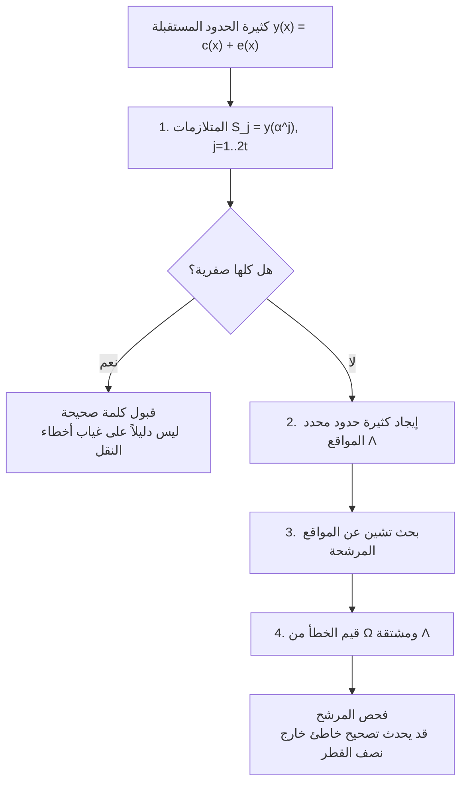
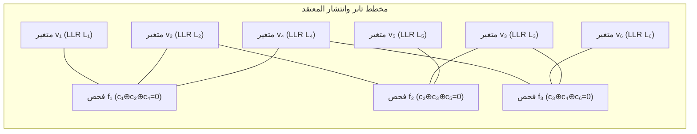
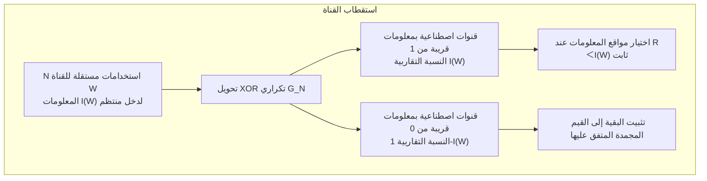

## 1. مقدمة: ما المشترك بين الاتصالات الفضائية ورموز QR؟

كيف نستعيد البيانات من إشارة فضائية ضعيفة أو رمز QR تالف جزئياً؟ تضيف <strong>أكواد تصحيح الأخطاء (ECC)</strong> تكراراً بنيوياً محسوباً إلى البيانات. يستخدم المستقبل هذه العلاقات لتقدير القيم المتغيرة وتصحيحها. الحماية محدودة: لا يمكن لكمية منتهية من هذا التكرار أن تصلح كل تلف متصور.

### الاتصالات الفضائية: استقبال الإشارة وتصحيح الأخطاء المتبقية

أُطلق فوياجر 1 وفوياجر 2 عام 1977 وزارا المشتري وزحل؛ ثم تابع فوياجر 2 إلى أورانوس ونبتون. لم يزر كل مسبار الكواكب الأربعة. نستخدم هنا اتصالات اللقاءات الكوكبية مثالاً، ولا نحول المسافات الحالية والقدرات المستقبلة المتغيرة إلى ثوابت دائمة.

يركز الهوائي عالي الكسب على المسبار طاقة الراديو باتجاه الأرض، حيث تستقبلها شبكة الفضاء العميق (DSN). قد يترك التوهين والضجيج الحراري أخطاء بعد إزالة التضمين. ومن تحويل الوحدات $10^{-16}\,\mathrm W=100\,\mathrm{aW}$، أي 100 أتواط. هذا ليس قياساً لتاريخ ومحطة محددين.

يصف تقرير JPL المعد للقاء فوياجر 2 بأورانوس كوداً تلافيفياً داخلياً وكود ريد–سولومون (RS) خارجياً $[255,223]$. تقلل المراحل أثر الضجيج، لكنها لا تضمن خلو كل كتلة مستقبلة أو كل بكسل من الأخطاء دائماً.

### QR: نسبة الاستعادة ليست مساحة يمكن تغطيتها اعتباطياً

تستخدم رموز QR أيضاً RS. تذكر DENSO WAVE مستويات استعادة تقريبية 7% و15% و25% و30%، محسوبة بوحدة <strong>الكلمات الكودية ذات 8 بتات</strong>. لا يعني ذلك أن الشعار يستطيع تغطية أي 30% من الصورة. تهم الأنماط الوظيفية وتوزيع الضرر بين كتل RS وظروف التصوير. ولا يوجد ضمان عام بعشر ميلي ثوان.

الكلمة الكودية ذات 8 بتات في مصطلحات QR تقابل رمزاً واحداً في الوصف الرياضي لـRS هنا. ليست الكلمة RS الكاملة ذات $n$ رموز. يزيل الفصل بين المستويين الالتباس في قدرة كل كتلة على التصحيح.

```mermaid
flowchart TD
    subgraph Voyager["مثال الترميز المتسلسل في فوياجر 2"]
        V1["بيانات المعلومات"] --> V2["RS خارجي → تشذير → كود تلافيفي داخلي"]
        V2 --> V3["إرسال موجه واستقبال DSN"]
        V3 --> V4["إشارة مستقبلة مع ضجيج حراري"]
        V4 --> V5["فيتربي بقرارات لينة → عكس التشذير → RS"]
        V5 --> V6["استعادة ضمن شروط التصحيح"]
    end
    subgraph QR["رمز QR"]
        Q1["رابط ونص وبيانات مفيدة أخرى"] --> Q2["RS على GF(256) وترتيب مكاني"]
        Q2 --> Q3["تلف أو مناطق مفقودة أو أخطاء تصوير"]
        Q3 --> Q4["تعرف الصورة واستخراج الكلمات وفك ترميز الكتل"]
        Q4 --> Q5["تقدير مواقع الأخطاء وقيمها"]
        Q5 --> Q6["استعادة البيانات إذا تحققت الشروط"]
    end
```



سنربط سعة القناة ومسافة هامينغ وكثيرات الحدود على الحقول المنتهية والحساب الاحتمالي على الرسوم البيانية. <strong>تصحيح جميع الأنماط حتى عدد معين من الأخطاء</strong> يختلف عن <strong>جعل احتمال الخطأ صغيراً كيفما نشاء مع ازدياد طول الكتلة</strong>.

---

## 2. مبرهنة شانون لترميز القناة وافتراضاتها

### 2.1 التكرار: موثوقية أعلى مقابل معدل أقل

يمكن لتكرار البت ثم قرار الأغلبية تقليل الأخطاء. لكن هذه البنية وحدها تتطلب استخدامات أكثر للقناة لكل بت معلومات لزيادة الموثوقية. هذا قيد على كود التكرار، لا على جميع الأكواد.

لنأخذ قناة ثنائية متماثلة عديمة الذاكرة (BSC)، بانقلابات مستقلة للبت واحتمال $0<p<1/2$. يحول كود تكرار بطول ثلاثة البت إلى:

$$
0 \mapsto 000, \qquad 1 \mapsto 111
$$

عند إرسال <bdi dir="ltr">`000`</bdi>، يؤدي استقبال <bdi dir="ltr">`011`</bdi> أو <bdi dir="ltr">`101`</bdi> أو <bdi dir="ltr">`110`</bdi> أو <bdi dir="ltr">`111`</bdi> إلى قرار خاطئ بأنه 1. يجب أن ينقلب بتان أو ثلاثة:

$$
P_e^{(3)} = \binom{3}{2} p^2 (1-p) + \binom{3}{3} p^3 = 3p^2(1-p) + p^3
$$

عند $p=0.01$ تكون النتيجة $0.000298$، أي نحو $0.03\%$. في المقابل يصبح معدل الكود:

$$
R = \frac{k}{n} = \frac{1}{3}
$$

للطول الفردي $n=2t+1$ تفشل الأغلبية عند انقلاب $t+1$ بتاً على الأقل:

$$
P_e^{(n)} = \sum_{i = (n+1)/2}^{n} \binom{n}{i} p^i (1-p)^{n-i}
$$

يسمح قانون الأعداد الكبيرة للاحتمال بالاقتراب من الصفر، لكن في الوقت نفسه:

$$
n \to \infty \implies P_e^{(n)} \to 0 \quad \text{لكن في الوقت نفسه} \quad R = \frac{1}{n} \to 0
$$

مثلاً، في الطول خمسة نستخدم $0\mapsto00000$ و$1\mapsto11111$ بمعدل $1/5$. لا يستبعد هذا الحساب أكواداً أكفأ تجمع عدة بتات معلومات في كتلة.

### 2.2 السعة ومبرهنة الترميز للقناة المشوشة

أظهر عمل شانون عام 1948 إمكان الحفاظ على معدل موجب ثابت في قناة مشوشة مع جعل احتمال الخطأ صغيراً كيفما نشاء.

> <strong>مبرهنة لقناة متقطعة عديمة الذاكرة بأبجديات منتهية:</strong> عند إعطاء قانون الانتقال $W(y\mid x)$ تكون السعة $C=\max_{P(X)}I(X;Y)\ge0$، بوحدة بت لكل استخدام للقناة. لكل معدل ثابت $0<R<C$ توجد متتالية من أكواد كتلية تزداد أطوالها وقواعد لفك الترميز يقترب احتمال خطأ الكتلة فيها من الصفر. عند $R>C$ لا يمكن تحقيق هذا التقارب.

ليس ضرورياً أن تكون السعة موجبة. إذا كان الخرج مستقلاً عن الدخل فالسعة $C=0$. عند تقييد تكلفة الدخل أو القدرة المتوسطة يجب إجراء التعظيم ضمن القيود. لا تكفي إحصائية واحدة لشدة الضجيج لتحديد سعة أي قناة.

هذه نتيجة وجود تقاربية عند ازدياد طول الكتلة إلى ما لا نهاية. لا تعد بأن كوداً بطول منته يصلح كل ضجيج ممكن، ولا تعطي تلقائياً فاك ترميز كفؤاً. يبقى التأخير والحساب المتاح واحتمال الخطأ المستهدف شروطاً للتصميم.

### 2.3 اشتقاق سعة BSC

للقناة المتقطعة عديمة الذاكرة:

$$
C = \max_{P(X)} I(X; Y) = \max_{P(X)} \bigl( H(Y) - H(Y \mid X) \bigr)
$$

نكتب خرج BSC على الصورة $Y=X\oplus E$، حيث بت الضجيج $E$ مستقل عن $X$ ويساوي واحداً باحتمال $p$. بعد معرفة الدخل تبقى الإنتروبيا الثنائية:

$$
H(Y \mid X) = H_2(p) \triangleq -p \log_2 p - (1-p) \log_2(1-p)
$$

الخرج ثنائي، لذلك $H(Y)\le1$ بت. يولد الدخل المنتظم خرجاً منتظماً ويحقق $H(Y)=1$، ومنه:

$$
C_{\text{BSC}}(p) = 1 - H_2(p) = 1 + p\log_2 p + (1-p)\log_2(1-p) \quad [\text{بت / استخدام للقناة}]
$$

مثلاً:

$$
H_2(0.1) = -0.1 \log_2(0.1) - 0.9 \log_2(0.9) \approx 0.4690\text{ بت}
$$

$$
C_{\text{BSC}}(0.1) = 1 - 0.4690 = 0.5310\text{ بت / استخدام للقناة}
$$

إذن يسمح معدل ثابت أدنى مثل $R=0.5$ باحتمال خطأ صغير كيفما نشاء بأكواد مناسبة وطويلة بما يكفي. ليس ضماناً لخطأ صفري بطول منته ومعدل يساوي السعة تماماً. يستخدم برهان الترميز العشوائي سلوك الضجيج النموذجي في الكتل الطويلة وإمكان تمييز الكلمات الكودية.

### 2.4 AWGN وحد النطاق العريض $-1.59\,\text{dB}$

يصف نموذج الضجيج الغاوسي الأبيض المضاف (AWGN) أشكال موجات مستمرة، لا انقلابات بتات مستقلة حرفياً. لتكن $B$ عرض النطاق بالهرتز، و$S$ القدرة المستقبلة المتوسطة بالواط، و$N_0$ الكثافة الطيفية أحادية الجانب لقدرة الضجيج بالواط/هرتز. قدرة الضجيج داخل النطاق هي $N=N_0B$. تحت قيد القدرة المتوسطة، ومن دون فرض دخل ثنائي إضافي، تعطي شانون–هارتلي:

$$
C_{\text{AWGN}} = B \log_2\!\left(1 + \frac{S}{N}\right) = B \log_2\!\left(1 + \frac{S}{N_0 B}\right) \quad [\text{بت / ثانية}]
$$

لتكن $E_b$ الطاقة المستقبلة لكل بت معلومات، وليكن $R$ الآن معدل المعلومات بالبت/ثانية، بحيث $S=E_bR$. تختلف هذه الوحدة عن البت لكل استخدام للقناة سابقاً. اشتراط $R<C_{\mathrm{AWGN}}$ يعطي:

$$
R < B \log_2\!\left(1 + \frac{E_b}{N_0} \frac{R}{B}\right)
$$

مع الكفاءة الطيفية $\eta=R/B$ بوحدة بت/ثانية/هرتز:

$$
\eta < \log_2\!\left(1 + \eta \frac{E_b}{N_0}\right) \iff 2^\eta - 1 < \eta \frac{E_b}{N_0} \iff \frac{E_b}{N_0} > \frac{2^\eta - 1}{\eta}
$$

في النموذج المثالي نأخذ $\eta\to0$ ونستخدم $2^\eta=1+\eta\ln2+O(\eta^2)$:

$$
\lim_{\eta \to 0} \frac{2^\eta - 1}{\eta} = \ln 2 \approx 0.693147
$$

بالديسيبل:

$$
\left(\frac{E_b}{N_0}\right)_{\min} = \ln 2 \approx 0.6931 \implies 10 \log_{10}(\ln 2) \approx \mathbf{-1.5917\,\text{dB}}
$$

هذا <strong>حد سفلي أعظم، أي إنفيمم، في نهاية النطاق العريض</strong>. عند كفاءة طيفية موجبة يلزم $(2^\eta-1)/\eta>\ln2$. والنسبة $E_b/N_0$ ليست نسبة القدرتين $S/N$ بين الإشارة وكل ضجيج النطاق. قد تخلط عبارة «إشارة تحت الضجيج» التعريفين.

للاقتراب من السعة تكلفة في طول الكتلة والتأخير أيضاً. النتيجة التقاربية لنموذج محدد ليست ثابتاً لكل القنوات الفيزيائية أو وعداً باتصال منته بلا أخطاء. مثلاً، تقييد الدخل بقيمتين يغير السعة المعنية.

---

## 3. مسافة هامينغ والضمانات وكود $[7,4,3]$

### 3.1 من الوجود إلى بناء قابل للحساب

لاستخدام مبرهنة وجود نحتاج خوارزميات للترميز وفكه. يعطي عمل هامينغ عام 1950 مثالاً ملموساً: إضافة فحوص تكافؤ وتحديد البت المنقلب من الفحوص المخالفة. نبني الكود عبر المسافة والمصفوفات.

### 3.2 المسافة والمسافة الدنيا

تشكل السلاسل الثنائية بطول $n$ الفضاء $\mathbb F_2^n$، رؤوس مكعب فائق ذي $n$ أبعاد. الجمع والطرح في $\mathbb F_2$ هما XOR. تعد مسافة هامينغ الإحداثيات المختلفة:

$$
d_H(\mathbf{u}, \mathbf{v}) \triangleq \bigl|\{ i \in \{1, \dots, n\} \mid u_i \neq v_i \}\bigr| = w_H(\mathbf{u} - \mathbf{v})
$$

تعد $w_H$ المداخل غير الصفرية، أي وزن هامينغ. تحقق المسافة عدم السلبية والتناظر ومتباينة المثلث. الكود مجموعة جزئية $\mathcal C$ من الكلمات المسموحة. للكود الخطي الثنائي ذي البعد $k$ عدد $2^k$ من الكلمات. مسافته الدنيا:

$$
d_{\min}(\mathcal{C}) \triangleq \min_{\substack{\mathbf{u}, \mathbf{v} \in \mathcal{C} \\ \mathbf{u} \neq \mathbf{v}}} d_H(\mathbf{u}, \mathbf{v})
$$

في الكود الخطي، فرق كلمتين مختلفتين كلمة كودية غير صفرية أيضاً، لذلك:

$$
d_{\min}(\mathcal{C}) = \min_{\mathbf{c} \in \mathcal{C} \setminus \{\mathbf{0}\}} w_H(\mathbf{c})
$$

### 3.3 الكشف والمحو وأخطاء الموقع المجهول

1. <strong>الكشف:</strong> تغيير إحداثي واحد إلى $d_{\min}-1$ إحداثياً لا يحول كلمة صحيحة إلى أخرى صحيحة. فحص الانتماء إلى الكود يكشف جميع هذه الأنماط غير الصفرية.
2. <strong>المحو:</strong> المواقع المفقودة معروفة، لكن قيمها ليست معروفة. إذا كان العدد لا يتجاوز $e\le d_{\min}-1$، تظل كلمتان مختلفتان مختلفتين في إحداثي محفوظ. بافتراض صحة القيم الباقية تتحدد الكلمة المرسلة وحيداً.
3. <strong>أخطاء الموقع المجهول:</strong> يصحح فك الترميز إلى أقرب كلمة جميع أنماط حتى $t$ أخطاء إذا وفقط إذا كانت كرات هامينغ بنصف قطر $t$ حول الكلمات المختلفة غير متقاطعة.

لو انتمت كلمة مستقبلة إلى كرتين، لأعطت متباينة المثلث مسافة بين المركزين لا تتجاوز $2t$. والعكس: لمركزين تبعد بينهما مسافة لا تتجاوز $2t$ يمكن توزيع الإحداثيات المختلفة بين الاختيارين لبناء كلمة تبعد عن كليهما بمقدار لا يتجاوز $t$. إذن:

$$
2t + 1 \le d_{\min} \iff t \le \left\lfloor \frac{d_{\min} - 1}{2} \right\rfloor
$$

تحدد المساواة $t=\lfloor(d_{\min}-1)/2\rfloor$ <strong>أكبر نصف قطر مضمون</strong>، لا كل نصف قطر أصغر مسموح. مع حتى $t$ أخطاء مجهولة و$e$ حالات محو معروفة يكون ضمان جميع الأنماط:

$$
\mathbf{d_{\min} \ge 2t + e + 1}
$$

حذف الإحداثيات الممحوة يبقي مسافة دنيا لا تقل عن $d_{\min}-e$؛ نطبق حجة الكرات غير المتقاطعة على الباقي. قد تصلح بعض الحالات خارج الحد، لكن لا يعود النجاح مضموناً لكل توزيع. «الموقع مجهول» لا يفرض توزيعاً عشوائياً للأخطاء.

تحتوي كرة نصف قطرها $t$ في فضاء أبجديته بحجم $q$ على $\sum_{i=0}^t\binom ni(q-1)^i$ كلمة. يجب أن تتسع المساحة لكل الكرات غير المتقاطعة:

$$
|\mathcal{C}| \cdot \sum_{i=0}^{t} \binom{n}{i} (q-1)^i \le q^n \quad \left(\text{للكود الثنائي: } 2^k \sum_{i=0}^{t} \binom{n}{i} \le 2^n \right)
$$

الكود الذي يحقق المساواة <strong>تام</strong>: تغطي الكرات الفضاء دون فراغات أو تداخل. من الأمثلة هامينغ وغولاي الثنائي $[23,12,7]$ والثلاثي $[11,6,5]$. تتطلب التصنيفات افتراضاتها؛ وتوجد أكواد تامة غير خطية أيضاً. لا تثبت هذه الأمثلة أي كود غولاي استخدمته بعثة معينة.

### 3.4 مصفوفات هامينغ والمتلازمة

يضيف كود $[7,4,3]$ ثلاثة بتات تكافؤ إلى أربعة بتات معلومات:

$$
2^4 \sum_{i=0}^{1} \binom{7}{i} = 16 \times (1 + 7) = 16 \times 8 = 128 = 2^7
$$

تغطي 16 كرة بنصف قطر واحد الكلمات الـ128، ولكل كرة مركز وسبعة جيران.

بناء مناسب لمصفوفة فحص التكافؤ يضع التمثيل الثنائي لـ$j$ في العمود $j$:

$$
\mathbf{H}_{\text{binary}} = \begin{pmatrix} 0 & 0 & 0 & 1 & 1 & 1 & 1 \\ 0 & 1 & 1 & 0 & 0 & 1 & 1 \\ 1 & 0 & 1 & 0 & 1 & 0 & 1 \end{pmatrix} \begin{matrix} \leftarrow 2^2\text{ خانة} \\ \leftarrow 2^1\text{ خانة} \\ \leftarrow 2^0\text{ خانة} \end{matrix}
$$

عمودها الخامس $(1,0,1)^T$. لحفظ بتات الرسالة الأربعة في البداية وإضافة التكافؤ في النهاية نستخدم الشكل النظامي $\mathbf G=[\mathbf I_4\mid\mathbf P]$ و$\mathbf H=[\mathbf P^T\mid\mathbf I_3]$:

$$
\mathbf{G}_{4\times 7} = \left(\begin{array}{cccc|ccc} 1 & 0 & 0 & 0 & 1 & 1 & 0 \\ 0 & 1 & 0 & 0 & 1 & 0 & 1 \\ 0 & 0 & 1 & 0 & 0 & 1 & 1 \\ 0 & 0 & 0 & 1 & 1 & 1 & 1 \end{array}\right), \qquad \mathbf{H}_{3\times 7} = \left(\begin{array}{cccc|ccc} 1 & 1 & 0 & 1 & 1 & 0 & 0 \\ 1 & 0 & 1 & 1 & 0 & 1 & 0 \\ 0 & 1 & 1 & 1 & 0 & 0 & 1 \end{array}\right)
$$

لأن $\mathbf G\mathbf H^T=0$ تحقق جميع الكلمات المرمزة:

$$
\mathbf{H}\mathbf{c}^T = \mathbf{0} \pmod 2
$$

عند استقبال $\mathbf y=\mathbf c+\mathbf e$ نحسب <strong>المتلازمة</strong>:

$$
\mathbf{s} = \mathbf{H}\mathbf{y}^T = \mathbf{H}(\mathbf{c} + \mathbf{e})^T = \underbrace{\mathbf{H}\mathbf{c}^T}_{=\mathbf{0}} + \mathbf{H}\mathbf{e}^T = \mathbf{H}\mathbf{e}^T \pmod 2
$$

تعتمد فقط على الخطأ. انقلاب البت $j$ يعطي العمود $j$ للمصفوفة المختارة. في ترتيب الأعمدة الثنائي تشير المتلازمة <bdi dir="ltr">`101`</bdi> إلى الموقع 5، لكن الشكل النظامي يملك ترتيباً آخر ويجب البحث عن العمود المطابق. قيمة المتلازمة العددية ليست دائماً موقع الخطأ. برنامج القسم 6 يجري هذا البحث.

المتلازمة الصفرية تعني الانتماء إلى الكود. تحت افتراض خطأ واحد على الأكثر تعني عدم وجود خطأ؛ خارجه قد تكون القناة بدلت كلمة صحيحة بأخرى صحيحة. وقد تدفع أخطاء متعددة فاك ترميز الخطأ الواحد إلى قلب بت كان صحيحاً.

مثلاً، ترمز الرسالة <bdi dir="ltr">`[1,0,1,1]`</bdi> إلى <bdi dir="ltr">`[1,0,1,1,0,1,0]`</bdi>. قلب الفهرس 2 بدءاً من الصفر، أي البت الثالث، يعطي المتلازمة <bdi dir="ltr">`[0,1,1]`</bdi> المطابقة لعمود الفهرس 2. حجم دارة ثابتة من سبعة بتات ثابت، لكن حساب المتلازمة لطول عام $n$ ليس دائماً $O(1)$.

إضافة بت تكافؤ إجمالي زوجي تعطي الكود الموسع $[8,4,4]$. تسمح قاعدة مناسبة بتصحيح بت واحد وكشف خطأ في بتين (SECDED). هذا نموذج أساسي لفهم ذاكرة ECC، لا البنية الدقيقة لكل منتج.

---

## 4. ريد–سولومون: الحقول المنتهية والاستيفاء وفك الترميز

### 4.1 أهمية دفعات الأخطاء

يصحح هامينغ $(7,4)$ بتاً واحداً في أي موقع داخل الكتلة. قد يغير خدش أو بقعة QR أو خفوت الإشارة بتات كثيرة في الكتلة نفسها. حتى انقلاب بتين قد يدفع فاك ترميز الخطأ الواحد إلى كلمة خاطئة.

يجمع بناء ريد وسولومون لعام 1960 البتات في <strong>رموز</strong> لحقل منته. تتغير وحدة قياس المسافة والتصحيح. ويحدد الترتيب المكاني والتشذير أيضاً كيف يؤثر الضرر الفيزيائي في الرموز.

### 4.2 البايت عنصر في حقل منته

يمكن تمثيل رمز من $m$ بتات في $\mathbb F_{2^m}$. ليس هذا حساب الأعداد الصحيحة بترديد 256: يوضح $2\cdot128\equiv0\pmod{256}$ قواسم الصفر، ولا تملك هذه العناصر غير الصفرية معكوساً ضربياً. توجد الحقول المنتهية بالضبط لأحجام هي قوى عدد أولي.

يمثل البايت في GF(256) كثيرة حدود بمعاملات ثنائية ودرجة لا تتجاوز سبعاً. يأخذ البرنامج باقي حاصل الضرب بترديد كثيرة الحدود غير القابلة للاختزال من الدرجة الثامنة التي يمثلها <bdi dir="ltr">`0x11D`</bdi>:

$$
\mathbb{F}_{2^8} \cong \frac{\mathbb{F}_2[x]}{\langle x^8 + x^4 + x^3 + x^2 + 1 \rangle}
$$

الجمع والطرح هما XOR لأن $1+1=0$ في حقل المعاملات. تشكل العناصر غير الصفرية الـ255 زمرة ضرب دورية. في هذا التمثيل $\alpha=x$، البايت <bdi dir="ltr">`0x02`</bdi>، عنصر بدائي: تمر القوى $\alpha^0,\ldots,\alpha^{254}$ بكل العناصر غير الصفرية و$\alpha^{255}=1$.

تسمح جداول اللوغاريتمات والأسس بضرب العناصر غير الصفرية وقسمتها:

$$
A \cdot B = \alpha^{(i + j) \bmod 255}, \qquad \frac{A}{B} = \alpha^{(i - j) \bmod 255}
$$

يحتاج الصفر معالجة منفصلة والقسمة على الصفر غير معرفة. طول الجداول تابع للتنفيذ؛ يمدد بعضها جدول الأسس لتجنب حساب الترديد صراحة. يستخدم القسم 6 الإزاحات وXOR.

تلف عدة بتات داخل بايت واحد يعد خطأ رمز واحد. تجاوز حدود البايت قد يصيب عدة رموز. عدد البتات المتغيرة وحده لا يحدد إمكان التصحيح.

### 4.3 حساب القيم والاستيفاء وحد سينغلتون

تحدد نقطتان بإحداثيين أفقيين مختلفين كثيرة حدود من الدرجة الأولى على الأكثر. إذا أرسلنا خمس قيم، تكفي أي قيمتين صحيحتين محفوظتين لإعادة البناء بعد ثلاث حالات محو. تحدد ثلاثة إحداثيات أفقية مختلفة كثيرة حدود من الدرجة الثانية على الأكثر.

نستخدم رموز الرسالة الـ$k$ معاملات:

$$
P(x) \triangleq m_0 + m_1 x + m_2 x^2 + \dots + m_{k-1} x^{k-1} \in \mathbb{F}_q[x]
$$

نختار $n$ نقاط مختلفة $\alpha_i\in\mathbb F_q$ مع $k\le n\le q$ ونرسل:

$$
\mathbf{c} = \bigl( P(\alpha_1),\; P(\alpha_2),\; \dots,\; P(\alpha_n) \bigr) \in \mathbb{F}_q^n
$$

من مبرهنة العامل، لا يتجاوز عدد جذور كثيرة حدود غير صفرية على حقل درجتها. فرق الرسالتين المختلفتين $P-Q$ درجته أقل من $k$ فينعدم عند $k-1$ نقاط على الأكثر. لذلك تختلف الكلمتان في $n-k+1$ إحداثياً على الأقل.

للحد المقابل، نحذف $d_{\min}-1$ إحداثياً من جميع الكلمات: يجب أن تبقى الإسقاطات مختلفة. لعدد $q^k$ من الكلمات يكون $q^k\le q^{n-d_{\min}+1}$، ومنه $d_{\min}\le n-k+1$. يحقق RS المساواة:

$$
\mathbf{d_{\min} = n - k + 1}
$$

هذه خاصية <strong>MDS: المسافة الدنيا العظمى عند ثبات المعلمات</strong>. تحسن المسافة لأبجدية وطول وبعد محددين، لا كل خصائص الهندسة معاً.

مع $r=n-k$ رموز زائدة يكون الضمان $2t+e\le r$:

- <strong>محو معلوم:</strong> يمكن فقد حتى $n-k$ رموز. تستعيد أي $k$ قيم صحيحة محفوظة الرسالة باستيفاء لاغرانج:

$$
P(x) = \sum_{j=1}^{k} y_{i_j} \prod_{\substack{m=1 \\ m \neq j}}^{k} \frac{x - x_{i_m}}{x_{i_j} - x_{i_m}}
$$

- <strong>أخطاء مجهولة:</strong> يمكن تصحيح حتى $\lfloor(n-k)/2\rfloor$ رموز تالفة مهما كان عدد البتات المتغيرة داخل كل رمز متأثر.

### 4.4 الشكل الدوري واصطلاحات صيغة فورني

يعامل شكل حساب القيم الرسالة معاملات ويرسل قيم كثيرة الحدود. في الوصف الدوري تكون إحداثيات الكلمة معاملات كثيرة حدود أخرى تقبل القسمة على مولد. يملك كود الطول الكامل $n=q-1$ على جميع النقاط غير الصفرية تمثيلاً دورياً مكافئاً بعد تثبيت المطابقة. ليس ضرورياً أن يبقى الكود المقصر دورياً في طوله الجديد.

نثبت الزيادة $n-k=2t$ وأول جذر للمولد $\alpha^1$. هذه اصطلاحات الاشتقاق هنا، لا جميع صيغ QR أو الفضاء:

$$
g(x)=\prod_{j=1}^{2t}(x-\alpha^j)
$$

مع الباقي $r(x)=x^{2t}m(x)\bmod g(x)$ نزيح الرسالة ونطرح الباقي:

$$
c(x)=x^{2t}m(x)-r(x),\qquad c(\alpha^j)=0\quad(1\le j\le2t)
$$

في حقل ذي مميزة 2 يبقى الطرح XOR.



1. <strong>المتلازمات:</strong> لتكن $\nu\le t$ أخطاء في المواقع $i_l$ بقيم غير صفرية $Y_l=e_{i_l}$. نعرف $X_l=\alpha^{i_l}$. حساب القيم عند الجذور يزيل الكلمة المرسلة:

$$
S_j=y(\alpha^j)=e(\alpha^j)=\sum_{l=1}^{\nu}Y_lX_l^j,\qquad j=1,\ldots,2t
$$

المتلازمة الصفرية تثبت الانتماء إلى الكود فقط، ولا تكشف تبديل كلمة صحيحة بأخرى.

2. <strong>كثيرة حدود محدد المواقع:</strong>

$$
\Lambda(z)=\prod_{l=1}^{\nu}(1-X_lz)=1+\Lambda_1z+\cdots+\Lambda_\nu z^\nu
$$

بضرب $\Lambda(X_l^{-1})=0$ في $Y_lX_l^{j+\nu}$ والجمع نحصل على علاقة عودية خطية:

$$
S_{j+\nu}+\Lambda_1S_{j+\nu-1}+\cdots+\Lambda_\nu S_j=0,\qquad1\le j\le2t-\nu
$$

تجد بيرليكامب–ماسي علاقة عودية دنيا ومرشحاً، عادة في $O(t^2)$ عملية حقل. ويمكن لطريقة إقليدس الموسعة حل المعادلة الأساسية أيضاً.

3. <strong>بحث تشين:</strong> نفحص العناصر غير الصفرية $\alpha^{-i}$ المقابلة للإحداثيات بحثاً عن $\Lambda(\alpha^{-i})=0$. يحوي GF(256) إجمالاً 256 عنصراً، 255 منها غير صفرية. يجب فحص شروط منها تطابق درجة محدد المواقع مع عدد الجذور المسموحة.

4. <strong>قيم الأخطاء:</strong> نعرف صراحة كثيرة حدود المتلازمات وكثيرة حدود تقييم الخطأ:

$$
S(z)=S_1+S_2z+\cdots+S_{2t}z^{2t-1},\qquad \Omega(z)=S(z)\Lambda(z)\bmod z^{2t}
$$

بهذه التعريفات تعطي فورني:

$$
Y_l=-\frac{\Omega(X_l^{-1})}{\Lambda'(X_l^{-1})}
$$

لخطأ واحد $\Omega=YX$ و$\Lambda'=-X$ فتكون النتيجة $Y$. عامل $X$ إضافي يعطي $XY$. قد تغير اصطلاحات أخرى للجذر الأول أو كثيرة حدود المتلازمات العامل؛ لا ننقل الصيغة من دون تعريفاتها.

نطرح الأخطاء المقدرة ونفحص الانتماء إلى الكود والمسافة المصححة. ومع ذلك قد تمر كلمة مستقبلة قريبة من كلمة صحيحة أخرى بالفحص مع رسالة خاطئة. يمكن لـCRC أو إعادة الإرسال أو فحوص الطبقات الأعلى إضافة حماية؛ لا يكتشف كل تلف خارج نصف القطر المضمون بالضرورة.

### 4.5 QR والتخزين والترميز المتسلسل في فوياجر

- <strong>QR:</strong> تشير L/M/Q/H إلى استعادة تقريبية 7/15/25/30% من كلمات 8 بتات. لكل كتلة RS شروطها. يغير الإصدار والمستوى البيانات والزيادة وتقسيم الكتل؛ لا يترجمان إلى مساحة عشوائية. قد تمنع تغطية الأنماط الوظيفية التعرف أو استخراج الكلمات قبل RS.
- <strong>RAID-6 والتخزين الموزع:</strong> القرص أو الجزء المفقود في موقع معلوم محو. يستخدم مثال MDS $[14,10]$ مساحة تعادل $14/10=1.4$ من حجم البيانات ويتحمل فقد أربعة أجزاء إذا صحت البقية والبيانات الوصفية اللازمة. ليس تكويناً عاماً لكل مزودي السحابة. تستعيد ازدواجية التكافؤ في RAID-6 قرصين تحت افتراضاتها، لا أي تلف كامن إضافي أو فقد المنشأة كلها.
- <strong>فوياجر 2:</strong> يصف تقرير JPL لعام 1983 كوداً تلافيفياً بطول قيد (constraint length) $K=7$ ومعدل $1/2$، وتشذيراً بعمق 4، وRS خارجياً $[255,223]$. تضمن البايتات الزائدة الـ32 لكل كلمة RS الشرط $2t+e\le32$، أو 16 خطأ بايت دون محو. قد تمتد دفعة متصلة من 128 بتاً غير محاذية لحد البايت على 17 بايتاً. يوزع التشذير دفعات الخطأ المتبقية من الفاك الداخلي بين كلمات RS عدة. الكود الداخلي هنا تلافيفي.

---

## 5. LDPC والتوربو والقطبي: الموثوقية والسعة

### 5.1 المسافة لا تحل المسألة كلها

يجب أن يلبي الكود العملي احتمال الخطأ المستهدف والتأخير وطول الكتلة والحساب وتكلفة العتاد. تتطلب مقارنة جميع كلمات كود ثنائي بعده $k$ تعداد $2^k$ مرشحاً. المسافة الدنيا الجيدة لا تعطي تلقائياً فك ترميز كفؤاً.

يستخدم فك الترميز التكراري للتوربو وLDPC معلومات الموثوقية؛ وتستخدم الأكواد القطبية بناء آخر للاقتراب من السعة المتماثلة. يجب تثبيت القناة وقيود الدخل والمعدل في المقارنة. لا تكفي مقارنة الجميع بحد النطاق العريض $-1.59\,\text{dB}$.

### 5.2 فحوص متناثرة وانتشار المعتقد

تستخدم أكواد غالاغر LDPC لعام 1962 مصفوفة فحص متناثرة. حتى للكتل الطويلة قد يحوي كل صف وعمود قليلاً من العناصر غير الصفرية. لمصفوفة $\mathbf H$ بحجم $m\times n$ يكون البعد $k=n-\operatorname{rank}_{\mathbb F_2}(\mathbf H)$، حيث rank رتبة المصفوفة. لا يساوي $n-m$ إلا إذا استقلت الصفوف.

في مخطط تانر تقابل عقد المتغيرات الأعمدة والبتات، وتقابل عقد الفحص الصفوف ومعادلات التكافؤ. توجد حافة بالضبط حين $H_{a,i}=1$:



يحفظ القرار اللين الموثوقية بدلاً من تحويل المشاهدة فوراً إلى صفر أو واحد. يمكن كتابة نسبة الترجيح اللوغاريتمية (LLR):

$$
L(c_i) \triangleq \ln \frac{\Pr(c_i = 0 \mid y_i)}{\Pr(c_i = 1 \mid y_i)}
$$

لدخلين متساويي الاحتمال، وBPSK بمطال إشارة يساوي 1 $0\mapsto+1$ و$1\mapsto-1$، وضجيج مستقل $Z\sim\mathcal N(0,\sigma^2)$، ومشاهدة $y_i=x_i+Z$:

$$
L_{\mathrm{ch}}(c_i)=\ln\frac{p(y_i\mid c_i=0)}{p(y_i\mid c_i=1)}=\frac{2y_i}{\sigma^2}
$$

تتغير الصيغة بتغير مطال الإشارة أو الاحتمالات القبلية. تدعم LLR بقيمة $+10$ الصفر بقوة، وبقيمة $-0.1$ الواحد قليلاً.

خوارزمية المجموع–الجداء شكل من انتشار المعتقد. تتبادل رسائل خارجية مع استبعاد مساهمة الجار المستقبل:

$$
\mu_{f_a \to v_i} = 2 \operatorname{artanh}\!\left( \prod_{v_j \in N(f_a) \setminus \{v_i\}} \tanh\!\left(\frac{\mu_{v_j \to f_a}}{2}\right) \right)
$$

$$
\mu_{v_i \to f_a} = L_{\text{ch}}(v_i) + \sum_{f_b \in N(v_i) \setminus \{f_a\}} \mu_{f_b \to v_i}
$$

تشير $N$ إلى مجموعة الجيران المعنية. يحدد جدول التكرار أي دورة من الرسائل تستخدم، دون تغيير استبعاد المستقبل.

تقلل المصفوفة المتناثرة الحواف، لكنها لا تزيل الدورات القصيرة تلقائياً. على شجرة تحسب الخوارزمية الاحتمالات الهامشية الدقيقة. في رسوم منتهية ذات دورات قد تترك التبعيات أو مجموعات الاحتجاز أو غياب التقارب أخطاء.

مع $E$ حواف يستخدم تنفيذ يشارك الحسابات بين الجيران نحو $O(E)$ عملية في الدورة، أو $O(IE)$ في $I$ دورات. قد تعطي درجات العقد المحدودة $E=O(n)$، لكنها لا تضمن عدداً ثابتاً للدورات. يجب معالجة تشبع LLR ومجال $\operatorname{artanh}$ عددياً.

تخص نتيجة Chung وزملائه لعام 2001 <strong>معدل $1/2$ لقناة AWGN ذات دخل ثنائي</strong>. تبعد العتبة التقاربية المحسوبة بتطور الكثافة $0.0045\,\text{dB}$ عن حد سعة تلك القناة. وتعطي محاكاة منتهية منفصلة لتصميم أبسط بطول $10^7$ ومعدل خطأ بت BER يساوي $10^{-6}$ فجوة $0.04\,\text{dB}$. ليست هذه خصائص عامة لكل الأجهزة أو إنفيمم الطاقة في النطاق العريض.

### 5.3 الأكواد القطبية والسعة المتماثلة

يقترب بناء أريكان لعام 2009 من $I(W)$، أي <strong>السعة المتماثلة</strong> لقناة متقطعة عديمة الذاكرة ذات دخل ثنائي: المعلومات المتبادلة مع دخل منتظم. تساوي $C$ للقنوات المتماثلة، لكن ليس بالضرورة أقصى قيمة على جميع توزيعات الدخل لقناة غير متماثلة.

التحويل الأساسي:

$$
(x_1,x_2)=(u_1,u_2)\begin{pmatrix}1&0\\1&1\end{pmatrix} =(u_1\oplus u_2,u_2)
$$

تقدر القناة الاصطناعية $W^-$ قيمة $u_1$ من $(y_1,y_2)$؛ وتقدر $W^+$ قيمة $u_2$ من $(y_1,y_2,u_1)$ عند إعطاء $u_1$ الصحيح. مع مدخلين مستقلين منتظمين تعطي قاعدة السلسلة:

$$
I(W^-)+I(W^+)=2I(W),\qquad I(W^-)\le I(W)\le I(W^+)
$$

«أفضل» و«أسوأ» هنا من حيث المعلومات؛ لا يشترط تغير صارم في كل الحالات. في فك الترميز المتتابع الفعلي قد ينتشر خطأ سابق إلى القرارات التالية.

عند $N=2^m$ يستخدم أحد الاصطلاحات التبديل $\mathbf B_N$ الذي يعكس ترتيب الأرقام الثنائية للفهرس، ومصفوفة التوليد:

$$
\mathbf G_N=\mathbf B_N \begin{pmatrix}1&0\\1&1\end{pmatrix}^{\otimes m}
$$

لكل $0<\delta<1$ ثابت، عندما $N\to\infty$ تقترب نسبة القنوات الاصطناعية ذات المعلومات الأكبر من $1-\delta$ من $I(W)$؛ ونسبة ذات المعلومات الأقل من $\delta$ من $1-I(W)$. في طول منته لا نحصل على $NI(W)$ قناة عديمة الضجيج تماماً بالضبط.



نختار مواقع المعلومات بمعدل ثابت $R<I(W)$ ونجمد البقية عند قيم متفق عليها. تستخدم الضمانة الأصلية للقناة العامة المتوسط على القيم المجمدة ووجود اختيار مناسب. في القناة المتماثلة يسري الحد المعني لأي اختيار ثابت.

يحتاج الترميز وفك الترميز بـ<strong>الإلغاء المتتابع (SC)</strong> زمناً $O(N\log N)$. اختيار مجموعة المعلومات تكلفة بناء مستقلة. يحتاج تنفيذ كفؤ لـ<strong>الإلغاء المتتابع القائمي (SCL)</strong> بحجم قائمة $L$ زمناً $O(LN\log N)$؛ وقد يساعد CRC في اختيار مرشح. تعتمد أخطاء الأطوال المنتهية والتأخير على البناء والمعدل وحجم القائمة والقناة. لا يوجد ضمان عام بغياب أرضية الخطأ (error floor).

### 5.4 مقارنة العائلات

| الكود | البنية الرياضية | فك الترميز الممثل | الخصائص والاستخدام |
| :--- | :--- | :--- | :--- |
| هامينغ (1950) | خطي ثنائي؛ $[7,4,3]$ تام | متلازمة وبحث عمود | تصحيح بت واحد؛ نموذج أساسي لـSECDED |
| ريد–سولومون (1960) | كثيرات حدود حقل منته؛ MDS | بيرليكامب–ماسي/إقليدس وتشين وفورني؛ Welch–Berlekamp بشكل القيم | أخطاء رموز ومحو؛ QR وتخزين وتليمتري متسلسل |
| تلافيفي وتوربو | شبكات trellis وتسلسل وتشذير | فيتربي؛ BCJR تكراري | اتصال مشوش؛ كود فوياجر الداخلي تلافيفي |
| LDPC (1962) | مصفوفة متناثرة ومخطط تانر | انتشار المعتقد بقرارات لينة | كتل طويلة وتواز؛ اقتراب من السعة لنماذج محددة |
| قطبي (2009) | استقطاب تكراري وبتات مجمدة | SC $O(N\log N)$؛ يعتمد SCL على $L$ | اقتراب تقاربي من السعة المتماثلة؛ بعض معلومات تحكم 5G NR |

الجدول المشترك لا يعني تعقيداً أو خطأ متماثلين. ولا ترمز كل معلومات التحكم في 5G بأكواد قطبية. مثلاً، تميز 3GPP TS 38.212 v19.3.0 في القسمين 6.3.1.2–6.3.1.3 معلومات التحكم الصاعدة (UCI) على PUCCH: حمولة $A\ge12$ بتاً بترميز قطبي، و$A\le11$ بترميز كتل قصيرة.

---

## 6. التحقق ببايثون: هامينغ وRS بحساب القيم على GF(256)

ينفذ برنامج Python 3 المستقل هامينغ $(7,4)$ النظامي و<strong>RS بحساب قيم كثيرة الحدود</strong> من القسم 4.3. رموز الرسالة معاملات، ولا تظهر عادة كما هي في بداية الكلمة الكودية. ليس فاك BM من القسم 4.4، ولا ينفذ مواضع الوحدات أو تقسيم كتل QR أو صيغته الدورية النظامية. ليس برنامجاً متوافقاً مباشرة مع QR أو مسبار.

الحقل GF(256) بكثيرة الحدود غير القابلة للاختزال <bdi dir="ltr">`0x11D`</bdi>. يختلف عن الحقل الأولي GF(257) لبواقي الأعداد الصحيحة بترديد 257. يمكن بناء أكواد قيم عليه أيضاً، لكن قد ينتج الرمز 256 الذي لا يتسع له بايت.

يستخدم الفاك نظاماً من نوع Welch–Berlekamp. للدرجات المرشحة $\nu=0,\ldots,t$ يبحث عن $E(x)$ من الدرجة $\nu$ ومعامله الرئيس 1، وعن $Q(x)$ بدرجة أقل من $k+\nu$ بحيث:

$$
Q(x_i)=y_iE(x_i)\qquad(i=1,\ldots,n)
$$

عدد المعاملات المجهولة $k+2\nu$. في حقل ذي مميزة 2 يبقى نقل حد إلى الطرف الآخر XOR.

إذا كانت الرسالة الحقيقية $P$ والأخطاء لا تتجاوز $\nu$، نختار $E$ ينعدم عند نقاطها ونكمل الدرجة عند الحاجة، ونضع $Q=PE$. وبالعكس، عند $n\ge k+2\nu$ يكون $Q-PE$ لأي حل صفراً عند $n-\nu$ نقاط صحيحة على الأقل، ودرجته أقل من $k+\nu$. يجب أن يكون كثيرة الحدود الصفرية. تبرر حجة عدد الجذور الاستعادة.

نجرب الدرجات من صفر إلى $t$ ونعالج الأنظمة المستطيلة ونقص الرتبة. نقسم $Q$ على $E$ ونشترط باقي الصفر ودرجة خارج قسمة أقل من $k$، ثم نعيد الترميز ونفحص مسافة عن الكلمة المستقبلة لا تزيد على $t$. يعمل مع صفر أخطاء وأقل من $t$ وعند الحد. يجب اختلاف نقاط الحساب؛ يسمح من 1 إلى 256 عنصراً من الحقل بما فيها الصفر.

الأولوية للوضوح التعليمي، لا لفاك RS إنتاجي أو قياس سرعة. قد نحتاج حتى $t+1$ تطبيقات عامة للحذف الغاوسي. تفحص <bdi dir="ltr">`rs_encode`</bdi> و<bdi dir="ltr">`rs_decode`</bdi> القيم والأطوال والنقاط ونصف القطر؛ وتفترض الدوال المساعدة الداخلية لكثيرات الحدود والأنظمة صحة عناصر الحقل مسبقاً.

```python
"""Educational evaluation RS over GF(256), not a QR parser or wire format."""
from itertools import product


def field_value(a):
    if type(a) is not int or not 0 <= a < 256:
        raise ValueError("Field elements must be integers from 0 through 255")
    return a


def gf_mul(a, b):
    field_value(a)
    field_value(b)
    result = 0
    for _ in range(8):
        if b & 1:
            result ^= a
        b >>= 1
        a <<= 1
        if a & 256:
            a ^= 0x11D
    return result


def gf_pow(a, exponent):
    field_value(a)
    if type(exponent) is not int or exponent < 0:
        raise ValueError("Exponent must be a nonnegative integer")
    result = 1
    while exponent:
        if exponent & 1:
            result = gf_mul(result, a)
        a = gf_mul(a, a)
        exponent >>= 1
    return result


def gf_inv(a):
    field_value(a)
    if a == 0:
        raise ZeroDivisionError("Zero has no multiplicative inverse")
    return gf_pow(a, 254)


def poly_trim(coefficients):
    result = list(coefficients)
    while result and result[-1] == 0:
        result.pop()
    return result


def poly_eval(coefficients, x):
    result = 0
    for coefficient in reversed(coefficients):
        result = gf_mul(result, x) ^ coefficient
    return result


def poly_divmod(numerator, denominator):
    remainder = poly_trim(numerator)
    denominator = poly_trim(denominator)
    if not denominator:
        raise ZeroDivisionError("Zero polynomial divisor")
    quotient = [0] * max(0, len(remainder) - len(denominator) + 1)
    inverse_lead = gf_inv(denominator[-1])
    while remainder and len(remainder) >= len(denominator):
        degree = len(remainder) - len(denominator)
        factor = gf_mul(remainder[-1], inverse_lead)
        quotient[degree] = factor
        for j, coefficient in enumerate(denominator):
            remainder[degree + j] ^= gf_mul(factor, coefficient)
        remainder = poly_trim(remainder)
    return poly_trim(quotient), remainder


def solve_linear_system(rows, rhs, columns):
    """Return one solution (free variables zero), or None if inconsistent."""
    if len(rows) != len(rhs) or any(len(row) != columns for row in rows):
        raise ValueError("Linear-system dimensions do not match")
    matrix = [list(row) + [value] for row, value in zip(rows, rhs)]
    pivot_columns = []
    pivot_row = 0
    for column in range(columns):
        pivot = next(
            (r for r in range(pivot_row, len(matrix)) if matrix[r][column]),
            None,
        )
        if pivot is None:
            continue
        matrix[pivot_row], matrix[pivot] = matrix[pivot], matrix[pivot_row]
        inverse = gf_inv(matrix[pivot_row][column])
        matrix[pivot_row] = [gf_mul(value, inverse) for value in matrix[pivot_row]]
        for r in range(len(matrix)):
            if r != pivot_row and matrix[r][column]:
                factor = matrix[r][column]
                matrix[r] = [
                    a ^ gf_mul(factor, b)
                    for a, b in zip(matrix[r], matrix[pivot_row])
                ]
        pivot_columns.append(column)
        pivot_row += 1
        if pivot_row == len(matrix):
            break
    if any(not any(row[:columns]) and row[columns] for row in matrix):
        return None
    solution = [0] * columns
    for r, column in enumerate(pivot_columns):
        solution[column] = matrix[r][columns]
    return solution


def check_points(points):
    points = list(points)
    if not points or len(points) > 256:
        raise ValueError("Use from 1 through 256 distinct evaluation points")
    for x in points:
        field_value(x)
    if len(set(points)) != len(points):
        raise ValueError("Evaluation points must be distinct")
    return points


def rs_encode(message, points):
    points = check_points(points)
    message = list(message)
    if not 1 <= len(message) <= len(points):
        raise ValueError("Require 1 <= message length <= code length")
    for value in message:
        field_value(value)
    return [poly_eval(message, x) for x in points]


def rs_decode(received, points, k, max_errors):
    points = check_points(points)
    received = list(received)
    n = len(points)
    if len(received) != n:
        raise ValueError("Received length must match evaluation points")
    if type(k) is not int or not 1 <= k <= n:
        raise ValueError("Require integer 1 <= k <= n")
    if type(max_errors) is not int or max_errors < 0 or k + 2 * max_errors > n:
        raise ValueError("Require integer t >= 0 and k + 2t <= n")
    for value in received:
        field_value(value)
    # Try locator degrees 0,...,t: fewer than t errors must also work.
    for errors in range(max_errors + 1):
        columns = k + 2 * errors
        rows, rhs = [], []
        for x, y in zip(points, received):
            powers = [gf_pow(x, degree) for degree in range(k + errors)]
            rows.append(
                powers + [gf_mul(y, gf_pow(x, degree)) for degree in range(errors)]
            )
            rhs.append(gf_mul(y, gf_pow(x, errors)))
        solution = solve_linear_system(rows, rhs, columns)
        if solution is None:
            continue
        q = solution[:k + errors]
        locator = solution[k + errors:] + [1]
        message, remainder = poly_divmod(q, locator)
        if remainder or len(message) > k:
            continue
        message += [0] * (k - len(message))
        codeword = rs_encode(message, points)
        distance = sum(a != b for a, b in zip(codeword, received))
        if distance <= max_errors:
            return message
    raise ValueError("No codeword within the requested correction radius")


G = (
    (1, 0, 0, 0, 1, 1, 0),
    (0, 1, 0, 0, 1, 0, 1),
    (0, 0, 1, 0, 0, 1, 1),
    (0, 0, 0, 1, 1, 1, 1),
)
H = (
    (1, 1, 0, 1, 1, 0, 0),
    (1, 0, 1, 1, 0, 1, 0),
    (0, 1, 1, 1, 0, 0, 1),
)


def bits(values, length):
    values = list(values)
    if len(values) != length or any(type(v) is not int or v not in (0, 1) for v in values):
        raise ValueError("Invalid bit vector")
    return values


def hamming_encode(message):
    message = bits(message, 4)
    return [sum(message[i] * G[i][j] for i in range(4)) % 2 for j in range(7)]


def hamming_decode(received):
    received = bits(received, 7)
    syndrome = [sum(H[r][j] * received[j] for j in range(7)) % 2 for r in range(3)]
    if any(syndrome):
        position = next(j for j in range(7) if [H[r][j] for r in range(3)] == syndrome)
        received[position] ^= 1
    return received[:4]


if __name__ == "__main__":
    hamming_cases = 0
    for message in product((0, 1), repeat=4):
        codeword = hamming_encode(message)
        for position in range(-1, 7):
            received = codeword.copy()
            if position >= 0:
                received[position] ^= 1
            assert hamming_decode(received) == list(message)
            hamming_cases += 1
    print("Hamming no-error/single-error cases:", hamming_cases)

    payload = b"VOYAGER-1"
    points = list(range(1, 16))
    codeword = rs_encode(payload, points)
    print("GF(256) evaluation codeword:", codeword)
    for count in range(4):
        received = codeword.copy()
        for position in range(count):
            received[position] ^= position + 1
        recovered = bytes(rs_decode(received, points, len(payload), 3))
        print("RS corrupted symbols:", count, "recovered:", recovered.decode("ascii"))
        assert recovered == payload
    # A decoder can miscorrect beyond the transmitted word's guaranteed radius.
    # Construct a received word close to a DIFFERENT valid word.
    alternative = list(payload)
    alternative[0] ^= 1
    alternative_codeword = rs_encode(alternative, points)
    received = alternative_codeword.copy()
    received[0] ^= 1
    assert rs_decode(received, points, len(payload), 3) == alternative
    print("Beyond-radius example returns another nearby codeword:", True)
```

خرج التنفيذ الفعلي:

```text
Hamming no-error/single-error cases: 128
GF(256) evaluation codeword: [77, 162, 167, 64, 87, 173, 26, 217, 215, 33, 189, 173, 212, 41, 124]
RS corrupted symbols: 0 recovered: VOYAGER-1
RS corrupted symbols: 1 recovered: VOYAGER-1
RS corrupted symbols: 2 recovered: VOYAGER-1
RS corrupted symbols: 3 recovered: VOYAGER-1
Beyond-radius example returns another nearby codeword: True
```

تصبح تسعة بايتات 15 رمزاً بمسافة دنيا 7 ونصف قطر مضمون 3. ثلاثة من خمسة عشر تعني 20% لا 30%. يغير المثال من صفر إلى ثلاثة مواقع أولى؛ ويشمل ضمان العدد المواقع المتباعدة أيضاً.

خيار صحيح آخر هو الحساب في $\alpha^0,\ldots,\alpha^{14}$ وتغيير الفهارس <bdi dir="ltr">`[1,6,13]`</bdi> بدءاً من الصفر. يعالج الفاك ذلك أيضاً. اختيار البايتات <bdi dir="ltr">`1..15`</bdi> نقاطاً يعطي كلمة مختلفة. ثلاثة أخطاء بايت منفصلة ليست دفعة متصلة من 24 بتاً.

يبني المثال الأخير كلمة مستقبلة قرب <strong>كلمة كودية صحيحة أخرى</strong>. يعيد الفاك تلك الكلمة ويمر بفحص المسافة، لكنه لا يستعيد الرسالة المرسلة. لا يمكن دائماً كشف التلف خارج نصف القطر المضمون. وقد يصحح هامينغ إلى رسالة خاطئة عند خرق افتراض خطأ واحد على الأكثر.

تشمل الاختبارات المنتهية المستقلة للبرنامج التعليمي كل حواصل الضرب الـ65,536 في GF(256) وفهرساً كاملاً منفصلاً من 65,536 كلمة بطول 4 وبعد 2. لـ256 متجهاً مستقبلاً برموز مقصورة على 0–3، يطابق فك الترميز بنصف قطر 1 البحث الشامل في الفهرس الكامل. فُحصت أيضاً كل مواقع وقيم الخطأ الواحد غير الصفرية لثلاث رسائل منها الصفرية؛ وحالات ببذرة ثابتة لأطوال وأعداد أخطاء مختلفة؛ وأنظمة ناقصة الرتبة؛ ومدخلات غير صالحة. لا يعني هذا تشغيل كل المدخلات الممكنة أو توافق QR أو اختبار عتاد حقيقي.

---

## 7. الاختيار بين RS وLDPC والقطبي

يحسن MDS <strong>المسافة الدنيا لكل رمز عند طول وبعد ثابتين</strong>. لا يحسن في الوقت نفسه فك الترميز الاحتمالي والمعلومات اللينة والتأخير والدوائر.

1. <strong>حجم الحقل والطول:</strong> يحقق شكل القيم من القسم 4.3 الشرط $n\le q$. يسمح GF(256) مع الصفر بـ256 رمزاً؛ والشكل الدوري الكامل المعتاد على النقاط غير الصفرية طوله 255. توجد امتدادات وتسلسلات، لذا فقول «كل RS محدود مطلقاً بـ255 بايتاً» أعم مما يصح. للأكواد الثنائية الطويلة ذات الرسوم المتناثرة فوائد تصميم أخرى.
2. <strong>المعلومات اللينة:</strong> القرار المبكر بصفر أو واحد يهدر موثوقية يستطيع LDPC والقطبي استغلالها. المكسب ليس دائماً 2 ديسيبل؛ بل يتبع القناة والتضمين والمعدل والخطأ المستهدف. ولـRS أيضاً طرق بمعلومات لينة، فلا يقتصر على القرار الصلب.
3. <strong>خلايا التخزين:</strong> يخزن TLC ثلاثة بتات للخلية بتمييز 8 حالات، وQLC أربعة بتمييز 16 حالة. قد يسبب تداخل توزيعات الجهد والاحتفاظ والكتابة أخطاء. تضيف قراءات أخرى معلومات موثوقية، لكن لا تستخدم كل أقراص SSD الفاك نفسه أو تحقق معدلات خطأ خام أو غير قابل للتصحيح متطابقة. للقراءة تكلفة وقت وطاقة أيضاً.

يفيد RS في المحو المعلوم لأن أي $k$ رموز صحيحة محفوظة تكفي للاستعادة. تفيد الأكواد الطويلة ذات القرارات اللينة في الوصلات الفيزيائية المشوشة. يمكن جمع العائلات على طبقات مختلفة. تفسر مقارنة أخطاء QR وSSD و5G وقيودها التعايش أفضل من افتراض استبدال عام للقديم بالجديد.

---

## 8. الخلاصة: تكرار بنيوي بضمانات صريحة

يضيف التصحيح بنية ويستخدم افتراضات عن الضرر.

1. يضمن شانون احتمال خطأ صغيراً كيفما نشاء بأكواد يزداد طولها عند معدل ثابت دون السعة، لقناة وقيود دخل محددة. ليس موثوقية مطلقة بطول منته.
2. تضمن المسافة الدنيا كل الأنماط التي تحقق $2t+e<d_{\min}$ لـ$t$ أخطاء مجهولة و$e$ حالات محو. تجعل متلازمة هامينغ الضمان حساباً ملموساً.
3. يستخدم RS الجذور والاستيفاء على حقول منتهية لتحقيق $d_{\min}=n-k+1$. يجب تثبيت الاصطلاحات وحساب التصحيح الخاطئ خارج نصف القطر.
4. يستخدم LDPC رسوماً احتمالية متناثرة، والقطبي الاستقطاب. العتبات التقاربية والأداء المنتهي وكلفة SC/SCL جوانب مختلفة.

تتبع موثوقية QR أو الاتصال الفضائي التكرار البنيوي والوحدات وتوزيع الخطأ والفحوص واحتمال الفشل الباقي. لا تعني استعادة كل بيانات تالفة دون شروط.

المراجع:

- [DENSO WAVE: تصحيح أخطاء QR](https://www.qrcode.com/en/about/error_correction.html) — مستويات الاستعادة ووحدات الكلمات الكودية.
- [JPL: Voyager 2](https://www.jpl.nasa.gov/missions/voyager-2/) — المسار الكوكبي.
- [Lorden وMcEliece وSwanson: Node Synchronization for the Viterbi Decoder (1983)](https://tda.jpl.nasa.gov/progress_report/42-73/73C.PDF) — ص 22، التسلسل والتزامن العملي.
- [Forney: مقدمة في نظرية الترميز الجبرية، MIT 6.451، الفصل 8](https://ocw.mit.edu/courses/6-451-principles-of-digital-communication-ii-spring-2005/01060b08ba74792ee8d85eb82b9efdb4_chap8.pdf) — ص 101–110، المسافة وRS بالقيم واستعادة من نوع Welch–Berlekamp.
- [Chung وزملاؤه: On the Design of LDPC Codes within 0.0045 dB of the Shannon Limit (2001)](https://www.cse.lehigh.edu/~jingli/teach/S2003turbo/notes/zeroZeroFourFive.pdf) — ص 58، التمييز بين العتبة والمحاكاة المنتهية.
- [Arıkan: Channel Polarization (2009)](https://arxiv.org/abs/0807.3917) — السعة المتماثلة والترميز وSC؛ التعريفات والمبرهنات الأولى.
- [Tal وVardy: List Decoding of Polar Codes](https://arxiv.org/abs/1206.0050) — زمن وذاكرة SCL الكفؤ.
- [Östergård وPottonen: تصنيف الأكواد الثنائية التامة بطول 15](https://arxiv.org/abs/0806.2513) — ليست بناء خطياً وحيداً.
- [Elkies: The Theory of Error-Correcting Codes (2013)](https://people.math.harvard.edu/~elkies/M256.13/index.html) — محاضرات عن الأكواد التامة وغولاي.
- [ETSI TS 138 212 v19.3.0 (2026-04)](https://www.etsi.org/deliver/etsi_ts/138200_138299/138212/19.03.00_60/ts_138212v190300p.pdf) — القسمان 6.3.1.2–6.3.1.3، اختيار ترميز UCI.
