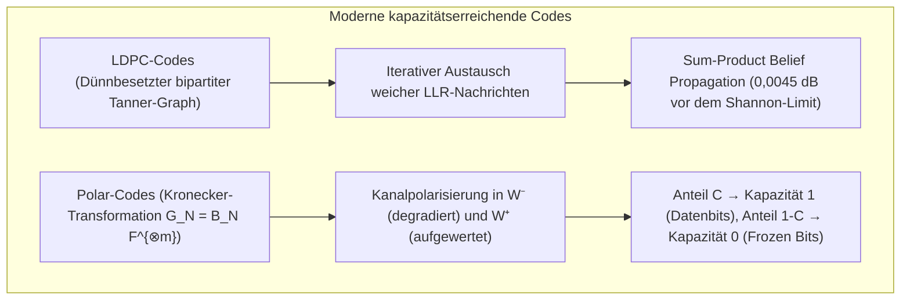

## 1. Einleitung: Zwei alltägliche und doch wundersame Meisterleistungen der Datenrekonstruktion

Sowohl in den Tiefen des interstellaren Raums als auch auf dem Display Ihres Smartphones vollbringt die moderne Informationstechnik täglich ein scheinbares physikalisches Wunder: <strong>die 100 % bitgenaue Wiederherstellung digitaler Informationen aus Signalen oder Datenträgern, die durch thermisches Rauschen, Kratzer oder physische Zerstörung massiv beschädigt wurden</strong>.

### Wunder 1: Voyager 1 & 2 senden aus 24 Milliarden Kilometern mit $10^{-16}\text{ Watt}$

Die 1977 gestarteten NASA-Raumsonden <strong>Voyager 1 und Voyager 2</strong> lieferten spektakuläre Nahaufnahmen von Jupiter, Saturn, Uranus und Neptun und befinden sich heute im interstellaren Raum in über <strong>24 Milliarden Kilometern</strong> Entfernung von der Erde.
Der Funksender an Bord von Voyager arbeitet mit einer Sendeleistung von lediglich <strong>$23\text{ Watt}$</strong> – weniger als die Glühbirne in einem Haushaltskühlschrank. Wenn diese elektromagnetische Welle nach Milliarden Kilometern die 70-Meter-Parabolantennen des NASA Deep Space Network (DSN) auf der Erde erreicht, ist die Empfangsleistung auf rund <strong>$10^{-16}\text{ Watt}$ ($0{,}1\text{ Attowatt}$)</strong> abgefallen.

Bei $10^{-16}\text{ Watt}$ versinkt das Signal tief im <strong>thermischen Rauschen (Johnson-Nyquist-Rauschen)</strong> der Empfängerelektronik. Würde Voyager uncodierte Bildbits ($0$ und $1$) senden, würden Tausende Bits pro Sekunde zufällig kippen ($0 \leftrightarrow 1$). Dennoch empfing die Erde gestochen scharfe Farbporträts des Großen Roten Flecks des Jupiters und der Neptun-Atmosphäre <strong>ohne unkorrigierbare Bitfehler</strong>.

### Wunder 2: Ein QR-Code, der zu $30\,\%$ durch einen Kaffeefleck oder ein Logo verdeckt ist

Betrachten wir nun das irdische Gegenstück: Sie richten Ihre Smartphone-Kamera auf einen <strong>QR-Code</strong>, dessen Ecke durch einen Kaffeefleck geschwärzt ist oder dessen <strong>Zentrum zu bis zu $30\,\%$ absichtlich durch ein Markenlogo überdeckt wurde</strong>. Innerhalb von weniger als <strong>$10\text{ Millisekunden}$</strong> berechnet Ihr Smartphone die exakte URL oder Zahlungsinformation mit <strong>null Bitfehlern (Zero Bit Errors)</strong>.


Wie ist das mathematisch möglich? Die Antwort liegt in <strong>Claude Shannons Informationstheorie (1948)</strong> und der Algebra <strong>fehlerkorrigierender Codes (Error-Correcting Codes, ECC)</strong>.

---

## 2. Claude Shannons Revolution von 1948 und das Kanalcodierungstheorem

### 2.1 Warum naive Wiederholungscodes ($0 \to 00000$) scheitern

Vor 1948 galt als unumstößliches Dogma: Um auf einem verrauschten Kanal die Fehlerwahrscheinlichkeit $P_e \to 0$ zu drücken, muss zwangsläufig auch die Übertragungsrate (Coderate) $R = k/n \to 0$ gegen null gehen.
Sendet man über einen <strong>binären symmetrischen Kanal (BSC)</strong> mit Bitfehlerwahrscheinlichkeit $p \in (0, 0{,}5)$ jedes Informationsbit ungerade $n = 2t + 1$ Mal (<strong>Repetition Code</strong>, $0 \mapsto 00\dots 0$, $1 \mapsto 11\dots 1$) und entscheidet per <strong>Mehrheitsentscheid (Majority Voting)</strong>, beträgt die Blockfehlerwahrscheinlichkeit:
$$P_e^{(n)} = \sum_{i = (n+1)/2}^{n} \binom{n}{i} p^i (1-p)^{n-i}$$
Zwar gilt für $n \to \infty$ nach dem Gesetz der großen Zahlen $P_e^{(n)} \to 0$, doch gleichzeitig kollabiert die Coderate $R = k/n = 1/n \to 0$.

### 2.2 Shannons Kanalcodierungstheorem und das Shannon-Limit ($-1{,}59\,\text{dB}$)

1948 bewies <strong>Claude E. Shannon</strong> in seiner Arbeit *"A Mathematical Theory of Communication"* das Gegenteil:

> <strong>Satz (Shannons Kanalcodierungstheorem, 1948):</strong>
> Jeder gedächtnislose verrauschte Kanal besitzt eine strikt positive <strong>Kanalkapazität $C$</strong>:
> - Für den <strong>binären symmetrischen Kanal (BSC)</strong> mit Übergangswahrscheinlichkeit $p$ und binärer Entropiefunktion $H_2(p) = -p\log_2 p - (1-p)\log_2(1-p)$ gilt:
>   $$C_{\text{BSC}}(p) = 1 - H_2(p) = 1 + p\log_2 p + (1-p)\log_2(1-p) \quad [\text{Bits / Kanalnutzung}]$$
> - Für den <strong>AWGN-Kanal</strong> (Bandbreite $B$, Signalleistung $S$, Rauschleistung $N = N_0 B$) gilt nach dem <strong>Shannon-Hartley-Gesetz</strong>:
>   $$C_{\text{AWGN}} = B \log_2\!\left(1 + \frac{S}{N}\right) = B \log_2\!\left(1 + \frac{S}{N_0 B}\right) \quad [\text{Bits / s}]$$
>
> <strong>Für jede beliebige Übertragungsrate $R < C$ existieren Blockcodes der Länge $n \to \infty$, deren Dekodierfehlerwahrscheinlichkeit beliebig klein wird ($P_e \to 0$)!</strong>

Setzt man $S = E_b R$ (mit der Energie pro Informationsbit $E_b$) und betrachtet die spektrale Effizienz $\eta = R/B \to 0$, folgt aus $R < C_{\text{AWGN}}$ über den Grenzwert $\lim_{\eta \to 0} \frac{2^\eta - 1}{\eta} = \ln 2 \approx 0{,}6931$ das berühmte <strong>ultimative Shannon-Limit</strong>:
$$\left(\frac{E_b}{N_0}\right)_{\min} = \ln 2 \approx 0{,}6931 \implies 10 \log_{10}(\ln 2) \approx \mathbf{-1{,}5917\,\text{dB}}$$

---

## 3. Richard Hammings geometrischer Durchbruch (1950): Hamming-Distanz und der $[7, 4, 3]$-Code

### 3.1 Hamming-Distanz $d_H(\mathbf{u}, \mathbf{v})$ auf dem Hyperwürfel $\mathbb{F}_2^n$

<strong>Richard Hamming</strong> definierte 1950 auf dem $n$-dimensionalen Hyperwürfel $\mathbb{F}_2^n$ die <strong>Hamming-Distanz $d_H(\mathbf{u}, \mathbf{v})$</strong> als die Anzahl der Koordinaten, in denen sich zwei Vektoren unterscheiden:
$$d_H(\mathbf{u}, \mathbf{v}) \triangleq \bigl|\{ i \in \{1, \dots, n\} \mid u_i \neq v_i \}\bigr| = w_H(\mathbf{u} - \mathbf{v})$$

Für einen Code $\mathcal{C} \subset \mathbb{F}_q^n$ mit <strong>Minimaldistanz $d_{\min} = \min_{\mathbf{u}\neq\mathbf{v}} d_H(\mathbf{u},\mathbf{v})$</strong> beweist die Geometrie paarweise disjunkter <strong>Hamming-Kugeln</strong> vom Radius $t$:
- <strong>Fehlererkennung</strong>: bis zu $d_{\min} - 1$ Fehler;
- <strong>Auslöschungskorrektur (Erasures, Position bekannt)</strong>: bis zu $e = d_{\min} - 1$ Auslöschungen;
- <strong>Fehlerkorrektur (Errors, Position unbekannt)</strong>: bis zu $t = \lfloor(d_{\min} - 1)/2\rfloor$ beliebige Fehler.
Zusammen mit der <strong>Hamming-Kugelpackungsschranke (Sphere-Packing Bound)</strong> gilt:
$$\mathbf{d_{\min} \ge 2t + e + 1}, \qquad |\mathcal{C}| \cdot \sum_{i=0}^{t} \binom{n}{i} (q-1)^i \le q^n$$

### 3.2 Der perfekte Hamming-$(7,4)$-Code und die Syndromdekodierung

Für $n=7, k=4, d_{\min}=3$ ($t=1$) gilt $2^4 \cdot (1 + 7) = 128 = 2^7$: Der Hamming-$[7,4,3]$-Code ist ein <strong>perfekter Code</strong>. Seine systematische Generatormatrix $\mathbf{G}_{4\times 7} = [\mathbf{I}_4 \mid \mathbf{P}]$ und Prüfmatrix $\mathbf{H}_{3\times 7} = [\mathbf{P}^T \mid \mathbf{I}_3]$ mit $\mathbf{G}\mathbf{H}^T = \mathbf{0} \pmod 2$ lauten:
$$\mathbf{G}_{4\times 7} = \left(\begin{array}{cccc|ccc}
1 & 0 & 0 & 0 & 1 & 1 & 0 \\
0 & 1 & 0 & 0 & 1 & 0 & 1 \\
0 & 0 & 1 & 0 & 0 & 1 & 1 \\
0 & 0 & 0 & 1 & 1 & 1 & 1
\end{array}\right), \qquad
\mathbf{H}_{3\times 7} = \left(\begin{array}{cccc|ccc}
1 & 1 & 0 & 1 & 1 & 0 & 0 \\
1 & 0 & 1 & 1 & 0 & 1 & 0 \\
0 & 1 & 1 & 1 & 0 & 0 & 1
\end{array}\right)$$

Für das Empfangswort $\mathbf{y} = \mathbf{c} + \mathbf{e}$ liefert das 3-Bit-<strong>Syndrom $\mathbf{s}$</strong>:
$$\mathbf{s} = \mathbf{H}\mathbf{y}^T = \mathbf{H}\mathbf{c}^T + \mathbf{H}\mathbf{e}^T = \mathbf{H}\mathbf{e}^T \pmod 2$$
Ordnet man die Spalten von $\mathbf{H}$ als Binärzahlen $1 \dots 7$, gibt das Syndrom $\mathbf{s}$ bei einem Einzelfehler <strong>direkt den Binärindex $(1 \dots 7)$ des gekippten Bits aus</strong>! Genau diese Logik schützt heute jeden <strong>ECC-DRAM-Serverspeicher</strong>.

---

## 4. Reed und Solomons Meisterwerk (1960): Reed-Solomon-Codes über Galois-Feldern $\mathbb{F}_{2^m}$

### 4.1 Galois-Felder $\text{GF}(2^8)$ und Schutz gegen Bündelfehler (Burst Errors)

Kratzer auf optischen Medien oder Kaffeeflecken auf QR-Codes zerstören viele aufeinanderfolgende Bits (<strong>Bündelfehler / Burst Errors</strong>). <strong>Irving Reed</strong> und <strong>Gustave Solomon</strong> fassten 1960 jeweils $m=8$ Bits (1 Byte) zu einem einzigen Symbol im endlichen <strong>Galois-Feld $\text{GF}(2^8) = \mathbb{F}_2[x]/(x^8 + x^4 + x^3 + x^2 + 1)$</strong> zusammen. Selbst wenn alle 8 Bits eines Bytes zerstört werden, ist dies in $\text{GF}(2^8)$ <strong>nur ein einziger Symbolfehler</strong>!

### 4.2 Polynominterpolation und die MDS-Singleton-Schranke $d_{\min} = n - k + 1$

Die $k$ Nachrichtensymbole $(m_0, \dots, m_{k-1}) \in \mathbb{F}_q^k$ definieren ein Polynom vom Grad $< k$:
$$P(x) = m_0 + m_1 x + \dots + m_{k-1} x^{k-1} \in \mathbb{F}_q[x]$$
Das Codewort besteht aus den Auswertungen an $n$ verschiedenen Punkten: $\mathbf{c} = \bigl(P(\alpha_1), \dots, P(\alpha_n)\bigr)$.
Da ein nichttriviales Polynom vom Grad $\le k-1$ über einem Körper $\mathbb{F}_q$ <strong>höchstens $k-1$ Nullstellen</strong> besitzt, ist $P(x)$ durch <strong>jede beliebige Auswahl von $k$ korrekten Punkten eindeutig bestimmt (Lagrange-Interpolation)</strong>! Zwei verschiedene Polynome stimmen in höchstens $k-1$ Punkten überein, weshalb jeder $[n, k]$-Reed-Solomon-Code die <strong>Singleton-Schranke mit Gleichheit erreicht (Maximum Distance Separable, MDS)</strong>:
$$\mathbf{d_{\min} = n - k + 1 \implies 2t + e \le n - k}$$

Mit $n - k = 2t$ Paritätsbytes korrigiert ein RS-Code <strong>bis zu $e = n - k$ Auslöschungen (RAID-6, Cloud-Storage)</strong> oder <strong>bis zu $t = \lfloor(n-k)/2\rfloor$ unbekannte Symbolfehler (QR-Code Level H korrigiert 30 % Flächenverlust; Voyager nutzte den $[255, 223]$-RS-Code)</strong>. Die Dekodierung löst über die Syndrome $S_j = y(\alpha^j)$ mittels <strong>Berlekamp-Massey- oder Euklidischem Algorithmus</strong> die Schlüsselgleichung $\Lambda(x)S(x) \equiv \Omega(x) \pmod{x^{2t}}$ nach dem Fehlerlokatorpolynom $\Lambda(x)$, bestimmt dessen Wurzeln per <strong>Chien-Suche</strong> und berechnet die Fehlerwerte über die <strong>Forney-Formel</strong>.

---

## 5. Annäherung an das Shannon-Limit: LDPC-Codes (1962), Turbo-Codes (1993) und Polar-Codes (2009)

1. <strong>Robert Gallagers LDPC-Codes (Low-Density Parity-Check, 1962)</strong>: Nutzen eine dünnbesetzte Prüfmatrix $\mathbf{H}$ und einen bipartiten <strong>Tanner-Graphen</strong>. Durch iterativen Austausch weicher Log-Likelihood-Verhältnisse $L(c_i) = \ln\frac{P(c_i=0|y_i)}{P(c_i=1|y_i)}$ mittels <strong>Belief Propagation (Sum-Product-Algorithmus)</strong> nähern sich LDPC-Codes dem Shannon-Limit bis auf $0{,}0045\,\text{dB}$<strong> und bilden das Rückgrat von </strong>5G NR (Datenkanäle), Wi-Fi 6/7 und modernen 3D-NAND-SSDs.
2. <strong>Erdal Arıkans Polar-Codes (2009)</strong>: Durch rekursive Anwendung der Kronecker-Transformation $\mathbf{G}_N = \mathbf{B}_N \begin{pmatrix} 1 & 0 \\ 1 & 1 \end{pmatrix}^{\otimes m}$ entsteht <strong>Kanalpolarisierung (Channel Polarization)</strong>: Für $N \to \infty$ konvergiert ein Anteil $C = I(W)$ der synthetischen Kanäle gegen Kapazität $1$ (rauschfrei, trägt Informationsbits), während der Anteil $1 - C$ gegen Kapazität $0$ konvergiert (<strong>Frozen Bits $= 0$</strong>). Polar-Codes sind die ersten konstruktiven Codes, die mit Komplexität $O(N \log N)$ <strong>beweisbar die Shannon-Kapazität erreichen</strong>, und sichern heute die <strong>5G-NR-Steuerkanäle</strong>.



### Vergleichstabelle der wichtigsten fehlerkorrigierenden Codes

| Code-Familie | Jahr & Pioniere | Mathematische Struktur | Dekodieralgorithmus | Hauptstärke & Fehlerprofil | Wichtige Praxisanwendungen |
| :--- | :--- | :--- | :--- | :--- | :--- |
| <strong>Hamming / SECDED</strong> | 1950<br/>R. Hamming | $\mathbb{F}_2^n$-Hyperwürfel-Kugelpackung | Syndrom $\mathbf{s}=\mathbf{H}\mathbf{y}^T$ ($O(1)$) | Einzelbitkorrektur in $<1\text{ ns}$ | <strong>ECC-DRAM-Serverspeicher</strong>, CPU-Caches |
| <strong>Reed-Solomon (RS)</strong> | 1960<br/>Reed & Solomon | Polynominterpolation über $\mathbb{F}_{2^m}$ | Berlekamp-Massey + Chien + Forney | <strong>Optimale MDS-Schranke $d_{\min}=n-k+1$</strong> gegen Bündelfehler | <strong>QR-Codes</strong>, <strong>RAID-6</strong>, Cloud-Storage, Voyager-Außencode |
| <strong>LDPC-Codes</strong> | 1962 R. Gallager<br/>(1996 Wiederentdeckt) | Dünnbesetzte Matrix $\mathbf{H}$ & Tanner-Graph | Weiche <strong>Belief Propagation (Sum-Product)</strong> | Bis auf $0{,}0045\,\text{dB}$ am Shannon-Limit; massiv parallel | <strong>5G NR Datenkanäle</strong>, <strong>Wi-Fi 6/7</strong>, <strong>NVMe-SSDs</strong> |
| <strong>Polar-Codes</strong> | 2009<br/>Erdal Arıkan | Kronecker-Potenz $\mathbf{F}^{\otimes m}$ & <strong>Kanalpolarisierung</strong> | Successive Cancellation List (CA-SCL, $O(N\log N)$) | Erreicht <strong>beweisbar die Shannon-Kapazität $C$</strong> | <strong>5G NR Steuerkanäle</strong>, 6G IoT |

---

## 6. Vollständige Python-Implementierung: Hamming $(7,4)$ & $\text{GF}(2^8)$ Reed-Solomon

```python
from typing import List

def hamming74_demo() -> None:
    G = [[1,0,0,0,1,1,0], [0,1,0,0,1,0,1], [0,0,1,0,0,1,1], [0,0,0,1,1,1,1]]
    H = [[1,1,0,1,1,0,0], [1,0,1,1,0,1,0], [0,1,1,1,0,0,1]]
    msg = [1, 0, 1, 1]
    c = [sum(msg[i] * G[i][j] for i in range(4)) % 2 for j in range(7)]
    y = c.copy()
    y[2] ^= 1
    s = [sum(H[r][col] * y[col] for col in range(7)) % 2 for r in range(3)]
    err_idx = next(col for col in range(7) if [H[r][col] for r in range(3)] == s)
    y[err_idx] ^= 1
    print(f"[Hamming (7,4)] Syndrome={s} -> Flipped idx={err_idx}, Recovered={y[:4] == msg}")

class GF256:
    def __init__(self, poly: int = 0x11D) -> None:
        self.exp, self.log = [0] * 512, [0] * 256
        v = 1
        for i in range(255):
            self.exp[i] = self.exp[i + 255] = v
            self.log[v] = i
            v <<= 1
            if v & 0x100:
                v ^= poly

    def mul(self, a: int, b: int) -> int:
        return 0 if (a == 0 or b == 0) else self.exp[self.log[a] + self.log[b]]

    def inv(self, a: int) -> int:
        return self.exp[255 - self.log[a]]

    def power(self, a: int, p: int) -> int:
        return 1 if p == 0 else (0 if a == 0 else self.exp[(self.log[a] * p) % 255])

    def eval_poly(self, coeffs: List[int], x: int) -> int:
        res = 0
        for c in reversed(coeffs):
            res = self.mul(res, x) ^ c
        return res

    def solve(self, A: List[List[int]], b: List[int]) -> List[int]:
        n = len(b)
        M = [row[:] + [b[i]] for i, row in enumerate(A)]
        for col in range(n):
            piv = next(r for r in range(col, n) if M[r][col] != 0)
            M[col], M[piv] = M[piv], M[col]
            inv_p = self.inv(M[col][col])
            for j in range(col, n + 1):
                M[col][j] = self.mul(M[col][j], inv_p)
            for r in range(n):
                if r != col and M[r][col] != 0:
                    f = M[r][col]
                    for j in range(col, n + 1):
                        M[r][j] ^= self.mul(f, M[col][j])
        return [M[i][n] for i in range(n)]

def rs_demo() -> None:
    gf = GF256()
    text = "VOYAGER-1"
    k, t = len(text), 3
    n = k + 2 * t
    pts = [gf.exp[i] for i in range(n)]
    cw = [gf.eval_poly([ord(c) for c in text], x) for x in pts]
    rx = cw.copy()
    rx[1] ^= 0xFF; rx[6] ^= 0xA5; rx[13] ^= 0x3C
    A = [[gf.power(pts[i], d) for d in range(k + t)] + [gf.mul(rx[i], gf.power(pts[i], d)) for d in range(t)] for i in range(n)]
    b = [gf.mul(rx[i], gf.power(pts[i], t)) for i in range(n)]
    sol = gf.solve(A, b)
    E = sol[k + t:] + [1]
    err_pos = [i for i, x in enumerate(pts) if gf.eval_poly(E, x) == 0]
    valid = [(pts[i], rx[i]) for i in range(n) if i not in err_pos][:k]
    rec = gf.solve([[gf.power(x, d) for d in range(k)] for x, _ in valid], [y for _, y in valid])
    print(f"[RS(15,9) over GF(2^8)] Located Errors={err_pos}, Recovered='{''.join(chr(c) for c in rec)}'")

if __name__ == "__main__":
    hamming74_demo()
    rs_demo()
```

---

## 7. Fazit

Von Shannons Kanalkapazität $C$ und dem $-1{,}59\,\text{dB}$-Limit (1948) über Hammings Hyperwürfel-Geometrie (1950) und Reed-Solomons Polynominterpolation über Galois-Feldern $\mathbb{F}_{2^m}$ (1960) bis hin zu Gallagers LDPC-Belief-Propagation und Arıkans Kanalpolarisierung: Die Codierungstheorie ist der Triumph der reinen Mathematik über die physikalische Entropie.
