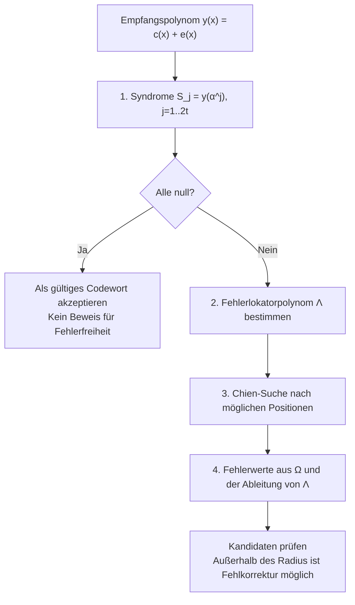
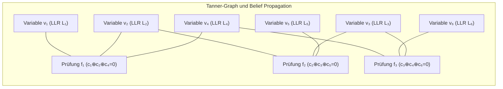
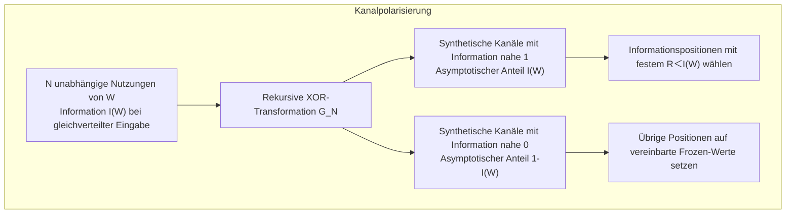

## 1. Einleitung: Was Raumfahrtkommunikation und QR-Codes gemeinsam haben

Wie lassen sich Daten aus einem schwachen Weltraumsignal oder einem teilweise beschädigten QR-Code zurückgewinnen? <strong>Fehlerkorrigierende Codes (ECC)</strong> ergänzen strukturierte Redundanz. Der Empfänger nutzt diese Beziehungen, um veränderte Werte zu schätzen und zu korrigieren. Der Schutz ist begrenzt: Eine endliche Redundanzmenge behebt nicht jede denkbare Zerstörung.

### Raumfahrtkommunikation: Signal empfangen und verbleibende Fehler korrigieren

Voyager 1 und Voyager 2 starteten 1977 und besuchten Jupiter und Saturn; Voyager 2 flog weiter zu Uranus und Neptun. Nicht beide Sonden besuchten jeweils alle vier Planeten. Hier dienen die Kommunikationssysteme der Planetenbegegnungen als Beispiel. Veränderliche heutige Entfernungen und Empfangsleistungen behandeln wir nicht als dauerhafte Konstanten.

Die Hochgewinnantenne der Sonde bündelt Funkenergie in Richtung Erde, wo das Deep Space Network (DSN) sie empfängt. Dämpfung und thermisches Rauschen können nach der Demodulation dennoch Fehler hinterlassen. Als Einheitenumrechnung gilt $10^{-16}\,\mathrm W=100\,\mathrm{aW}$, also 100 Attowatt. Das ist keine Messangabe für einen bestimmten Tag und eine bestimmte Empfangsstation.

Ein JPL-Bericht zur Vorbereitung der Uranusbegegnung von Voyager 2 beschreibt einen inneren Faltungscode und einen äußeren Reed–Solomon-Code (RS) $[255,223]$. Diese Stufen verringern den Einfluss des Rauschens. Sie garantieren nicht, dass jeder empfangene Block und jedes Pixel immer fehlerfrei sind.

### QR-Codes: Korrekturanteil ist keine beliebig verdeckbare Fläche

Auch QR-Codes verwenden RS. DENSO WAVE beschreibt ungefähre Wiederherstellungsstufen von 7 %, 15 %, 25 % und 30 %, bezogen auf <strong>8-Bit-Codewörter</strong>. Das bedeutet nicht, dass ein Logo beliebige 30 % des Bildes verdecken darf. Funktionsmuster, die Schadensverteilung auf RS-Blöcke und die Aufnahmebedingungen sind entscheidend. Eine allgemeine Garantie von zehn Millisekunden gibt es ebenfalls nicht.

Ein 8-Bit-Codewort in der QR-Terminologie entspricht einem Symbol der hier verwendeten mathematischen RS-Beschreibung. Es ist nicht das gesamte RS-Codewort aus $n$ Symbolen. Diese Unterscheidung verhindert, dass die Korrekturfähigkeit einzelner Blöcke mit einer Bildfläche verwechselt wird.


Wir verbinden Kanalkapazität, Hamming-Distanz, Polynome über endlichen Körpern und Wahrscheinlichkeitsrechnung auf Graphen. Dabei unterscheiden wir <strong>alle Fehlermuster bis zu einer bestimmten Fehlerzahl korrigieren</strong> von <strong>eine Fehlerwahrscheinlichkeit bei wachsender Blocklänge beliebig klein machen</strong>.

---

## 2. Shannons Kanalcodierungssatz und seine Voraussetzungen

### 2.1 Wiederholung: höhere Zuverlässigkeit auf Kosten der Rate

Wiederholte Bits lassen sich per Mehrheitsentscheidung zuverlässiger übertragen. Mit dieser Konstruktion allein erfordert eine höhere Zuverlässigkeit jedoch mehr Kanalnutzungen pro Informationsbit. Das ist eine Grenze des Wiederholungscodes, nicht aller Codes.

Betrachten wir einen gedächtnislosen binären symmetrischen Kanal (BSC) mit unabhängigen Bitinversionen der Wahrscheinlichkeit $0<p<1/2$. Ein Wiederholungscode der Länge drei bildet ein Bit wie folgt ab:

$$
0 \mapsto 000, \qquad 1 \mapsto 111
$$

Beim Senden von 000 führen 011, 101, 110 oder 111 zur falschen Entscheidung 1. Dafür müssen zwei oder drei Bits kippen:

$$
P_e^{(3)} = \binom{3}{2} p^2 (1-p) + \binom{3}{3} p^3 = 3p^2(1-p) + p^3
$$

Für $p=0{,}01$ ergibt sich $0{,}000298$, ungefähr $0{,}03\%$. Dafür beträgt die Coderate:

$$
R = \frac{k}{n} = \frac{1}{3}
$$

Bei ungerader Länge $n=2t+1$ scheitert die Mehrheit, wenn mindestens $t+1$ Bits kippen:

$$
P_e^{(n)} = \sum_{i = (n+1)/2}^{n} \binom{n}{i} p^i (1-p)^{n-i}
$$

Nach dem Gesetz der großen Zahlen nähert sich die Fehlerwahrscheinlichkeit null, gleichzeitig gilt aber:

$$
n \to \infty \implies P_e^{(n)} \to 0 \quad \text{doch gleichzeitig} \quad R = \frac{1}{n} \to 0
$$

Bei Länge fünf verwendet man beispielsweise $0\mapsto00000$, $1\mapsto11111$ mit Rate $1/5$. Das schließt effizientere Codes, die mehrere Informationsbits in einem Block verbinden, nicht aus.

### 2.2 Kapazität und Codierung über verrauschte Kanäle

Shannons Arbeit von 1948 zeigte, dass ein verrauschter Kanal eine feste positive Rate ermöglichen kann, während die Fehlerwahrscheinlichkeit beliebig klein wird.

> <strong>Satz für einen diskreten gedächtnislosen Kanal mit endlichen Alphabeten:</strong> Für ein gegebenes Übergangsgesetz $W(y\mid x)$ ist die Kapazität $C=\max_{P(X)}I(X;Y)\ge0$, gemessen in Bit pro Kanalnutzung. Für jede feste Rate $0<R<C$ existieren eine Folge immer längerer Blockcodes und Dekodierregeln, deren Blockfehlerwahrscheinlichkeit gegen null geht. Bei $R>C$ ist diese Konvergenz nicht erreichbar.

Die Kapazität muss nicht positiv sein. Ist die Ausgabe von der Eingabe unabhängig, gilt $C=0$. Bei Beschränkungen der Eingabekosten oder der mittleren Leistung muss die Maximierung diese berücksichtigen. Eine einzelne Kenngröße der Rauschstärke bestimmt nicht die Kapazität jedes Kanals.

Der Satz ist eine asymptotische Existenzaussage. Er verspricht weder die Korrektur jedes möglichen Rauschens durch einen endlichen Code noch automatisch einen effizienten Decoder. Latenz, verfügbare Rechenleistung und angestrebte Fehlerwahrscheinlichkeit bleiben Entwurfsbedingungen.

### 2.3 Herleitung der BSC-Kapazität

Für einen diskreten gedächtnislosen Kanal gilt:

$$
C = \max_{P(X)} I(X; Y) = \max_{P(X)} \bigl( H(Y) - H(Y \mid X) \bigr)
$$

Schreiben wir die BSC-Ausgabe als $Y=X\oplus E$. Das Rauschbit $E$ ist von $X$ unabhängig und mit Wahrscheinlichkeit $p$ gleich eins. Bei bekannter Eingabe verbleibt die binäre Entropie:

$$
H(Y \mid X) = H_2(p) \triangleq -p \log_2 p - (1-p) \log_2(1-p)
$$

Da die Ausgabe binär ist, gilt $H(Y)\le1$ Bit. Eine gleichverteilte Eingabe erzeugt eine gleichverteilte Ausgabe und erreicht $H(Y)=1$. Somit:

$$
C_{\text{BSC}}(p) = 1 - H_2(p) = 1 + p\log_2 p + (1-p)\log_2(1-p) \quad [\text{Bit / Kanalnutzung}]
$$

Zum Beispiel:

$$
H_2(0{,}1) = -0{,}1 \log_2(0{,}1) - 0{,}9 \log_2(0{,}9) \approx 0{,}4690\text{ bits}
$$

$$
C_{\text{BSC}}(0{,}1) = 1 - 0{,}4690 = 0{,}5310\text{ Bit / Kanalnutzung}
$$

Eine kleinere feste Rate wie $R=0{,}5$ kann daher mit geeigneten, hinreichend langen Codes eine beliebig kleine Fehlerwahrscheinlichkeit erreichen. Das garantiert keinen fehlerfreien endlichen Code mit Rate exakt gleich der Kapazität. Das Argument der Zufallscodierung nutzt das typische Rauschverhalten langer Blöcke und die Unterscheidbarkeit von Codewörtern.

### 2.4 AWGN und die Breitbandgrenze von $-1{,}59\,\mathrm{dB}$

Additives weißes gaußsches Rauschen (AWGN) beschreibt kontinuierliche Wellenformen, nicht wörtlich unabhängige Bitinversionen. Seien $B$ die Bandbreite in Hz, $S$ die mittlere empfangene Signalleistung in W und $N_0$ die einseitige spektrale Rauschleistungsdichte in W/Hz. Die Rauschleistung im Band ist $N=N_0B$. Unter einer mittleren Leistungsbeschränkung, ohne zusätzliche Beschränkung auf binäre Eingaben, liefert Shannon–Hartley:

$$
C_{\text{AWGN}} = B \log_2\!\left(1 + \frac{S}{N}\right) = B \log_2\!\left(1 + \frac{S}{N_0 B}\right) \quad [\text{Bit / Sekunde}]
$$

Sei $E_b$ die empfangene Energie pro Informationsbit und nun $R$ die Informationsrate in Bit/s, sodass $S=E_bR$ gilt. Die Einheit unterscheidet sich von der bisherigen Rate in Bit pro Kanalnutzung. Die Forderung $R<C_{\mathrm{AWGN}}$ ergibt:

$$
R < B \log_2\!\left(1 + \frac{E_b}{N_0} \frac{R}{B}\right)
$$

Mit spektraler Effizienz $\eta=R/B$ in Bit/s/Hz:

$$
\eta < \log_2\!\left(1 + \eta \frac{E_b}{N_0}\right) \iff 2^\eta - 1 < \eta \frac{E_b}{N_0} \iff \frac{E_b}{N_0} > \frac{2^\eta - 1}{\eta}
$$

In diesem idealen Modell betrachten wir $\eta\to0$ und verwenden $2^\eta=1+\eta\ln2+O(\eta^2)$:

$$
\lim_{\eta \to 0} \frac{2^\eta - 1}{\eta} = \ln 2 \approx 0{,}693147
$$

In Dezibel:

$$
\left(\frac{E_b}{N_0}\right)_{\min} = \ln 2 \approx 0{,}6931 \implies 10 \log_{10}(\ln 2) \approx \mathbf{-1{,}5917\,\text{dB}}
$$

Das ist ein <strong>Infimum im Breitbandgrenzfall</strong>. Bei positiver spektraler Effizienz ist die erforderliche Schranke $(2^\eta-1)/\eta>\ln2$. Außerdem ist $E_b/N_0$ nicht das Leistungsverhältnis $S/N$ zwischen Signal und gesamtem Bandrauschen. Die Aussage „Signal unter dem Rauschen“ kann diese Definitionen verwechseln.

Die Annäherung an die Kapazität kostet auch Blocklänge und Latenz. Dieses asymptotische Ergebnis eines bestimmten Modells ist weder eine Konstante aller physikalischen Kanäle noch das Versprechen fehlerfreier endlicher Kommunikation. Eine Einschränkung auf zwei Eingabewerte verändert beispielsweise die relevante Kapazität.

---

## 3. Hamming-Distanz, Garantien und der $[7,4,3]$-Code

### 3.1 Von der Existenz zur berechenbaren Konstruktion

Um einen Existenzsatz zu nutzen, braucht man Codier- und Dekodieralgorithmen. Hammings Arbeit von 1950 bietet ein konkretes Beispiel: Paritätsprüfungen ergänzen und aus den verletzten Prüfungen ein gekipptes Bit lokalisieren. Wir konstruieren den Code aus seiner Distanz und seinen Matrizen.

### 3.2 Distanz und Minimaldistanz

Binärfolgen der Länge $n$ bilden $\mathbb F_2^n$, die Ecken eines $n$-dimensionalen Hyperwürfels. In $\mathbb F_2$ sind Addition und Subtraktion XOR. Die Hamming-Distanz zählt unterschiedliche Koordinaten:

$$
d_H(\mathbf{u}, \mathbf{v}) \triangleq \bigl|\{ i \in \{1, \dots, n\} \mid u_i \neq v_i \}\bigr| = w_H(\mathbf{u} - \mathbf{v})
$$

Dabei zählt $w_H$ die von null verschiedenen Einträge, das Hamming-Gewicht. Die Distanz erfüllt Nichtnegativität, Symmetrie und Dreiecksungleichung. Ein Code ist eine Teilmenge $\mathcal C$ erlaubter Wörter. Ein binärer linearer Code der Dimension $k$ hat $2^k$ Codewörter. Seine Minimaldistanz ist:

$$
d_{\min}(\mathcal{C}) \triangleq \min_{\substack{\mathbf{u}, \mathbf{v} \in \mathcal{C} \\ \mathbf{u} \neq \mathbf{v}}} d_H(\mathbf{u}, \mathbf{v})
$$

Bei einem linearen Code ist die Differenz zweier verschiedener Codewörter wieder ein von null verschiedenes Codewort. Deshalb:

$$
d_{\min}(\mathcal{C}) = \min_{\mathbf{c} \in \mathcal{C} \setminus \{\mathbf{0}\}} w_H(\mathbf{c})
$$

### 3.3 Erkennen, Auslöschungen und Fehler unbekannter Position

1. <strong>Fehlererkennung:</strong> Werden zwischen einer und $d_{\min}-1$ Koordinaten verändert, kann aus einem gültigen Codewort kein anderes werden. Die Prüfung der Codezugehörigkeit erkennt alle diese von null verschiedenen Fehlermuster.
2. <strong>Auslöschungen:</strong> Die fehlenden Positionen sind bekannt, ihre Werte nicht. Bei höchstens $e\le d_{\min}-1$ Auslöschungen unterscheiden sich zwei Codewörter weiterhin in einer erhaltenen Koordinate. Sind die übrigen Werte korrekt, ist das gesendete Wort eindeutig bestimmt.
3. <strong>Fehler unbekannter Position:</strong> Die Dekodierung zum nächstgelegenen Codewort korrigiert genau dann alle Muster von höchstens $t$ Fehlern, wenn die Hamming-Kugeln vom Radius $t$ um verschiedene Codewörter disjunkt sind.

Gehörte ein Empfangswort zu zwei Kugeln, lägen deren Mittelpunkte nach der Dreiecksungleichung höchstens $2t$ auseinander. Umgekehrt erlauben zwei Mittelpunkte mit Abstand höchstens $2t$ ein Wort, das von beiden höchstens $t$ entfernt ist: Die unterschiedlichen Koordinaten werden auf die beiden Möglichkeiten verteilt. Daher:

$$
2t + 1 \le d_{\min} \iff t \le \left\lfloor \frac{d_{\min} - 1}{2} \right\rfloor
$$

Die Gleichheit $t=\lfloor(d_{\min}-1)/2\rfloor$ nennt den <strong>größten garantierten Radius</strong>, nicht jeden kleineren zulässigen Radius. Bei höchstens $t$ unbekannten Fehlern und $e$ bekannten Auslöschungen lautet die Garantie für alle Muster:

$$
\mathbf{d_{\min} \ge 2t + e + 1}
$$

Nach Entfernen der ausgelöschten Koordinaten bleibt eine Minimaldistanz von mindestens $d_{\min}-e$; darauf wenden wir das Argument disjunkter Kugeln an. Manche Fälle außerhalb dieser Bedingung bleiben korrigierbar, ein Erfolg ist aber nicht mehr für alle Konfigurationen garantiert. „Position unbekannt“ setzt keine zufällige Fehlerverteilung voraus.

Eine Kugel vom Radius $t$ in einem Raum mit Alphabetgröße $q$ enthält $\sum_{i=0}^t\binom ni(q-1)^i$ Wörter. Die disjunkten Kugeln müssen in den Raum passen:

$$
|\mathcal{C}| \cdot \sum_{i=0}^{t} \binom{n}{i} (q-1)^i \le q^n \quad \left(\text{für binäre Codes: } 2^k \sum_{i=0}^{t} \binom{n}{i} \le 2^n \right)
$$

Ein Code mit Gleichheit ist <strong>perfekt</strong>: Die Kugeln überdecken den Raum ohne Lücken oder Überschneidungen. Beispiele sind Hamming sowie der binäre Golay-Code $[23,12,7]$ und der ternäre $[11,6,5]$. Klassifikationen benötigen ihre jeweiligen Voraussetzungen; auch nichtlineare perfekte Codes existieren. Diese Beispiele belegen nicht, welchen Golay-Code eine bestimmte Raumfahrtmission verwendete.

### 3.4 Hamming-Matrizen und Syndrom

Der $[7,4,3]$-Code ergänzt vier Informationsbits um drei Paritätsbits:

$$
2^4 \sum_{i=0}^{1} \binom{7}{i} = 16 \times (1 + 7) = 16 \times 8 = 128 = 2^7
$$

Die 16 Kugeln vom Radius eins enthalten jeweils einen Mittelpunkt und sieben Nachbarn und überdecken alle 128 Wörter.

Eine praktische Konstruktion der Prüfmatrix verwendet in Spalte $j$ die Binärdarstellung von $j$:

$$
\mathbf{H}_{\text{binary}} = \begin{pmatrix} 0 & 0 & 0 & 1 & 1 & 1 & 1 \\ 0 & 1 & 1 & 0 & 0 & 1 & 1 \\ 1 & 0 & 1 & 0 & 1 & 0 & 1 \end{pmatrix} \begin{matrix} \leftarrow 2^2\text{ Stelle} \\ \leftarrow 2^1\text{ Stelle} \\ \leftarrow 2^0\text{ Stelle} \end{matrix}
$$

Ihre fünfte Spalte lautet $(1,0,1)^T$. Soll die Nachricht mit vier unveränderten Bits am Anfang stehen und die Parität am Ende, verwenden wir die systematische Form $\mathbf G=[\mathbf I_4\mid\mathbf P]$ und $\mathbf H=[\mathbf P^T\mid\mathbf I_3]$:

$$
\mathbf{G}_{4\times 7} = \left(\begin{array}{cccc|ccc} 1 & 0 & 0 & 0 & 1 & 1 & 0 \\ 0 & 1 & 0 & 0 & 1 & 0 & 1 \\ 0 & 0 & 1 & 0 & 0 & 1 & 1 \\ 0 & 0 & 0 & 1 & 1 & 1 & 1 \end{array}\right), \qquad \mathbf{H}_{3\times 7} = \left(\begin{array}{cccc|ccc} 1 & 1 & 0 & 1 & 1 & 0 & 0 \\ 1 & 0 & 1 & 1 & 0 & 1 & 0 \\ 0 & 1 & 1 & 1 & 0 & 0 & 1 \end{array}\right)
$$

Wegen $\mathbf G\mathbf H^T=0$ erfüllen alle codierten Wörter:

$$
\mathbf{H}\mathbf{c}^T = \mathbf{0} \pmod 2
$$

Für $\mathbf y=\mathbf c+\mathbf e$ berechnen wir das <strong>Syndrom</strong>:

$$
\mathbf{s} = \mathbf{H}\mathbf{y}^T = \mathbf{H}(\mathbf{c} + \mathbf{e})^T = \underbrace{\mathbf{H}\mathbf{c}^T}_{=\mathbf{0}} + \mathbf{H}\mathbf{e}^T = \mathbf{H}\mathbf{e}^T \pmod 2
$$

Es hängt nur vom Fehler ab. Eine Inversion in Bit $j$ liefert Spalte $j$ der gewählten Matrix. Bei binär geordneten Spalten bezeichnet Syndrom 101 Position 5. In systematischer Form ist die Reihenfolge anders; man muss die passende Spalte suchen. Sein Zahlenwert ist nicht automatisch die Fehlerposition. Das Programm in Abschnitt 6 führt diese Suche aus.

Syndrom null bedeutet Codezugehörigkeit. Unter der Annahme höchstens eines Fehlers heißt das Fehlerfreiheit; sonst kann der Kanal ein gültiges Codewort in ein anderes verändert haben. Mehrere Fehler können einen Einzelfehlerdecoder auch dazu bringen, ein ursprünglich korrektes Bit zu kippen.

Die Nachricht `[1,0,1,1]` wird beispielsweise zu `[1,0,1,1,0,1,0]`. Eine Inversion bei Index 2, ab null gezählt — also im dritten Bit —, ergibt Syndrom `[0,1,1]` und passt zu Spaltenindex 2. Ein festes Sieben-Bit-Schaltwerk hat konstante Größe; eine allgemeine Syndromberechnung für Länge $n$ ist aber nicht universell $O(1)$.

Ein zusätzliches Bit für gerade Gesamtparität ergibt den erweiterten $[8,4,4]$-Code. Eine passende Entscheidungsregel erlaubt Einzelbitkorrektur und Doppelbiterkennung (SECDED). Das ist ein Grundmodell zum Verständnis von ECC-Speicher, nicht die genaue Architektur jedes Produkts.

---

## 4. Reed–Solomon: endliche Körper, Interpolation und Dekodierung

### 4.1 Warum Bündelfehler wichtig sind

Hamming $(7,4)$ korrigiert ein Bit an beliebiger Stelle eines Blocks. Ein Kratzer, ein QR-Fleck oder ein Fading-Ereignis kann viele Bits desselben Blocks verändern. Schon zwei Inversionen können den Einzelfehlerdecoder zum falschen Codewort führen.

Die Konstruktion von Reed und Solomon aus dem Jahr 1960 gruppiert Bits zu <strong>Symbolen</strong> eines endlichen Körpers. Damit ändert sich die Einheit für Distanz und Korrektur. Räumliche Anordnung und Interleaving bestimmen ebenfalls, wie physische Schäden auf diese Symbole wirken.

### 4.2 Ein Byte als Element eines endlichen Körpers

Ein Symbol aus $m$ Bits kann in $\mathbb F_{2^m}$ dargestellt werden. Das ist nicht die Rechnung mit ganzen Zahlen modulo 256: $2\cdot128\equiv0\pmod{256}$ zeigt Nullteiler; diese von null verschiedenen Elemente haben kein multiplikatives Inverses. Endliche Körper existieren genau für Größen, die Primzahlpotenzen sind.

In GF(256) stellt ein Byte ein Polynom mit Binärkoeffizienten vom Grad höchstens sieben dar. Das Programm reduziert Produkte modulo dem durch `0x11D` dargestellten irreduziblen Polynom vom Grad acht:

$$
\mathbb{F}_{2^8} \cong \frac{\mathbb{F}_2[x]}{\langle x^8 + x^4 + x^3 + x^2 + 1 \rangle}
$$

Addition und Subtraktion sind XOR, da im Koeffizientenkörper $1+1=0$ gilt. Die 255 von null verschiedenen Elemente bilden eine zyklische multiplikative Gruppe. In dieser Darstellung ist $\alpha=x$, Byte `0x02`, primitiv: $\alpha^0,\ldots,\alpha^{254}$ durchlaufen alle von null verschiedenen Elemente, und $\alpha^{255}=1$.

Logarithmus- und Exponententabellen erlauben Multiplikation und Division von null verschiedener Elemente:

$$
A \cdot B = \alpha^{(i + j) \bmod 255}, \qquad \frac{A}{B} = \alpha^{(i - j) \bmod 255}
$$

Null benötigt eine Sonderbehandlung; Division durch null ist nicht definiert. Die Tabellenlänge hängt von der Implementierung ab. Manche verlängern die Exponententabelle, um eine explizite Modulorechnung zu vermeiden. Abschnitt 6 verwendet Verschiebungen und XOR.

Mehrere beschädigte Bits innerhalb eines Bytes zählen als ein Symbolfehler. Über Bytegrenzen hinweg können mehrere Symbole betroffen sein. Die reine Gesamtzahl gekippter Bits bestimmt daher nicht, ob eine Korrektur gelingt.

### 4.3 Auswertung, Interpolation und Singleton-Schranke

Zwei Punkte mit verschiedenen Abszissen bestimmen ein Polynom vom Grad höchstens eins. Werden fünf Auswertungen gesendet, genügen beliebige zwei korrekte erhaltene Auswertungen nach drei Auslöschungen zur Rekonstruktion. Drei verschiedene Abszissen bestimmen ein Polynom vom Grad höchstens zwei.

Die $k$ Nachrichtensymbole dienen als Koeffizienten:

$$
P(x) \triangleq m_0 + m_1 x + m_2 x^2 + \dots + m_{k-1} x^{k-1} \in \mathbb{F}_q[x]
$$

Wir wählen $n$ verschiedene Punkte $\alpha_i\in\mathbb F_q$ mit $k\le n\le q$ und senden:

$$
\mathbf{c} = \bigl( P(\alpha_1),\; P(\alpha_2),\; \dots,\; P(\alpha_n) \bigr) \in \mathbb{F}_q^n
$$

Nach dem Faktorsatz hat ein von null verschiedenes Polynom über einem Körper höchstens so viele Nullstellen wie sein Grad. Die Differenz $P-Q$ verschiedener Nachrichten hat Grad kleiner $k$ und verschwindet höchstens an $k-1$ Punkten. Die Codewörter unterscheiden sich daher an mindestens $n-k+1$ Koordinaten.

Für die entgegengesetzte Schranke entfernen wir $d_{\min}-1$ Koordinaten aus allen Codewörtern. Die Projektionen müssen verschieden bleiben. Bei $q^k$ Wörtern gilt $q^k\le q^{n-d_{\min}+1}$ und damit $d_{\min}\le n-k+1$. RS erreicht Gleichheit:

$$
\mathbf{d_{\min} = n - k + 1}
$$

Das ist die <strong>MDS-Eigenschaft, maximale Minimaldistanz bei festen Parametern</strong>. Sie optimiert die Distanz bei festem Alphabet, fester Länge und Dimension, nicht sämtliche technischen Eigenschaften.

Mit $r=n-k$ Redundanzsymbolen lautet die Garantie $2t+e\le r$:

- <strong>Bekannte Auslöschungen:</strong> Bis zu $n-k$ Symbole dürfen fehlen. Beliebige $k$ korrekte erhaltene Auswertungen liefern die Nachricht durch Lagrange-Interpolation:

$$
P(x) = \sum_{j=1}^{k} y_{i_j} \prod_{\substack{m=1 \\ m \neq j}}^{k} \frac{x - x_{i_m}}{x_{i_j} - x_{i_m}}
$$

- <strong>Unbekannte Fehler:</strong> Bis zu $\lfloor(n-k)/2\rfloor$ beschädigte Symbole sind korrigierbar, unabhängig davon, wie viele Bits innerhalb jedes betroffenen Symbols verändert sind.

### 4.4 Zyklische Form und Konventionen der Forney-Formel

Die Auswertungsform behandelt die Nachricht als Koeffizienten und überträgt Auswertungen. Bei der zyklischen Beschreibung sind die Codewortkoordinaten Koeffizienten eines anderen Polynoms, das durch ein Generatorpolynom teilbar ist. Der Code voller Länge $n=q-1$ über allen von null verschiedenen Auswertungspunkten besitzt bei festgelegter Zuordnung eine äquivalente zyklische Darstellung. Ein verkürzter Code muss bei seiner neuen Länge nicht mehr zyklisch sein.

Wir setzen Redundanz $n-k=2t$ und erste Generatornullstelle $\alpha^1$ fest. Das sind die Konventionen dieser Herleitung, nicht aller QR- oder Raumfahrtformate:

$$
g(x)=\prod_{j=1}^{2t}(x-\alpha^j)
$$

Mit Rest $r(x)=x^{2t}m(x)\bmod g(x)$ verschieben wir die Nachricht und ziehen den Rest ab:

$$
c(x)=x^{2t}m(x)-r(x),\qquad c(\alpha^j)=0\quad(1\le j\le2t)
$$

In Charakteristik zwei bleibt Subtraktion XOR.



1. <strong>Syndrome:</strong> Es gebe $\nu\le t$ Fehler an Positionen $i_l$ mit von null verschiedenen Werten $Y_l=e_{i_l}$. Wir definieren $X_l=\alpha^{i_l}$. Die Auswertung an Generatornullstellen entfernt das gesendete Codewort:

$$
S_j=y(\alpha^j)=e(\alpha^j)=\sum_{l=1}^{\nu}Y_lX_l^j,\qquad j=1,\ldots,2t
$$

Ein Nullsyndrom stellt nur Codezugehörigkeit fest; es erkennt keinen Wechsel zwischen gültigen Codewörtern.

2. <strong>Fehlerlokatorpolynom:</strong>

$$
\Lambda(z)=\prod_{l=1}^{\nu}(1-X_lz)=1+\Lambda_1z+\cdots+\Lambda_\nu z^\nu
$$

Wir multiplizieren $\Lambda(X_l^{-1})=0$ mit $Y_lX_l^{j+\nu}$ und summieren. So entsteht die lineare Rekursion:

$$
S_{j+\nu}+\Lambda_1S_{j+\nu-1}+\cdots+\Lambda_\nu S_j=0,\qquad1\le j\le2t-\nu
$$

Berlekamp–Massey bestimmt eine minimale Rekursion und einen Kandidaten, üblicherweise mit $O(t^2)$ Körperoperationen. Ein Verfahren mit erweitertem Euklid kann ebenfalls die Schlüsselgleichung lösen.

3. <strong>Chien-Suche:</strong> Wir prüfen die zu den Koordinaten gehörenden von null verschiedenen Elemente $\alpha^{-i}$ auf $\Lambda(\alpha^{-i})=0$. GF(256) hat insgesamt 256 Elemente, davon 255 von null verschiedene. Unter anderem müssen Lokatorgrad und Anzahl zulässiger Nullstellen zusammenpassen.

4. <strong>Fehlerwerte:</strong> Syndrompolynom und Fehlerauswerter werden ausdrücklich definiert:

$$
S(z)=S_1+S_2z+\cdots+S_{2t}z^{2t-1},\qquad \Omega(z)=S(z)\Lambda(z)\bmod z^{2t}
$$

Unter diesen Definitionen liefert Forney:

$$
Y_l=-\frac{\Omega(X_l^{-1})}{\Lambda'(X_l^{-1})}
$$

Für einen Fehler gilt $\Omega=YX$ und $\Lambda'=-X$, also erhalten wir $Y$. Ein weiterer Faktor $X$ ergäbe $XY$. Andere Konventionen für erste Nullstelle oder Syndrompolynom können diesen Faktor ändern. Eine Formel darf deshalb nicht ohne ihre Definitionen übernommen werden.

Wir subtrahieren die geschätzten Fehler und prüfen Codezugehörigkeit und korrigierte Distanz. Dennoch kann ein Empfangswort nahe einem anderen gültigen Codewort die Prüfungen mit einer falschen Nachricht bestehen. CRC, Wiederholung oder höhere Prüfebenen können zusätzlichen Schutz bieten; nicht jede Verfälschung außerhalb des garantierten Radius ist sicher erkennbar.

### 4.5 QR, Speicherung und Codeverkettung in Voyager

- <strong>QR:</strong> L/M/Q/H bezeichnen ungefähr 7/15/25/30 % Wiederherstellung von 8-Bit-Codewörtern. Jeder RS-Block muss seine Bedingungen erfüllen. Version und Stufe verändern Daten, Redundanz und Blockaufteilung; daraus folgt keine beliebige verdeckbare Fläche. Verdeckte Funktionsmuster können Erkennung oder Extraktion bereits vor der RS-Dekodierung verhindern.
- <strong>RAID-6 und verteilte Speicherung:</strong> Ein fehlendes Laufwerk oder Fragment an bekannter Position ist eine Auslöschung. Ein beispielhafter MDS-Code $[14,10]$ benötigt das $14/10=1{,}4$-Fache der Datenkapazität und toleriert vier verlorene Fragmente, sofern die übrigen und die nötigen Metadaten korrekt sind. Das ist keine universelle Cloud-Konfiguration. Doppelte RAID-6-Parität rekonstruiert unter ihren Annahmen zwei Laufwerke, nicht jeden zusätzlichen latenten Schaden oder den Verlust der ganzen Anlage.
- <strong>Voyager 2:</strong> Der JPL-Bericht von 1983 beschreibt einen Faltungscode mit Einflusslänge (constraint length) $K=7$ und Rate $1/2$, Interleaving-Tiefe 4 sowie äußeren RS $[255,223]$. Seine 32 Redundanzbytes garantieren pro RS-Codewort $2t+e\le32$, also ohne Auslöschungen 16 Bytefehler. Ein nicht ausgerichteter zusammenhängender 128-Bit-Burst kann 17 Bytes betreffen. Interleaving verteilt verbleibende Bündelfehler des inneren Decoders auf mehrere RS-Codewörter. Der innere Code dieses Beispiels ist ein Faltungscode.

---

## 5. LDPC, Turbo und Polar: Zuverlässigkeit und Kapazität

### 5.1 Distanz allein löst nicht alles

Ein praktischer Code muss angestrebte Fehlerwahrscheinlichkeit, Latenz, Blocklänge, Rechenaufwand und Hardwarekosten berücksichtigen. Der vollständige Vergleich aller Codewörter eines binären Codes der Dimension $k$ erfordert $2^k$ Kandidaten. Eine gute Minimaldistanz garantiert noch keine effiziente Dekodierung.

Iterative Turbo- und LDPC-Dekodierung nutzt Zuverlässigkeitsinformation; Polar-Codes verwenden eine andere Konstruktion, um sich der symmetrischen Kapazität zu nähern. Vergleiche müssen Kanal, Eingabebeschränkungen und Rate konstant halten. Alles mit der Breitbandgrenze von $-1{,}59\,\mathrm{dB}$ zu vergleichen genügt nicht.

### 5.2 Dünnbesetzte Prüfmatrix und Belief Propagation

Gallagers LDPC-Codes von 1962 verwenden eine dünnbesetzte Prüfmatrix. Auch bei langen Blöcken können ihre Zeilen und Spalten wenige von null verschiedene Einträge enthalten. Für eine Matrix $\mathbf H$ der Größe $m\times n$ ist die Dimension $k=n-\operatorname{rank}_{\mathbb F_2}(\mathbf H)$, wobei rank den Matrixrang bezeichnet. Nur bei unabhängigen Zeilen gilt $k=n-m$.

Im Tanner-Graphen entsprechen Variablenknoten den Spalten und Bits, Prüfknoten den Zeilen und Paritätsgleichungen. Genau bei $H_{a,i}=1$ existiert eine Kante:



Weiche Entscheidungen erhalten Zuverlässigkeit, statt die Beobachtung sofort auf null oder eins zu reduzieren. Das logarithmische Likelihood-Verhältnis (LLR) lässt sich schreiben als:

$$
L(c_i) \triangleq \ln \frac{\Pr(c_i = 0 \mid y_i)}{\Pr(c_i = 1 \mid y_i)}
$$

Für gleichwahrscheinliche Eingaben, BPSK mit Einheitsamplitude $0\mapsto+1$, $1\mapsto-1$, unabhängiges Rauschen $Z\sim\mathcal N(0,\sigma^2)$ und Beobachtung $y_i=x_i+Z$ gilt:

$$
L_{\mathrm{ch}}(c_i)=\ln\frac{p(y_i\mid c_i=0)}{p(y_i\mid c_i=1)}=\frac{2y_i}{\sigma^2}
$$

Andere Amplituden oder A-priori-Wahrscheinlichkeiten verändern die Formel. LLR $+10$ spricht stark für null; $-0{,}1$ nur schwach für eins.

Der Sum-Product-Algorithmus ist eine Form von Belief Propagation. Er tauscht extrinsische Nachrichten aus und schließt dabei den Beitrag des empfangenden Nachbarn aus:

$$
\mu_{f_a \to v_i} = 2 \operatorname{artanh}\!\left( \prod_{v_j \in N(f_a) \setminus \{v_i\}} \tanh\!\left(\frac{\mu_{v_j \to f_a}}{2}\right) \right)
$$

$$
\mu_{v_i \to f_a} = L_{\text{ch}}(v_i) + \sum_{f_b \in N(v_i) \setminus \{f_a\}} \mu_{f_b \to v_i}
$$

$N$ bezeichnet die jeweilige Nachbarschaftsmenge. Der Iterationsplan legt fest, aus welcher Iteration die verwendeten Nachrichten stammen; der Ausschluss des Empfängernachbarn bleibt bestehen.

Eine dünnbesetzte Matrix verringert die Kantenzahl, verhindert aber nicht automatisch kurze Zyklen. Auf einem Baum berechnet die Propagation exakte Randwahrscheinlichkeiten. In endlichen Graphen mit Zyklen können Abhängigkeiten, Trapping Sets oder fehlende Konvergenz Fehler hinterlassen.

Bei $E$ Kanten benötigt eine Implementierung mit gemeinsam genutzten Zwischenrechnungen ungefähr $O(E)$ Operationen pro Iteration, insgesamt $O(IE)$ für $I$ Iterationen. Beschränkte Knotengrade können $E=O(n)$ ergeben, garantieren jedoch keine konstante Iterationszahl. Numerische Implementierungen müssen LLR-Sättigung und den Definitionsbereich von $\operatorname{artanh}$ behandeln.

Das Ergebnis von Chung und Kollegen aus dem Jahr 2001 betrifft <strong>Rate $1/2$ auf einem AWGN-Kanal mit binärer Eingabe</strong>. Die durch Dichteentwicklung berechnete asymptotische Schwelle liegt $0{,}0045\,\mathrm{dB}$ von der Kapazitätsgrenze dieses Kanals entfernt. Eine separate endliche Simulation eines einfacheren Entwurfs mit Länge $10^7$ und BER $10^{-6}$ zeigt einen Abstand von $0{,}04\,\mathrm{dB}$. Das sind weder allgemeine Leistungswerte aller Geräte noch das energetische Breitbandinfimum.

### 5.3 Polar-Codes und symmetrische Kapazität

Arıkans Konstruktion von 2009 nähert sich $I(W)$, der <strong>symmetrischen Kapazität</strong> eines diskreten gedächtnislosen Kanals mit binärer Eingabe: der gegenseitigen Information bei gleichverteilter Eingabe. Bei symmetrischen Kanälen ist sie gleich $C$, bei asymmetrischen nicht notwendigerweise gleich dem Maximum über alle Eingabeverteilungen.

Die Grundtransformation lautet:

$$
(x_1,x_2)=(u_1,u_2)\begin{pmatrix}1&0\\1&1\end{pmatrix} =(u_1\oplus u_2,u_2)
$$

Der synthetische Kanal $W^-$ schätzt $u_1$ aus $(y_1,y_2)$; $W^+$ schätzt $u_2$ aus $(y_1,y_2,u_1)$, wenn der korrekte Wert von $u_1$ vorliegt. Bei unabhängigen gleichverteilten Eingaben liefert die Kettenregel:

$$
I(W^-)+I(W^+)=2I(W),\qquad I(W^-)\le I(W)\le I(W^+)
$$

„Besser“ und „schlechter“ beziehen sich hier auf Information. Nicht jeder Fall muss eine strikte Veränderung zeigen. Bei realer sukzessiver Dekodierung können frühere Fehlentscheidungen auf spätere übergreifen.

Für $N=2^m$ verwendet eine Konvention die Permutation $\mathbf B_N$, die die Reihenfolge der Binärziffern der Indizes umkehrt, und die Generatormatrix:

$$
\mathbf G_N=\mathbf B_N \begin{pmatrix}1&0\\1&1\end{pmatrix}^{\otimes m}
$$

Für festes $0<\delta<1$ nähert sich bei $N\to\infty$ der Anteil synthetischer Kanäle mit Information größer als $1-\delta$ dem Wert $I(W)$; der Anteil mit Information kleiner als $\delta$ nähert sich $1-I(W)$. Bei endlicher Länge entstehen nicht exakt $NI(W)$ vollkommen rauschfreie Kanäle.



Wir wählen Informationspositionen mit fester Rate $R<I(W)$ und frieren die übrigen auf vereinbarte Werte ein. Für allgemeine Kanäle verwendet die ursprüngliche Garantie einen Mittelwert über Frozen-Werte und die Existenz einer geeigneten Wahl. Bei symmetrischen Kanälen gilt die entsprechende Schranke für jede feste Wahl.

Codierung und <strong>Successive Cancellation (SC)</strong> benötigen $O(N\log N)$ Zeit. Die Wahl der Informationsmenge ist ein separater Konstruktionsaufwand. Eine effiziente Implementierung von <strong>Successive Cancellation List (SCL)</strong> mit Listengröße $L$ benötigt $O(LN\log N)$; ein CRC kann bei der Kandidatenauswahl helfen. Endliche Fehlerwahrscheinlichkeit und Latenz hängen von Konstruktion, Rate, Listengröße und Kanal ab. Eine allgemeine Garantie, dass kein Fehlerboden (error floor) auftritt, gibt es nicht.

### 5.4 Vergleich der Codefamilien

| Code | Mathematische Struktur | Typische Dekodierung | Eigenschaften und Einsatz |
| :--- | :--- | :--- | :--- |
| Hamming (1950) | Binärer linearer Code; $[7,4,3]$ ist perfekt | Syndrom und Spaltensuche | Einzelbitkorrektur; Grundmodell für SECDED |
| Reed–Solomon (1960) | Polynome über endlichem Körper; MDS-Eigenschaft | BM/Euklid, Chien, Forney; Welch–Berlekamp in Auswertungsform | Symbolfehler und Auslöschungen; QR, Speicherung, verkettete Telemetrie |
| Faltung und Turbo | Trellis, Verkettung, Interleaving | Viterbi; iterativer BCJR | Verrauschte Kommunikation; Voyagers innerer Code ist ein Faltungscode |
| LDPC (1962) | Dünnbesetzte Matrix und Tanner-Graph | Belief Propagation mit weichen Entscheidungen | Lange Blöcke und Parallelität; kapazitätsnahe Entwürfe für konkrete Modelle |
| Polar (2009) | Rekursive Polarisierung und Frozen Bits | SC $O(N\log N)$; SCL hängt von $L$ ab | Asymptotische Annäherung an symmetrische Kapazität; bestimmte 5G-NR-Steuerinformationen |

Die gemeinsame Tabelle bedeutet nicht gleiche Komplexität oder Fehlerwahrscheinlichkeit. Auch nicht sämtliche 5G-Steuerinformationen werden mit Polar-Codes codiert. Beispielsweise unterscheidet 3GPP TS 38.212 v19.3.0 in Abschnitten 6.3.1.2–6.3.1.3 bei Uplink-Steuerinformationen (UCI) auf PUCCH Nutzlasten mit $A\ge12$ Bits, die Polar-Codes verwenden, und $A\le11$ mit kurzen Blockcodes.

---

## 6. Python-Prüfung: Hamming und Auswertungs-RS über GF(256)

Dieses eigenständige Python-3-Programm implementiert systematisches Hamming $(7,4)$ und den <strong>Auswertungs-RS-Code</strong> aus Abschnitt 4.3. Nachrichtensymbole sind Polynomkoeffizienten; sie stehen im Allgemeinen nicht unverändert am Codewortanfang. Es implementiert weder den BM-Decoder aus Abschnitt 4.4 noch Modulplatzierung, Blockstruktur oder systematisches zyklisches QR-Format. Es ist nicht direkt mit QR oder einer Raumsonde interoperabel.

Der Körper ist GF(256) mit dem irreduziblen Polynom `0x11D`. Er unterscheidet sich vom Primkörper GF(257) der ganzzahligen Reste modulo 257. Auch dort sind Auswertungscodes möglich, aber Symbol 256 passt nicht in ein Byte.

Der Decoder verwendet ein lineares System vom Typ Welch–Berlekamp. Für Kandidatengrade $\nu=0,\ldots,t$ sucht er ein normiertes Polynom $E(x)$ mit Leitkoeffizient 1 vom Grad $\nu$ und $Q(x)$ vom Grad kleiner $k+\nu$ mit:

$$
Q(x_i)=y_iE(x_i)\qquad(i=1,\ldots,n)
$$

Es gibt $k+2\nu$ unbekannte Koeffizienten. In Charakteristik zwei bleibt das Verschieben eines Terms auf die andere Seite XOR.

Ist die tatsächliche Nachricht $P$ und gibt es höchstens $\nu$ Fehler, wählen wir ein $E$, das an diesen Stellen verschwindet, ergänzen bei Bedarf seinen Grad und setzen $Q=PE$. Umgekehrt ist bei $n\ge k+2\nu$ für jede Lösung $Q-PE$ an mindestens $n-\nu$ korrekten Punkten null, hat aber Grad kleiner $k+\nu$. Es muss daher das Nullpolynom sein. Dieses Nullstellenargument begründet die Rekonstruktion.

Die Grade null bis $t$ werden versucht; rechteckige und rangdefiziente Systeme werden behandelt. Der Decoder teilt $Q$ durch $E$, verlangt Rest null und Quotientengrad kleiner $k$, codiert erneut und prüft eine Distanz zum Empfangswort von höchstens $t$. Das funktioniert bei null Fehlern, weniger als $t$ und an der Grenze. Die Auswertungspunkte müssen verschieden sein; 1 bis 256 Körperelemente einschließlich null sind erlaubt.

Ziel ist didaktische Klarheit, nicht ein produktiver RS-Decoder oder eine Geschwindigkeitsmessung. Bis zu $t+1$ allgemeine Gauß-Eliminationen sind möglich. `rs_encode` und `rs_decode` prüfen Werte, Längen, Punkte und Radius; interne Polynom- und Systemhilfsfunktionen setzen bereits validierte Körperelemente voraus.

```python
"""Educational evaluation RS over GF(256), not a QR parser or wire format."""
from itertools import product


def field_value(a):
    if type(a) is not int or not 0 <= a < 256:
        raise ValueError("Field elements must be integers from 0 through 255")
    return a


def gf_mul(a, b):
    field_value(a)
    field_value(b)
    result = 0
    for _ in range(8):
        if b & 1:
            result ^= a
        b >>= 1
        a <<= 1
        if a & 256:
            a ^= 0x11D
    return result


def gf_pow(a, exponent):
    field_value(a)
    if type(exponent) is not int or exponent < 0:
        raise ValueError("Exponent must be a nonnegative integer")
    result = 1
    while exponent:
        if exponent & 1:
            result = gf_mul(result, a)
        a = gf_mul(a, a)
        exponent >>= 1
    return result


def gf_inv(a):
    field_value(a)
    if a == 0:
        raise ZeroDivisionError("Zero has no multiplicative inverse")
    return gf_pow(a, 254)


def poly_trim(coefficients):
    result = list(coefficients)
    while result and result[-1] == 0:
        result.pop()
    return result


def poly_eval(coefficients, x):
    result = 0
    for coefficient in reversed(coefficients):
        result = gf_mul(result, x) ^ coefficient
    return result


def poly_divmod(numerator, denominator):
    remainder = poly_trim(numerator)
    denominator = poly_trim(denominator)
    if not denominator:
        raise ZeroDivisionError("Zero polynomial divisor")
    quotient = [0] * max(0, len(remainder) - len(denominator) + 1)
    inverse_lead = gf_inv(denominator[-1])
    while remainder and len(remainder) >= len(denominator):
        degree = len(remainder) - len(denominator)
        factor = gf_mul(remainder[-1], inverse_lead)
        quotient[degree] = factor
        for j, coefficient in enumerate(denominator):
            remainder[degree + j] ^= gf_mul(factor, coefficient)
        remainder = poly_trim(remainder)
    return poly_trim(quotient), remainder


def solve_linear_system(rows, rhs, columns):
    """Return one solution (free variables zero), or None if inconsistent."""
    if len(rows) != len(rhs) or any(len(row) != columns for row in rows):
        raise ValueError("Linear-system dimensions do not match")
    matrix = [list(row) + [value] for row, value in zip(rows, rhs)]
    pivot_columns = []
    pivot_row = 0
    for column in range(columns):
        pivot = next(
            (r for r in range(pivot_row, len(matrix)) if matrix[r][column]),
            None,
        )
        if pivot is None:
            continue
        matrix[pivot_row], matrix[pivot] = matrix[pivot], matrix[pivot_row]
        inverse = gf_inv(matrix[pivot_row][column])
        matrix[pivot_row] = [gf_mul(value, inverse) for value in matrix[pivot_row]]
        for r in range(len(matrix)):
            if r != pivot_row and matrix[r][column]:
                factor = matrix[r][column]
                matrix[r] = [
                    a ^ gf_mul(factor, b)
                    for a, b in zip(matrix[r], matrix[pivot_row])
                ]
        pivot_columns.append(column)
        pivot_row += 1
        if pivot_row == len(matrix):
            break
    if any(not any(row[:columns]) and row[columns] for row in matrix):
        return None
    solution = [0] * columns
    for r, column in enumerate(pivot_columns):
        solution[column] = matrix[r][columns]
    return solution


def check_points(points):
    points = list(points)
    if not points or len(points) > 256:
        raise ValueError("Use from 1 through 256 distinct evaluation points")
    for x in points:
        field_value(x)
    if len(set(points)) != len(points):
        raise ValueError("Evaluation points must be distinct")
    return points


def rs_encode(message, points):
    points = check_points(points)
    message = list(message)
    if not 1 <= len(message) <= len(points):
        raise ValueError("Require 1 <= message length <= code length")
    for value in message:
        field_value(value)
    return [poly_eval(message, x) for x in points]


def rs_decode(received, points, k, max_errors):
    points = check_points(points)
    received = list(received)
    n = len(points)
    if len(received) != n:
        raise ValueError("Received length must match evaluation points")
    if type(k) is not int or not 1 <= k <= n:
        raise ValueError("Require integer 1 <= k <= n")
    if type(max_errors) is not int or max_errors < 0 or k + 2 * max_errors > n:
        raise ValueError("Require integer t >= 0 and k + 2t <= n")
    for value in received:
        field_value(value)
    # Try locator degrees 0,...,t: fewer than t errors must also work.
    for errors in range(max_errors + 1):
        columns = k + 2 * errors
        rows, rhs = [], []
        for x, y in zip(points, received):
            powers = [gf_pow(x, degree) for degree in range(k + errors)]
            rows.append(
                powers + [gf_mul(y, gf_pow(x, degree)) for degree in range(errors)]
            )
            rhs.append(gf_mul(y, gf_pow(x, errors)))
        solution = solve_linear_system(rows, rhs, columns)
        if solution is None:
            continue
        q = solution[:k + errors]
        locator = solution[k + errors:] + [1]
        message, remainder = poly_divmod(q, locator)
        if remainder or len(message) > k:
            continue
        message += [0] * (k - len(message))
        codeword = rs_encode(message, points)
        distance = sum(a != b for a, b in zip(codeword, received))
        if distance <= max_errors:
            return message
    raise ValueError("No codeword within the requested correction radius")


G = (
    (1, 0, 0, 0, 1, 1, 0),
    (0, 1, 0, 0, 1, 0, 1),
    (0, 0, 1, 0, 0, 1, 1),
    (0, 0, 0, 1, 1, 1, 1),
)
H = (
    (1, 1, 0, 1, 1, 0, 0),
    (1, 0, 1, 1, 0, 1, 0),
    (0, 1, 1, 1, 0, 0, 1),
)


def bits(values, length):
    values = list(values)
    if len(values) != length or any(type(v) is not int or v not in (0, 1) for v in values):
        raise ValueError("Invalid bit vector")
    return values


def hamming_encode(message):
    message = bits(message, 4)
    return [sum(message[i] * G[i][j] for i in range(4)) % 2 for j in range(7)]


def hamming_decode(received):
    received = bits(received, 7)
    syndrome = [sum(H[r][j] * received[j] for j in range(7)) % 2 for r in range(3)]
    if any(syndrome):
        position = next(j for j in range(7) if [H[r][j] for r in range(3)] == syndrome)
        received[position] ^= 1
    return received[:4]


if __name__ == "__main__":
    hamming_cases = 0
    for message in product((0, 1), repeat=4):
        codeword = hamming_encode(message)
        for position in range(-1, 7):
            received = codeword.copy()
            if position >= 0:
                received[position] ^= 1
            assert hamming_decode(received) == list(message)
            hamming_cases += 1
    print("Hamming no-error/single-error cases:", hamming_cases)

    payload = b"VOYAGER-1"
    points = list(range(1, 16))
    codeword = rs_encode(payload, points)
    print("GF(256) evaluation codeword:", codeword)
    for count in range(4):
        received = codeword.copy()
        for position in range(count):
            received[position] ^= position + 1
        recovered = bytes(rs_decode(received, points, len(payload), 3))
        print("RS corrupted symbols:", count, "recovered:", recovered.decode("ascii"))
        assert recovered == payload
    # A decoder can miscorrect beyond the transmitted word's guaranteed radius.
    # Construct a received word close to a DIFFERENT valid word.
    alternative = list(payload)
    alternative[0] ^= 1
    alternative_codeword = rs_encode(alternative, points)
    received = alternative_codeword.copy()
    received[0] ^= 1
    assert rs_decode(received, points, len(payload), 3) == alternative
    print("Beyond-radius example returns another nearby codeword:", True)
```

Ausgabe des tatsächlich ausgeführten Programms:

```text
Hamming no-error/single-error cases: 128
GF(256) evaluation codeword: [77, 162, 167, 64, 87, 173, 26, 217, 215, 33, 189, 173, 212, 41, 124]
RS corrupted symbols: 0 recovered: VOYAGER-1
RS corrupted symbols: 1 recovered: VOYAGER-1
RS corrupted symbols: 2 recovered: VOYAGER-1
RS corrupted symbols: 3 recovered: VOYAGER-1
Beyond-radius example returns another nearby codeword: True
```

Neun Bytes werden zu 15 Symbolen, mit Minimaldistanz 7 und garantiertem Radius 3. Drei von fünfzehn sind 20 %, nicht 30 %. Die Demonstration verändert null bis drei Anfangspositionen. Die Garantie nach Fehlerzahl gilt auch für nicht benachbarte Positionen.

Eine andere gültige Wahl sind Auswertungen an $\alpha^0,\ldots,\alpha^{14}$ und Änderungen der ab null gezählten Indizes `[1,6,13]`. Auch diesen Fall verarbeitet der Decoder. Die Bytes `1..15` als Punkte ergeben ein anderes Codewort. Drei getrennte Bytefehler sind kein zusammenhängender Burst von 24 Bits.

Das letzte Beispiel konstruiert ein Empfangswort nahe <strong>einem anderen gültigen Codewort</strong>. Der Decoder gibt dieses zurück und besteht die Distanzprüfung, rekonstruiert aber nicht die gesendete Nachricht. Eine Verfälschung außerhalb des garantierten Radius ist nicht immer erkennbar. Auch Hamming kann zur falschen Nachricht korrigieren, wenn die Annahme höchstens eines Fehlers verletzt wird.

Die unabhängigen endlichen Prüfungen des Lehrprogramms umfassen alle 65.536 GF(256)-Produkte und einen separat erzeugten vollständigen Katalog von 65.536 Codewörtern der Länge 4 und Dimension 2. Für die 256 Empfangsvektoren mit auf 0–3 beschränkten Symbolen stimmt die Radius-1-Dekodierung mit der vollständigen Suche in diesem Katalog überein. Geprüft wurden außerdem alle Positionen und von null verschiedenen Fehlerwerte eines Einzelfehlers für drei Nachrichten einschließlich der Nullnachricht; Fälle mit festem Zufallsstartwert bei verschiedenen Längen und Fehlerzahlen; rangdefiziente Systeme; ungültige Eingaben. Das ist weder eine Ausführung aller möglichen Eingaben noch QR-Interoperabilität oder ein Hardwaretest.

---

## 7. Wie man zwischen RS, LDPC und Polar wählt

MDS optimiert die <strong>Minimaldistanz pro Symbol bei fester Länge und Dimension</strong>. Es optimiert nicht gleichzeitig probabilistische Dekodierung, weiche Information, Latenz und Schaltungen.

1. <strong>Körpergröße und Länge:</strong> Die Auswertungsform aus Abschnitt 4.3 erfüllt $n\le q$. GF(256) einschließlich null erlaubt 256 Symbole; die übliche zyklische Form voller Länge über von null verschiedenen Punkten hat 255. Erweiterungen und Verkettungen existieren: „Jeder RS ist absolut auf 255 Bytes begrenzt“ ist zu allgemein. Lange binäre Codes mit dünnbesetzten Graphen bieten andere Entwurfsvorteile.
2. <strong>Weiche Information:</strong> Wer zuerst null oder eins entscheidet, verwirft Zuverlässigkeit, die LDPC und Polar nutzen können. Der Gewinn beträgt nicht universell 2 dB, sondern hängt von Kanal, Modulation, Rate und Fehlerziel ab. Auch RS kennt Verfahren mit weicher Information und ist keine ausschließlich hart entscheidende Codefamilie.
3. <strong>Speicherzellen:</strong> TLC speichert 3 Bits pro Zelle durch Unterscheidung von 8 Zuständen; QLC speichert 4 Bits in 16 Zuständen. Überlappende Spannungsverteilungen, Datenhaltung und Schreiben können Fehler verursachen. Zusätzliche Lesevorgänge können Zuverlässigkeitsinformation liefern. Nicht alle SSDs verwenden denselben Decoder oder erreichen gleiche rohe beziehungsweise unkorrigierbare Fehlerraten. Weitere Lesevorgänge kosten Zeit und Energie.

RS eignet sich für bekannte Auslöschungen, weil beliebige $k$ korrekte erhaltene Symbole zur Rekonstruktion genügen. Lange Codes mit weichen Entscheidungen sind auf verrauschten physikalischen Verbindungen wertvoll. Ein System kann die Familien auf verschiedenen Schichten kombinieren. Die Fehler und Bedingungen von QR, SSD und 5G zu vergleichen erklärt ihr Nebeneinander besser als eine angebliche universelle Ablösung alter Codes durch neue.

---

## 8. Fazit: Redundanz mit ausdrücklichen Garantien

Fehlerkorrektur ergänzt Struktur und nutzt Annahmen über Schäden.

1. Shannon garantiert unter festgelegtem Kanal und Eingabebedingungen beliebig kleine Fehlerwahrscheinlichkeiten durch wachsende Codes bei fester Rate unter der Kapazität. Das ist keine absolute Zuverlässigkeit bei endlicher Länge.
2. Die Minimaldistanz garantiert alle Muster mit $2t+e<d_{\min}$ für $t$ unbekannte Fehler und $e$ Auslöschungen. Das Hamming-Syndrom macht die Garantie konkret berechenbar.
3. RS nutzt Nullstellen und Interpolation über endlichen Körpern für $d_{\min}=n-k+1$. Konventionen müssen feststehen, Fehlkorrekturen außerhalb des Radius berücksichtigt werden.
4. LDPC nutzt dünnbesetzte probabilistische Graphen, Polar die Polarisierung. Asymptotische Schwellen, endliche Leistung und SC/SCL-Kosten betreffen unterschiedliche Aspekte.

Die Zuverlässigkeit eines QR-Codes oder einer Weltraumverbindung hängt von Redundanz, Einheiten, Fehlerverteilung, Prüfungen und verbleibender Ausfallwahrscheinlichkeit ab. Sie bedeutet keine bedingungslose Wiederherstellung beliebig beschädigter Daten.

Quellen:

- [DENSO WAVE: QR-Fehlerkorrektur](https://www.qrcode.com/en/about/error_correction.html) — Wiederherstellungsstufen und Codewörter.
- [JPL: Voyager 2](https://www.jpl.nasa.gov/missions/voyager-2/) — Planetenroute.
- [Lorden, McEliece und Swanson: Node Synchronization for the Viterbi Decoder (1983)](https://tda.jpl.nasa.gov/progress_report/42-73/73C.PDF) — S. 22, Verkettung und praktische Synchronisation.
- [Forney: Einführung in die algebraische Codierungstheorie, MIT 6.451, Kapitel 8](https://ocw.mit.edu/courses/6-451-principles-of-digital-communication-ii-spring-2005/01060b08ba74792ee8d85eb82b9efdb4_chap8.pdf) — S. 101–110, Distanz, RS-Auswertung und Welch–Berlekamp-artige Rekonstruktion.
- [Chung und Kollegen: On the Design of LDPC Codes within 0.0045 dB of the Shannon Limit (2001)](https://www.cse.lehigh.edu/~jingli/teach/S2003turbo/notes/zeroZeroFourFive.pdf) — S. 58, Schwelle und endliche Simulation getrennt.
- [Arıkan: Channel Polarization (2009)](https://arxiv.org/abs/0807.3917) — symmetrische Kapazität, Codierung und SC; anfängliche Definitionen und Sätze.
- [Tal und Vardy: List Decoding of Polar Codes](https://arxiv.org/abs/1206.0050) — Zeit und Speicher einer effizienten SCL-Implementierung.
- [Östergård und Pottonen: Klassifikation perfekter binärer Codes der Länge 15](https://arxiv.org/abs/0806.2513) — nicht nur eine einzige lineare Konstruktion.
- [Elkies: The Theory of Error-Correcting Codes (2013)](https://people.math.harvard.edu/~elkies/M256.13/index.html) — Vorlesung zu perfekten Codes und Golay.
- [ETSI TS 138 212 v19.3.0 (2026-04)](https://www.etsi.org/deliver/etsi_ts/138200_138299/138212/19.03.00_60/ts_138212v190300p.pdf) — Abschnitte 6.3.1.2–6.3.1.3, UCI-Codierung.
