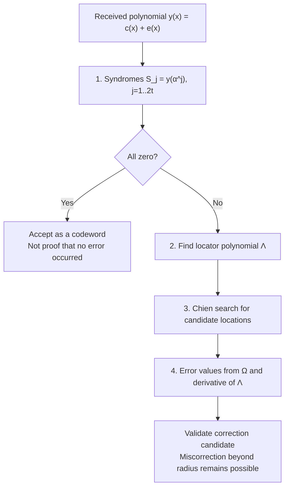
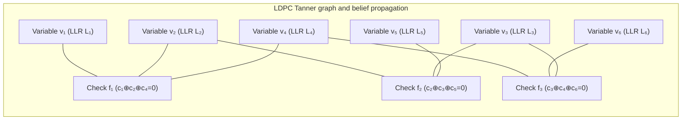
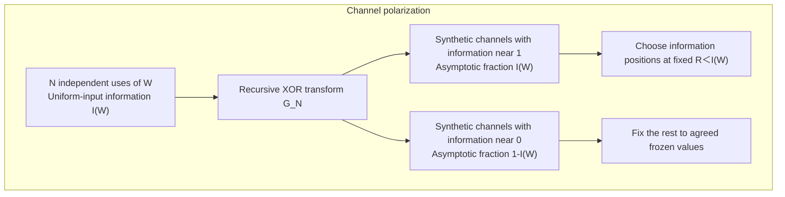

## 1. Introduction: what deep-space communication and QR codes share

How can a receiver recover data from a faint spacecraft signal or a partly damaged QR code? **Error-correcting codes (ECC)** add structured redundancy. The receiver uses that structure to infer and repair corrupted values. Recovery has limits: no finite amount of redundancy can correct arbitrary destruction.

### Deep-space communication: receive a weak signal, then correct residual errors

Voyager 1 and Voyager 2 launched in 1977 and visited Jupiter and Saturn; Voyager 2 continued to Uranus and Neptune. They did not both tour all four planets. Here we discuss their planetary-encounter communications, rather than treating today's changing distances or received powers as permanent constants.

A spacecraft's high-gain antenna directs radio energy toward Earth, where the Deep Space Network (DSN) receives the weak signal. Attenuation and thermal noise still leave errors after demodulation. For scale, the unit conversion is $10^{-16}\,\mathrm{W}=100\,\mathrm{aW}$. This is a conversion, not a measurement for a particular date and receiving station.

A JPL report prepared for Voyager 2's Uranus encounter describes an inner convolutional code and an outer $[255,223]$ Reed–Solomon (RS) code. The stages reduce the effects of noise; they do not guarantee that every received block or every image pixel is always error-free.

### QR codes: correction percentages are not arbitrary areas you may cover

QR codes also use RS codes. DENSO WAVE describes restoration levels of roughly 7%, 15%, 25%, and 30%, measured in **8-bit codewords**. This does not mean a logo may cover any chosen 30% of the image. Patterns needed for localization, the damage distribution across RS blocks, and imaging conditions all matter. Nor is there a universal ten-millisecond decoding guarantee.


We will connect channel capacity, Hamming distance, finite-field polynomials, and probabilistic graph algorithms. Keep two guarantees separate: **correcting every pattern up to a specified number of errors** and **making an error probability arbitrarily small as block length grows**.

---

## 2. Shannon's channel-coding theorem and its assumptions

### 2.1 Repetition improves reliability at the expense of rate

Sending a bit repeatedly lets a receiver use majority voting. However, with repetition alone, improving reliability consumes more channel uses per information bit. That is a limitation of this construction, not proof that all coding methods face the same trade-off.

Consider a memoryless binary symmetric channel (BSC) with independent crossover probability $0<p<1/2$. A length-three repetition code maps one information bit to:

$$
0 \mapsto 000, \qquad 1 \mapsto 111
$$

A majority error occurs when two or three transmitted bits flip:

$$
P_e^{(3)} = \binom{3}{2} p^2 (1-p) + \binom{3}{3} p^3 = 3p^2(1-p) + p^3
$$

At $p=0.01$, this is $0.000298$, approximately $0.03\%$. We have reduced the error probability, but the code rate is:

$$
R = \frac{k}{n} = \frac{1}{3}
$$

For general odd $n=2t+1$, majority voting fails if at least $t+1$ bits flip:

$$
P_e^{(n)} = \sum_{i = (n+1)/2}^{n} \binom{n}{i} p^i (1-p)^{n-i}
$$

The law of large numbers gives $P_e^{(n)}\to0$, but:

$$
n \to \infty \implies P_e^{(n)} \to 0 \quad \text{but simultaneously} \quad R = \frac{1}{n} \to 0
$$

A Chernoff bound makes this quantitative, using natural-log relative entropy:

$$
P_e^{(n)}\le \exp\!\left[-nD(1/2\parallel p)\right],\qquad D(a\parallel p)=a\ln\frac ap+(1-a)\ln\frac{1-a}{1-p}.
$$

It is an upper bound on this independent-noise repetition model. It does not prove that every code must have a vanishing rate.

### 2.2 Capacity and the noisy-channel coding theorem

Shannon's 1948 work showed that a noisy channel can support a fixed positive information rate while the decoding error probability becomes arbitrarily small.

> **Channel-coding theorem for a finite-alphabet discrete memoryless channel:** For transition law $W(y\mid x)$, capacity is $C=\max_{P(X)}I(X;Y)\ge0$, in bits per channel use. For any fixed $0<R<C$, there is a sequence of increasingly long codes and decoding rules whose block error probability tends to zero. A rate above $C$ cannot have an error probability tending to zero.

Capacity need not be positive: if the output is independent of the input, $C=0$. With input-cost or power constraints, optimization must respect those constraints. A channel's capacity is not determined by a single noise-magnitude statistic alone.

This is an asymptotic existence result. It neither promises that one finite code corrects every possible noise pattern nor automatically supplies an efficient decoder. Delay, computation, and target error probability remain engineering constraints.

### 2.3 Deriving BSC capacity

For a discrete memoryless channel:

$$
C = \max_{P(X)} I(X; Y) = \max_{P(X)} \bigl( H(Y) - H(Y \mid X) \bigr)
$$

Write a BSC output as $Y=X\oplus E$, where the noise bit $E$ is independent of $X$ and has probability $p$ of being one. Given the input, the remaining uncertainty is the binary entropy:

$$
H(Y \mid X) = H_2(p) \triangleq -p \log_2 p - (1-p) \log_2(1-p)
$$

Because $Y$ is binary, $H(Y)\le1$ bit. Uniform input makes the output uniform and attains this bound, giving:

$$
C_{\text{BSC}}(p) = 1 - H_2(p) = 1 + p\log_2 p + (1-p)\log_2(1-p) \quad [\text{bits / channel use}]
$$

For example:

$$
H_2(0.1) = -0.1 \log_2(0.1) - 0.9 \log_2(0.9) \approx 0.4690\text{ bits}
$$

$$
C_{\text{BSC}}(0.1) = 1 - 0.4690 = 0.5310\text{ bits / channel use}
$$

A fixed rate below this capacity, such as $R=0.5$, can therefore have arbitrarily small error with sufficiently long, suitable codes. This is not a finite-length zero-error claim at capacity.

The typical-set picture offers intuition. Under independent noise, most error patterns have weights close to $np$; a suitably defined typical set has approximately $2^{nH_2(p)}$ members on an exponential scale. Comparing that scale with $2^n$ suggests:

$$
\frac{2^n}{2^{nH_2(p)}}=2^{n(1-H_2(p))}.
$$

This is an asymptotic counting heuristic, not an exact packing theorem for disjoint noise balls. Typical sets around different codewords may overlap. A random-coding argument bounds the probability of confusing codewords, averaged over codebooks, to establish existence at fixed $R<C$.

### 2.4 AWGN and the wideband limit of $-1.59\,\mathrm{dB}$

A band-limited additive white Gaussian noise (AWGN) model describes continuous waveforms rather than literal independent bit flips. Let bandwidth be $B$ Hz, average received signal power $S$ W, and one-sided noise spectral density $N_0$ W/Hz, giving in-band noise power $N=N_0B$. With an average-power constraint and no binary-input restriction, Shannon–Hartley capacity is:

$$
C_{\text{AWGN}} = B \log_2\!\left(1 + \frac{S}{N}\right) = B \log_2\!\left(1 + \frac{S}{N_0 B}\right) \quad [\text{bits / second}]
$$

Let $E_b$ be received energy per information bit and now let $R$ denote information rate in bits/s, so $S=E_bR$. This use of $R$ has different units from code rate in bits/channel use. Requiring $R<C_{\mathrm{AWGN}}$ gives:

$$
R < B \log_2\!\left(1 + \frac{E_b}{N_0} \frac{R}{B}\right)
$$

Define spectral efficiency $\eta=R/B$ in bits/s/Hz:

$$
\eta < \log_2\!\left(1 + \eta \frac{E_b}{N_0}\right) \iff 2^\eta - 1 < \eta \frac{E_b}{N_0} \iff \frac{E_b}{N_0} > \frac{2^\eta - 1}{\eta}
$$

To find the energy-efficiency lower bound in this ideal model, take $\eta\to0$. Using $2^\eta=1+\eta\ln2+O(\eta^2)$ yields:

$$
\lim_{\eta \to 0} \frac{2^\eta - 1}{\eta} = \ln 2 \approx 0.693147
$$

$$
\left(\frac{E_b}{N_0}\right)_{\min} = \ln 2 \approx 0.6931 \implies 10 \log_{10}(\ln 2) \approx \mathbf{-1.5917\,\text{dB}}
$$

The value is an **infimum in the wideband limit**. At any positive spectral efficiency, $(2^\eta-1)/\eta>\ln2$. The ratio $E_b/N_0$ is not the received signal-to-total-noise power ratio $S/N$; describing it simply as “signal below noise” obscures their different definitions.

Approaching capacity also has block-length and delay costs. This AWGN result is neither a constant governing every physical communication channel nor a promise of error-free finite-time communication. A binary-input constraint, for example, changes the relevant capacity.

---

## 3. Hamming distance, correction guarantees, and the $[7,4,3]$ code

### 3.1 From existence to a computable construction

A useful code needs algorithms for encoding and decoding. Hamming's 1950 work supplies a concrete example: add parity checks and use their disagreements to locate a single flipped bit.

For example, a binary length-1000, rate-$1/2$ code has $2^{500}\approx3.27\times10^{150}$ codewords. Comparing a received vector against every candidate is one possible decoder, not a lower bound on every decoding algorithm. Structure can make decoding far cheaper.

### 3.2 Distance and minimum distance

Binary strings of length $n$ form $\mathbb F_2^n$, the vertices of an $n$-dimensional hypercube. Over $\mathbb F_2$, addition and subtraction are XOR. Hamming distance counts differing coordinates:

$$
d_H(\mathbf{u}, \mathbf{v}) \triangleq \bigl|\{ i \in \{1, \dots, n\} \mid u_i \neq v_i \}\bigr| = w_H(\mathbf{u} - \mathbf{v})
$$

Here $w_H$ counts nonzero entries. Distance satisfies nonnegativity, symmetry, and the triangle inequality. A code is a subset $\mathcal C$ of allowed words. For a binary linear code of dimension $k$, it contains $2^k$ words. Its minimum distance is:

$$
d_{\min}(\mathcal{C}) \triangleq \min_{\substack{\mathbf{u}, \mathbf{v} \in \mathcal{C} \\ \mathbf{u} \neq \mathbf{v}}} d_H(\mathbf{u}, \mathbf{v})
$$

Differences of distinct words in a linear code are nonzero codewords, so:

$$
d_{\min}(\mathcal{C}) = \min_{\mathbf{c} \in \mathcal{C} \setminus \{\mathbf{0}\}} w_H(\mathbf{c})
$$

### 3.3 Detection, erasures, and unknown errors

1. **Detection:** Between one and $d_{\min}-1$ changed coordinates cannot turn a codeword into another codeword. A membership test detects every such nonzero pattern.
2. **Erasures:** If at most $e\le d_{\min}-1$ coordinates are missing at known locations, two codewords cannot agree on every surviving coordinate. Assuming the surviving values are correct, the transmitted word is uniquely determined.
3. **Unknown-location errors:** A nearest-codeword decoder succeeds for every pattern of at most $t$ errors precisely when the radius-$t$ Hamming balls around distinct codewords are disjoint.

If a received word were in two such balls, the triangle inequality would give:

$$
d_H(\mathbf c_1,\mathbf c_2)\le d_H(\mathbf c_1,\mathbf y)+d_H(\mathbf y,\mathbf c_2)\le2t.
$$

Conversely, two words at distance at most $2t$ have a word within distance $t$ of each: split their differing coordinates between the two choices. Thus:

$$
2t + 1 \le d_{\min} \iff t \le \left\lfloor \frac{d_{\min} - 1}{2} \right\rfloor
$$

Equality $t=\lfloor(d_{\min}-1)/2\rfloor$ specifies the **largest guaranteed radius**, not every smaller valid radius. With up to $t$ unknown errors and $e$ known erasures, the all-pattern guarantee becomes:

$$
\mathbf{d_{\min} \ge 2t + e + 1}
$$

Removing erased coordinates leaves distance at least $d_{\min}-e$; apply the same ball argument there. Some individual received words outside this bound can still be recovered, but success for every permitted error pattern is no longer guaranteed.

A radius-$t$ ball in a $q$-ary space contains $\sum_{i=0}^t\binom ni(q-1)^i$ words. Disjoint balls must fit into the space:

$$
|\mathcal{C}| \cdot \sum_{i=0}^{t} \binom{n}{i} (q-1)^i \le q^n \quad \left(\text{for binary codes: } 2^k \sum_{i=0}^{t} \binom{n}{i} \le 2^n \right)
$$

A code meeting this bound with equality is **perfect**: its decoding balls cover the space without gaps or overlaps. Hamming codes and the binary $[23,12,7]$ and ternary $[11,6,5]$ Golay codes are examples. Classification statements require their hypotheses; nonlinear perfect codes also exist. These examples do not assert that Voyager used both binary and ternary Golay codes.

### 3.4 Explicit Hamming matrices and syndrome decoding

For one-error correction, $1+n=2^{n-k}$ gives $n=7$, $k=4$ when there are three parity bits. Indeed:

$$
2^4 \sum_{i=0}^{1} \binom{7}{i} = 16 \times (1 + 7) = 16 \times 8 = 128 = 2^7
$$

There are 16 radius-one balls, each with one center and seven neighbors. A convenient parity-check matrix places the binary representation of $j$ in column $j$:

$$
\mathbf{H}_{\text{binary}} = \begin{pmatrix} 0 & 0 & 0 & 1 & 1 & 1 & 1 \\ 0 & 1 & 1 & 0 & 0 & 1 & 1 \\ 1 & 0 & 1 & 0 & 1 & 0 & 1 \end{pmatrix} \begin{matrix} \leftarrow 2^2\text{ place} \\ \leftarrow 2^1\text{ place} \\ \leftarrow 2^0\text{ place} \end{matrix}
$$

For example, its fifth column is $(1,0,1)^T$. A systematic code places the four message bits first and three parity bits last. Write $\mathbf G=[\mathbf I_4\mid\mathbf P]$ and $\mathbf H=[\mathbf P^T\mid\mathbf I_3]$:

$$
\mathbf{G}_{4\times 7} = \left(\begin{array}{cccc|ccc} 1 & 0 & 0 & 0 & 1 & 1 & 0 \\ 0 & 1 & 0 & 0 & 1 & 0 & 1 \\ 0 & 0 & 1 & 0 & 0 & 1 & 1 \\ 0 & 0 & 0 & 1 & 1 & 1 & 1 \end{array}\right), \qquad \mathbf{H}_{3\times 7} = \left(\begin{array}{cccc|ccc} 1 & 1 & 0 & 1 & 1 & 0 & 0 \\ 1 & 0 & 1 & 1 & 0 & 1 & 0 \\ 0 & 1 & 1 & 1 & 0 & 0 & 1 \end{array}\right)
$$

Since $\mathbf G\mathbf H^T=0$ over $\mathbb F_2$, every encoded word satisfies:

$$
\mathbf{H}\mathbf{c}^T = \mathbf{0} \pmod 2
$$

For received word $\mathbf y=\mathbf c+\mathbf e$, the syndrome depends only on the error:

$$
\mathbf{s} = \mathbf{H}\mathbf{y}^T = \mathbf{H}(\mathbf{c} + \mathbf{e})^T = \underbrace{\mathbf{H}\mathbf{c}^T}_{=\mathbf{0}} + \mathbf{H}\mathbf{e}^T = \mathbf{H}\mathbf{e}^T \pmod 2
$$

A single error at position $j$ returns column $j$ of the chosen $\mathbf H$. In binary column order, reading syndrome $101_2$ identifies position 5. In **systematic column order**, match the syndrome to a column instead; its numeric value is not generally the position. The code in Section 6 uses that lookup.

A zero syndrome means the received word belongs to the code. Under the at-most-one-error assumption it means no error; without that assumption, noise may have changed one valid word into another. Multiple errors can also cause a single-error decoder to flip an additional, previously correct bit.

For example, message `[1,0,1,1]` encodes to `[1,0,1,1,0,1,0]` with the systematic matrices. Flipping zero-based index 2 yields syndrome `[0,1,1]`, matching column index 2. A fixed seven-bit circuit is constant-sized, but computing syndromes for general length $n$ is not universally $O(1)$.

Adding one overall parity bit gives the extended $[8,4,4]$ code, allowing single-error correction and double-error detection (SECDED) with an appropriate decoding rule. This is a basic model for understanding ECC memory, not the exact architecture of every memory product.

---

## 4. Reed–Solomon codes: finite fields, interpolation, and decoding

### 4.1 Why bit-level single-error correction is insufficient for bursts

The Hamming $(7,4)$ code corrects one bit anywhere in a block. Damage on a medium or a fading event may affect many adjacent bits in the same block. A two-bit error already causes the single-error decoder to miscorrect.

Reed and Solomon's 1960 construction works with finite-field **symbols**. Grouping bits changes the unit in which distance and correction capability are measured. Interleaving and placement also matter: a physical stain need not correspond to one neat contiguous run in a serialized bitstream.

### 4.2 A byte as a finite-field element

An $m$-bit symbol can be represented in $\mathbb F_{2^m}$. Ordinary integer arithmetic modulo 256 is not the same thing. It has zero divisors: $2\cdot128\equiv0\pmod{256}$ and $16\cdot16\equiv0\pmod{256}$, for example. Those nonzero elements lack multiplicative inverses. Finite fields exist exactly for prime-power orders.

For GF(256), represent a byte by a polynomial of degree at most seven:

$$
b(x)=b_7x^7+b_6x^6+b_5x^5+b_4x^4+b_3x^3+b_2x^2+b_1x+b_0.
$$

The implementation below reduces products modulo the degree-eight irreducible polynomial encoded by `0x11D`:

$$
\mathbb{F}_{2^8} \cong \frac{\mathbb{F}_2[x]}{\langle x^8 + x^4 + x^3 + x^2 + 1 \rangle}
$$

Addition and subtraction are bitwise XOR because $1+1=0$ in the coefficient field. The 255 nonzero field elements form a cyclic multiplicative group. For this representation, $\alpha=x$, byte `0x02`, is primitive: $\alpha^{255}=1$, and its first 255 powers are distinct. In particular $\alpha^8=x^4+x^3+x^2+1$, byte `0x1D`.

Logarithm and exponent tables can implement nonzero multiplication and division:

$$
A \cdot B = \alpha^{(i + j) \bmod 255}, \qquad \frac{A}{B} = \alpha^{(i - j) \bmod 255}
$$

Zero needs separate treatment, and division by zero is invalid. Table sizes vary; some implementations extend the exponent table to avoid an explicit modulus. Section 6 instead uses bitwise multiplication.

Flipping several bits **within one byte** still counts as one symbol error. Crossing byte boundaries changes multiple symbols. For instance, an unaligned run of eight corrupted bits may touch two bytes.

### 4.3 Polynomial evaluation and the Singleton bound

A degree-at-most-one polynomial is determined by two points with different horizontal coordinates. Transmit five evaluations, and any two correct surviving evaluations recover it after three erasures. Similarly, three distinct horizontal coordinates determine a polynomial of degree at most two.

For $k$ message symbols, make the coefficients of:

$$
P(x) \triangleq m_0 + m_1 x + m_2 x^2 + \dots + m_{k-1} x^{k-1} \in \mathbb{F}_q[x]
$$

Choose $n$ distinct points $\alpha_i\in\mathbb F_q$, with $k\le n\le q$, and send:

$$
\mathbf{c} = \bigl( P(\alpha_1),\; P(\alpha_2),\; \dots,\; P(\alpha_n) \bigr) \in \mathbb{F}_q^n
$$

The factor theorem implies that a nonzero polynomial of degree at most $k-1$ has at most $k-1$ roots in a field. For two different message polynomials $P,Q$, the difference $P-Q$ is such a polynomial. Their evaluations therefore agree in at most $k-1$ positions and differ in at least $n-k+1$.

The Singleton bound supplies the converse: delete any $d_{\min}-1$ coordinates from all codewords. No two projected words can coincide, so $q^k\le q^{n-d_{\min}+1}$. Thus $d_{\min}\le n-k+1$, and RS attains:

$$
\mathbf{d_{\min} = n - k + 1}
$$

This is the **maximum distance separable (MDS)** property. It optimizes minimum distance for the specified length, dimension, and alphabet.

The Vandermonde matrix provides another view. For any $k$ selected evaluation points, the matrix with entries $V_{r,j}=x_r^{j-1}$ has:

$$
\det V=\prod_{1\le r<s\le k}(x_s-x_r)\ne0.
$$

Its columns are independent, and those $k$ evaluations uniquely determine the coefficients. This concerns a matrix of evaluations, not a claim that the scalar coordinates themselves are linearly independent.

With redundancy $r=n-k$, the error/erasure guarantee is $2t+e\le r$:

- **Known erasures:** Up to $n-k$ symbols can be missing. Any $k$ correct survivors reconstruct $P$ by Lagrange interpolation:

$$
P(x) = \sum_{j=1}^{k} y_{i_j} \prod_{\substack{m=1 \\ m \neq j}}^{k} \frac{x - x_{i_m}}{x_{i_j} - x_{i_m}}
$$

- **Unknown errors:** Up to $\lfloor(n-k)/2\rfloor$ corrupted symbols can be corrected, regardless of how many bits changed inside each affected symbol.

### 4.4 Cyclic encoding and a convention-specific Forney formula

Evaluation encoding treats message symbols as polynomial coefficients and sends evaluations. In a cyclic description, codeword coordinates are coefficients of a different polynomial divisible by a generator. The full-length $n=q-1$ code using nonzero points has an equivalent cyclic representation after specifying the correspondence. A shortened code need not remain cyclic at its shortened length.

Fix redundancy $n-k=2t$ and first generator root $\alpha^1$ for this derivation. These conventions do not describe every QR or spacecraft format:

$$
g(x)=\prod_{j=1}^{2t}(x-\alpha^j)
$$

Set $r(x)=x^{2t}m(x)\bmod g(x)$. Shifting the message and subtracting the remainder gives:

$$
c(x)=x^{2t}m(x)-r(x),\qquad c(\alpha^j)=0\quad(1\le j\le2t)
$$

Subtraction is XOR in characteristic two.



1. **Syndromes:** Let $\nu\le t$ errors have locations $i_l$ and nonzero values $Y_l=e_{i_l}$. Define $X_l=\alpha^{i_l}$. Evaluating at the generator roots removes the transmitted codeword:

$$
S_j=y(\alpha^j)=e(\alpha^j)=\sum_{l=1}^{\nu}Y_lX_l^j,\qquad j=1,\ldots,2t
$$

A zero syndrome establishes code membership, not the absence of channel errors.

2. **Locator polynomial:** Define:

$$
\Lambda(z)=\prod_{l=1}^{\nu}(1-X_lz)=1+\Lambda_1z+\cdots+\Lambda_\nu z^\nu
$$

Multiplying $\Lambda(X_l^{-1})=0$ by $Y_lX_l^{j+\nu}$ and summing gives the linear recurrence:

$$
S_{j+\nu}+\Lambda_1S_{j+\nu-1}+\cdots+\Lambda_\nu S_j=0,\qquad1\le j\le2t-\nu
$$

Berlekamp–Massey finds a shortest recurrence and a candidate locator, normally with $O(t^2)$ field operations. An extended Euclidean approach can solve the associated key equation as well.

3. **Chien search:** Test the nonzero elements $\alpha^{-i}$ corresponding to codeword coordinates. A root of $\Lambda$ identifies a candidate location. GF(256) has 255 nonzero elements but 256 elements in total. A decoder must check conditions such as agreement between locator degree and the number of admissible roots.

4. **Error values:** Explicitly define the syndrome polynomial and evaluator:

$$
S(z)=S_1+S_2z+\cdots+S_{2t}z^{2t-1},\qquad \Omega(z)=S(z)\Lambda(z)\bmod z^{2t}
$$

With precisely these definitions, Forney's formula is:

$$
Y_l=-\frac{\Omega(X_l^{-1})}{\Lambda'(X_l^{-1})}
$$

For one error, $\Omega=YX$ and $\Lambda'=-X$, giving $Y$. An additional factor $X$ would instead return $XY$. Other first-root or syndrome-polynomial conventions can change the factor, so formulas cannot be transplanted without their definitions. In characteristic two, the formal derivative is:

$$
\Lambda'(z)=\sum_{\substack{j\ge1\\j\ \mathrm{odd}}}\Lambda_jz^{j-1}.
$$

Subtract the estimated errors, then check code membership and the number of changed symbols. These checks still cannot detect every beyond-radius corruption: a received word may be close to a different valid codeword. CRCs, retransmission, or higher-layer checks can provide additional protection.

### 4.5 QR, storage erasures, and Voyager's concatenated codes

- **QR:** The approximate L/M/Q/H restoration levels are 7/15/25/30 percent of codewords. Each RS block must satisfy its own correction conditions. Versions and levels differ in payload, redundancy, and block division; there is no fixed conversion from those percentages to arbitrary logo area. Covering functional patterns can prevent recognition before RS decoding starts.
- **RAID-6 and distributed storage:** A missing drive or chunk at a known location is an erasure. An illustrative $[14,10]$ MDS code uses $14/10=1.4$ times the data capacity and tolerates any four missing chunks, provided the survivors and required metadata are correct. This is not a universal configuration of named cloud providers. RAID-6's two parity units similarly support two-drive recovery under its assumptions; additional latent corruption or loss of the whole installation is outside that guarantee.
- **Voyager 2:** The 1983 JPL report describes a constraint-length-7, rate-$1/2$ convolutional code, depth-four interleaving, and a $[255,223]$ RS outer code. Its 32 redundant bytes support $2t+e\le32$ per RS word, or 16 unknown byte errors. A contiguous 128-bit run can span 17 bytes if not byte-aligned. Interleaving distributes residual inner-decoder bursts across RS words. The inner code in this Voyager example is convolutional, not LDPC.

---

## 5. LDPC, turbo, and Polar codes: reliability information and capacity

### 5.1 Distance is only part of practical performance

A practical code must satisfy error-rate, delay, block-length, computation, and hardware constraints. Brute-force maximum-likelihood comparison for a binary dimension-$k$ code examines $2^k$ candidates. A good minimum distance does not automatically make such decoding efficient.

Turbo and LDPC iterative decoding exploit reliability information; Polar codes use a different construction to approach symmetric capacity. Comparisons must hold channel model, input constraints, and rate consistent. The wideband $-1.59\,\mathrm{dB}$ bound is not the appropriate universal reference for every rate or modulation.

### 5.2 Sparse parity checks and belief propagation

Gallager's LDPC codes use a sparse parity-check matrix $\mathbf H$ of shape $m\times n$. Even with long blocks, the number of nonzero entries per row and column can remain small. Dimension is $k=n-\operatorname{rank}_{\mathbb F_2}(\mathbf H)$, not necessarily $n-m$.

For a regular-degree example, $n=10000$, $m=5000$, column degree 3 and row degree 6 imply 30000 ones in 50 million entries: 99.94% zeros. That alone does not establish rank 5000 or dimension 5000.

In a Tanner graph, variable nodes correspond to columns/bits, check nodes to rows/parity equations, and an edge exists exactly where $H_{a,i}=1$:



Soft-decision decoding retains a log-likelihood ratio (LLR) rather than immediately rounding the observation to a bit:

$$
L(c_i) \triangleq \ln \frac{\Pr(c_i = 0 \mid y_i)}{\Pr(c_i = 1 \mid y_i)}
$$

For equally likely inputs, unit-amplitude BPSK $0\mapsto+1$, $1\mapsto-1$, independent Gaussian noise $Z\sim\mathcal N(0,\sigma^2)$, and observation $y_i=x_i+Z$:

$$
L_{\mathrm{ch}}(c_i)=\ln\frac{p(y_i\mid c_i=0)}{p(y_i\mid c_i=1)}=\frac{2y_i}{\sigma^2}
$$

Different amplitudes or priors change this expression. An LLR of $+10$ strongly favors zero; $-0.1$ only weakly favors one.

Sum-product belief propagation exchanges **extrinsic** messages, excluding the receiving neighbor's own contribution:

$$
\mu_{f_a \to v_i} = 2 \operatorname{artanh}\!\left( \prod_{v_j \in N(f_a) \setminus \{v_i\}} \tanh\!\left(\frac{\mu_{v_j \to f_a}}{2}\right) \right)
$$

$$
\mu_{v_i \to f_a} = L_{\text{ch}}(v_i) + \sum_{f_b \in N(v_i) \setminus \{f_a\}} \mu_{f_b \to v_i}
$$

Here $N$ denotes the relevant neighbor set. In a flooding schedule, variable-to-check messages use the preceding check-to-variable messages, then checks update their outgoing messages. Iteration labels specify that schedule without changing the neighbor-exclusion rule.

Sparsity reduces edge count but does not by itself eliminate short cycles. On a tree, belief propagation computes exact marginal probabilities. On a finite loopy graph, dependent messages, trapping sets, and nonconvergence can leave errors.

With $E$ edges, an implementation that shares computations across outgoing neighbors uses roughly $O(E)$ work per iteration, or $O(IE)$ for $I$ iterations. Bounded degrees can give $E=O(n)$, but the necessary number of iterations is not automatically constant. Numerical implementations must handle LLR saturation and the domain of $\operatorname{artanh}$.

Chung and colleagues' 2001 result concerns a **rate-$1/2$, binary-input AWGN channel**. Its density-evolution threshold is within 0.0045 dB of that channel's capacity limit asymptotically. A separate finite-length simulation in the paper uses a simpler design, length $10^7$, and BER $10^{-6}$ at a gap of 0.04 dB. Neither number is a universal finite-device performance guarantee or the wideband energy bound.

### 5.3 Polar codes and symmetric capacity

Arıkan's 2009 construction approaches $I(W)$, the mutual information of a binary-input discrete memoryless channel under **uniform input**. For symmetric channels this equals capacity $C$; for general asymmetric channels it need not equal the maximum over all input distributions.

The basic XOR transform is:

$$
(x_1,x_2)=(u_1,u_2)\begin{pmatrix}1&0\\1&1\end{pmatrix} =(u_1\oplus u_2,u_2)
$$

The synthetic channel $W^-$ estimates $u_1$ from $(y_1,y_2)$. The synthetic channel $W^+$ estimates $u_2$ from $(y_1,y_2,u_1)$ with the correct $u_1$ supplied. For uniform independent input bits, the chain rule gives:

$$
I(W^-)+I(W^+)=2I(W),\qquad I(W^-)\le I(W)\le I(W^+)
$$

“Better” and “worse” refer here to information, without asserting a strict change in every case. A real sequential decoder can propagate an earlier decision error to later bits.

For $N=2^m$, one convention uses bit-reversal permutation $\mathbf B_N$ and generator:

$$
\mathbf G_N=\mathbf B_N \begin{pmatrix}1&0\\1&1\end{pmatrix}^{\otimes m}
$$

For any fixed $0<\delta<1$, polarization gives the following limiting fractions:

$$
\lim_{N\to\infty}\frac{|\{i: I(W_N^{(i)})>1-\delta\}|}{N}=I(W)
$$

$$
\lim_{N\to\infty}\frac{|\{i: I(W_N^{(i)})<\delta\}|}{N}=1-I(W).
$$

At finite $N$, exactly $NI(W)$ channels do not suddenly become perfectly noiseless.



Select information positions at a fixed rate $R<I(W)$ and freeze the remaining inputs to agreed values. For a general channel, the original theorem uses averaging over frozen values and existence of an appropriate choice. For a symmetric channel, the corresponding bound holds for any fixed frozen values.

Encoding and **successive cancellation (SC)** decoding take $O(N\log N)$ time. Choosing the information set is a separate construction cost. An efficient **successive cancellation list (SCL)** implementation with list size $L$ uses $O(LN\log N)$ time; CRC-aided variants help select a candidate. Finite-length error probability and delay depend on code construction, rate, list size, and channel. There is no general finite-length zero-error-floor guarantee.

### 5.4 Comparing the families

| Code | Mathematical structure | Representative decoding | Features and uses |
| :--- | :--- | :--- | :--- |
| Hamming (1950) | Binary linear code; $[7,4,3]$ is perfect | Syndrome-to-column matching | Single-bit correction; a basic model for SECDED |
| Reed–Solomon (1960) | Finite-field polynomials; MDS | BM/Euclidean, Chien, Forney; Welch–Berlekamp for evaluation codes | Symbol errors and erasures; QR, storage, concatenated telemetry |
| Convolutional and turbo | Trellises, concatenation, interleaving | Viterbi; iterative BCJR-type decoding | Noisy communication; Voyager's inner code is convolutional |
| LDPC (1962) | Sparse parity checks and Tanner graph | Soft-decision belief propagation and variants | Long blocks and parallelism; capacity-near designs for specified models and rates |
| Polar (2009) | Recursive polarization and frozen bits | SC $O(N\log N)$; SCL depends on $L$ | Asymptotically approaches symmetric capacity; specified 5G NR control information |

Methods sharing a row need not have identical complexity or error rates. Nor is every 5G control payload Polar-coded. For example, 3GPP TS 38.212 v19.3.0, Clauses 6.3.1.2–6.3.1.3, distinguishes Polar coding for PUCCH UCI payload $A\ge12$ from small-block-length coding for $A\le11$.

---

## 6. Python verification: Hamming and evaluation RS over GF(256)

This self-contained Python 3 example implements the systematic Hamming $(7,4)$ code and the **evaluation RS code** of Section 4.3. RS message symbols are polynomial coefficients; the message does not generally appear unchanged at the beginning of the codeword. This is not Section 4.4's BM decoder, a QR bit-placement/block parser, or a compatible spacecraft wire format.

The field is GF(256), using `0x11D`. It differs from the prime field GF(257), which uses integer residues modulo 257. The latter supports evaluation codes too, but an evaluated symbol can equal 256 and therefore does not always fit in one byte.

The decoder uses a Welch–Berlekamp-style system. For candidate locator degrees $\nu=0,\ldots,t$, solve for monic $E(x)$ of degree $\nu$ and $Q(x)$ of degree $<k+\nu$:

$$
Q(x_i)=y_iE(x_i)\qquad(i=1,\ldots,n)
$$

There are $k+2\nu$ unknown coefficients. In characteristic two, moving terms across the equation uses the same XOR operation as addition.

If the actual message polynomial is $P$ and there are at most $\nu$ errors, choose $E$ vanishing at the error points, padding its degree if necessary, and set $Q=PE$. Conversely, for any solution and $n\ge k+2\nu$, the polynomial $Q-PE$ vanishes at at least $n-\nu$ correct positions but has degree less than $k+\nu$, so it must be zero. This root-count argument justifies recovery, rather than merely assuming a solved linear system must contain the right message.

The implementation tries candidate degrees from zero through $t$, handles rank deficiency and rectangular systems, divides $Q$ by $E$, checks zero remainder and degree below $k$, then re-encodes and checks received distance at most $t$. It works for zero or fewer-than-$t$ errors as well as the boundary. Evaluation points must be distinct field elements; from 1 through 256 points are supported, including zero.

Readability is the priority. Trying up to $t+1$ general Gaussian eliminations is not a claim of production RS speed. Public `rs_encode` and `rs_decode` validate values, lengths, points, and radius. Internal polynomial and linear-system helpers assume already validated field elements.

```python
"""Educational evaluation RS over GF(256), not a QR parser or wire format."""
from itertools import product


def field_value(a):
    if type(a) is not int or not 0 <= a < 256:
        raise ValueError("Field elements must be integers from 0 through 255")
    return a


def gf_mul(a, b):
    field_value(a)
    field_value(b)
    result = 0
    for _ in range(8):
        if b & 1:
            result ^= a
        b >>= 1
        a <<= 1
        if a & 256:
            a ^= 0x11D
    return result


def gf_pow(a, exponent):
    field_value(a)
    if type(exponent) is not int or exponent < 0:
        raise ValueError("Exponent must be a nonnegative integer")
    result = 1
    while exponent:
        if exponent & 1:
            result = gf_mul(result, a)
        a = gf_mul(a, a)
        exponent >>= 1
    return result


def gf_inv(a):
    field_value(a)
    if a == 0:
        raise ZeroDivisionError("Zero has no multiplicative inverse")
    return gf_pow(a, 254)


def poly_trim(coefficients):
    result = list(coefficients)
    while result and result[-1] == 0:
        result.pop()
    return result


def poly_eval(coefficients, x):
    result = 0
    for coefficient in reversed(coefficients):
        result = gf_mul(result, x) ^ coefficient
    return result


def poly_divmod(numerator, denominator):
    remainder = poly_trim(numerator)
    denominator = poly_trim(denominator)
    if not denominator:
        raise ZeroDivisionError("Zero polynomial divisor")
    quotient = [0] * max(0, len(remainder) - len(denominator) + 1)
    inverse_lead = gf_inv(denominator[-1])
    while remainder and len(remainder) >= len(denominator):
        degree = len(remainder) - len(denominator)
        factor = gf_mul(remainder[-1], inverse_lead)
        quotient[degree] = factor
        for j, coefficient in enumerate(denominator):
            remainder[degree + j] ^= gf_mul(factor, coefficient)
        remainder = poly_trim(remainder)
    return poly_trim(quotient), remainder


def solve_linear_system(rows, rhs, columns):
    """Return one solution (free variables zero), or None if inconsistent."""
    if len(rows) != len(rhs) or any(len(row) != columns for row in rows):
        raise ValueError("Linear-system dimensions do not match")
    matrix = [list(row) + [value] for row, value in zip(rows, rhs)]
    pivot_columns = []
    pivot_row = 0
    for column in range(columns):
        pivot = next(
            (r for r in range(pivot_row, len(matrix)) if matrix[r][column]),
            None,
        )
        if pivot is None:
            continue
        matrix[pivot_row], matrix[pivot] = matrix[pivot], matrix[pivot_row]
        inverse = gf_inv(matrix[pivot_row][column])
        matrix[pivot_row] = [gf_mul(value, inverse) for value in matrix[pivot_row]]
        for r in range(len(matrix)):
            if r != pivot_row and matrix[r][column]:
                factor = matrix[r][column]
                matrix[r] = [
                    a ^ gf_mul(factor, b)
                    for a, b in zip(matrix[r], matrix[pivot_row])
                ]
        pivot_columns.append(column)
        pivot_row += 1
        if pivot_row == len(matrix):
            break
    if any(not any(row[:columns]) and row[columns] for row in matrix):
        return None
    solution = [0] * columns
    for r, column in enumerate(pivot_columns):
        solution[column] = matrix[r][columns]
    return solution


def check_points(points):
    points = list(points)
    if not points or len(points) > 256:
        raise ValueError("Use from 1 through 256 distinct evaluation points")
    for x in points:
        field_value(x)
    if len(set(points)) != len(points):
        raise ValueError("Evaluation points must be distinct")
    return points


def rs_encode(message, points):
    points = check_points(points)
    message = list(message)
    if not 1 <= len(message) <= len(points):
        raise ValueError("Require 1 <= message length <= code length")
    for value in message:
        field_value(value)
    return [poly_eval(message, x) for x in points]


def rs_decode(received, points, k, max_errors):
    points = check_points(points)
    received = list(received)
    n = len(points)
    if len(received) != n:
        raise ValueError("Received length must match evaluation points")
    if type(k) is not int or not 1 <= k <= n:
        raise ValueError("Require integer 1 <= k <= n")
    if type(max_errors) is not int or max_errors < 0 or k + 2 * max_errors > n:
        raise ValueError("Require integer t >= 0 and k + 2t <= n")
    for value in received:
        field_value(value)
    # Try locator degrees 0,...,t: fewer than t errors must also work.
    for errors in range(max_errors + 1):
        columns = k + 2 * errors
        rows, rhs = [], []
        for x, y in zip(points, received):
            powers = [gf_pow(x, degree) for degree in range(k + errors)]
            rows.append(
                powers + [gf_mul(y, gf_pow(x, degree)) for degree in range(errors)]
            )
            rhs.append(gf_mul(y, gf_pow(x, errors)))
        solution = solve_linear_system(rows, rhs, columns)
        if solution is None:
            continue
        q = solution[:k + errors]
        locator = solution[k + errors:] + [1]
        message, remainder = poly_divmod(q, locator)
        if remainder or len(message) > k:
            continue
        message += [0] * (k - len(message))
        codeword = rs_encode(message, points)
        distance = sum(a != b for a, b in zip(codeword, received))
        if distance <= max_errors:
            return message
    raise ValueError("No codeword within the requested correction radius")


G = (
    (1, 0, 0, 0, 1, 1, 0),
    (0, 1, 0, 0, 1, 0, 1),
    (0, 0, 1, 0, 0, 1, 1),
    (0, 0, 0, 1, 1, 1, 1),
)
H = (
    (1, 1, 0, 1, 1, 0, 0),
    (1, 0, 1, 1, 0, 1, 0),
    (0, 1, 1, 1, 0, 0, 1),
)


def bits(values, length):
    values = list(values)
    if len(values) != length or any(type(v) is not int or v not in (0, 1) for v in values):
        raise ValueError("Invalid bit vector")
    return values


def hamming_encode(message):
    message = bits(message, 4)
    return [sum(message[i] * G[i][j] for i in range(4)) % 2 for j in range(7)]


def hamming_decode(received):
    received = bits(received, 7)
    syndrome = [sum(H[r][j] * received[j] for j in range(7)) % 2 for r in range(3)]
    if any(syndrome):
        position = next(j for j in range(7) if [H[r][j] for r in range(3)] == syndrome)
        received[position] ^= 1
    return received[:4]


if __name__ == "__main__":
    hamming_cases = 0
    for message in product((0, 1), repeat=4):
        codeword = hamming_encode(message)
        for position in range(-1, 7):
            received = codeword.copy()
            if position >= 0:
                received[position] ^= 1
            assert hamming_decode(received) == list(message)
            hamming_cases += 1
    print("Hamming no-error/single-error cases:", hamming_cases)

    payload = b"VOYAGER-1"
    points = list(range(1, 16))
    codeword = rs_encode(payload, points)
    print("GF(256) evaluation codeword:", codeword)
    for count in range(4):
        received = codeword.copy()
        for position in range(count):
            received[position] ^= position + 1
        recovered = bytes(rs_decode(received, points, len(payload), 3))
        print("RS corrupted symbols:", count, "recovered:", recovered.decode("ascii"))
        assert recovered == payload
    # A decoder can miscorrect beyond the transmitted word's guaranteed radius.
    # Construct a received word close to a DIFFERENT valid word.
    alternative = list(payload)
    alternative[0] ^= 1
    alternative_codeword = rs_encode(alternative, points)
    received = alternative_codeword.copy()
    received[0] ^= 1
    assert rs_decode(received, points, len(payload), 3) == alternative
    print("Beyond-radius example returns another nearby codeword:", True)
```

Actual output:

```text
Hamming no-error/single-error cases: 128
GF(256) evaluation codeword: [77, 162, 167, 64, 87, 173, 26, 217, 215, 33, 189, 173, 212, 41, 124]
RS corrupted symbols: 0 recovered: VOYAGER-1
RS corrupted symbols: 1 recovered: VOYAGER-1
RS corrupted symbols: 2 recovered: VOYAGER-1
RS corrupted symbols: 3 recovered: VOYAGER-1
Beyond-radius example returns another nearby codeword: True
```

Nine message bytes become 15 symbols, giving minimum distance 7 and guaranteed radius 3 symbols. Three of fifteen is 20%, not 30%. The demo corrupts zero through three initial positions; the same count guarantee applies to nonadjacent positions.

Another valid choice of evaluation points is $\alpha^0,\ldots,\alpha^{14}$, with zero-based error positions `[1,6,13]`. The decoder supports that case too. Using byte-valued points `1..15` instead changes the codeword. Three nonadjacent byte errors are not a contiguous 24-bit burst.

The final example constructs a received word close to a **different** valid word. The decoder returns that word and passes its distance check: a beyond-radius change cannot always be detected. Hamming decoding likewise may miscorrect when its at-most-one-error assumption is violated.

Finite independent checks cover all 65,536 GF(256) products and a separately generated complete 65,536-word length-4, dimension-2 codebook. Radius-one decoding was compared against that full codebook for the 256 received vectors with symbols restricted to 0 through 3. Additional checks cover every single-error location and nonzero magnitude for three messages including zero, fixed-seed cases at several lengths and error counts, rank-deficient systems, and invalid inputs. This is finite evidence, not execution on every possible input, QR interoperability, or a hardware communication experiment.

---

## 7. Choosing between RS, LDPC, and Polar

Why not use MDS codes everywhere? MDS optimizes **minimum symbol distance at a fixed length and dimension**. It does not simultaneously optimize soft-information use, probabilistic decoding performance, delay, and hardware cost.

1. **Field size and block length:** Section 4.3's evaluation code has $n\le q$. Over GF(256), including zero permits 256 evaluation symbols; the usual full-length nonzero-point cyclic form has 255. Extensions and concatenation also exist. “Every RS code stops at 255 bytes” is too broad. Long binary codes represented by sparse graphs offer a different design advantage.
2. **Soft information:** Hard rounding discards observation reliability, which soft LDPC and Polar decoders can exploit. The gain is not universally 2 dB: channel, modulation, rate, and target error probability affect the comparison. RS also has soft-information decoding approaches, so “RS can only use hard decisions” is incorrect.
3. **Memory-cell conditions:** TLC stores three bits per cell using eight distinguishable states; QLC stores four using sixteen. Overlapping voltage distributions, retention changes, and rewriting can cause errors. Additional reads can provide useful reliability information, but not every SSD has the same decoder, raw error rate, or uncorrectable-error rate. Extra sensing time and energy belong in the trade-off.

RS's any-$k$-survivors property is convenient for known-position storage erasures; long soft-decision codes are valuable on noisy physical links. Different coding layers can coexist within one system. 5G, SSDs, and QR codes are better compared through their error models and constraints than described as one universal migration from old codes to new ones.

---

## 8. Conclusion: use redundancy with an explicit guarantee

Error correction gives data structure and exploits assumptions about how corruption occurs.

1. Shannon's theorem promises arbitrarily small error probability along a suitable sequence of increasingly long codes below capacity for the specified channel and input constraints. It is not finite-length absolute reliability.
2. Minimum distance gives an all-pattern guarantee: $2t+e<d_{\min}$ for $t$ unknown errors and $e$ erasures. Hamming syndrome decoding makes that guarantee concrete.
3. RS uses finite-field polynomial roots and interpolation to attain $d_{\min}=n-k+1$. Implementations must fix their conventions and consider beyond-radius miscorrection.
4. LDPC uses sparse probabilistic graphs and Polar uses polarization. Asymptotic thresholds, finite-length performance, and SC/SCL complexity describe different aspects of their behavior.

Reliable QR scanning and deep-space reception depend on the redundancy, error units and distributions, decoder checks, and remaining failure probability working together. The useful promise is a specified level of protection under stated conditions, not recovery from every conceivable damaged input.

References:

- [DENSO WAVE: QR error correction](https://www.qrcode.com/en/about/error_correction.html) — restoration levels and codewords.
- [JPL: Voyager 2](https://www.jpl.nasa.gov/missions/voyager-2/) — the planetary route.
- [Lorden, McEliece, and Swanson: Node Synchronization for the Viterbi Decoder (1983)](https://tda.jpl.nasa.gov/progress_report/42-73/73C.PDF) — p.22 on concatenation and practical synchronization issues.
- [Forney: Introduction to Algebraic Coding Theory, MIT 6.451, Chapter 8](https://ocw.mit.edu/courses/6-451-principles-of-digital-communication-ii-spring-2005/01060b08ba74792ee8d85eb82b9efdb4_chap8.pdf) — pp.101–110 on distance, evaluation RS, and Welch–Berlekamp-style reconstruction.
- [Chung et al.: On the Design of LDPC Codes within 0.0045 dB of the Shannon Limit (2001)](https://www.cse.lehigh.edu/~jingli/teach/S2003turbo/notes/zeroZeroFourFive.pdf) — p.58 distinguishes thresholds from a finite-length simulation.
- [Arıkan: Channel Polarization (2009)](https://arxiv.org/abs/0807.3917) — symmetric capacity and encoding/SC decoding; the introductory definitions and theorems.
- [Tal and Vardy: List Decoding of Polar Codes](https://arxiv.org/abs/1206.0050) — efficient SCL time and space complexity.
- [Östergård and Pottonen: classification of perfect binary one-error-correcting codes of length 15](https://arxiv.org/abs/0806.2513) — perfect codes are not a single linear construction.
- [Elkies: The Theory of Error-Correcting Codes (2013)](https://people.math.harvard.edu/~elkies/M256.13/index.html) — lectures on perfect and Golay codes.
- [ETSI TS 138 212 v19.3.0 (2026-04)](https://www.etsi.org/deliver/etsi_ts/138200_138299/138212/19.03.00_60/ts_138212v190300p.pdf) — Clauses 6.3.1.2–6.3.1.3 on UCI coding choices.
