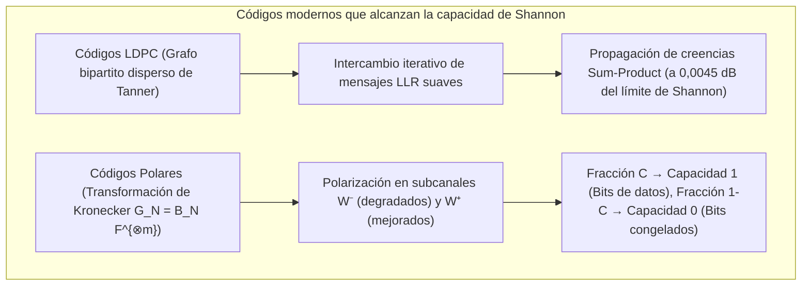

## 1. Introducción: Dos milagros cotidianos de resurrección de la información

Tanto en el espacio interestelar como en la cámara de tu teléfono móvil, la ingeniería digital realiza a diario una hazaña que parece desafiar la intuición física: <strong>reconstruir con un 100 % de exactitud bit a bit información digital cuyo canal o soporte físico ha sido severamente dañado por el ruido térmico o la destrucción parcial</strong>.

### Milagro 1: Voyager 1 y 2 transmitiendo a través de 24.000 millones de kilómetros con $10^{-16}\text{ vatios}$

Lanzadas en 1977, las sondas <strong>Voyager 1 y Voyager 2</strong> exploraron Júpiter, Saturno, Urano y Neptuno y hoy navegan por el espacio interestelar a más de <strong>24.000 millones de kilómetros</strong> de la Tierra.
Su transmisor de radio opera con apenas <strong>$23\text{ vatios}$</strong> (menos que la bombilla de un frigorífico). Cuando la señal llega a las antenas de 70 metros de la Red del Espacio Profundo (DSN) de la NASA, la potencia recibida ha caído a <strong>$10^{-16}\text{ vatios}$ ($0,1\text{ atovatios}$)</strong>, sumergida en el <strong>ruido térmico</strong>. Sin embargo, Voyager entregó fotografías en color de una nitidez asombrosa con <strong>cero errores de bit</strong>.

### Milagro 2: Un código QR con el $30\,\%$ de sus módulos cubiertos por café o un logotipo

Del mismo modo, cuando escaneas un <strong>código QR</strong> manchado de café o con un <strong>logotipo corporativo que cubre hasta el $30\,\%$ de su área central</strong>, la cámara de tu smartphone reconstruye la URL o el token de pago en menos de <strong>$10\text{ milisegundos}$</strong> con <strong>cero bits erróneos</strong>.


¿Cómo es esto matemáticamente posible? La respuesta reside en la <strong>Teoría de la Información de Claude Shannon (1948)</strong> y en la ciencia algebraica de los <strong>códigos correctores de errores (ECC)</strong>.

---

## 2. La revolución de Claude Shannon (1948) y el teorema de codificación de canal ruidoso

### 2.1 Por qué fracasa la codificación por repetición ingenua ($0 \to 00000$)

Antes de 1948 se creía que para lograr una probabilidad de error $P_e \to 0$ en un canal ruidoso, la tasa de transmisión $R = k/n$ debía caer inevitablemente a cero.
Con un <strong>código de repetición</strong> de longitud impar $n = 2t + 1$ sobre un <strong>canal binario simétrico (BSC)</strong> con probabilidad de cruce $p \in (0, 0,5)$, la votación por mayoría falla con probabilidad:
$$P_e^{(n)} = \sum_{i = (n+1)/2}^{n} \binom{n}{i} p^i (1-p)^{n-i}$$
Cuando $n \to \infty$, efectivamente $P_e^{(n)} \to 0$, pero al mismo tiempo la tasa de código se desploma: $R = k/n = 1/n \to 0$.

### 2.2 El teorema de Shannon y el límite último de Shannon ($-1,59\,\text{dB}$)

En 1948, <strong>Claude E. Shannon</strong> demostró en *"A Mathematical Theory of Communication"* su revolucionario <strong>teorema de codificación para canales con ruido</strong>:

> <strong>Teorema (Codificación de canal de Shannon, 1948):</strong>
> Todo canal sin memoria posee una <strong>capacidad de canal $C > 0$</strong> estrictamente positiva:
> - Para el <strong>canal binario simétrico (BSC)</strong> con entropía binaria $H_2(p) = -p\log_2 p - (1-p)\log_2(1-p)$:
>   $$C_{\text{BSC}}(p) = 1 - H_2(p) = 1 + p\log_2 p + (1-p)\log_2(1-p) \quad [\text{bits / uso de canal}]$$
> - Para el <strong>canal AWGN</strong> de ancho de banda $B$, potencia de señal $S$ y ruido $N = N_0 B$ (teorema de Shannon-Hartley):
>   $$C_{\text{AWGN}} = B \log_2\!\left(1 + \frac{S}{N}\right) = B \log_2\!\left(1 + \frac{S}{N_0 B}\right) \quad [\text{bits / s}]$$
>
> <strong>Para cualquier tasa de código $R < C$, existen códigos de bloque de longitud $n \to \infty$ con probabilidad de error de decodificación arbitrariamente pequeña ($P_e \to 0$).</strong>

Sustituyendo $S = E_b R$ y tomando el límite de eficiencia espectral $\eta = R/B \to 0$, se obtiene $\frac{E_b}{N_0} > \lim_{\eta \to 0} \frac{2^\eta - 1}{\eta} = \ln 2 \approx 0,6931$, es decir, el <strong>límite último de Shannon</strong>:
$$\left(\frac{E_b}{N_0}\right)_{\min} = \ln 2 \approx 0,6931 \implies 10 \log_{10}(\ln 2) \approx \mathbf{-1,5917\,\text{dB}}$$

---

## 3. El avance geométrico de Richard Hamming (1950): distancia de Hamming y el código $[7, 4, 3]$

### 3.1 Distancia de Hamming $d_H(\mathbf{u}, \mathbf{v})$ y cota de empaquetamiento de esferas

En el hipercubo binario $\mathbb{F}_2^n$, <strong>Richard Hamming</strong> definió en 1950 la <strong>distancia de Hamming $d_H(\mathbf{u}, \mathbf{v})$</strong> como el número de coordenadas en que difieren dos vectores:
$$d_H(\mathbf{u}, \mathbf{v}) \triangleq \bigl|\{ i \in \{1, \dots, n\} \mid u_i \neq v_i \}\bigr| = w_H(\mathbf{u} - \mathbf{v})$$

Para un código $\mathcal{C} \subset \mathbb{F}_q^n$ con <strong>distancia mínima $d_{\min} = \min_{\mathbf{u}\neq\mathbf{v}} d_H(\mathbf{u},\mathbf{v})$</strong>, las esferas de Hamming disjuntas de radio $t$ demuestran que el código puede:
- <strong>Detectar</strong> $d_{\min} - 1$ errores;
- <strong>Corregir $e = d_{\min} - 1$ borrados (erasures)</strong> en posiciones conocidas;
- <strong>Corregir $t = \lfloor(d_{\min} - 1)/2\rfloor$ errores arbitrarios</strong> en posiciones desconocidas:
$$\mathbf{d_{\min} \ge 2t + e + 1}, \qquad |\mathcal{C}| \cdot \sum_{i=0}^{t} \binom{n}{i} (q-1)^i \le q^n \quad \text{(Cota de Hamming)}$$

### 3.2 El código perfecto de Hamming $(7,4)$ y la decodificación por síndrome

Para $n=7, k=4, d_{\min}=3$ ($t=1$), se cumple $2^4 \cdot (1 + 7) = 128 = 2^7$: el código $[7,4,3]$ es un <strong>código perfecto</strong>. Su matriz generadora $\mathbf{G}_{4\times 7} = [\mathbf{I}_4 \mid \mathbf{P}]$ y su matriz de control de paridad $\mathbf{H}_{3\times 7} = [\mathbf{P}^T \mid \mathbf{I}_3]$ ($\mathbf{G}\mathbf{H}^T = \mathbf{0} \pmod 2$) son:
$$\mathbf{G}_{4\times 7} = \left(\begin{array}{cccc|ccc}
1 & 0 & 0 & 0 & 1 & 1 & 0 \\
0 & 1 & 0 & 0 & 1 & 0 & 1 \\
0 & 0 & 1 & 0 & 0 & 1 & 1 \\
0 & 0 & 0 & 1 & 1 & 1 & 1
\end{array}\right), \qquad
\mathbf{H}_{3\times 7} = \left(\begin{array}{cccc|ccc}
1 & 1 & 0 & 1 & 1 & 0 & 0 \\
1 & 0 & 1 & 1 & 0 & 1 & 0 \\
0 & 1 & 1 & 1 & 0 & 0 & 1
\end{array}\right)$$

El <strong>síndrome de 3 bits $\mathbf{s} = \mathbf{H}\mathbf{y}^T = \mathbf{H}(\mathbf{c} + \mathbf{e})^T = \mathbf{H}\mathbf{e}^T \pmod 2$</strong> extrae exactamente la columna de $\mathbf{H}$ correspondiente al bit invertido: ordenando las columnas en binario del $1$ al $7$, <strong>el síndrome $\mathbf{s}$ devuelve directamente el índice binario $(1 \dots 7)$ del bit dañado</strong>, protegiendo hoy toda la memoria <strong>ECC DRAM</strong> de los servidores.

---

## 4. La obra maestra de Reed y Solomon (1960): códigos Reed-Solomon sobre cuerpos de Galois $\mathbb{F}_{2^m}$

### 4.1 Cuerpos de Galois $\text{GF}(2^8)$ e inmunidad frente a errores de ráfaga (Burst Errors)

Para vencer los errores de ráfaga (arañazos en discos, manchas en códigos QR), <strong>Irving Reed</strong> y <strong>Gustave Solomon</strong> (1960) agruparon cada byte ($m=8$ bits) como un único símbolo del cuerpo finito <strong>$\text{GF}(2^8) = \mathbb{F}_2[x]/(x^8 + x^4 + x^3 + x^2 + 1)$</strong>. ¡Aunque se destruyan los 8 bits de un byte, en $\text{GF}(2^8)$ eso constituye <strong>un solo error de símbolo</strong>!

### 4.2 Interpolación polinómica y la cota de Singleton MDS $d_{\min} = n - k + 1$

Los $k$ símbolos de mensaje $(m_0, \dots, m_{k-1}) \in \mathbb{F}_q^k$ definen un polinomio $P(x) = m_0 + m_1 x + \dots + m_{k-1} x^{k-1}$ de grado $< k$, que se evalúa en $n$ puntos distintos $\mathbf{c} = \bigl(P(\alpha_1), \dots, P(\alpha_n)\bigr)$.
Como dos polinomios distintos de grado $\le k-1$ sobre un cuerpo $\mathbb{F}_q$ coinciden en a lo sumo $k-1$ puntos (y <strong>cualesquiera $k$ puntos bastan para reconstruir $P(x)$ por interpolación de Lagrange</strong>), todo código Reed-Solomon $[n, k]$ alcanza la <strong>cota de Singleton con igualdad (código MDS, Maximum Distance Separable)</strong>:
$$\mathbf{d_{\min} = n - k + 1 \implies 2t + e \le n - k}$$

Así, $n - k$ bytes de paridad corrigen <strong>hasta $e = n - k$ borrados (RAID-6, almacenamiento en la nube)</strong> o <strong>hasta $t = \lfloor(n-k)/2\rfloor$ errores en posiciones desconocidas (códigos QR hasta el 30 % en nivel H; sonda Voyager $[255, 223]$)</strong> mediante el polinomio generador cíclico $g(x) = \prod_{i=1}^{2t}(x - \alpha^i)$, el algoritmo de <strong>Berlekamp-Massey / Euclides</strong> ($\Lambda(x)S(x) \equiv \Omega(x) \pmod{x^{2t}}$), la <strong>búsqueda de Chien</strong> y la <strong>fórmula de Forney</strong>.

---

## 5. Rozando el límite de Shannon: códigos LDPC (1962), Turbo (1993) y Polares (2009)

1. <strong>Códigos LDPC de Robert Gallager (1962)</strong>: emplean una matriz de paridad dispersa $\mathbf{H}$ y un <strong>grafo bipartito de Tanner</strong>. Mediante el intercambio iterativo de razones de verosimilitud logarítmica suaves $L(c_i) = \ln\frac{P(c_i=0|y_i)}{P(c_i=1|y_i)}$ con <strong>propagación de creencias (Belief Propagation / Sum-Product)</strong>, los códigos LDPC operan a solo $0,0045\,\text{dB}$<strong> del límite de Shannon (</strong>canales de datos 5G NR, Wi-Fi 6/7 y SSD 3D NAND).
2. <strong>Códigos Polares de Erdal Arıkan (2009)</strong>: aplicando recursivamente la potencia de Kronecker $\mathbf{G}_N = \mathbf{B}_N \begin{pmatrix} 1 & 0 \\ 1 & 1 \end{pmatrix}^{\otimes m}$, la <strong>polarización de canal</strong> hace que una fracción $C = I(W)$ de los subcanales sintéticos converja a capacidad $1$ (sin ruido, bits de información) y una fracción $1 - C$ a capacidad $0$ (<strong>bits congelados / Frozen Bits $= 0$</strong>), siendo los primeros códigos con complejidad $O(N \log N)$ que <strong>alcanzan de forma matemáticamente demostrable la capacidad de Shannon</strong> (<strong>canales de control 5G NR</strong>).



### Tabla comparativa de familias de códigos correctores de errores

| Familia de códigos | Año y Pioneros | Estructura matemática | Algoritmo de decodificación | Fortaleza principal | Aplicaciones reales |
| :--- | :--- | :--- | :--- | :--- | :--- |
| <strong>Hamming / SECDED</strong> | 1950<br/>R. Hamming | Empaquetamiento de esferas en $\mathbb{F}_2^n$ | Síndrome $\mathbf{s}=\mathbf{H}\mathbf{y}^T$ ($O(1)$) | Corrección de 1 bit en $<1\text{ ns}$ | <strong>Memoria ECC DRAM</strong>, cachés de CPU |
| <strong>Reed-Solomon (RS)</strong> | 1960<br/>Reed y Solomon | Interpolación polinómica en $\mathbb{F}_{2^m}$ | Berlekamp-Massey + Chien + Forney | <strong>Cota MDS óptima $d_{\min}=n-k+1$</strong> contra ráfagas | <strong>Códigos QR</strong>, <strong>RAID-6</strong>, nube, Voyager |
| <strong>Códigos LDPC</strong> | 1962 R. Gallager<br/>(Redescubiertos 1996) | Matriz dispersa $\mathbf{H}$ y grafo de Tanner | <strong>Propagación de creencias (Sum-Product)</strong> | A $0,0045\,\text{dB}$ del límite de Shannon | <strong>5G NR (datos)</strong>, <strong>Wi-Fi 6/7</strong>, <strong>SSD NVMe</strong> |
| <strong>Códigos Polares</strong> | 2009<br/>Erdal Arıkan | Potencia de Kronecker $\mathbf{F}^{\otimes m}$ | Decodificación por lista CA-SCL ($O(N\log N)$) | Alcanza <strong>demostrablemente la capacidad $C$</strong> | <strong>5G NR (control)</strong>, 6G IoT |

---

## 6. Implementación completa en Python: Hamming $(7,4)$ y Reed-Solomon en $\text{GF}(2^8)$

```python
from typing import List

def hamming74_demo() -> None:
    G = [[1,0,0,0,1,1,0], [0,1,0,0,1,0,1], [0,0,1,0,0,1,1], [0,0,0,1,1,1,1]]
    H = [[1,1,0,1,1,0,0], [1,0,1,1,0,1,0], [0,1,1,1,0,0,1]]
    msg = [1, 0, 1, 1]
    c = [sum(msg[i] * G[i][j] for i in range(4)) % 2 for j in range(7)]
    y = c.copy()
    y[2] ^= 1
    s = [sum(H[r][col] * y[col] for col in range(7)) % 2 for r in range(3)]
    err_idx = next(col for col in range(7) if [H[r][col] for r in range(3)] == s)
    y[err_idx] ^= 1
    print(f"[Hamming (7,4)] Syndrome={s} -> Flipped idx={err_idx}, Recovered={y[:4] == msg}")

class GF256:
    def __init__(self, poly: int = 0x11D) -> None:
        self.exp, self.log = [0] * 512, [0] * 256
        v = 1
        for i in range(255):
            self.exp[i] = self.exp[i + 255] = v
            self.log[v] = i
            v <<= 1
            if v & 0x100:
                v ^= poly

    def mul(self, a: int, b: int) -> int:
        return 0 if (a == 0 or b == 0) else self.exp[self.log[a] + self.log[b]]

    def inv(self, a: int) -> int:
        return self.exp[255 - self.log[a]]

    def power(self, a: int, p: int) -> int:
        return 1 if p == 0 else (0 if a == 0 else self.exp[(self.log[a] * p) % 255])

    def eval_poly(self, coeffs: List[int], x: int) -> int:
        res = 0
        for c in reversed(coeffs):
            res = self.mul(res, x) ^ c
        return res

    def solve(self, A: List[List[int]], b: List[int]) -> List[int]:
        n = len(b)
        M = [row[:] + [b[i]] for i, row in enumerate(A)]
        for col in range(n):
            piv = next(r for r in range(col, n) if M[r][col] != 0)
            M[col], M[piv] = M[piv], M[col]
            inv_p = self.inv(M[col][col])
            for j in range(col, n + 1):
                M[col][j] = self.mul(M[col][j], inv_p)
            for r in range(n):
                if r != col and M[r][col] != 0:
                    f = M[r][col]
                    for j in range(col, n + 1):
                        M[r][j] ^= self.mul(f, M[col][j])
        return [M[i][n] for i in range(n)]

def rs_demo() -> None:
    gf = GF256()
    text = "VOYAGER-1"
    k, t = len(text), 3
    n = k + 2 * t
    pts = [gf.exp[i] for i in range(n)]
    cw = [gf.eval_poly([ord(c) for c in text], x) for x in pts]
    rx = cw.copy()
    rx[1] ^= 0xFF; rx[6] ^= 0xA5; rx[13] ^= 0x3C
    A = [[gf.power(pts[i], d) for d in range(k + t)] + [gf.mul(rx[i], gf.power(pts[i], d)) for d in range(t)] for i in range(n)]
    b = [gf.mul(rx[i], gf.power(pts[i], t)) for i in range(n)]
    sol = gf.solve(A, b)
    E = sol[k + t:] + [1]
    err_pos = [i for i, x in enumerate(pts) if gf.eval_poly(E, x) == 0]
    valid = [(pts[i], rx[i]) for i in range(n) if i not in err_pos][:k]
    rec = gf.solve([[gf.power(x, d) for d in range(k)] for x, _ in valid], [y for _, y in valid])
    print(f"[RS(15,9) over GF(2^8)] Located Errors={err_pos}, Recovered='{''.join(chr(c) for c in rec)}'")

if __name__ == "__main__":
    hamming74_demo()
    rs_demo()
```

---

## 7. Conclusión

Desde el límite de Shannon de $-1,59\,\text{dB}$ (1948) hasta la geometría de Hamming (1950), la interpolación polinómica de Reed-Solomon sobre $\mathbb{F}_{2^m}$ (1960), la propagación de creencias LDPC y la polarización de canal de Arıkan, la teoría de códigos demuestra cómo las matemáticas puras vencen al ruido térmico y la entropía del universo.
