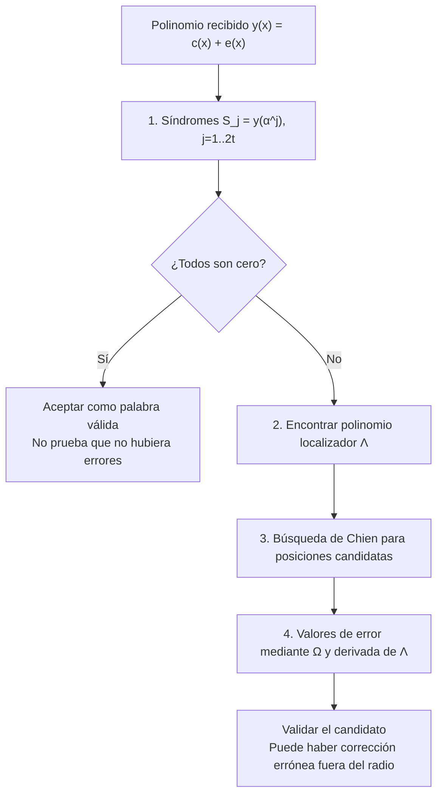
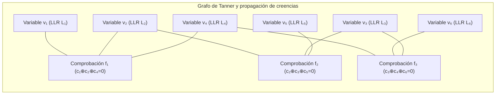
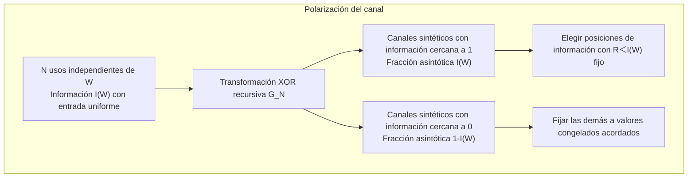

## 1. Introducción: qué comparten los enlaces espaciales y los códigos QR

¿Cómo se recuperan datos a partir de una señal espacial débil o de un código QR parcialmente dañado? Los <strong>códigos correctores de errores (ECC)</strong> añaden redundancia estructurada. El receptor utiliza esas relaciones para inferir y reparar valores alterados. La protección tiene límites: una cantidad finita de redundancia no corrige cualquier destrucción imaginable.

### Comunicaciones espaciales: recibir la señal y corregir los errores restantes

Voyager 1 y Voyager 2 se lanzaron en 1977 y visitaron Júpiter y Saturno; Voyager 2 continuó hacia Urano y Neptuno. No fueron ambas sondas las que recorrieron los cuatro planetas. Aquí usamos las comunicaciones de los encuentros planetarios como ejemplo, sin convertir las distancias y potencias recibidas actuales, que cambian, en constantes permanentes.

La antena de alta ganancia de la sonda concentra la energía de radio hacia la Tierra, donde la recibe la Red del Espacio Profundo (DSN). La atenuación y el ruido térmico aún pueden dejar errores después de la demodulación. Como conversión de unidades, $10^{-16}\,\mathrm{W}=100\,\mathrm{aW}$, es decir, 100 atovatios. No se trata de una medición para una fecha y estación concretas.

Un informe de JPL preparado para el encuentro de Voyager 2 con Urano describe un código convolucional interno y un código Reed–Solomon (RS) externo $[255,223]$. Las etapas reducen el efecto del ruido; no garantizan que todos los bloques recibidos ni todos los píxeles estén siempre libres de errores.

### Códigos QR: el porcentaje de corrección no es un área que puedas tapar arbitrariamente

Los códigos QR también emplean RS. DENSO WAVE describe niveles de restauración aproximados del 7 %, 15 %, 25 % y 30 %, medidos en <strong>palabras de código de 8 bits</strong>. Esto no significa que se pueda cubrir cualquier 30 % de la imagen con un logotipo. Importan los patrones funcionales, la distribución del daño entre bloques RS y las condiciones de captura. Tampoco existe una garantía universal de diez milisegundos.

Una palabra de código de 8 bits, en la terminología QR, corresponde a un símbolo de la descripción matemática de RS utilizada aquí. No es la palabra RS completa de $n$ símbolos. Distinguir ambos niveles evita confundir la capacidad de corrección de cada bloque.


Relacionaremos capacidad de canal, distancia de Hamming, polinomios sobre cuerpos finitos y cálculos probabilísticos en grafos. Conviene separar <strong>corregir todos los patrones hasta cierto número de errores</strong> de <strong>hacer arbitrariamente pequeña una probabilidad de error cuando crece la longitud del bloque</strong>.

---

## 2. El teorema de codificación de Shannon y sus hipótesis

### 2.1 Repetición: más fiabilidad a costa de la tasa

Repetir un bit permite eliminar errores mediante una decisión por mayoría. Sin embargo, con este método aislado, mejorar la fiabilidad exige más usos del canal por bit de información. Es una limitación de esa construcción, no de todos los códigos.

Consideremos un canal binario simétrico sin memoria (BSC), con inversiones independientes de probabilidad $0<p<1/2$. Un código de repetición de longitud tres transforma un bit en:

$$
0 \mapsto 000, \qquad 1 \mapsto 111
$$

Al transmitir 000, recibir 011, 101, 110 o 111 lleva a decidir erróneamente 1. Deben invertirse dos o tres bits:

$$
P_e^{(3)} = \binom{3}{2} p^2 (1-p) + \binom{3}{3} p^3 = 3p^2(1-p) + p^3
$$

Para $p=0{,}01$, el resultado es $0{,}000298$, aproximadamente $0{,}03\%$. A cambio, la tasa del código queda en:

$$
R = \frac{k}{n} = \frac{1}{3}
$$

Para longitud impar $n=2t+1$, la mayoría falla cuando se invierten al menos $t+1$ bits:

$$
P_e^{(n)} = \sum_{i = (n+1)/2}^{n} \binom{n}{i} p^i (1-p)^{n-i}
$$

La ley de los grandes números permite que la probabilidad de error tienda a cero, pero simultáneamente:

$$
n \to \infty \implies P_e^{(n)} \to 0 \quad \text{pero a la vez} \quad R = \frac{1}{n} \to 0
$$

Por ejemplo, con longitud cinco se usa $0\mapsto00000$, $1\mapsto11111$, y la tasa es $1/5$. Este cálculo no descarta una codificación más eficiente que combine varios bits de información en un bloque.

### 2.2 Capacidad y teorema de codificación para canales con ruido

El trabajo de Shannon de 1948 mostró que un canal ruidoso puede mantener una tasa positiva fija mientras la probabilidad de error se hace arbitrariamente pequeña.

> <strong>Teorema para un canal discreto sin memoria de alfabetos finitos:</strong> dada la ley de transición $W(y\mid x)$, la capacidad es $C=\max_{P(X)}I(X; Y)\ge0$, en bits por uso del canal. Para cualquier tasa fija $0<R<C$, existe una sucesión de códigos cada vez más largos y reglas de decodificación cuya probabilidad de error de bloque tiende a cero. Con $R>C$ no se puede lograr esa convergencia.

La capacidad no tiene por qué ser positiva. Si la salida es independiente de la entrada, $C=0$. Si hay restricciones de coste de entrada o potencia media, la maximización debe respetarlas. No basta una única estadística sobre la intensidad del ruido para determinar la capacidad.

El teorema es un resultado asintótico de existencia. No promete que un código finito corrija todo ruido posible ni proporciona automáticamente un decodificador eficiente. La latencia, el cálculo disponible y la probabilidad de error objetivo siguen siendo restricciones de diseño.

### 2.3 Derivación de la capacidad del BSC

Para un canal discreto sin memoria:

$$
C = \max_{P(X)} I(X; Y) = \max_{P(X)} \bigl( H(Y) - H(Y \mid X) \bigr)
$$

Escribamos la salida del BSC como $Y=X\oplus E$, donde el bit de ruido $E$ es independiente de $X$ y vale uno con probabilidad $p$. Conocida la entrada, la incertidumbre restante es la entropía binaria:

$$
H(Y \mid X) = H_2(p) \triangleq -p \log_2 p - (1-p) \log_2(1-p)
$$

Como la salida es binaria, $H(Y)\le1$ bit. Una entrada uniforme produce una salida uniforme y alcanza $H(Y)=1$, de donde:

$$
C_{\text{BSC}}(p) = 1 - H_2(p) = 1 + p\log_2 p + (1-p)\log_2(1-p) \quad [\text{bits / uso de canal}]
$$

Por ejemplo:

$$
H_2(0{,}1) = -0{,}1 \log_2(0{,}1) - 0{,}9 \log_2(0{,}9) \approx 0{,}4690\text{ bits}
$$

$$
C_{\text{BSC}}(0{,}1) = 1 - 0{,}4690 = 0{,}5310\text{ bits / uso de canal}
$$

Una tasa fija inferior, como $R=0{,}5$, puede por tanto alcanzar una probabilidad de error arbitrariamente pequeña con códigos suficientemente largos y adecuados. No es una garantía de error nulo a longitud finita y tasa exactamente igual a la capacidad. El argumento de codificación aleatoria aprovecha el comportamiento típico del ruido en bloques largos y la posibilidad de distinguir palabras de código.

### 2.4 AWGN y el límite de banda ancha de $-1{,}59\,\mathrm{dB}$

Un modelo de ruido blanco gaussiano aditivo (AWGN) describe formas de onda continuas, no inversiones literales e independientes de bits. Sean $B$ el ancho de banda en Hz, $S$ la potencia media recibida en W y $N_0$ la densidad espectral unilateral de potencia de ruido en W/Hz. La potencia de ruido dentro de la banda es $N=N_0B$. Bajo restricción de potencia media, sin imponer además una entrada binaria, Shannon–Hartley da:

$$
C_{\text{AWGN}} = B \log_2\!\left(1 + \frac{S}{N}\right) = B \log_2\!\left(1 + \frac{S}{N_0 B}\right) \quad [\text{bits / segundo}]
$$

Sea $E_b$ la energía recibida por bit de información y, ahora, $R$ la tasa de información en bits/s, de modo que $S=E_bR$. Sus unidades difieren de la tasa en bits por uso del canal anterior. Exigir $R<C_{\mathrm{AWGN}}$ da:

$$
R < B \log_2\!\left(1 + \frac{E_b}{N_0} \frac{R}{B}\right)
$$

Con eficiencia espectral $\eta=R/B$, en bits/s/Hz:

$$
\eta < \log_2\!\left(1 + \eta \frac{E_b}{N_0}\right) \iff 2^\eta - 1 < \eta \frac{E_b}{N_0} \iff \frac{E_b}{N_0} > \frac{2^\eta - 1}{\eta}
$$

En este modelo ideal tomamos $\eta\to0$ y usamos $2^\eta=1+\eta\ln2+O(\eta^2)$:

$$
\lim_{\eta \to 0} \frac{2^\eta - 1}{\eta} = \ln 2 \approx 0{,}693147
$$

Expresado en decibelios:

$$
\left(\frac{E_b}{N_0}\right)_{\min} = \ln 2 \approx 0{,}6931 \implies 10 \log_{10}(\ln 2) \approx \mathbf{-1{,}5917\,\text{dB}}
$$

Es un <strong>ínfimo en el límite de banda ancha</strong>. Con eficiencia espectral positiva, la cota requerida es $(2^\eta-1)/\eta>\ln2$. El cociente $E_b/N_0$ tampoco es la relación de potencias $S/N$ entre señal y ruido total de la banda. Decir simplemente «señal por debajo del ruido» confunde ambas definiciones.

Acercarse a la capacidad también cuesta longitud de bloque y latencia. Este resultado asintótico de un modelo concreto no es una constante de todos los canales físicos ni una promesa de comunicación finita sin errores. Restringir la entrada a dos valores, por ejemplo, modifica la capacidad pertinente.

---

## 3. Distancia de Hamming, garantías y código $[7,4,3]$

### 3.1 De la existencia a una construcción calculable

Para aprovechar un teorema de existencia hacen falta algoritmos de codificación y decodificación. El trabajo de Hamming de 1950 ofrece un ejemplo concreto: añadir comprobaciones de paridad y localizar un bit invertido a partir de las que no se cumplen. Construiremos el código desde la distancia y desde sus matrices.

### 3.2 Distancia y distancia mínima

Las cadenas binarias de longitud $n$ forman $\mathbb F_2^n$, los vértices de un hipercubo de dimensión $n$. En $\mathbb F_2$, sumar y restar es XOR. La distancia de Hamming cuenta coordenadas distintas:

$$
d_H(\mathbf{u}, \mathbf{v}) \triangleq \bigl|\{ i \in \{1, \dots, n\} \mid u_i \neq v_i \}\bigr| = w_H(\mathbf{u} - \mathbf{v})
$$

Aquí $w_H$ cuenta las entradas no nulas, el peso de Hamming. La distancia satisface no negatividad, simetría y desigualdad triangular. Un código es un subconjunto $\mathcal C$ de palabras permitidas; si es binario, lineal y de dimensión $k$, tiene $2^k$ palabras. Su distancia mínima es:

$$
d_{\min}(\mathcal{C}) \triangleq \min_{\substack{\mathbf{u}, \mathbf{v} \in \mathcal{C} \\ \mathbf{u} \neq \mathbf{v}}} d_H(\mathbf{u}, \mathbf{v})
$$

En un código lineal, la diferencia de dos palabras distintas es otra palabra no nula, así que:

$$
d_{\min}(\mathcal{C}) = \min_{\mathbf{c} \in \mathcal{C} \setminus \{\mathbf{0}\}} w_H(\mathbf{c})
$$

### 3.3 Detección, borrados y errores de posición desconocida

1. <strong>Detección:</strong> modificar entre una y $d_{\min}-1$ coordenadas no puede transformar una palabra válida en otra. Comprobar pertenencia al código detecta todos esos patrones no nulos.
2. <strong>Borrados:</strong> se conocen las posiciones perdidas, pero no sus valores. Si hay como máximo $e\le d_{\min}-1$, dos palabras distintas aún difieren en alguna coordenada conservada. Suponiendo correctos los valores restantes, la palabra transmitida queda determinada de forma única.
3. <strong>Errores de posición desconocida:</strong> el decodificador de palabra más cercana corrige todos los patrones de hasta $t$ errores si y solo si las bolas de Hamming de radio $t$ alrededor de distintas palabras son disjuntas.

Si una palabra recibida perteneciera a dos bolas, la desigualdad triangular daría distancia entre sus centros de como máximo $2t$. Recíprocamente, dos centros separados por no más de $2t$ admiten una palabra a distancia no mayor que $t$ de ambos: repartimos las coordenadas distintas entre las dos elecciones. Por tanto:

$$
2t + 1 \le d_{\min} \iff t \le \left\lfloor \frac{d_{\min} - 1}{2} \right\rfloor
$$

La igualdad $t=\lfloor(d_{\min}-1)/2\rfloor$ especifica el <strong>mayor radio garantizado</strong>, no cada radio menor válido. Con hasta $t$ errores desconocidos y $e$ borrados conocidos, la garantía para todos los patrones es:

$$
\mathbf{d_{\min} \ge 2t + e + 1}
$$

Eliminar las posiciones borradas deja distancia al menos $d_{\min}-e$; aplicamos allí el argumento de bolas disjuntas. Algunos casos fuera de esta cota aún pueden recuperarse, pero ya no se garantiza el éxito para todas las configuraciones. «Posición desconocida» no exige una distribución aleatoria de los errores.

Una bola de radio $t$ en un espacio de alfabeto $q$ tiene $\sum_{i=0}^t\binom ni(q-1)^i$ palabras. Las bolas disjuntas deben caber en el espacio:

$$
|\mathcal{C}| \cdot \sum_{i=0}^{t} \binom{n}{i} (q-1)^i \le q^n \quad \left(\text{para códigos binarios: } 2^k \sum_{i=0}^{t} \binom{n}{i} \le 2^n \right)
$$

Un código que alcanza la igualdad es <strong>perfecto</strong>: las bolas cubren el espacio sin huecos ni solapamientos. Son ejemplos los códigos de Hamming y los de Golay binario $[23,12,7]$ y ternario $[11,6,5]$. Las clasificaciones requieren sus hipótesis; también existen códigos perfectos no lineales. Estos ejemplos no demuestran qué código de Golay utilizó una misión concreta.

### 3.4 Matrices de Hamming y síndrome

El código $[7,4,3]$ añade tres bits de paridad a cuatro de información:

$$
2^4 \sum_{i=0}^{1} \binom{7}{i} = 16 \times (1 + 7) = 16 \times 8 = 128 = 2^7
$$

Hay 16 bolas de radio uno, cada una con un centro y siete vecinos, que cubren las 128 palabras.

Una construcción conveniente de la matriz de control de paridad coloca la representación binaria de $j$ en su columna $j$:

$$
\mathbf{H}_{\text{binary}} = \begin{pmatrix} 0 & 0 & 0 & 1 & 1 & 1 & 1 \\ 0 & 1 & 1 & 0 & 0 & 1 & 1 \\ 1 & 0 & 1 & 0 & 1 & 0 & 1 \end{pmatrix} \begin{matrix} \leftarrow 2^2\text{ posición} \\ \leftarrow 2^1\text{ posición} \\ \leftarrow 2^0\text{ posición} \end{matrix}
$$

Su quinta columna es $(1,0,1)^T$. Para conservar los cuatro bits de mensaje al principio y añadir la paridad al final, usamos forma sistemática $\mathbf G=[\mathbf I_4\mid\mathbf P]$ y $\mathbf H=[\mathbf P^T\mid\mathbf I_3]$:

$$
\mathbf{G}_{4\times 7} = \left(\begin{array}{cccc|ccc} 1 & 0 & 0 & 0 & 1 & 1 & 0 \\ 0 & 1 & 0 & 0 & 1 & 0 & 1 \\ 0 & 0 & 1 & 0 & 0 & 1 & 1 \\ 0 & 0 & 0 & 1 & 1 & 1 & 1 \end{array}\right), \qquad \mathbf{H}_{3\times 7} = \left(\begin{array}{cccc|ccc} 1 & 1 & 0 & 1 & 1 & 0 & 0 \\ 1 & 0 & 1 & 1 & 0 & 1 & 0 \\ 0 & 1 & 1 & 1 & 0 & 0 & 1 \end{array}\right)
$$

Como $\mathbf G\mathbf H^T=0$, todas las palabras codificadas cumplen:

$$
\mathbf{H}\mathbf{c}^T = \mathbf{0} \pmod 2
$$

Si recibimos $\mathbf y=\mathbf c+\mathbf e$, calculamos el <strong>síndrome</strong>:

$$
\mathbf{s} = \mathbf{H}\mathbf{y}^T = \mathbf{H}(\mathbf{c} + \mathbf{e})^T = \underbrace{\mathbf{H}\mathbf{c}^T}_{=\mathbf{0}} + \mathbf{H}\mathbf{e}^T = \mathbf{H}\mathbf{e}^T \pmod 2
$$

Depende solo del error. Una inversión en el bit $j$ devuelve la columna $j$ de la matriz elegida. Con columnas en orden binario, el síndrome 101 identifica la posición 5; en forma sistemática, el orden es distinto y hay que buscar la columna coincidente. Su valor numérico no es necesariamente la posición. El programa de la sección 6 hace esa búsqueda.

Un síndrome cero significa pertenencia al código. Bajo la hipótesis de como máximo un error significa ausencia de error; fuera de ella, el canal puede haber cambiado una palabra válida por otra. Varios errores también pueden inducir al decodificador de un error a invertir un bit que estaba correcto.

Por ejemplo, el mensaje `[1,0,1,1]` se codifica como `[1,0,1,1,0,1,0]`. Invertir el índice 2, contando desde cero —el tercer bit—, da síndrome `[0,1,1]`, correspondiente a la columna de índice 2. Un circuito fijo de siete bits tiene tamaño constante, pero calcular síndromes de longitud general $n$ no es universalmente $O(1)$.

Añadir un bit de paridad global par da el código extendido $[8,4,4]$. Una regla adecuada permite corregir un bit y detectar dos (SECDED). Es un modelo básico para entender la memoria ECC, no la arquitectura exacta de todos los productos.

---

## 4. Reed–Solomon: cuerpos finitos, interpolación y decodificación

### 4.1 Por qué importan las ráfagas

Hamming $(7,4)$ corrige un bit en cualquier posición de un bloque. Una raya en un disco, una mancha de QR o un desvanecimiento pueden alterar muchos bits del mismo bloque. Dos inversiones ya hacen que el decodificador de un error corrija hacia una palabra equivocada.

La construcción de Reed y Solomon de 1960 agrupa bits en <strong>símbolos</strong> de un cuerpo finito. Cambia la unidad con la que medimos distancia y corrección. La distribución espacial y el entrelazado también determinan cómo el daño físico afecta a esos símbolos.

### 4.2 Un byte como elemento de un cuerpo finito

Un símbolo de $m$ bits puede representarse en $\mathbb F_{2^m}$. No es lo mismo que operar con enteros módulo 256: $2\cdot128\equiv0\pmod{256}$ exhibe divisores de cero, y esos elementos no nulos no tienen inverso multiplicativo. Existen cuerpos finitos precisamente para órdenes que son potencias de un primo.

En GF(256), un byte representa un polinomio de grado como máximo siete con coeficientes binarios. El programa reduce los productos módulo el polinomio irreducible de grado ocho representado por `0x11D`:

$$
\mathbb{F}_{2^8} \cong \frac{\mathbb{F}_2[x]}{\langle x^8 + x^4 + x^3 + x^2 + 1 \rangle}
$$

Sumar y restar equivale a XOR porque $1+1=0$ en el cuerpo de coeficientes. Los 255 elementos no nulos forman un grupo multiplicativo cíclico. En esta representación, $\alpha=x$, byte `0x02`, es primitivo: sus potencias $\alpha^0,\ldots,\alpha^{254}$ recorren todos los no nulos y $\alpha^{255}=1$.

Las tablas de logaritmos y exponentes permiten multiplicar y dividir elementos no nulos:

$$
A \cdot B = \alpha^{(i + j) \bmod 255}, \qquad \frac{A}{B} = \alpha^{(i - j) \bmod 255}
$$

El cero necesita tratamiento separado y dividir por cero no está definido. La longitud de las tablas depende de la implementación; algunas prolongan la tabla de exponentes para evitar un módulo explícito. La sección 6 utiliza desplazamientos y XOR.

Varios bits dañados dentro de un mismo byte cuentan como un error de símbolo. Cruzar sus límites puede dañar varios símbolos; el número total de bits alterados por sí solo no determina si se podrá corregir.

### 4.3 Evaluación, interpolación y cota de Singleton

Dos puntos con abscisas diferentes determinan un polinomio de grado como máximo uno. Si transmitimos cinco evaluaciones, cualesquiera dos correctas conservadas permiten recuperar el polinomio tras tres borrados. Tres abscisas distintas determinan un polinomio de grado como máximo dos.

Usamos los $k$ símbolos del mensaje como coeficientes:

$$
P(x) \triangleq m_0 + m_1 x + m_2 x^2 + \dots + m_{k-1} x^{k-1} \in \mathbb{F}_q[x]
$$

Elegimos $n$ puntos distintos $\alpha_i\in\mathbb F_q$, con $k\le n\le q$, y transmitimos:

$$
\mathbf{c} = \bigl( P(\alpha_1),\; P(\alpha_2),\; \dots,\; P(\alpha_n) \bigr) \in \mathbb{F}_q^n
$$

El teorema del factor implica que un polinomio no nulo sobre un cuerpo no tiene más raíces que su grado. La diferencia $P-Q$ de mensajes distintos tiene grado menor que $k$, de modo que se anula en como máximo $k-1$ puntos. Las palabras difieren, por tanto, en al menos $n-k+1$ coordenadas.

Para la cota contraria, eliminamos $d_{\min}-1$ coordenadas de todas las palabras: sus proyecciones deben seguir siendo distintas. Con $q^k$ palabras, $q^k\le q^{n-d_{\min}+1}$, por lo que $d_{\min}\le n-k+1$. RS alcanza la igualdad:

$$
\mathbf{d_{\min} = n - k + 1}
$$

Es la propiedad <strong>MDS, máxima distancia separable</strong>: optimiza distancia mínima para el alfabeto, longitud y dimensión fijados, no todas las prestaciones de ingeniería.

Con $r=n-k$ símbolos redundantes, la garantía es $2t+e\le r$:

- <strong>Borrados conocidos:</strong> pueden faltar hasta $n-k$ símbolos. Cualesquiera $k$ evaluaciones correctas conservadas recuperan el mensaje mediante interpolación de Lagrange:

$$
P(x) = \sum_{j=1}^{k} y_{i_j} \prod_{\substack{m=1 \\ m \neq j}}^{k} \frac{x - x_{i_m}}{x_{i_j} - x_{i_m}}
$$

- <strong>Errores desconocidos:</strong> se corrigen hasta $\lfloor(n-k)/2\rfloor$ símbolos dañados, independientemente de cuántos bits cambien dentro de cada símbolo afectado.

### 4.4 Forma cíclica y convenciones de la fórmula de Forney

La forma de evaluación trata el mensaje como coeficientes y transmite evaluaciones. En la descripción cíclica, las coordenadas de la palabra son coeficientes de otro polinomio divisible por un generador. El código de longitud completa $n=q-1$ que usa los puntos no nulos tiene una representación cíclica equivalente, una vez fijada la correspondencia. Un código acortado no tiene por qué seguir siendo cíclico a su nueva longitud.

Fijemos redundancia $n-k=2t$ y primera raíz del generador $\alpha^1$. Son convenciones de esta derivación, no las de todos los formatos QR o espaciales:

$$
g(x)=\prod_{j=1}^{2t}(x-\alpha^j)
$$

Con resto $r(x)=x^{2t}m(x)\bmod g(x)$, desplazamos el mensaje y restamos el resto:

$$
c(x)=x^{2t}m(x)-r(x),\qquad c(\alpha^j)=0\quad(1\le j\le2t)
$$

En característica dos, restar sigue siendo XOR.



1. <strong>Síndromes:</strong> supongamos $\nu\le t$ errores en posiciones $i_l$, con valores no nulos $Y_l=e_{i_l}$. Definimos $X_l=\alpha^{i_l}$. Evaluar en las raíces elimina la palabra transmitida:

$$
S_j=y(\alpha^j)=e(\alpha^j)=\sum_{l=1}^{\nu}Y_lX_l^j,\qquad j=1,\ldots,2t
$$

Un síndrome nulo solo establece pertenencia al código; no detecta un cambio entre palabras válidas.

2. <strong>Polinomio localizador:</strong>

$$
\Lambda(z)=\prod_{l=1}^{\nu}(1-X_lz)=1+\Lambda_1z+\cdots+\Lambda_\nu z^\nu
$$

Multiplicando $\Lambda(X_l^{-1})=0$ por $Y_lX_l^{j+\nu}$ y sumando obtenemos la recurrencia lineal:

$$
S_{j+\nu}+\Lambda_1S_{j+\nu-1}+\cdots+\Lambda_\nu S_j=0,\qquad1\le j\le2t-\nu
$$

Berlekamp–Massey obtiene una recurrencia mínima y un candidato, normalmente con $O(t^2)$ operaciones del cuerpo. Un método basado en Euclides extendido también puede resolver la ecuación clave.

3. <strong>Búsqueda de Chien:</strong> probamos los elementos no nulos $\alpha^{-i}$ asociados a las coordenadas y buscamos $\Lambda(\alpha^{-i})=0$. GF(256) tiene 256 elementos en total, 255 no nulos. Deben verificarse condiciones como la coincidencia entre grado del localizador y número de raíces admisibles.

4. <strong>Valores de error:</strong> definimos explícitamente el polinomio de síndromes y el evaluador:

$$
S(z)=S_1+S_2z+\cdots+S_{2t}z^{2t-1},\qquad \Omega(z)=S(z)\Lambda(z)\bmod z^{2t}
$$

Con estas definiciones, Forney da:

$$
Y_l=-\frac{\Omega(X_l^{-1})}{\Lambda'(X_l^{-1})}
$$

Para un error, $\Omega=YX$ y $\Lambda'=-X$, por lo que obtenemos $Y$. Multiplicar por otro factor $X$ daría $XY$. Otras convenciones de primera raíz o polinomio de síndromes pueden cambiar ese factor; no se debe trasladar una fórmula sin sus definiciones.

Restamos los errores estimados y comprobamos pertenencia al código y distancia corregida. Aun así, una palabra recibida puede estar cerca de otra palabra válida y superar las comprobaciones con un mensaje equivocado. CRC, retransmisión o verificaciones superiores pueden añadir protección; no se detecta necesariamente toda corrupción fuera del radio garantizado.

### 4.5 QR, almacenamiento y concatenación en Voyager

- <strong>QR:</strong> los niveles L/M/Q/H tienen restauración aproximada del 7/15/25/30 % de palabras de 8 bits. Cada bloque RS debe respetar sus condiciones. Versión y nivel cambian datos, redundancia y división en bloques; no se convierten en un área arbitraria. Tapar patrones funcionales puede impedir reconocer o extraer las palabras antes de decodificar RS.
- <strong>RAID-6 y almacenamiento distribuido:</strong> una unidad o fragmento ausente en posición conocida es un borrado. Un código MDS $[14,10]$ ilustrativo usa $14/10=1{,}4$ veces la capacidad de datos y tolera cuatro fragmentos perdidos si los restantes y los metadatos necesarios son correctos. No es una configuración universal de los proveedores de nube. La doble paridad de RAID-6 permite recuperar dos unidades bajo sus hipótesis, no cualquier daño adicional latente o pérdida de la instalación completa.
- <strong>Voyager 2:</strong> el informe de JPL de 1983 describe un código convolucional de longitud de restricción $K=7$ y tasa $1/2$, entrelazado de profundidad 4 y RS externo $[255,223]$. Sus 32 bytes redundantes garantizan $2t+e\le32$ por palabra RS, o 16 errores de byte si no hay borrados. Una ráfaga contigua de 128 bits sin alinear puede abarcar 17 bytes. El entrelazado distribuye las ráfagas residuales del decodificador interno entre palabras RS. El código interno de este ejemplo es convolucional, no LDPC.

---

## 5. LDPC, turbo y polares: fiabilidad y capacidad

### 5.1 La distancia no resuelve todo el problema

Un código práctico debe satisfacer error objetivo, latencia, longitud de bloque, cálculo y coste de hardware. Comparar por fuerza bruta todas las palabras de un código binario de dimensión $k$ exige $2^k$ candidatos. Buena distancia mínima no implica automáticamente decodificación eficiente.

La decodificación iterativa de turbo y LDPC aprovecha información de fiabilidad; los polares usan otra construcción para aproximarse a capacidad simétrica. Las comparaciones deben mantener canal, restricciones de entrada y tasa. No basta comparar todo con el límite de banda ancha de $-1{,}59\,\mathrm{dB}$.

### 5.2 Paridad dispersa y propagación de creencias

Los códigos LDPC de Gallager de 1962 utilizan una matriz de control dispersa. Incluso con bloques largos, sus filas y columnas pueden tener pocos elementos no nulos. Para una matriz $\mathbf H$ de tamaño $m\times n$, la dimensión es $k=n-\operatorname{rank}_{\mathbb F_2}(\mathbf H)$; solo con filas independientes equivale a $n-m$.

En el grafo de Tanner, los nodos de variable corresponden a columnas y bits; los de comprobación, a filas y ecuaciones de paridad. Una arista existe precisamente cuando $H_{a, i}=1$:



La decisión blanda conserva fiabilidad sin reducir inmediatamente la observación a cero o uno. Podemos expresar la razón logarítmica de verosimilitud (LLR):

$$
L(c_i) \triangleq \ln \frac{\Pr(c_i = 0 \mid y_i)}{\Pr(c_i = 1 \mid y_i)}
$$

Para entradas equiprobables, BPSK de amplitud unitaria $0\mapsto+1$, $1\mapsto-1$, ruido independiente $Z\sim\mathcal N(0,\sigma^2)$ y observación $y_i=x_i+Z$:

$$
L_{\mathrm{ch}}(c_i)=\ln\frac{p(y_i\mid c_i=0)}{p(y_i\mid c_i=1)}=\frac{2y_i}{\sigma^2}
$$

Otras amplitudes o probabilidades previas cambian la expresión. Un LLR de $+10$ favorece fuertemente cero; $-0{,}1$ favorece uno solo ligeramente.

El algoritmo suma-producto es una forma de propagación de creencias. Intercambia mensajes extrínsecos excluyendo la contribución del vecino destinatario:

$$
\mu_{f_a \to v_i} = 2 \operatorname{artanh}\!\left( \prod_{v_j \in N(f_a) \setminus \{v_i\}} \tanh\!\left(\frac{\mu_{v_j \to f_a}}{2}\right) \right)
$$

$$
\mu_{v_i \to f_a} = L_{\text{ch}}(v_i) + \sum_{f_b \in N(v_i) \setminus \{f_a\}} \mu_{f_b \to v_i}
$$

$N$ denota el conjunto de vecinos pertinente. La planificación iterativa especifica qué iteración de mensajes se usa, sin cambiar esa exclusión.

Una matriz dispersa reduce aristas, pero no elimina por sí sola ciclos cortos. En un árbol, la propagación calcula marginales exactas; en grafos finitos con ciclos, las dependencias, los conjuntos trampa o la falta de convergencia pueden dejar errores.

Con $E$ aristas, una implementación que comparte cálculos entre vecinos usa aproximadamente $O(E)$ operaciones por iteración, u $O(IE)$ para $I$ iteraciones. Grados acotados pueden dar $E=O(n)$, pero no garantizan que el número de iteraciones sea constante. La implementación numérica debe manejar saturación de LLR y dominio de $\operatorname{artanh}$.

El resultado de Chung y colaboradores de 2001 corresponde a <strong>tasa $1/2$ en un canal AWGN de entrada binaria</strong>: el umbral asintótico calculado por evolución de densidades queda a $0{,}0045\,\mathrm{dB}$ del límite de capacidad de ese canal. Una simulación finita distinta, con diseño más sencillo, longitud $10^7$ y BER $10^{-6}$, presenta separación de $0{,}04\,\mathrm{dB}$. No son prestaciones universales de todos los dispositivos ni el ínfimo energético de banda ancha.

### 5.3 Códigos polares y capacidad simétrica

La construcción de Arıkan de 2009 se aproxima a $I(W)$, la <strong>capacidad simétrica</strong> de un canal discreto sin memoria de entrada binaria: la información mutua con entrada uniforme. Coincide con $C$ en canales simétricos, pero no necesariamente con el máximo sobre distribuciones de entrada en un canal asimétrico.

La transformación básica es:

$$
(x_1,x_2)=(u_1,u_2)\begin{pmatrix}1&0\\1&1\end{pmatrix} =(u_1\oplus u_2,u_2)
$$

El canal sintético $W^-$ estima $u_1$ con $(y_1, y_2)$; $W^+$ estima $u_2$ con $(y_1, y_2, u_1)$ cuando se proporciona el valor correcto de $u_1$. Con entradas uniformes e independientes, la regla de la cadena da:

$$
I(W^-)+I(W^+)=2I(W),\qquad I(W^-)\le I(W)\le I(W^+)
$$

«Mejor» y «peor» se refieren aquí a información, sin exigir cambio estricto en todos los casos. En la decodificación sucesiva real, un error previo puede propagarse a decisiones posteriores.

Para $N=2^m$, una convención usa permutación de inversión de bits $\mathbf B_N$ y generador:

$$
\mathbf G_N=\mathbf B_N \begin{pmatrix}1&0\\1&1\end{pmatrix}^{\otimes m}
$$

Para cualquier $0<\delta<1$ fijo, cuando $N\to\infty$, la fracción de canales sintéticos con información mayor que $1-\delta$ tiende a $I(W)$; la fracción con información menor que $\delta$ tiende a $1-I(W)$. A longitud finita no aparecen exactamente $NI(W)$ canales perfectamente sin ruido.



Elegimos posiciones de información a tasa fija $R<I(W)$ y congelamos las demás a valores acordados. Para un canal general, la garantía original utiliza promedio sobre valores congelados y existencia de una elección adecuada; en un canal simétrico, la cota correspondiente vale para cualquier elección fija.

Codificar y decodificar mediante <strong>cancelación sucesiva (SC)</strong> cuesta $O(N\log N)$ tiempo. Elegir el conjunto de información es un coste de construcción aparte. Una implementación eficiente de <strong>cancelación sucesiva con lista (SCL)</strong> de tamaño $L$ requiere $O(LN\log N)$; un CRC puede ayudar a elegir un candidato. El error y la latencia finitos dependen de construcción, tasa, tamaño de lista y canal; no hay garantía general de ausencia de suelo de error (error floor).

### 5.4 Comparación de familias

| Código | Estructura matemática | Decodificación representativa | Características y usos |
| :--- | :--- | :--- | :--- |
| Hamming (1950) | Código lineal binario; $[7,4,3]$ es perfecto | Síndrome y búsqueda de columna | Corrige un bit; modelo básico para SECDED |
| Reed–Solomon (1960) | Polinomios de cuerpo finito; propiedad MDS | BM/Euclides, Chien, Forney; Welch–Berlekamp en forma de evaluación | Errores de símbolo y borrados; QR, almacenamiento, telemetría concatenada |
| Convolucional y turbo | Trellis, concatenación, entrelazado | Viterbi; decodificación iterativa BCJR | Comunicación ruidosa; el código interno de Voyager es convolucional |
| LDPC (1962) | Matriz dispersa y grafo de Tanner | Propagación de creencias con decisión blanda | Bloques largos y paralelismo; diseños cercanos a capacidad en modelos concretos |
| Polares (2009) | Polarización recursiva y bits congelados | SC $O(N\log N)$; SCL depende de $L$ | Aproximación asintótica a capacidad simétrica; cierta información de control 5G NR |

Compartir fila no implica idéntica complejidad o error. Tampoco se codifica toda la información de control 5G con polares. Por ejemplo, 3GPP TS 38.212 v19.3.0, apartados 6.3.1.2–6.3.1.3, distingue en UCI por PUCCH cargas de $A\ge12$ bits, codificadas con polares, y $A\le11$, con codificación de bloques pequeños.

---

## 6. Verificación en Python: Hamming y RS de evaluación sobre GF(256)

Este programa autónomo en Python 3 implementa Hamming $(7,4)$ sistemático y el <strong>RS de evaluación</strong> de la sección 4.3. Los símbolos de mensaje son coeficientes del polinomio; no suelen aparecer sin cambios al principio de la palabra. No es el decodificador BM de la sección 4.4 ni implementa distribución de módulos, bloques o formato cíclico sistemático de QR; no es interoperable directamente con QR ni con una sonda.

El cuerpo es GF(256), con polinomio irreducible `0x11D`. Difiere del cuerpo primo GF(257) de residuos enteros módulo 257: este también permite códigos de evaluación, pero puede producir símbolo 256, que no cabe en un byte.

El decodificador usa un sistema de tipo Welch–Berlekamp. Para grados candidatos $\nu=0,\ldots, t$, busca un polinomio mónico $E(x)$ de grado $\nu$ y $Q(x)$ de grado menor que $k+\nu$ tales que:

$$
Q(x_i)=y_iE(x_i)\qquad(i=1,\ldots,n)
$$

Hay $k+2\nu$ coeficientes desconocidos. En característica dos, cambiar de lado un término sigue siendo XOR.

Si el mensaje real es $P$ y hay como máximo $\nu$ errores, elegimos $E$ que se anule en sus puntos, completando el grado si hace falta, y $Q=PE$. Recíprocamente, con $n\ge k+2\nu$, cualquier solución tiene $Q-PE$ nulo en al menos $n-\nu$ puntos correctos, pero de grado menor que $k+\nu$; debe ser el polinomio cero. Este argumento de raíces justifica la recuperación.

Se prueban grados de cero a $t$, se manejan sistemas rectangulares y deficiencia de rango, se divide $Q$ entre $E$, se exige resto cero y grado del cociente menor que $k$, y se vuelve a codificar para verificar distancia recibida no mayor que $t$. Funciona con cero errores, menos de $t$ y el límite. Los puntos deben ser distintos; se admiten de 1 a 256 elementos del cuerpo, incluido cero.

La prioridad es la claridad: no es un decodificador RS de producción ni una medición de velocidad. Puede efectuar hasta $t+1$ eliminaciones gaussianas generales. `rs_encode` y `rs_decode` verifican valores, longitudes, puntos y radio; los auxiliares internos de polinomios y sistemas presuponen elementos del cuerpo ya validados.

```python
"""Educational evaluation RS over GF(256), not a QR parser or wire format."""
from itertools import product


def field_value(a):
    if type(a) is not int or not 0 <= a < 256:
        raise ValueError("Field elements must be integers from 0 through 255")
    return a


def gf_mul(a, b):
    field_value(a)
    field_value(b)
    result = 0
    for _ in range(8):
        if b & 1:
            result ^= a
        b >>= 1
        a <<= 1
        if a & 256:
            a ^= 0x11D
    return result


def gf_pow(a, exponent):
    field_value(a)
    if type(exponent) is not int or exponent < 0:
        raise ValueError("Exponent must be a nonnegative integer")
    result = 1
    while exponent:
        if exponent & 1:
            result = gf_mul(result, a)
        a = gf_mul(a, a)
        exponent >>= 1
    return result


def gf_inv(a):
    field_value(a)
    if a == 0:
        raise ZeroDivisionError("Zero has no multiplicative inverse")
    return gf_pow(a, 254)


def poly_trim(coefficients):
    result = list(coefficients)
    while result and result[-1] == 0:
        result.pop()
    return result


def poly_eval(coefficients, x):
    result = 0
    for coefficient in reversed(coefficients):
        result = gf_mul(result, x) ^ coefficient
    return result


def poly_divmod(numerator, denominator):
    remainder = poly_trim(numerator)
    denominator = poly_trim(denominator)
    if not denominator:
        raise ZeroDivisionError("Zero polynomial divisor")
    quotient = [0] * max(0, len(remainder) - len(denominator) + 1)
    inverse_lead = gf_inv(denominator[-1])
    while remainder and len(remainder) >= len(denominator):
        degree = len(remainder) - len(denominator)
        factor = gf_mul(remainder[-1], inverse_lead)
        quotient[degree] = factor
        for j, coefficient in enumerate(denominator):
            remainder[degree + j] ^= gf_mul(factor, coefficient)
        remainder = poly_trim(remainder)
    return poly_trim(quotient), remainder


def solve_linear_system(rows, rhs, columns):
    """Return one solution (free variables zero), or None if inconsistent."""
    if len(rows) != len(rhs) or any(len(row) != columns for row in rows):
        raise ValueError("Linear-system dimensions do not match")
    matrix = [list(row) + [value] for row, value in zip(rows, rhs)]
    pivot_columns = []
    pivot_row = 0
    for column in range(columns):
        pivot = next(
            (r for r in range(pivot_row, len(matrix)) if matrix[r][column]),
            None,
        )
        if pivot is None:
            continue
        matrix[pivot_row], matrix[pivot] = matrix[pivot], matrix[pivot_row]
        inverse = gf_inv(matrix[pivot_row][column])
        matrix[pivot_row] = [gf_mul(value, inverse) for value in matrix[pivot_row]]
        for r in range(len(matrix)):
            if r != pivot_row and matrix[r][column]:
                factor = matrix[r][column]
                matrix[r] = [
                    a ^ gf_mul(factor, b)
                    for a, b in zip(matrix[r], matrix[pivot_row])
                ]
        pivot_columns.append(column)
        pivot_row += 1
        if pivot_row == len(matrix):
            break
    if any(not any(row[:columns]) and row[columns] for row in matrix):
        return None
    solution = [0] * columns
    for r, column in enumerate(pivot_columns):
        solution[column] = matrix[r][columns]
    return solution


def check_points(points):
    points = list(points)
    if not points or len(points) > 256:
        raise ValueError("Use from 1 through 256 distinct evaluation points")
    for x in points:
        field_value(x)
    if len(set(points)) != len(points):
        raise ValueError("Evaluation points must be distinct")
    return points


def rs_encode(message, points):
    points = check_points(points)
    message = list(message)
    if not 1 <= len(message) <= len(points):
        raise ValueError("Require 1 <= message length <= code length")
    for value in message:
        field_value(value)
    return [poly_eval(message, x) for x in points]


def rs_decode(received, points, k, max_errors):
    points = check_points(points)
    received = list(received)
    n = len(points)
    if len(received) != n:
        raise ValueError("Received length must match evaluation points")
    if type(k) is not int or not 1 <= k <= n:
        raise ValueError("Require integer 1 <= k <= n")
    if type(max_errors) is not int or max_errors < 0 or k + 2 * max_errors > n:
        raise ValueError("Require integer t >= 0 and k + 2t <= n")
    for value in received:
        field_value(value)
    # Try locator degrees 0,...,t: fewer than t errors must also work.
    for errors in range(max_errors + 1):
        columns = k + 2 * errors
        rows, rhs = [], []
        for x, y in zip(points, received):
            powers = [gf_pow(x, degree) for degree in range(k + errors)]
            rows.append(
                powers + [gf_mul(y, gf_pow(x, degree)) for degree in range(errors)]
            )
            rhs.append(gf_mul(y, gf_pow(x, errors)))
        solution = solve_linear_system(rows, rhs, columns)
        if solution is None:
            continue
        q = solution[:k + errors]
        locator = solution[k + errors:] + [1]
        message, remainder = poly_divmod(q, locator)
        if remainder or len(message) > k:
            continue
        message += [0] * (k - len(message))
        codeword = rs_encode(message, points)
        distance = sum(a != b for a, b in zip(codeword, received))
        if distance <= max_errors:
            return message
    raise ValueError("No codeword within the requested correction radius")


G = (
    (1, 0, 0, 0, 1, 1, 0),
    (0, 1, 0, 0, 1, 0, 1),
    (0, 0, 1, 0, 0, 1, 1),
    (0, 0, 0, 1, 1, 1, 1),
)
H = (
    (1, 1, 0, 1, 1, 0, 0),
    (1, 0, 1, 1, 0, 1, 0),
    (0, 1, 1, 1, 0, 0, 1),
)


def bits(values, length):
    values = list(values)
    if len(values) != length or any(type(v) is not int or v not in (0, 1) for v in values):
        raise ValueError("Invalid bit vector")
    return values


def hamming_encode(message):
    message = bits(message, 4)
    return [sum(message[i] * G[i][j] for i in range(4)) % 2 for j in range(7)]


def hamming_decode(received):
    received = bits(received, 7)
    syndrome = [sum(H[r][j] * received[j] for j in range(7)) % 2 for r in range(3)]
    if any(syndrome):
        position = next(j for j in range(7) if [H[r][j] for r in range(3)] == syndrome)
        received[position] ^= 1
    return received[:4]


if __name__ == "__main__":
    hamming_cases = 0
    for message in product((0, 1), repeat=4):
        codeword = hamming_encode(message)
        for position in range(-1, 7):
            received = codeword.copy()
            if position >= 0:
                received[position] ^= 1
            assert hamming_decode(received) == list(message)
            hamming_cases += 1
    print("Hamming no-error/single-error cases:", hamming_cases)

    payload = b"VOYAGER-1"
    points = list(range(1, 16))
    codeword = rs_encode(payload, points)
    print("GF(256) evaluation codeword:", codeword)
    for count in range(4):
        received = codeword.copy()
        for position in range(count):
            received[position] ^= position + 1
        recovered = bytes(rs_decode(received, points, len(payload), 3))
        print("RS corrupted symbols:", count, "recovered:", recovered.decode("ascii"))
        assert recovered == payload
    # A decoder can miscorrect beyond the transmitted word's guaranteed radius.
    # Construct a received word close to a DIFFERENT valid word.
    alternative = list(payload)
    alternative[0] ^= 1
    alternative_codeword = rs_encode(alternative, points)
    received = alternative_codeword.copy()
    received[0] ^= 1
    assert rs_decode(received, points, len(payload), 3) == alternative
    print("Beyond-radius example returns another nearby codeword:", True)
```

Salida de la ejecución real:

```text
Hamming no-error/single-error cases: 128
GF(256) evaluation codeword: [77, 162, 167, 64, 87, 173, 26, 217, 215, 33, 189, 173, 212, 41, 124]
RS corrupted symbols: 0 recovered: VOYAGER-1
RS corrupted symbols: 1 recovered: VOYAGER-1
RS corrupted symbols: 2 recovered: VOYAGER-1
RS corrupted symbols: 3 recovered: VOYAGER-1
Beyond-radius example returns another nearby codeword: True
```

Nueve bytes se convierten en 15 símbolos, con distancia mínima 7 y radio garantizado 3. Tres de quince es 20 %, no 30 %. La demostración altera de cero a tres posiciones iniciales; la garantía por cantidad vale también para posiciones no contiguas.

Otra elección válida es evaluar en $\alpha^0,\ldots,\alpha^{14}$ y alterar los índices `[1,6,13]` contados desde cero. El decodificador también admite ese caso. Usar los bytes `1..15` como puntos cambia la palabra codificada. Tres errores de byte separados no equivalen a una ráfaga contigua de 24 bits.

El último ejemplo construye una palabra recibida cerca de <strong>otra palabra válida</strong>. El decodificador la devuelve y supera la comprobación de distancia, pero no recupera el mensaje enviado. No siempre puede detectarse una corrupción fuera del radio garantizado. Hamming también puede corregir hacia un mensaje equivocado si se incumple su hipótesis de como máximo un error.

Las pruebas finitas independientes del programa educativo cubren los 65.536 productos de GF(256) y un catálogo completo de 65.536 palabras de longitud 4 y dimensión 2 generado por separado. Para los 256 vectores recibidos cuyos símbolos se restringen a 0–3, la decodificación de radio 1 coincide con la búsqueda exhaustiva en ese catálogo completo. También se comprobaron todas las posiciones y magnitudes no nulas de un error para tres mensajes, incluido cero; casos de semilla fija en varias longitudes y números de errores; sistemas de rango deficiente; entradas inválidas. No significa ejecutar todas las entradas posibles, interoperabilidad QR ni pruebas con hardware real.

---

## 7. Cómo elegir entre RS, LDPC y polares

MDS optimiza <strong>distancia mínima por símbolo a longitud y dimensión fijadas</strong>. No optimiza simultáneamente decodificación probabilística, información blanda, latencia y circuitos.

1. <strong>Tamaño del cuerpo y longitud:</strong> la evaluación de la sección 4.3 cumple $n\le q$. GF(256) incluyendo cero permite 256 símbolos; la forma cíclica completa habitual sobre puntos no nulos tiene 255. Hay extensiones y concatenaciones: «todo RS se limita absolutamente a 255 bytes» es demasiado amplio. Los códigos binarios largos con grafos dispersos ofrecen otra ventaja de diseño.
2. <strong>Información blanda:</strong> decidir primero cero o uno descarta fiabilidad que LDPC y polares pueden aprovechar. La ganancia no es universalmente 2 dB: depende de canal, modulación, tasa y error objetivo. RS también tiene métodos con información blanda; no es una familia exclusivamente de decisión dura.
3. <strong>Celdas de almacenamiento:</strong> TLC guarda 3 bits por celda distinguiendo 8 estados; QLC guarda 4 en 16 estados. Solapamiento de distribuciones de voltaje, retención y escritura pueden causar errores. Lecturas adicionales pueden aportar fiabilidad, pero no todos los SSD usan el mismo decodificador ni alcanzan las mismas tasas de error bruto o no corregible. Hay costes de tiempo y energía de lectura.

RS es conveniente ante borrados conocidos por su propiedad de recuperar desde cualesquiera $k$ símbolos correctos conservados. Los códigos largos con decisión blanda son valiosos en enlaces físicos ruidosos. Un sistema puede combinar familias en distintas capas. Comparar QR, SSD y 5G por sus errores y restricciones explica mejor su coexistencia que una supuesta sustitución universal de códigos antiguos por nuevos.

---

## 8. Conclusión: redundancia con garantías explícitas

La corrección añade estructura y aprovecha hipótesis sobre el daño.

1. Shannon garantiza probabilidades de error arbitrariamente pequeñas mediante códigos cada vez más largos a tasa inferior a capacidad, bajo canal y restricciones especificados. No es fiabilidad absoluta a longitud finita.
2. La distancia mínima garantiza todos los patrones con $2t+e<d_{\min}$ para $t$ errores desconocidos y $e$ borrados. El síndrome de Hamming hace concreta esa garantía.
3. RS utiliza raíces e interpolación sobre cuerpos finitos para alcanzar $d_{\min}=n-k+1$. Hay que fijar convenciones y considerar correcciones erróneas fuera del radio.
4. LDPC utiliza grafos probabilísticos dispersos y polares, polarización. Umbrales asintóticos, rendimiento finito y costes SC/SCL describen aspectos diferentes.

La fiabilidad de un QR o un enlace espacial depende de redundancia, unidades y distribución de error, comprobaciones y probabilidad de fallo restante. No equivale a recuperar cualquier entrada dañada sin condiciones.

Referencias:

- [DENSO WAVE: corrección de errores QR](https://www.qrcode.com/en/about/error_correction.html) — niveles de restauración y palabras de código.
- [JPL: Voyager 2](https://www.jpl.nasa.gov/missions/voyager-2/) — recorrido planetario.
- [Lorden, McEliece y Swanson: Node Synchronization for the Viterbi Decoder (1983)](https://tda.jpl.nasa.gov/progress_report/42-73/73C.PDF) — p. 22, concatenación y sincronización práctica.
- [Forney: Introducción a la teoría algebraica de códigos, MIT 6.451, capítulo 8](https://ocw.mit.edu/courses/6-451-principles-of-digital-communication-ii-spring-2005/01060b08ba74792ee8d85eb82b9efdb4_chap8.pdf) — pp. 101–110, distancia, evaluación RS y reconstrucción de tipo Welch–Berlekamp.
- [Chung y colaboradores: On the Design of LDPC Codes within 0.0045 dB of the Shannon Limit (2001)](https://www.cse.lehigh.edu/~jingli/teach/S2003turbo/notes/zeroZeroFourFive.pdf) — p. 58, distingue umbral de simulación finita.
- [Arıkan: Channel Polarization (2009)](https://arxiv.org/abs/0807.3917) — capacidad simétrica, codificación y SC; definiciones y teoremas iniciales.
- [Tal y Vardy: List Decoding of Polar Codes](https://arxiv.org/abs/1206.0050) — tiempo y espacio de SCL eficiente.
- [Östergård y Pottonen: clasificación de códigos perfectos binarios de longitud 15](https://arxiv.org/abs/0806.2513) — no son una única construcción lineal.
- [Elkies: The Theory of Error-Correcting Codes (2013)](https://people.math.harvard.edu/~elkies/M256.13/index.html) — clases sobre códigos perfectos y Golay.
- [ETSI TS 138 212 v19.3.0 (2026-04)](https://www.etsi.org/deliver/etsi_ts/138200_138299/138212/19.03.00_60/ts_138212v190300p.pdf) — apartados 6.3.1.2–6.3.1.3, elección de codificación UCI.
