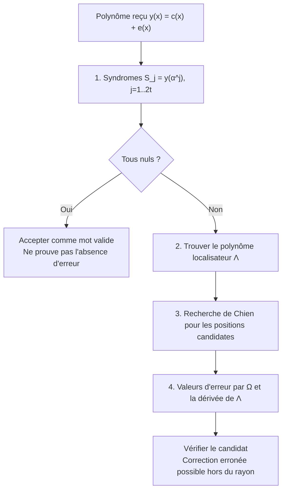
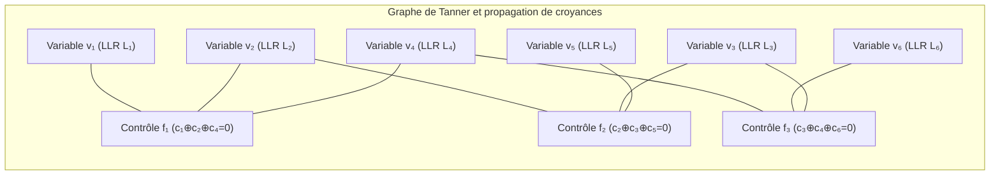
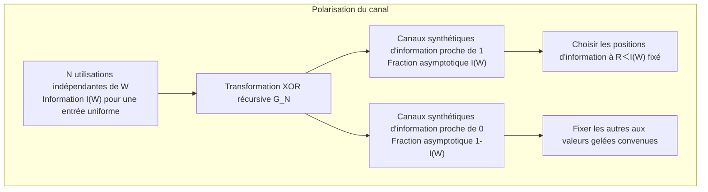

## 1. Introduction : ce que partagent les liaisons spatiales et les codes QR

Comment retrouver des données dans un signal spatial très faible ou un code QR partiellement endommagé ? Les <strong>codes correcteurs d'erreurs (ECC)</strong> ajoutent une redondance structurée. Le récepteur utilise ces relations pour estimer et réparer les valeurs modifiées. Cette protection a des limites : une redondance finie ne corrige pas toute destruction imaginable.

### Communications spatiales : recevoir le signal et corriger les erreurs restantes

Voyager 1 et Voyager 2 ont été lancées en 1977 et ont visité Jupiter et Saturne ; Voyager 2 a poursuivi vers Uranus et Neptune. Les deux sondes n'ont donc pas chacune parcouru les quatre planètes. Nous prenons pour exemple les communications des rencontres planétaires, sans transformer les distances et puissances reçues actuelles, variables, en constantes permanentes.

L'antenne à grand gain de la sonde concentre l'énergie radio vers la Terre, où le Deep Space Network (DSN) reçoit le signal. L'atténuation et le bruit thermique peuvent encore laisser des erreurs après démodulation. Pour la conversion d'unités, $10^{-16}\,\mathrm W=100\,\mathrm{aW}$, soit 100 attowatts. Ce n'est pas une mesure pour une date et une station particulières.

Un rapport du JPL préparé pour la rencontre de Voyager 2 avec Uranus décrit un code convolutif interne et un code de Reed–Solomon (RS) externe $[255,223]$. Ces étapes réduisent les effets du bruit ; elles ne garantissent pas l'absence d'erreur dans tous les blocs reçus ou tous les pixels.

### Codes QR : le pourcentage de correction n'est pas une surface que l'on peut masquer arbitrairement

Les codes QR utilisent également RS. DENSO WAVE décrit des niveaux de restauration approximatifs de 7 %, 15 %, 25 % et 30 %, mesurés en <strong>mots de code de 8 bits</strong>. Cela ne signifie pas que l'on puisse couvrir n'importe quels 30 % de l'image avec un logo. Les motifs fonctionnels, la répartition des dommages entre blocs RS et les conditions de prise de vue comptent. Il n'existe pas non plus de garantie universelle de dix millisecondes.

Dans la terminologie QR, un mot de code de 8 bits correspond à un symbole dans la description mathématique de RS utilisée ici. Ce n'est pas le mot RS entier de $n$ symboles. Distinguer ces niveaux évite de confondre la capacité de correction de chaque bloc.


Nous relierons capacité de canal, distance de Hamming, polynômes sur les corps finis et calculs probabilistes sur les graphes. Il faut distinguer <strong>corriger tous les motifs jusqu'à un certain nombre d'erreurs</strong> et <strong>rendre une probabilité d'erreur arbitrairement petite lorsque la longueur du bloc augmente</strong>.

---

## 2. Le théorème de codage de Shannon et ses hypothèses

### 2.1 Répétition : plus de fiabilité au prix du rendement

Répéter un bit permet de réduire les erreurs par vote majoritaire. Mais cette méthode seule exige davantage d'utilisations du canal par bit d'information pour augmenter la fiabilité. C'est une limite de cette construction, pas de tous les codes.

Considérons un canal binaire symétrique sans mémoire (BSC), avec inversions indépendantes de probabilité $0<p<1/2$. Un code à répétition de longueur trois transforme un bit ainsi :

$$
0 \mapsto 000, \qquad 1 \mapsto 111
$$

Si l'on transmet 000, recevoir 011, 101, 110 ou 111 conduit à décider à tort que le bit vaut 1. Deux ou trois bits doivent être inversés :

$$
P_e^{(3)} = \binom{3}{2} p^2 (1-p) + \binom{3}{3} p^3 = 3p^2(1-p) + p^3
$$

Pour $p=0{,}01$, on obtient $0{,}000298$, soit environ $0{,}03\%$. En contrepartie, le rendement du code devient :

$$
R = \frac{k}{n} = \frac{1}{3}
$$

Pour une longueur impaire $n=2t+1$, le vote échoue lorsqu'au moins $t+1$ bits sont inversés :

$$
P_e^{(n)} = \sum_{i = (n+1)/2}^{n} \binom{n}{i} p^i (1-p)^{n-i}
$$

La loi des grands nombres permet à la probabilité d'erreur de tendre vers zéro, mais simultanément :

$$
n \to \infty \implies P_e^{(n)} \to 0 \quad \text{mais simultanément} \quad R = \frac{1}{n} \to 0
$$

Par exemple, avec une longueur de cinq, $0\mapsto00000$, $1\mapsto11111$, et le rendement est $1/5$. Ce calcul n'exclut pas un codage plus efficace regroupant plusieurs bits d'information dans un bloc.

### 2.2 Capacité et théorème de codage de canal bruité

Le travail de Shannon de 1948 a montré qu'un canal bruité peut maintenir un débit positif fixe tout en rendant la probabilité d'erreur arbitrairement petite.

> <strong>Théorème pour un canal discret sans mémoire à alphabets finis :</strong> pour une loi de transition $W(y\mid x)$ donnée, la capacité est $C=\max_{P(X)}I(X;Y)\ge0$, en bits par utilisation du canal. Pour tout débit fixe $0<R<C$, il existe une suite de codes de blocs de plus en plus longs et de règles de décodage dont la probabilité d'erreur de bloc tend vers zéro. Avec $R>C$, on ne peut pas obtenir cette convergence.

La capacité n'est pas nécessairement positive. Si la sortie est indépendante de l'entrée, $C=0$. En présence de contraintes de coût d'entrée ou de puissance moyenne, la maximisation doit les respecter. Une seule statistique sur l'intensité du bruit ne détermine pas la capacité de tout canal.

Le théorème est un résultat asymptotique d'existence. Il ne promet pas qu'un code fini corrige tout bruit possible et ne fournit pas automatiquement un décodeur efficace. Latence, calcul disponible et probabilité d'erreur visée restent des contraintes de conception.

### 2.3 Dérivation de la capacité du BSC

Pour un canal discret sans mémoire :

$$
C = \max_{P(X)} I(X; Y) = \max_{P(X)} \bigl( H(Y) - H(Y \mid X) \bigr)
$$

Écrivons la sortie du BSC sous la forme $Y=X\oplus E$, où le bit de bruit $E$ est indépendant de $X$ et vaut un avec probabilité $p$. Lorsque l'entrée est connue, l'incertitude restante est l'entropie binaire :

$$
H(Y \mid X) = H_2(p) \triangleq -p \log_2 p - (1-p) \log_2(1-p)
$$

La sortie étant binaire, $H(Y)\le1$ bit. Une entrée uniforme produit une sortie uniforme et atteint $H(Y)=1$, d'où :

$$
C_{\text{BSC}}(p) = 1 - H_2(p) = 1 + p\log_2 p + (1-p)\log_2(1-p) \quad [\text{bits / utilisation du canal}]
$$

Par exemple :

$$
H_2(0{,}1) = -0{,}1 \log_2(0{,}1) - 0{,}9 \log_2(0{,}9) \approx 0{,}4690\text{ bits}
$$

$$
C_{\text{BSC}}(0{,}1) = 1 - 0{,}4690 = 0{,}5310\text{ bits / utilisation du canal}
$$

Un débit fixe inférieur, comme $R=0{,}5$, permet donc une probabilité d'erreur arbitrairement petite avec des codes adaptés et suffisamment longs. Ce n'est pas une garantie d'erreur nulle à longueur finie et à débit exactement égal à la capacité. L'argument de codage aléatoire exploite le comportement typique du bruit dans les blocs longs et la possibilité de distinguer les mots de code.

### 2.4 AWGN et limite de large bande de $-1{,}59\,\mathrm{dB}$

Un modèle de bruit blanc gaussien additif (AWGN) décrit des formes d'onde continues, pas des inversions littérales et indépendantes de bits. Notons $B$ la largeur de bande en Hz, $S$ la puissance moyenne reçue en W et $N_0$ la densité spectrale unilatérale de puissance du bruit en W/Hz. La puissance de bruit dans la bande est $N=N_0B$. Sous contrainte de puissance moyenne, sans imposer en plus une entrée binaire, Shannon–Hartley donne :

$$
C_{\text{AWGN}} = B \log_2\!\left(1 + \frac{S}{N}\right) = B \log_2\!\left(1 + \frac{S}{N_0 B}\right) \quad [\text{bits / seconde}]
$$

Soit $E_b$ l'énergie reçue par bit d'information et, maintenant, $R$ le débit d'information en bits/s, de sorte que $S=E_bR$. Les unités diffèrent du débit précédent en bits par utilisation du canal. Imposer $R<C_{\mathrm{AWGN}}$ donne :

$$
R < B \log_2\!\left(1 + \frac{E_b}{N_0} \frac{R}{B}\right)
$$

Avec l'efficacité spectrale $\eta=R/B$, en bits/s/Hz :

$$
\eta < \log_2\!\left(1 + \eta \frac{E_b}{N_0}\right) \iff 2^\eta - 1 < \eta \frac{E_b}{N_0} \iff \frac{E_b}{N_0} > \frac{2^\eta - 1}{\eta}
$$

Dans ce modèle idéal, on fait $\eta\to0$ et on utilise $2^\eta=1+\eta\ln2+O(\eta^2)$ :

$$
\lim_{\eta \to 0} \frac{2^\eta - 1}{\eta} = \ln 2 \approx 0{,}693147
$$

En décibels :

$$
\left(\frac{E_b}{N_0}\right)_{\min} = \ln 2 \approx 0{,}6931 \implies 10 \log_{10}(\ln 2) \approx \mathbf{-1{,}5917\,\text{dB}}
$$

C'est un <strong>infimum dans la limite de large bande</strong>. Pour une efficacité spectrale positive, la borne requise est $(2^\eta-1)/\eta>\ln2$. Le rapport $E_b/N_0$ n'est pas non plus le rapport de puissances $S/N$ entre signal et bruit total dans la bande. Parler simplement de « signal sous le bruit » confond ces définitions.

S'approcher de la capacité coûte aussi en longueur de bloc et en latence. Ce résultat asymptotique d'un modèle précis n'est pas une constante de tous les canaux physiques ni une promesse de communication finie sans erreurs. Restreindre l'entrée à deux valeurs, par exemple, modifie la capacité pertinente.

---

## 3. Distance de Hamming, garanties et code $[7,4,3]$

### 3.1 De l'existence à une construction calculable

Pour exploiter un théorème d'existence, il faut des algorithmes de codage et de décodage. Le travail de Hamming de 1950 en donne un exemple concret : ajouter des contrôles de parité et localiser un bit inversé à partir des contrôles non satisfaits. Construisons le code par la distance et par les matrices.

### 3.2 Distance et distance minimale

Les chaînes binaires de longueur $n$ forment $\mathbb F_2^n$, les sommets d'un hypercube de dimension $n$. Dans $\mathbb F_2$, additionner et soustraire revient à XOR. La distance de Hamming compte les coordonnées différentes :

$$
d_H(\mathbf{u}, \mathbf{v}) \triangleq \bigl|\{ i \in \{1, \dots, n\} \mid u_i \neq v_i \}\bigr| = w_H(\mathbf{u} - \mathbf{v})
$$

Ici, $w_H$ compte les entrées non nulles, le poids de Hamming. La distance vérifie positivité au sens large, symétrie et inégalité triangulaire. Un code est un sous-ensemble $\mathcal C$ de mots autorisés ; s'il est binaire, linéaire et de dimension $k$, il contient $2^k$ mots. Sa distance minimale est :

$$
d_{\min}(\mathcal{C}) \triangleq \min_{\substack{\mathbf{u}, \mathbf{v} \in \mathcal{C} \\ \mathbf{u} \neq \mathbf{v}}} d_H(\mathbf{u}, \mathbf{v})
$$

Dans un code linéaire, la différence de deux mots distincts est un autre mot non nul, donc :

$$
d_{\min}(\mathcal{C}) = \min_{\mathbf{c} \in \mathcal{C} \setminus \{\mathbf{0}\}} w_H(\mathbf{c})
$$

### 3.3 Détection, effacements et erreurs de position inconnue

1. <strong>Détection :</strong> modifier entre une et $d_{\min}-1$ coordonnées ne peut transformer un mot valide en un autre. Vérifier l'appartenance au code détecte tous ces motifs non nuls.
2. <strong>Effacements :</strong> les positions perdues sont connues, mais pas leurs valeurs. S'il y en a au plus $e\le d_{\min}-1$, deux mots distincts diffèrent encore sur une coordonnée conservée. En supposant exactes les valeurs restantes, le mot transmis est déterminé de manière unique.
3. <strong>Erreurs de position inconnue :</strong> le décodage par le mot le plus proche corrige tous les motifs d'au plus $t$ erreurs si et seulement si les boules de Hamming de rayon $t$ centrées sur des mots distincts sont disjointes.

Si un mot reçu appartenait à deux boules, l'inégalité triangulaire donnerait une distance entre leurs centres d'au plus $2t$. Réciproquement, deux centres séparés par au plus $2t$ admettent un mot à distance au plus $t$ des deux : on répartit les coordonnées différentes entre les deux choix. Ainsi :

$$
2t + 1 \le d_{\min} \iff t \le \left\lfloor \frac{d_{\min} - 1}{2} \right\rfloor
$$

L'égalité $t=\lfloor(d_{\min}-1)/2\rfloor$ précise le <strong>plus grand rayon garanti</strong>, pas chaque rayon inférieur admissible. Avec au plus $t$ erreurs inconnues et $e$ effacements connus, la garantie pour tous les motifs est :

$$
\mathbf{d_{\min} \ge 2t + e + 1}
$$

Retirer les positions effacées laisse une distance minimale d'au moins $d_{\min}-e$ ; on applique l'argument des boules disjointes dans cet espace restant. Certains cas hors de cette borne restent récupérables, mais le succès n'est plus garanti pour toutes les configurations. « Position inconnue » n'impose pas une distribution aléatoire des erreurs.

Une boule de rayon $t$ dans un espace sur un alphabet de taille $q$ contient $\sum_{i=0}^t\binom ni(q-1)^i$ mots. Les boules disjointes doivent tenir dans l'espace :

$$
|\mathcal{C}| \cdot \sum_{i=0}^{t} \binom{n}{i} (q-1)^i \le q^n \quad \left(\text{pour les codes binaires : } 2^k \sum_{i=0}^{t} \binom{n}{i} \le 2^n \right)
$$

Un code atteignant l'égalité est <strong>parfait</strong> : ses boules couvrent l'espace sans trous ni recouvrements. Exemples : Hamming, Golay binaire $[23,12,7]$ et ternaire $[11,6,5]$. Les classifications exigent leurs hypothèses ; il existe aussi des codes parfaits non linéaires. Ces exemples ne prouvent pas quel code de Golay une mission particulière a utilisé.

### 3.4 Matrices de Hamming et syndrome

Le code $[7,4,3]$ ajoute trois bits de parité à quatre bits d'information :

$$
2^4 \sum_{i=0}^{1} \binom{7}{i} = 16 \times (1 + 7) = 16 \times 8 = 128 = 2^7
$$

Les 16 boules de rayon un, chacune contenant un centre et sept voisins, couvrent les 128 mots.

Une construction commode de la matrice de contrôle place la représentation binaire de $j$ dans sa colonne $j$ :

$$
\mathbf{H}_{\text{binary}} = \begin{pmatrix} 0 & 0 & 0 & 1 & 1 & 1 & 1 \\ 0 & 1 & 1 & 0 & 0 & 1 & 1 \\ 1 & 0 & 1 & 0 & 1 & 0 & 1 \end{pmatrix} \begin{matrix} \leftarrow 2^2\text{ position} \\ \leftarrow 2^1\text{ position} \\ \leftarrow 2^0\text{ position} \end{matrix}
$$

Sa cinquième colonne est $(1,0,1)^T$. Pour conserver les quatre bits de message au début et ajouter la parité à la fin, on utilise la forme systématique $\mathbf G=[\mathbf I_4\mid\mathbf P]$ et $\mathbf H=[\mathbf P^T\mid\mathbf I_3]$ :

$$
\mathbf{G}_{4\times 7} = \left(\begin{array}{cccc|ccc} 1 & 0 & 0 & 0 & 1 & 1 & 0 \\ 0 & 1 & 0 & 0 & 1 & 0 & 1 \\ 0 & 0 & 1 & 0 & 0 & 1 & 1 \\ 0 & 0 & 0 & 1 & 1 & 1 & 1 \end{array}\right), \qquad \mathbf{H}_{3\times 7} = \left(\begin{array}{cccc|ccc} 1 & 1 & 0 & 1 & 1 & 0 & 0 \\ 1 & 0 & 1 & 1 & 0 & 1 & 0 \\ 0 & 1 & 1 & 1 & 0 & 0 & 1 \end{array}\right)
$$

Comme $\mathbf G\mathbf H^T=0$, tous les mots codés vérifient :

$$
\mathbf{H}\mathbf{c}^T = \mathbf{0} \pmod 2
$$

À la réception de $\mathbf y=\mathbf c+\mathbf e$, on calcule le <strong>syndrome</strong> :

$$
\mathbf{s} = \mathbf{H}\mathbf{y}^T = \mathbf{H}(\mathbf{c} + \mathbf{e})^T = \underbrace{\mathbf{H}\mathbf{c}^T}_{=\mathbf{0}} + \mathbf{H}\mathbf{e}^T = \mathbf{H}\mathbf{e}^T \pmod 2
$$

Il ne dépend que de l'erreur. Inverser le bit $j$ fournit la colonne $j$ de la matrice choisie. Avec des colonnes en ordre binaire, le syndrome 101 indique la position 5 ; en forme systématique, l'ordre diffère et il faut chercher la colonne correspondante. Sa valeur numérique n'est pas nécessairement la position. Le programme de la section 6 effectue cette recherche.

Un syndrome nul signifie appartenir au code. Sous l'hypothèse d'au plus une erreur, il signifie l'absence d'erreur ; hors de cette hypothèse, le canal peut avoir transformé un mot valide en un autre. Plusieurs erreurs peuvent aussi conduire le décodeur d'une erreur à inverser un bit initialement correct.

Par exemple, le message `[1,0,1,1]` est codé en `[1,0,1,1,0,1,0]`. Inverser l'indice 2, compté à partir de zéro — le troisième bit —, donne le syndrome `[0,1,1]`, correspondant à la colonne d'indice 2. Un circuit fixé à sept bits a une taille constante, mais calculer les syndromes pour une longueur générale $n$ n'est pas universellement $O(1)$.

Ajouter un bit de parité globale paire donne le code étendu $[8,4,4]$. Une règle adaptée permet de corriger un bit et d'en détecter deux (SECDED). C'est un modèle de base pour comprendre la mémoire ECC, pas l'architecture exacte de tous les produits.

---

## 4. Reed–Solomon : corps finis, interpolation et décodage

### 4.1 Pourquoi les rafales comptent

Hamming $(7,4)$ corrige un bit à toute position d'un bloc. Une rayure, une tache sur un QR ou un évanouissement du signal peuvent modifier plusieurs bits du même bloc. Deux inversions peuvent déjà faire corriger le décodeur d'une erreur vers le mauvais mot.

La construction de Reed et Solomon de 1960 regroupe les bits en <strong>symboles</strong> d'un corps fini. L'unité servant à mesurer distance et correction change. La disposition spatiale et l'entrelacement déterminent aussi comment les dommages physiques touchent ces symboles.

### 4.2 Un octet comme élément d'un corps fini

Un symbole de $m$ bits peut être représenté dans $\mathbb F_{2^m}$. Ce n'est pas le calcul sur les entiers modulo 256 : $2\cdot128\equiv0\pmod{256}$ exhibe des diviseurs de zéro, et ces éléments non nuls n'ont pas d'inverse multiplicatif. Les corps finis existent précisément pour les cardinalités qui sont des puissances d'un nombre premier.

Dans GF(256), un octet représente un polynôme de degré au plus sept à coefficients binaires. Le programme réduit les produits modulo le polynôme irréductible de degré huit représenté par `0x11D` :

$$
\mathbb{F}_{2^8} \cong \frac{\mathbb{F}_2[x]}{\langle x^8 + x^4 + x^3 + x^2 + 1 \rangle}
$$

Additionner et soustraire revient à XOR, car $1+1=0$ dans le corps des coefficients. Les 255 éléments non nuls forment un groupe multiplicatif cyclique. Dans cette représentation, $\alpha=x$, octet `0x02`, est primitif : ses puissances $\alpha^0,\ldots,\alpha^{254}$ parcourent tous les non nuls et $\alpha^{255}=1$.

Les tables de logarithmes et d'exponentielles permettent de multiplier et de diviser les éléments non nuls :

$$
A \cdot B = \alpha^{(i + j) \bmod 255}, \qquad \frac{A}{B} = \alpha^{(i - j) \bmod 255}
$$

Zéro exige un traitement séparé et la division par zéro n'est pas définie. La longueur des tables dépend de l'implémentation ; certaines prolongent la table d'exponentielles pour éviter un modulo explicite. La section 6 utilise décalages et XOR.

Plusieurs bits endommagés dans un même octet comptent comme une erreur de symbole. Franchir les frontières d'octets peut toucher plusieurs symboles ; le seul nombre total de bits modifiés ne détermine pas la possibilité de correction.

### 4.3 Évaluation, interpolation et borne de Singleton

Deux points d'abscisses distinctes déterminent un polynôme de degré au plus un. Si l'on transmet cinq évaluations, deux évaluations exactes conservées, quelles qu'elles soient, permettent de retrouver le polynôme après trois effacements. Trois abscisses distinctes déterminent un polynôme de degré au plus deux.

On utilise les $k$ symboles du message comme coefficients :

$$
P(x) \triangleq m_0 + m_1 x + m_2 x^2 + \dots + m_{k-1} x^{k-1} \in \mathbb{F}_q[x]
$$

On choisit $n$ points distincts $\alpha_i\in\mathbb F_q$, avec $k\le n\le q$, et on transmet :

$$
\mathbf{c} = \bigl( P(\alpha_1),\; P(\alpha_2),\; \dots,\; P(\alpha_n) \bigr) \in \mathbb{F}_q^n
$$

Le théorème de factorisation par $x-a$ implique qu'un polynôme non nul sur un corps n'a pas plus de racines que son degré. La différence $P-Q$ de messages distincts a un degré inférieur à $k$ et s'annule donc en au plus $k-1$ points. Les mots diffèrent sur au moins $n-k+1$ coordonnées.

Pour la borne opposée, on retire $d_{\min}-1$ coordonnées de tous les mots : leurs projections doivent rester distinctes. Avec $q^k$ mots, $q^k\le q^{n-d_{\min}+1}$, donc $d_{\min}\le n-k+1$. RS atteint l'égalité :

$$
\mathbf{d_{\min} = n - k + 1}
$$

C'est la propriété <strong>MDS, distance minimale maximale à paramètres fixés</strong> : elle optimise la distance pour un alphabet, une longueur et une dimension donnés, pas toutes les performances d'ingénierie.

Avec $r=n-k$ symboles redondants, la garantie est $2t+e\le r$ :

- <strong>Effacements connus :</strong> jusqu'à $n-k$ symboles peuvent manquer. N'importe quelles $k$ évaluations exactes conservées permettent de retrouver le message par interpolation de Lagrange :

$$
P(x) = \sum_{j=1}^{k} y_{i_j} \prod_{\substack{m=1 \\ m \neq j}}^{k} \frac{x - x_{i_m}}{x_{i_j} - x_{i_m}}
$$

- <strong>Erreurs inconnues :</strong> on corrige jusqu'à $\lfloor(n-k)/2\rfloor$ symboles endommagés, quel que soit le nombre de bits modifiés dans chaque symbole touché.

### 4.4 Forme cyclique et conventions de la formule de Forney

La forme d'évaluation traite le message comme des coefficients et transmet des évaluations. Dans la description cyclique, les coordonnées du mot sont les coefficients d'un autre polynôme divisible par un générateur. Le code de longueur complète $n=q-1$ utilisant les points non nuls possède une représentation cyclique équivalente lorsque l'on fixe la correspondance. Un code raccourci n'est pas nécessairement cyclique à sa nouvelle longueur.

Fixons la redondance $n-k=2t$ et la première racine du générateur $\alpha^1$. Ce sont les conventions de cette dérivation, pas celles de tous les formats QR ou spatiaux :

$$
g(x)=\prod_{j=1}^{2t}(x-\alpha^j)
$$

Avec le reste $r(x)=x^{2t}m(x)\bmod g(x)$, on décale le message et on soustrait le reste :

$$
c(x)=x^{2t}m(x)-r(x),\qquad c(\alpha^j)=0\quad(1\le j\le2t)
$$

En caractéristique deux, soustraire reste un XOR.



1. <strong>Syndromes :</strong> supposons $\nu\le t$ erreurs aux positions $i_l$, de valeurs non nulles $Y_l=e_{i_l}$. Posons $X_l=\alpha^{i_l}$. Évaluer aux racines élimine le mot transmis :

$$
S_j=y(\alpha^j)=e(\alpha^j)=\sum_{l=1}^{\nu}Y_lX_l^j,\qquad j=1,\ldots,2t
$$

Un syndrome nul établit seulement l'appartenance au code ; il ne détecte pas un changement entre mots valides.

2. <strong>Polynôme localisateur :</strong>

$$
\Lambda(z)=\prod_{l=1}^{\nu}(1-X_lz)=1+\Lambda_1z+\cdots+\Lambda_\nu z^\nu
$$

Multiplier $\Lambda(X_l^{-1})=0$ par $Y_lX_l^{j+\nu}$ et sommer donne la récurrence linéaire :

$$
S_{j+\nu}+\Lambda_1S_{j+\nu-1}+\cdots+\Lambda_\nu S_j=0,\qquad1\le j\le2t-\nu
$$

Berlekamp–Massey obtient une récurrence minimale et un candidat, généralement en $O(t^2)$ opérations du corps. Une méthode fondée sur Euclide étendu peut également résoudre l'équation clé.

3. <strong>Recherche de Chien :</strong> on teste les éléments non nuls $\alpha^{-i}$ associés aux coordonnées et on cherche $\Lambda(\alpha^{-i})=0$. GF(256) contient 256 éléments au total, dont 255 non nuls. Il faut vérifier, entre autres, que le degré du localisateur correspond au nombre de racines admissibles.

4. <strong>Valeurs d'erreur :</strong> définissons explicitement le polynôme des syndromes et l'évaluateur :

$$
S(z)=S_1+S_2z+\cdots+S_{2t}z^{2t-1},\qquad \Omega(z)=S(z)\Lambda(z)\bmod z^{2t}
$$

Avec ces définitions, Forney donne :

$$
Y_l=-\frac{\Omega(X_l^{-1})}{\Lambda'(X_l^{-1})}
$$

Pour une erreur, $\Omega=YX$ et $\Lambda'=-X$, d'où $Y$. Multiplier encore par $X$ donnerait $XY$. D'autres conventions de première racine ou de polynôme des syndromes peuvent modifier ce facteur ; on ne doit pas transférer une formule sans ses définitions.

On soustrait les erreurs estimées et on contrôle l'appartenance au code et la distance corrigée. Pourtant, un mot reçu proche d'un autre mot valide peut passer ces vérifications avec un message erroné. CRC, retransmission ou vérifications supérieures peuvent renforcer la protection ; toute corruption hors du rayon garanti n'est pas nécessairement détectée.

### 4.5 QR, stockage et concaténation dans Voyager

- <strong>QR :</strong> L/M/Q/H correspondent à environ 7/15/25/30 % de restauration des mots de 8 bits. Chaque bloc RS doit satisfaire ses conditions. Version et niveau modifient données, redondance et découpage en blocs ; ils ne se traduisent pas par une surface arbitraire. Masquer des motifs fonctionnels peut empêcher la reconnaissance ou l'extraction des mots avant le décodage RS.
- <strong>RAID-6 et stockage distribué :</strong> une unité ou un fragment manquant à une position connue est un effacement. Un code MDS $[14,10]$ illustratif utilise $14/10=1{,}4$ fois la capacité des données et tolère quatre fragments perdus si les autres et les métadonnées nécessaires sont exacts. Ce n'est pas une configuration universelle des fournisseurs de cloud. La double parité de RAID-6 permet de récupérer deux unités sous ses hypothèses, pas tout dommage latent supplémentaire ni la perte de l'installation entière.
- <strong>Voyager 2 :</strong> le rapport du JPL de 1983 décrit un code convolutif de longueur de contrainte $K=7$ et de rendement $1/2$, un entrelacement de profondeur 4 et un RS externe $[255,223]$. Ses 32 octets redondants garantissent $2t+e\le32$ par mot RS, soit 16 erreurs d'octet sans effacement. Une rafale contiguë de 128 bits non alignée peut couvrir 17 octets. L'entrelacement répartit les rafales résiduelles du décodeur interne entre mots RS. Le code interne de cet exemple est convolutif.

---

## 5. LDPC, turbo et polaires : fiabilité et capacité

### 5.1 La distance ne résout pas tout

Un code pratique doit satisfaire erreur visée, latence, longueur de bloc, calcul et coût matériel. Comparer exhaustivement tous les mots d'un code binaire de dimension $k$ exige $2^k$ candidats. Une bonne distance minimale n'implique pas automatiquement un décodage efficace.

Le décodage itératif turbo et LDPC exploite la fiabilité des observations ; les polaires utilisent une autre construction pour approcher la capacité symétrique. Les comparaisons doivent conserver le canal, les contraintes d'entrée et le débit. Tout comparer à la limite de large bande de $-1{,}59\,\mathrm{dB}$ ne suffit pas.

### 5.2 Parité creuse et propagation de croyances

Les codes LDPC de Gallager de 1962 utilisent une matrice de contrôle creuse. Même pour des blocs longs, chaque ligne et chaque colonne peuvent avoir peu d'éléments non nuls. Pour une matrice $\mathbf H$ de taille $m\times n$, la dimension est $k=n-\operatorname{rank}_{\mathbb F_2}(\mathbf H)$, où rank désigne le rang de la matrice ; elle vaut $n-m$ seulement si les lignes sont indépendantes.

Dans le graphe de Tanner, les nœuds de variable correspondent aux colonnes et aux bits ; les nœuds de contrôle, aux lignes et aux équations de parité. Une arête existe exactement lorsque $H_{a,i}=1$ :



La décision souple conserve la fiabilité sans réduire immédiatement l'observation à zéro ou un. Le rapport de vraisemblance logarithmique (LLR) peut s'écrire :

$$
L(c_i) \triangleq \ln \frac{\Pr(c_i = 0 \mid y_i)}{\Pr(c_i = 1 \mid y_i)}
$$

Pour des entrées équiprobables, une BPSK d'amplitude unitaire $0\mapsto+1$, $1\mapsto-1$, un bruit indépendant $Z\sim\mathcal N(0,\sigma^2)$ et l'observation $y_i=x_i+Z$ :

$$
L_{\mathrm{ch}}(c_i)=\ln\frac{p(y_i\mid c_i=0)}{p(y_i\mid c_i=1)}=\frac{2y_i}{\sigma^2}
$$

D'autres amplitudes ou probabilités a priori changent l'expression. Un LLR de $+10$ favorise fortement zéro ; $-0{,}1$ favorise légèrement un.

L'algorithme somme-produit est une forme de propagation de croyances. Il échange des messages extrinsèques en excluant la contribution du voisin destinataire :

$$
\mu_{f_a \to v_i} = 2 \operatorname{artanh}\!\left( \prod_{v_j \in N(f_a) \setminus \{v_i\}} \tanh\!\left(\frac{\mu_{v_j \to f_a}}{2}\right) \right)
$$

$$
\mu_{v_i \to f_a} = L_{\text{ch}}(v_i) + \sum_{f_b \in N(v_i) \setminus \{f_a\}} \mu_{f_b \to v_i}
$$

$N$ désigne l'ensemble de voisins concerné. L'ordonnancement itératif précise l'itération des messages utilisée sans modifier cette exclusion.

Une matrice creuse réduit les arêtes, mais ne supprime pas à elle seule les cycles courts. Sur un arbre, la propagation calcule des marginales exactes ; sur un graphe fini avec cycles, dépendances, ensembles de piégeage ou absence de convergence peuvent laisser des erreurs.

Avec $E$ arêtes, une implémentation partageant les calculs entre voisins utilise approximativement $O(E)$ opérations par itération, soit $O(IE)$ pour $I$ itérations. Des degrés bornés peuvent donner $E=O(n)$, sans garantir un nombre constant d'itérations. L'implémentation numérique doit gérer saturation des LLR et domaine de $\operatorname{artanh}$.

Le résultat de Chung et collaborateurs de 2001 concerne un <strong>rendement $1/2$ sur un canal AWGN à entrée binaire</strong> : le seuil asymptotique calculé par évolution de densité se situe à $0{,}0045\,\mathrm{dB}$ de la limite de capacité de ce canal. Une simulation finie distincte, avec une conception plus simple, une longueur $10^7$ et un BER de $10^{-6}$, présente un écart de $0{,}04\,\mathrm{dB}$. Ce ne sont ni les performances universelles de tous les appareils ni l'infimum énergétique de large bande.

### 5.3 Codes polaires et capacité symétrique

La construction d'Arıkan de 2009 approche $I(W)$, la <strong>capacité symétrique</strong> d'un canal discret sans mémoire à entrée binaire : l'information mutuelle pour une entrée uniforme. Elle coïncide avec $C$ sur les canaux symétriques, mais pas nécessairement avec le maximum sur les distributions d'entrée d'un canal asymétrique.

La transformation de base est :

$$
(x_1,x_2)=(u_1,u_2)\begin{pmatrix}1&0\\1&1\end{pmatrix} =(u_1\oplus u_2,u_2)
$$

Le canal synthétique $W^-$ estime $u_1$ avec $(y_1,y_2)$ ; $W^+$ estime $u_2$ avec $(y_1,y_2,u_1)$ lorsque la valeur correcte de $u_1$ est fournie. Pour des entrées uniformes et indépendantes, la règle de chaîne donne :

$$
I(W^-)+I(W^+)=2I(W),\qquad I(W^-)\le I(W)\le I(W^+)
$$

« Meilleur » et « moins bon » désignent ici l'information, sans exiger un changement strict dans tous les cas. En décodage successif réel, une erreur antérieure peut se propager aux décisions suivantes.

Pour $N=2^m$, une convention utilise la permutation $\mathbf B_N$ inversant l'ordre des chiffres binaires des indices, avec la matrice génératrice :

$$
\mathbf G_N=\mathbf B_N \begin{pmatrix}1&0\\1&1\end{pmatrix}^{\otimes m}
$$

Pour tout $0<\delta<1$ fixé, lorsque $N\to\infty$, la fraction de canaux synthétiques d'information supérieure à $1-\delta$ tend vers $I(W)$ ; celle d'information inférieure à $\delta$ tend vers $1-I(W)$. À longueur finie, il n'apparaît pas exactement $NI(W)$ canaux parfaitement sans bruit.



On choisit les positions d'information à débit fixe $R<I(W)$ et on gèle les autres à des valeurs convenues. Pour un canal général, la garantie d'origine utilise une moyenne sur les valeurs gelées et l'existence d'un choix adapté ; pour un canal symétrique, la borne correspondante vaut pour tout choix fixé.

Coder et décoder par <strong>annulation successive (SC)</strong> coûte $O(N\log N)$ en temps. Choisir l'ensemble d'information est un coût de construction distinct. Une implémentation efficace de l'<strong>annulation successive par liste (SCL)</strong> de taille $L$ exige $O(LN\log N)$ ; un CRC peut aider à choisir un candidat. Erreur et latence finies dépendent de la construction, du rendement, de la taille de liste et du canal ; il n'existe pas de garantie générale d'absence de plancher d'erreur (error floor).

### 5.4 Comparaison des familles

| Code | Structure mathématique | Décodage représentatif | Caractéristiques et usages |
| :--- | :--- | :--- | :--- |
| Hamming (1950) | Code linéaire binaire ; $[7,4,3]$ est parfait | Syndrome et recherche de colonne | Corrige un bit ; modèle de base pour SECDED |
| Reed–Solomon (1960) | Polynômes sur corps fini ; propriété MDS | BM/Euclide, Chien, Forney ; Welch–Berlekamp en évaluation | Erreurs de symbole et effacements ; QR, stockage, télémesure concaténée |
| Convolutif et turbo | Treillis, concaténation, entrelacement | Viterbi ; décodage itératif BCJR | Communication bruitée ; le code interne de Voyager est convolutif |
| LDPC (1962) | Matrice creuse et graphe de Tanner | Propagation de croyances à décisions souples | Blocs longs et parallélisme ; approches de capacité dans des modèles précis |
| Polaires (2009) | Polarisation récursive et bits gelés | SC $O(N\log N)$ ; SCL dépend de $L$ | Approche asymptotique de la capacité symétrique ; certaines informations de contrôle 5G NR |

Partager un tableau ne signifie pas avoir la même complexité ou le même taux d'erreur. Toutes les informations de contrôle 5G ne sont pas non plus codées par polaires. Par exemple, 3GPP TS 38.212 v19.3.0, sections 6.3.1.2–6.3.1.3, distingue pour l'information de contrôle montante (UCI) sur PUCCH les charges de $A\ge12$ bits, codées par polaires, et $A\le11$, avec codage en petits blocs.

---

## 6. Vérification en Python : Hamming et RS d'évaluation sur GF(256)

Ce programme autonome en Python 3 implémente Hamming $(7,4)$ systématique et le <strong>RS d'évaluation</strong> de la section 4.3. Les symboles de message sont les coefficients du polynôme ; en général, ils n'apparaissent pas inchangés au début du mot. Ce n'est pas le décodeur BM de la section 4.4 ; il n'implémente ni disposition des modules, ni blocs, ni format cyclique systématique du QR. Il n'est pas directement interopérable avec QR ou une sonde.

Le corps est GF(256), avec le polynôme irréductible `0x11D`. Il diffère du corps premier GF(257) des résidus entiers modulo 257 : ce dernier permet aussi des codes d'évaluation, mais peut produire le symbole 256, qui ne tient pas dans un octet.

Le décodeur utilise un système de type Welch–Berlekamp. Pour des degrés candidats $\nu=0,\ldots,t$, il cherche un polynôme unitaire $E(x)$ de degré $\nu$ et $Q(x)$ de degré inférieur à $k+\nu$ tels que :

$$
Q(x_i)=y_iE(x_i)\qquad(i=1,\ldots,n)
$$

Il y a $k+2\nu$ coefficients inconnus. En caractéristique deux, changer un terme de membre reste un XOR.

Si le message réel est $P$ et s'il y a au plus $\nu$ erreurs, on choisit $E$ s'annulant en leurs points, en complétant le degré si nécessaire, et $Q=PE$. Réciproquement, avec $n\ge k+2\nu$, toute solution a $Q-PE$ nul en au moins $n-\nu$ points corrects, mais de degré inférieur à $k+\nu$ ; ce doit donc être le polynôme nul. Cet argument de racines justifie la récupération.

On essaie les degrés de zéro à $t$, on traite les systèmes rectangulaires et les déficiences de rang, on divise $Q$ par $E$, on exige un reste nul et un quotient de degré inférieur à $k$, puis on recode pour vérifier une distance au mot reçu d'au plus $t$. Cela fonctionne avec zéro erreur, moins de $t$ erreurs et à la limite. Les points doivent être distincts ; de 1 à 256 éléments du corps sont admis, zéro compris.

La clarté est prioritaire : ce n'est ni un décodeur RS de production ni une mesure de vitesse. Il peut effectuer jusqu'à $t+1$ éliminations de Gauss générales. `rs_encode` et `rs_decode` vérifient valeurs, longueurs, points et rayon ; les fonctions auxiliaires internes de polynômes et systèmes supposent les éléments du corps déjà validés.

```python
"""Educational evaluation RS over GF(256), not a QR parser or wire format."""
from itertools import product


def field_value(a):
    if type(a) is not int or not 0 <= a < 256:
        raise ValueError("Field elements must be integers from 0 through 255")
    return a


def gf_mul(a, b):
    field_value(a)
    field_value(b)
    result = 0
    for _ in range(8):
        if b & 1:
            result ^= a
        b >>= 1
        a <<= 1
        if a & 256:
            a ^= 0x11D
    return result


def gf_pow(a, exponent):
    field_value(a)
    if type(exponent) is not int or exponent < 0:
        raise ValueError("Exponent must be a nonnegative integer")
    result = 1
    while exponent:
        if exponent & 1:
            result = gf_mul(result, a)
        a = gf_mul(a, a)
        exponent >>= 1
    return result


def gf_inv(a):
    field_value(a)
    if a == 0:
        raise ZeroDivisionError("Zero has no multiplicative inverse")
    return gf_pow(a, 254)


def poly_trim(coefficients):
    result = list(coefficients)
    while result and result[-1] == 0:
        result.pop()
    return result


def poly_eval(coefficients, x):
    result = 0
    for coefficient in reversed(coefficients):
        result = gf_mul(result, x) ^ coefficient
    return result


def poly_divmod(numerator, denominator):
    remainder = poly_trim(numerator)
    denominator = poly_trim(denominator)
    if not denominator:
        raise ZeroDivisionError("Zero polynomial divisor")
    quotient = [0] * max(0, len(remainder) - len(denominator) + 1)
    inverse_lead = gf_inv(denominator[-1])
    while remainder and len(remainder) >= len(denominator):
        degree = len(remainder) - len(denominator)
        factor = gf_mul(remainder[-1], inverse_lead)
        quotient[degree] = factor
        for j, coefficient in enumerate(denominator):
            remainder[degree + j] ^= gf_mul(factor, coefficient)
        remainder = poly_trim(remainder)
    return poly_trim(quotient), remainder


def solve_linear_system(rows, rhs, columns):
    """Return one solution (free variables zero), or None if inconsistent."""
    if len(rows) != len(rhs) or any(len(row) != columns for row in rows):
        raise ValueError("Linear-system dimensions do not match")
    matrix = [list(row) + [value] for row, value in zip(rows, rhs)]
    pivot_columns = []
    pivot_row = 0
    for column in range(columns):
        pivot = next(
            (r for r in range(pivot_row, len(matrix)) if matrix[r][column]),
            None,
        )
        if pivot is None:
            continue
        matrix[pivot_row], matrix[pivot] = matrix[pivot], matrix[pivot_row]
        inverse = gf_inv(matrix[pivot_row][column])
        matrix[pivot_row] = [gf_mul(value, inverse) for value in matrix[pivot_row]]
        for r in range(len(matrix)):
            if r != pivot_row and matrix[r][column]:
                factor = matrix[r][column]
                matrix[r] = [
                    a ^ gf_mul(factor, b)
                    for a, b in zip(matrix[r], matrix[pivot_row])
                ]
        pivot_columns.append(column)
        pivot_row += 1
        if pivot_row == len(matrix):
            break
    if any(not any(row[:columns]) and row[columns] for row in matrix):
        return None
    solution = [0] * columns
    for r, column in enumerate(pivot_columns):
        solution[column] = matrix[r][columns]
    return solution


def check_points(points):
    points = list(points)
    if not points or len(points) > 256:
        raise ValueError("Use from 1 through 256 distinct evaluation points")
    for x in points:
        field_value(x)
    if len(set(points)) != len(points):
        raise ValueError("Evaluation points must be distinct")
    return points


def rs_encode(message, points):
    points = check_points(points)
    message = list(message)
    if not 1 <= len(message) <= len(points):
        raise ValueError("Require 1 <= message length <= code length")
    for value in message:
        field_value(value)
    return [poly_eval(message, x) for x in points]


def rs_decode(received, points, k, max_errors):
    points = check_points(points)
    received = list(received)
    n = len(points)
    if len(received) != n:
        raise ValueError("Received length must match evaluation points")
    if type(k) is not int or not 1 <= k <= n:
        raise ValueError("Require integer 1 <= k <= n")
    if type(max_errors) is not int or max_errors < 0 or k + 2 * max_errors > n:
        raise ValueError("Require integer t >= 0 and k + 2t <= n")
    for value in received:
        field_value(value)
    # Try locator degrees 0,...,t: fewer than t errors must also work.
    for errors in range(max_errors + 1):
        columns = k + 2 * errors
        rows, rhs = [], []
        for x, y in zip(points, received):
            powers = [gf_pow(x, degree) for degree in range(k + errors)]
            rows.append(
                powers + [gf_mul(y, gf_pow(x, degree)) for degree in range(errors)]
            )
            rhs.append(gf_mul(y, gf_pow(x, errors)))
        solution = solve_linear_system(rows, rhs, columns)
        if solution is None:
            continue
        q = solution[:k + errors]
        locator = solution[k + errors:] + [1]
        message, remainder = poly_divmod(q, locator)
        if remainder or len(message) > k:
            continue
        message += [0] * (k - len(message))
        codeword = rs_encode(message, points)
        distance = sum(a != b for a, b in zip(codeword, received))
        if distance <= max_errors:
            return message
    raise ValueError("No codeword within the requested correction radius")


G = (
    (1, 0, 0, 0, 1, 1, 0),
    (0, 1, 0, 0, 1, 0, 1),
    (0, 0, 1, 0, 0, 1, 1),
    (0, 0, 0, 1, 1, 1, 1),
)
H = (
    (1, 1, 0, 1, 1, 0, 0),
    (1, 0, 1, 1, 0, 1, 0),
    (0, 1, 1, 1, 0, 0, 1),
)


def bits(values, length):
    values = list(values)
    if len(values) != length or any(type(v) is not int or v not in (0, 1) for v in values):
        raise ValueError("Invalid bit vector")
    return values


def hamming_encode(message):
    message = bits(message, 4)
    return [sum(message[i] * G[i][j] for i in range(4)) % 2 for j in range(7)]


def hamming_decode(received):
    received = bits(received, 7)
    syndrome = [sum(H[r][j] * received[j] for j in range(7)) % 2 for r in range(3)]
    if any(syndrome):
        position = next(j for j in range(7) if [H[r][j] for r in range(3)] == syndrome)
        received[position] ^= 1
    return received[:4]


if __name__ == "__main__":
    hamming_cases = 0
    for message in product((0, 1), repeat=4):
        codeword = hamming_encode(message)
        for position in range(-1, 7):
            received = codeword.copy()
            if position >= 0:
                received[position] ^= 1
            assert hamming_decode(received) == list(message)
            hamming_cases += 1
    print("Hamming no-error/single-error cases:", hamming_cases)

    payload = b"VOYAGER-1"
    points = list(range(1, 16))
    codeword = rs_encode(payload, points)
    print("GF(256) evaluation codeword:", codeword)
    for count in range(4):
        received = codeword.copy()
        for position in range(count):
            received[position] ^= position + 1
        recovered = bytes(rs_decode(received, points, len(payload), 3))
        print("RS corrupted symbols:", count, "recovered:", recovered.decode("ascii"))
        assert recovered == payload
    # A decoder can miscorrect beyond the transmitted word's guaranteed radius.
    # Construct a received word close to a DIFFERENT valid word.
    alternative = list(payload)
    alternative[0] ^= 1
    alternative_codeword = rs_encode(alternative, points)
    received = alternative_codeword.copy()
    received[0] ^= 1
    assert rs_decode(received, points, len(payload), 3) == alternative
    print("Beyond-radius example returns another nearby codeword:", True)
```

Sortie de l'exécution réelle :

```text
Hamming no-error/single-error cases: 128
GF(256) evaluation codeword: [77, 162, 167, 64, 87, 173, 26, 217, 215, 33, 189, 173, 212, 41, 124]
RS corrupted symbols: 0 recovered: VOYAGER-1
RS corrupted symbols: 1 recovered: VOYAGER-1
RS corrupted symbols: 2 recovered: VOYAGER-1
RS corrupted symbols: 3 recovered: VOYAGER-1
Beyond-radius example returns another nearby codeword: True
```

Neuf octets deviennent 15 symboles, avec distance minimale 7 et rayon garanti 3. Trois sur quinze font 20 %, pas 30 %. La démonstration modifie de zéro à trois positions initiales ; la garantie en nombre vaut également pour des positions non contiguës.

Un autre choix valide consiste à évaluer en $\alpha^0,\ldots,\alpha^{14}$ et modifier les indices `[1,6,13]`, comptés à partir de zéro. Le décodeur accepte aussi ce cas. Utiliser les octets `1..15` comme points change le mot codé. Trois erreurs d'octet séparées ne constituent pas une rafale contiguë de 24 bits.

Le dernier exemple construit un mot reçu proche d'<strong>un autre mot valide</strong>. Le décodeur le renvoie et passe la vérification de distance, sans retrouver le message envoyé. Une corruption hors du rayon garanti n'est pas toujours détectable. Hamming peut aussi corriger vers un message erroné si l'hypothèse d'au plus une erreur n'est pas respectée.

Les tests finis indépendants du programme pédagogique couvrent les 65 536 produits de GF(256) et un catalogue complet de 65 536 mots de longueur 4 et dimension 2 engendré séparément. Pour les 256 vecteurs reçus dont les symboles sont limités à 0–3, le décodage de rayon 1 coïncide avec la recherche exhaustive dans ce catalogue complet. On a aussi vérifié toutes les positions et amplitudes non nulles d'une erreur pour trois messages, dont zéro ; des cas à graine fixe pour plusieurs longueurs et nombres d'erreurs ; des systèmes à rang déficient ; des entrées invalides. Cela ne signifie ni exécuter toutes les entrées possibles, ni interopérabilité QR, ni tests sur matériel réel.

---

## 7. Comment choisir entre RS, LDPC et polaires

MDS optimise la <strong>distance minimale par symbole à longueur et dimension fixées</strong>. Il n'optimise pas simultanément décodage probabiliste, information souple, latence et circuits.

1. <strong>Taille du corps et longueur :</strong> l'évaluation de la section 4.3 vérifie $n\le q$. GF(256), zéro compris, permet 256 symboles ; la forme cyclique complète usuelle sur les points non nuls en a 255. Il existe des extensions et des concaténations : « tout RS est absolument limité à 255 octets » est trop général. Les codes binaires longs à graphes creux offrent d'autres avantages de conception.
2. <strong>Information souple :</strong> décider d'abord zéro ou un élimine la fiabilité que LDPC et polaires peuvent exploiter. Le gain n'est pas universellement de 2 dB : il dépend du canal, de la modulation, du rendement et de l'erreur visée. RS possède aussi des méthodes à information souple ; ce n'est pas une famille exclusivement à décisions dures.
3. <strong>Cellules de stockage :</strong> TLC stocke 3 bits par cellule en distinguant 8 états ; QLC en stocke 4 sur 16 états. Le chevauchement des distributions de tension, la rétention et l'écriture peuvent provoquer des erreurs. Des lectures supplémentaires peuvent apporter de l'information de fiabilité, mais tous les SSD n'utilisent pas le même décodeur et n'atteignent pas les mêmes taux d'erreurs brutes ou incorrigibles. Lire coûte aussi du temps et de l'énergie.

RS est utile face aux effacements connus, car il récupère les données à partir de n'importe quels $k$ symboles exacts conservés. Les codes longs à décisions souples sont précieux dans les liaisons physiques bruitées. Un système peut combiner les familles à différentes couches. Comparer les erreurs et contraintes de QR, SSD et 5G explique mieux leur coexistence qu'un remplacement universel supposé des anciens codes par les nouveaux.

---

## 8. Conclusion : une redondance aux garanties explicites

La correction ajoute de la structure et exploite des hypothèses sur les dommages.

1. Shannon garantit une probabilité d'erreur arbitrairement petite avec des codes de plus en plus longs à débit inférieur à la capacité, sous canal et contraintes spécifiés. Ce n'est pas une fiabilité absolue à longueur finie.
2. La distance minimale garantit tous les motifs avec $2t+e<d_{\min}$ pour $t$ erreurs inconnues et $e$ effacements. Le syndrome de Hamming concrétise cette garantie.
3. RS utilise racines et interpolation sur les corps finis pour atteindre $d_{\min}=n-k+1$. Il faut fixer les conventions et considérer les corrections erronées hors du rayon.
4. LDPC utilise des graphes probabilistes creux, les polaires la polarisation. Seuils asymptotiques, performances finies et coûts SC/SCL décrivent des aspects distincts.

La fiabilité d'un QR ou d'une liaison spatiale dépend de la redondance, des unités, de la distribution des erreurs, des vérifications et de la probabilité d'échec restante. Elle ne signifie pas retrouver n'importe quelles données endommagées sans conditions.

Références :

- [DENSO WAVE : correction d'erreurs QR](https://www.qrcode.com/en/about/error_correction.html) — niveaux de restauration et mots de code.
- [JPL : Voyager 2](https://www.jpl.nasa.gov/missions/voyager-2/) — parcours planétaire.
- [Lorden, McEliece et Swanson : Node Synchronization for the Viterbi Decoder (1983)](https://tda.jpl.nasa.gov/progress_report/42-73/73C.PDF) — p. 22, concaténation et synchronisation pratique.
- [Forney : Introduction à la théorie algébrique des codes, MIT 6.451, chapitre 8](https://ocw.mit.edu/courses/6-451-principles-of-digital-communication-ii-spring-2005/01060b08ba74792ee8d85eb82b9efdb4_chap8.pdf) — pp. 101–110, distance, évaluation RS et reconstruction de type Welch–Berlekamp.
- [Chung et collaborateurs : On the Design of LDPC Codes within 0.0045 dB of the Shannon Limit (2001)](https://www.cse.lehigh.edu/~jingli/teach/S2003turbo/notes/zeroZeroFourFive.pdf) — p. 58, distingue seuil et simulation finie.
- [Arıkan : Channel Polarization (2009)](https://arxiv.org/abs/0807.3917) — capacité symétrique, codage et SC ; définitions et premiers théorèmes.
- [Tal et Vardy : List Decoding of Polar Codes](https://arxiv.org/abs/1206.0050) — temps et espace d'un SCL efficace.
- [Östergård et Pottonen : classification des codes parfaits binaires de longueur 15](https://arxiv.org/abs/0806.2513) — ils ne se réduisent pas à une seule construction linéaire.
- [Elkies : The Theory of Error-Correcting Codes (2013)](https://people.math.harvard.edu/~elkies/M256.13/index.html) — cours sur codes parfaits et Golay.
- [ETSI TS 138 212 v19.3.0 (2026-04)](https://www.etsi.org/deliver/etsi_ts/138200_138299/138212/19.03.00_60/ts_138212v190300p.pdf) — sections 6.3.1.2–6.3.1.3, choix du codage UCI.
