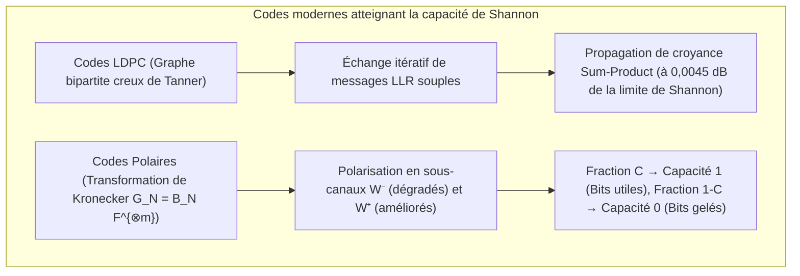

## 1. Introduction : Deux miracles quotidiens de résurrection de l'information

Aux confins de l'espace interstellaire comme au creux de votre main, l'ingénierie numérique accomplit chaque jour ce qui semble défier l'intuition physique : <strong>reconstruire à 100 %, au bit près, une information numérique dont le support ou le signal a été gravement mutilé par le bruit thermique ou la destruction matérielle</strong>.

### Miracle 1 : Voyager 1 et 2 communiquant à 24 milliards de kilomètres avec $10^{-16}\text{ watts}$

Lancées en 1977, les sondes <strong>Voyager 1 et Voyager 2</strong> ont photographié Jupiter, Saturne, Uranus et Neptune avant de pénétrer dans l'espace interstellaire à plus de <strong>24 milliards de kilomètres</strong> de la Terre.
L'émetteur radio de Voyager ne développe que <strong>$23\text{ watts}$</strong> — moins que l'ampoule d'un réfrigérateur. Lorsque cette onde atteint les antennes de 70 mètres du Deep Space Network (DSN) de la NASA sur Terre, la puissance reçue est tombée à environ <strong>$10^{-16}\text{ watts}$ ($0,1\text{ attowatt}$)</strong>, totalement noyée dans le <strong>bruit thermique (bruit de Johnson-Nyquist)</strong>. Pourtant, Voyager a transmis des portraits en couleur d'une netteté remarquable avec <strong>zéro erreur binaire résiduelle</strong>.

### Miracle 2 : Un code QR recouvert à $30\,\%$ par une tache de café ou un logo

Considérez maintenant un <strong>code QR</strong> sur une table de café dont un coin est taché, ou dont <strong>$30\,\%$ de la surface centrale est délibérément masquée par le logo d'une entreprise</strong>. En moins de <strong>$10\text{ millisecondes}$</strong>, la caméra de votre smartphone restitue l'URL exacte avec <strong>zéro bit d'erreur</strong>.


Comment est-ce mathématiquement possible ? Grâce à la <strong>théorie de l'information de Claude Shannon (1948)</strong> et à la science des <strong>codes correcteurs d'erreurs (ECC)</strong>.

---

## 2. La révolution de Claude Shannon (1948) et le théorème du codage de canal

### 2.1 L'impasse du codage par répétition naïf ($0 \to 00000$)

Avant 1948, les ingénieurs pensaient que pour faire tendre la probabilité d'erreur $P_e \to 0$ sur un canal bruité, il fallait nécessairement réduire le débit d'information $R = k/n \to 0$.
En effet, avec un <strong>code à répétition</strong> de longueur impaire $n = 2t + 1$ sur un <strong>canal binaire symétrique (BSC)</strong> de probabilité d'inversion $p \in (0, 0,5)$, le vote majoritaire échoue avec une probabilité :
$$P_e^{(n)} = \sum_{i = (n+1)/2}^{n} \binom{n}{i} p^i (1-p)^{n-i}$$
Lorsque $n \to \infty$, on a bien $P_e^{(n)} \to 0$, mais le rendement du code s'effondre simultanément : $R = k/n = 1/n \to 0$.

### 2.2 Le théorème de Shannon et la limite ultime de Shannon ($-1,59\,\text{dB}$)

En 1948, <strong>Claude E. Shannon</strong> démontra dans *"A Mathematical Theory of Communication"* son célèbre <strong>théorème du codage de canal bruyant</strong> :

> <strong>Théorème (Codage de canal de Shannon, 1948) :</strong>
> Tout canal sans mémoire possède une <strong>capacité de canal $C > 0$</strong> intrinsèque :
> - Pour le <strong>canal binaire symétrique (BSC)</strong> avec entropie binaire $H_2(p) = -p\log_2 p - (1-p)\log_2(1-p)$ :
>   $$C_{\text{BSC}}(p) = 1 - H_2(p) = 1 + p\log_2 p + (1-p)\log_2(1-p) \quad [\text{bits / utilisation}]$$
> - Pour le <strong>canal AWGN</strong> de bande passante $B$, puissance signal $S$ et bruit $N = N_0 B$ (théorème de Shannon-Hartley) :
>   $$C_{\text{AWGN}} = B \log_2\!\left(1 + \frac{S}{N}\right) = B \log_2\!\left(1 + \frac{S}{N_0 B}\right) \quad [\text{bits / s}]$$
>
> <strong>Pour tout débit $R < C$, il existe des codes en blocs de longueur $n \to \infty$ permettant une probabilité d'erreur arbitrairement faible ($P_e \to 0$) !</strong>

En posant $S = E_b R$ et en faisant tendre l'efficacité spectrale $\eta = R/B \to 0$, la condition $R < C_{\text{AWGN}}$ donne $\frac{E_b}{N_0} > \lim_{\eta \to 0} \frac{2^\eta - 1}{\eta} = \ln 2 \approx 0,6931$, soit la <strong>limite ultime de Shannon</strong> :
$$\left(\frac{E_b}{N_0}\right)_{\min} = \ln 2 \approx 0,6931 \implies 10 \log_{10}(\ln 2) \approx \mathbf{-1,5917\,\text{dB}}$$

---

## 3. La percée géométrique de Richard Hamming (1950) : distance de Hamming et code parfait $[7, 4, 3]$

### 3.1 Distance de Hamming $d_H(\mathbf{u}, \mathbf{v})$ et borne d'empilement de sphères

Sur l'hypercube binaire $\mathbb{F}_2^n$, <strong>Richard Hamming</strong> définit en 1950 la <strong>distance de Hamming $d_H(\mathbf{u}, \mathbf{v})$</strong> comme le nombre de coordonnées distinctes entre $\mathbf{u}$ et $\mathbf{v}$ :
$$d_H(\mathbf{u}, \mathbf{v}) \triangleq \bigl|\{ i \in \{1, \dots, n\} \mid u_i \neq v_i \}\bigr| = w_H(\mathbf{u} - \mathbf{v})$$

Pour un code $\mathcal{C} \subset \mathbb{F}_q^n$ de <strong>distance minimale $d_{\min} = \min_{\mathbf{u}\neq\mathbf{v}} d_H(\mathbf{u},\mathbf{v})$</strong>, la disjonction des sphères de Hamming de rayon $t$ prouve que le code peut :
- <strong>Détecter</strong> $d_{\min} - 1$ erreurs ;
- <strong>Corriger $e = d_{\min} - 1$ effacements</strong> (positions connues) ;
- <strong>Corriger $t = \lfloor(d_{\min} - 1)/2\rfloor$ erreurs arbitraires</strong> (positions inconnues) :
$$\mathbf{d_{\min} \ge 2t + e + 1}, \qquad |\mathcal{C}| \cdot \sum_{i=0}^{t} \binom{n}{i} (q-1)^i \le q^n \quad \text{(Borne de Hamming)}$$

### 3.2 Le code parfait de Hamming $(7,4)$ et le décodage par syndrome

Pour $n=7, k=4, d_{\min}=3$ ($t=1$), on a $2^4 \cdot (1 + 7) = 128 = 2^7$ : le code $[7,4,3]$ est un <strong>code parfait</strong>. Sa matrice génératrice $\mathbf{G}_{4\times 7} = [\mathbf{I}_4 \mid \mathbf{P}]$ et sa matrice de contrôle de parité $\mathbf{H}_{3\times 7} = [\mathbf{P}^T \mid \mathbf{I}_3]$ ($\mathbf{G}\mathbf{H}^T = \mathbf{0} \pmod 2$) s'écrivent :
$$\mathbf{G}_{4\times 7} = \left(\begin{array}{cccc|ccc}
1 & 0 & 0 & 0 & 1 & 1 & 0 \\
0 & 1 & 0 & 0 & 1 & 0 & 1 \\
0 & 0 & 1 & 0 & 0 & 1 & 1 \\
0 & 0 & 0 & 1 & 1 & 1 & 1
\end{array}\right), \qquad
\mathbf{H}_{3\times 7} = \left(\begin{array}{cccc|ccc}
1 & 1 & 0 & 1 & 1 & 0 & 0 \\
1 & 0 & 1 & 1 & 0 & 1 & 0 \\
0 & 1 & 1 & 1 & 0 & 0 & 1
\end{array}\right)$$

Le <strong>syndrome à 3 bits $\mathbf{s} = \mathbf{H}\mathbf{y}^T = \mathbf{H}(\mathbf{c} + \mathbf{e})^T = \mathbf{H}\mathbf{e}^T \pmod 2$</strong> extrait directement la colonne de $\mathbf{H}$ correspondant au bit inversé : si les colonnes sont ordonnées de $1$ à $7$ en binaire, <strong>$\mathbf{s}$ donne directement l'indice binaire $(1 \dots 7)$ du bit erroné</strong> ! Ce circuit équipe toutes les mémoires serveur <strong>ECC DRAM (SECDED)</strong>.

---

## 4. Le chef-d'œuvre de Reed et Solomon (1960) : codes de Reed-Solomon sur les corps de Galois $\mathbb{F}_{2^m}$

### 4.1 Corps de Galois $\text{GF}(2^8)$ et immunité aux erreurs en rafale (Burst Errors)

Pour vaincre les erreurs en rafale (rayures, taches sur un code QR), <strong>Irving Reed</strong> et <strong>Gustave Solomon</strong> (1960) ont regroupé chaque octet ($m=8$ bits) en un symbole unique du corps fini <strong>$\text{GF}(2^8) = \mathbb{F}_2[x]/(x^8 + x^4 + x^3 + x^2 + 1)$</strong>. Même si les 8 bits d'un octet sont détruits, cela ne représente <strong>qu'une seule erreur de symbole</strong> dans $\text{GF}(2^8)$ !

### 4.2 Interpolation polynomiale et borne de Singleton MDS $d_{\min} = n - k + 1$

Un message de $k$ symboles $(m_0, \dots, m_{k-1}) \in \mathbb{F}_q^k$ définit un polynôme $P(x) = m_0 + m_1 x + \dots + m_{k-1} x^{k-1}$ de degré $< k$, évalué en $n$ points distincts $\mathbf{c} = \bigl(P(\alpha_1), \dots, P(\alpha_n)\bigr)$.
Comme deux polynômes distincts de degré $\le k-1$ sur un corps $\mathbb{F}_q$ ne peuvent coïncider qu'en au plus $k-1$ points (et que <strong>n'importe quels $k$ points suffisent à reconstruire $P(x)$ par interpolation de Lagrange</strong>), tout code de Reed-Solomon $[n, k]$ atteint la <strong>borne de Singleton avec égalité (code MDS, Maximum Distance Separable)</strong> :
$$\mathbf{d_{\min} = n - k + 1 \implies 2t + e \le n - k}$$

Cela permet de corriger <strong>$e = n - k$ effacements (RAID-6, stockage cloud)</strong> ou <strong>$t = \lfloor(n-k)/2\rfloor$ erreurs de position inconnue (codes QR jusqu'à 30 % au niveau H, sonde Voyager $[255, 223]$)</strong> via le polynôme générateur cyclique $g(x) = \prod_{i=1}^{2t}(x - \alpha^i)$, l'algorithme de <strong>Berlekamp-Massey / Euclide</strong> résolvant $\Lambda(x)S(x) \equiv \Omega(x) \pmod{x^{2t}}$, la <strong>recherche de Chien</strong> et la <strong>formule de Forney</strong>.

---

## 5. Atteindre la limite de Shannon : codes LDPC (1962), Turbo (1993) et Polaires (2009)

1. <strong>Codes LDPC de Robert Gallager (1962)</strong> : définis par une matrice de parité creuse $\mathbf{H}$ et un <strong>graphe bipartite de Tanner</strong>. Le décodage itératif par <strong>propagation de croyance (Belief Propagation / Sum-Product)</strong> échangeant des rapports de vraisemblance logarithmiques souples $L(c_i) = \ln\frac{P(c_i=0|y_i)}{P(c_i=1|y_i)}$ s'approche à $0,0045\,\text{dB}$<strong> de la limite de Shannon (</strong>canaux de données 5G NR, Wi-Fi 6/7, SSD 3D NAND).
2. <strong>Codes Polaires d'Erdal Arıkan (2009)</strong> : par application récursive du noyau de Kronecker $\mathbf{G}_N = \mathbf{B}_N \begin{pmatrix} 1 & 0 \\ 1 & 1 \end{pmatrix}^{\otimes m}$, la <strong>polarisation de canal</strong> fait converger une fraction $C = I(W)$ des sous-canaux synthétiques vers une capacité $1$ (sans bruit, bits d'information) et une fraction $1 - C$ vers une capacité $0$ (<strong>bits gelés / Frozen Bits $= 0$</strong>), atteignant <strong>pour la première fois de manière mathématiquement prouvable la capacité de Shannon en $O(N \log N)$</strong> (<strong>canaux de contrôle 5G NR</strong>).



### Tableau comparatif des grandes familles de codes correcteurs

| Famille de codes | Année & Pionniers | Structure mathématique | Algorithme de décodage | Point fort & Profil d'erreur | Applications majeures |
| :--- | :--- | :--- | :--- | :--- | :--- |
| <strong>Hamming / SECDED</strong> | 1950<br/>R. Hamming | Empilement de sphères sur $\mathbb{F}_2^n$ | Syndrome $\mathbf{s}=\mathbf{H}\mathbf{y}^T$ ($O(1)$) | Correction d'un bit en $<1\text{ ns}$ | <strong>Mémoire serveur ECC DRAM</strong>, caches CPU |
| <strong>Reed-Solomon (RS)</strong> | 1960<br/>Reed & Solomon | Interpolation polynomiale sur $\mathbb{F}_{2^m}$ | Berlekamp-Massey + Chien + Forney | <strong>Borne MDS optimale $d_{\min}=n-k+1$</strong> contre erreurs en rafale | <strong>Codes QR</strong>, <strong>RAID-6</strong>, stockage cloud, Voyager |
| <strong>Codes LDPC</strong> | 1962 R. Gallager<br/>(Redécouverts 1996) | Matrice creuse $\mathbf{H}$ & graphe de Tanner | <strong>Propagation de croyance (Sum-Product)</strong> | À $0,0045\,\text{dB}$ de la limite de Shannon | <strong>5G NR (données)</strong>, <strong>Wi-Fi 6/7</strong>, <strong>SSD NVMe</strong> |
| <strong>Codes Polaires</strong> | 2009<br/>Erdal Arıkan | Puissance de Kronecker $\mathbf{F}^{\otimes m}$ | Décodage par liste CA-SCL ($O(N\log N)$) | Atteint <strong>prouvablement la capacité de Shannon $C$</strong> | <strong>5G NR (contrôle)</strong>, communications 6G |

---

## 6. Implémentation Python complète : Hamming $(7,4)$ et Reed-Solomon sur $\text{GF}(2^8)$

```python
from typing import List

def hamming74_demo() -> None:
    G = [[1,0,0,0,1,1,0], [0,1,0,0,1,0,1], [0,0,1,0,0,1,1], [0,0,0,1,1,1,1]]
    H = [[1,1,0,1,1,0,0], [1,0,1,1,0,1,0], [0,1,1,1,0,0,1]]
    msg = [1, 0, 1, 1]
    c = [sum(msg[i] * G[i][j] for i in range(4)) % 2 for j in range(7)]
    y = c.copy()
    y[2] ^= 1
    s = [sum(H[r][col] * y[col] for col in range(7)) % 2 for r in range(3)]
    err_idx = next(col for col in range(7) if [H[r][col] for r in range(3)] == s)
    y[err_idx] ^= 1
    print(f"[Hamming (7,4)] Syndrome={s} -> Flipped idx={err_idx}, Recovered={y[:4] == msg}")

class GF256:
    def __init__(self, poly: int = 0x11D) -> None:
        self.exp, self.log = [0] * 512, [0] * 256
        v = 1
        for i in range(255):
            self.exp[i] = self.exp[i + 255] = v
            self.log[v] = i
            v <<= 1
            if v & 0x100:
                v ^= poly

    def mul(self, a: int, b: int) -> int:
        return 0 if (a == 0 or b == 0) else self.exp[self.log[a] + self.log[b]]

    def inv(self, a: int) -> int:
        return self.exp[255 - self.log[a]]

    def power(self, a: int, p: int) -> int:
        return 1 if p == 0 else (0 if a == 0 else self.exp[(self.log[a] * p) % 255])

    def eval_poly(self, coeffs: List[int], x: int) -> int:
        res = 0
        for c in reversed(coeffs):
            res = self.mul(res, x) ^ c
        return res

    def solve(self, A: List[List[int]], b: List[int]) -> List[int]:
        n = len(b)
        M = [row[:] + [b[i]] for i, row in enumerate(A)]
        for col in range(n):
            piv = next(r for r in range(col, n) if M[r][col] != 0)
            M[col], M[piv] = M[piv], M[col]
            inv_p = self.inv(M[col][col])
            for j in range(col, n + 1):
                M[col][j] = self.mul(M[col][j], inv_p)
            for r in range(n):
                if r != col and M[r][col] != 0:
                    f = M[r][col]
                    for j in range(col, n + 1):
                        M[r][j] ^= self.mul(f, M[col][j])
        return [M[i][n] for i in range(n)]

def rs_demo() -> None:
    gf = GF256()
    text = "VOYAGER-1"
    k, t = len(text), 3
    n = k + 2 * t
    pts = [gf.exp[i] for i in range(n)]
    cw = [gf.eval_poly([ord(c) for c in text], x) for x in pts]
    rx = cw.copy()
    rx[1] ^= 0xFF; rx[6] ^= 0xA5; rx[13] ^= 0x3C
    A = [[gf.power(pts[i], d) for d in range(k + t)] + [gf.mul(rx[i], gf.power(pts[i], d)) for d in range(t)] for i in range(n)]
    b = [gf.mul(rx[i], gf.power(pts[i], t)) for i in range(n)]
    sol = gf.solve(A, b)
    E = sol[k + t:] + [1]
    err_pos = [i for i, x in enumerate(pts) if gf.eval_poly(E, x) == 0]
    valid = [(pts[i], rx[i]) for i in range(n) if i not in err_pos][:k]
    rec = gf.solve([[gf.power(x, d) for d in range(k)] for x, _ in valid], [y for _, y in valid])
    print(f"[RS(15,9) over GF(2^8)] Located Errors={err_pos}, Recovered='{''.join(chr(c) for c in rec)}'")

if __name__ == "__main__":
    hamming74_demo()
    rs_demo()
```

---

## 7. Conclusion

De la limite de Shannon $-1,59\,\text{dB}$ (1948) à la géométrie de Hamming (1950), à l'interpolation polynomiale de Reed-Solomon sur $\mathbb{F}_{2^m}$ (1960), jusqu'aux graphes de Tanner LDPC et à la polarisation de canal d'Arıkan, la théorie des codes correcteurs illustre comment l'algèbre abstraite permet de vaincre l'entropie physique.
