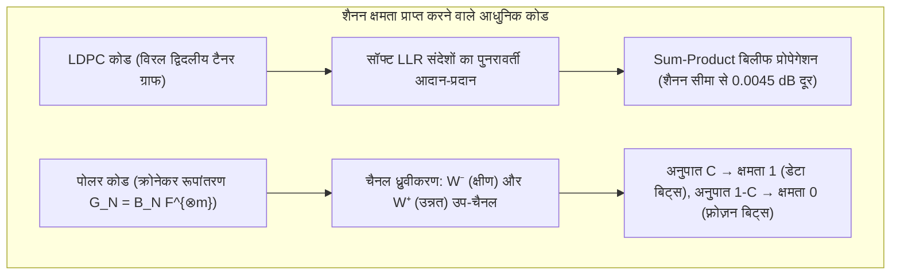

## 1. परिचय: सूचना पुनर्प्राप्ति के दो दैनिक किंतु अद्भुत इंजीनियरिंग चमत्कार

अंतरतारकीय अंतरिक्ष (interstellar space) की गहराइयों से लेकर आपके स्मार्टफोन के कैमरे तक, आधुनिक डिजिटल इंजीनियरिंग प्रतिदिन ऐसा कार्य करती है जो भौतिक अंतर्ज्ञान को चुनौती देता प्रतीत होता है: <strong>थर्मल शोर (thermal noise), खरोंच या भौतिक क्षति से बुरी तरह विकृत हो चुके सिग्नल या माध्यम से 100% बिट-सटीक डिजिटल जानकारी को पुनः प्राप्त करना</strong>।

### चमत्कार 1: 24 अरब किलोमीटर दूर से $10^{-16}\text{ वाट}$ पर संचार करता वॉयेजर 1 और 2

1977 में प्रक्षेपित नासा के <strong>Voyager 1 और Voyager 2</strong> अंतरिक्ष यानों ने बृहस्पति, शनि, यूरेनस और नेपच्यून की ऐतिहासिक तस्वीरें भेजीं और आज वे पृथ्वी से <strong>24 अरब किलोमीटर</strong> से अधिक दूर अंतरतारकीय अंतरिक्ष में यात्रा कर रहे हैं।
वॉयेजर के रेडियो ट्रांसमीटर की शक्ति मात्र <strong>$23\text{ वाट}$</strong> है — जो घरेलू रेफ्रिजरेटर के बल्ब से भी कम है। जब यह संकेत पृथ्वी पर नासा के डीप स्पेस नेटवर्क (DSN) के 70-मीटर एंटीना तक पहुँचता है, तो प्राप्त शक्ति घटकर केवल <strong>$10^{-16}\text{ वाट}$ ($0.1\text{ एटोवाट}$)</strong> रह जाती है, जो पूरी तरह से <strong>थर्मल शोर (Johnson–Nyquist noise)</strong> में डूबी होती है। फिर भी, वॉयेजर ने <strong>शून्य बिट त्रुटि (Zero Bit Errors)</strong> के साथ ग्रहों के अत्यंत स्पष्ट रंगीन चित्र पृथ्वी पर पहुंचाए।

### चमत्कार 2: कॉफी के दाग या कंपनी लोगो से $30\%$ ढका हुआ QR कोड

```mermaid
flowchart TD
    subgraph Voyager["गहन अंतरिक्ष टेलीमेट्री (Voyager 1 & 2)"]
        V1["ग्रह चित्र डेटा (k बिट्स)"] --> V2["संयुक्त कोडिंग (बाहरी RS कोड + आंतरिक कन्वोल्यूशनल/LDPC कोड)"]
        V2 --> V3["23 W ट्रांसमीटर → अरबों किमी प्रसार (10⁻¹⁶ W प्राप्त)"]
        V3 --> V4["गाउसियन थर्मल शोर (AWGN) और बिट पलटाव"]
        V4 --> V5["सॉफ्ट-डिसीजन विटरबी / बिलीफ प्रोपेगेशन + RS डिकोडिंग"]
        V5 --> V6["स्पष्ट ग्रह चित्र (शून्य बिट त्रुटि)"]
    end
    subgraph QR["दैनिक QR कोड स्कैनिंग"]
        Q1["URL / पेलोड डेटा (k बाइट्स)"] --> Q2["GF(2⁸) रीड-सोलोमन कोडिंग (n बाइट्स)"]
        Q2 --> Q3["कॉफी दाग या लोगो से 30% मॉड्यूल नष्ट"]
        Q3 --> Q4["सिंड्रोम गणना + बर्लेकैम्प-मैसी / यूक्लिडियन एल्गोरिदम"]
        Q4 --> Q5["चिएन सर्च (Chien Search) + फोर्नी सूत्र (10 ms)"]
        Q5 --> Q6["100% सटीक डेटा पुनर्निर्माण"]
    end
```

इसी प्रकार, जब आप किसी ऐसे <strong>QR कोड (Quick Response Code)</strong> को स्कैन करते हैं जिस पर कॉफी गिर गई हो या जिसके <strong>मध्य भाग का $30\%$ हिस्सा किसी ब्रांड लोगो से ढका हो</strong>, तो आपका स्मार्टफोन <strong>$10\text{ मिलीसेकंड}$</strong> से भी कम समय में बिना किसी त्रुटि के सटीक URL या भुगतान डेटा निकाल लेता है।



यह गणितीय रूप से कैसे संभव है? इसका उत्तर <strong>क्लॉड शैनन के सूचना सिद्धांत (1948)</strong> और <strong>त्रुटि-सुधार कोड (Error-Correcting Codes, ECC)</strong> के बीजगणित में निहित है।

---

## 2. क्लॉड शैनन की 1948 की क्रांति और नॉइज़ी-चैनल कोडिंग प्रमेय

### 2.1 साधारण पुनरावृत्ति कोड (Repetition Code $0 \to 00000$) की विफलता

1948 से पहले इंजीनियर मानते थे कि शोर वाले चैनल में त्रुटि संभावना $P_e \to 0$ करने के लिए डेटा दर $R = k/n$ को भी शून्य की ओर ले जाना अनिवार्य है।
यदि बिट पलटने की प्रायिकता $p \in (0, 0.5)$ वाले <strong>बाइनरी सिमेट्रिक चैनल (BSC)</strong> पर प्रत्येक बिट को विषम बार $n = 2t + 1$ दोहराया जाए, तो बहुमत मतदान (Majority Voting) के विफल होने की प्रायिकता है:
$$P_e^{(n)} = \sum_{i = (n+1)/2}^{n} \binom{n}{i} p^i (1-p)^{n-i}$$
जब $n \to \infty$, तो $P_e^{(n)} \to 0$, किंतु साथ ही कोड दर भी शून्य हो जाती है: $R = k/n = 1/n \to 0$.

### 2.2 शैनन का प्रमेय और परम शैनन सीमा ($-1.59\,\text{dB}$)

1948 में, <strong>क्लॉड शैनन (Claude E. Shannon)</strong> ने *"A Mathematical Theory of Communication"* में अपना ऐतिहासिक प्रमेय सिद्ध किया:

> <strong>प्रमेय (शैनन का नॉइज़ी-चैनल कोडिंग प्रमेय, 1948):</strong>
> प्रत्येक मेमोरीलेस चैनल की एक धनात्मक <strong>चैनल क्षमता (Channel Capacity) $C > 0$</strong> होती है:
> - <strong>बाइनरी सिमेट्रिक चैनल (BSC)</strong> के लिए बाइनरी एन्ट्रॉपी $H_2(p) = -p\log_2 p - (1-p)\log_2(1-p)$ के साथ:
>   $$C_{\text{BSC}}(p) = 1 - H_2(p) = 1 + p\log_2 p + (1-p)\log_2(1-p) \quad [\text{bits / channel use}]$$
> - बैंडविड्थ $B$, सिग्नल शक्ति $S$ और शोर $N = N_0 B$ वाले <strong>AWGN चैनल</strong> के लिए (शैनन-हार्टले प्रमेय):
>   $$C_{\text{AWGN}} = B \log_2\!\left(1 + \frac{S}{N}\right) = B \log_2\!\left(1 + \frac{S}{N_0 B}\right) \quad [\text{bits / s}]$$
>
> <strong>किसी भी सूचना दर $R < C$ के लिए, ब्लॉक लंबाई $n \to \infty$ होने पर ऐसे ब्लॉक कोड अस्तित्व में हैं जिनकी डिकोडिंग त्रुटि प्रायिकता $P_e \to 0$ हो जाती है!</strong>

$S = E_b R$ रखने और वर्णक्रमीय दक्षता $\eta = R/B \to 0$ की सीमा लेने पर $\frac{E_b}{N_0} > \lim_{\eta \to 0} \frac{2^\eta - 1}{\eta} = \ln 2 \approx 0.6931$ प्राप्त होता है, जिसे <strong>परम शैनन सीमा (Shannon Limit)</strong> कहते हैं:
$$\left(\frac{E_b}{N_0}\right)_{\min} = \ln 2 \approx 0.6931 \implies 10 \log_{10}(\ln 2) \approx \mathbf{-1.5917\,\text{dB}}$$

---

## 3. रिचर्ड हैमिंग की 1950 की ज्यामितीय क्रांति: हैमिंग दूरी और $[7, 4, 3]$ परफेक्ट कोड

### 3.1 हैमिंग दूरी $d_H(\mathbf{u}, \mathbf{v})$ और गोला-पैकिंग सीमा (Sphere-Packing Bound)

हाइपरक्यूब $\mathbb{F}_2^n$ पर <strong>रिचर्ड हैमिंग (Richard Hamming)</strong> ने 1950 में दो सदिशों के बीच भिन्न निर्देशांकों की संख्या को <strong>हैमिंग दूरी $d_H(\mathbf{u}, \mathbf{v})$</strong> के रूप में परिभाषित किया:
$$d_H(\mathbf{u}, \mathbf{v}) \triangleq \bigl|\{ i \in \{1, \dots, n\} \mid u_i \neq v_i \}\bigr| = w_H(\mathbf{u} - \mathbf{v})$$

न्यूनतम दूरी $d_{\min} = \min_{\mathbf{u}\neq\mathbf{v}} d_H(\mathbf{u},\mathbf{v})$ वाले कोड $\mathcal{C} \subset \mathbb{F}_q^n$ के लिए असंयुक्त हैमिंग गोलों की ज्यामिति सिद्ध करती है कि यह कोड:
- $d_{\min} - 1$ त्रुटियों की <strong>पहचान (Detection)</strong> कर सकता है;
- ज्ञात स्थानों पर $e = d_{\min} - 1$ <strong>मिटाव (Erasures)</strong> को सुधार सकता है;
- अज्ञात स्थानों पर $t = \lfloor(d_{\min} - 1)/2\rfloor$ <strong>त्रुटियों (Errors)</strong> को सुधार सकता है:
$$\mathbf{d_{\min} \ge 2t + e + 1}, \qquad |\mathcal{C}| \cdot \sum_{i=0}^{t} \binom{n}{i} (q-1)^i \le q^n \quad \text{(हैमिंग सीमा)}$$

### 3.2 हैमिंग $(7,4)$ परफेक्ट कोड और सिंड्रोम डिकोडिंग

$n=7, k=4, d_{\min}=3$ ($t=1$) के लिए $2^4 \cdot (1 + 7) = 128 = 2^7$ समीकरण संतुष्ट होता है। इसका जनरेटर मैट्रिक्स $\mathbf{G}_{4\times 7} = [\mathbf{I}_4 \mid \mathbf{P}]$ और पैरिटी-चेक मैट्रिक्स $\mathbf{H}_{3\times 7} = [\mathbf{P}^T \mid \mathbf{I}_3]$ ($\mathbf{G}\mathbf{H}^T = \mathbf{0} \pmod 2$) हैं:
$$\mathbf{G}_{4\times 7} = \left(\begin{array}{cccc|ccc}
1 & 0 & 0 & 0 & 1 & 1 & 0 \\
0 & 1 & 0 & 0 & 1 & 0 & 1 \\
0 & 0 & 1 & 0 & 0 & 1 & 1 \\
0 & 0 & 0 & 1 & 1 & 1 & 1
\end{array}\right), \qquad
\mathbf{H}_{3\times 7} = \left(\begin{array}{cccc|ccc}
1 & 1 & 0 & 1 & 1 & 0 & 0 \\
1 & 0 & 1 & 1 & 0 & 1 & 0 \\
0 & 1 & 1 & 1 & 0 & 0 & 1
\end{array}\right)$$

3-बिट <strong>सिंड्रोम $\mathbf{s} = \mathbf{H}\mathbf{y}^T = \mathbf{H}(\mathbf{c} + \mathbf{e})^T = \mathbf{H}\mathbf{e}^T \pmod 2$</strong> सीधे $\mathbf{H}$ के उस स्तंभ को इंगित करता है जहाँ बिट पलटा है: यदि स्तंभों को $1$ से $7$ के बाइनरी क्रम में रखा जाए, तो <strong>सिंड्रोम $\mathbf{s}$ सीधे खराब बिट की बाइनरी इंडेक्स $(1 \dots 7)$ देता है</strong>! यही तकनीक आज सभी सर्वरों की <strong>ECC DRAM मेमोरी</strong> की रक्षा करती है।

---

## 4. रीड और सोलोमन की 1960 की उत्कृष्ट कृति: गैलोइस फील्ड $\mathbb{F}_{2^m}$ पर रीड-सोलोमन (RS) कोड

### 4.1 गैलोइस फील्ड $\text{GF}(2^8)$ और बर्स्ट त्रुटियों (Burst Errors) से सुरक्षा

लगातार कई बिट्स को नष्ट करने वाली बर्स्ट त्रुटियों (डिस्क पर खरोंच, QR कोड पर दाग) को हराने के लिए <strong>इरविंग रीड</strong> और <strong>गुस्ताव सोलोमन</strong> (1960) ने प्रत्येक बाइट ($m=8$ बिट्स) को परिमित क्षेत्र <strong>$\text{GF}(2^8) = \mathbb{F}_2[x]/(x^8 + x^4 + x^3 + x^2 + 1)$</strong> के एक एकल प्रतीक (symbol) के रूप में बांधा। यदि एक बाइट के सभी 8 बिट्स भी नष्ट हो जाएं, तो भी $\text{GF}(2^8)$ में वह <strong>केवल एक प्रतीक त्रुटि</strong> है!

### 4.2 बहुपद अंतर्वेशन (Polynomial Interpolation) और MDS सिंगलटन सीमा $d_{\min} = n - k + 1$

$k$ संदेश प्रतीक $(m_0, \dots, m_{k-1}) \in \mathbb{F}_q^k$ घात $< k$ का एक बहुपद $P(x) = m_0 + m_1 x + \dots + m_{k-1} x^{k-1}$ परिभाषित करते हैं, जिसका $n$ भिन्न बिंदुओं पर मूल्यांकन कर कोडवर्ड $\mathbf{c} = \bigl(P(\alpha_1), \dots, P(\alpha_n)\bigr)$ भेजा जाता है।
चूँकि क्षेत्र $\mathbb{F}_q$ पर घात $\le k-1$ के दो भिन्न बहुपद अधिकतम $k-1$ बिंदुओं पर ही समान हो सकते हैं (और <strong>कोई भी $k$ सही बिंदु लैग्रेंज अंतर्वेशन द्वारा $P(x)$ को अद्वितीय रूप से पुनर्निर्मित कर देते हैं</strong>), प्रत्येक $[n, k]$ रीड-सोलोमन कोड <strong>सिंगलटन सीमा (Singleton Bound) को समानता के साथ प्राप्त करता है (MDS कोड)</strong>:
$$\mathbf{d_{\min} = n - k + 1 \implies 2t + e \le n - k}$$

इस प्रकार, $n - k$ पैरिटी बाइट्स <strong>$e = n - k$ मिटाव (RAID-6, क्लाउड स्टोरेज)</strong> या अज्ञात स्थानों पर <strong>$t = \lfloor(n-k)/2\rfloor$ बाइट त्रुटियों (QR कोड लेवल H में 30% क्षति; वॉयेजर का $[255, 223]$ कोड)</strong> को जनरेटर बहुपद $g(x) = \prod_{i=1}^{2t}(x - \alpha^i)$, <strong>बर्लेकैम्प-मैसी / यूक्लिडियन एल्गोरिदम</strong> ($\Lambda(x)S(x) \equiv \Omega(x) \pmod{x^{2t}}$), <strong>चिएन सर्च</strong> और <strong>फोर्नी सूत्र</strong> द्वारा पूरी तरह सुधार लेते हैं।

---

## 5. शैनन सीमा के करीब: LDPC कोड (1962), टर्बो कोड (1993) और पोलर कोड (2009)

1. <strong>रॉबर्ट गैलेगर के LDPC कोड (1962)</strong>: विरल (sparse) मैट्रिक्स $\mathbf{H}$ और द्विदलीय <strong>टैनर ग्राफ (Tanner Graph)</strong> पर आधारित हैं। सॉफ्ट लॉग-लाइकलीहुड अनुपात $L(c_i) = \ln\frac{P(c_i=0|y_i)}{P(c_i=1|y_i)}$ के <strong>बिलीफ प्रोपेगेशन (Sum-Product)</strong> द्वारा LDPC कोड शैनन सीमा के $0.0045\,\text{dB}$<strong> के भीतर कार्य करते हैं (</strong>5G NR डेटा चैनल, Wi-Fi 6/7, और 3D NAND SSDs)।
2. <strong>एरदाल अरिकन के पोलर कोड (Polar Codes, 2009)</strong>: क्रोनेकर रूपांतरण $\mathbf{G}_N = \mathbf{B}_N \begin{pmatrix} 1 & 0 \\ 1 & 1 \end{pmatrix}^{\otimes m}$ के पुनरावर्ती प्रयोग से <strong>चैनल ध्रुवीकरण (Channel Polarization)</strong> होता है — $N \to \infty$ पर $C = I(W)$ अनुपात के उप-चैनल क्षमता $1$ (शोर-रहित, सूचना बिट्स) की ओर और $1 - C$ अनुपात क्षमता $0$ (<strong>फ़्रोज़न बिट्स / Frozen Bits $= 0$</strong>) की ओर अभिसरित होते हैं। यह $O(N \log N)$ जटिलता में <strong>शैनन क्षमता को गणितीय रूप से सिद्ध करने वाला पहला कोड</strong> है (<strong>5G NR कंट्रोल चैनल</strong>)।



### प्रमुख त्रुटि-सुधार कोड परिवारों की तुलना तालिका

| कोड परिवार | वर्ष और प्रणेता | गणितीय आधार | मुख्य डिकोडिंग एल्गोरिदम | मुख्य विशेषता | प्रमुख व्यावहारिक अनुप्रयोग |
| :--- | :--- | :--- | :--- | :--- | :--- |
| <strong>हैमिंग / SECDED</strong> | 1950<br/>R. Hamming | $\mathbb{F}_2^n$ गोला पैकिंग | सिंड्रोम $\mathbf{s}=\mathbf{H}\mathbf{y}^T$ ($O(1)$) | $<1\text{ ns}$ में एकल बिट सुधार | <strong>ECC DRAM सर्वर मेमोरी</strong>, CPU कैश |
| <strong>रीड-सोलोमन (RS)</strong> | 1960<br/>Reed & Solomon | $\mathbb{F}_{2^m}$ पर बहुपद अंतर्वेशन | बर्लेकैम्प-मैसी + चिएन + फोर्नी | बर्स्ट त्रुटियों के विरुद्ध <strong>इष्टतम MDS $d_{\min}=n-k+1$</strong> | <strong>QR कोड</strong>, <strong>RAID-6</strong>, क्लाउड स्टोरेज, वॉयेजर |
| <strong>LDPC कोड</strong> | 1962 R. Gallager<br/>(1996 पुनः खोज) | विरल मैट्रिक्स $\mathbf{H}$ व टैनर ग्राफ | <strong>बिलीफ प्रोपेगेशन (Sum-Product)</strong> | शैनन सीमा के $0.0045\,\text{dB}$ के भीतर | <strong>5G NR (डेटा)</strong>, <strong>Wi-Fi 6/7</strong>, <strong>NVMe SSD</strong> |
| <strong>पोलर कोड (Polar)</strong> | 2009<br/>Erdal Arıkan | क्रोनेकर घात $\mathbf{F}^{\otimes m}$ | CA-SCL लिस्ट डिकोडिंग ($O(N\log N)$) | <strong>गणितीय रूप से शैनन क्षमता $C$ प्राप्त</strong> | <strong>5G NR (कंट्रोल)</strong>, 6G IoT |

---

## 6. संपूर्ण Python कार्यान्वयन: हैमिंग $(7,4)$ और $\text{GF}(2^8)$ रीड-सोलोमन

```python
from typing import List

def hamming74_demo() -> None:
    G = [[1,0,0,0,1,1,0], [0,1,0,0,1,0,1], [0,0,1,0,0,1,1], [0,0,0,1,1,1,1]]
    H = [[1,1,0,1,1,0,0], [1,0,1,1,0,1,0], [0,1,1,1,0,0,1]]
    msg = [1, 0, 1, 1]
    c = [sum(msg[i] * G[i][j] for i in range(4)) % 2 for j in range(7)]
    y = c.copy()
    y[2] ^= 1
    s = [sum(H[r][col] * y[col] for col in range(7)) % 2 for r in range(3)]
    err_idx = next(col for col in range(7) if [H[r][col] for r in range(3)] == s)
    y[err_idx] ^= 1
    print(f"[Hamming (7,4)] Syndrome={s} -> Flipped idx={err_idx}, Recovered={y[:4] == msg}")

class GF256:
    def __init__(self, poly: int = 0x11D) -> None:
        self.exp, self.log = [0] * 512, [0] * 256
        v = 1
        for i in range(255):
            self.exp[i] = self.exp[i + 255] = v
            self.log[v] = i
            v <<= 1
            if v & 0x100:
                v ^= poly

    def mul(self, a: int, b: int) -> int:
        return 0 if (a == 0 or b == 0) else self.exp[self.log[a] + self.log[b]]

    def inv(self, a: int) -> int:
        return self.exp[255 - self.log[a]]

    def power(self, a: int, p: int) -> int:
        return 1 if p == 0 else (0 if a == 0 else self.exp[(self.log[a] * p) % 255])

    def eval_poly(self, coeffs: List[int], x: int) -> int:
        res = 0
        for c in reversed(coeffs):
            res = self.mul(res, x) ^ c
        return res

    def solve(self, A: List[List[int]], b: List[int]) -> List[int]:
        n = len(b)
        M = [row[:] + [b[i]] for i, row in enumerate(A)]
        for col in range(n):
            piv = next(r for r in range(col, n) if M[r][col] != 0)
            M[col], M[piv] = M[piv], M[col]
            inv_p = self.inv(M[col][col])
            for j in range(col, n + 1):
                M[col][j] = self.mul(M[col][j], inv_p)
            for r in range(n):
                if r != col and M[r][col] != 0:
                    f = M[r][col]
                    for j in range(col, n + 1):
                        M[r][j] ^= self.mul(f, M[col][j])
        return [M[i][n] for i in range(n)]

def rs_demo() -> None:
    gf = GF256()
    text = "VOYAGER-1"
    k, t = len(text), 3
    n = k + 2 * t
    pts = [gf.exp[i] for i in range(n)]
    cw = [gf.eval_poly([ord(c) for c in text], x) for x in pts]
    rx = cw.copy()
    rx[1] ^= 0xFF; rx[6] ^= 0xA5; rx[13] ^= 0x3C
    A = [[gf.power(pts[i], d) for d in range(k + t)] + [gf.mul(rx[i], gf.power(pts[i], d)) for d in range(t)] for i in range(n)]
    b = [gf.mul(rx[i], gf.power(pts[i], t)) for i in range(n)]
    sol = gf.solve(A, b)
    E = sol[k + t:] + [1]
    err_pos = [i for i, x in enumerate(pts) if gf.eval_poly(E, x) == 0]
    valid = [(pts[i], rx[i]) for i in range(n) if i not in err_pos][:k]
    rec = gf.solve([[gf.power(x, d) for d in range(k)] for x, _ in valid], [y for _, y in valid])
    print(f"[RS(15,9) over GF(2^8)] Located Errors={err_pos}, Recovered='{''.join(chr(c) for c in rec)}'")

if __name__ == "__main__":
    hamming74_demo()
    rs_demo()
```

---

## 7. निष्कर्ष

शैनन की $-1.59\,\text{dB}$ सीमा (1948) से लेकर हैमिंग की ज्यामिति (1950), गैलोइस फील्ड $\mathbb{F}_{2^m}$ पर रीड-सोलोमन के बहुपद अंतर्वेशन (1960), और गैलेगर के LDPC बिलीफ प्रोपेगेशन तथा अरिकन के पोलर कोड्स तक — कोडिंग सिद्धांत यह सिद्ध करता है कि शुद्ध गणित किस प्रकार ब्रह्मांड के थर्मल शोर और भौतिक एन्ट्रॉपी पर विजय प्राप्त करता है।
