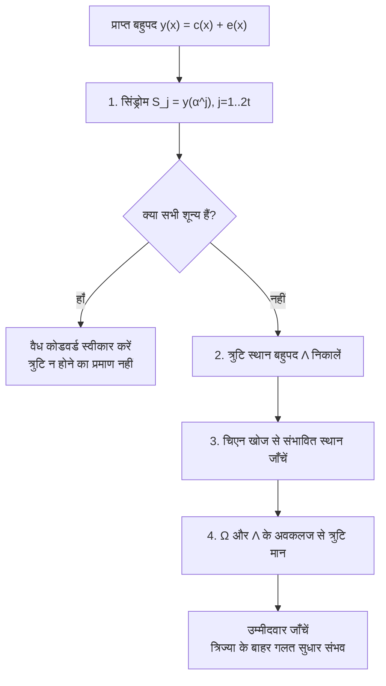
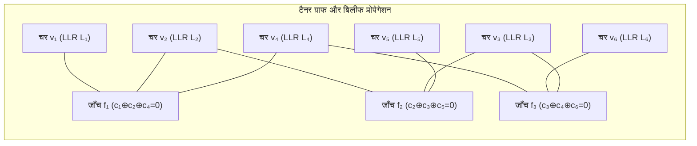
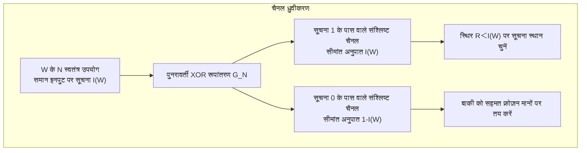

## 1. परिचय: अंतरिक्ष संचार और QR कोड में साझा सिद्धांत

कमज़ोर अंतरिक्ष संकेत या आंशिक रूप से क्षतिग्रस्त QR कोड से डेटा कैसे लौटता है? <strong>त्रुटि-सुधार कोड (ECC)</strong> डेटा में संरचित अतिरेक जोड़ते हैं। प्राप्तकर्ता इन संबंधों से बदले हुए मानों का अनुमान लगाकर उन्हें सुधारता है। सुरक्षा सीमित है: सीमित अतिरेक हर संभव क्षति को नहीं सुधार सकता।

### अंतरिक्ष संचार: संकेत प्राप्त करना और बची हुई त्रुटियाँ सुधारना

1977 में प्रक्षेपित वॉयेजर 1 और वॉयेजर 2 ने बृहस्पति और शनि का भ्रमण किया; वॉयेजर 2 आगे यूरेनस और नेपच्यून तक गया। दोनों यानों ने अलग-अलग चारों ग्रहों का भ्रमण नहीं किया। यहाँ ग्रहों के निकट से गुज़रने के समय के संचार को उदाहरण बनाया गया है। बदलती वर्तमान दूरी या प्राप्त शक्ति को स्थायी संख्या नहीं माना गया है।

यान का उच्च-लाभ एंटीना रेडियो ऊर्जा को पृथ्वी की दिशा में केंद्रित करता है, जहाँ डीप स्पेस नेटवर्क (DSN) संकेत प्राप्त करता है। क्षीणन और तापीय शोर के कारण डिमॉड्यूलेशन के बाद भी त्रुटियाँ बच सकती हैं। इकाई परिवर्तन के अनुसार $10^{-16}\,\mathrm W=100\,\mathrm{aW}$, अर्थात 100 एटोवाट है। यह किसी निश्चित तारीख और स्टेशन का मापा हुआ मान नहीं है।

वॉयेजर 2 के यूरेनस के निकट पहुँचने की तैयारी वाला JPL का एक प्रतिवेदन आंतरिक कन्वोल्यूशनल कोड और बाहरी रीड–सोलोमन (RS) $[255,223]$ कोड का संयोजन बताता है। ये चरण शोर का प्रभाव घटाते हैं; हर प्राप्त ब्लॉक या हर पिक्सेल के हमेशा त्रुटिरहित होने की गारंटी नहीं देते।

### QR कोड: सुधार का प्रतिशत मनमाने ढंग से ढक सकने वाला क्षेत्रफल नहीं है

QR कोड भी RS का उपयोग करते हैं। DENSO WAVE लगभग 7%, 15%, 25% और 30% पुनर्प्राप्ति स्तर बताता है, जिनकी इकाई <strong>8-बिट कोडवर्ड</strong> है। इसका अर्थ चित्र का कोई भी 30% हिस्सा लोगो से ढक देना नहीं है। कार्यात्मक पैटर्न, अलग-अलग RS ब्लॉकों में क्षति का वितरण और तस्वीर लेने की परिस्थितियाँ महत्त्वपूर्ण हैं। हर उपकरण पर दस मिलीसेकंड की सार्वभौमिक गारंटी भी नहीं है।

QR की शब्दावली में 8-बिट कोडवर्ड यहाँ की गणितीय RS व्याख्या के एक प्रतीक के बराबर है। यह $n$ प्रतीकों वाला पूरा RS कोडवर्ड नहीं है। दोनों स्तरों को अलग रखने से प्रत्येक ब्लॉक की सुधार क्षमता स्पष्ट रहती है।


हम चैनल क्षमता, हैमिंग दूरी, परिमित क्षेत्रों पर बहुपद और ग्राफ पर प्रायिकता गणना को जोड़ेंगे। <strong>निश्चित संख्या तक के सभी त्रुटि पैटर्न सुधारना</strong> और <strong>ब्लॉक लंबा होने पर त्रुटि प्रायिकता को मनचाहा छोटा करना</strong> अलग दावे हैं।

---

## 2. शैनन का चैनल कोडिंग प्रमेय और उसकी धारणाएँ

### 2.1 पुनरावृत्ति: बेहतर विश्वसनीयता की कीमत कोड दर में

बिट दोहराकर बहुमत से निर्णय लेने पर त्रुटियाँ घट सकती हैं। लेकिन केवल इस विधि में विश्वसनीयता बढ़ाने के लिए प्रति सूचना बिट अधिक चैनल उपयोग चाहिए। यह पुनरावृत्ति कोड की सीमा है, सभी कोडों की नहीं।

एक मेमोरीलेस द्विआधारी सममित चैनल (BSC) लें, जिसमें स्वतंत्र बिट पलटाव की प्रायिकता $0<p<1/2$ है। लंबाई तीन का पुनरावृत्ति कोड एक बिट को बदलता है:

$$
0 \mapsto 000, \qquad 1 \mapsto 111
$$

000 भेजने पर 011, 101, 110 या 111 प्राप्त होना गलत निर्णय 1 देता है। दो या तीन बिट पलटने चाहिए:

$$
P_e^{(3)} = \binom{3}{2} p^2 (1-p) + \binom{3}{3} p^3 = 3p^2(1-p) + p^3
$$

$p=0.01$ के लिए परिणाम $0.000298$, लगभग $0.03\%$ है। इसकी कीमत कोड दर में दिखती है:

$$
R = \frac{k}{n} = \frac{1}{3}
$$

विषम लंबाई $n=2t+1$ में कम-से-कम $t+1$ बिट पलटने पर बहुमत विफल होता है:

$$
P_e^{(n)} = \sum_{i = (n+1)/2}^{n} \binom{n}{i} p^i (1-p)^{n-i}
$$

बड़ी संख्याओं के नियम से त्रुटि प्रायिकता शून्य की ओर जाती है, लेकिन साथ ही:

$$
n \to \infty \implies P_e^{(n)} \to 0 \quad \text{लेकिन साथ ही} \quad R = \frac{1}{n} \to 0
$$

लंबाई पाँच में $0\mapsto00000$, $1\mapsto11111$ और दर $1/5$ है। यह गणना कई सूचना बिटों को एक ब्लॉक में जोड़ने वाले अधिक कुशल कोडों की संभावना समाप्त नहीं करती।

### 2.2 क्षमता और शोरयुक्त चैनल का कोडिंग प्रमेय

शैनन के 1948 के काम ने दिखाया कि शोरयुक्त चैनल में स्थिर धनात्मक दर बनाए रखते हुए त्रुटि प्रायिकता को मनचाहा छोटा करना संभव हो सकता है।

> <strong>परिमित इनपुट और आउटपुट वर्णमालाओं वाले विविक्त मेमोरीलेस चैनल का प्रमेय:</strong> संक्रमण नियम $W(y\mid x)$ दिया हो, तो क्षमता $C=\max_{P(X)}I(X;Y)\ge0$ है, जिसकी इकाई प्रति चैनल उपयोग बिट है। हर स्थिर दर $0<R<C$ के लिए बढ़ती ब्लॉक लंबाइयों वाले कोडों और डिकोडिंग नियमों का ऐसा अनुक्रम है जिसकी ब्लॉक त्रुटि प्रायिकता शून्य की ओर जाती है। $R>C$ पर यह अभिसरण संभव नहीं है।

क्षमता का धनात्मक होना आवश्यक नहीं। यदि आउटपुट इनपुट से स्वतंत्र है, तो $C=0$ है। इनपुट लागत या औसत शक्ति पर प्रतिबंध हों तो अधिकतम उन्हीं के भीतर लेना होगा। केवल शोर की तीव्रता का एक आँकड़ा हर चैनल की क्षमता नहीं तय करता।

यह ब्लॉक लंबाई अनंत की ओर जाने पर लागू (asymptotic) अस्तित्व का परिणाम है। यह नहीं कहता कि सीमित लंबाई का कोड हर संभव शोर सुधारेगा या स्वतः कुशल डिकोडर मिल जाएगा। विलंब, उपलब्ध गणना और लक्ष्य त्रुटि प्रायिकता अलग डिज़ाइन शर्तें हैं।

### 2.3 BSC क्षमता की व्युत्पत्ति

विविक्त मेमोरीलेस चैनल के लिए:

$$
C = \max_{P(X)} I(X; Y) = \max_{P(X)} \bigl( H(Y) - H(Y \mid X) \bigr)
$$

BSC आउटपुट को $Y=X\oplus E$ लिखें। शोर बिट $E$, $X$ से स्वतंत्र है और प्रायिकता $p$ से 1 है। इनपुट ज्ञात होने पर बची अनिश्चितता द्विआधारी एन्ट्रॉपी है:

$$
H(Y \mid X) = H_2(p) \triangleq -p \log_2 p - (1-p) \log_2(1-p)
$$

आउटपुट द्विआधारी होने से $H(Y)\le1$ बिट है। समान-वितरित इनपुट से समान-वितरित आउटपुट मिलता है और $H(Y)=1$ प्राप्त होता है। इसलिए:

$$
C_{\text{BSC}}(p) = 1 - H_2(p) = 1 + p\log_2 p + (1-p)\log_2(1-p) \quad [\text{बिट / चैनल उपयोग}]
$$

उदाहरण:

$$
H_2(0.1) = -0.1 \log_2(0.1) - 0.9 \log_2(0.9) \approx 0.4690\text{ बिट}
$$

$$
C_{\text{BSC}}(0.1) = 1 - 0.4690 = 0.5310\text{ बिट / चैनल उपयोग}
$$

अतः $R=0.5$ जैसी क्षमता से छोटी स्थिर दर पर पर्याप्त लंबे और उपयुक्त कोडों से त्रुटि प्रायिकता मनचाही छोटी की जा सकती है। यह सीमित लंबाई पर क्षमता के ठीक बराबर दर से शून्य त्रुटि की गारंटी नहीं है। यादृच्छिक कोडिंग का तर्क लंबे ब्लॉकों में शोर के विशिष्ट व्यवहार और कोडवर्डों की पहचान योग्य भिन्नता का उपयोग करता है।

### 2.4 AWGN और व्यापक बैंड सीमा $-1.59\,\mathrm{dB}$

योज्य श्वेत गाउसियन शोर (AWGN) सतत तरंगरूपों का मॉडल है, शाब्दिक रूप से स्वतंत्र बिट पलटाव का नहीं। $B$ बैंडविड्थ Hz में, $S$ औसत प्राप्त संकेत शक्ति W में और $N_0$ शोर शक्ति की एकपक्षीय वर्णक्रमीय घनता W/Hz में हो। बैंड के भीतर शोर शक्ति $N=N_0B$ है। औसत शक्ति प्रतिबंध के साथ, इनपुट को अतिरिक्त रूप से द्विआधारी तक सीमित किए बिना, शैनन–हार्टले देता है:

$$
C_{\text{AWGN}} = B \log_2\!\left(1 + \frac{S}{N}\right) = B \log_2\!\left(1 + \frac{S}{N_0 B}\right) \quad [\text{बिट / सेकंड}]
$$

$E_b$ प्रति सूचना बिट प्राप्त ऊर्जा हो और अब $R$ सूचना दर बिट/सेकंड में हो, ताकि $S=E_bR$ हो। इसकी इकाई पहले के प्रति चैनल उपयोग बिट से अलग है। $R<C_{\mathrm{AWGN}}$ की शर्त से:

$$
R < B \log_2\!\left(1 + \frac{E_b}{N_0} \frac{R}{B}\right)
$$

वर्णक्रमीय दक्षता $\eta=R/B$, बिट/सेकंड/Hz में:

$$
\eta < \log_2\!\left(1 + \eta \frac{E_b}{N_0}\right) \iff 2^\eta - 1 < \eta \frac{E_b}{N_0} \iff \frac{E_b}{N_0} > \frac{2^\eta - 1}{\eta}
$$

इस आदर्श मॉडल में $\eta\to0$ लें और $2^\eta=1+\eta\ln2+O(\eta^2)$ का उपयोग करें:

$$
\lim_{\eta \to 0} \frac{2^\eta - 1}{\eta} = \ln 2 \approx 0.693147
$$

डेसीबल में:

$$
\left(\frac{E_b}{N_0}\right)_{\min} = \ln 2 \approx 0.6931 \implies 10 \log_{10}(\ln 2) \approx \mathbf{-1.5917\,\text{dB}}
$$

यह <strong>व्यापक बैंड सीमा में इन्फिमम, अर्थात सबसे बड़ी निम्न सीमा</strong> है। धनात्मक वर्णक्रमीय दक्षता पर आवश्यक सीमा $(2^\eta-1)/\eta>\ln2$ है। $E_b/N_0$ पूरे बैंड की संकेत और शोर शक्तियों का अनुपात $S/N$ भी नहीं है। केवल “शोर से नीचे संकेत” कहना दोनों परिभाषाओं को मिला सकता है।

क्षमता के निकट जाने की कीमत ब्लॉक लंबाई और विलंब में भी होती है। विशिष्ट मॉडल का यह अनंत लंबाई का सीमांत परिणाम सभी भौतिक चैनलों का सार्वभौमिक स्थिरांक या सीमित लंबाई पर त्रुटिरहित संचार का वादा नहीं है। उदाहरण के लिए, इनपुट को दो मानों तक सीमित करना संबंधित क्षमता बदल देता है।

---

## 3. हैमिंग दूरी, सुधार की गारंटी और $[7,4,3]$ कोड

### 3.1 अस्तित्व से गणना योग्य निर्माण तक

अस्तित्व प्रमेय का उपयोग करने के लिए कोडिंग और डिकोडिंग एल्गोरिदम चाहिए। हैमिंग का 1950 का काम ठोस उदाहरण देता है: पैरिटी जाँच जोड़ना और असफल जाँचों से पलटा हुआ बिट ढूँढ़ना। इसे दूरी और मैट्रिक्स दोनों से बनाएँ।

### 3.2 दूरी और न्यूनतम दूरी

लंबाई $n$ की द्विआधारी शृंखलाएँ $\mathbb F_2^n$ बनाती हैं, जो $n$-आयामी हाइपरक्यूब के शीर्ष हैं। $\mathbb F_2$ में जोड़ और घटाव XOR हैं। हैमिंग दूरी अलग मान वाले निर्देशांकों की संख्या गिनती है:

$$
d_H(\mathbf{u}, \mathbf{v}) \triangleq \bigl|\{ i \in \{1, \dots, n\} \mid u_i \neq v_i \}\bigr| = w_H(\mathbf{u} - \mathbf{v})
$$

$w_H$ अशून्य प्रविष्टियों की संख्या, अर्थात हैमिंग भार है। दूरी अऋणात्मकता, सममिति और त्रिभुज असमिका को संतुष्ट करती है। कोड $\mathcal C$ अनुमत कोडवर्डों का उपसमुच्चय है। द्विआधारी रैखिक कोड का आयाम $k$ हो तो उसमें $2^k$ कोडवर्ड हैं। न्यूनतम दूरी:

$$
d_{\min}(\mathcal{C}) \triangleq \min_{\substack{\mathbf{u}, \mathbf{v} \in \mathcal{C} \\ \mathbf{u} \neq \mathbf{v}}} d_H(\mathbf{u}, \mathbf{v})
$$

रैखिक कोड में दो अलग कोडवर्डों का अंतर फिर एक अशून्य कोडवर्ड है, इसलिए:

$$
d_{\min}(\mathcal{C}) = \min_{\mathbf{c} \in \mathcal{C} \setminus \{\mathbf{0}\}} w_H(\mathbf{c})
$$

### 3.3 पहचान, मिटाव और अज्ञात स्थान की त्रुटियाँ

1. <strong>त्रुटि पहचान:</strong> एक से $d_{\min}-1$ निर्देशांक बदलने पर वैध कोडवर्ड दूसरा वैध कोडवर्ड नहीं बन सकता। कोड की सदस्यता जाँच इन सभी अशून्य पैटर्नों को पहचानती है।
2. <strong>मिटाव (erasure):</strong> खोए स्थान ज्ञात हैं, उनके मान नहीं। अधिकतम $e\le d_{\min}-1$ मिटाव हों तो दो अलग कोडवर्ड बची किसी प्रविष्टि पर अभी भी अलग हैं। शेष मान सही हों तो भेजा कोडवर्ड अद्वितीय रूप से तय होता है।
3. <strong>अज्ञात स्थान की त्रुटियाँ:</strong> निकटतम कोडवर्ड डिकोडिंग अधिकतम $t$ त्रुटियों के सभी पैटर्न तभी और केवल तभी सुधारती है जब अलग कोडवर्डों के चारों ओर त्रिज्या $t$ के हैमिंग गोले असंयुक्त हों।

यदि प्राप्त शब्द दो गोलों में हो, तो त्रिभुज असमिका से उनके केंद्रों की दूरी अधिकतम $2t$ होगी। उलटे, अधिकतम $2t$ दूरी के दो केंद्रों के अलग निर्देशांकों को दोनों विकल्पों में बाँटकर ऐसा शब्द बना सकते हैं जो दोनों से अधिकतम $t$ दूर हो। इसलिए:

$$
2t + 1 \le d_{\min} \iff t \le \left\lfloor \frac{d_{\min} - 1}{2} \right\rfloor
$$

$t=\lfloor(d_{\min}-1)/2\rfloor$ <strong>सबसे बड़ी गारंटीकृत त्रिज्या</strong> बताता है, हर छोटी वैध त्रिज्या को उसी के बराबर नहीं बताता। अधिकतम $t$ अज्ञात त्रुटियाँ और $e$ ज्ञात मिटाव साथ हों तो सभी पैटर्नों की गारंटी है:

$$
\mathbf{d_{\min} \ge 2t + e + 1}
$$

मिटे निर्देशांक हटाने पर न्यूनतम दूरी कम-से-कम $d_{\min}-e$ रहती है। शेष स्थानों पर असंयुक्त गोलों का तर्क लगाएँ। सीमा के बाहर कुछ मामले अभी भी सुधर सकते हैं, लेकिन हर विन्यास की सफलता सुनिश्चित नहीं है। “स्थान अज्ञात” का अर्थ त्रुटियों के लिए यादृच्छिक वितरण मानना नहीं है।

$q$ आकार की वर्णमाला वाले स्थान में त्रिज्या $t$ के गोले में $\sum_{i=0}^t\binom ni(q-1)^i$ शब्द हैं। असंयुक्त गोले पूरे स्थान में समाने चाहिए:

$$
|\mathcal{C}| \cdot \sum_{i=0}^{t} \binom{n}{i} (q-1)^i \le q^n \quad \left(\text{द्विआधारी कोड के लिए: } 2^k \sum_{i=0}^{t} \binom{n}{i} \le 2^n \right)
$$

समानता पाने वाला कोड <strong>परफेक्ट कोड</strong> है: गोले बिना खाली जगह या अतिव्यापन पूरे स्थान को ढकते हैं। उदाहरण हैं हैमिंग तथा द्विआधारी गोलाय $[23,12,7]$ और त्रिआधारी गोलाय $[11,6,5]$। वर्गीकरणों की अपनी धारणाएँ हैं; अरैखिक परफेक्ट कोड भी हैं। ये उदाहरण किसी निश्चित अंतरिक्ष अभियान के गोलाय कोड का प्रमाण नहीं हैं।

### 3.4 हैमिंग मैट्रिक्स और सिंड्रोम

$[7,4,3]$ कोड चार सूचना बिटों में तीन पैरिटी बिट जोड़ता है:

$$
2^4 \sum_{i=0}^{1} \binom{7}{i} = 16 \times (1 + 7) = 16 \times 8 = 128 = 2^7
$$

त्रिज्या एक के 16 गोले, प्रत्येक में केंद्र और सात पड़ोसी, सभी 128 शब्द ढकते हैं।

पैरिटी-जाँच मैट्रिक्स का सुविधाजनक निर्माण स्तंभ $j$ में $j$ का द्विआधारी निरूपण रखता है:

$$
\mathbf{H}_{\text{binary}} = \begin{pmatrix} 0 & 0 & 0 & 1 & 1 & 1 & 1 \\ 0 & 1 & 1 & 0 & 0 & 1 & 1 \\ 1 & 0 & 1 & 0 & 1 & 0 & 1 \end{pmatrix} \begin{matrix} \leftarrow 2^2\text{ का स्थान} \\ \leftarrow 2^1\text{ का स्थान} \\ \leftarrow 2^0\text{ का स्थान} \end{matrix}
$$

इसका पाँचवाँ स्तंभ $(1,0,1)^T$ है। संदेश के चार बिट शुरुआत में अपरिवर्तित रखने और अंत में पैरिटी जोड़ने के लिए व्यवस्थित (systematic) रूप $\mathbf G=[\mathbf I_4\mid\mathbf P]$, $\mathbf H=[\mathbf P^T\mid\mathbf I_3]$ लेते हैं:

$$
\mathbf{G}_{4\times 7} = \left(\begin{array}{cccc|ccc} 1 & 0 & 0 & 0 & 1 & 1 & 0 \\ 0 & 1 & 0 & 0 & 1 & 0 & 1 \\ 0 & 0 & 1 & 0 & 0 & 1 & 1 \\ 0 & 0 & 0 & 1 & 1 & 1 & 1 \end{array}\right), \qquad \mathbf{H}_{3\times 7} = \left(\begin{array}{cccc|ccc} 1 & 1 & 0 & 1 & 1 & 0 & 0 \\ 1 & 0 & 1 & 1 & 0 & 1 & 0 \\ 0 & 1 & 1 & 1 & 0 & 0 & 1 \end{array}\right)
$$

$\mathbf G\mathbf H^T=0$ होने से सभी कोडित शब्द संतुष्ट करते हैं:

$$
\mathbf{H}\mathbf{c}^T = \mathbf{0} \pmod 2
$$

$\mathbf y=\mathbf c+\mathbf e$ प्राप्त होने पर <strong>सिंड्रोम</strong> गणना करें:

$$
\mathbf{s} = \mathbf{H}\mathbf{y}^T = \mathbf{H}(\mathbf{c} + \mathbf{e})^T = \underbrace{\mathbf{H}\mathbf{c}^T}_{=\mathbf{0}} + \mathbf{H}\mathbf{e}^T = \mathbf{H}\mathbf{e}^T \pmod 2
$$

यह केवल त्रुटि पर निर्भर है। बिट $j$ पलटने पर चुने मैट्रिक्स का स्तंभ $j$ मिलता है। द्विआधारी क्रम के स्तंभों में सिंड्रोम 101 स्थान 5 बताता है; व्यवस्थित रूप में क्रम अलग है और मिलते स्तंभ को खोजना चाहिए। इसका संख्यात्मक मान हमेशा त्रुटि का स्थान नहीं है। खंड 6 का कार्यक्रम यही खोज करता है।

शून्य सिंड्रोम का अर्थ कोड की सदस्यता है। अधिकतम एक त्रुटि की धारणा में इसका अर्थ कोई त्रुटि न होना है; उसके बाहर चैनल एक वैध कोडवर्ड को दूसरे में बदल सकता है। कई त्रुटियाँ एकल-त्रुटि डिकोडर से पहले सही बिट को भी पलटवा सकती हैं।

उदाहरण के लिए संदेश `[1,0,1,1]` का कोडवर्ड `[1,0,1,1,0,1,0]` है। शून्य से गिने इंडेक्स 2, अर्थात तीसरे बिट को पलटने पर सिंड्रोम `[0,1,1]` आता है और स्तंभ इंडेक्स 2 से मेल खाता है। स्थिर सात-बिट परिपथ का आकार स्थिर है, लेकिन सामान्य लंबाई $n$ के लिए सिंड्रोम गणना हमेशा $O(1)$ नहीं है।

समग्र सम पैरिटी का एक बिट जोड़ने पर विस्तारित $[8,4,4]$ कोड मिलता है। उचित नियम से एक बिट सुधार और दो बिटों की त्रुटि पहचान (SECDED) होती है। यह ECC मेमोरी समझने का मूल मॉडल है, हर उत्पाद की ठीक संरचना नहीं।

---

## 4. रीड–सोलोमन: परिमित क्षेत्र, अंतर्वेशन और डिकोडिंग

### 4.1 बर्स्ट त्रुटियाँ क्यों महत्त्वपूर्ण हैं

हैमिंग $(7,4)$ किसी भी स्थान का एक बिट प्रति ब्लॉक सुधारता है। खरोंच, QR का दाग या सिग्नल फेडिंग उसी ब्लॉक के कई बिट बदल सकती है। दो पलटाव भी एकल-त्रुटि डिकोडर को गलत कोडवर्ड तक पहुँचा सकते हैं।

रीड और सोलोमन का 1960 का निर्माण बिटों को परिमित क्षेत्र के <strong>प्रतीकों</strong> में जोड़ता है। दूरी और सुधार की इकाई बदलती है। स्थानिक व्यवस्था और इंटरलीविंग भी तय करते हैं कि भौतिक क्षति प्रतीकों को कैसे प्रभावित करती है।

### 4.2 बाइट को परिमित क्षेत्र का अवयव मानना

$m$ बिट का प्रतीक $\mathbb F_{2^m}$ में निरूपित हो सकता है। यह पूर्णांकों की modulo 256 गणना नहीं है: $2\cdot128\equiv0\pmod{256}$ शून्य-भाजक दिखाता है और इन अशून्य अवयवों का गुणनात्मक प्रतिलोम नहीं है। परिमित क्षेत्र ठीक उन्हीं आकारों के होते हैं जो अभाज्य संख्या की घात हैं। यहाँ क्षेत्र से आशय बीजगणितीय finite field है, ज्यामितीय क्षेत्रफल नहीं।

GF(256) में बाइट द्विआधारी गुणांकों वाला अधिकतम डिग्री सात का बहुपद है। कार्यक्रम उत्पाद को `0x11D` से निरूपित डिग्री आठ के अविभाज्य (irreducible) बहुपद से भाग देकर शेष लेता है:

$$
\mathbb{F}_{2^8} \cong \frac{\mathbb{F}_2[x]}{\langle x^8 + x^4 + x^3 + x^2 + 1 \rangle}
$$

गुणांक क्षेत्र में $1+1=0$ होने से जोड़ और घटाव XOR हैं। 255 अशून्य अवयव चक्रीय गुणनात्मक समूह बनाते हैं। इस निरूपण में $\alpha=x$, बाइट `0x02`, आदिम अवयव है: $\alpha^0,\ldots,\alpha^{254}$ सभी अशून्य अवयव देते हैं और $\alpha^{255}=1$ है।

लघुगणक और घातांक सारणियों से अशून्य अवयवों का गुणा और भाग कर सकते हैं:

$$
A \cdot B = \alpha^{(i + j) \bmod 255}, \qquad \frac{A}{B} = \alpha^{(i - j) \bmod 255}
$$

शून्य को अलग संभालना चाहिए और शून्य से भाग परिभाषित नहीं है। सारणी की लंबाई कार्यान्वयन पर निर्भर है; कुछ घातांक सारणी बढ़ाकर स्पष्ट modulo गणना बचाते हैं। खंड 6 में बिट शिफ्ट और XOR हैं।

एक ही बाइट के कई बिगड़े बिट एक प्रतीक त्रुटि हैं। बाइट सीमा पार होने पर कई प्रतीक प्रभावित हो सकते हैं। केवल बदले बिटों की कुल संख्या से सुधार की संभावना तय नहीं होती।

### 4.3 मूल्यांकन, अंतर्वेशन और सिंगलटन सीमा

अलग $x$-निर्देशांकों वाले दो बिंदु अधिकतम डिग्री एक का बहुपद तय करते हैं। पाँच मूल्यांकन भेजे हों तो तीन मिटावों के बाद बचे कोई भी दो सही मूल्यांकन बहुपद लौटाते हैं। तीन अलग $x$-निर्देशांक अधिकतम डिग्री दो का बहुपद तय करते हैं।

संदेश के $k$ प्रतीक गुणांक हैं:

$$
P(x) \triangleq m_0 + m_1 x + m_2 x^2 + \dots + m_{k-1} x^{k-1} \in \mathbb{F}_q[x]
$$

$k\le n\le q$ के साथ अलग $n$ बिंदु $\alpha_i\in\mathbb F_q$ चुनकर भेजते हैं:

$$
\mathbf{c} = \bigl( P(\alpha_1),\; P(\alpha_2),\; \dots,\; P(\alpha_n) \bigr) \in \mathbb{F}_q^n
$$

गुणनखंड प्रमेय से क्षेत्र पर अशून्य बहुपद के मूलों की संख्या उसकी डिग्री से अधिक नहीं है। अलग संदेशों का अंतर $P-Q$ डिग्री $k$ से छोटा है, इसलिए अधिकतम $k-1$ बिंदुओं पर शून्य है। कोडवर्ड कम-से-कम $n-k+1$ निर्देशांकों पर अलग हैं।

उलटी सीमा के लिए सभी कोडवर्डों से $d_{\min}-1$ निर्देशांक हटाएँ। उनके प्रक्षेप अभी भी अलग होने चाहिए। $q^k$ शब्दों के लिए $q^k\le q^{n-d_{\min}+1}$, इसलिए $d_{\min}\le n-k+1$ है। RS समानता पाता है:

$$
\mathbf{d_{\min} = n - k + 1}
$$

यह <strong>MDS, तय मापदंडों पर अधिकतम न्यूनतम दूरी</strong> का गुण है। वर्णमाला, लंबाई और आयाम तय हों तो दूरी इष्टतम है, सभी इंजीनियरिंग गुण एक साथ नहीं।

$r=n-k$ अतिरेक प्रतीकों के लिए गारंटी $2t+e\le r$ है:

- <strong>ज्ञात मिटाव:</strong> अधिकतम $n-k$ प्रतीक अनुपस्थित हो सकते हैं। बचे कोई भी $k$ सही मूल्यांकन लैग्रेंज अंतर्वेशन से संदेश लौटाते हैं:

$$
P(x) = \sum_{j=1}^{k} y_{i_j} \prod_{\substack{m=1 \\ m \neq j}}^{k} \frac{x - x_{i_m}}{x_{i_j} - x_{i_m}}
$$

- <strong>अज्ञात त्रुटियाँ:</strong> अधिकतम $\lfloor(n-k)/2\rfloor$ बिगड़े प्रतीक सुधरते हैं, चाहे हर प्रभावित प्रतीक में कितने ही बिट बदले हों।

### 4.4 चक्रीय रूप और फोर्नी सूत्र की परंपराएँ

मूल्यांकन रूप संदेश को गुणांक मानकर मूल्यांकन भेजता है। चक्रीय व्याख्या में कोडवर्ड के निर्देशांक एक दूसरे बहुपद के गुणांक हैं, जो जनक बहुपद से विभाज्य है। सभी अशून्य मूल्यांकन बिंदुओं वाला पूर्ण लंबाई $n=q-1$ का कोड, संगति तय करने पर, समतुल्य चक्रीय निरूपण रखता है। छोटा किया गया कोड नई लंबाई पर चक्रीय होना आवश्यक नहीं।

अतिरेक $n-k=2t$ और जनक का पहला मूल $\alpha^1$ तय करें। ये इस व्युत्पत्ति की परंपराएँ हैं, हर QR या अंतरिक्ष प्रारूप की नहीं:

$$
g(x)=\prod_{j=1}^{2t}(x-\alpha^j)
$$

शेष $r(x)=x^{2t}m(x)\bmod g(x)$ निकालकर संदेश को शिफ्ट करें और शेष घटाएँ:

$$
c(x)=x^{2t}m(x)-r(x),\qquad c(\alpha^j)=0\quad(1\le j\le2t)
$$

अभिलक्षण दो में घटाव भी XOR है।



1. <strong>सिंड्रोम:</strong> स्थान $i_l$ पर अशून्य मान $Y_l=e_{i_l}$ की $\nu\le t$ त्रुटियाँ मानें। $X_l=\alpha^{i_l}$ रखें। मूलों पर मूल्यांकन से भेजा कोडवर्ड हट जाता है:

$$
S_j=y(\alpha^j)=e(\alpha^j)=\sum_{l=1}^{\nu}Y_lX_l^j,\qquad j=1,\ldots,2t
$$

शून्य सिंड्रोम केवल कोड की सदस्यता बताता है; वैध कोडवर्डों के बीच परिवर्तन नहीं पहचानता।

2. <strong>त्रुटि स्थान बहुपद:</strong>

$$
\Lambda(z)=\prod_{l=1}^{\nu}(1-X_lz)=1+\Lambda_1z+\cdots+\Lambda_\nu z^\nu
$$

$\Lambda(X_l^{-1})=0$ को $Y_lX_l^{j+\nu}$ से गुणा कर जोड़ने पर रैखिक पुनरावृत्ति मिलती है:

$$
S_{j+\nu}+\Lambda_1S_{j+\nu-1}+\cdots+\Lambda_\nu S_j=0,\qquad1\le j\le2t-\nu
$$

बर्लेकैम्प–मैसी न्यूनतम रैखिक पुनरावृत्ति संबंध और उम्मीदवार सामान्यतः $O(t^2)$ क्षेत्र संक्रियाओं में निकालता है। विस्तारित यूक्लिड विधि भी मुख्य समीकरण हल कर सकती है।

3. <strong>चिएन खोज:</strong> निर्देशांकों से जुड़े अशून्य $\alpha^{-i}$ पर $\Lambda(\alpha^{-i})=0$ जाँचते हैं। GF(256) में कुल 256 अवयव हैं, 255 अशून्य। स्थान बहुपद की डिग्री और अनुमत मूलों की संख्या का मेल जैसी शर्तें जाँचनी चाहिए।

4. <strong>त्रुटि मान:</strong> सिंड्रोम बहुपद और मूल्यांकनकर्ता को स्पष्ट परिभाषित करें:

$$
S(z)=S_1+S_2z+\cdots+S_{2t}z^{2t-1},\qquad \Omega(z)=S(z)\Lambda(z)\bmod z^{2t}
$$

इन परिभाषाओं के साथ फोर्नी देता है:

$$
Y_l=-\frac{\Omega(X_l^{-1})}{\Lambda'(X_l^{-1})}
$$

एक त्रुटि के लिए $\Omega=YX$, $\Lambda'=-X$, इसलिए परिणाम $Y$ है। अतिरिक्त $X$ से गुणा करने पर $XY$ मिलेगा। पहले मूल या सिंड्रोम बहुपद की दूसरी परंपराएँ यह कारक बदल सकती हैं। परिभाषाएँ हटाकर सूत्र नहीं अपनाना चाहिए।

अनुमानित त्रुटियाँ घटाकर कोड सदस्यता और सुधारी दूरी जाँचते हैं। फिर भी दूसरे वैध कोडवर्ड के पास का प्राप्त शब्द गलत संदेश से जाँच पास कर सकता है। CRC, पुनर्प्रसारण या ऊपरी स्तर की जाँच अतिरिक्त सुरक्षा दे सकती है; गारंटीकृत त्रिज्या के बाहर हर क्षति अवश्य पकड़ी नहीं जाती।

### 4.5 QR, भंडारण और वॉयेजर में संयोजन

- <strong>QR:</strong> L/M/Q/H लगभग 7/15/25/30% 8-बिट कोडवर्ड पुनर्प्राप्ति के स्तर हैं। हर RS ब्लॉक को अपनी शर्तें पूरी करनी हैं। संस्करण और स्तर डेटा, अतिरेक और ब्लॉक विभाजन बदलते हैं; इन्हें मनमाने क्षेत्रफल में नहीं बदल सकते। कार्यात्मक पैटर्न ढकने पर RS से पहले ही पहचान या कोडवर्ड निष्कर्षण विफल हो सकता है।
- <strong>RAID-6 और वितरित भंडारण:</strong> ज्ञात स्थान पर अनुपस्थित ड्राइव या खंड मिटाव है। उदाहरण का MDS $[14,10]$ डेटा क्षमता का $14/10=1.4$ गुना स्थान लेता है और बाकी खंड तथा आवश्यक मेटाडेटा सही हों तो चार खोए खंड सहता है। यह सभी क्लाउड की तय संरचना नहीं है। RAID-6 की दोहरी पैरिटी अपनी धारणाओं में दो ड्राइव लौटाती है, हर अतिरिक्त छिपी क्षति या पूरा केंद्र नष्ट होना नहीं सुधारती।
- <strong>वॉयेजर 2:</strong> 1983 का JPL प्रतिवेदन constraint length $K=7$, दर $1/2$ के कन्वोल्यूशनल कोड, गहराई 4 इंटरलीविंग और बाहरी RS $[255,223]$ का वर्णन करता है। 32 अतिरेक बाइट प्रति RS कोडवर्ड $2t+e\le32$ की गारंटी देते हैं, अर्थात मिटाव न हों तो 16 बाइट त्रुटियाँ। बाइट सीमा से असंरेखित लगातार 128-बिट बर्स्ट 17 बाइट छू सकता है। इंटरलीविंग आंतरिक डिकोडर के बाद बचे बर्स्ट को कई RS कोडवर्डों में फैलाती है। इस उदाहरण का आंतरिक कोड कन्वोल्यूशनल है।

---

## 5. LDPC, टर्बो और पोलर: विश्वसनीयता और क्षमता

### 5.1 केवल दूरी पूरी समस्या नहीं हल करती

व्यावहारिक कोड को लक्ष्य त्रुटि, विलंब, ब्लॉक लंबाई, गणना और हार्डवेयर लागत की शर्तें पूरी करनी हैं। आयाम $k$ के द्विआधारी कोड के सभी शब्दों की सीधे तुलना में $2^k$ उम्मीदवार चाहिए। अच्छी न्यूनतम दूरी स्वतः कुशल डिकोडिंग नहीं देती।

टर्बो और LDPC की पुनरावर्ती डिकोडिंग विश्वसनीयता की सूचना लेती है; पोलर दूसरी रचना से सममित क्षमता के पास जाते हैं। तुलना में चैनल, इनपुट प्रतिबंध और दर समान रखने चाहिए। सभी को व्यापक बैंड सीमा $-1.59\,\mathrm{dB}$ से सीधे तुलना करना पर्याप्त नहीं।

### 5.2 विरल पैरिटी और बिलीफ प्रोपेगेशन

गैलेगर के 1962 के LDPC कोड विरल पैरिटी-जाँच मैट्रिक्स लेते हैं। लंबे ब्लॉक में भी प्रत्येक पंक्ति और स्तंभ में थोड़ी अशून्य प्रविष्टियाँ हो सकती हैं। $m\times n$ मैट्रिक्स $\mathbf H$ के लिए आयाम $k=n-\operatorname{rank}_{\mathbb F_2}(\mathbf H)$ है, जहाँ rank मैट्रिक्स की रैंक है। केवल स्वतंत्र पंक्तियों पर यह $n-m$ है।

टैनर ग्राफ में चर नोड स्तंभों और बिटों के, जाँच नोड पंक्तियों और पैरिटी समीकरणों के अनुरूप हैं। किनारा ठीक तब है जब $H_{a,i}=1$ हो:



सॉफ्ट निर्णय अवलोकन को तुरंत 0 या 1 नहीं बनाता, उसकी विश्वसनीयता बचाता है। लॉग-लाइकलीहुड अनुपात (LLR) लिख सकते हैं:

$$
L(c_i) \triangleq \ln \frac{\Pr(c_i = 0 \mid y_i)}{\Pr(c_i = 1 \mid y_i)}
$$

समान प्रायिकता वाले इनपुट, इकाई संकेत आयाम (amplitude) वाला BPSK $0\mapsto+1$, $1\mapsto-1$, स्वतंत्र शोर $Z\sim\mathcal N(0,\sigma^2)$ और अवलोकन $y_i=x_i+Z$ के लिए:

$$
L_{\mathrm{ch}}(c_i)=\ln\frac{p(y_i\mid c_i=0)}{p(y_i\mid c_i=1)}=\frac{2y_i}{\sigma^2}
$$

संकेत का आयाम (amplitude) या पूर्व प्रायिकताएँ बदलने पर सूत्र बदलता है। LLR $+10$ शून्य का दृढ़ समर्थन करता है; $-0.1$ एक का हल्का समर्थन।

योग-गुणन (sum-product) बिलीफ प्रोपेगेशन का एक रूप है। इसमें संदेश पाने वाले पड़ोसी का योगदान हटाकर बाहरी सूचना वाले संदेश भेजे जाते हैं:

$$
\mu_{f_a \to v_i} = 2 \operatorname{artanh}\!\left( \prod_{v_j \in N(f_a) \setminus \{v_i\}} \tanh\!\left(\frac{\mu_{v_j \to f_a}}{2}\right) \right)
$$

$$
\mu_{v_i \to f_a} = L_{\text{ch}}(v_i) + \sum_{f_b \in N(v_i) \setminus \{f_a\}} \mu_{f_b \to v_i}
$$

$N$ संबंधित पड़ोसियों का समुच्चय है। पुनरावृत्ति का क्रम तय करता है कि किस चक्र के संदेश लिए जाएँ, लेकिन पाने वाले पड़ोसी को हटाने का नियम बना रहता है।

विरल मैट्रिक्स किनारे घटाता है, अपने आप छोटे चक्र नहीं हटाता। वृक्ष पर सटीक सीमांत प्रायिकताएँ मिलती हैं। चक्र वाले सीमित ग्राफ में निर्भरता, ट्रैपिंग सेट या अभिसरण न होने से त्रुटियाँ बच सकती हैं।

$E$ किनारों पर पड़ोसियों की साझा गणना बचाने वाला कार्यान्वयन प्रति पुनरावृत्ति लगभग $O(E)$, और $I$ पुनरावृत्तियों पर $O(IE)$ संक्रियाएँ लेता है। सीमित नोड डिग्री से $E=O(n)$ मिल सकता है, लेकिन पुनरावृत्तियों की संख्या स्थिर होने की गारंटी नहीं। संख्यात्मक कार्यान्वयन को LLR संतृप्ति और $\operatorname{artanh}$ का परिभाषा क्षेत्र संभालना चाहिए।

Chung और सहकर्मियों का 2001 का परिणाम <strong>द्विआधारी इनपुट AWGN चैनल पर दर $1/2$</strong> का है। घनत्व विकास से निकाली अनंत लंबाई की सीमा पर लागू दहलीज़ उस चैनल की क्षमता सीमा से $0.0045\,\mathrm{dB}$ दूर है। अलग सरल डिज़ाइन के सीमित अनुकरण में लंबाई $10^7$, BER $10^{-6}$ पर अंतर $0.04\,\mathrm{dB}$ है। यह सभी उपकरणों का सार्वभौमिक प्रदर्शन या व्यापक बैंड ऊर्जा इन्फिमम नहीं है।

### 5.3 पोलर कोड और सममित क्षमता

अरिकन का 2009 का निर्माण द्विआधारी इनपुट वाले विविक्त मेमोरीलेस चैनल की <strong>सममित क्षमता</strong> $I(W)$ तक पहुँचता है: समान-वितरित इनपुट की पारस्परिक सूचना। सममित चैनल में यह $C$ है, लेकिन असममित चैनल में सभी इनपुट वितरणों पर अधिकतम के बराबर होना आवश्यक नहीं।

मूल रूपांतरण है:

$$
(x_1,x_2)=(u_1,u_2)\begin{pmatrix}1&0\\1&1\end{pmatrix} =(u_1\oplus u_2,u_2)
$$

संश्लिष्ट चैनल $W^-$, $(y_1,y_2)$ से $u_1$ का अनुमान करता है। $W^+$, सही $u_1$ उपलब्ध होने पर $(y_1,y_2,u_1)$ से $u_2$ का अनुमान करता है। स्वतंत्र समान-वितरित इनपुट पर शृंखला नियम देता है:

$$
I(W^-)+I(W^+)=2I(W),\qquad I(W^-)\le I(W)\le I(W^+)
$$

“बेहतर” और “खराब” यहाँ सूचना के लिए हैं। हर मामले में सख्त परिवर्तन ज़रूरी नहीं। वास्तविक क्रमिक डिकोडिंग में पिछली गलती आगे के निर्णयों में फैल सकती है।

$N=2^m$ में एक परंपरा इंडेक्स के द्विआधारी अंकों का क्रम उलटने वाला क्रमचय $\mathbf B_N$ और जनक मैट्रिक्स लेती है:

$$
\mathbf G_N=\mathbf B_N \begin{pmatrix}1&0\\1&1\end{pmatrix}^{\otimes m}
$$

किसी स्थिर $0<\delta<1$ के लिए $N\to\infty$ पर सूचना $1-\delta$ से अधिक वाले संश्लिष्ट चैनलों का अनुपात $I(W)$ को, और सूचना $\delta$ से कम वाले चैनलों का अनुपात $1-I(W)$ को जाता है। सीमित लंबाई में ठीक $NI(W)$ चैनल पूर्णतः शोररहित नहीं बन जाते।



स्थिर दर $R<I(W)$ पर सूचना स्थान चुनकर बाकी को सहमत मानों पर स्थिर करते हैं। सामान्य चैनल की मूल गारंटी फ़्रोज़न मानों पर औसत और उपयुक्त चुनाव के अस्तित्व का उपयोग करती है। सममित चैनल में संबंधित सीमा किसी भी स्थिर चुनाव पर लागू है।

कोडिंग और <strong>क्रमिक निरस्तीकरण (SC)</strong> डिकोडिंग का समय $O(N\log N)$ है। सूचना स्थानों का समुच्चय चुनना अलग निर्माण लागत है। आकार $L$ की <strong>सूची सहित क्रमिक निरस्तीकरण (SCL)</strong> का कुशल कार्यान्वयन $O(LN\log N)$ लेता है; CRC उम्मीदवार चुनने में मदद कर सकता है। सीमित लंबाई की त्रुटि और विलंब निर्माण, दर, सूची आकार और चैनल पर निर्भर हैं। त्रुटि तल (error floor) कभी नहीं होगा, ऐसी सार्वभौमिक गारंटी नहीं।

### 5.4 कोड परिवारों की तुलना

| कोड | गणितीय संरचना | प्रतिनिधि डिकोडिंग | विशेषता और उपयोग |
| :--- | :--- | :--- | :--- |
| हैमिंग (1950) | द्विआधारी रैखिक कोड; $[7,4,3]$ परफेक्ट है | सिंड्रोम और स्तंभ खोज | एक बिट सुधार; SECDED का मूल मॉडल |
| रीड–सोलोमन (1960) | परिमित क्षेत्र के बहुपद; MDS गुण | BM/यूक्लिड, चिएन, फोर्नी; मूल्यांकन में Welch–Berlekamp | प्रतीक त्रुटि और मिटाव; QR, भंडारण, संयोजित टेलीमेट्री |
| कन्वोल्यूशनल और टर्बो | ट्रेलिस, संयोजन, इंटरलीविंग | विटरबी; पुनरावर्ती BCJR | शोरयुक्त संचार; वॉयेजर का आंतरिक कोड कन्वोल्यूशनल है |
| LDPC (1962) | विरल मैट्रिक्स और टैनर ग्राफ | सॉफ्ट निर्णय से बिलीफ प्रोपेगेशन | लंबे ब्लॉक और समानांतर गणना; निश्चित मॉडल में क्षमता के पास |
| पोलर (2009) | पुनरावर्ती ध्रुवीकरण और फ़्रोज़न बिट | SC $O(N\log N)$; SCL में $L$ का प्रभाव | सममित क्षमता की अनंत लंबाई की सीमा में प्राप्ति; कुछ 5G NR नियंत्रण सूचना |

एक तालिका में होना समान जटिलता या त्रुटि दर नहीं बताता। 5G की सारी नियंत्रण सूचना पोलर से कोडित भी नहीं होती। उदाहरण में 3GPP TS 38.212 v19.3.0 के खंड 6.3.1.2–6.3.1.3, PUCCH पर अपलिंक नियंत्रण सूचना (UCI) में $A\ge12$ बिट पेलोड के लिए पोलर और $A\le11$ के लिए छोटे ब्लॉक कोड अलग करते हैं।

---

## 6. Python जाँच: हैमिंग और GF(256) पर मूल्यांकन RS

यह स्वतंत्र Python 3 कार्यक्रम व्यवस्थित हैमिंग $(7,4)$ और खंड 4.3 का <strong>मूल्यांकन RS</strong> बनाता है। संदेश प्रतीक बहुपद के गुणांक हैं; सामान्यतः वे कोडवर्ड के शुरू में वैसे के वैसे नहीं आते। यह खंड 4.4 का BM डिकोडर या QR का मॉड्यूल विन्यास, ब्लॉक विभाजन और व्यवस्थित चक्रीय प्रारूप नहीं बनाता। QR या अंतरिक्ष यान के साथ सीधे संगत कार्यक्रम नहीं है।

क्षेत्र GF(256) है, अविभाज्य बहुपद `0x11D` के साथ। यह modulo 257 पूर्णांक अवशेषों वाले अभाज्य क्षेत्र GF(257) से अलग है। उस क्षेत्र में भी मूल्यांकन कोड बनते हैं, लेकिन प्रतीक 256 आ सकता है जो बाइट में नहीं समाता।

डिकोडर Welch–Berlekamp प्रकार का तंत्र उपयोग करता है। उम्मीदवार डिग्री $\nu=0,\ldots,t$ के लिए अग्रगुणांक 1 वाला डिग्री $\nu$ का $E(x)$ और $k+\nu$ से छोटी डिग्री का $Q(x)$ खोजता है, ताकि:

$$
Q(x_i)=y_iE(x_i)\qquad(i=1,\ldots,n)
$$

$k+2\nu$ अज्ञात गुणांक हैं। अभिलक्षण दो में पद दूसरी ओर करने पर भी XOR है।

वास्तविक संदेश $P$ हो और अधिकतम $\nu$ त्रुटियाँ हों, तो उनके बिंदुओं पर शून्य होने वाला $E$ चुनें, आवश्यकता पर उसकी डिग्री पूरी करें, और $Q=PE$ लें। उलटे, $n\ge k+2\nu$ में किसी भी हल का $Q-PE$ कम-से-कम $n-\nu$ सही बिंदुओं पर शून्य है, लेकिन डिग्री $k+\nu$ से छोटी है। इसलिए वह शून्य बहुपद है। मूलों की संख्या का यह तर्क पुनर्प्राप्ति को उचित ठहराता है।

डिग्री 0 से $t$ तक जाँची जाती हैं। आयताकार और रैंक की कमी वाले तंत्र संभाले जाते हैं। $Q$ को $E$ से भाग देकर शून्य शेष और $k$ से छोटी डिग्री का भागफल माँगते हैं। फिर कोडिंग दोहराकर प्राप्त शब्द से दूरी अधिकतम $t$ जाँचते हैं। शून्य त्रुटि, $t$ से कम और सीमा की त्रुटियाँ संभलती हैं। मूल्यांकन बिंदु अलग हों; शून्य सहित क्षेत्र के 1 से 256 अवयव ले सकते हैं।

उद्देश्य शैक्षिक स्पष्टता है, उत्पादन-स्तर RS डिकोडर या गति मापन नहीं। अधिकतम $t+1$ सामान्य गाउस उन्मूलन हो सकते हैं। `rs_encode` और `rs_decode` मान, लंबाई, बिंदु और त्रिज्या जाँचते हैं। अंदरूनी बहुपद और रैखिक तंत्र की सहायक विधियाँ पहले से सत्यापित क्षेत्र अवयव मानती हैं।

```python
"""Educational evaluation RS over GF(256), not a QR parser or wire format."""
from itertools import product


def field_value(a):
    if type(a) is not int or not 0 <= a < 256:
        raise ValueError("Field elements must be integers from 0 through 255")
    return a


def gf_mul(a, b):
    field_value(a)
    field_value(b)
    result = 0
    for _ in range(8):
        if b & 1:
            result ^= a
        b >>= 1
        a <<= 1
        if a & 256:
            a ^= 0x11D
    return result


def gf_pow(a, exponent):
    field_value(a)
    if type(exponent) is not int or exponent < 0:
        raise ValueError("Exponent must be a nonnegative integer")
    result = 1
    while exponent:
        if exponent & 1:
            result = gf_mul(result, a)
        a = gf_mul(a, a)
        exponent >>= 1
    return result


def gf_inv(a):
    field_value(a)
    if a == 0:
        raise ZeroDivisionError("Zero has no multiplicative inverse")
    return gf_pow(a, 254)


def poly_trim(coefficients):
    result = list(coefficients)
    while result and result[-1] == 0:
        result.pop()
    return result


def poly_eval(coefficients, x):
    result = 0
    for coefficient in reversed(coefficients):
        result = gf_mul(result, x) ^ coefficient
    return result


def poly_divmod(numerator, denominator):
    remainder = poly_trim(numerator)
    denominator = poly_trim(denominator)
    if not denominator:
        raise ZeroDivisionError("Zero polynomial divisor")
    quotient = [0] * max(0, len(remainder) - len(denominator) + 1)
    inverse_lead = gf_inv(denominator[-1])
    while remainder and len(remainder) >= len(denominator):
        degree = len(remainder) - len(denominator)
        factor = gf_mul(remainder[-1], inverse_lead)
        quotient[degree] = factor
        for j, coefficient in enumerate(denominator):
            remainder[degree + j] ^= gf_mul(factor, coefficient)
        remainder = poly_trim(remainder)
    return poly_trim(quotient), remainder


def solve_linear_system(rows, rhs, columns):
    """Return one solution (free variables zero), or None if inconsistent."""
    if len(rows) != len(rhs) or any(len(row) != columns for row in rows):
        raise ValueError("Linear-system dimensions do not match")
    matrix = [list(row) + [value] for row, value in zip(rows, rhs)]
    pivot_columns = []
    pivot_row = 0
    for column in range(columns):
        pivot = next(
            (r for r in range(pivot_row, len(matrix)) if matrix[r][column]),
            None,
        )
        if pivot is None:
            continue
        matrix[pivot_row], matrix[pivot] = matrix[pivot], matrix[pivot_row]
        inverse = gf_inv(matrix[pivot_row][column])
        matrix[pivot_row] = [gf_mul(value, inverse) for value in matrix[pivot_row]]
        for r in range(len(matrix)):
            if r != pivot_row and matrix[r][column]:
                factor = matrix[r][column]
                matrix[r] = [
                    a ^ gf_mul(factor, b)
                    for a, b in zip(matrix[r], matrix[pivot_row])
                ]
        pivot_columns.append(column)
        pivot_row += 1
        if pivot_row == len(matrix):
            break
    if any(not any(row[:columns]) and row[columns] for row in matrix):
        return None
    solution = [0] * columns
    for r, column in enumerate(pivot_columns):
        solution[column] = matrix[r][columns]
    return solution


def check_points(points):
    points = list(points)
    if not points or len(points) > 256:
        raise ValueError("Use from 1 through 256 distinct evaluation points")
    for x in points:
        field_value(x)
    if len(set(points)) != len(points):
        raise ValueError("Evaluation points must be distinct")
    return points


def rs_encode(message, points):
    points = check_points(points)
    message = list(message)
    if not 1 <= len(message) <= len(points):
        raise ValueError("Require 1 <= message length <= code length")
    for value in message:
        field_value(value)
    return [poly_eval(message, x) for x in points]


def rs_decode(received, points, k, max_errors):
    points = check_points(points)
    received = list(received)
    n = len(points)
    if len(received) != n:
        raise ValueError("Received length must match evaluation points")
    if type(k) is not int or not 1 <= k <= n:
        raise ValueError("Require integer 1 <= k <= n")
    if type(max_errors) is not int or max_errors < 0 or k + 2 * max_errors > n:
        raise ValueError("Require integer t >= 0 and k + 2t <= n")
    for value in received:
        field_value(value)
    # Try locator degrees 0,...,t: fewer than t errors must also work.
    for errors in range(max_errors + 1):
        columns = k + 2 * errors
        rows, rhs = [], []
        for x, y in zip(points, received):
            powers = [gf_pow(x, degree) for degree in range(k + errors)]
            rows.append(
                powers + [gf_mul(y, gf_pow(x, degree)) for degree in range(errors)]
            )
            rhs.append(gf_mul(y, gf_pow(x, errors)))
        solution = solve_linear_system(rows, rhs, columns)
        if solution is None:
            continue
        q = solution[:k + errors]
        locator = solution[k + errors:] + [1]
        message, remainder = poly_divmod(q, locator)
        if remainder or len(message) > k:
            continue
        message += [0] * (k - len(message))
        codeword = rs_encode(message, points)
        distance = sum(a != b for a, b in zip(codeword, received))
        if distance <= max_errors:
            return message
    raise ValueError("No codeword within the requested correction radius")


G = (
    (1, 0, 0, 0, 1, 1, 0),
    (0, 1, 0, 0, 1, 0, 1),
    (0, 0, 1, 0, 0, 1, 1),
    (0, 0, 0, 1, 1, 1, 1),
)
H = (
    (1, 1, 0, 1, 1, 0, 0),
    (1, 0, 1, 1, 0, 1, 0),
    (0, 1, 1, 1, 0, 0, 1),
)


def bits(values, length):
    values = list(values)
    if len(values) != length or any(type(v) is not int or v not in (0, 1) for v in values):
        raise ValueError("Invalid bit vector")
    return values


def hamming_encode(message):
    message = bits(message, 4)
    return [sum(message[i] * G[i][j] for i in range(4)) % 2 for j in range(7)]


def hamming_decode(received):
    received = bits(received, 7)
    syndrome = [sum(H[r][j] * received[j] for j in range(7)) % 2 for r in range(3)]
    if any(syndrome):
        position = next(j for j in range(7) if [H[r][j] for r in range(3)] == syndrome)
        received[position] ^= 1
    return received[:4]


if __name__ == "__main__":
    hamming_cases = 0
    for message in product((0, 1), repeat=4):
        codeword = hamming_encode(message)
        for position in range(-1, 7):
            received = codeword.copy()
            if position >= 0:
                received[position] ^= 1
            assert hamming_decode(received) == list(message)
            hamming_cases += 1
    print("Hamming no-error/single-error cases:", hamming_cases)

    payload = b"VOYAGER-1"
    points = list(range(1, 16))
    codeword = rs_encode(payload, points)
    print("GF(256) evaluation codeword:", codeword)
    for count in range(4):
        received = codeword.copy()
        for position in range(count):
            received[position] ^= position + 1
        recovered = bytes(rs_decode(received, points, len(payload), 3))
        print("RS corrupted symbols:", count, "recovered:", recovered.decode("ascii"))
        assert recovered == payload
    # A decoder can miscorrect beyond the transmitted word's guaranteed radius.
    # Construct a received word close to a DIFFERENT valid word.
    alternative = list(payload)
    alternative[0] ^= 1
    alternative_codeword = rs_encode(alternative, points)
    received = alternative_codeword.copy()
    received[0] ^= 1
    assert rs_decode(received, points, len(payload), 3) == alternative
    print("Beyond-radius example returns another nearby codeword:", True)
```

वास्तविक निष्पादन का आउटपुट:

```text
Hamming no-error/single-error cases: 128
GF(256) evaluation codeword: [77, 162, 167, 64, 87, 173, 26, 217, 215, 33, 189, 173, 212, 41, 124]
RS corrupted symbols: 0 recovered: VOYAGER-1
RS corrupted symbols: 1 recovered: VOYAGER-1
RS corrupted symbols: 2 recovered: VOYAGER-1
RS corrupted symbols: 3 recovered: VOYAGER-1
Beyond-radius example returns another nearby codeword: True
```

नौ बाइट 15 प्रतीक बनते हैं, न्यूनतम दूरी 7 और गारंटीकृत त्रिज्या 3 है। 15 में से 3 का अर्थ 20% है, 30% नहीं। प्रदर्शन शुरू के 0 से 3 स्थान बदलता है; संख्या की गारंटी दूर-दूर स्थित त्रुटियों पर भी है।

दूसरे वैध विकल्प में $\alpha^0,\ldots,\alpha^{14}$ पर मूल्यांकन और शून्य से गिने इंडेक्स `[1,6,13]` बदल सकते हैं। डिकोडर यह मामला भी संभालता है। बाइट `1..15` को बिंदु लेने पर कोडवर्ड बदलता है। अलग-अलग तीन बाइट त्रुटियाँ लगातार 24-बिट बर्स्ट नहीं हैं।

अंतिम उदाहरण <strong>दूसरे वैध कोडवर्ड</strong> के निकट प्राप्त शब्द बनाता है। डिकोडर वही दूसरा शब्द लौटाता है और दूरी जाँच पास करता है, लेकिन भेजा संदेश नहीं लौटाता। गारंटीकृत त्रिज्या के बाहर क्षति हमेशा पहचानी नहीं जा सकती। अधिकतम एक त्रुटि की धारणा टूटे तो हैमिंग भी गलत संदेश की ओर सुधार कर सकता है।

शैक्षिक कार्यक्रम की स्वतंत्र सीमित जाँचों में GF(256) के सभी 65,536 उत्पाद और अलग बनाया लंबाई 4, आयाम 2 का पूरा 65,536 कोडवर्डों का संग्रह है। प्रतीक 0–3 तक सीमित 256 प्राप्त सदिशों पर त्रिज्या 1 डिकोडिंग पूरे संग्रह की सर्वसमावेशी खोज से मिलती है। शून्य संदेश सहित तीन संदेशों के एकल त्रुटि के सभी स्थान और अशून्य मान; अलग लंबाई और त्रुटि संख्याओं पर स्थिर सीड के मामले; रैंक की कमी वाले तंत्र; अमान्य इनपुट भी जाँचे गए। इसका अर्थ हर संभव इनपुट चलाना, QR संगतता या वास्तविक हार्डवेयर परीक्षण नहीं।

---

## 7. RS, LDPC और पोलर में चुनाव

MDS <strong>तय लंबाई और आयाम पर प्रति प्रतीक न्यूनतम दूरी</strong> को इष्टतम करता है। प्रायिकतात्मक डिकोडिंग, सॉफ्ट सूचना, विलंब और परिपथ एक साथ इष्टतम नहीं होते।

1. <strong>क्षेत्र का आकार और लंबाई:</strong> खंड 4.3 का मूल्यांकन $n\le q$ मानता है। शून्य सहित GF(256) में 256 प्रतीक संभव हैं; सभी अशून्य बिंदुओं का सामान्य पूर्ण लंबाई चक्रीय रूप 255 है। विस्तार और संयोजन भी हैं, इसलिए “हर RS पूरी तरह 255 बाइट तक सीमित है” बहुत व्यापक दावा है। विरल ग्राफ वाले लंबे द्विआधारी कोड अलग डिज़ाइन लाभ देते हैं।
2. <strong>सॉफ्ट सूचना:</strong> पहले 0 या 1 चुनने से वह विश्वसनीयता खोती है जिसे LDPC और पोलर ले सकते हैं। लाभ हमेशा 2 dB नहीं; चैनल, मॉड्यूलेशन, दर और लक्ष्य त्रुटि पर निर्भर है। RS में भी सॉफ्ट सूचना विधियाँ हैं, इसलिए वह केवल हार्ड निर्णय का परिवार नहीं।
3. <strong>भंडारण सेल:</strong> TLC में 8 स्थितियाँ अलग करके प्रति सेल 3 बिट, QLC में 16 स्थितियों से 4 बिट रखे जाते हैं। वोल्टेज वितरणों का अतिव्यापन, डेटा प्रतिधारण और लिखना त्रुटियाँ ला सकते हैं। अतिरिक्त रीड ऑपरेशन विश्वसनीयता सूचना दे सकते हैं, लेकिन सभी SSD का डिकोडर या कच्ची और असुधार्य त्रुटि दर एक नहीं। अतिरिक्त पढ़ने का समय और ऊर्जा खर्च भी है।

RS ज्ञात मिटाव में उपयोगी है क्योंकि कोई भी $k$ सही बचे प्रतीक डेटा लौटाते हैं। लंबे सॉफ्ट-डिसीजन कोड शोरयुक्त भौतिक लिंक में उपयोगी हैं। एक प्रणाली अलग परतों पर परिवार जोड़ सकती है। QR, SSD और 5G की त्रुटियों और शर्तों की तुलना उनके सह-अस्तित्व को समझाती है; नया कोड हर पुराने कोड को सार्वभौमिक रूप से बदल देता है, ऐसा नहीं।

---

## 8. निष्कर्ष: स्पष्ट शर्तों वाला अतिरेक

त्रुटि सुधार संरचना जोड़ता है और क्षति की धारणाओं का उपयोग करता है।

1. शैनन तय चैनल और इनपुट प्रतिबंधों के अंतर्गत क्षमता से नीचे स्थिर दर पर लंबे होते कोडों से त्रुटि प्रायिकता मनचाही छोटी करने की गारंटी देता है। सीमित लंबाई में पूर्ण त्रुटिरहितता नहीं।
2. न्यूनतम दूरी $t$ अज्ञात त्रुटियों और $e$ मिटावों के लिए $2t+e<d_{\min}$ वाले सभी पैटर्नों की गारंटी देती है। हैमिंग सिंड्रोम इसे ठोस गणना में बदलता है।
3. RS परिमित क्षेत्र के मूलों और अंतर्वेशन से $d_{\min}=n-k+1$ प्राप्त करता है। परंपराएँ तय करनी हैं और त्रिज्या के बाहर गलत सुधार ध्यान में रखना है।
4. LDPC विरल प्रायिकतात्मक ग्राफ, पोलर ध्रुवीकरण लेता है। अनंत लंबाई की दहलीज़, सीमित प्रदर्शन और SC/SCL लागत अलग पहलू हैं।

QR या अंतरिक्ष संचार की विश्वसनीयता अतिरेक, इकाइयों, त्रुटि वितरण, जाँच और बची विफलता प्रायिकता पर निर्भर है। इसका अर्थ किसी भी क्षतिग्रस्त डेटा की बिना शर्त वापसी नहीं है।

संदर्भ:

- [DENSO WAVE: QR त्रुटि सुधार](https://www.qrcode.com/en/about/error_correction.html) — पुनर्प्राप्ति स्तर और कोडवर्ड इकाई।
- [JPL: Voyager 2](https://www.jpl.nasa.gov/missions/voyager-2/) — ग्रह भ्रमण मार्ग।
- [Lorden, McEliece और Swanson: Node Synchronization for the Viterbi Decoder (1983)](https://tda.jpl.nasa.gov/progress_report/42-73/73C.PDF) — पृष्ठ 22, संयोजन और व्यावहारिक सिंक्रोनाइज़ेशन।
- [Forney: बीजगणितीय कोड सिद्धांत परिचय, MIT 6.451, अध्याय 8](https://ocw.mit.edu/courses/6-451-principles-of-digital-communication-ii-spring-2005/01060b08ba74792ee8d85eb82b9efdb4_chap8.pdf) — पृष्ठ 101–110, दूरी, मूल्यांकन RS और Welch–Berlekamp प्रकार की पुनर्प्राप्ति।
- [Chung और सहकर्मी: On the Design of LDPC Codes within 0.0045 dB of the Shannon Limit (2001)](https://www.cse.lehigh.edu/~jingli/teach/S2003turbo/notes/zeroZeroFourFive.pdf) — पृष्ठ 58, दहलीज़ और सीमित अनुकरण अलग हैं।
- [Arıkan: Channel Polarization (2009)](https://arxiv.org/abs/0807.3917) — सममित क्षमता, कोडिंग और SC; प्रारंभिक परिभाषाएँ और प्रमेय।
- [Tal और Vardy: List Decoding of Polar Codes](https://arxiv.org/abs/1206.0050) — कुशल SCL का समय और स्मृति।
- [Östergård और Pottonen: लंबाई 15 के द्विआधारी परफेक्ट कोडों का वर्गीकरण](https://arxiv.org/abs/0806.2513) — केवल एक रैखिक निर्माण नहीं।
- [Elkies: The Theory of Error-Correcting Codes (2013)](https://people.math.harvard.edu/~elkies/M256.13/index.html) — परफेक्ट कोड और गोलाय पर पाठ्यक्रम।
- [ETSI TS 138 212 v19.3.0 (2026-04)](https://www.etsi.org/deliver/etsi_ts/138200_138299/138212/19.03.00_60/ts_138212v190300p.pdf) — खंड 6.3.1.2–6.3.1.3, UCI कोडिंग का चुनाव।
