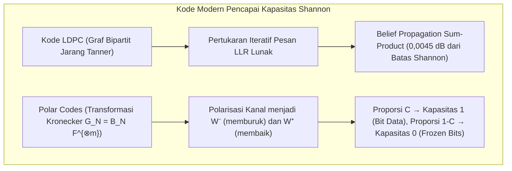

## 1. Pendahuluan: Dua Keajaiban Rekonstruksi Informasi dalam Kehidupan Sehari-hari

Baik di ruang antarbintang maupun di layar kamera ponsel Anda, rekayasa digital modern setiap hari melakukan sesuatu yang tampak menentang intuisi fisika: <strong>merekonstruksi informasi digital secara 100% akurat bit demi bit dari sinyal atau media yang telah rusak parah akibat derau termal, goresan, atau kerusakan fisik</strong>.

### Keajaiban 1: Voyager 1 & 2 Mengirim Gambar melintasi 24 Miliar Kilometer pada Daya $10^{-16}\text{ Watt}$

Diluncurkan pada tahun 1977, wahana antariksa <strong>Voyager 1 dan Voyager 2</strong> memotret Jupiter, Saturnus, Uranus, dan Neptunus sebelum memasuki ruang antarbintang yang berjarak lebih dari <strong>24 miliar kilometer</strong> dari Bumi.
Pemancar radio Voyager hanya beroperasi pada daya <strong>$23\text{ watt}$</strong> — lebih kecil dari bohlam lampu kulkas. Ketika gelombang elektromagnetik tersebut mencapai antena parabola 70 meter milik Deep Space Network (DSN) NASA di Bumi, daya sinyal yang diterima telah melemah hingga sekitar <strong>$10^{-16}\text{ watt}$ ($0,1\text{ attowatt}$)</strong>, tenggelam di dalam <strong>derau termal (thermal noise)</strong>. Namun Voyager berhasil mengirimkan foto berwarna beresolusi tajam dengan <strong>nol kesalahan bit</strong>.

### Keajaiban 2: Kode QR yang $30\%$ Modulnya Tertutup Noda Kopi atau Logo Perusahaan

Demikian pula, ketika Anda memindai <strong>Kode QR (Quick Response Code)</strong> yang terkena noda kopi atau memiliki <strong>logo perusahaan yang menutupi hingga $30\%$ area tengahnya</strong>, kamera ponsel Anda memulihkan URL atau data pembayaran secara utuh dalam waktu kurang dari <strong>$10\text{ milidetik}$</strong> dengan <strong>nol kesalahan bit (Zero Bit Errors)</strong>.


Bagaimana hal ini mungkin secara matematis? Jawabannya terletak pada <strong>Teori Informasi Claude Shannon (1948)</strong> dan aljabar <strong>Kode Koreksi Kesalahan (Error-Correcting Codes, ECC)</strong>.

---

## 2. Revolusi Claude Shannon (1948) dan Teorema Pengkodean Kanal Berderau

### 2.1 Mengapa Kode Pengulangan Naif ($0 \to 00000$) Gagal

Sebelum tahun 1948, para insinyur meyakini bahwa untuk menekan probabilitas kesalahan $P_e \to 0$ pada kanal berderau, laju transmisi informasi $R = k/n$ harus ikut turun menuju nol.
Pada <strong>Kode Pengulangan (Repetition Code)</strong> dengan panjang ganjil $n = 2t + 1$ di atas <strong>Kanal Simetris Biner (BSC)</strong> berprobabilitas balik bit $p \in (0, 0,5)$, pemungutan suara mayoritas gagal dengan probabilitas:
$$P_e^{(n)} = \sum_{i = (n+1)/2}^{n} \binom{n}{i} p^i (1-p)^{n-i}$$
Saat $n \to \infty$, memang $P_e^{(n)} \to 0$, tetapi secara bersamaan laju kode runtuh menjadi nol: $R = k/n = 1/n \to 0$.

### 2.2 Teorema Shannon dan Batas Mutlak Shannon ($-1,59\,\text{dB}$)

Pada tahun 1948, <strong>Claude E. Shannon</strong> membuktikan dalam *"A Mathematical Theory of Communication"* <strong>Teorema Pengkodean Kanal Berderau</strong>:

> <strong>Teorema (Pengkodean Kanal Berderau Shannon, 1948):</strong>
> Setiap kanal tanpa memori memiliki <strong>Kapasitas Kanal $C > 0$</strong> yang positif:
> - Untuk <strong>Kanal Simetris Biner (BSC)</strong> dengan fungsi entropi biner $H_2(p) = -p\log_2 p - (1-p)\log_2(1-p)$:
>   $$C_{\text{BSC}}(p) = 1 - H_2(p) = 1 + p\log_2 p + (1-p)\log_2(1-p) \quad [\text{bit / penggunaan kanal}]$$
> - Untuk <strong>kanal AWGN</strong> dengan lebar pita $B$, daya sinyal $S$, dan derau $N = N_0 B$ (Teorema Shannon-Hartley):
>   $$C_{\text{AWGN}} = B \log_2\!\left(1 + \frac{S}{N}\right) = B \log_2\!\left(1 + \frac{S}{N_0 B}\right) \quad [\text{bit / s}]$$
>
> <strong>Untuk setiap laju kode $R < C$, terdapat kode blok dengan panjang $n \to \infty$ yang menghasilkan probabilitas kesalahan dekode sekecil apa pun ($P_e \to 0$)!</strong>

Dengan mensubstitusikan $S = E_b R$ dan mengambil limit efisiensi spektral $\eta = R/B \to 0$, diperoleh $\frac{E_b}{N_0} > \lim_{\eta \to 0} \frac{2^\eta - 1}{\eta} = \ln 2 \approx 0,6931$, yaitu <strong>Batas Shannon (Shannon Limit)</strong>:
$$\left(\frac{E_b}{N_0}\right)_{\min} = \ln 2 \approx 0,6931 \implies 10 \log_{10}(\ln 2) \approx \mathbf{-1,5917\,\text{dB}}$$

---

## 3. Terobosan Geometris Richard Hamming (1950): Jarak Hamming dan Kode Sempurna $[7, 4, 3]$

### 3.1 Jarak Hamming $d_H(\mathbf{u}, \mathbf{v})$ dan Batas Pengepakan Bola

Pada hiperkubus biner $\mathbb{F}_2^n$, <strong>Richard Hamming</strong> (1950) mendefinisikan <strong>Jarak Hamming $d_H(\mathbf{u}, \mathbf{v})$</strong> sebagai jumlah koordinat yang berbeda antara dua vektor:
$$d_H(\mathbf{u}, \mathbf{v}) \triangleq \bigl|\{ i \in \{1, \dots, n\} \mid u_i \neq v_i \}\bigr| = w_H(\mathbf{u} - \mathbf{v})$$

Untuk kode $\mathcal{C} \subset \mathbb{F}_q^n$ dengan <strong>jarak minimum $d_{\min} = \min_{\mathbf{u}\neq\mathbf{v}} d_H(\mathbf{u},\mathbf{v})$</strong>, geometri bola-bola Hamming berjari-jari $t$ yang saling lepas membuktikan bahwa kode tersebut mampu:
- <strong>Mendeteksi</strong> $d_{\min} - 1$ kesalahan;
- <strong>Memulihkan $e = d_{\min} - 1$ penghapusan (erasures)</strong> pada posisi yang diketahui;
- <strong>Mengoreksi $t = \lfloor(d_{\min} - 1)/2\rfloor$ kesalahan acak</strong> pada posisi yang tidak diketahui:
$$\mathbf{d_{\min} \ge 2t + e + 1}, \qquad |\mathcal{C}| \cdot \sum_{i=0}^{t} \binom{n}{i} (q-1)^i \le q^n \quad \text{(Batas Hamming)}$$

### 3.2 Kode Sempurna Hamming $(7,4)$ dan Dekode Sindrom

Untuk $n=7, k=4, d_{\min}=3$ ($t=1$), berlaku $2^4 \cdot (1 + 7) = 128 = 2^7$: kode $[7,4,3]$ adalah <strong>Kode Sempurna</strong>. Matriks generator $\mathbf{G}_{4\times 7} = [\mathbf{I}_4 \mid \mathbf{P}]$ dan matriks pemeriksa paritas $\mathbf{H}_{3\times 7} = [\mathbf{P}^T \mid \mathbf{I}_3]$ ($\mathbf{G}\mathbf{H}^T = \mathbf{0} \pmod 2$) adalah:
$$\mathbf{G}_{4\times 7} = \left(\begin{array}{cccc|ccc}
1 & 0 & 0 & 0 & 1 & 1 & 0 \\
0 & 1 & 0 & 0 & 1 & 0 & 1 \\
0 & 0 & 1 & 0 & 0 & 1 & 1 \\
0 & 0 & 0 & 1 & 1 & 1 & 1
\end{array}\right), \qquad
\mathbf{H}_{3\times 7} = \left(\begin{array}{cccc|ccc}
1 & 1 & 0 & 1 & 1 & 0 & 0 \\
1 & 0 & 1 & 1 & 0 & 1 & 0 \\
0 & 1 & 1 & 1 & 0 & 0 & 1
\end{array}\right)$$

Vektor <strong>sindrom 3-bit $\mathbf{s} = \mathbf{H}\mathbf{y}^T = \mathbf{H}(\mathbf{c} + \mathbf{e})^T = \mathbf{H}\mathbf{e}^T \pmod 2$</strong> langsung mengekstrak kolom matriks $\mathbf{H}$ yang bersesuaian dengan posisi bit yang terbalik: jika kolom diurutkan secara biner dari $1$ hingga $7$, <strong>sindrom $\mathbf{s}$ langsung menghasilkan indeks biner $(1 \dots 7)$ dari bit yang rusak</strong>, melindungi seluruh memori server <strong>ECC DRAM (SECDED)</strong> saat ini.

---

## 4. Mahakarya Reed dan Solomon (1960): Kode Reed-Solomon di atas Medan Galois $\mathbb{F}_{2^m}$

### 4.1 Medan Galois $\text{GF}(2^8)$ dan Kekebalan terhadap Burst Errors

Untuk mengatasi kesalahan beruntun (goresan cakram optik, noda pada Kode QR), <strong>Irving Reed</strong> dan <strong>Gustave Solomon</strong> (1960) mengelompokkan setiap byte ($m=8$ bit) sebagai satu simbol di dalam medan hingga <strong>$\text{GF}(2^8) = \mathbb{F}_2[x]/(x^8 + x^4 + x^3 + x^2 + 1)$</strong>. Bahkan jika seluruh 8 bit dalam satu byte hancur, di dalam $\text{GF}(2^8)$ itu hanyalah <strong>satu kesalahan simbol tunggal</strong>!

### 4.2 Interpolasi Polinomial dan Batas Singleton MDS $d_{\min} = n - k + 1$

Sebanyak $k$ simbol pesan $(m_0, \dots, m_{k-1}) \in \mathbb{F}_q^k$ mendefinisikan polinomial $P(x) = m_0 + m_1 x + \dots + m_{k-1} x^{k-1}$ berderajat $< k$, yang dievaluasi pada $n$ titik berbeda $\mathbf{c} = \bigl(P(\alpha_1), \dots, P(\alpha_n)\bigr)$.
Karena dua polinomial berbeda berderajat $\le k-1$ di atas medan $\mathbb{F}_q$ hanya dapat berimpit di paling banyak $k-1$ titik (dan <strong>sembarang $k$ titik utuh cukup untuk merekonstruksi $P(x)$ secara unik melalui interpolasi Lagrange</strong>), setiap kode Reed-Solomon $[n, k]$ mencapai <strong>Batas Singleton dengan kesamaan mutlak (kode MDS, Maximum Distance Separable)</strong>:
$$\mathbf{d_{\min} = n - k + 1 \implies 2t + e \le n - k}$$

Dengan demikian, $n - k$ byte paritas mampu memulihkan <strong>hingga $e = n - k$ penghapusan (RAID-6, penyimpanan cloud)</strong> atau mengoreksi <strong>hingga $t = \lfloor(n-k)/2\rfloor$ kesalahan simbol pada posisi tak diketahui (Kode QR hingga 30% kerusakan pada Level H; kode $[255, 223]$ pada Voyager)</strong> melalui polinomial generator siklik $g(x) = \prod_{i=1}^{2t}(x - \alpha^i)$, algoritma <strong>Berlekamp-Massey / Euclidean</strong> ($\Lambda(x)S(x) \equiv \Omega(x) \pmod{x^{2t}}$), <strong>pencarian Chien</strong>, dan <strong>rumus Forney</strong>.

---

## 5. Mendekati Batas Shannon: Kode LDPC (1962), Turbo (1993), dan Polar (2009)

1. <strong>Kode LDPC Robert Gallager (1962)</strong>: menggunakan matriks paritas jarang $\mathbf{H}$ dan <strong>graf bipartit Tanner</strong>. Melalui pertukaran iteratif rasio log-likelihood lunak $L(c_i) = \ln\frac{P(c_i=0|y_i)}{P(c_i=1|y_i)}$ dengan <strong>Belief Propagation (Sum-Product)</strong>, kode LDPC beroperasi hanya $0,0045\,\text{dB}$<strong> dari batas Shannon (</strong>kanal data 5G NR, Wi-Fi 6/7, dan SSD 3D NAND).
2. <strong>Polar Codes Erdal Arıkan (2009)</strong>: menerapkan transformasi Kronecker $\mathbf{G}_N = \mathbf{B}_N \begin{pmatrix} 1 & 0 \\ 1 & 1 \end{pmatrix}^{\otimes m}$ secara rekursif untuk menciptakan <strong>polarisasi kanal</strong> — saat $N \to \infty$, proporsi $C = I(W)$ subkanal sintetis menuju kapasitas $1$ (bebas derau, membawa bit informasi) dan proporsi $1 - C$ menuju kapasitas $0$ (<strong>bit beku / Frozen Bits $= 0$</strong>), menjadikannya kode berkecepatan $O(N \log N)$ pertama yang <strong>secara matematis terbukti mencapai kapasitas Shannon</strong> (<strong>kanal kontrol 5G NR</strong>).



### Tabel Perbandingan Keluarga Kode Koreksi Kesalahan

| Keluarga Kode | Tahun & Pelopor | Struktur Matematika | Algoritma Dekode | Keunggulan Utama | Aplikasi Nyata |
| :--- | :--- | :--- | :--- | :--- | :--- |
| <strong>Hamming / SECDED</strong> | 1950<br/>R. Hamming | Pengepakan bola pada $\mathbb{F}_2^n$ | Sindrom $\mathbf{s}=\mathbf{H}\mathbf{y}^T$ ($O(1)$) | Koreksi 1 bit dalam $<1\text{ ns}$ | <strong>Memori server ECC DRAM</strong>, cache CPU |
| <strong>Reed-Solomon (RS)</strong> | 1960<br/>Reed & Solomon | Interpolasi polinomial di $\mathbb{F}_{2^m}$ | Berlekamp-Massey + Chien + Forney | <strong>Batas MDS optimal $d_{\min}=n-k+1$</strong> terhadap burst error | <strong>Kode QR</strong>, <strong>RAID-6</strong>, cloud storage, Voyager |
| <strong>Kode LDPC</strong> | 1962 R. Gallager<br/>(1996 ditemukan ulang) | Matriks jarang $\mathbf{H}$ & graf Tanner | <strong>Belief Propagation (Sum-Product)</strong> | $0,0045\,\text{dB}$ dari batas Shannon | <strong>5G NR (data)</strong>, <strong>Wi-Fi 6/7</strong>, <strong>SSD NVMe</strong> |
| <strong>Polar Codes</strong> | 2009<br/>Erdal Arıkan | Pangkat Kronecker $\mathbf{F}^{\otimes m}$ | Dekode daftar CA-SCL ($O(N\log N)$) | <strong>Terbukti mencapai kapasitas Shannon $C$</strong> | <strong>5G NR (kontrol)</strong>, 6G IoT |

---

## 6. Implementasi Lengkap Python: Hamming $(7,4)$ dan Reed-Solomon di $\text{GF}(2^8)$

```python
from typing import List

def hamming74_demo() -> None:
    G = [[1,0,0,0,1,1,0], [0,1,0,0,1,0,1], [0,0,1,0,0,1,1], [0,0,0,1,1,1,1]]
    H = [[1,1,0,1,1,0,0], [1,0,1,1,0,1,0], [0,1,1,1,0,0,1]]
    msg = [1, 0, 1, 1]
    c = [sum(msg[i] * G[i][j] for i in range(4)) % 2 for j in range(7)]
    y = c.copy()
    y[2] ^= 1
    s = [sum(H[r][col] * y[col] for col in range(7)) % 2 for r in range(3)]
    err_idx = next(col for col in range(7) if [H[r][col] for r in range(3)] == s)
    y[err_idx] ^= 1
    print(f"[Hamming (7,4)] Syndrome={s} -> Flipped idx={err_idx}, Recovered={y[:4] == msg}")

class GF256:
    def __init__(self, poly: int = 0x11D) -> None:
        self.exp, self.log = [0] * 512, [0] * 256
        v = 1
        for i in range(255):
            self.exp[i] = self.exp[i + 255] = v
            self.log[v] = i
            v <<= 1
            if v & 0x100:
                v ^= poly

    def mul(self, a: int, b: int) -> int:
        return 0 if (a == 0 or b == 0) else self.exp[self.log[a] + self.log[b]]

    def inv(self, a: int) -> int:
        return self.exp[255 - self.log[a]]

    def power(self, a: int, p: int) -> int:
        return 1 if p == 0 else (0 if a == 0 else self.exp[(self.log[a] * p) % 255])

    def eval_poly(self, coeffs: List[int], x: int) -> int:
        res = 0
        for c in reversed(coeffs):
            res = self.mul(res, x) ^ c
        return res

    def solve(self, A: List[List[int]], b: List[int]) -> List[int]:
        n = len(b)
        M = [row[:] + [b[i]] for i, row in enumerate(A)]
        for col in range(n):
            piv = next(r for r in range(col, n) if M[r][col] != 0)
            M[col], M[piv] = M[piv], M[col]
            inv_p = self.inv(M[col][col])
            for j in range(col, n + 1):
                M[col][j] = self.mul(M[col][j], inv_p)
            for r in range(n):
                if r != col and M[r][col] != 0:
                    f = M[r][col]
                    for j in range(col, n + 1):
                        M[r][j] ^= self.mul(f, M[col][j])
        return [M[i][n] for i in range(n)]

def rs_demo() -> None:
    gf = GF256()
    text = "VOYAGER-1"
    k, t = len(text), 3
    n = k + 2 * t
    pts = [gf.exp[i] for i in range(n)]
    cw = [gf.eval_poly([ord(c) for c in text], x) for x in pts]
    rx = cw.copy()
    rx[1] ^= 0xFF; rx[6] ^= 0xA5; rx[13] ^= 0x3C
    A = [[gf.power(pts[i], d) for d in range(k + t)] + [gf.mul(rx[i], gf.power(pts[i], d)) for d in range(t)] for i in range(n)]
    b = [gf.mul(rx[i], gf.power(pts[i], t)) for i in range(n)]
    sol = gf.solve(A, b)
    E = sol[k + t:] + [1]
    err_pos = [i for i, x in enumerate(pts) if gf.eval_poly(E, x) == 0]
    valid = [(pts[i], rx[i]) for i in range(n) if i not in err_pos][:k]
    rec = gf.solve([[gf.power(x, d) for d in range(k)] for x, _ in valid], [y for _, y in valid])
    print(f"[RS(15,9) over GF(2^8)] Located Errors={err_pos}, Recovered='{''.join(chr(c) for c in rec)}'")

if __name__ == "__main__":
    hamming74_demo()
    rs_demo()
```

---

## 7. Kesimpulan

Dari batas Shannon $-1,59\,\text{dB}$ (1948) hingga geometri Hamming (1950), interpolasi polinomial Reed-Solomon di atas $\mathbb{F}_{2^m}$ (1960), hingga propagasi kepercayaan LDPC dan polarisasi kanal Arıkan — teori pengkodean membuktikan bagaimana matematika murni mampu mengalahkan derau termal dan entropi fisik alam semesta.
