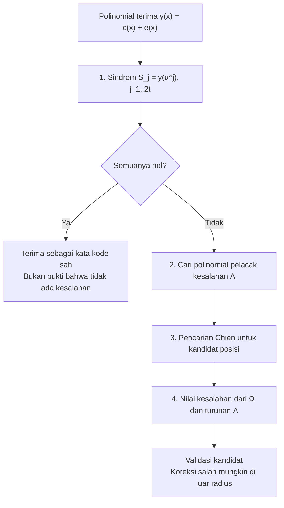
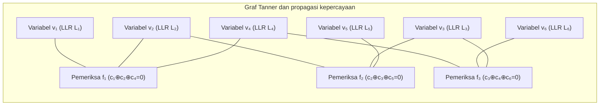
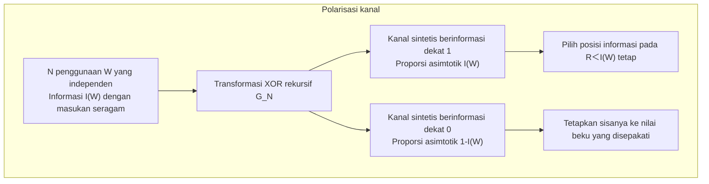

## 1. Pendahuluan: kesamaan komunikasi antariksa dan kode QR

Bagaimana data dipulihkan dari sinyal antariksa yang lemah atau kode QR yang rusak sebagian? <strong>Kode koreksi kesalahan (ECC)</strong> menambahkan redundansi terstruktur. Penerima menggunakan hubungan itu untuk memperkirakan dan memperbaiki nilai yang berubah. Perlindungannya terbatas: redundansi yang berhingga tidak dapat memperbaiki setiap kerusakan yang mungkin terjadi.

### Komunikasi antariksa: menerima sinyal dan mengoreksi kesalahan yang tersisa

Voyager 1 dan Voyager 2 diluncurkan pada 1977 dan mengunjungi Jupiter serta Saturnus; Voyager 2 melanjutkan perjalanan ke Uranus dan Neptunus. Bukan kedua wahana yang masing-masing mengunjungi keempat planet itu. Kita menggunakan komunikasi saat perjumpaan planet sebagai contoh, tanpa memperlakukan jarak dan daya terima saat ini yang berubah-ubah sebagai konstanta tetap.

Antena berpenguatan tinggi pada wahana memusatkan energi radio ke arah Bumi, tempat Deep Space Network (DSN) menerima sinyal. Pelemahan dan derau termal masih dapat menyisakan kesalahan setelah demodulasi. Sebagai konversi satuan, $10^{-16}\,\mathrm W=100\,\mathrm{aW}$, yaitu 100 attowatt. Ini bukan hasil pengukuran untuk tanggal dan stasiun tertentu.

Laporan JPL yang disiapkan untuk perjumpaan Voyager 2 dengan Uranus menjelaskan kode konvolusional dalam dan kode Reed–Solomon (RS) luar $[255,223]$. Tahapan ini mengurangi pengaruh derau, tetapi tidak menjamin bahwa setiap blok yang diterima atau setiap piksel selalu bebas kesalahan.

### Kode QR: persentase koreksi bukan luas yang boleh ditutup sembarangan

Kode QR juga memakai RS. DENSO WAVE menjelaskan tingkat pemulihan sekitar 7%, 15%, 25%, dan 30%, dihitung dalam <strong>kata kode 8 bit</strong>. Ini tidak berarti logo boleh menutupi sembarang 30% gambar. Pola fungsional, sebaran kerusakan di antara blok RS, dan kondisi pengambilan gambar tetap penting. Tidak ada pula jaminan universal sepuluh milidetik.

Dalam istilah QR, kata kode 8 bit setara dengan satu simbol dalam uraian matematis RS di sini. Itu bukan seluruh kata kode RS yang terdiri atas $n$ simbol. Memisahkan kedua tingkat ini mencegah kekeliruan tentang kemampuan koreksi setiap blok.

```mermaid
flowchart TD
    subgraph Voyager["Contoh pengodean berantai pada Voyager 2"]
        V1["Data informasi"] --> V2["RS luar → interleaving → kode konvolusional dalam"]
        V2 --> V3["Pemancaran terarah dan penerimaan DSN"]
        V3 --> V4["Sinyal terima dengan derau termal"]
        V4 --> V5["Viterbi keputusan lunak → deinterleaving → RS"]
        V5 --> V6["Pemulihan dalam syarat koreksi"]
    end
    subgraph QR["Kode QR"]
        Q1["URL, teks, dan data berguna lainnya"] --> Q2["RS pada GF(256) dan penataan spasial"]
        Q2 --> Q3["Kerusakan, bagian hilang, atau kesalahan pengambilan gambar"]
        Q3 --> Q4["Kenali gambar, ekstrak kata kode, dan dekode blok"]
        Q4 --> Q5["Perkirakan posisi dan nilai kesalahan"]
        Q5 --> Q6["Pulihkan data jika syarat terpenuhi"]
    end
```



Kita akan menghubungkan kapasitas kanal, jarak Hamming, polinomial pada medan hingga, dan perhitungan probabilitas pada graf. <strong>Mengoreksi semua pola hingga jumlah kesalahan tertentu</strong> berbeda dari <strong>membuat probabilitas kesalahan sekecil yang diinginkan ketika panjang blok bertambah</strong>.

---

## 2. Teorema pengodean Shannon dan asumsinya

### 2.1 Pengulangan: keandalan lebih tinggi dengan laju lebih rendah

Mengulang bit memungkinkan keputusan mayoritas mengurangi kesalahan. Namun, metode ini sendiri memerlukan lebih banyak penggunaan kanal per bit informasi untuk meningkatkan keandalan. Ini keterbatasan konstruksi pengulangan, bukan semua kode.

Ambil kanal simetris biner tanpa memori (BSC), dengan pembalikan bit independen berprobabilitas $0<p<1/2$. Kode pengulangan panjang tiga memetakan satu bit menjadi:

$$
0 \mapsto 000, \qquad 1 \mapsto 111
$$

Ketika 000 dikirim, menerima 011, 101, 110, atau 111 menghasilkan keputusan salah 1. Dua atau tiga bit harus terbalik:

$$
P_e^{(3)} = \binom{3}{2} p^2 (1-p) + \binom{3}{3} p^3 = 3p^2(1-p) + p^3
$$

Untuk $p=0{,}01$, hasilnya $0{,}000298$, sekitar $0{,}03\%$. Sebagai gantinya, laju kode adalah:

$$
R = \frac{k}{n} = \frac{1}{3}
$$

Pada panjang ganjil $n=2t+1$, keputusan mayoritas gagal jika setidaknya $t+1$ bit terbalik:

$$
P_e^{(n)} = \sum_{i = (n+1)/2}^{n} \binom{n}{i} p^i (1-p)^{n-i}
$$

Hukum bilangan besar memungkinkan probabilitas kesalahan menuju nol, tetapi pada saat yang sama:

$$
n \to \infty \implies P_e^{(n)} \to 0 \quad \text{tetapi sekaligus} \quad R = \frac{1}{n} \to 0
$$

Misalnya, panjang lima memakai $0\mapsto00000$, $1\mapsto11111$, dengan laju $1/5$. Perhitungan ini tidak meniadakan kode lebih efisien yang menggabungkan beberapa bit informasi dalam satu blok.

### 2.2 Kapasitas dan teorema pengodean kanal berderau

Karya Shannon pada 1948 menunjukkan bahwa kanal berderau dapat mempertahankan laju positif tetap sambil membuat probabilitas kesalahan sekecil yang diinginkan.

> <strong>Teorema untuk kanal diskret tanpa memori dengan alfabet berhingga:</strong> untuk aturan transisi $W(y\mid x)$ yang diberikan, kapasitas adalah $C=\max_{P(X)}I(X;Y)\ge0$, dalam bit per penggunaan kanal. Untuk setiap laju tetap $0<R<C$, ada barisan kode dengan blok makin panjang dan aturan dekode yang probabilitas kesalahan bloknya menuju nol. Pada $R>C$, konvergensi itu tidak dapat dicapai.

Kapasitas tidak harus positif. Jika keluaran independen dari masukan, $C=0$. Bila ada batas biaya masukan atau daya rata-rata, pemaksimuman harus mematuhinya. Satu statistik kekuatan derau saja tidak menentukan kapasitas setiap kanal.

Teorema ini adalah hasil keberadaan asimtotik, saat panjang blok menuju tak hingga. Ini bukan janji bahwa kode berhingga mengoreksi setiap derau yang mungkin atau otomatis menyediakan dekoder efisien. Latensi, perhitungan yang tersedia, dan probabilitas kesalahan sasaran tetap menjadi batas desain.

### 2.3 Penurunan kapasitas BSC

Untuk kanal diskret tanpa memori:

$$
C = \max_{P(X)} I(X; Y) = \max_{P(X)} \bigl( H(Y) - H(Y \mid X) \bigr)
$$

Tuliskan keluaran BSC sebagai $Y=X\oplus E$. Bit derau $E$ independen dari $X$ dan bernilai satu dengan probabilitas $p$. Ketika masukan diketahui, ketidakpastian yang tersisa adalah entropi biner:

$$
H(Y \mid X) = H_2(p) \triangleq -p \log_2 p - (1-p) \log_2(1-p)
$$

Karena keluaran biner, $H(Y)\le1$ bit. Masukan seragam menghasilkan keluaran seragam dan mencapai $H(Y)=1$, sehingga:

$$
C_{\text{BSC}}(p) = 1 - H_2(p) = 1 + p\log_2 p + (1-p)\log_2(1-p) \quad [\text{bit / penggunaan kanal}]
$$

Sebagai contoh:

$$
H_2(0{,}1) = -0{,}1 \log_2(0{,}1) - 0{,}9 \log_2(0{,}9) \approx 0{,}4690\text{ bit}
$$

$$
C_{\text{BSC}}(0{,}1) = 1 - 0{,}4690 = 0{,}5310\text{ bit / penggunaan kanal}
$$

Laju tetap yang lebih rendah, seperti $R=0{,}5$, karena itu dapat mencapai probabilitas kesalahan sekecil yang diinginkan dengan kode sesuai yang cukup panjang. Ini bukan jaminan kesalahan nol pada panjang berhingga dengan laju tepat sama dengan kapasitas. Argumen pengodean acak menggunakan perilaku khas derau pada blok panjang dan keterbedaan kata kode.

### 2.4 AWGN dan batas pita lebar $-1{,}59\,\mathrm{dB}$

Model derau putih Gaussian aditif (AWGN) menjelaskan bentuk gelombang kontinu, bukan secara harfiah pembalikan bit yang independen. Misalkan $B$ lebar pita dalam Hz, $S$ daya sinyal terima rata-rata dalam W, dan $N_0$ rapat spektral daya derau satu sisi dalam W/Hz. Daya derau di dalam pita adalah $N=N_0B$. Di bawah batas daya rata-rata, tanpa pembatasan tambahan pada masukan biner, Shannon–Hartley memberikan:

$$
C_{\text{AWGN}} = B \log_2\!\left(1 + \frac{S}{N}\right) = B \log_2\!\left(1 + \frac{S}{N_0 B}\right) \quad [\text{bit / detik}]
$$

Misalkan $E_b$ energi terima per bit informasi dan, sekarang, $R$ laju informasi dalam bit/s, sehingga $S=E_bR$. Satuannya berbeda dari laju sebelumnya dalam bit per penggunaan kanal. Mensyaratkan $R<C_{\mathrm{AWGN}}$ memberikan:

$$
R < B \log_2\!\left(1 + \frac{E_b}{N_0} \frac{R}{B}\right)
$$

Dengan efisiensi spektral $\eta=R/B$, dalam bit/s/Hz:

$$
\eta < \log_2\!\left(1 + \eta \frac{E_b}{N_0}\right) \iff 2^\eta - 1 < \eta \frac{E_b}{N_0} \iff \frac{E_b}{N_0} > \frac{2^\eta - 1}{\eta}
$$

Pada model ideal ini kita mengambil $\eta\to0$ dan menggunakan $2^\eta=1+\eta\ln2+O(\eta^2)$:

$$
\lim_{\eta \to 0} \frac{2^\eta - 1}{\eta} = \ln 2 \approx 0{,}693147
$$

Dalam desibel:

$$
\left(\frac{E_b}{N_0}\right)_{\min} = \ln 2 \approx 0{,}6931 \implies 10 \log_{10}(\ln 2) \approx \mathbf{-1{,}5917\,\text{dB}}
$$

Ini adalah <strong>infimum pada limit pita lebar</strong>. Pada efisiensi spektral positif, batas yang diperlukan adalah $(2^\eta-1)/\eta>\ln2$. Rasio $E_b/N_0$ juga bukan rasio daya $S/N$ antara sinyal dan seluruh derau dalam pita. Menyebut hanya “sinyal di bawah derau” dapat mencampurkan kedua definisi.

Mendekati kapasitas juga membutuhkan panjang blok dan latensi. Hasil asimtotik dari model tertentu ini bukan konstanta semua kanal fisik atau janji komunikasi berhingga tanpa kesalahan. Membatasi masukan pada dua nilai, misalnya, mengubah kapasitas yang relevan.

---

## 3. Jarak Hamming, jaminan, dan kode $[7,4,3]$

### 3.1 Dari keberadaan ke konstruksi yang dapat dihitung

Untuk menggunakan teorema keberadaan, kita memerlukan algoritma pengodean dan pendekodean. Karya Hamming pada 1950 memberi contoh konkret: menambahkan pemeriksaan paritas dan melokalisasi bit terbalik dari pemeriksaan yang gagal. Kita membangun kode melalui jarak dan matriksnya.

### 3.2 Jarak dan jarak minimum

Deretan biner panjang $n$ membentuk $\mathbb F_2^n$, titik sudut hiperkubus berdimensi $n$. Pada $\mathbb F_2$, penjumlahan dan pengurangan adalah XOR. Jarak Hamming menghitung koordinat yang berbeda:

$$
d_H(\mathbf{u}, \mathbf{v}) \triangleq \bigl|\{ i \in \{1, \dots, n\} \mid u_i \neq v_i \}\bigr| = w_H(\mathbf{u} - \mathbf{v})
$$

Di sini $w_H$ menghitung entri bukan nol, yaitu bobot Hamming. Jarak memenuhi ketaknegatifan, simetri, dan ketaksamaan segitiga. Kode adalah himpunan bagian $\mathcal C$ dari kata yang diizinkan. Kode linear biner berdimensi $k$ memiliki $2^k$ kata kode. Jarak minimumnya:

$$
d_{\min}(\mathcal{C}) \triangleq \min_{\substack{\mathbf{u}, \mathbf{v} \in \mathcal{C} \\ \mathbf{u} \neq \mathbf{v}}} d_H(\mathbf{u}, \mathbf{v})
$$

Pada kode linear, selisih dua kata kode berbeda kembali merupakan kata kode bukan nol, sehingga:

$$
d_{\min}(\mathcal{C}) = \min_{\mathbf{c} \in \mathcal{C} \setminus \{\mathbf{0}\}} w_H(\mathbf{c})
$$

### 3.3 Deteksi, erasure, dan kesalahan posisi tak diketahui

1. <strong>Deteksi:</strong> mengubah satu hingga $d_{\min}-1$ koordinat tidak dapat mengubah kata kode sah menjadi kata kode sah lain. Memeriksa keanggotaan kode mendeteksi semua pola bukan nol itu.
2. <strong>Penghapusan (erasure):</strong> posisi yang hilang diketahui, tetapi nilainya tidak. Koordinat tidak bergeser seperti pada penghapusan karakter dalam teks. Jika ada paling banyak $e\le d_{\min}-1$, dua kata kode berbeda masih berbeda pada suatu koordinat tersisa. Dengan asumsi nilai lainnya benar, kata yang dikirim ditentukan secara unik.
3. <strong>Kesalahan posisi tak diketahui:</strong> dekode kata kode terdekat mengoreksi semua pola hingga $t$ kesalahan jika dan hanya jika bola Hamming berjari-jari $t$ di sekitar kata kode berbeda saling lepas.

Jika suatu kata terima berada di dua bola, ketaksamaan segitiga memberi jarak antarpusat paling banyak $2t$. Sebaliknya, dua pusat berjarak paling banyak $2t$ memungkinkan kata yang berjarak paling banyak $t$ dari keduanya: bagi koordinat berbeda antara kedua pilihan. Maka:

$$
2t + 1 \le d_{\min} \iff t \le \left\lfloor \frac{d_{\min} - 1}{2} \right\rfloor
$$

Persamaan $t=\lfloor(d_{\min}-1)/2\rfloor$ menyebut <strong>radius terjamin terbesar</strong>, bukan setiap radius lebih kecil yang masih sah. Dengan paling banyak $t$ kesalahan tak diketahui dan $e$ erasure diketahui, jaminan untuk semua pola adalah:

$$
\mathbf{d_{\min} \ge 2t + e + 1}
$$

Membuang posisi erasure menyisakan jarak minimum setidaknya $d_{\min}-e$; argumen bola saling lepas diterapkan pada ruang tersisa. Beberapa kasus di luar batas ini masih dapat pulih, tetapi keberhasilan semua konfigurasi tidak lagi dijamin. “Posisi tak diketahui” tidak mensyaratkan distribusi kesalahan acak.

Bola radius $t$ pada ruang beralfabet ukuran $q$ berisi $\sum_{i=0}^t\binom ni(q-1)^i$ kata. Bola-bola yang saling lepas harus muat dalam ruang:

$$
|\mathcal{C}| \cdot \sum_{i=0}^{t} \binom{n}{i} (q-1)^i \le q^n \quad \left(\text{untuk kode biner: } 2^k \sum_{i=0}^{t} \binom{n}{i} \le 2^n \right)
$$

Kode yang mencapai kesamaan pada batas ini adalah <strong>kode sempurna</strong>: bola menutupi ruang tanpa celah atau tumpang tindih. Contohnya Hamming, Golay biner $[23,12,7]$, dan Golay terner $[11,6,5]$. Klasifikasi memerlukan asumsinya masing-masing; ada juga kode sempurna nonlinear. Contoh ini tidak membuktikan kode Golay apa yang dipakai misi tertentu.

### 3.4 Matriks Hamming dan sindrom

Kode $[7,4,3]$ menambahkan tiga bit paritas pada empat bit informasi:

$$
2^4 \sum_{i=0}^{1} \binom{7}{i} = 16 \times (1 + 7) = 16 \times 8 = 128 = 2^7
$$

Ada 16 bola radius satu, masing-masing berisi pusat dan tujuh tetangga, yang menutupi seluruh 128 kata.

Salah satu konstruksi matriks pemeriksa paritas menempatkan representasi biner $j$ pada kolom $j$:

$$
\mathbf{H}_{\text{binary}} = \begin{pmatrix} 0 & 0 & 0 & 1 & 1 & 1 & 1 \\ 0 & 1 & 1 & 0 & 0 & 1 & 1 \\ 1 & 0 & 1 & 0 & 1 & 0 & 1 \end{pmatrix} \begin{matrix} \leftarrow 2^2\text{ posisi} \\ \leftarrow 2^1\text{ posisi} \\ \leftarrow 2^0\text{ posisi} \end{matrix}
$$

Kolom kelimanya $(1,0,1)^T$. Agar empat bit pesan tetap di awal dan paritas ditambahkan di akhir, kita menggunakan bentuk sistematis $\mathbf G=[\mathbf I_4\mid\mathbf P]$ dan $\mathbf H=[\mathbf P^T\mid\mathbf I_3]$:

$$
\mathbf{G}_{4\times 7} = \left(\begin{array}{cccc|ccc} 1 & 0 & 0 & 0 & 1 & 1 & 0 \\ 0 & 1 & 0 & 0 & 1 & 0 & 1 \\ 0 & 0 & 1 & 0 & 0 & 1 & 1 \\ 0 & 0 & 0 & 1 & 1 & 1 & 1 \end{array}\right), \qquad \mathbf{H}_{3\times 7} = \left(\begin{array}{cccc|ccc} 1 & 1 & 0 & 1 & 1 & 0 & 0 \\ 1 & 0 & 1 & 1 & 0 & 1 & 0 \\ 0 & 1 & 1 & 1 & 0 & 0 & 1 \end{array}\right)
$$

Karena $\mathbf G\mathbf H^T=0$, semua kata yang dikodekan memenuhi:

$$
\mathbf{H}\mathbf{c}^T = \mathbf{0} \pmod 2
$$

Untuk $\mathbf y=\mathbf c+\mathbf e$ yang diterima, hitung <strong>sindrom</strong>:

$$
\mathbf{s} = \mathbf{H}\mathbf{y}^T = \mathbf{H}(\mathbf{c} + \mathbf{e})^T = \underbrace{\mathbf{H}\mathbf{c}^T}_{=\mathbf{0}} + \mathbf{H}\mathbf{e}^T = \mathbf{H}\mathbf{e}^T \pmod 2
$$

Sindrom hanya bergantung pada kesalahan. Satu pembalikan bit $j$ memberi kolom $j$ pada matriks yang dipilih. Dengan kolom berurutan biner, sindrom 101 mengidentifikasi posisi 5. Pada bentuk sistematis urutannya berbeda sehingga kolom yang sesuai harus dicari. Nilai angkanya tidak selalu posisi kesalahan. Program pada bagian 6 melakukan pencarian itu.

Sindrom nol berarti keanggotaan kode. Di bawah asumsi paling banyak satu kesalahan, ini berarti tidak ada kesalahan; di luar asumsi itu kanal mungkin telah mengubah satu kata kode sah menjadi kata kode sah lain. Beberapa kesalahan juga dapat membuat dekoder satu kesalahan membalik bit yang semula benar.

Sebagai contoh, pesan `[1,0,1,1]` dikodekan menjadi `[1,0,1,1,0,1,0]`. Membalik indeks 2, dihitung dari nol — bit ketiga —, memberi sindrom `[0,1,1]`, sesuai kolom indeks 2. Rangkaian tujuh bit tetap memiliki ukuran konstan, tetapi perhitungan sindrom untuk panjang umum $n$ tidak selalu $O(1)$.

Menambahkan satu bit paritas genap global memberi kode diperluas $[8,4,4]$. Aturan yang sesuai memungkinkan koreksi satu bit dan deteksi dua bit (SECDED). Ini model dasar untuk memahami memori ECC, bukan arsitektur persis semua produk.

---

## 4. Reed–Solomon: medan hingga, interpolasi, dan dekode

### 4.1 Mengapa kesalahan beruntun penting

Hamming $(7,4)$ mengoreksi satu bit di posisi mana pun dalam satu blok. Goresan cakram, noda QR, atau pemudaran sinyal dapat mengubah banyak bit dalam blok yang sama. Dua pembalikan saja dapat membuat dekoder satu kesalahan mengoreksi menuju kata kode yang salah.

Konstruksi Reed dan Solomon dari 1960 mengelompokkan bit menjadi <strong>simbol</strong> medan hingga. Satuan pengukuran jarak dan koreksi berubah. Penataan spasial dan interleaving juga menentukan bagaimana kerusakan fisik mengenai simbol tersebut.

### 4.2 Byte sebagai unsur medan hingga

Simbol $m$ bit dapat direpresentasikan dalam $\mathbb F_{2^m}$. Ini bukan aritmetika bilangan bulat modulo 256: $2\cdot128\equiv0\pmod{256}$ menunjukkan pembagi nol, dan unsur bukan nol itu tidak memiliki invers perkalian. Medan hingga ada tepat untuk ukuran yang merupakan pangkat bilangan prima. Di sini “medan” adalah struktur aljabar finite field, bukan luas atau medan fisik.

Dalam GF(256), byte mewakili polinomial berderajat paling tinggi tujuh dengan koefisien biner. Program mereduksi hasil kali modulo polinomial tak tereduksi berderajat delapan yang diwakili `0x11D`:

$$
\mathbb{F}_{2^8} \cong \frac{\mathbb{F}_2[x]}{\langle x^8 + x^4 + x^3 + x^2 + 1 \rangle}
$$

Penjumlahan dan pengurangan adalah XOR karena $1+1=0$ pada medan koefisien. Sebanyak 255 unsur bukan nol membentuk grup perkalian siklik. Dalam representasi ini, $\alpha=x$, byte `0x02`, adalah unsur primitif: $\alpha^0,\ldots,\alpha^{254}$ melalui semua unsur bukan nol dan $\alpha^{255}=1$.

Tabel logaritma dan eksponen memungkinkan perkalian dan pembagian unsur bukan nol:

$$
A \cdot B = \alpha^{(i + j) \bmod 255}, \qquad \frac{A}{B} = \alpha^{(i - j) \bmod 255}
$$

Nol memerlukan penanganan terpisah dan pembagian dengan nol tidak didefinisikan. Panjang tabel bergantung pada implementasi; beberapa memperpanjang tabel eksponen agar tidak perlu modulo eksplisit. Bagian 6 memakai pergeseran bit dan XOR.

Beberapa bit rusak pada byte yang sama dihitung sebagai satu kesalahan simbol. Melintasi batas byte dapat merusak beberapa simbol. Jumlah total bit yang berubah saja tidak menentukan apakah koreksi mungkin dilakukan.

### 4.3 Evaluasi, interpolasi, dan batas Singleton

Dua titik dengan absis berbeda menentukan polinomial berderajat paling tinggi satu. Jika lima evaluasi dikirim, sembarang dua evaluasi benar yang tersisa memulihkan polinomial setelah tiga erasure. Tiga absis berbeda menentukan polinomial berderajat paling tinggi dua.

Kita memakai $k$ simbol pesan sebagai koefisien:

$$
P(x) \triangleq m_0 + m_1 x + m_2 x^2 + \dots + m_{k-1} x^{k-1} \in \mathbb{F}_q[x]
$$

Pilih $n$ titik berbeda $\alpha_i\in\mathbb F_q$, dengan $k\le n\le q$, dan kirim:

$$
\mathbf{c} = \bigl( P(\alpha_1),\; P(\alpha_2),\; \dots,\; P(\alpha_n) \bigr) \in \mathbb{F}_q^n
$$

Teorema faktor menyatakan bahwa polinomial bukan nol pada medan tidak memiliki lebih banyak akar daripada derajatnya. Selisih $P-Q$ dua pesan berbeda berderajat kurang dari $k$, sehingga nol di paling banyak $k-1$ titik. Kata kode berbeda pada sedikitnya $n-k+1$ koordinat.

Untuk batas sebaliknya, buang $d_{\min}-1$ koordinat dari semua kata kode. Proyeksinya harus tetap berbeda. Dengan $q^k$ kata, $q^k\le q^{n-d_{\min}+1}$ sehingga $d_{\min}\le n-k+1$. RS mencapai batas dengan kesamaan:

$$
\mathbf{d_{\min} = n - k + 1}
$$

Ini sifat <strong>MDS, jarak minimum maksimum pada parameter tetap</strong>. Sifat ini mengoptimalkan jarak untuk alfabet, panjang, dan dimensi tertentu, bukan semua kinerja rekayasa.

Dengan $r=n-k$ simbol redundan, jaminannya $2t+e\le r$:

- <strong>Erasure diketahui:</strong> hingga $n-k$ simbol boleh hilang. Sembarang $k$ evaluasi benar yang tersisa memulihkan pesan lewat interpolasi Lagrange:

$$
P(x) = \sum_{j=1}^{k} y_{i_j} \prod_{\substack{m=1 \\ m \neq j}}^{k} \frac{x - x_{i_m}}{x_{i_j} - x_{i_m}}
$$

- <strong>Kesalahan tak diketahui:</strong> hingga $\lfloor(n-k)/2\rfloor$ simbol rusak dapat dikoreksi, berapa pun bit yang berubah dalam setiap simbol terdampak.

### 4.4 Bentuk siklik dan konvensi rumus Forney

Bentuk evaluasi memperlakukan pesan sebagai koefisien lalu mengirimkan evaluasi. Dalam uraian siklik, koordinat kata kode adalah koefisien polinomial lain yang habis dibagi polinomial generator. Kode panjang penuh $n=q-1$ yang memakai titik bukan nol memiliki representasi siklik ekuivalen setelah korespondensinya ditetapkan. Kode yang diperpendek tidak harus tetap siklik pada panjang barunya.

Tetapkan redundansi $n-k=2t$ dan akar pertama generator $\alpha^1$. Ini konvensi penurunan berikut, bukan semua format QR atau antariksa:

$$
g(x)=\prod_{j=1}^{2t}(x-\alpha^j)
$$

Dengan sisa $r(x)=x^{2t}m(x)\bmod g(x)$, geser pesan lalu kurangi sisanya:

$$
c(x)=x^{2t}m(x)-r(x),\qquad c(\alpha^j)=0\quad(1\le j\le2t)
$$

Pada karakteristik dua, pengurangan tetap XOR.



1. <strong>Sindrom:</strong> misalkan ada $\nu\le t$ kesalahan pada posisi $i_l$ dengan nilai bukan nol $Y_l=e_{i_l}$. Definisikan $X_l=\alpha^{i_l}$. Evaluasi di akar menghilangkan kata kode yang dikirim:

$$
S_j=y(\alpha^j)=e(\alpha^j)=\sum_{l=1}^{\nu}Y_lX_l^j,\qquad j=1,\ldots,2t
$$

Sindrom nol hanya menetapkan keanggotaan kode, bukan mendeteksi perubahan antara dua kata kode sah.

2. <strong>Polinomial pelacak kesalahan:</strong>

$$
\Lambda(z)=\prod_{l=1}^{\nu}(1-X_lz)=1+\Lambda_1z+\cdots+\Lambda_\nu z^\nu
$$

Mengalikan $\Lambda(X_l^{-1})=0$ dengan $Y_lX_l^{j+\nu}$ lalu menjumlahkan memberi rekurensi linear:

$$
S_{j+\nu}+\Lambda_1S_{j+\nu-1}+\cdots+\Lambda_\nu S_j=0,\qquad1\le j\le2t-\nu
$$

Berlekamp–Massey memperoleh rekurensi minimum dan kandidat, biasanya dalam $O(t^2)$ operasi medan. Metode berbasis Euklides diperluas juga dapat menyelesaikan persamaan kunci.

3. <strong>Pencarian Chien:</strong> uji unsur bukan nol $\alpha^{-i}$ yang sesuai dengan koordinat untuk mencari $\Lambda(\alpha^{-i})=0$. GF(256) memiliki 256 unsur total, 255 bukan nol. Kondisi seperti kecocokan derajat pelacak dengan jumlah akar yang diizinkan harus diperiksa.

4. <strong>Nilai kesalahan:</strong> definisikan secara eksplisit polinomial sindrom dan evaluator:

$$
S(z)=S_1+S_2z+\cdots+S_{2t}z^{2t-1},\qquad \Omega(z)=S(z)\Lambda(z)\bmod z^{2t}
$$

Dengan definisi ini, Forney memberi:

$$
Y_l=-\frac{\Omega(X_l^{-1})}{\Lambda'(X_l^{-1})}
$$

Untuk satu kesalahan, $\Omega=YX$ dan $\Lambda'=-X$, sehingga hasilnya $Y$. Faktor $X$ tambahan akan memberi $XY$. Konvensi akar pertama atau polinomial sindrom yang lain dapat mengubah faktor itu; rumus tidak boleh dipindahkan tanpa definisinya.

Kurangi kesalahan perkiraan lalu periksa keanggotaan kode dan jarak koreksi. Namun, kata terima yang dekat dengan kata kode sah lain dapat lolos pemeriksaan dengan pesan yang salah. CRC, transmisi ulang, atau pemeriksaan lapisan atas dapat menambah perlindungan, tetapi tidak setiap kerusakan di luar radius terjamin pasti terdeteksi.

### 4.5 QR, penyimpanan, dan kode berantai Voyager

- <strong>QR:</strong> L/M/Q/H berarti pemulihan sekitar 7/15/25/30% kata kode 8 bit. Setiap blok RS harus memenuhi syaratnya. Versi dan tingkat mengubah data, redundansi, dan pembagian blok; itu tidak dapat dikonversi menjadi luas sembarang. Menutup pola fungsional dapat menggagalkan pengenalan atau ekstraksi sebelum dekode RS.
- <strong>RAID-6 dan penyimpanan terdistribusi:</strong> drive atau fragmen yang hilang pada posisi diketahui adalah erasure. Contoh kode MDS $[14,10]$ memakai $14/10=1{,}4$ kali kapasitas data dan menoleransi empat fragmen hilang jika sisanya serta metadata yang diperlukan benar. Ini bukan konfigurasi universal semua penyedia cloud. Paritas ganda RAID-6 memulihkan dua drive di bawah asumsinya, bukan semua kerusakan laten tambahan atau hilangnya seluruh fasilitas.
- <strong>Voyager 2:</strong> laporan JPL tahun 1983 menjelaskan kode konvolusional dengan constraint length $K=7$ dan laju $1/2$, interleaving berkedalaman 4, serta RS luar $[255,223]$. Redundansi 32 byte menjamin $2t+e\le32$ per kata kode RS, atau 16 kesalahan byte tanpa erasure. Burst 128 bit berurutan yang tidak sejajar dengan batas byte dapat mengenai 17 byte. Interleaving menyebarkan burst sisa dekoder dalam ke beberapa kata kode RS. Kode dalam pada contoh ini adalah konvolusional.

---

## 5. LDPC, turbo, dan polar: keandalan dan kapasitas

### 5.1 Jarak tidak menyelesaikan seluruh persoalan

Kode praktis harus memenuhi probabilitas kesalahan sasaran, latensi, panjang blok, perhitungan, dan biaya perangkat keras. Membandingkan semua kata kode biner berdimensi $k$ secara langsung memerlukan $2^k$ kandidat. Jarak minimum yang baik tidak otomatis memberi dekode efisien.

Dekode iteratif turbo dan LDPC memakai informasi keandalan; polar memakai konstruksi lain untuk mendekati kapasitas simetris. Perbandingan harus mempertahankan kanal, batas masukan, dan laju yang sama. Tidak cukup membandingkan semuanya dengan batas pita lebar $-1{,}59\,\mathrm{dB}$.

### 5.2 Paritas jarang dan propagasi kepercayaan

Kode LDPC Gallager dari 1962 memakai matriks pemeriksa paritas jarang. Meskipun bloknya panjang, setiap baris dan kolom dapat memiliki sedikit entri bukan nol. Untuk $\mathbf H$ berukuran $m\times n$, dimensinya $k=n-\operatorname{rank}_{\mathbb F_2}(\mathbf H)$, dengan rank berarti peringkat matriks. Hanya jika baris-barisnya independen nilai itu sama dengan $n-m$.

Pada graf Tanner, simpul variabel sesuai dengan kolom dan bit; simpul pemeriksa sesuai dengan baris dan persamaan paritas. Sisi ada tepat ketika $H_{a,i}=1$:



Keputusan lunak mempertahankan keandalan, bukan langsung mengubah pengamatan menjadi keputusan nol atau satu. Rasio log-likelihood (LLR) dapat ditulis:

$$
L(c_i) \triangleq \ln \frac{\Pr(c_i = 0 \mid y_i)}{\Pr(c_i = 1 \mid y_i)}
$$

Untuk masukan berpeluang sama, BPSK beramplitudo satu $0\mapsto+1$, $1\mapsto-1$, derau independen $Z\sim\mathcal N(0,\sigma^2)$, dan pengamatan $y_i=x_i+Z$:

$$
L_{\mathrm{ch}}(c_i)=\ln\frac{p(y_i\mid c_i=0)}{p(y_i\mid c_i=1)}=\frac{2y_i}{\sigma^2}
$$

Amplitudo atau probabilitas awal yang berbeda mengubah rumus. LLR $+10$ mendukung nol dengan kuat; $-0{,}1$ mendukung satu hanya sedikit.

Algoritma jumlah-produk merupakan salah satu bentuk propagasi kepercayaan. Pesan ekstrinsik dipertukarkan dengan mengecualikan kontribusi tetangga penerima:

$$
\mu_{f_a \to v_i} = 2 \operatorname{artanh}\!\left( \prod_{v_j \in N(f_a) \setminus \{v_i\}} \tanh\!\left(\frac{\mu_{v_j \to f_a}}{2}\right) \right)
$$

$$
\mu_{v_i \to f_a} = L_{\text{ch}}(v_i) + \sum_{f_b \in N(v_i) \setminus \{f_a\}} \mu_{f_b \to v_i}
$$

$N$ berarti himpunan tetangga yang bersangkutan. Jadwal iterasi menentukan pesan dari iterasi mana yang dipakai, tanpa mengubah pengecualian itu.

Matriks jarang mengurangi sisi, tetapi tidak otomatis menghilangkan siklus pendek. Pada pohon, propagasi menghitung probabilitas marginal tepat. Pada graf berhingga bersiklus, ketergantungan, trapping set, atau kegagalan konvergensi dapat menyisakan kesalahan.

Dengan $E$ sisi, implementasi yang berbagi perhitungan antartetangga memakai sekitar $O(E)$ operasi per iterasi, atau $O(IE)$ untuk $I$ iterasi. Derajat simpul terbatas dapat memberi $E=O(n)$, tetapi tidak menjamin jumlah iterasi konstan. Implementasi numerik perlu menangani saturasi LLR dan domain $\operatorname{artanh}$.

Hasil Chung dan rekan-rekan dari 2001 berlaku untuk <strong>laju $1/2$ pada kanal AWGN bermasukan biner</strong>. Ambang asimtotik yang dihitung lewat evolusi densitas berjarak $0{,}0045\,\mathrm{dB}$ dari batas kapasitas kanal tersebut. Simulasi berhingga terpisah dengan rancangan lebih sederhana, panjang $10^7$, dan BER $10^{-6}$ menunjukkan selisih $0{,}04\,\mathrm{dB}$. Ini bukan kinerja universal semua perangkat atau infimum energi pita lebar.

### 5.3 Kode polar dan kapasitas simetris

Konstruksi Arıkan dari 2009 mendekati $I(W)$, <strong>kapasitas simetris</strong> kanal diskret tanpa memori bermasukan biner: informasi timbal balik dengan masukan seragam. Ini sama dengan $C$ pada kanal simetris, tetapi belum tentu sama dengan maksimum atas semua distribusi masukan pada kanal asimetris.

Transformasi dasarnya:

$$
(x_1,x_2)=(u_1,u_2)\begin{pmatrix}1&0\\1&1\end{pmatrix} =(u_1\oplus u_2,u_2)
$$

Kanal sintetis $W^-$ memperkirakan $u_1$ dari $(y_1,y_2)$; $W^+$ memperkirakan $u_2$ dari $(y_1,y_2,u_1)$ jika nilai $u_1$ yang benar diberikan. Untuk masukan seragam yang independen, aturan rantai memberi:

$$
I(W^-)+I(W^+)=2I(W),\qquad I(W^-)\le I(W)\le I(W^+)
$$

“Lebih baik” dan “lebih buruk” di sini berkaitan dengan informasi; perubahan tidak harus ketat dalam setiap kasus. Pada dekode berurutan yang nyata, keputusan salah sebelumnya dapat merambat ke keputusan berikutnya.

Untuk $N=2^m$, salah satu konvensi memakai permutasi $\mathbf B_N$ yang membalik urutan digit biner indeks dan matriks generator:

$$
\mathbf G_N=\mathbf B_N \begin{pmatrix}1&0\\1&1\end{pmatrix}^{\otimes m}
$$

Untuk setiap $0<\delta<1$ tetap, ketika $N\to\infty$, proporsi kanal sintetis dengan informasi lebih besar dari $1-\delta$ menuju $I(W)$; proporsi dengan informasi kurang dari $\delta$ menuju $1-I(W)$. Pada panjang berhingga tidak muncul tepat $NI(W)$ kanal yang sepenuhnya bebas derau.



Pilih posisi informasi pada laju tetap $R<I(W)$ dan bekukan sisanya pada nilai yang disepakati. Untuk kanal umum, jaminan asli memakai rata-rata atas nilai beku dan keberadaan pilihan yang sesuai. Pada kanal simetris, batas terkait berlaku untuk setiap pilihan tetap.

Pengodean dan <strong>pembatalan berurutan (SC, successive cancellation)</strong> membutuhkan waktu $O(N\log N)$. Memilih himpunan informasi adalah biaya konstruksi terpisah. Implementasi efisien <strong>pembatalan berurutan dengan daftar (SCL)</strong> berukuran $L$ memerlukan $O(LN\log N)$; CRC dapat membantu memilih kandidat. Kesalahan dan latensi pada panjang berhingga bergantung pada konstruksi, laju, ukuran daftar, dan kanal. Tidak ada jaminan umum bahwa lantai kesalahan (error floor) selalu tidak ada.

### 5.4 Perbandingan keluarga kode

| Kode | Struktur matematika | Dekode representatif | Sifat dan penggunaan |
| :--- | :--- | :--- | :--- |
| Hamming (1950) | Kode linear biner; $[7,4,3]$ sempurna | Sindrom dan pencarian kolom | Koreksi satu bit; model dasar SECDED |
| Reed–Solomon (1960) | Polinomial medan hingga; sifat MDS | BM/Euklides, Chien, Forney; Welch–Berlekamp dalam evaluasi | Kesalahan simbol dan erasure; QR, penyimpanan, telemetri berantai |
| Konvolusional dan turbo | Trellis, perantaian, interleaving | Viterbi; BCJR iteratif | Komunikasi berderau; kode dalam Voyager adalah konvolusional |
| LDPC (1962) | Matriks jarang dan graf Tanner | Propagasi kepercayaan dengan keputusan lunak | Blok panjang dan paralelisme; rancangan dekat kapasitas pada model tertentu |
| Polar (2009) | Polarisasi rekursif dan bit beku | SC $O(N\log N)$; SCL bergantung pada $L$ | Pendekatan asimtotik ke kapasitas simetris; sebagian informasi kontrol 5G NR |

Berada pada tabel yang sama tidak berarti kompleksitas atau tingkat kesalahan yang sama. Tidak semua informasi kontrol 5G dikodekan dengan polar. Misalnya, 3GPP TS 38.212 v19.3.0 bagian 6.3.1.2–6.3.1.3 membedakan informasi kontrol uplink (UCI) pada PUCCH: muatan $A\ge12$ bit memakai polar, sedangkan $A\le11$ memakai kode blok pendek.

---

## 6. Pemeriksaan Python: Hamming dan RS evaluasi pada GF(256)

Program Python 3 mandiri ini mengimplementasikan Hamming $(7,4)$ sistematis dan <strong>RS evaluasi</strong> dari bagian 4.3. Simbol pesan adalah koefisien polinomial; umumnya tidak muncul tanpa perubahan di awal kata kode. Ini bukan dekoder BM bagian 4.4 dan tidak mengimplementasikan penataan modul, pembagian blok, atau format siklik sistematis QR. Program ini tidak langsung interoperabel dengan QR atau wahana antariksa.

Medannya GF(256), dengan polinomial tak tereduksi `0x11D`. Ini berbeda dari medan prima GF(257) berupa residu bilangan bulat modulo 257. Medan itu juga mendukung kode evaluasi, tetapi dapat menghasilkan simbol 256 yang tidak muat dalam byte.

Dekoder memakai sistem jenis Welch–Berlekamp. Untuk kandidat derajat $\nu=0,\ldots,t$, ia mencari polinomial monik $E(x)$, berkoefisien utama 1 dan berderajat $\nu$, serta $Q(x)$ berderajat kurang dari $k+\nu$ dengan:

$$
Q(x_i)=y_iE(x_i)\qquad(i=1,\ldots,n)
$$

Ada $k+2\nu$ koefisien tak diketahui. Pada karakteristik dua, memindahkan suku ke sisi lain tetap XOR.

Jika pesan sebenarnya $P$ dan ada paling banyak $\nu$ kesalahan, pilih $E$ yang nol pada titik kesalahan, lengkapi derajatnya bila perlu, dan ambil $Q=PE$. Sebaliknya, dengan $n\ge k+2\nu$, setiap solusi memiliki $Q-PE$ nol pada setidaknya $n-\nu$ titik benar, tetapi berderajat kurang dari $k+\nu$. Jadi itu harus polinomial nol. Argumen jumlah akar ini membenarkan pemulihan.

Derajat nol hingga $t$ dicoba; sistem dengan matriks persegi panjang maupun yang mengalami defisiensi peringkat ditangani. Dekoder membagi $Q$ dengan $E$, mensyaratkan sisa nol dan derajat hasil bagi kurang dari $k$, lalu mengodekan ulang untuk memeriksa jarak ke kata terima paling banyak $t$. Ini menangani nol kesalahan, kurang dari $t$, dan batasnya. Titik evaluasi harus berbeda; 1 hingga 256 unsur medan, termasuk nol, diperbolehkan.

Tujuannya kejelasan pendidikan, bukan dekoder RS produksi atau pengukuran kecepatan. Hingga $t+1$ eliminasi Gauss umum mungkin dilakukan. `rs_encode` dan `rs_decode` memeriksa nilai, panjang, titik, dan radius. Fungsi bantu internal polinomial dan sistem mengasumsikan unsur medan sudah divalidasi.

```python
"""Educational evaluation RS over GF(256), not a QR parser or wire format."""
from itertools import product


def field_value(a):
    if type(a) is not int or not 0 <= a < 256:
        raise ValueError("Field elements must be integers from 0 through 255")
    return a


def gf_mul(a, b):
    field_value(a)
    field_value(b)
    result = 0
    for _ in range(8):
        if b & 1:
            result ^= a
        b >>= 1
        a <<= 1
        if a & 256:
            a ^= 0x11D
    return result


def gf_pow(a, exponent):
    field_value(a)
    if type(exponent) is not int or exponent < 0:
        raise ValueError("Exponent must be a nonnegative integer")
    result = 1
    while exponent:
        if exponent & 1:
            result = gf_mul(result, a)
        a = gf_mul(a, a)
        exponent >>= 1
    return result


def gf_inv(a):
    field_value(a)
    if a == 0:
        raise ZeroDivisionError("Zero has no multiplicative inverse")
    return gf_pow(a, 254)


def poly_trim(coefficients):
    result = list(coefficients)
    while result and result[-1] == 0:
        result.pop()
    return result


def poly_eval(coefficients, x):
    result = 0
    for coefficient in reversed(coefficients):
        result = gf_mul(result, x) ^ coefficient
    return result


def poly_divmod(numerator, denominator):
    remainder = poly_trim(numerator)
    denominator = poly_trim(denominator)
    if not denominator:
        raise ZeroDivisionError("Zero polynomial divisor")
    quotient = [0] * max(0, len(remainder) - len(denominator) + 1)
    inverse_lead = gf_inv(denominator[-1])
    while remainder and len(remainder) >= len(denominator):
        degree = len(remainder) - len(denominator)
        factor = gf_mul(remainder[-1], inverse_lead)
        quotient[degree] = factor
        for j, coefficient in enumerate(denominator):
            remainder[degree + j] ^= gf_mul(factor, coefficient)
        remainder = poly_trim(remainder)
    return poly_trim(quotient), remainder


def solve_linear_system(rows, rhs, columns):
    """Return one solution (free variables zero), or None if inconsistent."""
    if len(rows) != len(rhs) or any(len(row) != columns for row in rows):
        raise ValueError("Linear-system dimensions do not match")
    matrix = [list(row) + [value] for row, value in zip(rows, rhs)]
    pivot_columns = []
    pivot_row = 0
    for column in range(columns):
        pivot = next(
            (r for r in range(pivot_row, len(matrix)) if matrix[r][column]),
            None,
        )
        if pivot is None:
            continue
        matrix[pivot_row], matrix[pivot] = matrix[pivot], matrix[pivot_row]
        inverse = gf_inv(matrix[pivot_row][column])
        matrix[pivot_row] = [gf_mul(value, inverse) for value in matrix[pivot_row]]
        for r in range(len(matrix)):
            if r != pivot_row and matrix[r][column]:
                factor = matrix[r][column]
                matrix[r] = [
                    a ^ gf_mul(factor, b)
                    for a, b in zip(matrix[r], matrix[pivot_row])
                ]
        pivot_columns.append(column)
        pivot_row += 1
        if pivot_row == len(matrix):
            break
    if any(not any(row[:columns]) and row[columns] for row in matrix):
        return None
    solution = [0] * columns
    for r, column in enumerate(pivot_columns):
        solution[column] = matrix[r][columns]
    return solution


def check_points(points):
    points = list(points)
    if not points or len(points) > 256:
        raise ValueError("Use from 1 through 256 distinct evaluation points")
    for x in points:
        field_value(x)
    if len(set(points)) != len(points):
        raise ValueError("Evaluation points must be distinct")
    return points


def rs_encode(message, points):
    points = check_points(points)
    message = list(message)
    if not 1 <= len(message) <= len(points):
        raise ValueError("Require 1 <= message length <= code length")
    for value in message:
        field_value(value)
    return [poly_eval(message, x) for x in points]


def rs_decode(received, points, k, max_errors):
    points = check_points(points)
    received = list(received)
    n = len(points)
    if len(received) != n:
        raise ValueError("Received length must match evaluation points")
    if type(k) is not int or not 1 <= k <= n:
        raise ValueError("Require integer 1 <= k <= n")
    if type(max_errors) is not int or max_errors < 0 or k + 2 * max_errors > n:
        raise ValueError("Require integer t >= 0 and k + 2t <= n")
    for value in received:
        field_value(value)
    # Try locator degrees 0,...,t: fewer than t errors must also work.
    for errors in range(max_errors + 1):
        columns = k + 2 * errors
        rows, rhs = [], []
        for x, y in zip(points, received):
            powers = [gf_pow(x, degree) for degree in range(k + errors)]
            rows.append(
                powers + [gf_mul(y, gf_pow(x, degree)) for degree in range(errors)]
            )
            rhs.append(gf_mul(y, gf_pow(x, errors)))
        solution = solve_linear_system(rows, rhs, columns)
        if solution is None:
            continue
        q = solution[:k + errors]
        locator = solution[k + errors:] + [1]
        message, remainder = poly_divmod(q, locator)
        if remainder or len(message) > k:
            continue
        message += [0] * (k - len(message))
        codeword = rs_encode(message, points)
        distance = sum(a != b for a, b in zip(codeword, received))
        if distance <= max_errors:
            return message
    raise ValueError("No codeword within the requested correction radius")


G = (
    (1, 0, 0, 0, 1, 1, 0),
    (0, 1, 0, 0, 1, 0, 1),
    (0, 0, 1, 0, 0, 1, 1),
    (0, 0, 0, 1, 1, 1, 1),
)
H = (
    (1, 1, 0, 1, 1, 0, 0),
    (1, 0, 1, 1, 0, 1, 0),
    (0, 1, 1, 1, 0, 0, 1),
)


def bits(values, length):
    values = list(values)
    if len(values) != length or any(type(v) is not int or v not in (0, 1) for v in values):
        raise ValueError("Invalid bit vector")
    return values


def hamming_encode(message):
    message = bits(message, 4)
    return [sum(message[i] * G[i][j] for i in range(4)) % 2 for j in range(7)]


def hamming_decode(received):
    received = bits(received, 7)
    syndrome = [sum(H[r][j] * received[j] for j in range(7)) % 2 for r in range(3)]
    if any(syndrome):
        position = next(j for j in range(7) if [H[r][j] for r in range(3)] == syndrome)
        received[position] ^= 1
    return received[:4]


if __name__ == "__main__":
    hamming_cases = 0
    for message in product((0, 1), repeat=4):
        codeword = hamming_encode(message)
        for position in range(-1, 7):
            received = codeword.copy()
            if position >= 0:
                received[position] ^= 1
            assert hamming_decode(received) == list(message)
            hamming_cases += 1
    print("Hamming no-error/single-error cases:", hamming_cases)

    payload = b"VOYAGER-1"
    points = list(range(1, 16))
    codeword = rs_encode(payload, points)
    print("GF(256) evaluation codeword:", codeword)
    for count in range(4):
        received = codeword.copy()
        for position in range(count):
            received[position] ^= position + 1
        recovered = bytes(rs_decode(received, points, len(payload), 3))
        print("RS corrupted symbols:", count, "recovered:", recovered.decode("ascii"))
        assert recovered == payload
    # A decoder can miscorrect beyond the transmitted word's guaranteed radius.
    # Construct a received word close to a DIFFERENT valid word.
    alternative = list(payload)
    alternative[0] ^= 1
    alternative_codeword = rs_encode(alternative, points)
    received = alternative_codeword.copy()
    received[0] ^= 1
    assert rs_decode(received, points, len(payload), 3) == alternative
    print("Beyond-radius example returns another nearby codeword:", True)
```

Keluaran eksekusi sebenarnya:

```text
Hamming no-error/single-error cases: 128
GF(256) evaluation codeword: [77, 162, 167, 64, 87, 173, 26, 217, 215, 33, 189, 173, 212, 41, 124]
RS corrupted symbols: 0 recovered: VOYAGER-1
RS corrupted symbols: 1 recovered: VOYAGER-1
RS corrupted symbols: 2 recovered: VOYAGER-1
RS corrupted symbols: 3 recovered: VOYAGER-1
Beyond-radius example returns another nearby codeword: True
```

Sembilan byte menjadi 15 simbol, dengan jarak minimum 7 dan radius terjamin 3. Tiga dari lima belas adalah 20%, bukan 30%. Demonstrasi mengubah nol hingga tiga posisi awal; jaminan berdasarkan jumlah juga berlaku pada posisi yang tidak bersebelahan.

Pilihan sah lain adalah evaluasi pada $\alpha^0,\ldots,\alpha^{14}$ dan perubahan indeks `[1,6,13]`, dihitung dari nol. Dekoder juga menerima kasus ini. Byte `1..15` sebagai titik menghasilkan kata kode berbeda. Tiga kesalahan byte yang terpisah bukan burst 24 bit yang berurutan.

Contoh terakhir membentuk kata terima dekat <strong>kata kode sah lain</strong>. Dekoder mengembalikan kata itu dan lolos uji jarak, tetapi tidak memulihkan pesan yang dikirim. Kerusakan di luar radius terjamin tidak selalu dapat dideteksi. Hamming juga dapat mengoreksi ke pesan salah jika asumsi paling banyak satu kesalahan dilanggar.

Pengujian berhingga independen program pendidikan ini mencakup semua 65.536 hasil kali GF(256) dan katalog lengkap 65.536 kata kode panjang 4, dimensi 2, yang dibuat terpisah. Untuk 256 vektor terima dengan simbol dibatasi pada 0–3, dekode radius 1 cocok dengan pencarian menyeluruh atas katalog lengkap itu. Diperiksa pula semua posisi dan nilai bukan nol satu kesalahan untuk tiga pesan termasuk pesan nol; kasus dengan seed tetap pada berbagai panjang dan jumlah kesalahan; sistem dengan defisiensi peringkat; masukan tidak sah. Ini bukan eksekusi semua masukan yang mungkin, interoperabilitas QR, atau pengujian perangkat keras nyata.

---

## 7. Memilih RS, LDPC, atau polar

MDS mengoptimalkan <strong>jarak minimum per simbol pada panjang dan dimensi tetap</strong>. Ini tidak sekaligus mengoptimalkan dekode probabilistik, informasi lunak, latensi, dan rangkaian.

1. <strong>Ukuran medan dan panjang:</strong> evaluasi bagian 4.3 memenuhi $n\le q$. GF(256) termasuk nol memungkinkan 256 simbol; bentuk siklik panjang penuh biasa pada titik bukan nol memiliki 255. Ada perluasan dan perantaian, sehingga “semua RS mutlak terbatas pada 255 byte” terlalu luas. Kode biner panjang bergraf jarang menawarkan keuntungan desain lain.
2. <strong>Informasi lunak:</strong> memutuskan nol atau satu lebih dulu membuang keandalan yang dapat dipakai LDPC dan polar. Keuntungannya tidak selalu 2 dB, melainkan bergantung pada kanal, modulasi, laju, dan sasaran kesalahan. RS juga mempunyai metode berinformasi lunak dan bukan keluarga khusus keputusan keras.
3. <strong>Sel penyimpanan:</strong> TLC menyimpan 3 bit per sel dengan membedakan 8 keadaan; QLC menyimpan 4 bit dalam 16 keadaan. Tumpang tindih distribusi tegangan, retensi, dan penulisan dapat menyebabkan kesalahan. Pembacaan tambahan dapat memberi informasi keandalan, tetapi tidak semua SSD memakai dekoder atau mencapai tingkat kesalahan mentah maupun tak terkoreksi yang sama. Pembacaan juga memerlukan waktu dan energi.

RS cocok untuk erasure diketahui karena sembarang $k$ simbol benar yang tersisa cukup untuk pemulihan. Kode panjang berkeputusan lunak berharga pada sambungan fisik berderau. Satu sistem dapat menggabungkan keluarga pada lapisan berbeda. Membandingkan kesalahan dan batas QR, SSD, serta 5G menjelaskan koeksistensinya lebih baik daripada dugaan bahwa kode baru selalu menggantikan semua kode lama.

---

## 8. Kesimpulan: redundansi dengan jaminan yang jelas

Koreksi menambahkan struktur dan memakai asumsi tentang kerusakan.

1. Shannon menjamin probabilitas kesalahan sekecil yang diinginkan melalui kode makin panjang pada laju tetap di bawah kapasitas, dengan kanal dan batas masukan tertentu. Ini bukan keandalan mutlak pada panjang berhingga.
2. Jarak minimum menjamin semua pola dengan $2t+e<d_{\min}$ untuk $t$ kesalahan tak diketahui dan $e$ erasure. Sindrom Hamming membuat jaminan itu dapat dihitung secara konkret.
3. RS memakai akar dan interpolasi pada medan hingga untuk mencapai $d_{\min}=n-k+1$. Konvensi harus ditetapkan dan koreksi salah di luar radius diperhitungkan.
4. LDPC memakai graf probabilistik jarang, polar memakai polarisasi. Ambang asimtotik, kinerja berhingga, dan biaya SC/SCL adalah aspek berbeda.

Keandalan QR atau sambungan antariksa bergantung pada redundansi, satuan, distribusi kesalahan, pemeriksaan, dan probabilitas kegagalan tersisa. Ini bukan pemulihan setiap data rusak tanpa syarat.

Referensi:

- [DENSO WAVE: koreksi kesalahan QR](https://www.qrcode.com/en/about/error_correction.html) — tingkat pemulihan dan satuan kata kode.
- [JPL: Voyager 2](https://www.jpl.nasa.gov/missions/voyager-2/) — rute planet.
- [Lorden, McEliece, dan Swanson: Node Synchronization for the Viterbi Decoder (1983)](https://tda.jpl.nasa.gov/progress_report/42-73/73C.PDF) — hlm. 22, perantaian dan sinkronisasi praktis.
- [Forney: Pengantar teori pengodean aljabar, MIT 6.451, bab 8](https://ocw.mit.edu/courses/6-451-principles-of-digital-communication-ii-spring-2005/01060b08ba74792ee8d85eb82b9efdb4_chap8.pdf) — hlm. 101–110, jarak, evaluasi RS, dan rekonstruksi jenis Welch–Berlekamp.
- [Chung dan rekan-rekan: On the Design of LDPC Codes within 0.0045 dB of the Shannon Limit (2001)](https://www.cse.lehigh.edu/~jingli/teach/S2003turbo/notes/zeroZeroFourFive.pdf) — hlm. 58, ambang dibedakan dari simulasi berhingga.
- [Arıkan: Channel Polarization (2009)](https://arxiv.org/abs/0807.3917) — kapasitas simetris, pengodean, dan SC; definisi dan teorema awal.
- [Tal dan Vardy: List Decoding of Polar Codes](https://arxiv.org/abs/1206.0050) — waktu dan ruang SCL efisien.
- [Östergård dan Pottonen: klasifikasi kode sempurna biner panjang 15](https://arxiv.org/abs/0806.2513) — bukan hanya satu konstruksi linear.
- [Elkies: The Theory of Error-Correcting Codes (2013)](https://people.math.harvard.edu/~elkies/M256.13/index.html) — kuliah kode sempurna dan Golay.
- [ETSI TS 138 212 v19.3.0 (2026-04)](https://www.etsi.org/deliver/etsi_ts/138200_138299/138212/19.03.00_60/ts_138212v190300p.pdf) — bagian 6.3.1.2–6.3.1.3, pilihan pengodean UCI.
