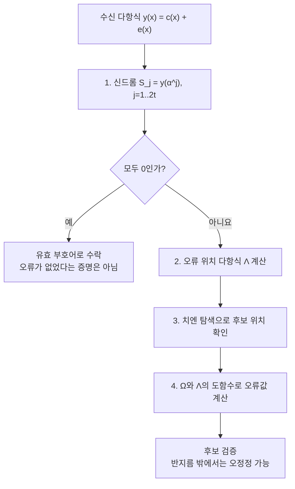
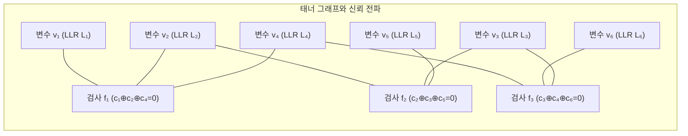
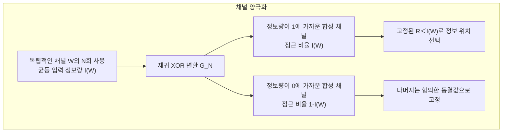

## 1. 우주 통신과 QR 코드가 공유하는 원리

약한 우주 전파와 일부가 손상된 QR 코드에서 어떻게 데이터를 복원할까요? <strong>오류 정정 부호(ECC)</strong>는 데이터에 구조화된 중복성을 더합니다. 수신기는 그 관계를 이용해 바뀐 값을 추정하고 고칩니다. 중복성이 유한하면 정정 능력에도 한계가 있습니다.

### 우주 통신: 신호 수신과 남은 오류의 정정

1977년에 발사된 보이저 1호와 2호는 목성과 토성을 방문했고, 2호는 천왕성과 해왕성까지 탐사했습니다. 두 탐사선이 모두 네 행성을 방문한 것은 아닙니다. 여기서는 행성 근접 통과 시기의 통신을 예로 사용하며, 시간에 따라 변하는 현재 거리와 수신 전력을 고정된 상수처럼 제시하지 않습니다.

탐사선의 고이득 안테나는 전파 에너지를 지구 방향으로 집중시키고, 지구의 심우주 통신망(DSN)이 이를 수신합니다. 감쇠와 열잡음 때문에 복조 뒤에도 오류가 남을 수 있습니다. 단위 환산으로 $10^{-16}\,\mathrm W=100\,\mathrm{aW}$, 즉 100아토와트입니다. 특정 날짜와 수신국에서 측정한 값이라는 뜻은 아닙니다.

보이저 2호의 천왕성 조우를 준비한 JPL 보고서는 내부 길쌈 부호와 외부 리드–솔로몬(RS) $[255,223]$ 부호의 연접을 설명합니다. 단계별 처리가 잡음의 영향을 줄이지만, 모든 수신 블록과 모든 화소에 항상 오류가 없다는 보장은 아닙니다.

### QR 코드: 정정 비율과 임의로 가려도 되는 면적의 차이

QR 코드도 RS를 사용합니다. DENSO WAVE가 설명하는 약 7%, 15%, 25%, 30%의 복원 수준은 <strong>8비트 코드워드</strong>를 기준으로 합니다. 로고로 영상의 임의의 30%를 덮어도 된다는 의미가 아닙니다. 기능 패턴, RS 블록 사이의 손상 분포, 촬영 조건이 중요하며, 모든 기기에서 10밀리초 이내에 복원된다는 보장도 없습니다.

QR 용어의 8비트 코드워드는 여기서 사용하는 RS 수학적 설명의 심볼 하나에 해당합니다. $n$개 심볼로 이루어진 전체 RS 부호어와는 다릅니다. 두 단위를 구분해야 각 블록의 정정 능력을 바르게 이해할 수 있습니다.


이 글은 채널 용량, 해밍 거리, 유한체 다항식, 그래프 위의 확률 계산을 연결합니다. <strong>일정 개수까지의 모든 오류 패턴을 정정한다</strong>는 보장과 <strong>블록이 길어질수록 오류 확률을 임의로 작게 만든다</strong>는 결과를 구분합니다.

---

## 2. 섀넌의 채널 부호화 정리와 가정

### 2.1 반복 부호: 신뢰성을 높일 때 감소하는 부호율

비트를 반복하고 다수결로 판정하면 오류를 줄일 수 있습니다. 다만 이 방식만 사용하면 정보 비트당 채널 사용 횟수가 늘어납니다. 이는 반복 부호의 한계이며, 모든 부호의 한계는 아닙니다.

서로 독립적으로 비트가 반전될 확률이 $0<p<1/2$인 무기억 이진 대칭 채널(BSC)을 생각해 봅시다. 길이 3의 반복 부호는 한 비트를 다음처럼 바꿉니다.

$$
0 \mapsto 000, \qquad 1 \mapsto 111
$$

000을 보냈는데 011, 101, 110 또는 111을 받으면 1로 잘못 판정합니다. 두 개 또는 세 개의 비트가 반전되어야 합니다.

$$
P_e^{(3)} = \binom{3}{2} p^2 (1-p) + \binom{3}{3} p^3 = 3p^2(1-p) + p^3
$$

$p=0.01$이면 $P_e=0.000298$, 약 $0.03\%$입니다. 대신 부호율은 다음과 같습니다.

$$
R = \frac{k}{n} = \frac{1}{3}
$$

홀수 길이 $n=2t+1$에서는 $t+1$개 이상이 반전될 때 다수결이 실패합니다.

$$
P_e^{(n)} = \sum_{i = (n+1)/2}^{n} \binom{n}{i} p^i (1-p)^{n-i}
$$

대수의 법칙으로 오류 확률은 0에 가까워지지만 동시에 다음이 성립합니다.

$$
n \to \infty \implies P_e^{(n)} \to 0 \quad \text{그러나 동시에} \quad R = \frac{1}{n} \to 0
$$

길이 5라면 $0\mapsto00000$, $1\mapsto11111$이고 부호율은 $1/5$입니다. 여러 정보 비트를 하나의 블록으로 묶어 더 효율적으로 부호화할 가능성까지 배제하는 계산은 아닙니다.

### 2.2 채널 용량과 잡음 채널 부호화 정리

섀넌의 1948년 연구는 잡음이 있는 채널에서도 고정된 양의 전송률을 유지하면서 오류 확률을 임의로 작게 만들 수 있음을 보였습니다.

> <strong>유한 알파벳의 이산 무기억 채널에 대한 정리:</strong> 전이 법칙 $W(y\mid x)$가 주어졌을 때 채널 용량은 $C=\max_{P(X)}I(X;Y)\ge0$이며, 단위는 채널 1회 사용당 비트입니다. 고정된 $0<R<C$에 대해 블록 길이가 증가하면서 블록 복호 오류 확률이 0으로 수렴하는 부호열과 복호 규칙이 존재합니다. $R>C$에서는 이러한 수렴을 달성할 수 없습니다.

용량이 반드시 양수인 것은 아닙니다. 출력이 입력과 독립이면 $C=0$입니다. 입력 비용이나 평균 전력에 제약이 있으면 그 제약 안에서 최댓값을 구해야 합니다. 잡음 세기에 관한 통계량 하나만으로 모든 채널의 용량이 정해지지는 않습니다.

이 정리는 점근적 존재 정리입니다. 유한 길이 부호가 가능한 모든 잡음을 고친다는 뜻도, 효율적인 복호기를 자동으로 제공한다는 뜻도 아닙니다. 지연 시간, 계산량, 목표 오류 확률은 별도의 설계 조건입니다.

### 2.3 BSC 용량의 유도

이산 무기억 채널에서는 다음과 같습니다.

$$
C = \max_{P(X)} I(X; Y) = \max_{P(X)} \bigl( H(Y) - H(Y \mid X) \bigr)
$$

BSC의 출력을 $Y=X\oplus E$로 씁니다. 잡음 비트 $E$는 입력 $X$와 독립이고 확률 $p$로 1입니다. 입력을 알고 있을 때 남는 불확실성은 이진 엔트로피입니다.

$$
H(Y \mid X) = H_2(p) \triangleq -p \log_2 p - (1-p) \log_2(1-p)
$$

출력이 이진이므로 $H(Y)\le1$비트입니다. 입력을 균등하게 선택하면 출력도 균등해져 $H(Y)=1$을 달성합니다.

$$
C_{\text{BSC}}(p) = 1 - H_2(p) = 1 + p\log_2 p + (1-p)\log_2(1-p) \quad [\text{비트 / 채널 사용}]
$$

예를 들면 다음과 같습니다.

$$
H_2(0.1) = -0.1 \log_2(0.1) - 0.9 \log_2(0.9) \approx 0.4690\text{ bits}
$$

$$
C_{\text{BSC}}(0.1) = 1 - 0.4690 = 0.5310\text{ 비트 / 채널 사용}
$$

따라서 $R=0.5$처럼 용량보다 낮은 고정 전송률에서는 적절한 긴 부호로 오류 확률을 임의로 작게 만들 수 있습니다. 유한 길이에서 용량과 정확히 같은 전송률로 오류가 전혀 없다는 보장은 아닙니다. 무작위 부호화 논증은 긴 블록의 전형적인 잡음과 서로 다른 부호어를 구별할 수 있다는 사실을 이용합니다.

### 2.4 AWGN과 광대역 극한의 $-1.59\,\mathrm{dB}$

가산성 백색 가우스 잡음(AWGN)은 연속 파형 모델입니다. 문자 그대로 독립적인 비트 반전을 뜻하지 않습니다. 대역폭을 $B$ Hz, 평균 수신 신호 전력을 $S$ W, 잡음 전력의 단측 스펙트럼 밀도를 $N_0$ W/Hz라 하면 대역 내 잡음 전력은 $N=N_0B$입니다. 평균 전력 제약 아래에서 입력을 이진으로 제한하지 않는 섀넌–하틀리 용량은 다음과 같습니다.

$$
C_{\text{AWGN}} = B \log_2\!\left(1 + \frac{S}{N}\right) = B \log_2\!\left(1 + \frac{S}{N_0 B}\right) \quad [\text{비트 / 초}]
$$

정보 비트당 수신 에너지를 $E_b$, 이번에는 정보 전송률을 $R$ 비트/초라 하면 $S=E_bR$입니다. 앞의 채널 사용당 전송률과 단위가 다릅니다. $R<C_{\mathrm{AWGN}}$에서 다음을 얻습니다.

$$
R < B \log_2\!\left(1 + \frac{E_b}{N_0} \frac{R}{B}\right)
$$

주파수 이용 효율 $\eta=R/B$의 단위는 비트/초/Hz입니다.

$$
\eta < \log_2\!\left(1 + \eta \frac{E_b}{N_0}\right) \iff 2^\eta - 1 < \eta \frac{E_b}{N_0} \iff \frac{E_b}{N_0} > \frac{2^\eta - 1}{\eta}
$$

이 이상적 모델에서 $\eta\to0$으로 보내고 $2^\eta=1+\eta\ln2+O(\eta^2)$를 사용하면 다음과 같습니다.

$$
\lim_{\eta \to 0} \frac{2^\eta - 1}{\eta} = \ln 2 \approx 0.693147
$$

데시벨로 표시하면 다음과 같습니다.

$$
\left(\frac{E_b}{N_0}\right)_{\min} = \ln 2 \approx 0.6931 \implies 10 \log_{10}(\ln 2) \approx \mathbf{-1.5917\,\text{dB}}
$$

이는 <strong>광대역 극한에서의 하한값</strong>입니다. 양의 주파수 이용 효율에서는 $(2^\eta-1)/\eta>\ln2$가 필요합니다. $E_b/N_0$는 대역 전체의 신호 대 잡음 전력비 $S/N$와도 다릅니다. 단순히 “잡음보다 작은 신호”라고 하면 두 정의를 혼동하기 쉽습니다.

용량에 가까워질수록 블록 길이와 지연 비용도 고려해야 합니다. 특정 모델의 점근적 결과를 모든 물리적 채널에 적용되는 상수나 유한 길이 무오류 통신의 약속으로 해석해서는 안 됩니다. 입력을 두 값으로 제한하는 것만으로도 해당 용량은 달라집니다.

---

## 3. 해밍 거리, 정정 보장과 $[7,4,3]$ 부호

### 3.1 존재 정리에서 계산 가능한 구성으로

존재 정리를 실제로 이용하려면 부호화와 복호 알고리즘이 필요합니다. 해밍의 1950년 연구는 패리티 검사를 추가하고 위반된 검사로부터 반전된 비트를 찾는 구체적인 예를 제공합니다. 거리와 행렬의 두 관점에서 이를 구성해 봅시다.

### 3.2 해밍 거리와 최소 거리

길이 $n$의 이진 문자열은 $n$차원 초입방체의 꼭짓점인 $\mathbb F_2^n$을 이룹니다. $\mathbb F_2$에서 덧셈과 뺄셈은 XOR입니다. 해밍 거리는 값이 다른 좌표의 수입니다.

$$
d_H(\mathbf{u}, \mathbf{v}) \triangleq \bigl|\{ i \in \{1, \dots, n\} \mid u_i \neq v_i \}\bigr| = w_H(\mathbf{u} - \mathbf{v})
$$

$w_H$는 0이 아닌 성분의 수, 즉 해밍 무게입니다. 거리는 비음수성, 대칭성, 삼각 부등식을 만족합니다. 부호 $\mathcal C$는 허용된 부호어의 집합입니다. 이진 선형 부호의 차원이 $k$이면 부호어는 $2^k$개이고, 최소 거리는 다음과 같습니다.

$$
d_{\min}(\mathcal{C}) \triangleq \min_{\substack{\mathbf{u}, \mathbf{v} \in \mathcal{C} \\ \mathbf{u} \neq \mathbf{v}}} d_H(\mathbf{u}, \mathbf{v})
$$

선형 부호에서는 서로 다른 두 부호어의 차이가 다시 0이 아닌 부호어이므로 다음이 성립합니다.

$$
d_{\min}(\mathcal{C}) = \min_{\mathbf{c} \in \mathcal{C} \setminus \{\mathbf{0}\}} w_H(\mathbf{c})
$$

### 3.3 오류 검출, 소실, 위치를 모르는 오류

1. <strong>검출:</strong> 1개부터 $d_{\min}-1$개까지의 좌표를 바꾸어도 다른 유효 부호어가 될 수 없습니다. 부호에 속하는지 검사하면 이 범위의 모든 0이 아닌 오류 패턴을 검출합니다.
2. <strong>소실:</strong> 잃어버린 위치는 알지만 값은 모릅니다. 소실 수가 $e\le d_{\min}-1$이면 서로 다른 부호어는 남은 좌표 중 적어도 하나에서 다릅니다. 남은 값이 정확하다는 가정 아래 전송 부호어가 유일하게 정해집니다.
3. <strong>위치 미지 오류:</strong> 서로 다른 부호어를 중심으로 하는 반지름 $t$의 해밍 구들이 서로소일 때, 그리고 그때에만 최근접 부호어 복호가 최대 $t$개 오류의 모든 패턴을 정정합니다.

어떤 수신어가 두 구에 속하면 삼각 부등식에 의해 두 중심의 거리는 최대 $2t$입니다. 반대로 두 중심의 거리가 $2t$ 이하이면 다른 좌표들을 두 선택에 나누어 배정하여 양쪽에서 거리 $t$ 이하인 수신어를 만들 수 있습니다. 따라서 다음과 같습니다.

$$
2t + 1 \le d_{\min} \iff t \le \left\lfloor \frac{d_{\min} - 1}{2} \right\rfloor
$$

$t=\lfloor(d_{\min}-1)/2\rfloor$는 <strong>보장되는 최대 반지름</strong>이며, 가능한 모든 작은 반지름이 그 값과 같아야 한다는 뜻은 아닙니다. 위치 미지 오류 최대 $t$개와 위치를 아는 소실 $e$개를 함께 고려하면 모든 패턴에 대한 조건은 다음과 같습니다.

$$
\mathbf{d_{\min} \ge 2t + e + 1}
$$

소실 좌표를 제거하면 최소 거리는 적어도 $d_{\min}-e$입니다. 남은 좌표에 서로소 구 논증을 적용합니다. 이 경계 밖의 일부 입력도 복원될 수 있지만, 모든 배치에 대한 성공 보장은 사라집니다. “위치 미지”라는 말이 오류의 확률 분포까지 무작위라고 가정하는 것은 아닙니다.

알파벳 크기가 $q$인 공간에서 반지름 $t$의 구는 $\sum_{i=0}^t\binom ni(q-1)^i$개의 원소를 가집니다. 서로소 구들은 전체 공간 안에 들어가야 합니다.

$$
|\mathcal{C}| \cdot \sum_{i=0}^{t} \binom{n}{i} (q-1)^i \le q^n \quad \left(\text{이진 부호에서는 } 2^k \sum_{i=0}^{t} \binom{n}{i} \le 2^n \right)
$$

등호를 만족하는 부호는 <strong>완전 부호</strong>입니다. 구들이 빈틈이나 겹침 없이 공간을 덮습니다. 해밍 부호, 이진 골레이 $[23,12,7]$, 삼진 골레이 $[11,6,5]$가 예입니다. 분류 결과에는 각각의 가정이 필요하며 비선형 완전 부호도 존재합니다. 이 예만으로 특정 우주 임무가 어떤 골레이 부호를 사용했는지 결론 내릴 수는 없습니다.

### 3.4 해밍 행렬과 신드롬

$[7,4,3]$ 부호는 정보 4비트에 패리티 3비트를 더합니다.

$$
2^4 \sum_{i=0}^{1} \binom{7}{i} = 16 \times (1 + 7) = 16 \times 8 = 128 = 2^7
$$

반지름 1인 구 16개가 각각 중심 하나와 이웃 7개를 포함해 전체 128개 문자열을 덮습니다.

패리티 검사 행렬의 $j$번째 열에 정수 $j$의 이진 표현을 놓는 구성이 편리합니다.

$$
\mathbf{H}_{\text{binary}} = \begin{pmatrix} 0 & 0 & 0 & 1 & 1 & 1 & 1 \\ 0 & 1 & 1 & 0 & 0 & 1 & 1 \\ 1 & 0 & 1 & 0 & 1 & 0 & 1 \end{pmatrix} \begin{matrix} \leftarrow 2^2\text{ 자리} \\ \leftarrow 2^1\text{ 자리} \\ \leftarrow 2^0\text{ 자리} \end{matrix}
$$

다섯째 열은 $(1,0,1)^T$입니다. 메시지 4비트를 앞에 그대로 두고 뒤에 패리티를 붙이려면 체계적 형태 $\mathbf G=[\mathbf I_4\mid\mathbf P]$, $\mathbf H=[\mathbf P^T\mid\mathbf I_3]$를 사용할 수 있습니다.

$$
\mathbf{G}_{4\times 7} = \left(\begin{array}{cccc|ccc} 1 & 0 & 0 & 0 & 1 & 1 & 0 \\ 0 & 1 & 0 & 0 & 1 & 0 & 1 \\ 0 & 0 & 1 & 0 & 0 & 1 & 1 \\ 0 & 0 & 0 & 1 & 1 & 1 & 1 \end{array}\right), \qquad \mathbf{H}_{3\times 7} = \left(\begin{array}{cccc|ccc} 1 & 1 & 0 & 1 & 1 & 0 & 0 \\ 1 & 0 & 1 & 1 & 0 & 1 & 0 \\ 0 & 1 & 1 & 1 & 0 & 0 & 1 \end{array}\right)
$$

$\mathbf G\mathbf H^T=0$이므로 모든 부호화 결과는 다음을 만족합니다.

$$
\mathbf{H}\mathbf{c}^T = \mathbf{0} \pmod 2
$$

$\mathbf y=\mathbf c+\mathbf e$를 받았을 때 <strong>신드롬</strong>을 계산합니다.

$$
\mathbf{s} = \mathbf{H}\mathbf{y}^T = \mathbf{H}(\mathbf{c} + \mathbf{e})^T = \underbrace{\mathbf{H}\mathbf{c}^T}_{=\mathbf{0}} + \mathbf{H}\mathbf{e}^T = \mathbf{H}\mathbf{e}^T \pmod 2
$$

신드롬은 오류에만 의존합니다. $j$번째 비트 하나가 반전되면 선택한 행렬의 $j$번째 열이 나옵니다. 열이 이진 순서이면 101은 위치 5를 뜻하지만, 체계적 형태에서는 열 순서가 달라 일치하는 열을 찾아야 합니다. 신드롬의 정숫값이 항상 위치 번호인 것은 아닙니다. 6절의 프로그램은 열을 검색합니다.

신드롬 0은 부호에 속한다는 뜻입니다. 오류가 최대 1개라는 가정 아래에서는 오류가 없음을 뜻하지만, 그 밖에서는 다른 유효 부호어로 바뀌었을 수 있습니다. 여러 오류가 있으면 단일 오류 복호기가 원래 정확했던 비트를 뒤집기도 합니다.

예를 들어 메시지 `[1,0,1,1]`의 부호어는 `[1,0,1,1,0,1,0]`입니다. 0부터 세는 인덱스 2, 즉 세 번째 비트를 뒤집으면 신드롬 `[0,1,1]`을 얻으며 열 인덱스 2와 일치합니다. 고정된 7비트 회로의 크기는 상수이지만, 일반적인 길이 $n$의 신드롬 계산이 언제나 $O(1)$인 것은 아닙니다.

전체 짝수 패리티 비트를 추가하면 확장 $[8,4,4]$ 부호가 됩니다. 적절한 판정 규칙으로 단일 비트 정정과 이중 비트 검출(SECDED)을 수행합니다. 이는 ECC 메모리를 이해하는 기본 모델이지 모든 제품의 정확한 구조는 아닙니다.

---

## 4. 리드–솔로몬: 유한체, 보간과 복호

### 4.1 버스트 오류가 중요한 이유

해밍 $(7,4)$는 한 블록 안에서 어느 위치의 단일 비트 오류든 고칩니다. 하지만 디스크 흠집, QR 얼룩, 페이딩은 같은 블록의 여러 비트를 바꿀 수 있습니다. 두 비트가 반전되면 단일 오류 복호기는 잘못된 부호어 쪽으로 정정할 수 있습니다.

1960년 리드와 솔로몬의 구성은 비트들을 유한체의 <strong>심볼</strong>로 묶습니다. 거리와 정정 능력을 측정하는 단위가 바뀝니다. 공간 배치와 인터리빙도 물리적 손상이 심볼에 미치는 영향을 결정합니다.

### 4.2 바이트를 유한체 원소로 표현하기

$m$비트 심볼은 $\mathbb F_{2^m}$의 원소로 표현할 수 있습니다. 정수를 256으로 나눈 나머지로 계산하는 것과는 다릅니다. $2\cdot128\equiv0\pmod{256}$은 영인수를 보이며, 이 0이 아닌 원소들은 곱셈 역원을 갖지 않습니다. 유한체가 존재하는 크기는 정확히 소수의 거듭제곱입니다.

GF(256)에서 바이트는 이진 계수를 가진 차수 7 이하의 다항식을 나타냅니다. 프로그램은 `0x11D`가 나타내는 차수 8의 기약다항식으로 곱을 나눈 나머지를 사용합니다.

$$
\mathbb{F}_{2^8} \cong \frac{\mathbb{F}_2[x]}{\langle x^8 + x^4 + x^3 + x^2 + 1 \rangle}
$$

계수체에서 $1+1=0$이므로 덧셈과 뺄셈은 XOR입니다. 0이 아닌 255개 원소는 순환 곱셈군을 이룹니다. 이 표현에서 $\alpha=x$, 바이트 `0x02`는 원시 원소입니다. $\alpha^0,\ldots,\alpha^{254}$가 0이 아닌 모든 원소를 순회하고 $\alpha^{255}=1$입니다.

로그·지수 표로 0이 아닌 원소의 곱셈과 나눗셈을 계산할 수 있습니다.

$$
A \cdot B = \alpha^{(i + j) \bmod 255}, \qquad \frac{A}{B} = \alpha^{(i - j) \bmod 255}
$$

0은 별도로 처리해야 하며 0으로 나누기는 정의되지 않습니다. 표 길이는 구현에 따라 다릅니다. 지수 표를 늘려 명시적인 나머지 계산을 피하기도 합니다. 6절에서는 비트 이동과 XOR를 사용합니다.

한 바이트 안에서 여러 비트가 손상되어도 심볼 오류는 하나입니다. 바이트 경계를 넘으면 여러 심볼이 손상될 수 있으므로, 바뀐 비트의 총수만으로 정정 가능 여부를 결정할 수 없습니다.

### 4.3 평가, 보간과 싱글턴 한계

서로 다른 가로좌표의 두 점은 차수 1 이하의 다항식을 정합니다. 다섯 점에서 평가한 값을 보내면 세 값이 소실되어도 남은 정확한 두 평가값으로 복원할 수 있습니다. 서로 다른 가로좌표의 세 점은 차수 2 이하의 다항식을 정합니다.

메시지의 $k$개 심볼을 계수로 사용합니다.

$$
P(x) \triangleq m_0 + m_1 x + m_2 x^2 + \dots + m_{k-1} x^{k-1} \in \mathbb{F}_q[x]
$$

$k\le n\le q$ 아래 서로 다른 $n$개 점 $\alpha_i\in\mathbb F_q$를 선택해 다음을 전송합니다.

$$
\mathbf{c} = \bigl( P(\alpha_1),\; P(\alpha_2),\; \dots,\; P(\alpha_n) \bigr) \in \mathbb{F}_q^n
$$

인수 정리에 의해 체 위의 0이 아닌 다항식의 근 개수는 차수를 넘을 수 없습니다. 서로 다른 메시지의 차이 $P-Q$는 차수가 $k$보다 작아 최대 $k-1$개 점에서 0입니다. 따라서 두 부호어는 적어도 $n-k+1$개 좌표에서 다릅니다.

반대 방향의 경계를 위해 모든 부호어에서 $d_{\min}-1$개 좌표를 제거합니다. 남은 투영은 여전히 서로 달라야 합니다. 부호어가 $q^k$개이므로 $q^k\le q^{n-d_{\min}+1}$, 즉 $d_{\min}\le n-k+1$입니다. RS는 등호를 달성합니다.

$$
\mathbf{d_{\min} = n - k + 1}
$$

이것이 <strong>MDS, 최대 거리 분리</strong> 성질입니다. 알파벳, 길이, 차원을 고정했을 때 최소 거리를 최적화하며, 모든 공학적 성능을 동시에 최적화하지는 않습니다.

중복 심볼이 $r=n-k$개이면 보장 조건은 $2t+e\le r$입니다.

- <strong>위치를 아는 소실:</strong> 최대 $n-k$개 심볼이 없어져도 됩니다. 남은 정확한 평가값 중 어느 $k$개로도 라그랑주 보간하여 메시지를 복원합니다.

$$
P(x) = \sum_{j=1}^{k} y_{i_j} \prod_{\substack{m=1 \\ m \neq j}}^{k} \frac{x - x_{i_m}}{x_{i_j} - x_{i_m}}
$$

- <strong>위치를 모르는 오류:</strong> 최대 $\lfloor(n-k)/2\rfloor$개 손상 심볼을 고칩니다. 각 심볼 안에서 몇 비트가 바뀌었는지는 이 심볼 수 보장에 영향을 주지 않습니다.

### 4.4 순환 형태와 포니 공식의 관례

평가 형태는 메시지를 계수로 보고 평가값을 전송합니다. 순환 설명에서는 부호어 좌표가 생성 다항식으로 나누어지는 다른 다항식의 계수입니다. 0이 아닌 모든 점을 사용하는 전체 길이 $n=q-1$ 부호는 대응을 고정하면 동등한 순환 표현을 가집니다. 단축 부호가 줄어든 길이에서도 순환적일 필요는 없습니다.

중복 수를 $n-k=2t$, 생성 다항식의 첫 근을 $\alpha^1$로 고정합시다. 이 유도의 관례이며 모든 QR·우주 통신 형식의 관례라는 뜻은 아닙니다.

$$
g(x)=\prod_{j=1}^{2t}(x-\alpha^j)
$$

나머지 $r(x)=x^{2t}m(x)\bmod g(x)$를 구해 메시지를 이동시킨 뒤 뺍니다.

$$
c(x)=x^{2t}m(x)-r(x),\qquad c(\alpha^j)=0\quad(1\le j\le2t)
$$

표수가 2이므로 뺄셈도 XOR입니다.



1. <strong>신드롬:</strong> 위치 $i_l$에 0이 아닌 값 $Y_l=e_{i_l}$의 오류가 $\nu\le t$개 있다고 합시다. $X_l=\alpha^{i_l}$로 정의합니다. 근에서 평가하면 전송 부호어가 사라집니다.

$$
S_j=y(\alpha^j)=e(\alpha^j)=\sum_{l=1}^{\nu}Y_lX_l^j,\qquad j=1,\ldots,2t
$$

신드롬 0은 부호 소속만 확인하며 유효 부호어 사이의 변화를 검출하지 못합니다.

2. <strong>오류 위치 다항식:</strong>

$$
\Lambda(z)=\prod_{l=1}^{\nu}(1-X_lz)=1+\Lambda_1z+\cdots+\Lambda_\nu z^\nu
$$

$\Lambda(X_l^{-1})=0$에 $Y_lX_l^{j+\nu}$를 곱해 합하면 다음 선형 점화식을 얻습니다.

$$
S_{j+\nu}+\Lambda_1S_{j+\nu-1}+\cdots+\Lambda_\nu S_j=0,\qquad1\le j\le2t-\nu
$$

벌레캠프–매시(Berlekamp–Massey)는 보통 체 연산 $O(t^2)$로 최소 점화식과 후보를 구합니다. 확장 유클리드 방법으로도 핵심 방정식을 풀 수 있습니다.

3. <strong>치엔 탐색:</strong> 좌표에 대응하는 0이 아닌 원소 $\alpha^{-i}$를 검사해 $\Lambda(\alpha^{-i})=0$인 곳을 찾습니다. GF(256)의 원소는 총 256개, 0이 아닌 것은 255개입니다. 위치 다항식 차수와 허용된 근의 수가 일치하는지 등의 조건을 확인해야 합니다.

4. <strong>오류값:</strong> 신드롬 다항식과 오류 평가 다항식을 명시적으로 정의합니다.

$$
S(z)=S_1+S_2z+\cdots+S_{2t}z^{2t-1},\qquad \Omega(z)=S(z)\Lambda(z)\bmod z^{2t}
$$

이 정의에서 포니(Forney) 공식은 다음과 같습니다.

$$
Y_l=-\frac{\Omega(X_l^{-1})}{\Lambda'(X_l^{-1})}
$$

오류 하나이면 $\Omega=YX$, $\Lambda'=-X$이므로 결과는 $Y$입니다. $X$를 다시 곱하면 $XY$가 됩니다. 첫 근이나 신드롬 다항식의 다른 관례에서는 계수가 달라질 수 있으므로 정의 없이 공식을 옮겨 쓰면 안 됩니다.

추정 오류를 빼고 부호 소속과 정정 거리를 검사합니다. 그래도 다른 유효 부호어 근처의 수신어는 잘못된 메시지로 검사를 통과할 수 있습니다. CRC, 재전송, 상위 계층 검사가 보호를 더할 수 있지만 보장 반지름 밖의 모든 손상을 반드시 검출하는 것은 아닙니다.

### 4.5 QR, 저장장치와 보이저의 연접

- <strong>QR:</strong> L/M/Q/H는 8비트 코드워드의 약 7/15/25/30% 복원 수준입니다. 각 RS 블록이 조건을 만족해야 합니다. 버전과 수준에 따라 데이터, 중복성, 블록 구성이 달라지며 임의의 면적으로 환산할 수 없습니다. 기능 패턴을 가리면 RS 복호 전에 인식이나 코드워드 추출이 실패할 수 있습니다.
- <strong>RAID-6와 분산 저장:</strong> 위치를 아는 디스크·조각의 누락은 소실입니다. 예시 MDS $[14,10]$은 데이터 용량의 $14/10=1.4$배를 사용하고, 나머지와 필요한 메타데이터가 정확하면 네 조각의 손실을 견딥니다. 모든 클라우드의 고정 구성이라는 뜻은 아닙니다. RAID-6의 이중 패리티는 가정 아래 두 디스크를 복구하며, 추가 잠재 손상이나 설비 전체의 소실까지 모두 고치지는 않습니다.
- <strong>보이저 2호:</strong> 1983년 JPL 보고서는 구속장 $K=7$, 부호율 $1/2$인 길쌈 부호, 깊이 4 인터리빙, 외부 RS $[255,223]$을 설명합니다. 중복 32바이트는 RS 부호어마다 $2t+e\le32$, 소실이 없으면 16바이트 오류를 보장합니다. 정렬되지 않은 연속 128비트 버스트는 17바이트에 걸칠 수 있습니다. 인터리빙은 내부 복호 후 남은 버스트를 여러 RS 부호어로 분산합니다. 이 예의 내부 부호는 길쌈 부호입니다.

---

## 5. LDPC·터보·폴라 부호: 신뢰성과 용량

### 5.1 최소 거리만으로 해결되지 않는 문제

실용 부호는 목표 오류율, 지연, 블록 길이, 계산과 하드웨어 비용을 만족해야 합니다. 차원 $k$인 이진 부호의 모든 부호어를 무차별 비교하면 후보가 $2^k$개입니다. 좋은 최소 거리만으로 효율적인 복호가 따라오지는 않습니다.

터보·LDPC의 반복 복호는 신뢰도 정보를 활용하고, 폴라 부호는 다른 구성으로 대칭 용량에 접근합니다. 채널, 입력 제약, 전송률을 맞추어 비교해야 합니다. 모두를 광대역 극한 $-1.59\,\mathrm{dB}$와 직접 비교하는 것은 적절하지 않습니다.

### 5.2 희소 패리티와 신뢰 전파

갤러거의 1962년 LDPC 부호는 희소 패리티 검사 행렬을 사용합니다. 긴 블록에서도 각 행·열에 0이 아닌 성분이 적을 수 있습니다. $m\times n$ 행렬 $\mathbf H$에 대해 차원은 $k=n-\operatorname{rank}_{\mathbb F_2}(\mathbf H)$입니다. 행들이 독립일 때에만 $n-m$과 같습니다.

태너 그래프의 변수 노드는 열·비트에, 검사 노드는 행·패리티 방정식에 대응합니다. $H_{a,i}=1$일 때에만 간선이 있습니다.



연판정은 관측을 즉시 0이나 1로 줄이지 않고 신뢰도를 보존합니다. 로그 우도비(LLR)는 다음처럼 표현할 수 있습니다.

$$
L(c_i) \triangleq \ln \frac{\Pr(c_i = 0 \mid y_i)}{\Pr(c_i = 1 \mid y_i)}
$$

입력이 등확률이고, 단위 진폭 BPSK $0\mapsto+1$, $1\mapsto-1$, 독립 잡음 $Z\sim\mathcal N(0,\sigma^2)$, 관측 $y_i=x_i+Z$이면 다음과 같습니다.

$$
L_{\mathrm{ch}}(c_i)=\ln\frac{p(y_i\mid c_i=0)}{p(y_i\mid c_i=1)}=\frac{2y_i}{\sigma^2}
$$

진폭이나 사전 확률이 달라지면 식도 달라집니다. LLR $+10$은 0을 강하게 지지하고, $-0.1$은 1을 약하게 지지합니다.

합–곱 알고리즘은 신뢰 전파의 한 형태입니다. 메시지를 받을 이웃의 기여를 제외한 외부 정보를 교환합니다.

$$
\mu_{f_a \to v_i} = 2 \operatorname{artanh}\!\left( \prod_{v_j \in N(f_a) \setminus \{v_i\}} \tanh\!\left(\frac{\mu_{v_j \to f_a}}{2}\right) \right)
$$

$$
\mu_{v_i \to f_a} = L_{\text{ch}}(v_i) + \sum_{f_b \in N(v_i) \setminus \{f_a\}} \mu_{f_b \to v_i}
$$

$N$은 해당 이웃 집합입니다. 반복 스케줄은 어느 반복의 메시지를 사용할지 정하며, 수신 이웃을 제외한다는 규칙은 유지합니다.

희소 행렬은 간선 수를 줄이지만 짧은 순환을 저절로 없애지는 않습니다. 트리에서는 정확한 주변 확률을 계산하지만, 순환이 있는 유한 그래프에서는 의존성, 트래핑 집합, 비수렴 때문에 오류가 남을 수 있습니다.

간선이 $E$개일 때 이웃 사이의 계산을 공유하는 구현은 반복당 대략 $O(E)$, $I$회 반복에 $O(IE)$ 연산을 사용합니다. 차수가 제한되면 $E=O(n)$이 가능하지만 반복 횟수가 상수라는 보장은 아닙니다. 수치 구현은 LLR 포화와 $\operatorname{artanh}$의 정의역을 처리해야 합니다.

Chung 등의 2001년 결과는 <strong>부호율 $1/2$의 이진 입력 AWGN 채널</strong>에 관한 것입니다. 밀도 진화로 계산한 점근적 임계값이 그 채널의 용량 한계에서 $0.0045\,\mathrm{dB}$ 떨어져 있습니다. 별도의 단순한 설계로 수행한 길이 $10^7$, BER $10^{-6}$의 유한 시뮬레이션 간격은 $0.04\,\mathrm{dB}$입니다. 모든 기기의 보편적 성능이나 광대역 에너지 하한을 뜻하지 않습니다.

### 5.3 폴라 부호와 대칭 용량

아리칸의 2009년 구성은 이진 입력 이산 무기억 채널의 <strong>대칭 용량</strong> $I(W)$, 즉 균등 입력의 상호정보량에 접근합니다. 대칭 채널에서는 $C$와 같지만 비대칭 채널에서는 입력 분포 전체에 대한 최댓값과 다를 수 있습니다.

기본 변환은 다음과 같습니다.

$$
(x_1,x_2)=(u_1,u_2)\begin{pmatrix}1&0\\1&1\end{pmatrix} =(u_1\oplus u_2,u_2)
$$

합성 채널 $W^-$는 $(y_1,y_2)$로 $u_1$을 추정합니다. $W^+$는 정확한 $u_1$이 주어졌을 때 $(y_1,y_2,u_1)$로 $u_2$를 추정합니다. 독립 균등 입력에 연쇄 법칙을 적용하면 다음과 같습니다.

$$
I(W^-)+I(W^+)=2I(W),\qquad I(W^-)\le I(W)\le I(W^+)
$$

여기서 “좋다”와 “나쁘다”는 정보량을 뜻하며, 모든 경우에 엄격하게 달라져야 한다는 뜻은 아닙니다. 실제 순차 복호에서는 앞의 오류가 뒤의 판정으로 전파될 수 있습니다.

$N=2^m$일 때 인덱스의 이진 자릿수 순서를 뒤집는 순열 $\mathbf B_N$을 사용하는 한 관례의 생성 행렬은 다음과 같습니다.

$$
\mathbf G_N=\mathbf B_N \begin{pmatrix}1&0\\1&1\end{pmatrix}^{\otimes m}
$$

고정된 $0<\delta<1$에 대해 $N\to\infty$이면 정보량이 $1-\delta$보다 큰 합성 채널의 비율은 $I(W)$로, $\delta$보다 작은 비율은 $1-I(W)$로 수렴합니다. 유한 길이에서 정확히 $NI(W)$개 채널이 완전 무잡음이 되는 것은 아닙니다.



고정 전송률 $R<I(W)$로 정보 위치를 선택하고 나머지는 합의한 값으로 동결합니다. 일반 채널의 원래 보장은 동결값에 대한 평균과 적절한 선택의 존재를 이용합니다. 대칭 채널에서는 해당 경계가 어떤 고정 선택에도 적용됩니다.

<strong>순차 제거 복호(SC)</strong>와 부호화의 시간은 $O(N\log N)$입니다. 정보 위치 집합을 구성하는 비용은 별도입니다. 크기 $L$의 <strong>순차 제거 리스트 복호(SCL)</strong>를 효율적으로 구현하면 $O(LN\log N)$이 필요하며 CRC가 후보 선택에 도움을 줄 수 있습니다. 유한 길이 오류와 지연은 구성, 부호율, 리스트 크기, 채널에 달려 있습니다. 오류 마루(error floor)가 항상 없다는 일반 보장은 아닙니다.

### 5.4 부호 계열 비교

| 부호 | 수학 구조 | 대표 복호 | 특징과 활용 |
| :--- | :--- | :--- | :--- |
| 해밍 (1950) | 이진 선형 부호; $[7,4,3]$은 완전 부호 | 신드롬과 열 검색 | 단일 비트 정정; SECDED의 기본 모델 |
| 리드–솔로몬 (1960) | 유한체 다항식과 MDS 성질 | BM/유클리드·치엔·포니; 평가형 Welch–Berlekamp | 심볼 오류·소실; QR·저장·연접 원격 측정 |
| 길쌈·터보 | 트렐리스·연접·인터리빙 | 비터비; 반복 BCJR | 잡음 통신; 보이저의 내부 부호는 길쌈 부호 |
| LDPC (1962) | 희소 행렬과 태너 그래프 | 연판정 신뢰 전파 | 긴 블록·병렬화; 특정 모델에서 용량 접근 |
| 폴라 (2009) | 재귀 양극화와 동결 비트 | SC $O(N\log N)$; SCL은 $L$에 의존 | 대칭 용량의 점근적 접근; 일부 5G NR 제어 정보 |

같은 표에 있다는 이유로 복잡도나 오류율이 같지는 않습니다. 5G의 모든 제어 정보를 폴라로 부호화하는 것도 아닙니다. 예를 들어 3GPP TS 38.212 v19.3.0의 6.3.1.2–6.3.1.3절은 PUCCH의 UCI에서 $A\ge12$비트는 폴라, $A\le11$비트는 짧은 블록 부호화를 사용하도록 구분합니다.

---

## 6. Python 검증: 해밍과 GF(256) 평가형 RS

이 독립적인 Python 3 프로그램은 체계적 해밍 $(7,4)$와 4.3절의 <strong>평가형 RS</strong>를 구현합니다. 메시지 심볼은 다항식 계수이며 보통 부호어 맨 앞에 그대로 나타나지 않습니다. 4.4절의 BM 복호기, QR의 모듈 배치·블록 구성·체계적 순환 형식을 구현하지 않으므로 QR이나 탐사선과 직접 상호 운용되는 프로그램은 아닙니다.

체는 기약다항식 `0x11D`를 사용하는 GF(256)입니다. 정수를 257로 나눈 나머지로 이루어진 소수체 GF(257)과 다릅니다. 그 체에서도 평가 부호를 구성할 수 있지만, 한 바이트에 들어가지 않는 심볼 256이 나올 수 있습니다.

복호기는 Welch–Berlekamp형 시스템을 사용합니다. 후보 차수 $\nu=0,\ldots,t$에 대해 차수 $\nu$의 최고차항 계수가 1인 $E(x)$와 차수 $k+\nu$ 미만의 $Q(x)$를 찾습니다.

$$
Q(x_i)=y_iE(x_i)\qquad(i=1,\ldots,n)
$$

미지 계수는 $k+2\nu$개입니다. 표수 2에서는 항을 이항해도 XOR입니다.

실제 메시지가 $P$이고 오류가 최대 $\nu$개이면 오류 점에서 0이 되는 $E$를 선택하고, 필요하면 차수를 채워 $Q=PE$로 놓을 수 있습니다. 반대로 $n\ge k+2\nu$일 때 모든 해의 $Q-PE$는 적어도 $n-\nu$개의 정확한 점에서 0이지만 차수는 $k+\nu$ 미만이므로 영다항식이어야 합니다. 이 근 개수 논증이 복원을 정당화합니다.

차수를 0부터 $t$까지 시도하고 직사각 행렬과 랭크 부족 시스템을 처리합니다. $Q$를 $E$로 나누어 나머지 0과 몫 차수 $k$ 미만을 요구하고, 재부호화하여 수신어와의 거리가 $t$ 이하인지 검사합니다. 오류 0개, $t$개 미만, 경계의 오류를 모두 처리합니다. 평가점은 서로 달라야 하며 0을 포함해 체 원소 1개부터 256개까지 허용합니다.

교육용 명료성이 목적입니다. 생산용 RS 복호기나 속도 측정이 아니며, 일반 가우스 소거를 최대 $t+1$번 수행할 수 있습니다. `rs_encode`와 `rs_decode`는 값·길이·평가점·반지름을 검증합니다. 내부 다항식·선형 시스템 보조 함수는 체 원소가 이미 검증되었다고 가정합니다.

```python
"""Educational evaluation RS over GF(256), not a QR parser or wire format."""
from itertools import product


def field_value(a):
    if type(a) is not int or not 0 <= a < 256:
        raise ValueError("Field elements must be integers from 0 through 255")
    return a


def gf_mul(a, b):
    field_value(a)
    field_value(b)
    result = 0
    for _ in range(8):
        if b & 1:
            result ^= a
        b >>= 1
        a <<= 1
        if a & 256:
            a ^= 0x11D
    return result


def gf_pow(a, exponent):
    field_value(a)
    if type(exponent) is not int or exponent < 0:
        raise ValueError("Exponent must be a nonnegative integer")
    result = 1
    while exponent:
        if exponent & 1:
            result = gf_mul(result, a)
        a = gf_mul(a, a)
        exponent >>= 1
    return result


def gf_inv(a):
    field_value(a)
    if a == 0:
        raise ZeroDivisionError("Zero has no multiplicative inverse")
    return gf_pow(a, 254)


def poly_trim(coefficients):
    result = list(coefficients)
    while result and result[-1] == 0:
        result.pop()
    return result


def poly_eval(coefficients, x):
    result = 0
    for coefficient in reversed(coefficients):
        result = gf_mul(result, x) ^ coefficient
    return result


def poly_divmod(numerator, denominator):
    remainder = poly_trim(numerator)
    denominator = poly_trim(denominator)
    if not denominator:
        raise ZeroDivisionError("Zero polynomial divisor")
    quotient = [0] * max(0, len(remainder) - len(denominator) + 1)
    inverse_lead = gf_inv(denominator[-1])
    while remainder and len(remainder) >= len(denominator):
        degree = len(remainder) - len(denominator)
        factor = gf_mul(remainder[-1], inverse_lead)
        quotient[degree] = factor
        for j, coefficient in enumerate(denominator):
            remainder[degree + j] ^= gf_mul(factor, coefficient)
        remainder = poly_trim(remainder)
    return poly_trim(quotient), remainder


def solve_linear_system(rows, rhs, columns):
    """Return one solution (free variables zero), or None if inconsistent."""
    if len(rows) != len(rhs) or any(len(row) != columns for row in rows):
        raise ValueError("Linear-system dimensions do not match")
    matrix = [list(row) + [value] for row, value in zip(rows, rhs)]
    pivot_columns = []
    pivot_row = 0
    for column in range(columns):
        pivot = next(
            (r for r in range(pivot_row, len(matrix)) if matrix[r][column]),
            None,
        )
        if pivot is None:
            continue
        matrix[pivot_row], matrix[pivot] = matrix[pivot], matrix[pivot_row]
        inverse = gf_inv(matrix[pivot_row][column])
        matrix[pivot_row] = [gf_mul(value, inverse) for value in matrix[pivot_row]]
        for r in range(len(matrix)):
            if r != pivot_row and matrix[r][column]:
                factor = matrix[r][column]
                matrix[r] = [
                    a ^ gf_mul(factor, b)
                    for a, b in zip(matrix[r], matrix[pivot_row])
                ]
        pivot_columns.append(column)
        pivot_row += 1
        if pivot_row == len(matrix):
            break
    if any(not any(row[:columns]) and row[columns] for row in matrix):
        return None
    solution = [0] * columns
    for r, column in enumerate(pivot_columns):
        solution[column] = matrix[r][columns]
    return solution


def check_points(points):
    points = list(points)
    if not points or len(points) > 256:
        raise ValueError("Use from 1 through 256 distinct evaluation points")
    for x in points:
        field_value(x)
    if len(set(points)) != len(points):
        raise ValueError("Evaluation points must be distinct")
    return points


def rs_encode(message, points):
    points = check_points(points)
    message = list(message)
    if not 1 <= len(message) <= len(points):
        raise ValueError("Require 1 <= message length <= code length")
    for value in message:
        field_value(value)
    return [poly_eval(message, x) for x in points]


def rs_decode(received, points, k, max_errors):
    points = check_points(points)
    received = list(received)
    n = len(points)
    if len(received) != n:
        raise ValueError("Received length must match evaluation points")
    if type(k) is not int or not 1 <= k <= n:
        raise ValueError("Require integer 1 <= k <= n")
    if type(max_errors) is not int or max_errors < 0 or k + 2 * max_errors > n:
        raise ValueError("Require integer t >= 0 and k + 2t <= n")
    for value in received:
        field_value(value)
    # Try locator degrees 0,...,t: fewer than t errors must also work.
    for errors in range(max_errors + 1):
        columns = k + 2 * errors
        rows, rhs = [], []
        for x, y in zip(points, received):
            powers = [gf_pow(x, degree) for degree in range(k + errors)]
            rows.append(
                powers + [gf_mul(y, gf_pow(x, degree)) for degree in range(errors)]
            )
            rhs.append(gf_mul(y, gf_pow(x, errors)))
        solution = solve_linear_system(rows, rhs, columns)
        if solution is None:
            continue
        q = solution[:k + errors]
        locator = solution[k + errors:] + [1]
        message, remainder = poly_divmod(q, locator)
        if remainder or len(message) > k:
            continue
        message += [0] * (k - len(message))
        codeword = rs_encode(message, points)
        distance = sum(a != b for a, b in zip(codeword, received))
        if distance <= max_errors:
            return message
    raise ValueError("No codeword within the requested correction radius")


G = (
    (1, 0, 0, 0, 1, 1, 0),
    (0, 1, 0, 0, 1, 0, 1),
    (0, 0, 1, 0, 0, 1, 1),
    (0, 0, 0, 1, 1, 1, 1),
)
H = (
    (1, 1, 0, 1, 1, 0, 0),
    (1, 0, 1, 1, 0, 1, 0),
    (0, 1, 1, 1, 0, 0, 1),
)


def bits(values, length):
    values = list(values)
    if len(values) != length or any(type(v) is not int or v not in (0, 1) for v in values):
        raise ValueError("Invalid bit vector")
    return values


def hamming_encode(message):
    message = bits(message, 4)
    return [sum(message[i] * G[i][j] for i in range(4)) % 2 for j in range(7)]


def hamming_decode(received):
    received = bits(received, 7)
    syndrome = [sum(H[r][j] * received[j] for j in range(7)) % 2 for r in range(3)]
    if any(syndrome):
        position = next(j for j in range(7) if [H[r][j] for r in range(3)] == syndrome)
        received[position] ^= 1
    return received[:4]


if __name__ == "__main__":
    hamming_cases = 0
    for message in product((0, 1), repeat=4):
        codeword = hamming_encode(message)
        for position in range(-1, 7):
            received = codeword.copy()
            if position >= 0:
                received[position] ^= 1
            assert hamming_decode(received) == list(message)
            hamming_cases += 1
    print("Hamming no-error/single-error cases:", hamming_cases)

    payload = b"VOYAGER-1"
    points = list(range(1, 16))
    codeword = rs_encode(payload, points)
    print("GF(256) evaluation codeword:", codeword)
    for count in range(4):
        received = codeword.copy()
        for position in range(count):
            received[position] ^= position + 1
        recovered = bytes(rs_decode(received, points, len(payload), 3))
        print("RS corrupted symbols:", count, "recovered:", recovered.decode("ascii"))
        assert recovered == payload
    # A decoder can miscorrect beyond the transmitted word's guaranteed radius.
    # Construct a received word close to a DIFFERENT valid word.
    alternative = list(payload)
    alternative[0] ^= 1
    alternative_codeword = rs_encode(alternative, points)
    received = alternative_codeword.copy()
    received[0] ^= 1
    assert rs_decode(received, points, len(payload), 3) == alternative
    print("Beyond-radius example returns another nearby codeword:", True)
```

실제 실행 출력:

```text
Hamming no-error/single-error cases: 128
GF(256) evaluation codeword: [77, 162, 167, 64, 87, 173, 26, 217, 215, 33, 189, 173, 212, 41, 124]
RS corrupted symbols: 0 recovered: VOYAGER-1
RS corrupted symbols: 1 recovered: VOYAGER-1
RS corrupted symbols: 2 recovered: VOYAGER-1
RS corrupted symbols: 3 recovered: VOYAGER-1
Beyond-radius example returns another nearby codeword: True
```

9바이트를 15심볼로 바꾸며 최소 거리는 7, 보장 반지름은 3입니다. 15개 중 3개는 20%입니다. 예제는 앞의 0~3개 위치를 바꾸지만, 개수에 따른 보장은 떨어진 위치에도 적용됩니다.

다른 유효한 선택으로 $\alpha^0,\ldots,\alpha^{14}$에서 평가하고, 0부터 세는 인덱스 `[1,6,13]`을 바꿀 수 있습니다. 복호기는 이 경우도 처리합니다. 바이트 `1..15`를 평가점으로 사용하면 부호어가 달라집니다. 떨어진 세 바이트 오류가 연속 24비트 버스트를 뜻하지는 않습니다.

마지막 예는 <strong>다른 유효 부호어</strong> 근처의 수신어를 구성합니다. 복호기는 그 다른 부호어를 반환하고 거리 검사를 통과하지만, 보낸 메시지는 복원하지 못합니다. 보장 반지름 밖의 손상을 언제나 검출할 수는 없습니다. 해밍 복호기도 최대 단일 오류라는 가정을 위반하면 잘못된 메시지로 정정할 수 있습니다.

교육용 프로그램의 독립된 유한 검사는 GF(256)의 65,536개 곱과 별도로 생성한 길이 4·차원 2의 전체 65,536개 부호어 목록을 다룹니다. 심볼을 0~3으로 제한한 256개 수신 벡터에서 반지름 1 복호 결과가 전체 목록에 대한 전수 검색과 일치합니다. 영 메시지를 포함한 세 메시지의 모든 단일 오류 위치·0이 아닌 크기, 여러 길이와 오류 수의 고정 시드 사례, 랭크 부족 시스템, 잘못된 입력도 검사했습니다. 모든 가능한 입력의 실행, QR 상호 운용, 실제 하드웨어 시험을 뜻하지 않습니다.

---

## 7. RS·LDPC·폴라를 선택하는 기준

MDS는 <strong>고정된 길이와 차원에서 심볼당 최소 거리</strong>를 최적화합니다. 확률적 복호, 연정보, 지연과 회로까지 동시에 최적화하지는 않습니다.

1. <strong>체 크기와 길이:</strong> 4.3절 평가 부호는 $n\le q$입니다. 0을 포함한 GF(256)은 256심볼을 허용하고, 0이 아닌 점을 쓰는 통상적인 전체 길이 순환 형태는 255입니다. 확장과 연접도 있으므로 “모든 RS는 절대적으로 255바이트까지”라는 표현은 지나치게 넓습니다. 희소 그래프의 긴 이진 부호는 다른 설계 이점을 제공합니다.
2. <strong>연정보:</strong> 먼저 0이나 1로 판정하면 LDPC·폴라가 활용할 수 있는 신뢰도를 버립니다. 이득은 항상 2 dB가 아니며 채널·변조·부호율·목표 오류에 달려 있습니다. RS에도 연정보를 활용하는 방법이 있으므로 경판정 전용 계열은 아닙니다.
3. <strong>저장 셀:</strong> TLC는 8개 상태를 구별해 셀당 3비트, QLC는 16개 상태로 4비트를 저장합니다. 전압 분포의 겹침, 보존과 쓰기 특성이 오류를 일으킬 수 있습니다. 추가 읽기는 신뢰도 정보를 제공할 수 있지만 모든 SSD의 복호기나 원시·복구 불가 오류율이 같지는 않습니다. 읽기 시간과 에너지 비용도 따릅니다.

RS는 남은 정확한 심볼 중 어느 $k$개로도 복원하므로 위치를 아는 소실에 유용합니다. 긴 연판정 부호는 잡음이 있는 물리적 링크에서 가치가 있습니다. 한 시스템이 여러 계층에서 계열들을 결합할 수도 있습니다. QR·SSD·5G의 오류와 제약을 비교하면, 새 부호가 옛 부호를 보편적으로 대체한다는 설명보다 공존 이유를 잘 이해할 수 있습니다.

---

## 8. 결론: 조건을 명시한 중복성

오류 정정은 구조를 더하고 손상에 대한 가정을 활용합니다.

1. 섀넌은 채널과 입력 제약을 명시한 뒤 용량보다 낮은 고정 전송률에서 부호를 길게 하여 오류 확률을 임의로 줄일 수 있음을 보입니다. 유한 길이의 절대 무오류 보장은 아닙니다.
2. 최소 거리는 위치 미지 오류 $t$개와 소실 $e$개에 대해 $2t+e<d_{\min}$인 모든 패턴을 보장합니다. 해밍 신드롬은 이를 구체적인 계산으로 보여 줍니다.
3. RS는 유한체의 근과 보간으로 $d_{\min}=n-k+1$을 달성합니다. 관례를 고정하고 반지름 밖의 오정정을 고려해야 합니다.
4. LDPC는 희소 확률 그래프, 폴라는 양극화를 이용합니다. 점근 임계값, 유한 길이 성능, SC/SCL 비용은 서로 다른 측면입니다.

QR과 우주 통신의 신뢰성은 중복량, 단위, 오류 분포, 검사와 잔여 실패 확률에 달려 있습니다. 조건 없이 어떤 손상 데이터라도 복원한다는 의미는 아닙니다.

참고 자료:

- [DENSO WAVE: QR 오류 정정](https://www.qrcode.com/en/about/error_correction.html) — 복원 수준과 코드워드 단위.
- [JPL: 보이저 2호](https://www.jpl.nasa.gov/missions/voyager-2/) — 행성 탐사 경로.
- [Lorden·McEliece·Swanson: Node Synchronization for the Viterbi Decoder (1983)](https://tda.jpl.nasa.gov/progress_report/42-73/73C.PDF) — p. 22, 연접과 실제 동기화.
- [Forney: MIT 6.451 대수적 부호 이론 입문, 8장](https://ocw.mit.edu/courses/6-451-principles-of-digital-communication-ii-spring-2005/01060b08ba74792ee8d85eb82b9efdb4_chap8.pdf) — pp. 101–110, 거리·평가형 RS·Welch–Berlekamp형 복원.
- [Chung 외: On the Design of LDPC Codes within 0.0045 dB of the Shannon Limit (2001)](https://www.cse.lehigh.edu/~jingli/teach/S2003turbo/notes/zeroZeroFourFive.pdf) — p. 58, 임계값과 유한 시뮬레이션 구별.
- [Arıkan: Channel Polarization (2009)](https://arxiv.org/abs/0807.3917) — 대칭 용량·부호화·SC와 초기 정의·정리.
- [Tal·Vardy: List Decoding of Polar Codes](https://arxiv.org/abs/1206.0050) — 효율적인 SCL의 시간·공간.
- [Östergård·Pottonen: 길이 15 이진 완전 부호의 분류](https://arxiv.org/abs/0806.2513) — 하나의 선형 구성만 있는 것은 아님.
- [Elkies: The Theory of Error-Correcting Codes (2013)](https://people.math.harvard.edu/~elkies/M256.13/index.html) — 완전 부호·골레이 강의.
- [ETSI TS 138 212 v19.3.0 (2026-04)](https://www.etsi.org/deliver/etsi_ts/138200_138299/138212/19.03.00_60/ts_138212v190300p.pdf) — 6.3.1.2–6.3.1.3절의 UCI 부호화 구분.
