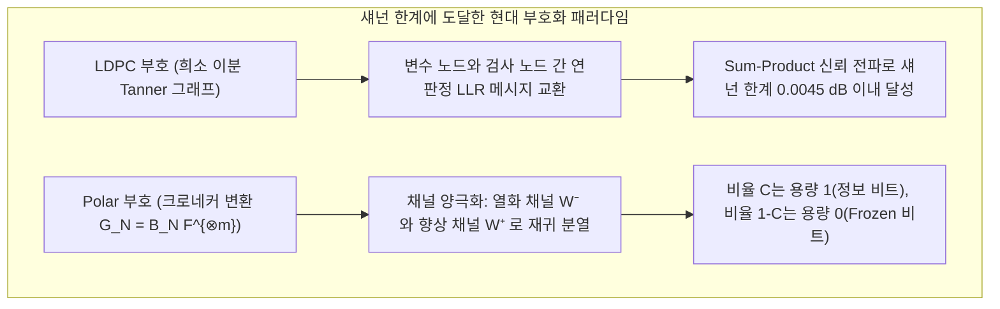

## 1. 도입: 직관을 뛰어넘는 두 가지 '정보 복원'의 기적

현대 디지털 문명의 기저에는 물리적 직관을 거스르는 듯한 두 가지 경이로운 공학적 기적이 존재합니다.

### 기적 ①: 240억 킬로미터 너머에서 도착하는 보이저 1·2호의 선명한 행성 사진

1977년 발사된 심우주 탐사선 <strong>보이저 1호와 2호(Voyager 1 & 2)</strong>는 목성, 토성, 천왕성, 해왕성을 차례로 근접 통과한 뒤 현재 지구에서 <strong>240억 킬로미터 이상</strong> 떨어진 성간 우주를 항해하고 있습니다.
놀라운 물리적 사실은 보이저호에 탑재된 무선 송신기의 출력이 불과 <strong>$23\text{ W}$(와트)</strong>——가정용 냉장고 안의 작은 꼬마전구 수준에 불과하다는 점입니다. 이 미약한 전파가 수십억 킬로미터의 우주 공간을 퍼져 나가 지구에 있는 NASA 심우주 통신망(DSN)의 직경 70m 거대 안테나에 도달할 때쯤이면, 수신 전력은 무려 <strong>$10^{-16}\text{ W}$($0.1\text{ 아토와트}$) 이하</strong>로 감쇠합니다.

이 에너지는 수신기 내부 전자의 열운동이 만들어내는 <strong>열잡음(Thermal Noise)</strong>의 폭풍 속에 완전히 파묻히는 수준입니다. 만약 아무런 부호화 없이 원시 픽셀 비트($0$과 $1$)를 그대로 보낸다면 수천 비트가 무작위로 반전($0 \leftrightarrow 1$)되어 지구의 화면에는 의미 없는 노이즈만 가득할 것입니다. 그럼에도 보이저호는 목성의 대적점과 해왕성의 푸른 대기를 <strong>단 한 픽셀의 깨짐도 없는 선명한 컬러 영상</strong>으로 지구에 전송했습니다.

### 기적 ②: 커피 얼룩이나 기업 로고로 30%가 가려져도 10밀리초 만에 읽히는 QR 코드

또 다른 기적은 우리가 매일 스마트폰으로 스캔하는 <strong>QR 코드(Quick Response Code)</strong>입니다.
카페 테이블의 QR 코드 모서리에 커피 얼룩이 묻어 있거나, 디자인을 위해 <strong>QR 코드 중앙 면적의 최대 30%를 기업 브랜드 로고로 완전히 덮어버린 경우</strong>에도 스마트폰 카메라를 갖다 대는 순간 불과 <strong>$10\text{ ms}$(밀리초) 이내</strong>에 <strong>단 1비트의 오류도 없이(Zero Bit Errors)</strong> 원래의 URL이나 결제 데이터를 완벽히 복원해 냅니다.


어째서 열잡음에 잠식된 우주 전파와 30%가 찢겨 나간 바코드에서 재전송 없이 원본 데이터를 수학적으로 100% 복원할 수 있을까요? 그 해답은 <strong>클로드 섀넌(Claude Shannon)의 정보이론</strong>과 <strong>오류 정정 부호(Error-Correcting Codes, ECC)</strong>의 대수학·기하학에 있습니다.

---

## 2. 클로드 섀넌의 1948년 혁명과 '잡음 채널 부호화 정리'

### 2.1 소박한 반복 부호(Repetition Code)의 딜레마

1948년 이전의 통신공학자들은 <strong>"잡음이 있는 채널에서 오류 확률 $P_e \to 0$을 달성하려면 정보 전송 속도(부호화율) $R = k/n$ 역시 $0$으로 수렴할 수밖에 없다"</strong>고 믿었습니다.
비트 반전 확률이 $p \in (0, 0.5)$인 <strong>이진 대칭 채널(BSC)</strong>에서 $1$비트를 홀수 번 $n = 2t + 1$회 반복 전송($0 \mapsto 00000, 1 \mapsto 11111$)하고 다수결 판정(Majority Voting)을 수행하면 블록 오류 확률은 다음과 같습니다:
$$P_e^{(n)} = \sum_{i = (n+1)/2}^{n} \binom{n}{i} p^i (1-p)^{n-i}$$
대수의 법칙에 의해 $n \to \infty$이면 $P_e^{(n)} \to 0$이 되지만, 동시에 전송 효율인 부호화율 $R = k/n = 1/n \to 0$으로 붕괴하고 맙니다.

### 2.2 섀넌의 채널 용량 $C$와 궁극의 섀넌 한계($-1.59\,\text{dB}$)

1948년 <strong>클로드 섀넌</strong>은 불후의 논문 『통신의 수학적 이론(*A Mathematical Theory of Communication*)』에서 <strong>잡음 채널 부호화 정리(Noisy-Channel Coding Theorem)</strong>를 증명하며 이 통념을 완전히 뒤집었습니다.

> <strong>【정리: 섀넌의 잡음 채널 부호화 정리】</strong>
> 모든 무기억 잡음 채널에는 채널의 통계적 잡음 특성에 의해서만 결정되는 고유한 양의 상수 <strong>채널 용량(Channel Capacity) $C$</strong>가 존재한다:
> - 비트 반전 확률 $p$인 <strong>이진 대칭 채널(BSC)</strong>의 용량(상호정보량 $I(X;Y) = H(Y) - H(Y\mid X)$의 최댓값):
>   $$C_{\text{BSC}}(p) = 1 - H_2(p) = 1 + p\log_2 p + (1-p)\log_2(1-p) \quad [\text{bits / channel use}]$$
> - 대역폭 $B$, 신호 전력 $S$, 백색 가우스 잡음 전력 $N = N_0 B$인 <strong>AWGN 채널</strong>의 용량(섀넌-하틀리 정리):
>   $$C_{\text{AWGN}} = B \log_2\!\left(1 + \frac{S}{N}\right) = B \log_2\!\left(1 + \frac{S}{N_0 B}\right) \quad [\text{bits / s}]$$
>
> <strong>전송 속도(부호화율) $R$이 채널 용량 $C$보다 엄격히 작기만 하면($R < C$), 블록 길이 $n \to \infty$으로 늘림으로써 복호 오류 확률 $P_e \to 0$을 달성하는 부호가 반드시 존재한다!</strong>

여기서 1정보 비트당 에너지를 $E_b$라 하면 $S = E_b R$이므로, $R < B \log_2(1 + \frac{E_b R}{N_0 B})$에서 주파수 이용 효율 $\eta = R/B \to 0$의 극한을 취하면($\lim_{\eta \to 0} \frac{2^\eta - 1}{\eta} = \ln 2 \approx 0.6931$), 우주 통신의 절대 물리 한계인 <strong>섀넌 한계(Shannon Limit)</strong>가 도출됩니다:
$$\left(\frac{E_b}{N_0}\right)_{\min} = \ln 2 \approx 0.6931 \implies 10 \log_{10}(\ln 2) \approx \mathbf{-1.5917\,\text{dB}}$$

---

## 3. 리처드 해밍의 1950년 기하학적 돌파: 해밍 거리와 $[7, 4, 3]$ 완전 부호

### 3.1 초입방체 $\mathbb{F}_2^n$ 위의 해밍 거리와 구 채우기 한계(Sphere-Packing Bound)

벨 연구소의 <strong>리처드 해밍(Richard Hamming)</strong>은 1950년 $n$차원 초입방체 $\mathbb{F}_2^n$ 위에서 두 벡터 $\mathbf{u}, \mathbf{v}$의 서로 다른 좌표 개수인 <strong>해밍 거리 $d_H(\mathbf{u}, \mathbf{v})$</strong>를 정의했습니다:
$$d_H(\mathbf{u}, \mathbf{v}) \triangleq \bigl|\{ i \in \{1, \dots, n\} \mid u_i \neq v_i \}\bigr| = w_H(\mathbf{u} - \mathbf{v})$$

부호 $\mathcal{C}$의 <strong>최소 거리 $d_{\min} = \min_{\mathbf{u} \neq \mathbf{v}} d_H(\mathbf{u}, \mathbf{v})$</strong>에 대해, 반지름 $t$인 서로소 해밍 구(Disjoint Hamming Spheres)의 기하학으로부터 다음이 증명됩니다:
- <strong>오류 검출(Error Detection)</strong>: 최대 $d_{\min} - 1$개 비트 오류 검출;
- <strong>소실 정정(Erasure Correction, 위치가 알려진 손실)</strong>: 최대 $e = d_{\min} - 1$개 소실 완벽 복원;
- <strong>임의 오류 정정(Error Correction, 위치가 알려지지 않은 반전)</strong>: 최대 $t = \lfloor(d_{\min} - 1)/2\rfloor$개 오류 완벽 정정.
이들을 결합한 부등식과 <strong>해밍 구 채우기 한계(Hamming Sphere-Packing Bound)</strong>는 다음과 같습니다:
$$\mathbf{d_{\min} \ge 2t + e + 1}, \qquad |\mathcal{C}| \cdot \sum_{i=0}^{t} \binom{n}{i} (q-1)^i \le q^n$$

### 3.2 해밍 $(7,4)$ 부호의 생성 행렬 $\mathbf{G}$, 패리티 검사 행렬 $\mathbf{H}$ 및 신드롬 복호

$n=7, k=4, d_{\min}=3$($t=1$)일 때 $2^4 \times (1 + 7) = 128 = 2^7$로 등호가 성립하므로 <strong>해밍 $[7, 4, 3]$ 부호는 완전 부호(Perfect Code)</strong>입니다. 조직 부호(Systematic) 형태의 생성 행렬 $\mathbf{G}_{4\times 7} = [\mathbf{I}_4 \mid \mathbf{P}]$와 패리티 검사 행렬 $\mathbf{H}_{3\times 7} = [\mathbf{P}^T \mid \mathbf{I}_3]$는 다음과 같습니다:
$$\mathbf{G}_{4\times 7} = \left(\begin{array}{cccc|ccc}
1 & 0 & 0 & 0 & 1 & 1 & 0 \\
0 & 1 & 0 & 0 & 1 & 0 & 1 \\
0 & 0 & 1 & 0 & 0 & 1 & 1 \\
0 & 0 & 0 & 1 & 1 & 1 & 1
\end{array}\right), \qquad
\mathbf{H}_{3\times 7} = \left(\begin{array}{cccc|ccc}
1 & 1 & 0 & 1 & 1 & 0 & 0 \\
1 & 0 & 1 & 1 & 0 & 1 & 0 \\
0 & 1 & 1 & 1 & 0 & 0 & 1
\end{array}\right)$$

수신 벡터 $\mathbf{y} = \mathbf{c} + \mathbf{e}$에 대해 3비트 <strong>신드롬(Syndrome) $\mathbf{s}$</strong>를 계산하면 $\mathbf{H}\mathbf{c}^T = \mathbf{0} \pmod 2$이므로:
$$\mathbf{s} = \mathbf{H}\mathbf{y}^T = \mathbf{H}(\mathbf{c} + \mathbf{e})^T = \mathbf{H}\mathbf{e}^T \pmod 2$$
만약 $\mathbf{H}$의 제$j$열을 정수 $j$($1\dots 7$)의 3비트 이진수로 배치하면, 단일 비트 오류 발생 시 <strong>신드롬 $\mathbf{s}$ 자체가 반전된 비트의 위치 번호 $(1\dots 7)$를 이진수로 즉시 출력</strong>합니다! 이 회로는 오늘날 모든 데이터센터 서버의 <strong>ECC DRAM 메모리</strong>에서 실시간으로 작동하고 있습니다.

---

## 4. 리드와 솔로몬의 1960년 걸작: 갈루아 체 $\mathbb{F}_{2^m}$ 위의 리드-솔로몬(RS) 부호

### 4.1 갈루아 체 $\text{GF}(2^8)$와 버스트 오류(Burst Errors) 극복

해밍 부호는 연속된 수십 비트가 한꺼번에 깨지는 <strong>버스트 오류(Burst Errors: 디스크 스크래치, QR 코드의 커피 얼룩 및 로고)</strong>에 취약합니다. 1960년 <strong>어빙 리드(Irving Reed)</strong>와 <strong>구스타브 솔로몬(Gustave Solomon)</strong>은 $m=8$비트(1바이트)를 하나의 원소(심볼)로 묶어 기약다항식 $p(x) = x^8 + x^4 + x^3 + x^2 + 1$로 정의되는 <strong>갈루아 체(유한체) $\text{GF}(2^8) = \mathbb{F}_2[x]/(x^8 + x^4 + x^3 + x^2 + 1)$</strong> 위에서 부호를 구성했습니다. 1바이트 안의 8비트가 전부 깨져도 $\text{GF}(2^8)$ 위에서는 <strong>단 1개의 심볼 오류</strong>에 불과합니다!

### 4.2 다항식 보간의 유일성과 MDS 싱글턴 한계(Singleton Bound) 달성

$k$개의 메시지 심볼 $(m_0, \dots, m_{k-1}) \in \mathbb{F}_q^k$를 계수로 갖는 차수 $< k$인 다항식 $P(x) = m_0 + m_1 x + \dots + m_{k-1} x^{k-1}$을 서로 다른 $n$개의 점 $(\alpha_1, \dots, \alpha_n)$에서 평가하여 부호어 $\mathbf{c} = \bigl(P(\alpha_1), \dots, P(\alpha_n)\bigr)$을 전송합니다.

<strong>유한체 위의 대수학의 기본정리</strong>에 의해, 차수가 최대 $k-1$인 서로 다른 두 다항식 $P(x) \neq Q(x)$는 최대 $k-1$개의 점에서만 일치할 수 있습니다. 따라서 최소 거리는 반드시:
$$\mathbf{d_{\min} = n - (k - 1) = n - k + 1 \implies 2t + e \le n - k}$$
가 되며, 이론적 상한인 <strong>싱글턴 한계(Singleton Bound)를 등호로 달성하는 MDS(Maximum Distance Separable, 최대 거리 분리) 부호</strong>가 됩니다!
이를 통해 $n-k$개의 패리티 바이트만으로 <strong>최대 $e = n - k$개의 알려진 위치 소실(RAID-6 및 클라우드 스토리지 소실 코딩)</strong>을 복원하거나, <strong>최대 $t = \lfloor(n-k)/2\rfloor$개의 미지 위치 바이트 오류(QR 코드의 L:7%, M:15%, Q:25%, H:30% 복원 및 보이저호 $[255,223]$ 외곽 부호)</strong>를 완벽히 정정합니다. 복호 시에는 생성 다항식 $g(x) = \prod_{i=1}^{2t}(x-\alpha^i)$로부터 신드롬 $S_j = y(\alpha^j)$를 구한 뒤, <strong>Berlekamp-Massey 알고리즘 또는 유클리드 호제법</strong>으로 핵심 방정식 $\Lambda(x)S(x) \equiv \Omega(x) \pmod{x^{2t}}$를 풀어 오류 위치 다항식 $\Lambda(x)$를 찾고, <strong>Chien 탐색</strong>과 <strong>Forney 공식</strong>으로 오류 위치와 값을 10밀리초 안에 복원합니다.

---

## 5. 섀넌 한계에의 도달: LDPC 부호(1962), 터보 부호(1993), 그리고 폴라 부호(2009)

연속적인 열잡음(AWGN) 채널에서 경판정(Hard-Decision)의 $2\,\text{dB}$ 손실을 극복하고 섀넌 한계($-1.59\,\text{dB}$)에 도달한 두 가지 현대 부호는 다음과 같습니다:
1. <strong>로버트 갤러거(Robert Gallager, 1962)의 저밀도 패리티 검사(LDPC) 부호</strong>: 희소 행렬 $\mathbf{H}$에 대응하는 이분 <strong>태너 그래프(Tanner Graph)</strong> 위에서 연판정 로그 우도비(LLR) $L(c_i) = \ln\frac{P(c_i=0|y_i)}{P(c_i=1|y_i)}$를 반복 교환하는 <strong>신뢰 전파(Belief Propagation / Sum-Product 알고리즘)</strong>를 통해 섀넌 한계에 $0.0045\,\text{dB}$<strong>까지 근접했으며, </strong>5G NR 데이터 채널, Wi-Fi 6/7, 3D NAND NVMe SSD의 핵심 기술로 쓰입니다.
2. <strong>에르달 아리칸(Erdal Arıkan, 2009)의 폴라 부호(Polar Codes)</strong>: 크로네커 거듭제곱 $\mathbf{G}_N = \mathbf{B}_N \begin{pmatrix} 1 & 0 \\ 1 & 1 \end{pmatrix}^{\otimes m}$ 변환을 통해 $N = 2^m$개의 채널에 <strong>채널 양극화(Channel Polarization)</strong>를 일으켜, $N \to \infty$에서 비율 $C = I(W)$만큼의 가상 채널은 용량 $1$(무잡음)로, 나머지 $1-C$는 용량 $0$(완전 잡음, 동결 비트 Frozen Bits $0$ 할당)으로 수렴시킴으로써 <strong>수학적으로 최초의 $O(N \log N)$ 복잡도 섀넌 용량 달성 부호</strong>가 되었으며 <strong>5G NR 제어 채널</strong> 표준으로 채택되었습니다.



### 주요 오류 정정 부호 비교 요약표

| 부호 체계 | 발명 연도·창시자 | 핵심 수학적 기반 | 주 복호 알고리즘 | 주요 강점 및 오류 특성 | 대표적 실용 분야 |
| :--- | :--- | :--- | :--- | :--- | :--- |
| <strong>해밍 부호 Hamming</strong> | 1950<br/>R. Hamming | $\mathbb{F}_2^n$ 초입방체 완전 구 채우기 | 신드롬 행렬곱 $\mathbf{s}=\mathbf{H}\mathbf{y}^T$ ($O(1)$) | 나노초급 단일 비트 정정·2비트 검출 (SECDED) | 서버용 <strong>ECC DRAM 메모리</strong>, CPU 캐시 |
| <strong>리드-솔로몬 부호 RS</strong> | 1960<br/>Reed & Solomon | 갈루아 체 $\mathbb{F}_{2^m}$ 다항식 보간 | Berlekamp-Massey + Chien 탐색 + Forney | <strong>MDS 싱글턴 한계 $d_{\min}=n-k+1$</strong>, 버스트 오류·소실 최강 | <strong>QR 코드</strong>, <strong>RAID-6</strong>, 클라우드 스토리지, 보이저호 외곽 부호 |
| <strong>LDPC 부호</strong> | 1962 R. Gallager<br/>(1996 재발견) | 희소 행렬 $\mathbf{H}$ 및 이분 Tanner 그래프 | 연판정 반복 <strong>신뢰 전파 (Belief Propagation)</strong> | 섀넌 한계 $0.0045\,\text{dB}$ 근접, 대규모 병렬 처리 | <strong>5G NR 데이터 채널</strong>, <strong>Wi-Fi 6/7</strong>, <strong>3D NAND SSD</strong> |
| <strong>폴라 부호 Polar</strong> | 2009<br/>Erdal Arıkan | 크로네커 곱 $\mathbf{F}^{\otimes m}$ <strong>채널 양극화</strong> | 연속 제거 리스트 복호 (CA-SCL, $O(N\log N)$) | <strong>수학적으로 섀넌 용량 $C$ 최초 엄밀 달성</strong> | <strong>5G NR 제어 채널</strong>, 초고신뢰 저지연 통신 |

---

## 6. Python 구현 검증: 해밍 $(7,4)$ 부호 및 갈루아 체 $\text{GF}(2^8)$ 리드-솔로몬 복호기

```python
from typing import List

def hamming74_demo() -> None:
    G = [[1,0,0,0,1,1,0], [0,1,0,0,1,0,1], [0,0,1,0,0,1,1], [0,0,0,1,1,1,1]]
    H = [[1,1,0,1,1,0,0], [1,0,1,1,0,1,0], [0,1,1,1,0,0,1]]
    msg = [1, 0, 1, 1]
    c = [sum(msg[i] * G[i][j] for i in range(4)) % 2 for j in range(7)]
    y = c.copy()
    y[2] ^= 1
    s = [sum(H[r][col] * y[col] for col in range(7)) % 2 for r in range(3)]
    err_idx = next(col for col in range(7) if [H[r][col] for r in range(3)] == s)
    y[err_idx] ^= 1
    print(f"[Hamming (7,4)] Syndrome={s} -> Flipped idx={err_idx}, Recovered={y[:4] == msg}")

class GF256:
    def __init__(self, poly: int = 0x11D) -> None:
        self.exp, self.log = [0] * 512, [0] * 256
        v = 1
        for i in range(255):
            self.exp[i] = self.exp[i + 255] = v
            self.log[v] = i
            v <<= 1
            if v & 0x100:
                v ^= poly

    def mul(self, a: int, b: int) -> int:
        return 0 if (a == 0 or b == 0) else self.exp[self.log[a] + self.log[b]]

    def inv(self, a: int) -> int:
        return self.exp[255 - self.log[a]]

    def power(self, a: int, p: int) -> int:
        return 1 if p == 0 else (0 if a == 0 else self.exp[(self.log[a] * p) % 255])

    def eval_poly(self, coeffs: List[int], x: int) -> int:
        res = 0
        for c in reversed(coeffs):
            res = self.mul(res, x) ^ c
        return res

    def solve(self, A: List[List[int]], b: List[int]) -> List[int]:
        n = len(b)
        M = [row[:] + [b[i]] for i, row in enumerate(A)]
        for col in range(n):
            piv = next(r for r in range(col, n) if M[r][col] != 0)
            M[col], M[piv] = M[piv], M[col]
            inv_p = self.inv(M[col][col])
            for j in range(col, n + 1):
                M[col][j] = self.mul(M[col][j], inv_p)
            for r in range(n):
                if r != col and M[r][col] != 0:
                    f = M[r][col]
                    for j in range(col, n + 1):
                        M[r][j] ^= self.mul(f, M[col][j])
        return [M[i][n] for i in range(n)]

def rs_demo() -> None:
    gf = GF256()
    text = "VOYAGER-1"
    k, t = len(text), 3
    n = k + 2 * t
    pts = [gf.exp[i] for i in range(n)]
    cw = [gf.eval_poly([ord(c) for c in text], x) for x in pts]
    rx = cw.copy()
    rx[1] ^= 0xFF; rx[6] ^= 0xA5; rx[13] ^= 0x3C
    A = [[gf.power(pts[i], d) for d in range(k + t)] + [gf.mul(rx[i], gf.power(pts[i], d)) for d in range(t)] for i in range(n)]
    b = [gf.mul(rx[i], gf.power(pts[i], t)) for i in range(n)]
    sol = gf.solve(A, b)
    E = sol[k + t:] + [1]
    err_pos = [i for i, x in enumerate(pts) if gf.eval_poly(E, x) == 0]
    valid = [(pts[i], rx[i]) for i in range(n) if i not in err_pos][:k]
    rec = gf.solve([[gf.power(x, d) for d in range(k)] for x, _ in valid], [y for _, y in valid])
    print(f"[RS(15,9) over GF(2^8)] Located Errors={err_pos}, Recovered='{''.join(chr(c) for c in rec)}'")

if __name__ == "__main__":
    hamming74_demo()
    rs_demo()
```

---

## 7. 결론

1948년 클로드 섀넌이 밝혀낸 채널 용량 $C$와 $-1.59\,\text{dB}$의 섀넌 한계부터, 해밍의 초입방체 기하학, 리드와 솔로몬의 갈루아 체 $\mathbb{F}_{2^m}$ 다항식 보간법, 그리고 갤러거의 LDPC 신뢰 전파와 아리칸의 폴라 부호에 이르기까지——오류 정정 부호 이론은 열잡음과 엔트로피가 지배하는 물리적 우주 속에서 완벽한 디지털 정보를 지켜내는 인류 지성의 결정체입니다.
