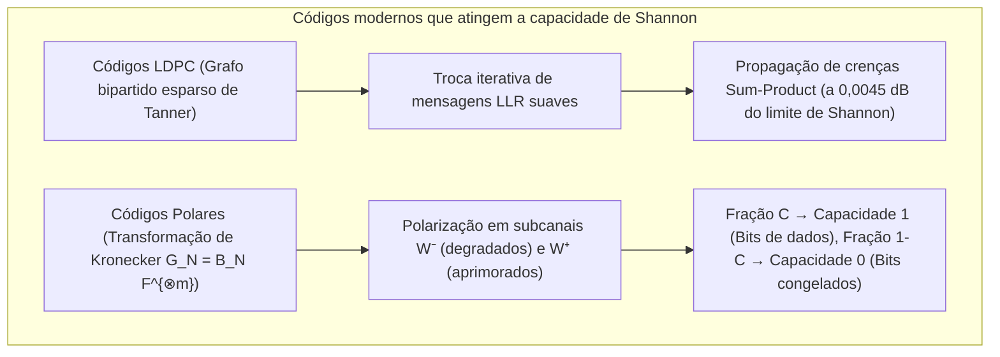

## 1. Introdução: Dois milagres cotidianos de ressurreição da informação

Tanto nas profundezas do espaço interestelar quanto na câmera do seu smartphone, a engenharia digital realiza diariamente uma façanha que parece desafiar a intuição física: <strong>reconstruir com 100% de precisão, bit a bit, informações digitais cujo sinal ou mídia física foi severamente mutilado pelo ruído térmico ou destruição parcial</strong>.

### Milagre 1: Voyager 1 e 2 transmitindo a 24 bilhões de quilômetros com $10^{-16}\text{ watts}$

Lançadas em 1977, as sondas <strong>Voyager 1 e Voyager 2</strong> fotografaram Júpiter, Saturno, Urano e Netuno e hoje viajam pelo espaço interestelar a mais de <strong>24 bilhões de quilômetros</strong> da Terra.
O transmissor de rádio da Voyager opera com apenas <strong>$23\text{ watts}$</strong> — menos que a lâmpada de uma geladeira. Quando o sinal alcança as antenas de 70 metros da Deep Space Network (DSN) da NASA na Terra, a potência recebida caiu para cerca de <strong>$10^{-16}\text{ watts}$ ($0,1\text{ atowatts}$)</strong>, submersa no <strong>ruído térmico</strong>. Ainda assim, a Voyager entregou imagens coloridas perfeitas com <strong>zero erros de bit</strong>.

### Milagre 2: Um código QR com $30\%$ de seus módulos cobertos por café ou um logotipo

Da mesma forma, ao apontar o celular para um <strong>código QR</strong> manchado de café ou com um <strong>logotipo cobrindo até $30\%$ de sua área central</strong>, seu smartphone reconstrói a URL exata em menos de <strong>$10\text{ milissegundos}$</strong> com <strong>zero bits errados</strong>.


Como isso é matematicamente possível? Graças à <strong>Teoria da Informação de Claude Shannon (1948)</strong> e à ciência algébrica dos <strong>códigos corretores de erros (ECC)</strong>.

---

## 2. A revolução de Claude Shannon (1948) e o teorema de codificação de canal ruidoso

### 2.1 Por que a codificação por repetição ingênua ($0 \to 00000$) falha

Antes de 1948, acreditava-se que para fazer a probabilidade de erro $P_e \to 0$ em um canal ruidoso, a taxa de transmissão $R = k/n$ deveria inevitavelmente cair para zero.
Com um <strong>código de repetição</strong> de comprimento ímpar $n = 2t + 1$ em um <strong>canal binário simétrico (BSC)</strong> com probabilidade de inversão $p \in (0, 0,5)$, o voto majoritário falha com probabilidade:
$$P_e^{(n)} = \sum_{i = (n+1)/2}^{n} \binom{n}{i} p^i (1-p)^{n-i}$$
Quando $n \to \infty$, temos $P_e^{(n)} \to 0$, mas simultaneamente a taxa de código entra em colapso: $R = k/n = 1/n \to 0$.

### 2.2 O teorema de Shannon e o limite último de Shannon ($-1,59\,\text{dB}$)

Em 1948, <strong>Claude E. Shannon</strong> provou em *"A Mathematical Theory of Communication"* seu famoso <strong>teorema de codificação de canal ruidoso</strong>:

> <strong>Teorema (Codificação de canal de Shannon, 1948):</strong>
> Todo canal sem memória possui uma <strong>capacidade de canal $C > 0$</strong> estritamente positiva:
> - Para o <strong>canal binário simétrico (BSC)</strong> com entropia binária $H_2(p) = -p\log_2 p - (1-p)\log_2(1-p)$:
>   $$C_{\text{BSC}}(p) = 1 - H_2(p) = 1 + p\log_2 p + (1-p)\log_2(1-p) \quad [\text{bits / uso do canal}]$$
> - Para o <strong>canal AWGN</strong> de largura de banda $B$, potência de sinal $S$ e ruído $N = N_0 B$ (teorema de Shannon-Hartley):
>   $$C_{\text{AWGN}} = B \log_2\!\left(1 + \frac{S}{N}\right) = B \log_2\!\left(1 + \frac{S}{N_0 B}\right) \quad [\text{bits / s}]$$
>
> <strong>Para qualquer taxa $R < C$, existem códigos de bloco de comprimento $n \to \infty$ com probabilidade de erro arbitrariamente pequena ($P_e \to 0$)!</strong>

Substituindo $S = E_b R$ e tomando o limite de eficiência espectral $\eta = R/B \to 0$, obtemos $\frac{E_b}{N_0} > \lim_{\eta \to 0} \frac{2^\eta - 1}{\eta} = \ln 2 \approx 0,6931$, isto é, o <strong>limite último de Shannon</strong>:
$$\left(\frac{E_b}{N_0}\right)_{\min} = \ln 2 \approx 0,6931 \implies 10 \log_{10}(\ln 2) \approx \mathbf{-1,5917\,\text{dB}}$$

---

## 3. O avanço geométrico de Richard Hamming (1950): distância de Hamming e o código $[7, 4, 3]$

### 3.1 Distância de Hamming $d_H(\mathbf{u}, \mathbf{v})$ e limite de empacotamento de esferas

No hipercubo binário $\mathbb{F}_2^n$, <strong>Richard Hamming</strong> definiu em 1950 a <strong>distância de Hamming $d_H(\mathbf{u}, \mathbf{v})$</strong> como o número de coordenadas em que dois vetores diferem:
$$d_H(\mathbf{u}, \mathbf{v}) \triangleq \bigl|\{ i \in \{1, \dots, n\} \mid u_i \neq v_i \}\bigr| = w_H(\mathbf{u} - \mathbf{v})$$

Para um código $\mathcal{C} \subset \mathbb{F}_q^n$ com <strong>distância mínima $d_{\min} = \min_{\mathbf{u}\neq\mathbf{v}} d_H(\mathbf{u},\mathbf{v})$</strong>, as esferas de Hamming disjuntas de raio $t$ provam que o código pode:
- <strong>Detectar</strong> $d_{\min} - 1$ erros;
- <strong>Corrigir $e = d_{\min} - 1$ apagamentos (erasures)</strong> em posições conhecidas;
- <strong>Corrigir $t = \lfloor(d_{\min} - 1)/2\rfloor$ erros arbitrários</strong> em posições desconhecidas:
$$\mathbf{d_{\min} \ge 2t + e + 1}, \qquad |\mathcal{C}| \cdot \sum_{i=0}^{t} \binom{n}{i} (q-1)^i \le q^n \quad \text{(Limite de Hamming)}$$

### 3.2 O código perfeito de Hamming $(7,4)$ e a decodificação por síndrome

Para $n=7, k=4, d_{\min}=3$ ($t=1$), temos $2^4 \cdot (1 + 7) = 128 = 2^7$: o código $[7,4,3]$ é um <strong>código perfeito</strong>. Sua matriz geradora $\mathbf{G}_{4\times 7} = [\mathbf{I}_4 \mid \mathbf{P}]$ e sua matriz de verificação de paridade $\mathbf{H}_{3\times 7} = [\mathbf{P}^T \mid \mathbf{I}_3]$ ($\mathbf{G}\mathbf{H}^T = \mathbf{0} \pmod 2$) são:
$$\mathbf{G}_{4\times 7} = \left(\begin{array}{cccc|ccc}
1 & 0 & 0 & 0 & 1 & 1 & 0 \\
0 & 1 & 0 & 0 & 1 & 0 & 1 \\
0 & 0 & 1 & 0 & 0 & 1 & 1 \\
0 & 0 & 0 & 1 & 1 & 1 & 1
\end{array}\right), \qquad
\mathbf{H}_{3\times 7} = \left(\begin{array}{cccc|ccc}
1 & 1 & 0 & 1 & 1 & 0 & 0 \\
1 & 0 & 1 & 1 & 0 & 1 & 0 \\
0 & 1 & 1 & 1 & 0 & 0 & 1
\end{array}\right)$$

A <strong>síndrome de 3 bits $\mathbf{s} = \mathbf{H}\mathbf{y}^T = \mathbf{H}(\mathbf{c} + \mathbf{e})^T = \mathbf{H}\mathbf{e}^T \pmod 2$</strong> extrai diretamente a coluna de $\mathbf{H}$ correspondente ao bit invertido: ordenando as colunas em binário de $1$ a $7$, <strong>a síndrome $\mathbf{s}$ fornece diretamente o índice binário $(1 \dots 7)$ do bit corrompido</strong>, protegendo hoje toda a memória <strong>ECC DRAM</strong> de servidores.

---

## 4. A obra-prima de Reed e Solomon (1960): códigos Reed-Solomon sobre corpos de Galois $\mathbb{F}_{2^m}$

### 4.1 Corpos de Galois $\text{GF}(2^8)$ e imunidade contra erros em rajada (Burst Errors)

Para vencer erros em rajada (arranhões em discos, manchas em códigos QR), <strong>Irving Reed</strong> e <strong>Gustave Solomon</strong> (1960) agruparam cada byte ($m=8$ bits) como um único símbolo do corpo finito <strong>$\text{GF}(2^8) = \mathbb{F}_2[x]/(x^8 + x^4 + x^3 + x^2 + 1)$</strong>. Mesmo que todos os 8 bits de um byte sejam destruídos, em $\text{GF}(2^8)$ isso representa <strong>apenas um único erro de símbolo</strong>!

### 4.2 Interpolação polinomial e o limite de Singleton MDS $d_{\min} = n - k + 1$

Os $k$ símbolos de mensagem $(m_0, \dots, m_{k-1}) \in \mathbb{F}_q^k$ definem um polinômio $P(x) = m_0 + m_1 x + \dots + m_{k-1} x^{k-1}$ de grau $< k$, avaliado em $n$ pontos distintos $\mathbf{c} = \bigl(P(\alpha_1), \dots, P(\alpha_n)\bigr)$.
Como dois polinômios distintos de grau $\le k-1$ sobre um corpo $\mathbb{F}_q$ coincidem em no máximo $k-1$ pontos (e <strong>quaisquer $k$ pontos bastam para reconstruir $P(x)$ por interpolação de Lagrange</strong>), todo código Reed-Solomon $[n, k]$ atinge o <strong>limite de Singleton com igualdade (código MDS, Maximum Distance Separable)</strong>:
$$\mathbf{d_{\min} = n - k + 1 \implies 2t + e \le n - k}$$

Assim, $n - k$ bytes de paridade corrigem <strong>até $e = n - k$ apagamentos (RAID-6, armazenamento em nuvem)</strong> ou <strong>até $t = \lfloor(n-k)/2\rfloor$ erros em posições desconhecidas (códigos QR até 30% no nível H; sonda Voyager $[255, 223]$)</strong> via polinômio gerador cíclico $g(x) = \prod_{i=1}^{2t}(x - \alpha^i)$, algoritmo de <strong>Berlekamp-Massey / Euclides</strong> ($\Lambda(x)S(x) \equiv \Omega(x) \pmod{x^{2t}}$), <strong>busca de Chien</strong> e <strong>fórmula de Forney</strong>.

---

## 5. Aproximando-se do limite de Shannon: códigos LDPC (1962), Turbo (1993) e Polares (2009)

1. <strong>Códigos LDPC de Robert Gallager (1962)</strong>: utilizam uma matriz de paridade esparsa $\mathbf{H}$ e um <strong>grafo bipartido de Tanner</strong>. Mediante a troca iterativa de razões de verossimilhança logarítmica suaves $L(c_i) = \ln\frac{P(c_i=0|y_i)}{P(c_i=1|y_i)}$ com <strong>propagação de crenças (Belief Propagation / Sum-Product)</strong>, os códigos LDPC operam a apenas $0,0045\,\text{dB}$<strong> do limite de Shannon (</strong>canais de dados 5G NR, Wi-Fi 6/7 e SSDs 3D NAND).
2. <strong>Códigos Polares de Erdal Arıkan (2009)</strong>: aplicando recursivamente a potência de Kronecker $\mathbf{G}_N = \mathbf{B}_N \begin{pmatrix} 1 & 0 \\ 1 & 1 \end{pmatrix}^{\otimes m}$, a <strong>polarização de canal</strong> faz com que uma fração $C = I(W)$ dos subcanais sintéticos convirja para capacidade $1$ (sem ruído, bits de informação) e uma fração $1 - C$ para capacidade $0$ (<strong>bits congelados / Frozen Bits $= 0$</strong>), sendo os primeiros códigos com complexidade $O(N \log N)$ que <strong>atingem de forma matematicamente comprovada a capacidade de Shannon</strong> (<strong>canais de controle 5G NR</strong>).



### Tabela comparativa das principais famílias de códigos corretores de erros

| Família de códigos | Ano e Pioneiros | Estrutura matemática | Algoritmo de decodificação | Ponto forte principal | Aplicações reais |
| :--- | :--- | :--- | :--- | :--- | :--- |
| <strong>Hamming / SECDED</strong> | 1950<br/>R. Hamming | Empacotamento de esferas em $\mathbb{F}_2^n$ | Síndrome $\mathbf{s}=\mathbf{H}\mathbf{y}^T$ ($O(1)$) | Correção de 1 bit em $<1\text{ ns}$ | <strong>Memória ECC DRAM</strong>, caches de CPU |
| <strong>Reed-Solomon (RS)</strong> | 1960<br/>Reed e Solomon | Interpolação polinomial em $\mathbb{F}_{2^m}$ | Berlekamp-Massey + Chien + Forney | <strong>Limite MDS ótimo $d_{\min}=n-k+1$</strong> contra rajadas | <strong>Códigos QR</strong>, <strong>RAID-6</strong>, nuvem, Voyager |
| <strong>Códigos LDPC</strong> | 1962 R. Gallager<br/>(Redescobertos 1996) | Matriz esparsa $\mathbf{H}$ e grafo de Tanner | <strong>Propagação de crenças (Sum-Product)</strong> | A $0,0045\,\text{dB}$ do limite de Shannon | <strong>5G NR (dados)</strong>, <strong>Wi-Fi 6/7</strong>, <strong>SSD NVMe</strong> |
| <strong>Códigos Polares</strong> | 2009<br/>Erdal Arıkan | Potência de Kronecker $\mathbf{F}^{\otimes m}$ | Decodificação por lista CA-SCL ($O(N\log N)$) | Atinge <strong>comprovadamente a capacidade $C$</strong> | <strong>5G NR (controle)</strong>, 6G IoT |

---

## 6. Implementação completa em Python: Hamming $(7,4)$ e Reed-Solomon em $\text{GF}(2^8)$

```python
from typing import List

def hamming74_demo() -> None:
    G = [[1,0,0,0,1,1,0], [0,1,0,0,1,0,1], [0,0,1,0,0,1,1], [0,0,0,1,1,1,1]]
    H = [[1,1,0,1,1,0,0], [1,0,1,1,0,1,0], [0,1,1,1,0,0,1]]
    msg = [1, 0, 1, 1]
    c = [sum(msg[i] * G[i][j] for i in range(4)) % 2 for j in range(7)]
    y = c.copy()
    y[2] ^= 1
    s = [sum(H[r][col] * y[col] for col in range(7)) % 2 for r in range(3)]
    err_idx = next(col for col in range(7) if [H[r][col] for r in range(3)] == s)
    y[err_idx] ^= 1
    print(f"[Hamming (7,4)] Syndrome={s} -> Flipped idx={err_idx}, Recovered={y[:4] == msg}")

class GF256:
    def __init__(self, poly: int = 0x11D) -> None:
        self.exp, self.log = [0] * 512, [0] * 256
        v = 1
        for i in range(255):
            self.exp[i] = self.exp[i + 255] = v
            self.log[v] = i
            v <<= 1
            if v & 0x100:
                v ^= poly

    def mul(self, a: int, b: int) -> int:
        return 0 if (a == 0 or b == 0) else self.exp[self.log[a] + self.log[b]]

    def inv(self, a: int) -> int:
        return self.exp[255 - self.log[a]]

    def power(self, a: int, p: int) -> int:
        return 1 if p == 0 else (0 if a == 0 else self.exp[(self.log[a] * p) % 255])

    def eval_poly(self, coeffs: List[int], x: int) -> int:
        res = 0
        for c in reversed(coeffs):
            res = self.mul(res, x) ^ c
        return res

    def solve(self, A: List[List[int]], b: List[int]) -> List[int]:
        n = len(b)
        M = [row[:] + [b[i]] for i, row in enumerate(A)]
        for col in range(n):
            piv = next(r for r in range(col, n) if M[r][col] != 0)
            M[col], M[piv] = M[piv], M[col]
            inv_p = self.inv(M[col][col])
            for j in range(col, n + 1):
                M[col][j] = self.mul(M[col][j], inv_p)
            for r in range(n):
                if r != col and M[r][col] != 0:
                    f = M[r][col]
                    for j in range(col, n + 1):
                        M[r][j] ^= self.mul(f, M[col][j])
        return [M[i][n] for i in range(n)]

def rs_demo() -> None:
    gf = GF256()
    text = "VOYAGER-1"
    k, t = len(text), 3
    n = k + 2 * t
    pts = [gf.exp[i] for i in range(n)]
    cw = [gf.eval_poly([ord(c) for c in text], x) for x in pts]
    rx = cw.copy()
    rx[1] ^= 0xFF; rx[6] ^= 0xA5; rx[13] ^= 0x3C
    A = [[gf.power(pts[i], d) for d in range(k + t)] + [gf.mul(rx[i], gf.power(pts[i], d)) for d in range(t)] for i in range(n)]
    b = [gf.mul(rx[i], gf.power(pts[i], t)) for i in range(n)]
    sol = gf.solve(A, b)
    E = sol[k + t:] + [1]
    err_pos = [i for i, x in enumerate(pts) if gf.eval_poly(E, x) == 0]
    valid = [(pts[i], rx[i]) for i in range(n) if i not in err_pos][:k]
    rec = gf.solve([[gf.power(x, d) for d in range(k)] for x, _ in valid], [y for _, y in valid])
    print(f"[RS(15,9) over GF(2^8)] Located Errors={err_pos}, Recovered='{''.join(chr(c) for c in rec)}'")

if __name__ == "__main__":
    hamming74_demo()
    rs_demo()
```

---

## 7. Conclusão

Do limite de Shannon de $-1,59\,\text{dB}$ (1948) à geometria de Hamming (1950), à interpolação polinomial de Reed-Solomon sobre $\mathbb{F}_{2^m}$ (1960), até a propagação de crenças LDPC e a polarização de canal de Arıkan, a teoria dos códigos corretores mostra como a matemática pura vence o ruído térmico e a entropia do universo.
