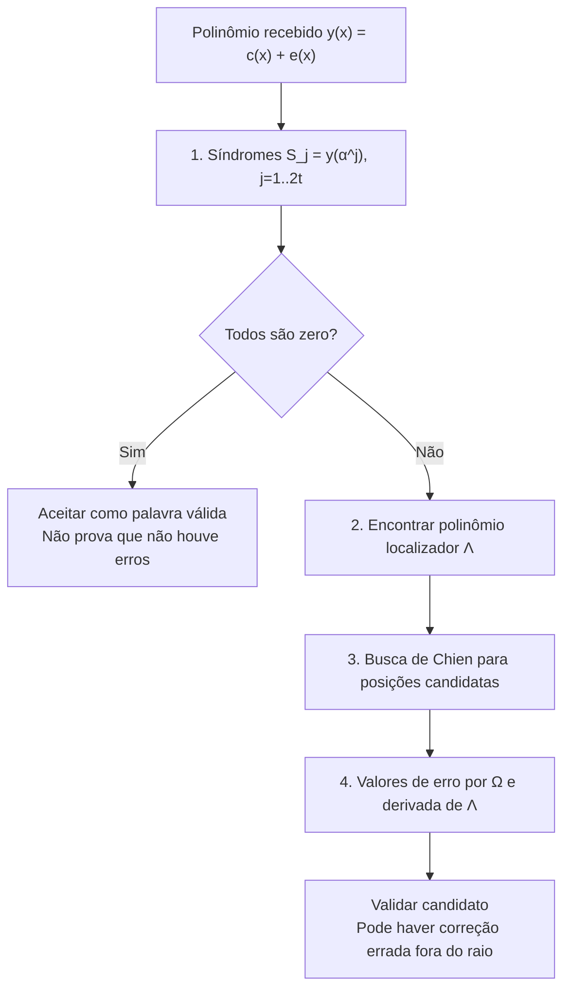
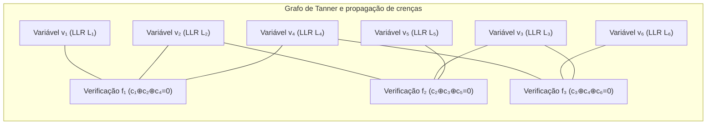
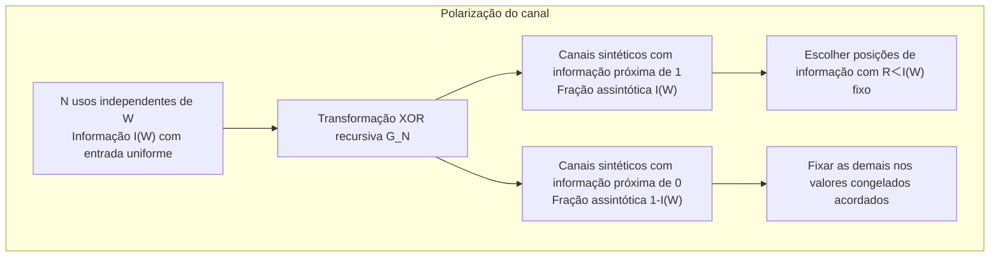

## 1. Introdução: o que as comunicações espaciais e os códigos QR têm em comum

Como recuperar dados de um sinal espacial fraco ou de um código QR parcialmente danificado? Os <strong>códigos corretores de erros (ECC)</strong> acrescentam redundância estruturada. O receptor usa essas relações para estimar e corrigir valores alterados. A proteção tem limites: uma quantidade finita de redundância não corrige qualquer destruição possível.

### Comunicações espaciais: receber o sinal e corrigir os erros restantes

Voyager 1 e Voyager 2 foram lançadas em 1977 e visitaram Júpiter e Saturno; a Voyager 2 prosseguiu até Urano e Netuno. Não foram ambas as sondas que percorreram os quatro planetas. Usaremos as comunicações dos encontros planetários como exemplo, sem tratar distâncias e potências recebidas atuais, que variam, como constantes permanentes.

A antena de alto ganho da sonda concentra energia de rádio na direção da Terra, onde a Deep Space Network (DSN) recebe o sinal. Atenuação e ruído térmico ainda podem deixar erros após a demodulação. Como conversão de unidades, $10^{-16}\,\mathrm W=100\,\mathrm{aW}$, ou 100 attowatts. Isso não constitui uma medição para determinada data e estação.

Um relatório do JPL preparado para o encontro da Voyager 2 com Urano descreve um código convolucional interno e um Reed–Solomon (RS) externo $[255,223]$. As etapas reduzem os efeitos do ruído, mas não garantem que todos os blocos recebidos e todos os pixels estejam sempre livres de erros.

### Códigos QR: porcentagem de correção não é uma área que se pode cobrir arbitrariamente

Os códigos QR também usam RS. A DENSO WAVE descreve níveis aproximados de restauração de 7%, 15%, 25% e 30%, medidos em <strong>palavras de código de 8 bits</strong>. Isso não significa que se possa cobrir quaisquer 30% da imagem com um logotipo. Importam os padrões funcionais, a distribuição dos danos entre blocos RS e as condições de captura. Tampouco há uma garantia universal de dez milissegundos.

Na terminologia QR, uma palavra de código de 8 bits corresponde a um símbolo na descrição matemática de RS adotada aqui. Não é a palavra RS inteira, de $n$ símbolos. Separar esses níveis evita confundir a capacidade de correção de cada bloco.


Vamos relacionar capacidade de canal, distância de Hamming, polinômios sobre corpos finitos e cálculos probabilísticos em grafos. É preciso distinguir <strong>corrigir todos os padrões até certo número de erros</strong> de <strong>tornar arbitrariamente pequena uma probabilidade de erro quando o bloco cresce</strong>.

---

## 2. O teorema de codificação de Shannon e suas hipóteses

### 2.1 Repetição: mais confiabilidade ao custo da taxa

Repetir um bit permite reduzir erros por votação majoritária. Entretanto, esse método isolado exige mais usos do canal por bit de informação para aumentar a confiabilidade. É uma limitação dessa construção, não de todos os códigos.

Considere um canal binário simétrico sem memória (BSC), com inversões independentes de probabilidade $0<p<1/2$. Um código de repetição de comprimento três transforma um bit em:

$$
0 \mapsto 000, \qquad 1 \mapsto 111
$$

Ao transmitir 000, receber 011, 101, 110 ou 111 leva à decisão errada de que o bit era 1. Devem ser invertidos dois ou três bits:

$$
P_e^{(3)} = \binom{3}{2} p^2 (1-p) + \binom{3}{3} p^3 = 3p^2(1-p) + p^3
$$

Para $p=0{,}01$, obtemos $0{,}000298$, aproximadamente $0{,}03\%$. Em contrapartida, a taxa do código é:

$$
R = \frac{k}{n} = \frac{1}{3}
$$

Para comprimento ímpar $n=2t+1$, a maioria falha quando pelo menos $t+1$ bits são invertidos:

$$
P_e^{(n)} = \sum_{i = (n+1)/2}^{n} \binom{n}{i} p^i (1-p)^{n-i}
$$

A lei dos grandes números permite que a probabilidade de erro tenda a zero, mas simultaneamente:

$$
n \to \infty \implies P_e^{(n)} \to 0 \quad \text{mas simultaneamente} \quad R = \frac{1}{n} \to 0
$$

Por exemplo, no comprimento cinco usamos $0\mapsto00000$, $1\mapsto11111$, com taxa $1/5$. Esse cálculo não exclui códigos mais eficientes que combinem vários bits de informação em um bloco.

### 2.2 Capacidade e teorema de codificação de canal ruidoso

O trabalho de Shannon de 1948 mostrou que um canal ruidoso pode manter uma taxa positiva fixa enquanto a probabilidade de erro se torna arbitrariamente pequena.

> <strong>Teorema para um canal discreto sem memória com alfabetos finitos:</strong> dada a lei de transição $W(y\mid x)$, a capacidade é $C=\max_{P(X)}I(X;Y)\ge0$, em bits por uso do canal. Para qualquer taxa fixa $0<R<C$, existe uma sequência de códigos de blocos cada vez mais longos e regras de decodificação cuja probabilidade de erro de bloco tende a zero. Com $R>C$, não se pode obter essa convergência.

A capacidade não precisa ser positiva. Se a saída for independente da entrada, $C=0$. Se houver restrições de custo de entrada ou potência média, a maximização deve respeitá-las. Uma única estatística sobre a intensidade do ruído não determina a capacidade de qualquer canal.

O teorema é um resultado assintótico de existência. Não promete que um código finito corrija todo ruído possível nem fornece automaticamente um decodificador eficiente. Latência, cálculo disponível e probabilidade de erro desejada continuam sendo restrições de projeto.

### 2.3 Derivação da capacidade do BSC

Para um canal discreto sem memória:

$$
C = \max_{P(X)} I(X; Y) = \max_{P(X)} \bigl( H(Y) - H(Y \mid X) \bigr)
$$

Escreva a saída do BSC como $Y=X\oplus E$, onde o bit de ruído $E$ é independente de $X$ e vale um com probabilidade $p$. Conhecida a entrada, a incerteza restante é a entropia binária:

$$
H(Y \mid X) = H_2(p) \triangleq -p \log_2 p - (1-p) \log_2(1-p)
$$

Como a saída é binária, $H(Y)\le1$ bit. Uma entrada uniforme produz uma saída uniforme e atinge $H(Y)=1$, portanto:

$$
C_{\text{BSC}}(p) = 1 - H_2(p) = 1 + p\log_2 p + (1-p)\log_2(1-p) \quad [\text{bits / uso do canal}]
$$

Por exemplo:

$$
H_2(0{,}1) = -0{,}1 \log_2(0{,}1) - 0{,}9 \log_2(0{,}9) \approx 0{,}4690\text{ bits}
$$

$$
C_{\text{BSC}}(0{,}1) = 1 - 0{,}4690 = 0{,}5310\text{ bits / uso do canal}
$$

Uma taxa fixa inferior, como $R=0{,}5$, pode alcançar uma probabilidade de erro arbitrariamente pequena com códigos adequados e suficientemente longos. Não é uma garantia de erro nulo em comprimento finito e taxa exatamente igual à capacidade. O argumento de codificação aleatória usa o comportamento típico do ruído em blocos longos e a possibilidade de distinguir palavras de código.

### 2.4 AWGN e o limite de banda larga de $-1{,}59\,\mathrm{dB}$

O modelo de ruído branco gaussiano aditivo (AWGN) descreve formas de onda contínuas, não inversões literais e independentes de bits. Sejam $B$ a largura de banda em Hz, $S$ a potência média recebida em W e $N_0$ a densidade espectral unilateral de potência de ruído em W/Hz. A potência de ruído na banda é $N=N_0B$. Com restrição de potência média, sem impor adicionalmente uma entrada binária, Shannon–Hartley fornece:

$$
C_{\text{AWGN}} = B \log_2\!\left(1 + \frac{S}{N}\right) = B \log_2\!\left(1 + \frac{S}{N_0 B}\right) \quad [\text{bits / segundo}]
$$

Seja $E_b$ a energia recebida por bit de informação e, agora, $R$ a taxa de informação em bits/s, de modo que $S=E_bR$. As unidades diferem da taxa anterior, em bits por uso do canal. Exigir $R<C_{\mathrm{AWGN}}$ resulta em:

$$
R < B \log_2\!\left(1 + \frac{E_b}{N_0} \frac{R}{B}\right)
$$

Com eficiência espectral $\eta=R/B$, em bits/s/Hz:

$$
\eta < \log_2\!\left(1 + \eta \frac{E_b}{N_0}\right) \iff 2^\eta - 1 < \eta \frac{E_b}{N_0} \iff \frac{E_b}{N_0} > \frac{2^\eta - 1}{\eta}
$$

Nesse modelo ideal, fazemos $\eta\to0$ e usamos $2^\eta=1+\eta\ln2+O(\eta^2)$:

$$
\lim_{\eta \to 0} \frac{2^\eta - 1}{\eta} = \ln 2 \approx 0{,}693147
$$

Em decibéis:

$$
\left(\frac{E_b}{N_0}\right)_{\min} = \ln 2 \approx 0{,}6931 \implies 10 \log_{10}(\ln 2) \approx \mathbf{-1{,}5917\,\text{dB}}
$$

É um <strong>ínfimo no limite de banda larga</strong>. Com eficiência espectral positiva, o limite requerido é $(2^\eta-1)/\eta>\ln2$. A razão $E_b/N_0$ também não é a razão de potências $S/N$ entre sinal e ruído total na banda. Dizer apenas “sinal abaixo do ruído” confunde essas duas definições.

Aproximar-se da capacidade também custa comprimento de bloco e latência. Esse resultado assintótico de um modelo específico não é uma constante de todos os canais físicos nem uma promessa de comunicação finita sem erros. Restringir a entrada a dois valores, por exemplo, modifica a capacidade pertinente.

---

## 3. Distância de Hamming, garantias e código $[7,4,3]$

### 3.1 Da existência a uma construção calculável

Para usar um teorema de existência, precisamos de algoritmos de codificação e decodificação. O trabalho de Hamming de 1950 oferece um exemplo concreto: acrescentar verificações de paridade e localizar o bit invertido pelas verificações que falham. Vamos construir o código a partir da distância e das matrizes.

### 3.2 Distância e distância mínima

As sequências binárias de comprimento $n$ formam $\mathbb F_2^n$, os vértices de um hipercubo de dimensão $n$. Em $\mathbb F_2$, somar e subtrair é XOR. A distância de Hamming conta coordenadas diferentes:

$$
d_H(\mathbf{u}, \mathbf{v}) \triangleq \bigl|\{ i \in \{1, \dots, n\} \mid u_i \neq v_i \}\bigr| = w_H(\mathbf{u} - \mathbf{v})
$$

Aqui, $w_H$ conta entradas não nulas, o peso de Hamming. A distância satisfaz não negatividade, simetria e desigualdade triangular. Um código é um subconjunto $\mathcal C$ de palavras permitidas; se for binário, linear e de dimensão $k$, terá $2^k$ palavras. Sua distância mínima é:

$$
d_{\min}(\mathcal{C}) \triangleq \min_{\substack{\mathbf{u}, \mathbf{v} \in \mathcal{C} \\ \mathbf{u} \neq \mathbf{v}}} d_H(\mathbf{u}, \mathbf{v})
$$

Em um código linear, a diferença entre duas palavras distintas é outra palavra não nula, portanto:

$$
d_{\min}(\mathcal{C}) = \min_{\mathbf{c} \in \mathcal{C} \setminus \{\mathbf{0}\}} w_H(\mathbf{c})
$$

### 3.3 Detecção, apagamentos e erros de posição desconhecida

1. <strong>Detecção:</strong> alterar de uma a $d_{\min}-1$ coordenadas não transforma uma palavra válida em outra. Verificar se a palavra pertence ao código detecta todos esses padrões não nulos.
2. <strong>Apagamentos:</strong> conhecemos as posições perdidas, mas não seus valores. Se houver no máximo $e\le d_{\min}-1$, duas palavras distintas ainda diferem em alguma coordenada preservada. Supondo corretos os valores restantes, a palavra transmitida fica determinada de forma única.
3. <strong>Erros de posição desconhecida:</strong> a decodificação pela palavra mais próxima corrige todos os padrões de até $t$ erros se, e somente se, as esferas de Hamming de raio $t$ ao redor de palavras distintas forem disjuntas.

Se uma palavra recebida pertencesse a duas esferas, a desigualdade triangular daria distância entre os centros de no máximo $2t$. Reciprocamente, dois centros separados por no máximo $2t$ admitem uma palavra a distância não maior que $t$ de ambos: distribuímos as coordenadas diferentes entre as duas escolhas. Portanto:

$$
2t + 1 \le d_{\min} \iff t \le \left\lfloor \frac{d_{\min} - 1}{2} \right\rfloor
$$

A igualdade $t=\lfloor(d_{\min}-1)/2\rfloor$ especifica o <strong>maior raio garantido</strong>, não cada raio menor válido. Com até $t$ erros desconhecidos e $e$ apagamentos conhecidos, a garantia para todos os padrões é:

$$
\mathbf{d_{\min} \ge 2t + e + 1}
$$

Eliminar as posições apagadas deixa distância mínima de pelo menos $d_{\min}-e$; aplicamos o argumento das esferas disjuntas nesse espaço restante. Alguns casos fora dessa condição ainda podem ser recuperados, mas não há garantia de sucesso para todas as configurações. “Posição desconhecida” não exige uma distribuição aleatória dos erros.

Uma esfera de raio $t$ em um espaço com alfabeto de tamanho $q$ contém $\sum_{i=0}^t\binom ni(q-1)^i$ palavras. As esferas disjuntas devem caber no espaço:

$$
|\mathcal{C}| \cdot \sum_{i=0}^{t} \binom{n}{i} (q-1)^i \le q^n \quad \left(\text{para códigos binários: } 2^k \sum_{i=0}^{t} \binom{n}{i} \le 2^n \right)
$$

Um código que atinge a igualdade é <strong>perfeito</strong>: as esferas cobrem o espaço sem lacunas nem sobreposições. Exemplos incluem Hamming e Golay binário $[23,12,7]$ e ternário $[11,6,5]$. Classificações exigem suas hipóteses; também existem códigos perfeitos não lineares. Esses exemplos não demonstram qual código de Golay foi usado em determinada missão.

### 3.4 Matrizes de Hamming e síndrome

O código $[7,4,3]$ acrescenta três bits de paridade a quatro de informação:

$$
2^4 \sum_{i=0}^{1} \binom{7}{i} = 16 \times (1 + 7) = 16 \times 8 = 128 = 2^7
$$

São 16 esferas de raio um, cada uma com um centro e sete vizinhos, cobrindo as 128 palavras.

Uma construção conveniente da matriz de verificação de paridade coloca a representação binária de $j$ na coluna $j$:

$$
\mathbf{H}_{\text{binary}} = \begin{pmatrix} 0 & 0 & 0 & 1 & 1 & 1 & 1 \\ 0 & 1 & 1 & 0 & 0 & 1 & 1 \\ 1 & 0 & 1 & 0 & 1 & 0 & 1 \end{pmatrix} \begin{matrix} \leftarrow 2^2\text{ posição} \\ \leftarrow 2^1\text{ posição} \\ \leftarrow 2^0\text{ posição} \end{matrix}
$$

Sua quinta coluna é $(1,0,1)^T$. Para preservar os quatro bits de mensagem no início e acrescentar a paridade no final, usamos a forma sistemática $\mathbf G=[\mathbf I_4\mid\mathbf P]$ e $\mathbf H=[\mathbf P^T\mid\mathbf I_3]$:

$$
\mathbf{G}_{4\times 7} = \left(\begin{array}{cccc|ccc} 1 & 0 & 0 & 0 & 1 & 1 & 0 \\ 0 & 1 & 0 & 0 & 1 & 0 & 1 \\ 0 & 0 & 1 & 0 & 0 & 1 & 1 \\ 0 & 0 & 0 & 1 & 1 & 1 & 1 \end{array}\right), \qquad \mathbf{H}_{3\times 7} = \left(\begin{array}{cccc|ccc} 1 & 1 & 0 & 1 & 1 & 0 & 0 \\ 1 & 0 & 1 & 1 & 0 & 1 & 0 \\ 0 & 1 & 1 & 1 & 0 & 0 & 1 \end{array}\right)
$$

Como $\mathbf G\mathbf H^T=0$, todas as palavras codificadas satisfazem:

$$
\mathbf{H}\mathbf{c}^T = \mathbf{0} \pmod 2
$$

Ao receber $\mathbf y=\mathbf c+\mathbf e$, calculamos a <strong>síndrome</strong>:

$$
\mathbf{s} = \mathbf{H}\mathbf{y}^T = \mathbf{H}(\mathbf{c} + \mathbf{e})^T = \underbrace{\mathbf{H}\mathbf{c}^T}_{=\mathbf{0}} + \mathbf{H}\mathbf{e}^T = \mathbf{H}\mathbf{e}^T \pmod 2
$$

Ela depende apenas do erro. Uma inversão no bit $j$ retorna a coluna $j$ da matriz escolhida. Com colunas em ordem binária, a síndrome 101 identifica a posição 5; na forma sistemática, a ordem é diferente e precisamos buscar a coluna correspondente. Seu valor numérico não é necessariamente a posição. O programa da seção 6 faz essa busca.

Síndrome zero significa pertencer ao código. Sob a hipótese de no máximo um erro, significa ausência de erro; fora dela, o canal pode ter mudado uma palavra válida para outra. Vários erros também podem induzir o decodificador de um erro a inverter um bit que estava correto.

Por exemplo, a mensagem `[1,0,1,1]` é codificada como `[1,0,1,1,0,1,0]`. Inverter o índice 2, contado a partir de zero — o terceiro bit —, produz síndrome `[0,1,1]`, correspondente à coluna de índice 2. Um circuito fixo de sete bits tem tamanho constante, mas calcular síndromes de comprimento geral $n$ não é universalmente $O(1)$.

Acrescentar um bit de paridade global par produz o código estendido $[8,4,4]$. Uma regra adequada permite corrigir um bit e detectar dois (SECDED). É um modelo básico para entender memória ECC, não a arquitetura exata de todos os produtos.

---

## 4. Reed–Solomon: corpos finitos, interpolação e decodificação

### 4.1 Por que as rajadas importam

Hamming $(7,4)$ corrige um bit em qualquer posição de um bloco. Um arranhão no disco, uma mancha de QR ou um desvanecimento podem alterar muitos bits do mesmo bloco. Duas inversões já podem fazer o decodificador de um erro corrigir para a palavra errada.

A construção de Reed e Solomon de 1960 agrupa bits em <strong>símbolos</strong> de um corpo finito. Muda a unidade usada para medir distância e correção. Distribuição espacial e entrelaçamento também determinam como danos físicos atingem esses símbolos.

### 4.2 Um byte como elemento de um corpo finito

Um símbolo de $m$ bits pode ser representado em $\mathbb F_{2^m}$. Isso difere de operar com inteiros módulo 256: $2\cdot128\equiv0\pmod{256}$ exibe divisores de zero, e esses elementos não nulos não têm inverso multiplicativo. Existem corpos finitos precisamente para tamanhos que são potências de um primo.

Em GF(256), um byte representa um polinômio de grau no máximo sete com coeficientes binários. O programa reduz os produtos módulo o polinômio irredutível de grau oito representado por `0x11D`:

$$
\mathbb{F}_{2^8} \cong \frac{\mathbb{F}_2[x]}{\langle x^8 + x^4 + x^3 + x^2 + 1 \rangle}
$$

Somar e subtrair equivale a XOR porque $1+1=0$ no corpo dos coeficientes. Os 255 elementos não nulos formam um grupo multiplicativo cíclico. Nessa representação, $\alpha=x$, byte `0x02`, é primitivo: suas potências $\alpha^0,\ldots,\alpha^{254}$ percorrem todos os não nulos e $\alpha^{255}=1$.

Tabelas de logaritmos e expoentes permitem multiplicar e dividir elementos não nulos:

$$
A \cdot B = \alpha^{(i + j) \bmod 255}, \qquad \frac{A}{B} = \alpha^{(i - j) \bmod 255}
$$

O zero precisa de tratamento separado, e dividir por zero não é definido. O comprimento das tabelas depende da implementação; algumas estendem a tabela de expoentes para evitar um módulo explícito. A seção 6 usa deslocamentos e XOR.

Vários bits danificados no mesmo byte contam como um erro de símbolo. Atravessar limites entre bytes pode danificar vários símbolos; só o total de bits alterados não determina se a correção será possível.

### 4.3 Avaliação, interpolação e limite de Singleton

Dois pontos com abscissas diferentes determinam um polinômio de grau no máximo um. Se transmitirmos cinco avaliações, quaisquer duas corretas preservadas recuperam o polinômio após três apagamentos. Três abscissas distintas determinam um polinômio de grau no máximo dois.

Usamos os $k$ símbolos da mensagem como coeficientes:

$$
P(x) \triangleq m_0 + m_1 x + m_2 x^2 + \dots + m_{k-1} x^{k-1} \in \mathbb{F}_q[x]
$$

Escolhemos $n$ pontos distintos $\alpha_i\in\mathbb F_q$, com $k\le n\le q$, e transmitimos:

$$
\mathbf{c} = \bigl( P(\alpha_1),\; P(\alpha_2),\; \dots,\; P(\alpha_n) \bigr) \in \mathbb{F}_q^n
$$

O teorema do fator implica que um polinômio não nulo sobre um corpo não tem mais raízes que seu grau. A diferença $P-Q$ entre mensagens distintas tem grau menor que $k$, portanto se anula em no máximo $k-1$ pontos. As palavras diferem em pelo menos $n-k+1$ coordenadas.

Para o limite oposto, removemos $d_{\min}-1$ coordenadas de todas as palavras: suas projeções precisam continuar distintas. Com $q^k$ palavras, $q^k\le q^{n-d_{\min}+1}$, de modo que $d_{\min}\le n-k+1$. RS atinge a igualdade:

$$
\mathbf{d_{\min} = n - k + 1}
$$

É a propriedade <strong>MDS, máxima distância separável</strong>: otimiza a distância mínima para alfabeto, comprimento e dimensão fixados, não todas as características de engenharia.

Com $r=n-k$ símbolos redundantes, a garantia é $2t+e\le r$:

- <strong>Apagamentos conhecidos:</strong> podem faltar até $n-k$ símbolos. Quaisquer $k$ avaliações corretas preservadas recuperam a mensagem por interpolação de Lagrange:

$$
P(x) = \sum_{j=1}^{k} y_{i_j} \prod_{\substack{m=1 \\ m \neq j}}^{k} \frac{x - x_{i_m}}{x_{i_j} - x_{i_m}}
$$

- <strong>Erros desconhecidos:</strong> corrigem-se até $\lfloor(n-k)/2\rfloor$ símbolos danificados, independentemente de quantos bits mudem em cada símbolo afetado.

### 4.4 Forma cíclica e convenções da fórmula de Forney

A forma de avaliação trata a mensagem como coeficientes e transmite avaliações. Na descrição cíclica, as coordenadas da palavra são coeficientes de outro polinômio divisível por um gerador. O código de comprimento completo $n=q-1$, que usa os pontos não nulos, tem uma representação cíclica equivalente quando se fixa a correspondência. Um código encurtado não precisa continuar cíclico em seu novo comprimento.

Fixemos redundância $n-k=2t$ e primeira raiz do gerador $\alpha^1$. São convenções desta derivação, não de todos os formatos QR ou espaciais:

$$
g(x)=\prod_{j=1}^{2t}(x-\alpha^j)
$$

Com resto $r(x)=x^{2t}m(x)\bmod g(x)$, deslocamos a mensagem e subtraímos o resto:

$$
c(x)=x^{2t}m(x)-r(x),\qquad c(\alpha^j)=0\quad(1\le j\le2t)
$$

Em característica dois, subtrair continua sendo XOR.



1. <strong>Síndromes:</strong> suponha $\nu\le t$ erros nas posições $i_l$, de valores não nulos $Y_l=e_{i_l}$. Defina $X_l=\alpha^{i_l}$. Avaliar nas raízes elimina a palavra transmitida:

$$
S_j=y(\alpha^j)=e(\alpha^j)=\sum_{l=1}^{\nu}Y_lX_l^j,\qquad j=1,\ldots,2t
$$

Síndrome nula só estabelece pertencimento ao código; não detecta uma mudança entre palavras válidas.

2. <strong>Polinômio localizador:</strong>

$$
\Lambda(z)=\prod_{l=1}^{\nu}(1-X_lz)=1+\Lambda_1z+\cdots+\Lambda_\nu z^\nu
$$

Multiplicar $\Lambda(X_l^{-1})=0$ por $Y_lX_l^{j+\nu}$ e somar fornece a recorrência linear:

$$
S_{j+\nu}+\Lambda_1S_{j+\nu-1}+\cdots+\Lambda_\nu S_j=0,\qquad1\le j\le2t-\nu
$$

Berlekamp–Massey obtém uma recorrência mínima e um candidato, normalmente com $O(t^2)$ operações do corpo. Um método baseado em Euclides estendido também pode resolver a equação-chave.

3. <strong>Busca de Chien:</strong> testamos os elementos não nulos $\alpha^{-i}$ associados às coordenadas e buscamos $\Lambda(\alpha^{-i})=0$. GF(256) tem 256 elementos no total, 255 não nulos. É preciso verificar condições como a coincidência entre grau do localizador e número de raízes admissíveis.

4. <strong>Valores dos erros:</strong> definimos explicitamente o polinômio de síndromes e o avaliador:

$$
S(z)=S_1+S_2z+\cdots+S_{2t}z^{2t-1},\qquad \Omega(z)=S(z)\Lambda(z)\bmod z^{2t}
$$

Com essas definições, Forney fornece:

$$
Y_l=-\frac{\Omega(X_l^{-1})}{\Lambda'(X_l^{-1})}
$$

Para um erro, $\Omega=YX$ e $\Lambda'=-X$, portanto obtemos $Y$. Multiplicar por outro fator $X$ daria $XY$. Outras convenções para a primeira raiz ou o polinômio de síndromes podem alterar esse fator; não se deve transportar a fórmula sem suas definições.

Subtraímos os erros estimados e verificamos pertencimento ao código e distância corrigida. Mesmo assim, uma palavra recebida pode estar perto de outra palavra válida e passar nas verificações com a mensagem errada. CRC, retransmissão ou verificações superiores podem acrescentar proteção; nem toda corrupção fora do raio garantido será necessariamente detectada.

### 4.5 QR, armazenamento e concatenação na Voyager

- <strong>QR:</strong> os níveis L/M/Q/H têm restauração aproximada de 7/15/25/30% de palavras de 8 bits. Cada bloco RS deve respeitar suas condições. Versão e nível mudam dados, redundância e divisão em blocos; não se convertem em área arbitrária. Cobrir padrões funcionais pode impedir o reconhecimento ou a extração das palavras antes da decodificação RS.
- <strong>RAID-6 e armazenamento distribuído:</strong> uma unidade ou fragmento ausente em posição conhecida é um apagamento. Um código MDS $[14,10]$ ilustrativo usa $14/10=1{,}4$ vezes a capacidade dos dados e tolera quatro fragmentos perdidos se os restantes e os metadados necessários forem corretos. Não é uma configuração universal dos provedores de nuvem. A dupla paridade do RAID-6 permite recuperar duas unidades sob suas hipóteses, não todo dano latente adicional ou a perda da instalação inteira.
- <strong>Voyager 2:</strong> o relatório do JPL de 1983 descreve um código convolucional de comprimento de restrição $K=7$ e taxa $1/2$, entrelaçamento de profundidade 4 e RS externo $[255,223]$. Seus 32 bytes redundantes garantem $2t+e\le32$ por palavra RS, ou 16 erros de byte sem apagamentos. Uma rajada contígua de 128 bits sem alinhamento pode abranger 17 bytes. O entrelaçamento distribui as rajadas residuais do decodificador interno entre palavras RS. O código interno desse exemplo é convolucional.

---

## 5. LDPC, turbo e polares: confiabilidade e capacidade

### 5.1 A distância não resolve todo o problema

Um código prático precisa satisfazer erro desejado, latência, comprimento de bloco, cálculo e custo de hardware. Comparar por força bruta todas as palavras de um código binário de dimensão $k$ exige $2^k$ candidatos. Boa distância mínima não implica automaticamente decodificação eficiente.

A decodificação iterativa de turbo e LDPC usa informações de confiabilidade; os polares usam outra construção para se aproximar da capacidade simétrica. As comparações devem manter canal, restrições de entrada e taxa. Não basta comparar tudo com o limite de banda larga de $-1{,}59\,\mathrm{dB}$.

### 5.2 Paridade esparsa e propagação de crenças

Os códigos LDPC de Gallager de 1962 usam uma matriz de verificação esparsa. Mesmo com blocos longos, suas linhas e colunas podem ter poucos elementos não nulos. Para uma matriz $\mathbf H$ de tamanho $m\times n$, a dimensão é $k=n-\operatorname{rank}_{\mathbb F_2}(\mathbf H)$, onde rank é o posto da matriz; só com linhas independentes isso equivale a $n-m$.

No grafo de Tanner, nós de variável correspondem a colunas e bits; nós de verificação, a linhas e equações de paridade. Uma aresta existe exatamente quando $H_{a,i}=1$:



A decisão suave preserva confiabilidade sem reduzir imediatamente a observação a zero ou um. Podemos expressar a razão de verossimilhança logarítmica (LLR):

$$
L(c_i) \triangleq \ln \frac{\Pr(c_i = 0 \mid y_i)}{\Pr(c_i = 1 \mid y_i)}
$$

Para entradas equiprováveis, BPSK de amplitude unitária $0\mapsto+1$, $1\mapsto-1$, ruído independente $Z\sim\mathcal N(0,\sigma^2)$ e observação $y_i=x_i+Z$:

$$
L_{\mathrm{ch}}(c_i)=\ln\frac{p(y_i\mid c_i=0)}{p(y_i\mid c_i=1)}=\frac{2y_i}{\sigma^2}
$$

Outras amplitudes ou probabilidades a priori mudam a expressão. Um LLR $+10$ favorece fortemente zero; $-0{,}1$ favorece um apenas ligeiramente.

O algoritmo soma-produto é uma forma de propagação de crenças. Troca mensagens extrínsecas excluindo a contribuição do vizinho destinatário:

$$
\mu_{f_a \to v_i} = 2 \operatorname{artanh}\!\left( \prod_{v_j \in N(f_a) \setminus \{v_i\}} \tanh\!\left(\frac{\mu_{v_j \to f_a}}{2}\right) \right)
$$

$$
\mu_{v_i \to f_a} = L_{\text{ch}}(v_i) + \sum_{f_b \in N(v_i) \setminus \{f_a\}} \mu_{f_b \to v_i}
$$

$N$ denota o conjunto de vizinhos pertinente. O escalonamento iterativo especifica qual iteração das mensagens será usada, sem mudar essa exclusão.

Uma matriz esparsa reduz arestas, mas não elimina por si só ciclos curtos. Em uma árvore, a propagação calcula marginais exatas; em grafos finitos com ciclos, dependências, conjuntos de aprisionamento ou falta de convergência podem deixar erros.

Com $E$ arestas, uma implementação que compartilha cálculos entre vizinhos usa aproximadamente $O(E)$ operações por iteração, ou $O(IE)$ para $I$ iterações. Graus limitados podem dar $E=O(n)$, mas não garantem um número constante de iterações. A implementação numérica deve tratar saturação de LLR e o domínio de $\operatorname{artanh}$.

O resultado de Chung e colaboradores de 2001 corresponde à <strong>taxa $1/2$ em um canal AWGN de entrada binária</strong>: o limiar assintótico calculado por evolução de densidades fica a $0{,}0045\,\mathrm{dB}$ do limite de capacidade desse canal. Uma simulação finita distinta, com projeto mais simples, comprimento $10^7$ e BER $10^{-6}$, apresenta uma diferença de $0{,}04\,\mathrm{dB}$. Não são desempenhos universais de todos os dispositivos nem o ínfimo energético de banda larga.

### 5.3 Códigos polares e capacidade simétrica

A construção de Arıkan de 2009 aproxima-se de $I(W)$, a <strong>capacidade simétrica</strong> de um canal discreto sem memória de entrada binária: a informação mútua com entrada uniforme. Coincide com $C$ em canais simétricos, mas não necessariamente com o máximo sobre distribuições de entrada em um canal assimétrico.

A transformação básica é:

$$
(x_1,x_2)=(u_1,u_2)\begin{pmatrix}1&0\\1&1\end{pmatrix} =(u_1\oplus u_2,u_2)
$$

O canal sintético $W^-$ estima $u_1$ com $(y_1,y_2)$; $W^+$ estima $u_2$ com $(y_1,y_2,u_1)$ quando se fornece o valor correto de $u_1$. Com entradas uniformes e independentes, a regra da cadeia fornece:

$$
I(W^-)+I(W^+)=2I(W),\qquad I(W^-)\le I(W)\le I(W^+)
$$

“Melhor” e “pior” referem-se aqui à informação, sem exigir mudança estrita em todos os casos. Na decodificação sucessiva real, um erro anterior pode se propagar para decisões posteriores.

Para $N=2^m$, uma convenção usa a permutação $\mathbf B_N$ que inverte a ordem dos dígitos binários dos índices, com matriz geradora:

$$
\mathbf G_N=\mathbf B_N \begin{pmatrix}1&0\\1&1\end{pmatrix}^{\otimes m}
$$

Para qualquer $0<\delta<1$ fixo, quando $N\to\infty$, a fração de canais sintéticos com informação maior que $1-\delta$ tende a $I(W)$; a fração com informação menor que $\delta$ tende a $1-I(W)$. Em comprimento finito não surgem exatamente $NI(W)$ canais perfeitamente sem ruído.



Escolhemos posições de informação à taxa fixa $R<I(W)$ e congelamos as demais em valores acordados. Para um canal geral, a garantia original usa média sobre valores congelados e existência de uma escolha adequada; em um canal simétrico, o limite correspondente vale para qualquer escolha fixa.

Codificar e decodificar por <strong>cancelamento sucessivo (SC)</strong> custa $O(N\log N)$ de tempo. Escolher o conjunto de informação é um custo de construção separado. Uma implementação eficiente de <strong>cancelamento sucessivo com lista (SCL)</strong> de tamanho $L$ requer $O(LN\log N)$; um CRC pode ajudar a escolher um candidato. Erro e latência finitos dependem de construção, taxa, tamanho da lista e canal; não há garantia geral de ausência de piso de erro (error floor).

### 5.4 Comparação entre famílias

| Código | Estrutura matemática | Decodificação representativa | Características e usos |
| :--- | :--- | :--- | :--- |
| Hamming (1950) | Código linear binário; $[7,4,3]$ é perfeito | Síndrome e busca de coluna | Corrige um bit; modelo básico de SECDED |
| Reed–Solomon (1960) | Polinômios sobre corpo finito; propriedade MDS | BM/Euclides, Chien, Forney; Welch–Berlekamp na forma de avaliação | Erros de símbolo e apagamentos; QR, armazenamento, telemetria concatenada |
| Convolucional e turbo | Treliças, concatenação, entrelaçamento | Viterbi; decodificação iterativa BCJR | Comunicação ruidosa; código interno da Voyager é convolucional |
| LDPC (1962) | Matriz esparsa e grafo de Tanner | Propagação de crenças com decisão suave | Blocos longos e paralelismo; projetos próximos da capacidade em modelos específicos |
| Polares (2009) | Polarização recursiva e bits congelados | SC $O(N\log N)$; SCL depende de $L$ | Aproximação assintótica à capacidade simétrica; parte da informação de controle 5G NR |

Estar na mesma tabela não implica complexidade ou erro iguais. Tampouco se codifica toda a informação de controle 5G com polares. Por exemplo, 3GPP TS 38.212 v19.3.0, seções 6.3.1.2–6.3.1.3, distingue, na informação de controle do enlace de subida (UCI) transportada por PUCCH, cargas de $A\ge12$ bits, codificadas com polares, e $A\le11$, com codificação de blocos pequenos.

---

## 6. Verificação em Python: Hamming e RS de avaliação em GF(256)

Este programa autônomo em Python 3 implementa Hamming $(7,4)$ sistemático e o <strong>RS de avaliação</strong> da seção 4.3. Os símbolos de mensagem são coeficientes do polinômio; em geral não aparecem inalterados no início da palavra. Não é o decodificador BM da seção 4.4 nem implementa distribuição de módulos, blocos ou formato cíclico sistemático do QR; não é diretamente interoperável com QR nem com uma sonda.

O corpo é GF(256), com polinômio irredutível `0x11D`. Difere do corpo primo GF(257) dos resíduos inteiros módulo 257: este também permite códigos de avaliação, mas pode produzir o símbolo 256, que não cabe em um byte.

O decodificador usa um sistema do tipo Welch–Berlekamp. Para graus candidatos $\nu=0,\ldots,t$, busca um polinômio mônico $E(x)$ de grau $\nu$ e $Q(x)$ de grau menor que $k+\nu$ tais que:

$$
Q(x_i)=y_iE(x_i)\qquad(i=1,\ldots,n)
$$

Há $k+2\nu$ coeficientes desconhecidos. Em característica dois, mudar um termo de lado continua sendo XOR.

Se a mensagem real for $P$ e houver no máximo $\nu$ erros, escolhemos $E$ que se anule nesses pontos, completando o grau se necessário, e $Q=PE$. Reciprocamente, com $n\ge k+2\nu$, qualquer solução tem $Q-PE$ nulo em pelo menos $n-\nu$ pontos corretos, mas de grau menor que $k+\nu$; logo, deve ser o polinômio nulo. Esse argumento de raízes justifica a recuperação.

Testam-se graus de zero a $t$, tratam-se sistemas retangulares e com deficiência de posto, divide-se $Q$ por $E$, exige-se resto zero e grau do quociente menor que $k$, e recodifica-se para verificar distância à palavra recebida não maior que $t$. Funciona com zero erros, menos de $t$ e no limite. Os pontos precisam ser distintos; admitem-se de 1 a 256 elementos do corpo, incluindo zero.

A prioridade é a clareza: não é um decodificador RS de produção nem uma medição de velocidade. Pode executar até $t+1$ eliminações gaussianas gerais. `rs_encode` e `rs_decode` verificam valores, comprimentos, pontos e raio; as funções auxiliares internas de polinômios e sistemas pressupõem elementos do corpo já validados.

```python
"""Educational evaluation RS over GF(256), not a QR parser or wire format."""
from itertools import product


def field_value(a):
    if type(a) is not int or not 0 <= a < 256:
        raise ValueError("Field elements must be integers from 0 through 255")
    return a


def gf_mul(a, b):
    field_value(a)
    field_value(b)
    result = 0
    for _ in range(8):
        if b & 1:
            result ^= a
        b >>= 1
        a <<= 1
        if a & 256:
            a ^= 0x11D
    return result


def gf_pow(a, exponent):
    field_value(a)
    if type(exponent) is not int or exponent < 0:
        raise ValueError("Exponent must be a nonnegative integer")
    result = 1
    while exponent:
        if exponent & 1:
            result = gf_mul(result, a)
        a = gf_mul(a, a)
        exponent >>= 1
    return result


def gf_inv(a):
    field_value(a)
    if a == 0:
        raise ZeroDivisionError("Zero has no multiplicative inverse")
    return gf_pow(a, 254)


def poly_trim(coefficients):
    result = list(coefficients)
    while result and result[-1] == 0:
        result.pop()
    return result


def poly_eval(coefficients, x):
    result = 0
    for coefficient in reversed(coefficients):
        result = gf_mul(result, x) ^ coefficient
    return result


def poly_divmod(numerator, denominator):
    remainder = poly_trim(numerator)
    denominator = poly_trim(denominator)
    if not denominator:
        raise ZeroDivisionError("Zero polynomial divisor")
    quotient = [0] * max(0, len(remainder) - len(denominator) + 1)
    inverse_lead = gf_inv(denominator[-1])
    while remainder and len(remainder) >= len(denominator):
        degree = len(remainder) - len(denominator)
        factor = gf_mul(remainder[-1], inverse_lead)
        quotient[degree] = factor
        for j, coefficient in enumerate(denominator):
            remainder[degree + j] ^= gf_mul(factor, coefficient)
        remainder = poly_trim(remainder)
    return poly_trim(quotient), remainder


def solve_linear_system(rows, rhs, columns):
    """Return one solution (free variables zero), or None if inconsistent."""
    if len(rows) != len(rhs) or any(len(row) != columns for row in rows):
        raise ValueError("Linear-system dimensions do not match")
    matrix = [list(row) + [value] for row, value in zip(rows, rhs)]
    pivot_columns = []
    pivot_row = 0
    for column in range(columns):
        pivot = next(
            (r for r in range(pivot_row, len(matrix)) if matrix[r][column]),
            None,
        )
        if pivot is None:
            continue
        matrix[pivot_row], matrix[pivot] = matrix[pivot], matrix[pivot_row]
        inverse = gf_inv(matrix[pivot_row][column])
        matrix[pivot_row] = [gf_mul(value, inverse) for value in matrix[pivot_row]]
        for r in range(len(matrix)):
            if r != pivot_row and matrix[r][column]:
                factor = matrix[r][column]
                matrix[r] = [
                    a ^ gf_mul(factor, b)
                    for a, b in zip(matrix[r], matrix[pivot_row])
                ]
        pivot_columns.append(column)
        pivot_row += 1
        if pivot_row == len(matrix):
            break
    if any(not any(row[:columns]) and row[columns] for row in matrix):
        return None
    solution = [0] * columns
    for r, column in enumerate(pivot_columns):
        solution[column] = matrix[r][columns]
    return solution


def check_points(points):
    points = list(points)
    if not points or len(points) > 256:
        raise ValueError("Use from 1 through 256 distinct evaluation points")
    for x in points:
        field_value(x)
    if len(set(points)) != len(points):
        raise ValueError("Evaluation points must be distinct")
    return points


def rs_encode(message, points):
    points = check_points(points)
    message = list(message)
    if not 1 <= len(message) <= len(points):
        raise ValueError("Require 1 <= message length <= code length")
    for value in message:
        field_value(value)
    return [poly_eval(message, x) for x in points]


def rs_decode(received, points, k, max_errors):
    points = check_points(points)
    received = list(received)
    n = len(points)
    if len(received) != n:
        raise ValueError("Received length must match evaluation points")
    if type(k) is not int or not 1 <= k <= n:
        raise ValueError("Require integer 1 <= k <= n")
    if type(max_errors) is not int or max_errors < 0 or k + 2 * max_errors > n:
        raise ValueError("Require integer t >= 0 and k + 2t <= n")
    for value in received:
        field_value(value)
    # Try locator degrees 0,...,t: fewer than t errors must also work.
    for errors in range(max_errors + 1):
        columns = k + 2 * errors
        rows, rhs = [], []
        for x, y in zip(points, received):
            powers = [gf_pow(x, degree) for degree in range(k + errors)]
            rows.append(
                powers + [gf_mul(y, gf_pow(x, degree)) for degree in range(errors)]
            )
            rhs.append(gf_mul(y, gf_pow(x, errors)))
        solution = solve_linear_system(rows, rhs, columns)
        if solution is None:
            continue
        q = solution[:k + errors]
        locator = solution[k + errors:] + [1]
        message, remainder = poly_divmod(q, locator)
        if remainder or len(message) > k:
            continue
        message += [0] * (k - len(message))
        codeword = rs_encode(message, points)
        distance = sum(a != b for a, b in zip(codeword, received))
        if distance <= max_errors:
            return message
    raise ValueError("No codeword within the requested correction radius")


G = (
    (1, 0, 0, 0, 1, 1, 0),
    (0, 1, 0, 0, 1, 0, 1),
    (0, 0, 1, 0, 0, 1, 1),
    (0, 0, 0, 1, 1, 1, 1),
)
H = (
    (1, 1, 0, 1, 1, 0, 0),
    (1, 0, 1, 1, 0, 1, 0),
    (0, 1, 1, 1, 0, 0, 1),
)


def bits(values, length):
    values = list(values)
    if len(values) != length or any(type(v) is not int or v not in (0, 1) for v in values):
        raise ValueError("Invalid bit vector")
    return values


def hamming_encode(message):
    message = bits(message, 4)
    return [sum(message[i] * G[i][j] for i in range(4)) % 2 for j in range(7)]


def hamming_decode(received):
    received = bits(received, 7)
    syndrome = [sum(H[r][j] * received[j] for j in range(7)) % 2 for r in range(3)]
    if any(syndrome):
        position = next(j for j in range(7) if [H[r][j] for r in range(3)] == syndrome)
        received[position] ^= 1
    return received[:4]


if __name__ == "__main__":
    hamming_cases = 0
    for message in product((0, 1), repeat=4):
        codeword = hamming_encode(message)
        for position in range(-1, 7):
            received = codeword.copy()
            if position >= 0:
                received[position] ^= 1
            assert hamming_decode(received) == list(message)
            hamming_cases += 1
    print("Hamming no-error/single-error cases:", hamming_cases)

    payload = b"VOYAGER-1"
    points = list(range(1, 16))
    codeword = rs_encode(payload, points)
    print("GF(256) evaluation codeword:", codeword)
    for count in range(4):
        received = codeword.copy()
        for position in range(count):
            received[position] ^= position + 1
        recovered = bytes(rs_decode(received, points, len(payload), 3))
        print("RS corrupted symbols:", count, "recovered:", recovered.decode("ascii"))
        assert recovered == payload
    # A decoder can miscorrect beyond the transmitted word's guaranteed radius.
    # Construct a received word close to a DIFFERENT valid word.
    alternative = list(payload)
    alternative[0] ^= 1
    alternative_codeword = rs_encode(alternative, points)
    received = alternative_codeword.copy()
    received[0] ^= 1
    assert rs_decode(received, points, len(payload), 3) == alternative
    print("Beyond-radius example returns another nearby codeword:", True)
```

Saída da execução real:

```text
Hamming no-error/single-error cases: 128
GF(256) evaluation codeword: [77, 162, 167, 64, 87, 173, 26, 217, 215, 33, 189, 173, 212, 41, 124]
RS corrupted symbols: 0 recovered: VOYAGER-1
RS corrupted symbols: 1 recovered: VOYAGER-1
RS corrupted symbols: 2 recovered: VOYAGER-1
RS corrupted symbols: 3 recovered: VOYAGER-1
Beyond-radius example returns another nearby codeword: True
```

Nove bytes tornam-se 15 símbolos, com distância mínima 7 e raio garantido 3. Três de quinze são 20%, não 30%. A demonstração altera de zero a três posições iniciais; a garantia por quantidade também vale para posições não contíguas.

Outra escolha válida é avaliar em $\alpha^0,\ldots,\alpha^{14}$ e alterar os índices `[1,6,13]`, contados a partir de zero. O decodificador também admite esse caso. Usar os bytes `1..15` como pontos muda a palavra codificada. Três erros de byte separados não equivalem a uma rajada contígua de 24 bits.

O último exemplo constrói uma palavra recebida perto de <strong>outra palavra válida</strong>. O decodificador a retorna e passa na verificação de distância, mas não recupera a mensagem enviada. Nem sempre se detecta uma corrupção fora do raio garantido. Hamming também pode corrigir para uma mensagem errada se não for respeitada a hipótese de no máximo um erro.

Os testes finitos independentes do programa educativo cobrem os 65.536 produtos de GF(256) e um catálogo completo de 65.536 palavras de comprimento 4 e dimensão 2 gerado separadamente. Para os 256 vetores recebidos cujos símbolos são restritos a 0–3, a decodificação de raio 1 coincide com a busca exaustiva no catálogo inteiro. Também foram verificadas todas as posições e magnitudes não nulas de um erro para três mensagens, incluindo zero; casos de semente fixa em vários comprimentos e números de erros; sistemas com deficiência de posto; entradas inválidas. Não significa executar todas as entradas possíveis, interoperabilidade QR nem testes em hardware real.

---

## 7. Como escolher entre RS, LDPC e polares

MDS otimiza a <strong>distância mínima por símbolo com comprimento e dimensão fixados</strong>. Não otimiza simultaneamente decodificação probabilística, informação suave, latência e circuitos.

1. <strong>Tamanho do corpo e comprimento:</strong> a avaliação da seção 4.3 satisfaz $n\le q$. GF(256) incluindo zero permite 256 símbolos; a forma cíclica completa usual em pontos não nulos tem 255. Há extensões e concatenações: “todo RS se limita absolutamente a 255 bytes” é amplo demais. Códigos binários longos com grafos esparsos oferecem outra vantagem de projeto.
2. <strong>Informação suave:</strong> decidir primeiro zero ou um descarta confiabilidade que LDPC e polares podem usar. O ganho não é universalmente 2 dB: depende de canal, modulação, taxa e erro desejado. RS também possui métodos com informação suave; não é uma família exclusiva de decisão dura.
3. <strong>Células de armazenamento:</strong> TLC armazena 3 bits por célula distinguindo 8 estados; QLC guarda 4 em 16 estados. Sobreposição de distribuições de tensão, retenção e escrita podem causar erros. Leituras adicionais podem fornecer confiabilidade, mas nem todos os SSDs usam o mesmo decodificador ou atingem as mesmas taxas de erro bruto ou incorrigível. Há custos de tempo e energia de leitura.

RS é conveniente para apagamentos conhecidos por recuperar a partir de quaisquer $k$ símbolos corretos preservados. Códigos longos com decisão suave são valiosos em enlaces físicos ruidosos. Um sistema pode combinar famílias em camadas diferentes. Comparar QR, SSD e 5G pelos seus erros e restrições explica melhor sua coexistência do que uma suposta substituição universal dos códigos antigos pelos novos.

---

## 8. Conclusão: redundância com garantias explícitas

A correção acrescenta estrutura e usa hipóteses sobre o dano.

1. Shannon garante probabilidades de erro arbitrariamente pequenas por códigos cada vez mais longos à taxa inferior à capacidade, sob canal e restrições especificados. Não é confiabilidade absoluta em comprimento finito.
2. A distância mínima garante todos os padrões com $2t+e<d_{\min}$ para $t$ erros desconhecidos e $e$ apagamentos. A síndrome de Hamming torna essa garantia concreta.
3. RS usa raízes e interpolação sobre corpos finitos para atingir $d_{\min}=n-k+1$. É preciso fixar convenções e considerar correções erradas fora do raio.
4. LDPC usa grafos probabilísticos esparsos, e polares usam polarização. Limiares assintóticos, desempenho finito e custos SC/SCL descrevem aspectos diferentes.

A confiabilidade de um QR ou enlace espacial depende de redundância, unidades e distribuição do erro, verificações e probabilidade de falha restante. Não equivale a recuperar qualquer entrada danificada sem condições.

Referências:

- [DENSO WAVE: correção de erros QR](https://www.qrcode.com/en/about/error_correction.html) — níveis de restauração e palavras de código.
- [JPL: Voyager 2](https://www.jpl.nasa.gov/missions/voyager-2/) — percurso planetário.
- [Lorden, McEliece e Swanson: Node Synchronization for the Viterbi Decoder (1983)](https://tda.jpl.nasa.gov/progress_report/42-73/73C.PDF) — p. 22, concatenação e sincronização prática.
- [Forney: Introdução à teoria algébrica de códigos, MIT 6.451, capítulo 8](https://ocw.mit.edu/courses/6-451-principles-of-digital-communication-ii-spring-2005/01060b08ba74792ee8d85eb82b9efdb4_chap8.pdf) — pp. 101–110, distância, avaliação RS e reconstrução do tipo Welch–Berlekamp.
- [Chung e colaboradores: On the Design of LDPC Codes within 0.0045 dB of the Shannon Limit (2001)](https://www.cse.lehigh.edu/~jingli/teach/S2003turbo/notes/zeroZeroFourFive.pdf) — p. 58, distingue limiar de simulação finita.
- [Arıkan: Channel Polarization (2009)](https://arxiv.org/abs/0807.3917) — capacidade simétrica, codificação e SC; definições e teoremas iniciais.
- [Tal e Vardy: List Decoding of Polar Codes](https://arxiv.org/abs/1206.0050) — tempo e espaço de SCL eficiente.
- [Östergård e Pottonen: classificação de códigos perfeitos binários de comprimento 15](https://arxiv.org/abs/0806.2513) — não se resumem a uma única construção linear.
- [Elkies: The Theory of Error-Correcting Codes (2013)](https://people.math.harvard.edu/~elkies/M256.13/index.html) — aulas sobre códigos perfeitos e Golay.
- [ETSI TS 138 212 v19.3.0 (2026-04)](https://www.etsi.org/deliver/etsi_ts/138200_138299/138212/19.03.00_60/ts_138212v190300p.pdf) — seções 6.3.1.2–6.3.1.3, escolha de codificação UCI.
