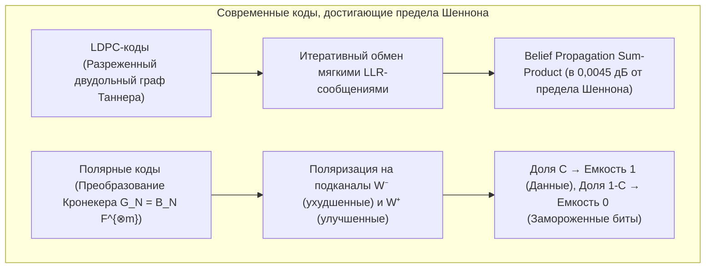

## 1. Введение: два повседневных и одновременно невероятных чуда восстановления информации

Как в глубинах межзвездного пространства, так и в камере вашего смартфона современная цифровая инженерия ежедневно совершает то, что кажется нарушением физической интуиции: <strong>100%-ное побитовое восстановление цифровых данных из сигналов или носителей, серьезно поврежденных тепловым шумом, царапинами или физическим разрушением</strong>.

### Чудо 1: «Вояджер-1» и «Вояджер-2» вещают с 24 миллиардов километров при мощности $10^{-16}\text{ Вт}$

Запущенные в 1977 году зонды <strong>Voyager 1 и Voyager 2</strong> передали детальные снимки Юпитера, Сатурна, Урана и Нептуна и сегодня находятся в межзвездном пространстве на расстоянии более <strong>24 миллиардов километров</strong> от Земли.
Мощность радиопередатчика «Вояджера» составляет всего <strong>$23\text{ Вт}$</strong> — меньше, чем у лампочки в бытовом холодильнике. Когда эта электромагнитная волна достигает 70-метровых антенн Сети дальней космической связи НАСА (DSN) на Земле, принимаемая мощность падает до <strong>$10^{-16}\text{ Вт}$ ($0,1\text{ аттоватта}$)</strong>, полностью утопая в <strong>тепловом шуме (шуме Джонсона — Найквиста)</strong>. Тем не менее «Вояджер» передал кристально четкие цветные фотографии Большого красного пятна Юпитера и атмосферы Нептуна <strong>с нулевым числом неисправимых битовых ошибок</strong>.

### Чудо 2: QR-код, на $30\,\%$ закрытый пятном кофе или логотипом компании

А теперь взгляните на <strong>QR-код</strong>, угол которого залит кофе или <strong>центральные $30\,\%$ площади которого намеренно перекрыты логотипом бренда</strong>. Менее чем за <strong>$10\text{ миллисекунд}$</strong> камера смартфона восстанавливает точный URL или платежный токен с <strong>нулем ошибочных битов (Zero Bit Errors)</strong>.


Как это возможно математически? Ответ кроется в <strong>теории информации Клода Шеннона (1948)</strong> и алгебре <strong>кодов, исправляющих ошибки (Error-Correcting Codes, ECC)</strong>.

---

## 2. Революция Клода Шеннона (1948) и теорема о кодировании для канала с шумом

### 2.1 Почему наивный код с повторением ($0 \to 00000$) терпит крах

До 1948 года инженеры считали очевидным, что для стремления вероятности ошибки $P_e \to 0$ в зашумленном канале скорость передачи информации $R = k/n$ также обязана стремиться к нулю.
Действительно, при передаче бита нечетное число раз $n = 2t + 1$ по <strong>двоичному симметричному каналу (ДСК / BSC)</strong> с вероятностью инверсии $p \in (0, 0,5)$ голосование по большинству ошибается с вероятностью:
$$P_e^{(n)} = \sum_{i = (n+1)/2}^{n} \binom{n}{i} p^i (1-p)^{n-i}$$
При $n \to \infty$ величина $P_e^{(n)} \to 0$, но одновременно кодовая скорость обрушивается в ноль: $R = k/n = 1/n \to 0$.

### 2.2 Теорема Шеннона и фундаментальный предел Шеннона ($-1,59\,\text{дБ}$)

В 1948 году <strong>Клод Шеннон</strong> опубликовал работу *«Математическая теория связи»* и доказал обратное:

> <strong>Теорема (Теорема Шеннона о кодировании для канала с шумом, 1948):</strong>
> Каждый канал без памяти обладает строго положительной <strong>пропускной способностью канала $C > 0$</strong>:
> - Для <strong>двоичного симметричного канала (BSC)</strong> с двоичной функцией энтропии $H_2(p) = -p\log_2 p - (1-p)\log_2(1-p)$:
>   $$C_{\text{BSC}}(p) = 1 - H_2(p) = 1 + p\log_2 p + (1-p)\log_2(1-p) \quad [\text{бит / использование}]$$
> - Для <strong>канала с АБГШ (AWGN)</strong> ширины полосы $B$, мощности сигнала $S$ и мощности шума $N = N_0 B$ (теорема Шеннона — Хартли):
>   $$C_{\text{AWGN}} = B \log_2\!\left(1 + \frac{S}{N}\right) = B \log_2\!\left(1 + \frac{S}{N_0 B}\right) \quad [\text{бит / с}]$$
>
> <strong>Для любой скорости передачи $R < C$ существуют блоковые коды длины $n \to \infty$, обеспечивающие сколь угодно малую вероятность ошибки декодирования ($P_e \to 0$)!</strong>

Полагая $S = E_b R$ и устремляя спектральную эффективность $\eta = R/B \to 0$, из условия $R < C_{\text{AWGN}}$ получаем $\frac{E_b}{N_0} > \lim_{\eta \to 0} \frac{2^\eta - 1}{\eta} = \ln 2 \approx 0,6931$, что дает знаменитый <strong>абсолютный предел Шеннона</strong>:
$$\left(\frac{E_b}{N_0}\right)_{\min} = \ln 2 \approx 0,6931 \implies 10 \log_{10}(\ln 2) \approx \mathbf{-1,5917\,\text{дБ}}$$

---

## 3. Геометрический прорыв Ричарда Хэмминга (1950): расстояние Хэмминга и код $[7, 4, 3]$

### 3.1 Расстояние Хэмминга $d_H(\mathbf{u}, \mathbf{v})$ и граница сферической упаковки

На $n$-мерном гиперкубе $\mathbb{F}_2^n$ <strong>Ричард Хэмминг</strong> (1950) определил <strong>расстояние Хэмминга $d_H(\mathbf{u}, \mathbf{v})$</strong> как число позиций, в которых различаются векторы $\mathbf{u}$ и $\mathbf{v}$:
$$d_H(\mathbf{u}, \mathbf{v}) \triangleq \bigl|\{ i \in \{1, \dots, n\} \mid u_i \neq v_i \}\bigr| = w_H(\mathbf{u} - \mathbf{v})$$

Для кода $\mathcal{C} \subset \mathbb{F}_q^n$ с <strong>минимальным расстоянием $d_{\min} = \min_{\mathbf{u}\neq\mathbf{v}} d_H(\mathbf{u},\mathbf{v})$</strong> геометрия непересекающихся сфер Хэмминга радиуса $t$ доказывает, что код способен:
- <strong>Обнаруживать</strong> $d_{\min} - 1$ ошибок;
- <strong>Исправлять $e = d_{\min} - 1$ стираний (erasures)</strong> на известных позициях;
- <strong>Исправлять $t = \lfloor(d_{\min} - 1)/2\rfloor$ произвольных ошибок</strong> на неизвестных позициях:
$$\mathbf{d_{\min} \ge 2t + e + 1}, \qquad |\mathcal{C}| \cdot \sum_{i=0}^{t} \binom{n}{i} (q-1)^i \le q^n \quad \text{(Граница Хэмминга)}$$

### 3.2 Совершенный код Хэмминга $(7,4)$ и синдромное декодирование

При $n=7, k=4, d_{\min}=3$ ($t=1$) выполняется $2^4 \cdot (1 + 7) = 128 = 2^7$: код $[7,4,3]$ является <strong>совершенным кодом</strong>. Его порождающая матрица $\mathbf{G}_{4\times 7} = [\mathbf{I}_4 \mid \mathbf{P}]$ и проверочная матрица $\mathbf{H}_{3\times 7} = [\mathbf{P}^T \mid \mathbf{I}_3]$ ($\mathbf{G}\mathbf{H}^T = \mathbf{0} \pmod 2$) имеют вид:
$$\mathbf{G}_{4\times 7} = \left(\begin{array}{cccc|ccc}
1 & 0 & 0 & 0 & 1 & 1 & 0 \\
0 & 1 & 0 & 0 & 1 & 0 & 1 \\
0 & 0 & 1 & 0 & 0 & 1 & 1 \\
0 & 0 & 0 & 1 & 1 & 1 & 1
\end{array}\right), \qquad
\mathbf{H}_{3\times 7} = \left(\begin{array}{cccc|ccc}
1 & 1 & 0 & 1 & 1 & 0 & 0 \\
1 & 0 & 1 & 1 & 0 & 1 & 0 \\
0 & 1 & 1 & 1 & 0 & 0 & 1
\end{array}\right)$$

Трехбитный <strong>синдром $\mathbf{s} = \mathbf{H}\mathbf{y}^T = \mathbf{H}(\mathbf{c} + \mathbf{e})^T = \mathbf{H}\mathbf{e}^T \pmod 2$</strong> выделяет столбец матрицы $\mathbf{H}$, соответствующий позиции перевернутого бита: при двоичном упорядочении столбцов от $1$ до $7$ <strong>синдром $\mathbf{s}$ напрямую выдает двоичный номер $(1 \dots 7)$ поврежденного бита</strong>! Эта схема защищает всю серверную память <strong>ECC DRAM (SECDED)</strong>.

---

## 4. Шедевр Рида и Соломона (1960): коды Рида — Соломона над полями Галуа $\mathbb{F}_{2^m}$

### 4.1 Поля Галуа $\text{GF}(2^8)$ и защита от пакетов ошибок (Burst Errors)

Для борьбы с пакетами ошибок (царапины на дисках, пятна на QR-кодах) <strong>Ирвинг Рид</strong> и <strong>Густав Соломон</strong> (1960) объединили каждые $m=8$ бит (1 байт) в единый символ конечного <strong>поля Галуа $\text{GF}(2^8) = \mathbb{F}_2[x]/(x^8 + x^4 + x^3 + x^2 + 1)$</strong>. Даже если все 8 битов внутри одного байта искажены, в поле $\text{GF}(2^8)$ это <strong>всего одна символьная ошибка</strong>!

### 4.2 Полиномиальная интерполяция и граница Синглтона MDS $d_{\min} = n - k + 1$

Блок из $k$ информационных символов $(m_0, \dots, m_{k-1}) \in \mathbb{F}_q^k$ задает многочлен $P(x) = m_0 + m_1 x + \dots + m_{k-1} x^{k-1}$ степени $< k$, вычисляемый в $n$ различных точках: $\mathbf{c} = \bigl(P(\alpha_1), \dots, P(\alpha_n)\bigr)$.
Так как два различных многочлена степени $\le k-1$ над полем $\mathbb{F}_q$ могут совпадать не более чем в $k-1$ точках (а <strong>любые $k$ неповрежденных точек однозначно восстанавливают $P(x)$ по интерполяционной формуле Лагранжа</strong>), любой $[n, k]$-код Рида — Соломона достигает <strong>границы Синглтона со знаком равенства (код MDS — с максимальным расстоянием разделимости)</strong>:
$$\mathbf{d_{\min} = n - k + 1 \implies 2t + e \le n - k}$$

Добавление $n - k$ проверочных байтов позволяет исправить <strong>до $e = n - k$ стираний (RAID-6, облачные хранилища)</strong> или <strong>до $t = \lfloor(n-k)/2\rfloor$ ошибок в неизвестных позициях (QR-коды до 30% площади на уровне H; код $[255, 223]$ на «Вояджере»)</strong> с помощью порождающего многочлена $g(x) = \prod_{i=1}^{2t}(x - \alpha^i)$, алгоритма <strong>Берлекэмпа — Месси / Евклида</strong> ($\Lambda(x)S(x) \equiv \Omega(x) \pmod{x^{2t}}$), <strong>поиска Ченя</strong> и <strong>формулы Форни</strong>.

---

## 5. Вплотную к пределу Шеннона: LDPC-коды (1962), турбо-коды (1993) и полярные коды (2009)

1. <strong>LDPC-коды Роберта Галлагера (1962)</strong>: задаются разреженной проверочной матрицей $\mathbf{H}$ и двудольным <strong>графом Таннера</strong>. Итеративное декодирование методом <strong>распространения доверия (Belief Propagation / Sum-Product)</strong> с мягкими логарифмическими отношениями правдоподобия $L(c_i) = \ln\frac{P(c_i=0|y_i)}{P(c_i=1|y_i)}$ приближается к пределу Шеннона на $0,0045\,\text{дБ}$<strong> (</strong>каналы данных 5G NR, Wi-Fi 6/7, контроллеры 3D NAND SSD).
2. <strong>Полярные коды Эрдала Арыкана (Polar Codes, 2009)</strong>: рекурсивное применение кронекеровой степени $\mathbf{G}_N = \mathbf{B}_N \begin{pmatrix} 1 & 0 \\ 1 & 1 \end{pmatrix}^{\otimes m}$ вызывает <strong>поляризацию канала</strong> — при $N \to \infty$ доля $C = I(W)$ синтетических подканалов стремится к пропускной способности $1$ (без шума, информационные биты), а доля $1 - C$ — к $0$ (<strong>замороженные биты / Frozen Bits $= 0$</strong>). Это первые конструктивные коды со сложностью $O(N \log N)$, <strong>математически доказанно достигающие пропускной способности Шеннона</strong> (<strong>каналы управления 5G NR</strong>).



### Сравнительная таблица семейств кодов коррекции ошибок

| Семейство кодов | Год и авторы | Математическая основа | Алгоритм декодирования | Ключевое преимущество | Основные применения |
| :--- | :--- | :--- | :--- | :--- | :--- |
| <strong>Хэмминга / SECDED</strong> | 1950<br/>Р. Хэмминг | Упаковка сфер в гиперкубе $\mathbb{F}_2^n$ | Синдром $\mathbf{s}=\mathbf{H}\mathbf{y}^T$ ($O(1)$) | Исправление 1 бита за $<1\text{ нс}$ | <strong>Серверная память ECC DRAM</strong>, кэш CPU |
| <strong>Рида — Соломона (RS)</strong> | 1960<br/>Рид и Соломон | Интерполяция полиномов над $\mathbb{F}_{2^m}$ | Берлекэмп — Месси + Чень + Форни | <strong>Оптимум MDS $d_{\min}=n-k+1$</strong> против пакетов ошибок | <strong>QR-коды</strong>, <strong>RAID-6</strong>, облака, «Вояджер» |
| <strong>LDPC-коды</strong> | 1962 Р. Галлагер<br/>(1996 переоткрыты) | Разреженная матрица $\mathbf{H}$ и граф Таннера | <strong>Распространение доверия (Sum-Product)</strong> | В $0,0045\,\text{дБ}$ от предела Шеннона | <strong>5G NR (данные)</strong>, <strong>Wi-Fi 6/7</strong>, <strong>SSD NVMe</strong> |
| <strong>Полярные коды</strong> | 2009<br/>Эрдал Арыкан | Степень Кронекера $\mathbf{F}^{\otimes m}$ | Списочное декодирование CA-SCL ($O(N\log N)$) | <strong>Доказанно достигает емкости Шеннона $C$</strong> | <strong>5G NR (управление)</strong>, 6G IoT |

---

## 6. Полная реализация на Python: код Хэмминга $(7,4)$ и Рида — Соломона над $\text{GF}(2^8)$

```python
from typing import List

def hamming74_demo() -> None:
    G = [[1,0,0,0,1,1,0], [0,1,0,0,1,0,1], [0,0,1,0,0,1,1], [0,0,0,1,1,1,1]]
    H = [[1,1,0,1,1,0,0], [1,0,1,1,0,1,0], [0,1,1,1,0,0,1]]
    msg = [1, 0, 1, 1]
    c = [sum(msg[i] * G[i][j] for i in range(4)) % 2 for j in range(7)]
    y = c.copy()
    y[2] ^= 1
    s = [sum(H[r][col] * y[col] for col in range(7)) % 2 for r in range(3)]
    err_idx = next(col for col in range(7) if [H[r][col] for r in range(3)] == s)
    y[err_idx] ^= 1
    print(f"[Hamming (7,4)] Syndrome={s} -> Flipped idx={err_idx}, Recovered={y[:4] == msg}")

class GF256:
    def __init__(self, poly: int = 0x11D) -> None:
        self.exp, self.log = [0] * 512, [0] * 256
        v = 1
        for i in range(255):
            self.exp[i] = self.exp[i + 255] = v
            self.log[v] = i
            v <<= 1
            if v & 0x100:
                v ^= poly

    def mul(self, a: int, b: int) -> int:
        return 0 if (a == 0 or b == 0) else self.exp[self.log[a] + self.log[b]]

    def inv(self, a: int) -> int:
        return self.exp[255 - self.log[a]]

    def power(self, a: int, p: int) -> int:
        return 1 if p == 0 else (0 if a == 0 else self.exp[(self.log[a] * p) % 255])

    def eval_poly(self, coeffs: List[int], x: int) -> int:
        res = 0
        for c in reversed(coeffs):
            res = self.mul(res, x) ^ c
        return res

    def solve(self, A: List[List[int]], b: List[int]) -> List[int]:
        n = len(b)
        M = [row[:] + [b[i]] for i, row in enumerate(A)]
        for col in range(n):
            piv = next(r for r in range(col, n) if M[r][col] != 0)
            M[col], M[piv] = M[piv], M[col]
            inv_p = self.inv(M[col][col])
            for j in range(col, n + 1):
                M[col][j] = self.mul(M[col][j], inv_p)
            for r in range(n):
                if r != col and M[r][col] != 0:
                    f = M[r][col]
                    for j in range(col, n + 1):
                        M[r][j] ^= self.mul(f, M[col][j])
        return [M[i][n] for i in range(n)]

def rs_demo() -> None:
    gf = GF256()
    text = "VOYAGER-1"
    k, t = len(text), 3
    n = k + 2 * t
    pts = [gf.exp[i] for i in range(n)]
    cw = [gf.eval_poly([ord(c) for c in text], x) for x in pts]
    rx = cw.copy()
    rx[1] ^= 0xFF; rx[6] ^= 0xA5; rx[13] ^= 0x3C
    A = [[gf.power(pts[i], d) for d in range(k + t)] + [gf.mul(rx[i], gf.power(pts[i], d)) for d in range(t)] for i in range(n)]
    b = [gf.mul(rx[i], gf.power(pts[i], t)) for i in range(n)]
    sol = gf.solve(A, b)
    E = sol[k + t:] + [1]
    err_pos = [i for i, x in enumerate(pts) if gf.eval_poly(E, x) == 0]
    valid = [(pts[i], rx[i]) for i in range(n) if i not in err_pos][:k]
    rec = gf.solve([[gf.power(x, d) for d in range(k)] for x, _ in valid], [y for _, y in valid])
    print(f"[RS(15,9) over GF(2^8)] Located Errors={err_pos}, Recovered='{''.join(chr(c) for c in rec)}'")

if __name__ == "__main__":
    hamming74_demo()
    rs_demo()
```

---

## 7. Заключение

От предела Шеннона $-1,59\,\text{дБ}$ (1948) до геометрии Хэмминга (1950), интерполяции Рида — Соломона над полями Галуа $\mathbb{F}_{2^m}$ (1960), графов Таннера LDPC и поляризации каналов Арыкана — теория кодирования демонстрирует триумф чистой математики над тепловым хаосом и физической энтропией Вселенной.
