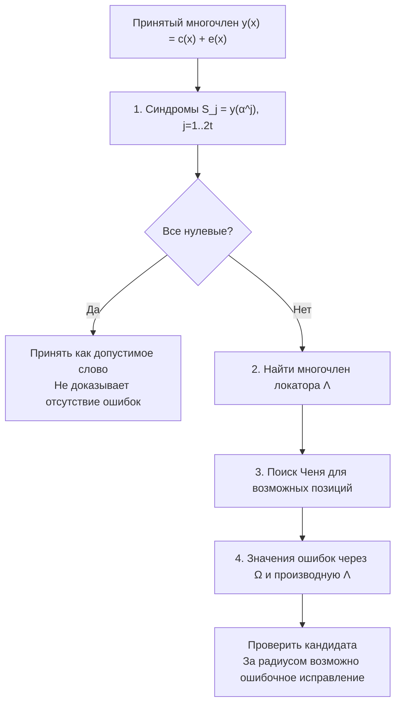
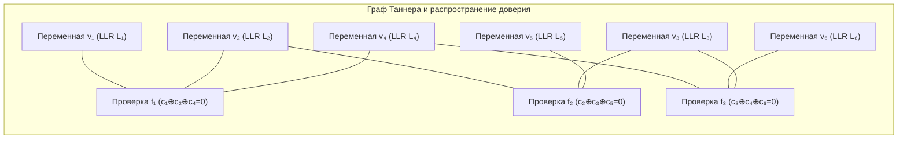
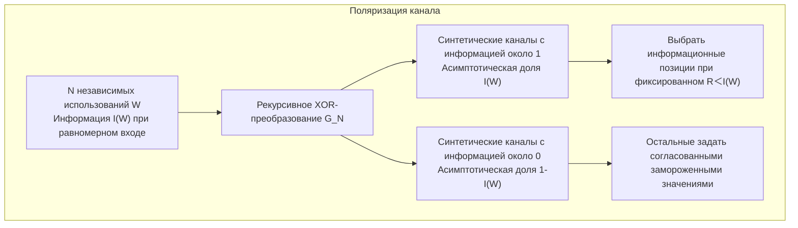

## 1. Введение: что общего у космической связи и QR-кодов

Как восстановить данные из слабого космического сигнала или частично повреждённого QR-кода? <strong>Коды, исправляющие ошибки (ECC)</strong>, добавляют структурированную избыточность. Приёмник использует эти связи, чтобы оценить и исправить изменённые значения. Защита ограничена: конечная избыточность не исправляет любое мыслимое разрушение.

### Космическая связь: принять сигнал и исправить оставшиеся ошибки

«Вояджер-1» и «Вояджер-2» стартовали в 1977 году и посетили Юпитер и Сатурн; второй аппарат продолжил путь к Урану и Нептуну. Не каждый из двух аппаратов посетил все четыре планеты. Здесь примером служит связь во время планетных сближений. Меняющиеся современные расстояния и принимаемую мощность мы не превращаем в постоянные величины.

Остронаправленная антенна аппарата концентрирует радиоэнергию в сторону Земли, где сигнал принимает Deep Space Network (DSN). Затухание и тепловой шум могут оставить ошибки после демодуляции. При переводе единиц $10^{-16}\,\mathrm W=100\,\mathrm{aW}$, то есть 100 аттоватт. Это не измерение для определённой даты и станции.

Доклад JPL, подготовленный к встрече «Вояджера-2» с Ураном, описывает внутренний свёрточный код и внешний код Рида — Соломона (RS) $[255,223]$. Эти ступени уменьшают влияние шума, но не гарантируют безошибочность каждого принятого блока или каждого пикселя.

### QR-коды: процент восстановления не равен произвольно закрываемой площади

QR-коды тоже используют RS. DENSO WAVE описывает приблизительные уровни восстановления 7 %, 15 %, 25 % и 30 %, измеряемые в <strong>8-битных кодовых словах</strong>. Это не означает, что логотипом можно закрыть любые 30 % изображения. Важны служебные узоры, распределение повреждений между RS-блоками и условия съёмки. Универсальной гарантии десяти миллисекунд также нет.

В терминологии QR 8-битное кодовое слово соответствует одному символу используемого здесь математического описания RS. Это не целое RS-слово из $n$ символов. Разделение этих уровней предотвращает путаницу в исправляющей способности каждого блока.


Мы свяжем пропускную способность канала, расстояние Хэмминга, многочлены над конечными полями и вероятностные вычисления на графах. <strong>Исправить все конфигурации до определённого числа ошибок</strong> и <strong>сделать вероятность ошибки сколь угодно малой при росте блока</strong> — разные утверждения.

---

## 2. Теорема кодирования Шеннона и её предпосылки

### 2.1 Повторение: больше надёжности ценой скорости

Повторяя бит и принимая решение большинством, можно уменьшить ошибки. Однако одна эта конструкция требует больше использований канала на информационный бит для повышения надёжности. Это ограничение кода с повторением, а не всех кодов.

Рассмотрим двоичный симметричный канал без памяти (ДСК, BSC) с независимыми инверсиями вероятности $0<p<1/2$. Код с повторением длины три отображает один бит так:

$$
0 \mapsto 000, \qquad 1 \mapsto 111
$$

При передаче 000 слова 011, 101, 110 и 111 приводят к ошибочному решению 1. Должны инвертироваться два или три бита:

$$
P_e^{(3)} = \binom{3}{2} p^2 (1-p) + \binom{3}{3} p^3 = 3p^2(1-p) + p^3
$$

При $p=0{,}01$ получаем $0{,}000298$, примерно $0{,}03\%$. Взамен скорость кода равна:

$$
R = \frac{k}{n} = \frac{1}{3}
$$

Для нечётной длины $n=2t+1$ большинство ошибается, если инвертировано хотя бы $t+1$ битов:

$$
P_e^{(n)} = \sum_{i = (n+1)/2}^{n} \binom{n}{i} p^i (1-p)^{n-i}
$$

По закону больших чисел вероятность ошибки стремится к нулю, но одновременно:

$$
n \to \infty \implies P_e^{(n)} \to 0 \quad \text{но одновременно} \quad R = \frac{1}{n} \to 0
$$

Например, при длине пять используются $0\mapsto00000$, $1\mapsto11111$ со скоростью $1/5$. Этот расчёт не исключает более эффективного кодирования, объединяющего несколько информационных битов в блок.

### 2.2 Пропускная способность и кодирование для канала с шумом

Работа Шеннона 1948 года показала возможность сохранять фиксированную положительную скорость в шумном канале и делать вероятность ошибки сколь угодно малой.

> <strong>Теорема для дискретного канала без памяти с конечными алфавитами:</strong> при заданном законе переходов $W(y\mid x)$ пропускная способность равна $C=\max_{P(X)}I(X;Y)\ge0$, в битах на использование канала. Для любой фиксированной скорости $0<R<C$ существует последовательность всё более длинных блоковых кодов и правил декодирования, у которых вероятность ошибки блока стремится к нулю. При $R>C$ такая сходимость недостижима.

Пропускная способность не обязана быть положительной. Если выход не зависит от входа, $C=0$. При ограничениях стоимости входа или средней мощности максимум берётся с их соблюдением. Одна характеристика интенсивности шума не определяет пропускную способность любого канала.

Это асимптотическая теорема существования при росте длины блока. Она не обещает исправить любым конечным кодом весь возможный шум и не предоставляет автоматически эффективный декодер. Задержка, вычислительные ресурсы и целевая вероятность ошибки остаются условиями проектирования.

### 2.3 Вывод пропускной способности ДСК

Для дискретного канала без памяти:

$$
C = \max_{P(X)} I(X; Y) = \max_{P(X)} \bigl( H(Y) - H(Y \mid X) \bigr)
$$

Запишем выход ДСК как $Y=X\oplus E$. Шумовой бит $E$ независим от $X$ и равен единице с вероятностью $p$. При известном входе остаётся двоичная энтропия:

$$
H(Y \mid X) = H_2(p) \triangleq -p \log_2 p - (1-p) \log_2(1-p)
$$

Выход двоичен, поэтому $H(Y)\le1$ бит. Равномерный вход даёт равномерный выход и достигает $H(Y)=1$, откуда:

$$
C_{\text{BSC}}(p) = 1 - H_2(p) = 1 + p\log_2 p + (1-p)\log_2(1-p) \quad [\text{бит / использование канала}]
$$

Например:

$$
H_2(0{,}1) = -0{,}1 \log_2(0{,}1) - 0{,}9 \log_2(0{,}9) \approx 0{,}4690\text{ бит}
$$

$$
C_{\text{BSC}}(0{,}1) = 1 - 0{,}4690 = 0{,}5310\text{ бит / использование канала}
$$

Поэтому меньшая фиксированная скорость, например $R=0{,}5$, позволяет получить сколь угодно малую вероятность ошибки с подходящими достаточно длинными кодами. Это не гарантия нулевой ошибки при конечной длине и скорости точно на уровне пропускной способности. Аргумент случайного кодирования использует типичное поведение шума в длинных блоках и различимость кодовых слов.

### 2.4 АБГШ и широкополосный предел $-1{,}59\,\text{дБ}$

Аддитивный белый гауссовский шум (АБГШ, AWGN) описывает непрерывные сигналы, а не буквально независимые инверсии битов. Пусть $B$ — ширина полосы в Гц, $S$ — средняя принимаемая мощность в Вт, $N_0$ — односторонняя спектральная плотность мощности шума в Вт/Гц. Мощность шума в полосе равна $N=N_0B$. При ограничении средней мощности, без дополнительного ограничения на двоичный вход, Шеннон — Хартли даёт:

$$
C_{\text{AWGN}} = B \log_2\!\left(1 + \frac{S}{N}\right) = B \log_2\!\left(1 + \frac{S}{N_0 B}\right) \quad [\text{бит / секунду}]
$$

Пусть $E_b$ — принимаемая энергия на информационный бит, а теперь $R$ — информационная скорость в бит/с, так что $S=E_bR$. Единица отличается от прежних битов на использование канала. Условие $R<C_{\mathrm{AWGN}}$ даёт:

$$
R < B \log_2\!\left(1 + \frac{E_b}{N_0} \frac{R}{B}\right)
$$

Со спектральной эффективностью $\eta=R/B$, в бит/с/Гц:

$$
\eta < \log_2\!\left(1 + \eta \frac{E_b}{N_0}\right) \iff 2^\eta - 1 < \eta \frac{E_b}{N_0} \iff \frac{E_b}{N_0} > \frac{2^\eta - 1}{\eta}
$$

В этой идеальной модели берём $\eta\to0$ и используем $2^\eta=1+\eta\ln2+O(\eta^2)$:

$$
\lim_{\eta \to 0} \frac{2^\eta - 1}{\eta} = \ln 2 \approx 0{,}693147
$$

В децибелах:

$$
\left(\frac{E_b}{N_0}\right)_{\min} = \ln 2 \approx 0{,}6931 \implies 10 \log_{10}(\ln 2) \approx \mathbf{-1{,}5917\,\text{дБ}}
$$

Это <strong>инфимум в широкополосном пределе</strong>. При положительной спектральной эффективности необходимая граница равна $(2^\eta-1)/\eta>\ln2$. Отношение $E_b/N_0$ также не равно отношению мощностей $S/N$ между сигналом и всем шумом в полосе. Фраза «сигнал ниже шума» может смешать эти определения.

Приближение к пропускной способности также требует длины блока и задержки. Этот асимптотический результат конкретной модели — не константа всех физических каналов и не обещание безошибочной конечной передачи. Например, ограничение входа двумя значениями меняет соответствующую пропускную способность.

---

## 3. Расстояние Хэмминга, гарантии и код $[7,4,3]$

### 3.1 От существования к вычислимой конструкции

Чтобы применить теорему существования, нужны алгоритмы кодирования и декодирования. Работа Хэмминга 1950 года даёт конкретный пример: добавить проверки чётности и по нарушенным проверкам найти инвертированный бит. Построим код через расстояние и матрицы.

### 3.2 Расстояние и минимальное расстояние

Двоичные последовательности длины $n$ образуют $\mathbb F_2^n$, вершины $n$-мерного гиперкуба. В $\mathbb F_2$ сложение и вычитание — XOR. Расстояние Хэмминга считает различающиеся координаты:

$$
d_H(\mathbf{u}, \mathbf{v}) \triangleq \bigl|\{ i \in \{1, \dots, n\} \mid u_i \neq v_i \}\bigr| = w_H(\mathbf{u} - \mathbf{v})
$$

Здесь $w_H$ считает ненулевые компоненты — вес Хэмминга. Расстояние удовлетворяет неотрицательности, симметрии и неравенству треугольника. Код — подмножество $\mathcal C$ допустимых слов. Двоичный линейный код размерности $k$ содержит $2^k$ кодовых слов. Минимальное расстояние:

$$
d_{\min}(\mathcal{C}) \triangleq \min_{\substack{\mathbf{u}, \mathbf{v} \in \mathcal{C} \\ \mathbf{u} \neq \mathbf{v}}} d_H(\mathbf{u}, \mathbf{v})
$$

В линейном коде разность двух разных кодовых слов снова является ненулевым кодовым словом, поэтому:

$$
d_{\min}(\mathcal{C}) = \min_{\mathbf{c} \in \mathcal{C} \setminus \{\mathbf{0}\}} w_H(\mathbf{c})
$$

### 3.3 Обнаружение, стирания и ошибки неизвестной позиции

1. <strong>Обнаружение:</strong> изменение от одной до $d_{\min}-1$ координат не может превратить допустимое слово в другое допустимое. Проверка принадлежности коду обнаруживает все такие ненулевые конфигурации.
2. <strong>Стирания:</strong> потерянные позиции известны, значения — нет. При не более чем $e\le d_{\min}-1$ стираниях два разных слова всё ещё различаются в сохранённой координате. Если остальные значения верны, переданное слово определяется однозначно.
3. <strong>Ошибки неизвестной позиции:</strong> декодирование к ближайшему кодовому слову исправляет все конфигурации до $t$ ошибок тогда и только тогда, когда шары Хэмминга радиуса $t$ вокруг разных слов не пересекаются.

Если принятое слово принадлежало бы двум шарам, по неравенству треугольника расстояние между центрами было бы не более $2t$. Обратно, для центров на расстоянии не более $2t$ можно распределить различающиеся координаты между двумя выборами и получить слово на расстоянии не более $t$ от обоих. Следовательно:

$$
2t + 1 \le d_{\min} \iff t \le \left\lfloor \frac{d_{\min} - 1}{2} \right\rfloor
$$

Равенство $t=\lfloor(d_{\min}-1)/2\rfloor$ указывает <strong>наибольший гарантированный радиус</strong>, а не каждый меньший допустимый радиус. При не более чем $t$ неизвестных ошибках и $e$ известных стираниях гарантия для всех конфигураций имеет вид:

$$
\mathbf{d_{\min} \ge 2t + e + 1}
$$

После удаления стёртых координат остаётся минимальное расстояние хотя бы $d_{\min}-e$; к этому пространству применяем рассуждение о непересекающихся шарах. Некоторые случаи за границей ещё исправимы, но успех всех конфигураций уже не гарантирован. Неизвестная позиция не требует случайного распределения ошибок.

Шар радиуса $t$ в пространстве с алфавитом размера $q$ содержит $\sum_{i=0}^t\binom ni(q-1)^i$ слов. Непересекающиеся шары должны помещаться в пространстве:

$$
|\mathcal{C}| \cdot \sum_{i=0}^{t} \binom{n}{i} (q-1)^i \le q^n \quad \left(\text{для двоичных кодов: } 2^k \sum_{i=0}^{t} \binom{n}{i} \le 2^n \right)
$$

Код, достигающий равенства, <strong>совершенный</strong>: шары покрывают пространство без пробелов и пересечений. Примеры — Хэмминг, двоичный Голей $[23,12,7]$ и троичный Голей $[11,6,5]$. Классификации требуют своих предпосылок; существуют и нелинейные совершенные коды. Эти примеры не доказывают, какой код Голея использовала конкретная миссия.

### 3.4 Матрицы Хэмминга и синдром

Код $[7,4,3]$ добавляет три проверочных бита к четырём информационным:

$$
2^4 \sum_{i=0}^{1} \binom{7}{i} = 16 \times (1 + 7) = 16 \times 8 = 128 = 2^7
$$

Всего 16 шаров радиуса один, каждый с центром и семью соседями, покрывают все 128 слов.

Удобная конструкция проверочной матрицы помещает двоичное представление $j$ в столбец $j$:

$$
\mathbf{H}_{\text{binary}} = \begin{pmatrix} 0 & 0 & 0 & 1 & 1 & 1 & 1 \\ 0 & 1 & 1 & 0 & 0 & 1 & 1 \\ 1 & 0 & 1 & 0 & 1 & 0 & 1 \end{pmatrix} \begin{matrix} \leftarrow 2^2\text{ разряд} \\ \leftarrow 2^1\text{ разряд} \\ \leftarrow 2^0\text{ разряд} \end{matrix}
$$

Её пятый столбец равен $(1,0,1)^T$. Чтобы оставить четыре бита сообщения в начале, а проверки добавить в конце, используем систематический вид $\mathbf G=[\mathbf I_4\mid\mathbf P]$, $\mathbf H=[\mathbf P^T\mid\mathbf I_3]$:

$$
\mathbf{G}_{4\times 7} = \left(\begin{array}{cccc|ccc} 1 & 0 & 0 & 0 & 1 & 1 & 0 \\ 0 & 1 & 0 & 0 & 1 & 0 & 1 \\ 0 & 0 & 1 & 0 & 0 & 1 & 1 \\ 0 & 0 & 0 & 1 & 1 & 1 & 1 \end{array}\right), \qquad \mathbf{H}_{3\times 7} = \left(\begin{array}{cccc|ccc} 1 & 1 & 0 & 1 & 1 & 0 & 0 \\ 1 & 0 & 1 & 1 & 0 & 1 & 0 \\ 0 & 1 & 1 & 1 & 0 & 0 & 1 \end{array}\right)
$$

Из $\mathbf G\mathbf H^T=0$ следует, что все закодированные слова удовлетворяют:

$$
\mathbf{H}\mathbf{c}^T = \mathbf{0} \pmod 2
$$

Для принятого $\mathbf y=\mathbf c+\mathbf e$ вычисляем <strong>синдром</strong>:

$$
\mathbf{s} = \mathbf{H}\mathbf{y}^T = \mathbf{H}(\mathbf{c} + \mathbf{e})^T = \underbrace{\mathbf{H}\mathbf{c}^T}_{=\mathbf{0}} + \mathbf{H}\mathbf{e}^T = \mathbf{H}\mathbf{e}^T \pmod 2
$$

Он зависит только от ошибки. Инверсия бита $j$ даёт столбец $j$ выбранной матрицы. При двоичном порядке столбцов синдром 101 обозначает позицию 5. В систематическом виде порядок иной, и нужный столбец надо искать. Числовое значение синдрома не всегда равно позиции ошибки. Программа раздела 6 выполняет такой поиск.

Нулевой синдром означает принадлежность коду. При предположении не более одной ошибки он означает отсутствие ошибки; вне этого предположения канал мог заменить одно допустимое слово другим. Несколько ошибок также могут заставить одноошибочный декодер инвертировать первоначально верный бит.

Например, сообщение `[1,0,1,1]` кодируется как `[1,0,1,1,0,1,0]`. Инверсия индекса 2, считая с нуля, — третьего бита — даёт синдром `[0,1,1]`, соответствующий столбцу с индексом 2. Фиксированная схема на семь бит имеет постоянный размер, но вычисление синдрома для общей длины $n$ не всегда имеет сложность $O(1)$.

Добавление бита, обеспечивающего чётную сумму всех восьми битов, даёт расширенный код $[8,4,4]$. Подходящее правило позволяет исправлять один бит и обнаруживать два (SECDED). Это базовая модель для понимания ECC-памяти, не точная архитектура каждого продукта.

---

## 4. Рид — Соломон: конечные поля, интерполяция и декодирование

### 4.1 Почему важны пакеты ошибок

Хэмминг $(7,4)$ исправляет один бит в любой позиции блока. Царапина, пятно на QR или замирание сигнала могут изменить много битов одного блока. Уже две инверсии могут направить одноошибочный декодер к неверному слову.

Конструкция Рида и Соломона 1960 года объединяет биты в <strong>символы</strong> конечного поля. Меняется единица измерения расстояния и исправляющей способности. Пространственное размещение и перемежение тоже определяют, как физическое повреждение затрагивает символы.

### 4.2 Байт как элемент конечного поля

Символ из $m$ бит можно представить в $\mathbb F_{2^m}$. Это не арифметика целых чисел по модулю 256: $2\cdot128\equiv0\pmod{256}$ показывает делители нуля, и эти ненулевые элементы не имеют мультипликативного обратного. Конечные поля существуют ровно для размеров, являющихся степенями простого числа.

В GF(256) байт представляет многочлен степени не выше семи с двоичными коэффициентами. Программа берёт остаток произведения по модулю неприводимого многочлена степени восемь, представленного `0x11D`:

$$
\mathbb{F}_{2^8} \cong \frac{\mathbb{F}_2[x]}{\langle x^8 + x^4 + x^3 + x^2 + 1 \rangle}
$$

Сложение и вычитание — XOR, поскольку $1+1=0$ в поле коэффициентов. 255 ненулевых элементов образуют циклическую мультипликативную группу. В этом представлении $\alpha=x$, байт `0x02`, — примитивный элемент: $\alpha^0,\ldots,\alpha^{254}$ перебирают все ненулевые элементы, а $\alpha^{255}=1$.

Таблицы логарифмов и степеней позволяют умножать и делить ненулевые элементы:

$$
A \cdot B = \alpha^{(i + j) \bmod 255}, \qquad \frac{A}{B} = \alpha^{(i - j) \bmod 255}
$$

Ноль требует отдельной обработки, деление на ноль не определено. Размер таблиц зависит от реализации; иногда таблицу степеней удлиняют, чтобы избежать явного вычисления остатка. В разделе 6 используются сдвиги и XOR.

Несколько повреждённых битов внутри байта считаются одной символьной ошибкой. Переход через границы байтов может затронуть несколько символов. Одно общее число изменённых битов ещё не определяет возможность исправления.

### 4.3 Вычисление значений, интерполяция и граница Синглтона

Две точки с разными абсциссами определяют многочлен степени не выше первой. Если передать пять значений, любые два сохранённых верных значения восстановят многочлен после трёх стираний. Три разные абсциссы определяют многочлен степени не выше второй.

Используем $k$ символов сообщения как коэффициенты:

$$
P(x) \triangleq m_0 + m_1 x + m_2 x^2 + \dots + m_{k-1} x^{k-1} \in \mathbb{F}_q[x]
$$

Выбираем $n$ различных точек $\alpha_i\in\mathbb F_q$ при $k\le n\le q$ и передаём:

$$
\mathbf{c} = \bigl( P(\alpha_1),\; P(\alpha_2),\; \dots,\; P(\alpha_n) \bigr) \in \mathbb{F}_q^n
$$

Из теоремы о множителе $x-a$ следует, что ненулевой многочлен над полем имеет не больше корней, чем его степень. Разность $P-Q$ разных сообщений имеет степень меньше $k$ и обращается в ноль не более чем в $k-1$ точках. Кодовые слова различаются хотя бы в $n-k+1$ координатах.

Для противоположной границы удалим $d_{\min}-1$ координат из всех слов: проекции должны остаться различными. При $q^k$ словах $q^k\le q^{n-d_{\min}+1}$, откуда $d_{\min}\le n-k+1$. RS достигает равенства:

$$
\mathbf{d_{\min} = n - k + 1}
$$

Это свойство <strong>MDS: максимальное минимальное расстояние при фиксированных параметрах</strong>. Оно оптимизирует расстояние при данных алфавите, длине и размерности, не все инженерные характеристики одновременно.

При $r=n-k$ избыточных символах гарантия равна $2t+e\le r$:

- <strong>Известные стирания:</strong> могут отсутствовать до $n-k$ символов. Любые $k$ сохранённых верных значений восстанавливают сообщение по интерполяции Лагранжа:

$$
P(x) = \sum_{j=1}^{k} y_{i_j} \prod_{\substack{m=1 \\ m \neq j}}^{k} \frac{x - x_{i_m}}{x_{i_j} - x_{i_m}}
$$

- <strong>Неизвестные ошибки:</strong> исправляются до $\lfloor(n-k)/2\rfloor$ повреждённых символов независимо от числа изменённых битов в каждом затронутом символе.

### 4.4 Циклический вид и соглашения формулы Форни

Форма через вычисление значений рассматривает сообщение как коэффициенты и передаёт значения многочлена. В циклическом описании координаты слова — коэффициенты другого многочлена, делящегося на порождающий. Код полной длины $n=q-1$ по всем ненулевым точкам имеет эквивалентное циклическое представление при фиксированном соответствии. Укороченный код не обязан быть циклическим на новой длине.

Зафиксируем избыточность $n-k=2t$ и первый корень порождающего многочлена $\alpha^1$. Это соглашения данной выкладки, не всех QR- или космических форматов:

$$
g(x)=\prod_{j=1}^{2t}(x-\alpha^j)
$$

С остатком $r(x)=x^{2t}m(x)\bmod g(x)$ сдвигаем сообщение и вычитаем остаток:

$$
c(x)=x^{2t}m(x)-r(x),\qquad c(\alpha^j)=0\quad(1\le j\le2t)
$$

В характеристике два вычитание остаётся XOR.



1. <strong>Синдромы:</strong> пусть $\nu\le t$ ошибок находятся в позициях $i_l$ и имеют ненулевые значения $Y_l=e_{i_l}$. Определим $X_l=\alpha^{i_l}$. Вычисление в корнях убирает переданное кодовое слово:

$$
S_j=y(\alpha^j)=e(\alpha^j)=\sum_{l=1}^{\nu}Y_lX_l^j,\qquad j=1,\ldots,2t
$$

Нулевой синдром устанавливает только принадлежность коду, не обнаруживает замену одного допустимого слова другим.

2. <strong>Многочлен локатора:</strong>

$$
\Lambda(z)=\prod_{l=1}^{\nu}(1-X_lz)=1+\Lambda_1z+\cdots+\Lambda_\nu z^\nu
$$

Умножая $\Lambda(X_l^{-1})=0$ на $Y_lX_l^{j+\nu}$ и суммируя, получаем линейную рекуррентность:

$$
S_{j+\nu}+\Lambda_1S_{j+\nu-1}+\cdots+\Lambda_\nu S_j=0,\qquad1\le j\le2t-\nu
$$

Берлекэмп — Месси находит минимальную рекуррентность и кандидата, обычно за $O(t^2)$ операций поля. Метод на основе расширенного алгоритма Евклида также решает ключевое уравнение.

3. <strong>Поиск Ченя:</strong> проверяем ненулевые элементы $\alpha^{-i}$, соответствующие координатам, на $\Lambda(\alpha^{-i})=0$. В GF(256) всего 256 элементов, 255 из них ненулевые. Нужно проверить, в частности, совпадение степени локатора с числом допустимых корней.

4. <strong>Значения ошибок:</strong> явно определим многочлен синдромов и оценочный многочлен:

$$
S(z)=S_1+S_2z+\cdots+S_{2t}z^{2t-1},\qquad \Omega(z)=S(z)\Lambda(z)\bmod z^{2t}
$$

При этих определениях Форни даёт:

$$
Y_l=-\frac{\Omega(X_l^{-1})}{\Lambda'(X_l^{-1})}
$$

Для одной ошибки $\Omega=YX$ и $\Lambda'=-X$, поэтому получается $Y$. Дополнительный множитель $X$ дал бы $XY$. Иные соглашения о первом корне или многочлене синдромов могут менять этот множитель; переносить формулу без определений нельзя.

Вычитаем оценённые ошибки и проверяем принадлежность коду и исправленное расстояние. Но принятое слово рядом с другим допустимым может пройти проверки с неверным сообщением. CRC, повторная передача или проверки верхних уровней добавляют защиту; не всякое искажение за гарантированным радиусом обязательно обнаруживается.

### 4.5 QR, хранение и каскадное кодирование в Voyager

- <strong>QR:</strong> L/M/Q/H означают примерно 7/15/25/30 % восстановления 8-битных кодовых слов. Каждый RS-блок должен удовлетворять своим условиям. Версия и уровень меняют данные, избыточность и разбиение на блоки; это не произвольно закрываемая площадь. Закрытие служебных узоров может сорвать распознавание или извлечение слов ещё до RS-декодирования.
- <strong>RAID-6 и распределённое хранение:</strong> отсутствующий диск или фрагмент в известной позиции — стирание. Иллюстративный MDS $[14,10]$ требует $14/10=1{,}4$ объёма данных и выдерживает потерю четырёх фрагментов, если остальные и необходимые метаданные верны. Это не универсальная конфигурация облачных поставщиков. Двойная чётность RAID-6 восстанавливает два диска при своих предпосылках, не любое дополнительное скрытое повреждение или потерю всего объекта.
- <strong>«Вояджер-2»:</strong> доклад JPL 1983 года описывает свёрточный код с длиной кодового ограничения (constraint length) $K=7$ и скоростью $1/2$, перемежение глубины 4 и внешний RS $[255,223]$. Его 32 избыточных байта гарантируют $2t+e\le32$ на RS-слово, то есть 16 байтовых ошибок без стираний. Невыровненный непрерывный пакет из 128 бит может затронуть 17 байт. Перемежение распределяет остаточные пакеты ошибок внутреннего декодера между несколькими RS-словами. Внутренний код этого примера — свёрточный.

---

## 5. LDPC, турбо и полярные коды: надёжность и пропускная способность

### 5.1 Одно расстояние не решает всю задачу

Практический код должен учитывать целевую ошибку, задержку, длину блока, вычисления и стоимость аппаратуры. Полный перебор слов двоичного кода размерности $k$ требует $2^k$ кандидатов. Хорошее минимальное расстояние не означает автоматически эффективное декодирование.

Итеративное декодирование турбо и LDPC использует информацию о надёжности; полярные коды приближаются к симметричной пропускной способности другой конструкцией. Сравнения должны сохранять канал, ограничения входа и скорость. Сравнить всё с широкополосным пределом $-1{,}59\,\text{дБ}$ недостаточно.

### 5.2 Разреженные проверки и распространение доверия

LDPC-коды Галлагера 1962 года используют разреженную проверочную матрицу. Даже для длинных блоков строки и столбцы могут содержать мало ненулевых элементов. Для матрицы $\mathbf H$ размера $m\times n$ размерность равна $k=n-\operatorname{rank}_{\mathbb F_2}(\mathbf H)$, где rank — ранг матрицы. Только при независимых строках это равно $n-m$.

В графе Таннера переменные узлы соответствуют столбцам и битам; проверочные — строкам и уравнениям чётности. Ребро существует точно при $H_{a,i}=1$:



Мягкое решение сохраняет надёжность наблюдения, не сводя его сразу к нулю или единице. Логарифмическое отношение правдоподобия (LLR) можно записать так:

$$
L(c_i) \triangleq \ln \frac{\Pr(c_i = 0 \mid y_i)}{\Pr(c_i = 1 \mid y_i)}
$$

Для равновероятных входов, BPSK единичной амплитуды $0\mapsto+1$, $1\mapsto-1$, независимого шума $Z\sim\mathcal N(0,\sigma^2)$ и наблюдения $y_i=x_i+Z$:

$$
L_{\mathrm{ch}}(c_i)=\ln\frac{p(y_i\mid c_i=0)}{p(y_i\mid c_i=1)}=\frac{2y_i}{\sigma^2}
$$

Другие амплитуды или априорные вероятности меняют формулу. LLR $+10$ сильно поддерживает ноль; $-0{,}1$ лишь слабо поддерживает единицу.

Алгоритм «сумма — произведение» — одна из форм распространения доверия. Он обменивается внешними сообщениями, исключая вклад соседа-получателя:

$$
\mu_{f_a \to v_i} = 2 \operatorname{artanh}\!\left( \prod_{v_j \in N(f_a) \setminus \{v_i\}} \tanh\!\left(\frac{\mu_{v_j \to f_a}}{2}\right) \right)
$$

$$
\mu_{v_i \to f_a} = L_{\text{ch}}(v_i) + \sum_{f_b \in N(v_i) \setminus \{f_a\}} \mu_{f_b \to v_i}
$$

$N$ обозначает соответствующее множество соседей. Расписание итераций задаёт, сообщения какой итерации используются, не меняя исключения получателя.

Разреженная матрица уменьшает число рёбер, но сама по себе не устраняет короткие циклы. На дереве распространение вычисляет точные маргинальные вероятности. В конечном графе с циклами зависимости, ловушечные множества или отсутствие сходимости могут оставить ошибки.

При $E$ рёбрах реализация, разделяющая промежуточные вычисления между соседями, использует примерно $O(E)$ операций на итерацию, или $O(IE)$ для $I$ итераций. Ограниченные степени узлов могут дать $E=O(n)$, но не гарантируют постоянное число итераций. Численная реализация должна учитывать насыщение LLR и область определения $\operatorname{artanh}$.

Результат Chung и соавторов 2001 года относится к <strong>скорости $1/2$ на канале АБГШ с двоичным входом</strong>. Асимптотический порог, рассчитанный эволюцией плотностей, отстоит на $0{,}0045\,\text{дБ}$ от границы пропускной способности этого канала. Отдельная конечная симуляция более простого проекта при длине $10^7$ и BER $10^{-6}$ показывает разрыв $0{,}04\,\text{дБ}$. Это не универсальные характеристики всех устройств и не широкополосный энергетический инфимум.

### 5.3 Полярные коды и симметричная пропускная способность

Конструкция Арыкана 2009 года приближается к $I(W)$, <strong>симметричной пропускной способности</strong> дискретного канала без памяти с двоичным входом: взаимной информации при равномерном входе. Для симметричных каналов это $C$, но для асимметричного канала не обязательно максимум по всем входным распределениям.

Базовое преобразование:

$$
(x_1,x_2)=(u_1,u_2)\begin{pmatrix}1&0\\1&1\end{pmatrix} =(u_1\oplus u_2,u_2)
$$

Синтетический канал $W^-$ оценивает $u_1$ по $(y_1,y_2)$; $W^+$ оценивает $u_2$ по $(y_1,y_2,u_1)$, когда дано верное $u_1$. При независимых равномерных входах цепное правило даёт:

$$
I(W^-)+I(W^+)=2I(W),\qquad I(W^-)\le I(W)\le I(W^+)
$$

«Лучше» и «хуже» относятся здесь к информации; строгое изменение не требуется во всех случаях. При реальном последовательном декодировании предыдущая ошибка может распространиться на следующие решения.

Для $N=2^m$ одно соглашение использует перестановку $\mathbf B_N$, обращающую порядок двоичных цифр индексов, и порождающую матрицу:

$$
\mathbf G_N=\mathbf B_N \begin{pmatrix}1&0\\1&1\end{pmatrix}^{\otimes m}
$$

При любом фиксированном $0<\delta<1$ и $N\to\infty$ доля синтетических каналов с информацией больше $1-\delta$ стремится к $I(W)$; доля с информацией меньше $\delta$ — к $1-I(W)$. На конечной длине не возникает ровно $NI(W)$ идеально бесшумных каналов.



Выбираем информационные позиции с фиксированной скоростью $R<I(W)$ и замораживаем остальные в согласованных значениях. Для общего канала исходная гарантия использует среднее по замороженным значениям и существование подходящего выбора. Для симметричного канала соответствующая граница применима к любому фиксированному выбору.

Кодирование и <strong>последовательное исключение (SC)</strong> требуют времени $O(N\log N)$. Выбор информационного множества — отдельная стоимость построения. Эффективная реализация <strong>списочного последовательного исключения (SCL)</strong> с размером списка $L$ требует $O(LN\log N)$; CRC может помогать выбору кандидата. Ошибка и задержка при конечной длине зависят от конструкции, скорости, размера списка и канала. Общей гарантии отсутствия «пола ошибок» (error floor) нет.

### 5.4 Сравнение семейств

| Код | Математическая структура | Типичное декодирование | Свойства и применение |
| :--- | :--- | :--- | :--- |
| Хэмминга (1950) | Двоичный линейный код; $[7,4,3]$ совершенен | Синдром и поиск столбца | Исправляет бит; базовая модель SECDED |
| Рида — Соломона (1960) | Многочлены конечного поля; свойство MDS | Берлекэмп–Месси/Евклид, Чень, Форни; Welch–Berlekamp по значениям | Символьные ошибки и стирания; QR, хранение, каскадная телеметрия |
| Свёрточный и турбо | Решётки, каскады, перемежение | Витерби; итеративный BCJR | Шумная связь; внутренний код Voyager свёрточный |
| LDPC (1962) | Разреженная матрица и граф Таннера | Распространение доверия с мягкими решениями | Длинные блоки и параллелизм; приближение к границе в конкретных моделях |
| Полярные (2009) | Рекурсивная поляризация и замороженные биты | SC $O(N\log N)$; SCL зависит от $L$ | Асимптотическое приближение к симметричной пропускной способности; часть управления 5G NR |

Общая таблица не означает одинаковую сложность или вероятность ошибки. Не вся управляющая информация 5G кодируется полярными кодами. Например, 3GPP TS 38.212 v19.3.0 в разделах 6.3.1.2–6.3.1.3 различает для восходящей управляющей информации (UCI) на PUCCH нагрузки $A\ge12$ бит с полярным кодированием и $A\le11$ с короткими блоковыми кодами.

---

## 6. Проверка на Python: Хэмминг и RS по значениям над GF(256)

Эта самостоятельная программа Python 3 реализует систематический код Хэмминга $(7,4)$ и <strong>RS по значениям многочлена</strong> из раздела 4.3. Символы сообщения — коэффициенты, обычно не появляющиеся неизменными в начале кодового слова. Это не BM-декодер раздела 4.4; программа не реализует размещение модулей, разбиение на блоки или систематический циклический формат QR. Она не совместима напрямую с QR или космическим аппаратом.

Поле — GF(256) с неприводимым многочленом `0x11D`. Оно отличается от простого поля GF(257) целочисленных остатков по модулю 257. Над ним также строятся коды по значениям, но может появиться символ 256, не помещающийся в байт.

Декодер использует систему типа Welch–Berlekamp. Для возможных степеней $\nu=0,\ldots,t$ ищет приведённый многочлен $E(x)$ со старшим коэффициентом 1 степени $\nu$ и $Q(x)$ степени меньше $k+\nu$, чтобы:

$$
Q(x_i)=y_iE(x_i)\qquad(i=1,\ldots,n)
$$

Неизвестных коэффициентов $k+2\nu$. В характеристике два перенос слагаемого на другую сторону остаётся XOR.

Если истинное сообщение $P$ и ошибок не больше $\nu$, выбираем $E$, обращающийся в ноль в их точках, при необходимости дополняя степень, и $Q=PE$. Обратно, при $n\ge k+2\nu$ у любого решения $Q-PE$ равен нулю хотя бы в $n-\nu$ верных точках, но имеет степень меньше $k+\nu$. Значит, это нулевой многочлен. Аргумент о числе корней обосновывает восстановление.

Пробуются степени от нуля до $t$; обрабатываются прямоугольные системы и дефицит ранга. Делим $Q$ на $E$, требуем нулевого остатка и степени частного меньше $k$, заново кодируем и проверяем расстояние до принятого слова не больше $t$. Обрабатываются ноль ошибок, меньше $t$ и граница. Точки должны быть различны; разрешены от 1 до 256 элементов поля, включая ноль.

Приоритет — учебная ясность, не промышленный RS-декодер и не замер скорости. Возможны до $t+1$ применений общего метода Гаусса. `rs_encode` и `rs_decode` проверяют значения, длины, точки и радиус; внутренние вспомогательные функции многочленов и систем предполагают уже проверенные элементы поля.

```python
"""Educational evaluation RS over GF(256), not a QR parser or wire format."""
from itertools import product


def field_value(a):
    if type(a) is not int or not 0 <= a < 256:
        raise ValueError("Field elements must be integers from 0 through 255")
    return a


def gf_mul(a, b):
    field_value(a)
    field_value(b)
    result = 0
    for _ in range(8):
        if b & 1:
            result ^= a
        b >>= 1
        a <<= 1
        if a & 256:
            a ^= 0x11D
    return result


def gf_pow(a, exponent):
    field_value(a)
    if type(exponent) is not int or exponent < 0:
        raise ValueError("Exponent must be a nonnegative integer")
    result = 1
    while exponent:
        if exponent & 1:
            result = gf_mul(result, a)
        a = gf_mul(a, a)
        exponent >>= 1
    return result


def gf_inv(a):
    field_value(a)
    if a == 0:
        raise ZeroDivisionError("Zero has no multiplicative inverse")
    return gf_pow(a, 254)


def poly_trim(coefficients):
    result = list(coefficients)
    while result and result[-1] == 0:
        result.pop()
    return result


def poly_eval(coefficients, x):
    result = 0
    for coefficient in reversed(coefficients):
        result = gf_mul(result, x) ^ coefficient
    return result


def poly_divmod(numerator, denominator):
    remainder = poly_trim(numerator)
    denominator = poly_trim(denominator)
    if not denominator:
        raise ZeroDivisionError("Zero polynomial divisor")
    quotient = [0] * max(0, len(remainder) - len(denominator) + 1)
    inverse_lead = gf_inv(denominator[-1])
    while remainder and len(remainder) >= len(denominator):
        degree = len(remainder) - len(denominator)
        factor = gf_mul(remainder[-1], inverse_lead)
        quotient[degree] = factor
        for j, coefficient in enumerate(denominator):
            remainder[degree + j] ^= gf_mul(factor, coefficient)
        remainder = poly_trim(remainder)
    return poly_trim(quotient), remainder


def solve_linear_system(rows, rhs, columns):
    """Return one solution (free variables zero), or None if inconsistent."""
    if len(rows) != len(rhs) or any(len(row) != columns for row in rows):
        raise ValueError("Linear-system dimensions do not match")
    matrix = [list(row) + [value] for row, value in zip(rows, rhs)]
    pivot_columns = []
    pivot_row = 0
    for column in range(columns):
        pivot = next(
            (r for r in range(pivot_row, len(matrix)) if matrix[r][column]),
            None,
        )
        if pivot is None:
            continue
        matrix[pivot_row], matrix[pivot] = matrix[pivot], matrix[pivot_row]
        inverse = gf_inv(matrix[pivot_row][column])
        matrix[pivot_row] = [gf_mul(value, inverse) for value in matrix[pivot_row]]
        for r in range(len(matrix)):
            if r != pivot_row and matrix[r][column]:
                factor = matrix[r][column]
                matrix[r] = [
                    a ^ gf_mul(factor, b)
                    for a, b in zip(matrix[r], matrix[pivot_row])
                ]
        pivot_columns.append(column)
        pivot_row += 1
        if pivot_row == len(matrix):
            break
    if any(not any(row[:columns]) and row[columns] for row in matrix):
        return None
    solution = [0] * columns
    for r, column in enumerate(pivot_columns):
        solution[column] = matrix[r][columns]
    return solution


def check_points(points):
    points = list(points)
    if not points or len(points) > 256:
        raise ValueError("Use from 1 through 256 distinct evaluation points")
    for x in points:
        field_value(x)
    if len(set(points)) != len(points):
        raise ValueError("Evaluation points must be distinct")
    return points


def rs_encode(message, points):
    points = check_points(points)
    message = list(message)
    if not 1 <= len(message) <= len(points):
        raise ValueError("Require 1 <= message length <= code length")
    for value in message:
        field_value(value)
    return [poly_eval(message, x) for x in points]


def rs_decode(received, points, k, max_errors):
    points = check_points(points)
    received = list(received)
    n = len(points)
    if len(received) != n:
        raise ValueError("Received length must match evaluation points")
    if type(k) is not int or not 1 <= k <= n:
        raise ValueError("Require integer 1 <= k <= n")
    if type(max_errors) is not int or max_errors < 0 or k + 2 * max_errors > n:
        raise ValueError("Require integer t >= 0 and k + 2t <= n")
    for value in received:
        field_value(value)
    # Try locator degrees 0,...,t: fewer than t errors must also work.
    for errors in range(max_errors + 1):
        columns = k + 2 * errors
        rows, rhs = [], []
        for x, y in zip(points, received):
            powers = [gf_pow(x, degree) for degree in range(k + errors)]
            rows.append(
                powers + [gf_mul(y, gf_pow(x, degree)) for degree in range(errors)]
            )
            rhs.append(gf_mul(y, gf_pow(x, errors)))
        solution = solve_linear_system(rows, rhs, columns)
        if solution is None:
            continue
        q = solution[:k + errors]
        locator = solution[k + errors:] + [1]
        message, remainder = poly_divmod(q, locator)
        if remainder or len(message) > k:
            continue
        message += [0] * (k - len(message))
        codeword = rs_encode(message, points)
        distance = sum(a != b for a, b in zip(codeword, received))
        if distance <= max_errors:
            return message
    raise ValueError("No codeword within the requested correction radius")


G = (
    (1, 0, 0, 0, 1, 1, 0),
    (0, 1, 0, 0, 1, 0, 1),
    (0, 0, 1, 0, 0, 1, 1),
    (0, 0, 0, 1, 1, 1, 1),
)
H = (
    (1, 1, 0, 1, 1, 0, 0),
    (1, 0, 1, 1, 0, 1, 0),
    (0, 1, 1, 1, 0, 0, 1),
)


def bits(values, length):
    values = list(values)
    if len(values) != length or any(type(v) is not int or v not in (0, 1) for v in values):
        raise ValueError("Invalid bit vector")
    return values


def hamming_encode(message):
    message = bits(message, 4)
    return [sum(message[i] * G[i][j] for i in range(4)) % 2 for j in range(7)]


def hamming_decode(received):
    received = bits(received, 7)
    syndrome = [sum(H[r][j] * received[j] for j in range(7)) % 2 for r in range(3)]
    if any(syndrome):
        position = next(j for j in range(7) if [H[r][j] for r in range(3)] == syndrome)
        received[position] ^= 1
    return received[:4]


if __name__ == "__main__":
    hamming_cases = 0
    for message in product((0, 1), repeat=4):
        codeword = hamming_encode(message)
        for position in range(-1, 7):
            received = codeword.copy()
            if position >= 0:
                received[position] ^= 1
            assert hamming_decode(received) == list(message)
            hamming_cases += 1
    print("Hamming no-error/single-error cases:", hamming_cases)

    payload = b"VOYAGER-1"
    points = list(range(1, 16))
    codeword = rs_encode(payload, points)
    print("GF(256) evaluation codeword:", codeword)
    for count in range(4):
        received = codeword.copy()
        for position in range(count):
            received[position] ^= position + 1
        recovered = bytes(rs_decode(received, points, len(payload), 3))
        print("RS corrupted symbols:", count, "recovered:", recovered.decode("ascii"))
        assert recovered == payload
    # A decoder can miscorrect beyond the transmitted word's guaranteed radius.
    # Construct a received word close to a DIFFERENT valid word.
    alternative = list(payload)
    alternative[0] ^= 1
    alternative_codeword = rs_encode(alternative, points)
    received = alternative_codeword.copy()
    received[0] ^= 1
    assert rs_decode(received, points, len(payload), 3) == alternative
    print("Beyond-radius example returns another nearby codeword:", True)
```

Вывод реально исполненной программы:

```text
Hamming no-error/single-error cases: 128
GF(256) evaluation codeword: [77, 162, 167, 64, 87, 173, 26, 217, 215, 33, 189, 173, 212, 41, 124]
RS corrupted symbols: 0 recovered: VOYAGER-1
RS corrupted symbols: 1 recovered: VOYAGER-1
RS corrupted symbols: 2 recovered: VOYAGER-1
RS corrupted symbols: 3 recovered: VOYAGER-1
Beyond-radius example returns another nearby codeword: True
```

Девять байтов превращаются в 15 символов с минимальным расстоянием 7 и гарантированным радиусом 3. Три из пятнадцати — 20 %, не 30 %. Демонстрация изменяет от нуля до трёх начальных позиций; гарантия по числу действует и на несмежных позициях.

Другой допустимый выбор — значения в $\alpha^0,\ldots,\alpha^{14}$ и изменения индексов `[1,6,13]`, считая с нуля. Декодер поддерживает и этот случай. Байты `1..15` как точки дают другое кодовое слово. Три раздельные байтовые ошибки — не непрерывный пакет из 24 битов.

Последний пример строит принятое слово рядом с <strong>другим допустимым кодовым словом</strong>. Декодер возвращает его и проходит проверку расстояния, но не восстанавливает переданное сообщение. Искажение за гарантированным радиусом не всегда обнаружимо. Хэмминг тоже может ошибочно исправить сообщение при нарушении предположения не более одной ошибки.

Независимые конечные проверки учебной программы охватывают все 65 536 произведений GF(256) и отдельно построенный полный каталог из 65 536 слов длины 4 и размерности 2. Для 256 принятых векторов с символами, ограниченными 0–3, декодирование радиуса 1 совпадает с полным перебором этого каталога. Также проверены все позиции и ненулевые значения одной ошибки для трёх сообщений, включая нулевое; случаи с фиксированным seed при разных длинах и числах ошибок; системы с дефицитом ранга; некорректные входы. Это не исполнение всех возможных входов, совместимость с QR или испытание реального оборудования.

---

## 7. Как выбирать между RS, LDPC и полярными кодами

MDS оптимизирует <strong>минимальное расстояние по символам при фиксированных длине и размерности</strong>. Он не оптимизирует одновременно вероятностное декодирование, мягкую информацию, задержку и схемы.

1. <strong>Размер поля и длина:</strong> форма раздела 4.3 удовлетворяет $n\le q$. GF(256), включая ноль, допускает 256 символов; обычная полная циклическая форма по ненулевым точкам имеет 255. Существуют расширения и каскады: «все RS абсолютно ограничены 255 байтами» — слишком общее утверждение. Длинные двоичные коды с разреженными графами дают другие преимущества конструкции.
2. <strong>Мягкая информация:</strong> решая сначала ноль или единицу, мы теряем надёжность, которую используют LDPC и полярные коды. Выигрыш не всегда 2 дБ; он зависит от канала, модуляции, скорости и целевой ошибки. У RS тоже есть методы с мягкой информацией; это не исключительно жёсткое декодирование.
3. <strong>Ячейки хранения:</strong> TLC хранит 3 бита на ячейку, различая 8 состояний; QLC — 4 бита в 16 состояниях. Перекрытие распределений напряжения, хранение и запись могут вызвать ошибки. Дополнительные чтения дают информацию о надёжности, но не все SSD используют один декодер или имеют одинаковые сырые и неисправимые частоты ошибок. Чтение также стоит времени и энергии.

RS удобен при известных стираниях, поскольку любые $k$ сохранённых верных символов достаточны для восстановления. Длинные коды с мягкими решениями полезны на шумных физических линиях. Система может сочетать семейства на разных уровнях. Сравнение ошибок и ограничений QR, SSD и 5G лучше объясняет их сосуществование, чем предполагаемая универсальная замена старых кодов новыми.

---

## 8. Заключение: избыточность с явными гарантиями

Исправление добавляет структуру и использует предположения о повреждении.

1. Шеннон гарантирует сколь угодно малую вероятность ошибки с растущей длиной кодов при фиксированной скорости ниже пропускной способности, заданных канале и ограничениях входа. Это не абсолютная надёжность при конечной длине.
2. Минимальное расстояние гарантирует все конфигурации с $2t+e<d_{\min}$ для $t$ неизвестных ошибок и $e$ стираний. Синдром Хэмминга делает гарантию вычислимой.
3. RS использует корни и интерполяцию над конечными полями для $d_{\min}=n-k+1$. Нужно фиксировать соглашения и учитывать ошибочное исправление за радиусом.
4. LDPC использует разреженные вероятностные графы, полярные коды — поляризацию. Асимптотические пороги, конечные характеристики и стоимость SC/SCL описывают разные аспекты.

Надёжность QR или космической линии зависит от избыточности, единиц, распределения ошибок, проверок и оставшейся вероятности сбоя. Это не восстановление любых повреждённых данных без условий.

Источники:

- [DENSO WAVE: коррекция ошибок QR](https://www.qrcode.com/en/about/error_correction.html) — уровни восстановления и кодовые слова.
- [JPL: Voyager 2](https://www.jpl.nasa.gov/missions/voyager-2/) — планетный маршрут.
- [Lorden, McEliece и Swanson: Node Synchronization for the Viterbi Decoder (1983)](https://tda.jpl.nasa.gov/progress_report/42-73/73C.PDF) — с. 22, каскады и практическая синхронизация.
- [Forney: Введение в алгебраическую теорию кодирования, MIT 6.451, глава 8](https://ocw.mit.edu/courses/6-451-principles-of-digital-communication-ii-spring-2005/01060b08ba74792ee8d85eb82b9efdb4_chap8.pdf) — с. 101–110, расстояние, RS по значениям и восстановление типа Welch–Berlekamp.
- [Chung и соавторы: On the Design of LDPC Codes within 0.0045 dB of the Shannon Limit (2001)](https://www.cse.lehigh.edu/~jingli/teach/S2003turbo/notes/zeroZeroFourFive.pdf) — с. 58, различие порога и конечной симуляции.
- [Arıkan: Channel Polarization (2009)](https://arxiv.org/abs/0807.3917) — симметричная пропускная способность, кодирование и SC; начальные определения и теоремы.
- [Tal и Vardy: List Decoding of Polar Codes](https://arxiv.org/abs/1206.0050) — время и память эффективного SCL.
- [Östergård и Pottonen: классификация совершенных двоичных кодов длины 15](https://arxiv.org/abs/0806.2513) — не единственная линейная конструкция.
- [Elkies: The Theory of Error-Correcting Codes (2013)](https://people.math.harvard.edu/~elkies/M256.13/index.html) — лекции о совершенных кодах и Голее.
- [ETSI TS 138 212 v19.3.0 (2026-04)](https://www.etsi.org/deliver/etsi_ts/138200_138299/138212/19.03.00_60/ts_138212v190300p.pdf) — разделы 6.3.1.2–6.3.1.3, выбор кодирования UCI.
