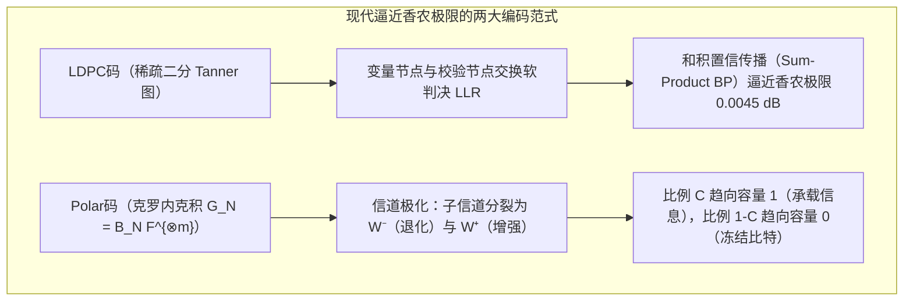

## 1. 引言：两个看似违背直觉的“信息复活”工程奇迹

在现代数字文明的底层，有两个每天都在发生、却在直觉上近乎魔法的工程奇迹：

### 奇迹一：跨越240亿公里的旅行者1号与2号（Voyager 1 & 2）深空通信

1977年发射的<strong>旅行者1号与2号（Voyager 1 & 2）</strong>先后飞掠木星、土星、天王星与海王星，如今已飞出太阳圈进入距离地球超过<strong>240亿公里</strong>的星际空间。
令人震撼的物理事实是：旅行者号上的无线电发射机功率仅有<strong>$23\text{ W}$（瓦特）</strong>——还不如家用冰箱里的一颗照明灯泡。当这束微弱的电磁波跨越数十亿公里的深空到达地球上NASA深空网络（DSN）的70米口径巨型抛物面天线时，接收到的信号功率已衰减至惊人的<strong>$10^{-16}\text{ W}$（$0.1\text{ 阿瓦}$）以下</strong>！

这一功率完全淹没在宇宙背景辐射与接收机内部电子热运动产生的<strong>热噪声（Thermal Noise）海洋</strong>之中。如果直接发送未编码的原始像素比特（$0$ 和 $1$），成千上万的比特会在途中随机翻转（$0 \leftrightarrow 1$），传回地球的图像只会是一片雪花噪点。然而，旅行者号却传回了木星大红斑、土星光环与海王星深邃蓝大气的<strong>零误差高清彩色图像</strong>。

### 奇迹二：被咖啡渍污染或被Logo遮挡30%面积的二维码（QR Code）

另一个奇迹发生在你的手机镜头前。无论是餐厅桌角被咖啡渍染黑了一块的二维码，还是中心<strong>高达30%的黑白模块被企业品牌Logo直接覆盖的二维码</strong>，当你用手机摄像头对准它的瞬间，不到<strong>$10\text{ 毫秒}$</strong>，手机就能以<strong>零比特误差（Zero Bit Errors）</strong>完美还原出完整的网址或支付凭证。


为什么淹没在热噪声中的星际电波和缺失了近三分之一面积的二维码，能够在不需要重传的情况下100%精确复原？答案正是<strong>克劳德·香农（Claude Shannon）的信息论</strong>与<strong>纠错码（Error-Correcting Codes, ECC）</strong>的数学科学。

---

## 2. 克劳德·香农的1948年革命与“有噪信道编码定理”

### 2.1 朴素重复码（Repetition Code）的困境

在1948年之前，通信界普遍认为：<strong>要想在有噪信道中让误码率 $P_e \to 0$，唯一的方法就是让信息传输速率 $R = k/n \to 0$。</strong>
以比特翻转概率为 $p \in (0, 0.5)$ 的<strong>二进制对称信道（BSC）</strong>为例，最直观的纠错方式是<strong>重复码</strong>：将1比特信息重复发送奇数次 $n = 2t + 1$（例如 $0 \mapsto 00000, 1 \mapsto 11111$），接收端采取<strong>多数表决（Majority Voting）</strong>。当至少 $(n+1)/2$ 个比特发生翻转时译码失败，其误块率为：
$$P_e^{(n)} = \sum_{i = (n+1)/2}^{n} \binom{n}{i} p^i (1-p)^{n-i}$$

虽然当 $n \to \infty$ 时，由大数定律可知 $P_e^{(n)} \to 0$，但与此同时，编码速率（Code Rate） $R = k/n = 1/n$ 也不可避免地坍缩为零：
$$n \to \infty \implies P_e^{(n)} \to 0, \quad \text{但同时} \quad R = \frac{1}{n} \to 0$$

### 2.2 香农第二定理与香农极限（Shannon Limit $-1.59\,\text{dB}$）

1948年，<strong>克劳德·香农</strong>在《通信的数学理论》（*A Mathematical Theory of Communication*）中证明了震撼世界的<strong>有噪信道编码定理（Noisy-Channel Coding Theorem）</strong>：

> <strong>【定理：香农有噪信道编码定理】</strong>
> 每一个无记忆有噪信道都存在一个由其噪声统计特性唯一决定的正常数——<strong>信道容量（Channel Capacity） $C$</strong>：
> - 对于翻转概率为 $p$ 的<strong>二进制对称信道（BSC）</strong>，最大化互信息 $I(X;Y) = H(Y) - H(Y\mid X)$ 可得：
>   $$C_{\text{BSC}}(p) = 1 - H_2(p) = 1 + p\log_2 p + (1-p)\log_2(1-p) \quad [\text{bits / channel use}]$$
> - 对于带宽为 $B$、信号功率为 $S$、高斯白噪声功率为 $N = N_0 B$ 的<strong>加性高斯白噪声（AWGN）信道</strong>，<strong>香农-哈特利定理</strong>给出：
>   $$C_{\text{AWGN}} = B \log_2\!\left(1 + \frac{S}{N}\right) = B \log_2\!\left(1 + \frac{S}{N_0 B}\right) \quad [\text{bits / s}]$$
>
> <strong>只要信息传输速率严格小于信道容量（$R < C$），无论 $R$ 多么接近 $C$，当码长 $n \to \infty$ 时，必定存在速率为 $R$ 的分组码使得译码错误概率任意接近于零（$P_e \to 0$）！</strong>

令每信息比特能量为 $E_b$，则信号功率 $S = E_b R$。代入 $R < B \log_2(1 + \frac{E_b R}{N_0 B})$ 并令频谱效率 $\eta = R/B \to 0$，由极限 $\lim_{\eta \to 0} \frac{2^\eta - 1}{\eta} = \ln 2 \approx 0.6931$ 可导出宇宙通信的终极物理界限——<strong>香农极限（Shannon Limit）</strong>：
$$\left(\frac{E_b}{N_0}\right)_{\min} = \ln 2 \approx 0.6931 \implies 10 \log_{10}(\ln 2) \approx \mathbf{-1.5917\,\text{dB}}$$

---

## 3. 理查德·汉明的1950年几何突破：汉明距离与 $[7, 4, 3]$ 完美码

### 3.1 超立方体 $\mathbb{F}_2^n$ 上的汉明距离与球堆积界（Sphere-Packing Bound）

香农用随机编码证明了最优码的“存在性”，而贝尔实验室的<strong>理查德·汉明（Richard Hamming）</strong>则在1950年给出了第一个显式构造。
在 $n$ 维二元超立方体 $\mathbb{F}_2^n$ 上，两个向量 $\mathbf{u}, \mathbf{v}$ 之间不同坐标的个数定义为<strong>汉明距离 $d_H(\mathbf{u}, \mathbf{v})$</strong>：
$$d_H(\mathbf{u}, \mathbf{v}) \triangleq \bigl|\{ i \in \{1, \dots, n\} \mid u_i \neq v_i \}\bigr| = w_H(\mathbf{u} - \mathbf{v})$$

设编码集合 $\mathcal{C} \subset \mathbb{F}_q^n$ 的<strong>最小汉明距离</strong>为 $d_{\min} = \min_{\mathbf{u} \neq \mathbf{v}} d_H(\mathbf{u}, \mathbf{v})$。利用三角不等式与以各码字为中心、半径为 $t$ 的<strong>不相交汉明球（Disjoint Hamming Spheres）</strong>，可以直接证明：
1. <strong>检错能力</strong>：最多可检测 $d_{\min} - 1$ 个比特错误；
2. <strong>擦除纠正能力（Erasure Correction，已知损坏位置）</strong>：最多可恢复 $e = d_{\min} - 1$ 个擦除符号；
3. <strong>随机纠错能力（Error Correction，未知损坏位置）</strong>：最多可纠正 $t = \lfloor(d_{\min} - 1)/2\rfloor$ 个任意位置的错误。
当 $t$ 个未知位置错误与 $e$ 个已知位置擦除同时发生时，充要条件及<strong>汉明球堆积界（Hamming Sphere-Packing Bound）</strong>为：
$$\mathbf{d_{\min} \ge 2t + e + 1}, \qquad |\mathcal{C}| \cdot \sum_{i=0}^{t} \binom{n}{i} (q-1)^i \le q^n$$

### 3.2 汉明 $(7,4)$ 码的生成矩阵 $\mathbf{G}$、校验矩阵 $\mathbf{H}$ 与伴随式译码

当 $n=7, k=4, d_{\min}=3$（即 $t=1$）时，$2^4 \times (1 + \binom{7}{1}) = 16 \times 8 = 128 = 2^7$，汉明界取严格等号，因此<strong>汉明 $[7, 4, 3]$ 码是无死角铺满 $\mathbb{F}_2^7$ 超立方体的完美码（Perfect Code）</strong>。
其系统形式的生成矩阵 $\mathbf{G}_{4\times 7} = [\mathbf{I}_4 \mid \mathbf{P}]$ 与奇偶校验矩阵 $\mathbf{H}_{3\times 7} = [\mathbf{P}^T \mid \mathbf{I}_3]$（满足 $\mathbf{G}\mathbf{H}^T = \mathbf{0} \pmod 2$）为：
$$\mathbf{G}_{4\times 7} = \left(\begin{array}{cccc|ccc}
1 & 0 & 0 & 0 & 1 & 1 & 0 \\
0 & 1 & 0 & 0 & 1 & 0 & 1 \\
0 & 0 & 1 & 0 & 0 & 1 & 1 \\
0 & 0 & 0 & 1 & 1 & 1 & 1
\end{array}\right), \qquad
\mathbf{H}_{3\times 7} = \left(\begin{array}{cccc|ccc}
1 & 1 & 0 & 1 & 1 & 0 & 0 \\
1 & 0 & 1 & 1 & 0 & 1 & 0 \\
0 & 1 & 1 & 1 & 0 & 0 & 1
\end{array}\right)$$

若按列索引 $1 \dots 7$ 的二进制表示排列校验矩阵 $\mathbf{H}_{\text{binary}}$，当接收端收到含噪向量 $\mathbf{y} = \mathbf{c} + \mathbf{e}$ 时，计算3比特<strong>伴随式（Syndrome） $\mathbf{s}$</strong>：
$$\mathbf{s} = \mathbf{H}\mathbf{y}^T = \mathbf{H}\mathbf{c}^T + \mathbf{H}\mathbf{e}^T = \mathbf{H}\mathbf{e}^T \pmod 2$$
若第 $j$ 位发生单比特翻转，则 $\mathbf{s} = \mathbf{H}\mathbf{e}_j^T$ 恰好等于 $\mathbf{H}$ 的第 $j$ 列——<strong>伴随式 $\mathbf{s}$ 的二进制数值直接输出了出错比特的坐标索引 $(1 \dots 7)$</strong>！这一机制至今仍在所有服务器级 <strong>ECC 内存（SECDED DRAM）</strong>中以纳秒级硬件电路实时运行。

---

## 4. 里德与所罗门的1960年杰作：伽罗瓦域 $\mathbb{F}_{2^m}$ 上的里德-所罗门（RS）码

### 4.1 伽罗瓦域 $\text{GF}(2^8)$ 与抗突发错误（Burst Errors）的秘密

汉明码只能纠正零星的单比特翻转，而光盘划痕、二维码污渍或深空通信衰落往往会造成连续数十比特同时损毁的<strong>突发错误（Burst Errors）</strong>。
1960年，<strong>欧文·里德（Irving Reed）</strong>与<strong>古斯塔夫·所罗门（Gustave Solomon）</strong>提出了在<strong>伽罗瓦域（有限域） $\mathbb{F}_{2^m}$</strong> 上构造的<strong>里德-所罗门码（Reed-Solomon Codes）</strong>。

在二维码标准（ISO/IEC 18004）中，选用不可约多项式 $p(x) = x^8 + x^4 + x^3 + x^2 + 1$ 构造具有256个元素的有限域：
$$\text{GF}(2^8) = \mathbb{F}_{2^8} \cong \frac{\mathbb{F}_2[x]}{\langle x^8 + x^4 + x^3 + x^2 + 1 \rangle}$$
在 $\text{GF}(2^8)$ 中，每 $8$ 个连续比特（1字节）被打包为一个<strong>域符号（Symbol）</strong>：加减法就是按位异或（XOR），乘除法则是本原元 $\alpha$ 的幂次指数加减（模255）。即使一个字节内部的8个比特全部被咖啡渍毁坏，在 $\text{GF}(2^8)$ 看来也<strong>仅仅是1个符号发生了错误</strong>！

### 4.2 多项式插值唯一性与达到 Singleton 界的 MDS 性质

设待发送的 $k$ 个信息字节为 $\mathbf{m} = (m_0, m_1, \dots, m_{k-1}) \in \mathbb{F}_q^k$，将其作为系数构造次数 $\le k-1$ 的多项式：
$$P(x) = m_0 + m_1 x + m_2 x^2 + \dots + m_{k-1} x^{k-1} \in \mathbb{F}_q[x]$$
在 $\mathbb{F}_q$ 中选取 $n$ 个互不相同的求值点 $(\alpha_1, \dots, \alpha_n)$，发送求值向量 $\mathbf{c} = \bigl(P(\alpha_1), P(\alpha_2), \dots, P(\alpha_n)\bigr)$。

根据<strong>有限域上的代数学基本定理</strong>：
- 次数 $< k$ 的非零多项式最多只有 $k-1$ 个根。因此，任意两个不同的消息多项式 $P(x) \neq Q(x)$ 最多只能在 $k-1$ 个求值点上相等，在其余至少 $n - (k-1) = n - k + 1$ 个点上必然不同！
- 于是，任何 $[n, k]$ 里德-所罗门码都以严格等号达到理论上限 <strong>Singleton 界（最大距离可分码，MDS Code）</strong>：
  $$\mathbf{d_{\min} = n - k + 1 \implies 2t + e \le n - k}$$

这意味着：增加 $n-k$ 个冗余校验字节，就能完美恢复<strong>任意 $e = n - k$ 个已知位置的擦除（用于 RAID-6 双盘容错与 AWS/阿里云纠删码存储）</strong>，或者完美纠正<strong>任意 $t = \lfloor(n-k)/2\rfloor$ 个未知位置的字节错误（用于二维码 L/M/Q/H 四级纠错，H级允许高达30%面积损毁，以及旅行者号 $[255, 223]$ 外码）</strong>！在循环码实现中，利用生成多项式 $g(x) = \prod_{i=1}^{2t}(x - \alpha^i)$ 编码，接收端通过计算伴随式 $S_j = y(\alpha^j)$，利用 <strong>Berlekamp-Massey 算法或扩展欧几里得算法</strong>求解关键方程 $\Lambda(x)S(x) \equiv \Omega(x) \pmod{x^{2t}}$ 得到错误位置多项式 $\Lambda(x) = \prod_{l=1}^\nu (1 - X_l x)$，再经由<strong>钱氏搜索（Chien Search）</strong>与 <strong>Forney 公式</strong>即可在几毫秒内精准算出所有错误字节的位置与数值。

---

## 5. 逼近香农极限：LDPC码（1962）、Turbo码（1993）与极化码 Polar Codes（2009）

为了跨越硬判决代数译码与香农极限之间的最后 $3\,\text{dB}$ 鸿沟，现代通信迎来了两大终极武器：
1. <strong>罗伯特·加拉格尔（Robert Gallager, 1962）的低密度奇偶校验码（LDPC Codes）</strong>：采用极度稀疏的校验矩阵 $\mathbf{H}$ 构造二分<strong>坦纳图（Tanner Graph）</strong>，利用接收信号的连续软判决对数似然比 $L(c_i) = \ln\frac{P(c_i=0|y_i)}{P(c_i=1|y_i)}$ 在变量节点与校验节点之间进行迭代<strong>置信传播（Belief Propagation / 和积算法 Sum-Product）</strong>。经密度进化优化的非规则LDPC码已逼近香农极限仅差 $0.0045\,\text{dB}$<strong>，成为 </strong>5G NR 数据信道、Wi-Fi 6/7 与现代 3D NAND SSD 固态硬盘的核心标准。
2. <strong>埃达尔·阿里坎（Erdal Arıkan, 2009）的极化码（Polar Codes）</strong>：利用克罗内克积核矩阵 $\mathbf{G}_N = \mathbf{B}_N \begin{pmatrix} 1 & 0 \\ 1 & 1 \end{pmatrix}^{\otimes m}$ 对 $N = 2^m$ 个独立信道实施递归<strong>信道极化（Channel Polarization）</strong>。当 $N \to \infty$ 时，比例恰为 $C = I(W)$ 的合成子信道容量趋向于 $1$（完全无噪），其余 $1 - C$ 的子信道容量趋向于 $0$（纯噪声）。只需在容量趋近 $1$ 的子信道发送信息比特、将容量趋近 $0$ 的子信道固定为已知的<strong>冻结比特（Frozen Bits $0$）</strong>，配合连续消除列表译码（CA-SCL），即可在 $O(N \log N)$ 复杂度下<strong>在数学上首次严格证明达到香农容量 $C$</strong>，并被确立为 <strong>5G NR 控制信道</strong>国际标准。



### 主流纠错码体系全景对比表

| 编码体系 | 提出年份与学者 | 核心数学结构 | 译码算法与复杂度 | 纠错特性与优势 | 典型工业应用场景 |
| :--- | :--- | :--- | :--- | :--- | :--- |
| <strong>汉明码 Hamming</strong> | 1950<br/>R. Hamming | $\mathbb{F}_2^n$ 超立方体完美球堆积 | 伴随式矩阵乘法 $\mathbf{s}=\mathbf{H}\mathbf{y}^T$ ($O(1)$) | 纳秒级单比特纠错、双比特检错 (SECDED) | 服务器 <strong>ECC DRAM 内存</strong>、CPU 缓存 |
| <strong>里德-所罗门码 RS</strong> | 1960<br/>Reed & Solomon | 伽罗瓦域 $\mathbb{F}_{2^m}$ 多项式插值 | Berlekamp-Massey + 钱氏搜索 + Forney | 达到 Singleton 界 $d_{\min}=n-k+1$，抗突发错误与擦除最强 | <strong>二维码 (QR Code)</strong>、<strong>RAID-6</strong>、云存储纠删码、旅行者号外码 |
| <strong>LDPC 低密度奇偶校验码</strong> | 1962 R. Gallager<br/>(1996 重新发现) | 稀疏校验矩阵 $\mathbf{H}$ 与二分 Tanner 图 | 软判决迭代<strong>置信传播 (Belief Propagation)</strong> | 距香农极限仅 $0.0045\,\text{dB}$，支持高吞吐硬件并行 | <strong>5G NR 数据信道</strong>、<strong>Wi-Fi 6/7</strong>、<strong>NVMe SSD (3D NAND)</strong> |
| <strong>极化码 Polar Codes</strong> | 2009<br/>Erdal Arıkan | 克罗内克积 $\mathbf{F}^{\otimes m}$ <strong>信道极化</strong> | 连续消除列表译码 (CA-SCL, $O(N\log N)$) | <strong>数学上首个严格达到香农容量 $C$</strong>，无错误平层 | <strong>5G NR 控制信道</strong>、超可靠低时延通信 |

---

## 6. Python 完整实战验证：汉明 $(7,4)$ 码与伽罗瓦域 $\text{GF}(2^8)$ 里德-所罗门译码器

下面的 Python 代码实现了汉明 $(7,4)$ 伴随式译码器，以及基于二维码标准有限域 $\text{GF}(2^8)$（不可约多项式 `0x11D`）的里德-所罗门编码与 Welch-Berlekamp 代数纠错译码：

```python
from typing import List

def hamming74_demo() -> None:
    G = [[1,0,0,0,1,1,0], [0,1,0,0,1,0,1], [0,0,1,0,0,1,1], [0,0,0,1,1,1,1]]
    H = [[1,1,0,1,1,0,0], [1,0,1,1,0,1,0], [0,1,1,1,0,0,1]]
    msg = [1, 0, 1, 1]
    c = [sum(msg[i] * G[i][j] for i in range(4)) % 2 for j in range(7)]
    y = c.copy()
    y[2] ^= 1  # 翻转第2位
    s = [sum(H[r][col] * y[col] for col in range(7)) % 2 for r in range(3)]
    err_idx = next(col for col in range(7) if [H[r][col] for r in range(3)] == s)
    y[err_idx] ^= 1
    print(f"[Hamming (7,4)] Syndrome={s} -> Flipped idx={err_idx}, Recovered={y[:4] == msg}")

class GF256:
    def __init__(self, poly: int = 0x11D) -> None:
        self.exp, self.log = [0] * 512, [0] * 256
        v = 1
        for i in range(255):
            self.exp[i] = self.exp[i + 255] = v
            self.log[v] = i
            v <<= 1
            if v & 0x100:
                v ^= poly

    def mul(self, a: int, b: int) -> int:
        return 0 if (a == 0 or b == 0) else self.exp[self.log[a] + self.log[b]]

    def inv(self, a: int) -> int:
        return self.exp[255 - self.log[a]]

    def power(self, a: int, p: int) -> int:
        return 1 if p == 0 else (0 if a == 0 else self.exp[(self.log[a] * p) % 255])

    def eval_poly(self, coeffs: List[int], x: int) -> int:
        res = 0
        for c in reversed(coeffs):
            res = self.mul(res, x) ^ c
        return res

    def solve(self, A: List[List[int]], b: List[int]) -> List[int]:
        n = len(b)
        M = [row[:] + [b[i]] for i, row in enumerate(A)]
        for col in range(n):
            piv = next(r for r in range(col, n) if M[r][col] != 0)
            M[col], M[piv] = M[piv], M[col]
            inv_p = self.inv(M[col][col])
            for j in range(col, n + 1):
                M[col][j] = self.mul(M[col][j], inv_p)
            for r in range(n):
                if r != col and M[r][col] != 0:
                    f = M[r][col]
                    for j in range(col, n + 1):
                        M[r][j] ^= self.mul(f, M[col][j])
        return [M[i][n] for i in range(n)]

def rs_demo() -> None:
    gf = GF256()
    text = "VOYAGER-1"
    k, t = len(text), 3
    n = k + 2 * t
    pts = [gf.exp[i] for i in range(n)]
    cw = [gf.eval_poly([ord(c) for c in text], x) for x in pts]
    rx = cw.copy()
    rx[1] ^= 0xFF; rx[6] ^= 0xA5; rx[13] ^= 0x3C  # 破坏3个字节
    A = [[gf.power(pts[i], d) for d in range(k + t)] + [gf.mul(rx[i], gf.power(pts[i], d)) for d in range(t)] for i in range(n)]
    b = [gf.mul(rx[i], gf.power(pts[i], t)) for i in range(n)]
    sol = gf.solve(A, b)
    E = sol[k + t:] + [1]
    err_pos = [i for i, x in enumerate(pts) if gf.eval_poly(E, x) == 0]
    valid = [(pts[i], rx[i]) for i in range(n) if i not in err_pos][:k]
    rec = gf.solve([[gf.power(x, d) for d in range(k)] for x, _ in valid], [y for _, y in valid])
    print(f"[RS(15,9) over GF(2^8)] Located Errors={err_pos}, Recovered='{''.join(chr(c) for c in rec)}'")

if __name__ == "__main__":
    hamming74_demo()
    rs_demo()
```

---

## 7. 结语

从克劳德·香农在1948年揭示信道容量 $C$ 与 $-1.59\,\text{dB}$ 香农极限，到汉明在超立方体上建立伴随式几何，再到里德与所罗门利用伽罗瓦域 $\mathbb{F}_{2^m}$ 上的多项式插值实现 MDS 突发纠错，直至加拉格尔的 LDPC 置信传播与阿里坎的信道极化最终触及香农极限——正是这一座横跨代数、几何与概率论的数学丰碑，使得人类能够在充满热噪声与熵增的物理宇宙中，构建起毫厘不差的数字文明。
