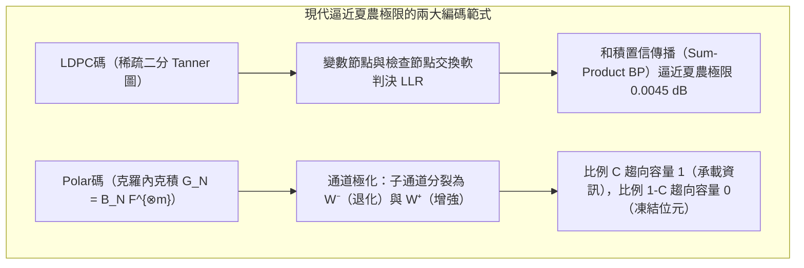

## 1. 引言：兩個看似違背直覺的「資訊復活」工程奇蹟

在現代數位文明的底層，有兩個每天都在發生、卻在直覺上近乎魔法的工程奇蹟：

### 奇蹟一：跨越240億公里的航海家1號與2號（Voyager 1 & 2）深空通訊

1977年發射的<strong>航海家1號與2號（Voyager 1 & 2）</strong>先後飛掠木星、土星、天王星與海王星，如今已飛出太陽圈進入距離地球超過<strong>240億公里</strong>的星際空間。
令人震撼的物理事實是：航海家號上的無線電發射機功率僅有<strong>$23\text{ W}$（瓦特）</strong>——還不如家用冰箱裡的一顆小燈泡。當這束微弱的電磁波跨越數十億公里的深空到達地球上NASA深空網路（DSN）的70公尺口徑巨型拋物面天線時，接收到的訊號功率已衰減至驚人的<strong>$10^{-16}\text{ W}$（$0.1\text{ 阿瓦}$）以下</strong>！

這一功率完全淹沒在宇宙背景輻射與接收機內部電子熱運動產生的<strong>熱雜訊（Thermal Noise）海洋</strong>之中。如果直接發送未編碼的原始像素位元（$0$ 和 $1$），成千上萬的位元會在途中隨機翻轉（$0 \leftrightarrow 1$），傳回地球的影像只會是一片雪花雜訊。然而，航海家號卻傳回了木星大紅斑、土星光環與海王星深邃藍大氣的<strong>零誤差高解析度彩色影像</strong>。

### 奇蹟二：被咖啡漬污染或被Logo遮擋30%面積的 QR Code

另一個奇蹟發生在你的手機鏡頭前。無論是餐廳桌角被咖啡漬染黑了一塊的 QR Code，還是中心<strong>高達30%的黑白模組被企業品牌Logo直接覆蓋的 QR Code</strong>，當你用手機相機對準它的瞬間，不到<strong>$10\text{ 毫秒}$</strong>，手機就能以<strong>零位元誤差（Zero Bit Errors）</strong>完美還原出完整的網址或支付憑證。


為什麼淹沒在熱雜訊中的星際電波和缺失了近三分之一面積的條碼，能夠在不需要重傳的情況下100%精確復原？答案正是<strong>克勞德·夏農（Claude Shannon）的資訊理論</strong>與<strong>錯誤更正碼（Error-Correcting Codes, ECC）</strong>的數學科學。

---

## 2. 克勞德·夏農的1948年革命與「有噪通道編碼定理」

### 2.1 樸素重複碼（Repetition Code）的困境

在1948年之前，通訊界普遍認為：<strong>要想在有噪通道中讓誤碼率 $P_e \to 0$，唯一的方法就是讓資訊傳輸速率 $R = k/n \to 0$。</strong>
以位元翻轉機率為 $p \in (0, 0.5)$ 的<strong>二元對稱通道（BSC）</strong>為例，最直觀的糾錯方式是<strong>重複碼</strong>：將1位元資訊重複發送奇數次 $n = 2t + 1$（例如 $0 \mapsto 00000, 1 \mapsto 11111$），接收端採取<strong>多數決（Majority Voting）</strong>。當至少 $(n+1)/2$ 個位元發生翻轉時解碼失敗，其區塊錯誤率為：
$$P_e^{(n)} = \sum_{i = (n+1)/2}^{n} \binom{n}{i} p^i (1-p)^{n-i}$$

雖然當 $n \to \infty$ 時，由大數法則可知 $P_e^{(n)} \to 0$，但與此同時，編碼速率（Code Rate） $R = k/n = 1/n$ 也不可避免地坍縮為零：
$$n \to \infty \implies P_e^{(n)} \to 0, \quad \text{但同時} \quad R = \frac{1}{n} \to 0$$

### 2.2 夏農第二定理與夏農極限（Shannon Limit $-1.59\,\text{dB}$）

1948年，<strong>克勞德·夏農</strong>在《通訊的數學理論》（*A Mathematical Theory of Communication*）中證明了震撼世界的<strong>有噪通道編碼定理（Noisy-Channel Coding Theorem）</strong>：

> <strong>【定理：夏農有噪通道編碼定理】</strong>
> 每一個無記憶有噪通道都存在一個由其雜訊統計特性唯一決定的正常數——<strong>通道容量（Channel Capacity） $C$</strong>：
> - 對於翻轉機率為 $p$ 的<strong>二元對稱通道（BSC）</strong>，最大化互資訊 $I(X;Y) = H(Y) - H(Y\mid X)$ 可得：
>   $$C_{\text{BSC}}(p) = 1 - H_2(p) = 1 + p\log_2 p + (1-p)\log_2(1-p) \quad [\text{bits / channel use}]$$
> - 對於頻寬為 $B$、訊號功率為 $S$、高斯白雜訊功率為 $N = N_0 B$ 的<strong>加性高斯白雜訊（AWGN）通道</strong>，<strong>夏農-哈特利定理</strong>給出：
>   $$C_{\text{AWGN}} = B \log_2\!\left(1 + \frac{S}{N}\right) = B \log_2\!\left(1 + \frac{S}{N_0 B}\right) \quad [\text{bits / s}]$$
>
> <strong>只要資訊傳輸速率嚴格小於通道容量（$R < C$），無論 $R$ 多麼接近 $C$，當碼長 $n \to \infty$ 時，必定存在速率為 $R$ 的區塊碼使得解碼錯誤機率任意接近於零（$P_e \to 0$）！</strong>

令每資訊位元能量為 $E_b$，則訊號功率 $S = E_b R$。代入 $R < B \log_2(1 + \frac{E_b R}{N_0 B})$ 並令頻譜效率 $\eta = R/B \to 0$，由極限 $\lim_{\eta \to 0} \frac{2^\eta - 1}{\eta} = \ln 2 \approx 0.6931$ 可導出宇宙通訊的終極物理界限——<strong>夏農極限（Shannon Limit）</strong>：
$$\left(\frac{E_b}{N_0}\right)_{\min} = \ln 2 \approx 0.6931 \implies 10 \log_{10}(\ln 2) \approx \mathbf{-1.5917\,\text{dB}}$$

---

## 3. 理查·漢明的1950年幾何突破：漢明距離與 $[7, 4, 3]$ 完美碼

### 3.1 超立方體 $\mathbb{F}_2^n$ 上的漢明距離與球堆積界（Sphere-Packing Bound）

夏農用隨機編碼證明了最優碼的「存在性」，而貝爾實驗室的<strong>理查·漢明（Richard Hamming）</strong>則在1950年給出了第一個顯式構造。
在 $n$ 維二元超立方體 $\mathbb{F}_2^n$ 上，兩個向量 $\mathbf{u}, \mathbf{v}$ 之間不同座標的個數定義為<strong>漢明距離 $d_H(\mathbf{u}, \mathbf{v})$</strong>：
$$d_H(\mathbf{u}, \mathbf{v}) \triangleq \bigl|\{ i \in \{1, \dots, n\} \mid u_i \neq v_i \}\bigr| = w_H(\mathbf{u} - \mathbf{v})$$

設編碼集合 $\mathcal{C} \subset \mathbb{F}_q^n$ 的<strong>最小漢明距離</strong>為 $d_{\min} = \min_{\mathbf{u} \neq \mathbf{v}} d_H(\mathbf{u}, \mathbf{v})$。利用三角不等式與以各碼字為中心、半徑為 $t$ 的<strong>不相交漢明球（Disjoint Hamming Spheres）</strong>，可以直接證明：
1. <strong>偵錯能力</strong>：最多可偵測 $d_{\min} - 1$ 個位元錯誤；
2. <strong>抹除更正能力（Erasure Correction，已知損壞位置）</strong>：最多可恢復 $e = d_{\min} - 1$ 個抹除符號；
3. <strong>隨機更正能力（Error Correction，未知損壞位置）</strong>：最多可更正 $t = \lfloor(d_{\min} - 1)/2\rfloor$ 個任意位置的錯誤。
當 $t$ 個未知位置錯誤與 $e$ 個已知位置抹除同時發生時，充要條件及<strong>漢明球堆積界（Hamming Sphere-Packing Bound）</strong>為：
$$\mathbf{d_{\min} \ge 2t + e + 1}, \qquad |\mathcal{C}| \cdot \sum_{i=0}^{t} \binom{n}{i} (q-1)^i \le q^n$$

### 3.2 漢明 $(7,4)$ 碼的生成矩陣 $\mathbf{G}$、同位元檢查矩陣 $\mathbf{H}$ 與伴隨式解碼

當 $n=7, k=4, d_{\min}=3$（即 $t=1$）時，$2^4 \times (1 + \binom{7}{1}) = 16 \times 8 = 128 = 2^7$，漢明界取嚴格等號，因此<strong>漢明 $[7, 4, 3]$ 碼是無死角鋪滿 $\mathbb{F}_2^7$ 超立方體的完美碼（Perfect Code）</strong>。
其系統形式的生成矩陣 $\mathbf{G}_{4\times 7} = [\mathbf{I}_4 \mid \mathbf{P}]$ 與檢查矩陣 $\mathbf{H}_{3\times 7} = [\mathbf{P}^T \mid \mathbf{I}_3]$（滿足 $\mathbf{G}\mathbf{H}^T = \mathbf{0} \pmod 2$）為：
$$\mathbf{G}_{4\times 7} = \left(\begin{array}{cccc|ccc}
1 & 0 & 0 & 0 & 1 & 1 & 0 \\
0 & 1 & 0 & 0 & 1 & 0 & 1 \\
0 & 0 & 1 & 0 & 0 & 1 & 1 \\
0 & 0 & 0 & 1 & 1 & 1 & 1
\end{array}\right), \qquad
\mathbf{H}_{3\times 7} = \left(\begin{array}{cccc|ccc}
1 & 1 & 0 & 1 & 1 & 0 & 0 \\
1 & 0 & 1 & 1 & 0 & 1 & 0 \\
0 & 1 & 1 & 1 & 0 & 0 & 1
\end{array}\right)$$

若按行索引 $1 \dots 7$ 的二進位表示排列檢查矩陣 $\mathbf{H}_{\text{binary}}$，當接收端收到含噪向量 $\mathbf{y} = \mathbf{c} + \mathbf{e}$ 時，計算3位元<strong>伴隨式（Syndrome） $\mathbf{s}$</strong>：
$$\mathbf{s} = \mathbf{H}\mathbf{y}^T = \mathbf{H}\mathbf{c}^T + \mathbf{H}\mathbf{e}^T = \mathbf{H}\mathbf{e}^T \pmod 2$$
若第 $j$ 位發生單位元翻轉，則 $\mathbf{s} = \mathbf{H}\mathbf{e}_j^T$ 恰好等於 $\mathbf{H}$ 的第 $j$ 行——<strong>伴隨式 $\mathbf{s}$ 的二進位數值直接輸出了出錯位元的座標索引 $(1 \dots 7)$</strong>！這一機制至今仍在所有伺服器級 <strong>ECC 記憶體（SECDED DRAM）</strong>中以奈秒級硬體電路即時運行。

---

## 4. 里德與所羅門的1960年傑作：伽羅瓦體 $\mathbb{F}_{2^m}$ 上的里德-所羅門（RS）碼

### 4.1 伽羅瓦體 $\text{GF}(2^8)$ 與抗突發錯誤（Burst Errors）的秘密

漢明碼只能更正零星的單位元翻轉，而光碟刮痕、QR Code 污漬或深空通訊衰落往往會造成連續數十位元同時損毀的<strong>突發錯誤（Burst Errors）</strong>。
1960年，<strong>歐文·里德（Irving Reed）</strong>與<strong>古斯塔夫·所羅門（Gustave Solomon）</strong>提出了在<strong>伽羅瓦體（有限體） $\mathbb{F}_{2^m}$</strong> 上構造的<strong>里德-所羅門碼（Reed-Solomon Codes）</strong>。

在 QR Code 標準（ISO/IEC 18004）中，選用不可約多項式 $p(x) = x^8 + x^4 + x^3 + x^2 + 1$ 構造具有256個元素的有限體：
$$\text{GF}(2^8) = \mathbb{F}_{2^8} \cong \frac{\mathbb{F}_2[x]}{\langle x^8 + x^4 + x^3 + x^2 + 1 \rangle}$$
在 $\text{GF}(2^8)$ 中，每 $8$ 個連續位元（1位元組）被打包為一個<strong>體符號（Symbol）</strong>：加減法就是逐位元互斥或（XOR），乘除法則透過本原元 $\alpha$ 的冪次指數加減（模255）完成。即使一個位元組內部的8個位元全部被咖啡漬毀壞，在 $\text{GF}(2^8)$ 看來也<strong>僅僅是1個符號發生了錯誤</strong>！

### 4.2 多項式插值唯一性與達到 Singleton 界的 MDS 性質

設待發送的 $k$ 個資訊位元組為 $\mathbf{m} = (m_0, m_1, \dots, m_{k-1}) \in \mathbb{F}_q^k$，將其作為係數構造次數 $\le k-1$ 的多項式：
$$P(x) = m_0 + m_1 x + m_2 x^2 + \dots + m_{k-1} x^{k-1} \in \mathbb{F}_q[x]$$
在 $\mathbb{F}_q$ 中選取 $n$ 個互不相同的求值點 $(\alpha_1, \dots, \alpha_n)$，發送求值向量 $\mathbf{c} = \bigl(P(\alpha_1), P(\alpha_2), \dots, P(\alpha_n)\bigr)$。

根據<strong>有限體上的代數學基本定理</strong>：
- 次數 $< k$ 的非零多項式最多只有 $k-1$ 個根。因此，任意兩個不同的訊息多項式 $P(x) \neq Q(x)$ 最多只能在 $k-1$ 個求值點上相等，在其餘至少 $n - (k-1) = n - k + 1$ 個點上必然不同！
- 於是，任何 $[n, k]$ 里德-所羅門碼都以嚴格等號達到理論上限 <strong>Singleton 界（最大距離可分碼，MDS Code）</strong>：
  $$\mathbf{d_{\min} = n - k + 1 \implies 2t + e \le n - k}$$

這意味著：增加 $n-k$ 個冗餘同位元組，就能完美恢復<strong>任意 $e = n - k$ 個已知位置的抹除（用於 RAID-6 雙碟容錯與雲端儲存抹除編碼）</strong>，或者完美更正<strong>任意 $t = \lfloor(n-k)/2\rfloor$ 個未知位置的位元組錯誤（用於 QR Code 的 L/M/Q/H 四級糾錯，H級允許高達30%面積損毀，以及航海家號 $[255, 223]$ 外碼）</strong>！在循環碼實現中，利用生成多項式 $g(x) = \prod_{i=1}^{2t}(x - \alpha^i)$ 編碼，接收端計算伴隨式 $S_j = y(\alpha^j)$，透過 <strong>Berlekamp-Massey 演算法或擴展歐幾里得演算法</strong>求解關鍵方程 $\Lambda(x)S(x) \equiv \Omega(x) \pmod{x^{2t}}$ 得到錯誤位置多項式 $\Lambda(x) = \prod_{l=1}^\nu (1 - X_l x)$，再經由<strong>錢氏搜尋（Chien Search）</strong>與 <strong>Forney 公式</strong>即可在幾毫秒內精準算出所有錯誤位元組的位置與數值。

---

## 5. 逼近夏農極限：LDPC碼（1962）、Turbo碼（1993）與極化碼 Polar Codes（2009）

為了跨越硬判決代數解碼與夏農極限之間的最後 $3\,\text{dB}$ 鴻溝，現代通訊迎來了兩大終極武器：
1. <strong>羅伯特·加拉格爾（Robert Gallager, 1962）的低密度同位元檢查碼（LDPC Codes）</strong>：採用極度稀疏的檢查矩陣 $\mathbf{H}$ 構造二分<strong>坦納圖（Tanner Graph）</strong>，利用接收訊號的連續軟判決對數似然比 $L(c_i) = \ln\frac{P(c_i=0|y_i)}{P(c_i=1|y_i)}$ 在變數節點與檢查節點之間進行迭代<strong>置信傳播（Belief Propagation / 和積演算法 Sum-Product）</strong>。經密度演化最佳化的非規則LDPC碼已逼近夏農極限僅差 $0.0045\,\text{dB}$<strong>，成為 </strong>5G NR 資料通道、Wi-Fi 6/7 與現代 3D NAND SSD 固態硬碟的核心標準。
2. <strong>埃達爾·阿里坎（Erdal Arıkan, 2009）的極化碼（Polar Codes）</strong>：利用克羅內克積核矩陣 $\mathbf{G}_N = \mathbf{B}_N \begin{pmatrix} 1 & 0 \\ 1 & 1 \end{pmatrix}^{\otimes m}$ 對 $N = 2^m$ 個獨立通道實施遞迴<strong>通道極化（Channel Polarization）</strong>。當 $N \to \infty$ 時，比例恰為 $C = I(W)$ 的合成子通道容量趨向於 $1$（完全無噪），其餘 $1 - C$ 的子通道容量趨向於 $0$（純雜訊）。只需在容量趨近 $1$ 的子通道發送資訊位元、將容量趨近 $0$ 的子通道固定為已知的<strong>凍結位元（Frozen Bits $0$）</strong>，配合連續消除列表解碼（CA-SCL），即可在 $O(N \log N)$ 複雜度下<strong>在數學上首次嚴格證明達到夏農容量 $C$</strong>，並被確立為 <strong>5G NR 控制通道</strong>國際標準。



### 主流錯誤更正碼體系全景對比表

| 編碼體系 | 提出年份與學者 | 核心數學結構 | 解碼演算法與複雜度 | 糾錯特性與優勢 | 典型工業應用場景 |
| :--- | :--- | :--- | :--- | :--- | :--- |
| <strong>漢明碼 Hamming</strong> | 1950<br/>R. Hamming | $\mathbb{F}_2^n$ 超立方體完美球堆積 | 伴隨式矩陣乘法 $\mathbf{s}=\mathbf{H}\mathbf{y}^T$ ($O(1)$) | 奈秒級單位元更正、雙位元偵錯 (SECDED) | 伺服器 <strong>ECC DRAM 記憶體</strong>、CPU 快取 |
| <strong>里德-所羅門碼 RS</strong> | 1960<br/>Reed & Solomon | 伽羅瓦體 $\mathbb{F}_{2^m}$ 多項式插值 | Berlekamp-Massey + 錢氏搜尋 + Forney | 達到 Singleton 界 $d_{\min}=n-k+1$，抗突發錯誤與抹除最強 | <strong>QR Code</strong>、<strong>RAID-6</strong>、雲端儲存抹除編碼、航海家號外碼 |
| <strong>LDPC 低密度檢查碼</strong> | 1962 R. Gallager<br/>(1996 重新發現) | 稀疏檢查矩陣 $\mathbf{H}$ 與二分 Tanner 圖 | 軟判決迭代<strong>置信傳播 (Belief Propagation)</strong> | 距夏農極限僅 $0.0045\,\text{dB}$，支援高吞吐硬體平行 | <strong>5G NR 資料通道</strong>、<strong>Wi-Fi 6/7</strong>、<strong>NVMe SSD (3D NAND)</strong> |
| <strong>極化碼 Polar Codes</strong> | 2009<br/>Erdal Arıkan | 克羅內克積 $\mathbf{F}^{\otimes m}$ <strong>通道極化</strong> | 連續消除列表解碼 (CA-SCL, $O(N\log N)$) | <strong>數學上首個嚴格達到夏農容量 $C$</strong>，無錯誤平層 | <strong>5G NR 控制通道</strong>、超可靠低延遲通訊 |

---

## 6. Python 完整實戰驗證：漢明 $(7,4)$ 碼與伽羅瓦體 $\text{GF}(2^8)$ 里德-所羅門解碼器

下面的 Python 程式碼實現了漢明 $(7,4)$ 伴隨式解碼器，以及基於 QR Code 標準有限體 $\text{GF}(2^8)$（不可約多項式 `0x11D`）的里德-所羅門編碼與 Welch-Berlekamp 代數糾錯解碼：

```python
from typing import List

def hamming74_demo() -> None:
    G = [[1,0,0,0,1,1,0], [0,1,0,0,1,0,1], [0,0,1,0,0,1,1], [0,0,0,1,1,1,1]]
    H = [[1,1,0,1,1,0,0], [1,0,1,1,0,1,0], [0,1,1,1,0,0,1]]
    msg = [1, 0, 1, 1]
    c = [sum(msg[i] * G[i][j] for i in range(4)) % 2 for j in range(7)]
    y = c.copy()
    y[2] ^= 1
    s = [sum(H[r][col] * y[col] for col in range(7)) % 2 for r in range(3)]
    err_idx = next(col for col in range(7) if [H[r][col] for r in range(3)] == s)
    y[err_idx] ^= 1
    print(f"[Hamming (7,4)] Syndrome={s} -> Flipped idx={err_idx}, Recovered={y[:4] == msg}")

class GF256:
    def __init__(self, poly: int = 0x11D) -> None:
        self.exp, self.log = [0] * 512, [0] * 256
        v = 1
        for i in range(255):
            self.exp[i] = self.exp[i + 255] = v
            self.log[v] = i
            v <<= 1
            if v & 0x100:
                v ^= poly

    def mul(self, a: int, b: int) -> int:
        return 0 if (a == 0 or b == 0) else self.exp[self.log[a] + self.log[b]]

    def inv(self, a: int) -> int:
        return self.exp[255 - self.log[a]]

    def power(self, a: int, p: int) -> int:
        return 1 if p == 0 else (0 if a == 0 else self.exp[(self.log[a] * p) % 255])

    def eval_poly(self, coeffs: List[int], x: int) -> int:
        res = 0
        for c in reversed(coeffs):
            res = self.mul(res, x) ^ c
        return res

    def solve(self, A: List[List[int]], b: List[int]) -> List[int]:
        n = len(b)
        M = [row[:] + [b[i]] for i, row in enumerate(A)]
        for col in range(n):
            piv = next(r for r in range(col, n) if M[r][col] != 0)
            M[col], M[piv] = M[piv], M[col]
            inv_p = self.inv(M[col][col])
            for j in range(col, n + 1):
                M[col][j] = self.mul(M[col][j], inv_p)
            for r in range(n):
                if r != col and M[r][col] != 0:
                    f = M[r][col]
                    for j in range(col, n + 1):
                        M[r][j] ^= self.mul(f, M[col][j])
        return [M[i][n] for i in range(n)]

def rs_demo() -> None:
    gf = GF256()
    text = "VOYAGER-1"
    k, t = len(text), 3
    n = k + 2 * t
    pts = [gf.exp[i] for i in range(n)]
    cw = [gf.eval_poly([ord(c) for c in text], x) for x in pts]
    rx = cw.copy()
    rx[1] ^= 0xFF; rx[6] ^= 0xA5; rx[13] ^= 0x3C
    A = [[gf.power(pts[i], d) for d in range(k + t)] + [gf.mul(rx[i], gf.power(pts[i], d)) for d in range(t)] for i in range(n)]
    b = [gf.mul(rx[i], gf.power(pts[i], t)) for i in range(n)]
    sol = gf.solve(A, b)
    E = sol[k + t:] + [1]
    err_pos = [i for i, x in enumerate(pts) if gf.eval_poly(E, x) == 0]
    valid = [(pts[i], rx[i]) for i in range(n) if i not in err_pos][:k]
    rec = gf.solve([[gf.power(x, d) for d in range(k)] for x, _ in valid], [y for _, y in valid])
    print(f"[RS(15,9) over GF(2^8)] Located Errors={err_pos}, Recovered='{''.join(chr(c) for c in rec)}'")

if __name__ == "__main__":
    hamming74_demo()
    rs_demo()
```

---

## 7. 結語

從克勞德·夏農在1948年揭示通道容量 $C$ 與 $-1.59\,\text{dB}$ 夏農極限，到漢明在超立方體上建立伴隨式幾何，再到里德與所羅門利用伽羅瓦體 $\mathbb{F}_{2^m}$ 上的多項式插值實現 MDS 突發糾錯，直至加拉格爾的 LDPC 置信傳播與阿里坎的通道極化最終觸及夏農極限——正是這座橫跨代數、幾何與機率論的數學豐碑，使得人類能夠在充滿熱雜訊與熵增的物理宇宙中，構建起毫釐不差的數位文明。
