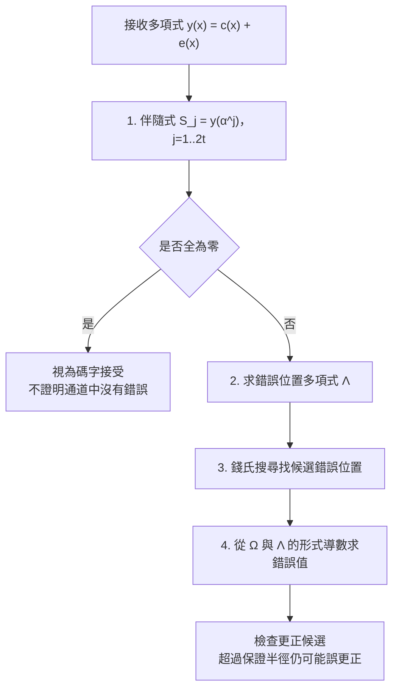
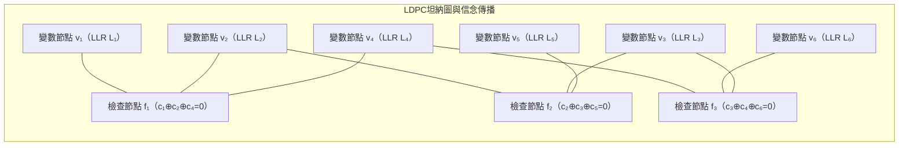
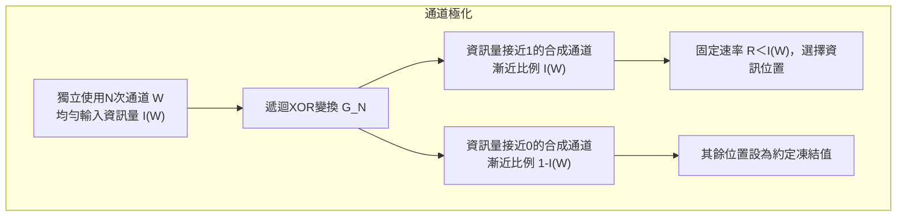

## 1. 引言：深空通訊與QR Code的共同機制

接收機為何能從微弱的深空訊號或局部污損的QR Code還原資料？關鍵在於<strong>錯誤更正碼（Error-Correcting Codes，ECC）</strong>：傳送前加入有規律的冗餘，接收後利用這些限制推斷並修復損壞的值。不過，有限的冗餘無法應付任意程度的破壞。

### 深空通訊：接收微弱訊號，再更正殘留錯誤

1977年發射的航海家1號與2號都探訪了木星、土星，2號隨後繼續前往天王星、海王星。並非兩艘探測器都飛掠了四顆行星。以下以行星探測時期的通訊為例，不把持續變化的目前距離或接收功率寫成永久固定的數字。

探測器的高增益天線將無線電能量集中指向地球，由深空網路（DSN）接收。傳播衰減與熱雜訊仍可能使解調結果出現位元錯誤。單位換算上，$10^{-16}\,\mathrm{W}=100\,\mathrm{aW}$；這不是特定日期、特定接收站的實測功率。

JPL為航海家2號天王星探測準備的報告，說明了內層摺積碼與外層 $[255,223]$ 里德–所羅門（RS）碼的串接架構。各層逐步減少雜訊的影響，但不保證所有接收區塊、所有影像像素永遠無錯。

### QR Code：更正率不是能任意遮住的影像面積

QR Code也使用RS碼。DENSO WAVE所列約7%、15%、25%、30%的還原能力，是以<strong>8位元碼字</strong>為單位的近似指標，不代表「任意遮住中央30%的面積仍能讀取」。定位等功能圖樣、損壞在各RS區塊的分布，以及拍攝條件，都會影響讀取，也沒有一律10毫秒的解碼保證。

QR Code術語中的一個8位元碼字，對應本篇RS數學中的一個符號，而不是由 $n$ 個符號組成的整個RS碼字。區分這兩個層次，才能正確計算每個區塊的更正能力。

```mermaid
flowchart TD
    subgraph Voyager["航海家2號串接編碼範例"]
        V1["資訊資料"] --> V2["外層RS → 交錯 → 內層摺積碼"]
        V2 --> V3["定向天線傳送，DSN接收"]
        V3 --> V4["含熱雜訊的接收訊號"]
        V4 --> V5["軟判決維特比 → 解交錯 → RS解碼"]
        V5 --> V6["在更正條件內還原資訊"]
    end
    subgraph QR["QR Code"]
        Q1["網址、文字等酬載"] --> Q2["GF(256)上的RS編碼與空間配置"]
        Q2 --> Q3["污損、缺漏或成像辨識錯誤"]
        Q3 --> Q4["影像辨識、擷取碼字、逐區塊解碼"]
        Q4 --> Q5["估計錯誤位置與錯誤值"]
        Q5 --> Q6["條件成立時還原原始資料"]
    end
```



下面依序連結通道容量、漢明距離、有限體多項式與圖上的機率計算。首先要分清楚：<strong>一定數量以內的所有錯誤模式都能更正</strong>，以及<strong>隨著碼長增加，解碼錯誤機率能任意小</strong>，是不同的保證。

---

## 2. 夏農通道編碼定理與適用條件

### 2.1 重複碼：可靠性提高，編碼速率卻下降

重複傳送同一位元，可以透過多數決抵抗錯誤。但若只用這個方法，提高可靠性就必須花更多次通道使用。這是特定構造的限制，不能據此斷言所有編碼都必須犧牲到零速率。

設無記憶二元對稱通道（BSC）的位元獨立翻轉，機率為 $0<p<1/2$。長度3的重複碼把1個資訊位元映射成：

$$
0 \mapsto 000, \qquad 1 \mapsto 111
$$

傳送000時，接收到011、101、110或111都會被多數決誤判為1，也就是3個位置有2個或3個翻轉。因此區塊錯誤機率為：

$$
P_e^{(3)} = \binom{3}{2} p^2 (1-p) + \binom{3}{3} p^3 = 3p^2(1-p) + p^3
$$

當 $p=0.01$ 時，結果為0.000298，約 $0.03\%$。代價是編碼速率變成：

$$
R = \frac{k}{n} = \frac{1}{3}
$$

一般而言，重複奇數次 $n=2t+1$，至少 $t+1$ 個位元翻轉時，多數決失敗：

$$
P_e^{(n)} = \sum_{i = (n+1)/2}^{n} \binom{n}{i} p^i (1-p)^{n-i}
$$

大數法則保證錯誤機率隨碼長增加趨近零，但同時：

$$
n \to \infty \implies P_e^{(n)} \to 0 \quad \text{但同時} \quad R = \frac{1}{n} \to 0
$$

例如長度5時，映射為 $0\mapsto00000$、$1\mapsto11111$，速率只有 $1/5$。這說明重複碼的效率問題，並沒有否定更有結構的多位元區塊編碼。

### 2.2 通道容量與有雜訊通道編碼定理

夏農1948年的工作指出：有雜訊的通道仍能維持固定的正資訊速率，同時讓錯誤機率任意小。

> <strong>有限字母表離散無記憶通道的編碼定理：</strong>給定轉移機率 $W(y\mid x)$，容量為 $C=\max_{P(X)}I(X;Y)\ge0$，單位是位元／次通道使用。對任意固定速率 $0<R<C$，存在碼長持續增加的碼序列與解碼規則，使區塊錯誤機率趨近零。若 $R>C$，則無法使錯誤機率收斂到零。

容量未必為正。輸出若與輸入獨立，便有 $C=0$。若另有輸入成本或平均功率限制，最大化也必須在限制內進行。容量不是只由一個「雜訊大小」數字決定的。

這是漸近的存在性結果，不保證某一個有限長度的碼能更正所有可能的雜訊，也不自動提供高效率的解碼器。實際設計還得滿足延遲、運算資源與目標錯誤率。

### 2.3 推導BSC容量

離散無記憶通道的容量，是對輸入分布最大化互資訊：

$$
C = \max_{P(X)} I(X; Y) = \max_{P(X)} \bigl( H(Y) - H(Y \mid X) \bigr)
$$

對BSC，令 $Y=X\oplus E$，其中雜訊位元 $E$ 與輸入獨立，取1的機率為 $p$。給定輸入之後的條件熵就是二元熵：

$$
H(Y \mid X) = H_2(p) \triangleq -p \log_2 p - (1-p) \log_2(1-p)
$$

因為輸出只有兩種值，所以 $H(Y)\le1$ 位元。輸入0、1等機率時，輸出也等機率，達到 $H(Y)=1$，因此：

$$
C_{\text{BSC}}(p) = 1 - H_2(p) = 1 + p\log_2 p + (1-p)\log_2(1-p) \quad [\text{bits / channel use}]
$$

例如：

$$
H_2(0.1) = -0.1 \log_2(0.1) - 0.9 \log_2(0.9) \approx 0.4690\text{ bits}
$$

$$
C_{\text{BSC}}(0.1) = 1 - 0.4690 = 0.5310\text{ bits / channel use}
$$

固定速率 $R=0.5$ 低於此容量，便能透過足夠長的適當編碼，讓錯誤機率任意小。這不是有限碼長、恰好等於容量時的無錯保證。隨機編碼論證利用長區塊中雜訊的典型行為與碼字可區分的空間，而不是只重複一個位元。

### 2.4 AWGN與寬頻極限的 $-1.59\,\mathrm{dB}$

無線訊號是連續波形，可以用加性高斯白雜訊（AWGN）模型描述，不能把物理雜訊直接等同於獨立的0／1翻轉。設頻寬為 $B$ Hz、平均接收訊號功率為 $S$ W、單邊雜訊功率頻譜密度為 $N_0$ W/Hz，頻帶內總雜訊功率為 $N=N_0B$。在平均功率限制下，且不另限為二元輸入時，夏農–哈特利容量為：

$$
C_{\text{AWGN}} = B \log_2\!\left(1 + \frac{S}{N}\right) = B \log_2\!\left(1 + \frac{S}{N_0 B}\right) \quad [\text{bits / second}]
$$

令接收端每個資訊位元的能量為 $E_b$，資訊傳輸速率為 $R$ 位元／秒，便有 $S=E_bR$。此處 $R$ 的單位與前面以位元／次使用表示的編碼速率不同。由 $R<C_{\mathrm{AWGN}}$ 得：

$$
R < B \log_2\!\left(1 + \frac{E_b}{N_0} \frac{R}{B}\right)
$$

定義頻譜效率 $\eta=R/B$，單位為位元／秒／Hz：

$$
\eta < \log_2\!\left(1 + \eta \frac{E_b}{N_0}\right) \iff 2^\eta - 1 < \eta \frac{E_b}{N_0} \iff \frac{E_b}{N_0} > \frac{2^\eta - 1}{\eta}
$$

在此理想模型中，令頻譜效率 $\eta\to0$，利用 $2^\eta=1+\eta\ln2+O(\eta^2)$ 展開：

$$
\lim_{\eta \to 0} \frac{2^\eta - 1}{\eta} = \ln 2 \approx 0.693147
$$

換算成分貝：

$$
\left(\frac{E_b}{N_0}\right)_{\min} = \ln 2 \approx 0.6931 \implies 10 \log_{10}(\ln 2) \approx \mathbf{-1.5917\,\text{dB}}
$$

這是<strong>寬頻極限中的下確界</strong>。正頻譜效率下，需要的比值界為 $(2^\eta-1)/\eta>\ln2$。$E_b/N_0$ 也不是接收訊號功率與頻帶內總雜訊功率之比 $S/N$，不能直接說成「訊號比雜訊小」。

逼近容量還有碼長、延遲等成本。這個具有明確假設的漸近結果，不是支配所有物理通道的宇宙常數，也不保證有限時間絕對無錯。加入二元輸入等限制之後，相關容量也會改變。

---

## 3. 漢明距離、更正保證與 $[7,4,3]$ 碼

### 3.1 從存在性走向可計算的構造

要將存在定理用於工程，需要具體的編碼與解碼方法。漢明1950年的工作是代表例子：加入同位檢查，根據未滿足的檢查條件找出一個翻轉位元。下面從距離與矩陣兩個角度構造 $[7,4,3]$ 碼。

### 3.2 距離與最小距離

長度 $n$ 的二進位字串組成 $\mathbb F_2^n$，也可看成 $n$ 維超立方體的頂點。體 $\mathbb F_2$ 中加減法都是互斥或（XOR）。漢明距離計算兩向量不同座標的數量：

$$
d_H(\mathbf{u}, \mathbf{v}) \triangleq \bigl|\{ i \in \{1, \dots, n\} \mid u_i \neq v_i \}\bigr| = w_H(\mathbf{u} - \mathbf{v})
$$

其中 $w_H$ 是非零座標的個數，稱為漢明重量。距離滿足非負性、對稱性與三角不等式。允許傳送的向量組成碼 $\mathcal C$，其中元素稱為碼字。維數為 $k$ 的二元線性碼有 $2^k$ 個碼字，最小距離為：

$$
d_{\min}(\mathcal{C}) \triangleq \min_{\substack{\mathbf{u}, \mathbf{v} \in \mathcal{C} \\ \mathbf{u} \neq \mathbf{v}}} d_H(\mathbf{u}, \mathbf{v})
$$

線性碼中，不同碼字的差仍是非零碼字，因此：

$$
d_{\min}(\mathcal{C}) = \min_{\mathbf{c} \in \mathcal{C} \setminus \{\mathbf{0}\}} w_H(\mathbf{c})
$$

### 3.3 偵錯、抹除與未知位置錯誤

1. <strong>偵錯：</strong>從一個碼字出發，改變1到 $d_{\min}-1$ 個座標，不可能剛好變成另一個碼字。因此檢查接收向量是否屬於碼，就能偵測所有這類非零錯誤模式。
2. <strong>抹除：</strong>已知哪些座標遺失、但不知道值，稱為抹除。若 $e\le d_{\min}-1$，不同碼字在剩餘座標仍有區別。在其他座標正確的前提下，原碼字能唯一確定。
3. <strong>未知位置錯誤：</strong>最近碼字解碼能更正所有不超過 $t$ 個錯誤的模式，若且唯若不同碼字周圍半徑 $t$ 的漢明球互不相交。

若某接收向量同時位於兩個球內，三角不等式會使兩碼字距離不超過 $2t$。反過來，若兩碼字距離不超過 $2t$，可在相異座標間分配取值，找出一個與兩者距離都不超過 $t$ 的向量。因此：

$$
2t + 1 \le d_{\min} \iff t \le \left\lfloor \frac{d_{\min} - 1}{2} \right\rfloor
$$

等式 $t=\lfloor(d_{\min}-1)/2\rfloor$ 指定的是<strong>最大保證半徑</strong>，較小半徑同樣成立。未知位置錯誤不超過 $t$ 個、已知位置抹除不超過 $e$ 個時，對所有配置的唯一還原保證為：

$$
\mathbf{d_{\min} \ge 2t + e + 1}
$$

刪去抹除座標後，距離至少是 $d_{\min}-e$，再套用不相交球的論證即可。超過此界的某些具體接收向量仍可能還原，但無法保證所有錯誤配置。「未知位置」也不要求錯誤必須遵循某個隨機分布。

$q$ 元空間中，半徑 $t$ 的球包含 $\sum_{i=0}^t\binom ni(q-1)^i$ 個向量。所有不相交球必須放進大小為 $q^n$ 的空間：

$$
|\mathcal{C}| \cdot \sum_{i=0}^{t} \binom{n}{i} (q-1)^i \le q^n \quad \left(\text{對二元碼：} 2^k \sum_{i=0}^{t} \binom{n}{i} \le 2^n \right)
$$

等號成立時，這些球無重疊、無空隙地覆蓋空間，稱為<strong>完美碼</strong>。漢明碼、二元 $[23,12,7]$ 與三元 $[11,6,5]$ 戈萊碼是例子。分類敘述須區分線性性與參數等條件，非線性完美碼也存在，不能將所有完美碼都等同於兩個特定構造。這些例子也不直接證明航海家號採用了哪個戈萊碼。

### 3.4 漢明矩陣與伴隨式

$[7,4,3]$ 碼將4個資訊位元加上3個檢查位元，形成7位元碼字：

$$
2^4 \sum_{i=0}^{1} \binom{7}{i} = 16 \times (1 + 7) = 16 \times 8 = 128 = 2^7
$$

16個半徑1的球，每個含1個中心與7個單位元鄰居，恰好覆蓋128個向量。

以下以<strong>直欄（column）</strong>與<strong>橫列（row）</strong>明確區分矩陣方向。一種方便的檢查矩陣，是讓第 $j$ 個直欄等於整數 $j$ 的3位元二進位表示：

$$
\mathbf{H}_{\text{binary}} = \begin{pmatrix} 0 & 0 & 0 & 1 & 1 & 1 & 1 \\ 0 & 1 & 1 & 0 & 0 & 1 & 1 \\ 1 & 0 & 1 & 0 & 1 & 0 & 1 \end{pmatrix} \begin{matrix} \leftarrow 2^2\text{ 位} \\ \leftarrow 2^1\text{ 位} \\ \leftarrow 2^0\text{ 位} \end{matrix}
$$

例如第5個直欄是 $(1,0,1)^T$。若要前4位直接保留訊息、後3位為檢查位元，可用系統式 $\mathbf G=[\mathbf I_4\mid\mathbf P]$、$\mathbf H=[\mathbf P^T\mid\mathbf I_3]$：

$$
\mathbf{G}_{4\times 7} = \left(\begin{array}{cccc|ccc} 1 & 0 & 0 & 0 & 1 & 1 & 0 \\ 0 & 1 & 0 & 0 & 1 & 0 & 1 \\ 0 & 0 & 1 & 0 & 0 & 1 & 1 \\ 0 & 0 & 0 & 1 & 1 & 1 & 1 \end{array}\right), \qquad \mathbf{H}_{3\times 7} = \left(\begin{array}{cccc|ccc} 1 & 1 & 0 & 1 & 1 & 0 & 0 \\ 1 & 0 & 1 & 1 & 0 & 1 & 0 \\ 0 & 1 & 1 & 1 & 0 & 0 & 1 \end{array}\right)
$$

因 $\mathbf G\mathbf H^T=0$，所有編碼後的向量都滿足：

$$
\mathbf{H}\mathbf{c}^T = \mathbf{0} \pmod 2
$$

接收 $\mathbf y=\mathbf c+\mathbf e$ 後，計算<strong>伴隨式（syndrome）</strong>：

$$
\mathbf{s} = \mathbf{H}\mathbf{y}^T = \mathbf{H}(\mathbf{c} + \mathbf{e})^T = \underbrace{\mathbf{H}\mathbf{c}^T}_{=\mathbf{0}} + \mathbf{H}\mathbf{e}^T = \mathbf{H}\mathbf{e}^T \pmod 2
$$

它只取決於錯誤。只有第 $j$ 位翻轉時，結果是所用 $\mathbf H$ 的第 $j$ 個直欄。二進位欄序下，伴隨式101直接表示第5位；系統式的欄序不同，必須比對直欄，不能直接將數值當作位置。第6節程式使用後者。

零伴隨式只表示接收向量屬於碼。若已知最多1位錯誤，它代表沒有錯誤；離開這項前提，通道可能已將一個合法碼字改成另一個。多個錯誤也可能誘使單錯解碼器再翻轉一個原本正確的位元。

例如訊息 `[1,0,1,1]` 使用上述系統矩陣編成 `[1,0,1,1,0,1,0]`。翻轉從零起算的索引2，即第3個位元，伴隨式為 `[0,1,1]`，符合直欄索引2。固定7位元電路的規模固定，但一般長度 $n$ 的伴隨式計算並非總是 $O(1)$。

再加上一個整體偶同位檢查位元，可得到 $[8,4,4]$ 擴展漢明碼。適當解碼規則能提供單位元更正、雙位元偵測（SECDED）。這是理解ECC記憶體的基本模型，不代表每種產品都採用完全相同的碼與電路。

---

## 4. RS碼：有限體、多項式與代數解碼

### 4.1 處理突發錯誤

漢明 $(7,4)$ 碼能更正同一區塊任意位置的1位錯誤，但光碟刮痕、QR Code污損或通訊衰落可能同時影響多個位元。同一區塊的2位錯誤已足以使單錯解碼器誤更正。

里德與所羅門1960年的構造，將數個位元合為一個有限體<strong>符號</strong>。這改變了距離與更正能力的計量單位；物理損傷如何映射成符號錯誤，也和配置、交錯有關。

### 4.2 將位元組表示為有限體元素

$m$ 位元符號可用 $\mathbb F_{2^m}$ 表示。一般整數模256運算不是同一個體：例如 $2\cdot128\equiv0\pmod{256}$，兩個非零數相乘得到零，非零元素不一定有乘法反元素。有限體存在的階數，恰好是質數冪。

GF(256)中的一個位元組，對應二元係數、次數不超過7的多項式。下面的程式用十六進位 `0x11D` 所代表的8次不可約多項式對乘積取餘：

$$
\mathbb{F}_{2^8} \cong \frac{\mathbb{F}_2[x]}{\langle x^8 + x^4 + x^3 + x^2 + 1 \rangle}
$$

加減法都是逐位元XOR，因為係數體中 $1+1=0$。255個非零元素組成循環乘法群。在此表示下，$\alpha=x$，也就是位元組 `0x02`，可作為乘法群生成元（primitive element）：$\alpha^0,\ldots,\alpha^{254}$ 遍歷所有非零元素，$\alpha^{255}=1$。

利用對數表與指數表，可將非零元素的乘除變成指數的模255加減：

$$
A \cdot B = \alpha^{(i + j) \bmod 255}, \qquad \frac{A}{B} = \alpha^{(i - j) \bmod 255}
$$

零元素須另行處理，除以零沒有定義。表長依實作而異，也可以延長指數表，省去明確取模。第6節為了便於說明，改用移位與XOR實作乘法。

即使同一位元組內多位損壞，也只算1個符號錯誤；跨越位元組邊界則可能影響多個符號。因此不能只按照「總共壞了幾個位元」判斷更正能力。

### 4.3 求值編碼、內插與Singleton界

橫座標不同的兩點，唯一決定次數不超過1的多項式。傳送5個求值結果，任意2個正確結果保留，就能在3個抹除後還原。3個橫座標互異的點，則唯一決定次數不超過2的多項式。

將 $k$ 個訊息符號作為係數：

$$
P(x) \triangleq m_0 + m_1 x + m_2 x^2 + \dots + m_{k-1} x^{k-1} \in \mathbb{F}_q[x]
$$

在 $\mathbb F_q$ 中選 $n$ 個互異求值點 $\alpha_i$，其中 $k\le n\le q$，傳送：

$$
\mathbf{c} = \bigl( P(\alpha_1),\; P(\alpha_2),\; \dots,\; P(\alpha_n) \bigr) \in \mathbb{F}_q^n
$$

因式定理表示：體上的非零多項式，根數不超過次數。不同訊息多項式 $P,Q$ 的差，次數小於 $k$，最多在 $k-1$ 個求值點為零，因此碼字至少有 $n-k+1$ 個不同座標。

另一方面，將所有碼字刪去 $d_{\min}-1$ 個座標，剩下的向量仍須互不相同，否則原碼字距離小於 $d_{\min}$。對含 $q^k$ 個碼字的碼，有 $q^k\le q^{n-d_{\min}+1}$，即Singleton界 $d_{\min}\le n-k+1$。RS碼達到等號：

$$
\mathbf{d_{\min} = n - k + 1}
$$

這是<strong>最大距離可分（MDS）</strong>性質：在指定字母表、長度與維數下，最小距離達到此上界，不代表所有工程指標都最佳。

令冗餘符號數為 $r=n-k$，錯誤與抹除的保證條件是 $2t+e\le r$：

- <strong>已知位置抹除：</strong>最多可缺少 $n-k$ 個符號。任意 $k$ 個正確保留的求值結果，可用拉格朗日內插還原訊息多項式：

$$
P(x) = \sum_{j=1}^{k} y_{i_j} \prod_{\substack{m=1 \\ m \neq j}}^{k} \frac{x - x_{i_m}}{x_{i_j} - x_{i_m}}
$$

- <strong>未知位置錯誤：</strong>最多能更正 $\lfloor(n-k)/2\rfloor$ 個損壞符號，不論每個符號內翻轉了多少位元。

### 4.4 循環形式與Forney公式的約定

求值形式把訊息當作多項式係數，傳送不同點的求值；循環形式則把碼字座標看作另一個多項式的係數，要求它是生成多項式的倍數。使用全部非零點、長度 $n=q-1$ 的RS碼，可以在指定座標與係數對應後寫成等價循環形式。短縮之後，不一定在新長度下仍為循環碼。

以下固定冗餘 $n-k=2t$，第一個生成根為 $\alpha^1$。這是本節推導的約定，不是所有QR Code或探測器格式的統一規定：

$$
g(x)=\prod_{j=1}^{2t}(x-\alpha^j)
$$

令餘式 $r(x)=x^{2t}m(x)\bmod g(x)$，訊息移位後減去餘式：

$$
c(x)=x^{2t}m(x)-r(x),\qquad c(\alpha^j)=0\quad(1\le j\le2t)
$$

特徵2中，減法仍是XOR。



1. <strong>伴隨式：</strong>假定 $\nu\le t$ 個錯誤位於 $i_l$，非零錯誤值為 $Y_l=e_{i_l}$，令 $X_l=\alpha^{i_l}$。在生成根求值，合法碼字部分為零：

$$
S_j=y(\alpha^j)=e(\alpha^j)=\sum_{l=1}^{\nu}Y_lX_l^j,\qquad j=1,\ldots,2t
$$

零伴隨式只表示屬於碼，無法發現從一個合法碼字變成另一個的錯誤。

2. <strong>錯誤位置多項式：</strong>

$$
\Lambda(z)=\prod_{l=1}^{\nu}(1-X_lz)=1+\Lambda_1z+\cdots+\Lambda_\nu z^\nu
$$

將 $\Lambda(X_l^{-1})=0$ 乘以對應的 $Y_lX_l^{j+\nu}$ 再相加，得到線性遞迴：

$$
S_{j+\nu}+\Lambda_1S_{j+\nu-1}+\cdots+\Lambda_\nu S_j=0,\qquad1\le j\le2t-\nu
$$

Berlekamp–Massey演算法尋找最短線性遞迴，通常用 $O(t^2)$ 次體運算求候選多項式。擴展歐幾里得方法也能解對應的關鍵方程。

3. <strong>錢氏搜尋：</strong>檢查碼字座標對應的非零元素 $\alpha^{-i}$，找出 $\Lambda(\alpha^{-i})=0$ 的候選位置。GF(256)總共有256個元素，其中非零元素255個。還要檢查根數是否和位置多項式次數相符等條件。

4. <strong>錯誤值：</strong>明確定義伴隨式多項式與錯誤求值多項式：

$$
S(z)=S_1+S_2z+\cdots+S_{2t}z^{2t-1},\qquad \Omega(z)=S(z)\Lambda(z)\bmod z^{2t}
$$

在這組定義下，Forney公式為：

$$
Y_l=-\frac{\Omega(X_l^{-1})}{\Lambda'(X_l^{-1})}
$$

只有1個錯誤時，$\Omega=YX$、$\Lambda'=-X$，右側正好是 $Y$。若多乘一個 $X$，就得到 $XY$。改變第一個生成根或伴隨式多項式定義，公式中的因子可能改變，不能脫離約定直接移植。

減去估計的錯誤後，應檢查結果是否屬於碼，以及修改的符號數是否在範圍內。但接收向量若已接近另一個合法碼字，這些檢查仍可能通過並誤更正。可結合CRC、重傳或上層檢查增加保護，不能承諾偵測所有超出半徑的破壞。

### 4.5 QR Code、儲存抹除與航海家號串接編碼

- <strong>QR Code：</strong>L/M/Q/H約7／15／25／30%是以8位元碼字為單位的還原能力指標。每個RS區塊都須滿足更正條件。版本、等級、資料容量、冗餘量與分塊方式有關，不能換成任意影像面積；遮住功能圖樣還可能在RS解碼前就使定位或碼字擷取失敗。
- <strong>RAID-6與分散式儲存：</strong>已知位置的失效磁碟或遺失區塊屬於抹除。說明用的 $[14,10]$ MDS抹除碼，容量倍率是 $14/10=1.4$，其餘資料與必要中繼資料正確時，可容忍任意4塊遺失。這不是所有雲端業者的統一配置。RAID-6的兩組同位檢查資料也在相應前提下支援雙碟還原，不涵蓋額外潛在損壞或整個設施遺失等任意災難。
- <strong>航海家2號：</strong>JPL的1983年報告說明約束長度 $K=7$、速率 $1/2$ 的摺積碼、深度4交錯與 $[255,223]$ RS外碼。每個RS碼字有32個冗餘位元組，保證 $2t+e\le32$；只有未知錯誤時，最多更正16位元組。未對齊位元組邊界的連續128位元，可能跨17個位元組，並非一定是16個。交錯把內層解碼殘留的突發錯誤分散到多個RS碼字；此處的航海家內碼是摺積碼，不是LDPC。

---

## 5. LDPC、Turbo與Polar：利用可靠性資訊逼近容量

### 5.1 最小距離之外的解碼問題

實用編碼須兼顧目標錯誤率、延遲、碼長、運算量與硬體規模。維數 $k$ 的二元碼，若採用樸素最大概似窮舉，就要比較 $2^k$ 個候選。最小距離好，不代表一定能高效率解碼。

Turbo與LDPC的迭代解碼交換可靠性資訊，Polar則用另一種構造逼近對稱容量。比較時應統一通道、輸入限制與速率，不能將所有碼一律與寬頻下界 $-1.59\,\mathrm{dB}$ 比較。

### 5.2 稀疏檢查矩陣與坦納圖

加拉格爾1962年的LDPC碼採用稀疏檢查矩陣。即使區塊很長，每個橫列、直欄的非零項數仍可保持很少。對 $m\times n$ 矩陣 $\mathbf H$，維數為 $k=n-\operatorname{rank}_{\mathbb F_2}(\mathbf H)$；只有橫列獨立，才能寫成 $n-m$。

坦納圖將變數節點對應到直欄與碼字位元，檢查節點對應到橫列與同位限制，僅在 $H_{a,i}=1$ 時連一條邊：



軟判決解碼保留觀測值的可靠性，不立即硬判決為0或1。對數概似比（LLR）可寫為：

$$
L(c_i) \triangleq \ln \frac{\Pr(c_i = 0 \mid y_i)}{\Pr(c_i = 1 \mid y_i)}
$$

輸入等機率、單位振幅BPSK映射為 $0\mapsto+1$、$1\mapsto-1$，獨立雜訊 $Z\sim\mathcal N(0,\sigma^2)$，觀測 $y_i=x_i+Z$ 時：

$$
L_{\mathrm{ch}}(c_i)=\ln\frac{p(y_i\mid c_i=0)}{p(y_i\mid c_i=1)}=\frac{2y_i}{\sigma^2}
$$

振幅或先驗機率不同，公式也會改變。LLR為 $+10$ 時強烈支持0，為 $-0.1$ 時僅略偏向1。

和積演算法（sum-product）是信念傳播（belief propagation）的一種形式。它沿邊交換外部資訊，排除接收該訊息的鄰居本身貢獻：

$$
\mu_{f_a \to v_i} = 2 \operatorname{artanh}\!\left( \prod_{v_j \in N(f_a) \setminus \{v_i\}} \tanh\!\left(\frac{\mu_{v_j \to f_a}}{2}\right) \right)
$$

$$
\mu_{v_i \to f_a} = L_{\text{ch}}(v_i) + \sum_{f_b \in N(v_i) \setminus \{f_a\}} \mu_{f_b \to v_i}
$$

此處 $N$ 表示對應鄰居集合。迭代排程決定使用哪一輪訊息，但不改變排除目標鄰居的原則。

稀疏性減少邊數，卻不會自動排除短環。在樹上，信念傳播能計算精確的邊緣機率；有限有環圖中，訊息相關、陷阱集或不收斂，都可能留下錯誤。

若邊數為 $E$，共用鄰居計算的實作每輪約需 $O(E)$ 次運算，$I$ 輪便是 $O(IE)$。節點度數有界時，可有 $E=O(n)$，但不能無條件把所需迭代輪數當作常數。數值實作也要處理LLR飽和與 $\operatorname{artanh}$ 的定義域。

Chung等人2001年報告的0.0045 dB，指<strong>速率 $1/2$ 的二元輸入AWGN通道</strong>中，密度演化得到的漸近門檻與該通道容量界之差。同一論文另一個較簡單設計的有限長度模擬，在碼長 $10^7$、位元錯誤率 $10^{-6}$ 時差距為0.04 dB。這不是所有裝置的性能保證，也不能和寬頻能量下界混為一談。

### 5.3 Polar碼：對稱容量與有限長度

阿里坎2009年的Polar構造，逼近二元輸入離散無記憶通道 $W$ 的<strong>對稱容量 $I(W)$</strong>，也就是均勻輸入時的互資訊。對稱通道中，它等於容量 $C$；一般非對稱通道不一定等於最佳化輸入分布後的最大值。

基本XOR變換為：

$$
(x_1,x_2)=(u_1,u_2)\begin{pmatrix}1&0\\1&1\end{pmatrix} =(u_1\oplus u_2,u_2)
$$

合成通道 $W^-$ 從 $(y_1,y_2)$ 推斷 $u_1$；$W^+$ 在已知正確 $u_1$ 時，從 $(y_1,y_2,u_1)$ 推斷 $u_2$。均勻獨立輸入下，由互資訊的連鎖法則：

$$
I(W^-)+I(W^+)=2I(W),\qquad I(W^-)\le I(W)\le I(W^+)
$$

「變好、變差」是這裡的資訊量意義，不表示所有情況都嚴格變動。實際逐次解碼若先前判錯，錯誤可能傳到後續判決。

令 $N=2^m$，採用位元反序置換 $\mathbf B_N$ 的約定時，生成矩陣為：

$$
\mathbf G_N=\mathbf B_N \begin{pmatrix}1&0\\1&1\end{pmatrix}^{\otimes m}
$$

對任意固定 $0<\delta<1$，當 $N\to\infty$，資訊量超過 $1-\delta$ 的合成通道比例趨近 $I(W)$，低於 $\delta$ 的比例趨近 $1-I(W)$。不是有限 $N$ 時恰好有 $NI(W)$ 個通道突然完全無雜訊。



在固定速率 $R<I(W)$ 下選資訊位置，其餘輸入凍結為約定值。一般通道的原始保證，利用凍結值的平均與適當值的存在性；對稱通道則有適用於任意固定凍結值的相應界。

編碼與<strong>逐次消除解碼（SC）</strong>的時間複雜度為 $O(N\log N)$，選擇資訊位置的構造成本另計。高效率的<strong>逐次消除清單解碼（SCL）</strong>在候選清單大小 $L$ 下，需要 $O(LN\log N)$ 時間；CRC輔助方式可協助選出候選。有限長度的錯誤率與延遲仍取決於構造、速率、清單大小及通道，不能籠統保證沒有錯誤平層。

### 5.4 主要編碼比較

| 編碼 | 數學結構 | 代表解碼方法 | 特點與用途 |
| :--- | :--- | :--- | :--- |
| 漢明碼（1950） | 二元線性碼，$[7,4,3]$ 為完美碼 | 伴隨式比對直欄 | 單位元更正；理解SECDED的基本例子 |
| RS碼（1960） | 有限體多項式，MDS性質 | BM／歐幾里得、錢氏搜尋、Forney；求值形式也可用Welch–Berlekamp | 符號錯誤與抹除；QR Code、儲存、深空串接編碼 |
| 摺積碼與Turbo碼 | 狀態網格、串接與交錯 | 維特比、BCJR等迭代解碼 | 有雜訊通訊；航海家內碼為摺積碼 |
| LDPC（1962） | 稀疏檢查矩陣、坦納圖 | 軟判決信念傳播等 | 長區塊與平行化；指定通道、速率下逼近容量 |
| Polar（2009） | 遞迴極化與凍結位元 | SC為 $O(N\log N)$；SCL依清單大小而變 | 漸近逼近對稱容量；5G NR指定的部分控制資訊編碼 |

同一列的方法不一定有相同複雜度或錯誤率，5G控制資訊也不是全用Polar。例如3GPP TS 38.212 v19.3.0第6.3.1.2–6.3.1.3節，對PUCCH的UCI區分：酬載 $A\ge12$ 用Polar，$A\le11$ 用小區塊長度編碼。

---

## 6. Python驗證：漢明碼與GF(256)求值RS碼

以下獨立Python 3程式，實作系統式漢明 $(7,4)$ 碼與第4.3節的<strong>求值RS碼</strong>。RS訊息符號是多項式係數，通常不會原樣出現在碼字開頭。這不是第4.4節的BM解碼器，也沒有實作QR Code的位元配置、分塊與循環系統格式，不能直接與QR Code或探測器的通訊格式互通。

程式使用GF(256)與不可約多項式 `0x11D`。這和整數模257形成的質數體GF(257)不同；後者也能構造求值碼，但結果可能等於256，不能總以單一位元組儲存。

解碼採用Welch–Berlekamp型線性系統。對候選錯誤位置多項式次數 $\nu=0,\ldots,t$，求首一多項式 $E(x)$（次數 $\nu$）以及次數小於 $k+\nu$ 的 $Q(x)$，使：

$$
Q(x_i)=y_iE(x_i)\qquad(i=1,\ldots,n)
$$

未知係數共有 $k+2\nu$ 個。GF(256)中加減法相同，將項移到等號另一邊仍使用XOR。

設真實訊息多項式為 $P$。錯誤數若不超過 $\nu$，可讓 $E$ 在錯誤點為零，必要時補足次數，再構造 $Q=PE$。反過來，$n\ge k+2\nu$ 時，任意解的 $Q-PE$ 在至少 $n-\nu$ 個正確點為零，次數卻小於 $k+\nu$，因此必為零多項式。這個根數論證，才是線性系統能還原訊息的依據。

實作依序嘗試0到 $t$ 的候選多項式次數，處理矩形方程組與秩不足；將 $Q$ 除以 $E$，檢查餘式為零、商次數小於 $k$，再重新編碼，確認與接收向量的距離不超過 $t$。因此無錯、少於 $t$ 個錯誤與邊界情況都可處理。求值點須互異，可從體中選1到256個，包含零。

本例優先考量可讀性，最多執行 $t+1$ 次一般高斯消去，不是高速RS解碼器或效能基準。公開函式 `rs_encode`、`rs_decode` 檢查數值、長度、求值點與半徑；內部多項式及線性系統輔助函式，假設接收的是已檢查的體元素。

```python
"""Educational evaluation RS over GF(256), not a QR parser or wire format."""
from itertools import product


def field_value(a):
    if type(a) is not int or not 0 <= a < 256:
        raise ValueError("Field elements must be integers from 0 through 255")
    return a


def gf_mul(a, b):
    field_value(a)
    field_value(b)
    result = 0
    for _ in range(8):
        if b & 1:
            result ^= a
        b >>= 1
        a <<= 1
        if a & 256:
            a ^= 0x11D
    return result


def gf_pow(a, exponent):
    field_value(a)
    if type(exponent) is not int or exponent < 0:
        raise ValueError("Exponent must be a nonnegative integer")
    result = 1
    while exponent:
        if exponent & 1:
            result = gf_mul(result, a)
        a = gf_mul(a, a)
        exponent >>= 1
    return result


def gf_inv(a):
    field_value(a)
    if a == 0:
        raise ZeroDivisionError("Zero has no multiplicative inverse")
    return gf_pow(a, 254)


def poly_trim(coefficients):
    result = list(coefficients)
    while result and result[-1] == 0:
        result.pop()
    return result


def poly_eval(coefficients, x):
    result = 0
    for coefficient in reversed(coefficients):
        result = gf_mul(result, x) ^ coefficient
    return result


def poly_divmod(numerator, denominator):
    remainder = poly_trim(numerator)
    denominator = poly_trim(denominator)
    if not denominator:
        raise ZeroDivisionError("Zero polynomial divisor")
    quotient = [0] * max(0, len(remainder) - len(denominator) + 1)
    inverse_lead = gf_inv(denominator[-1])
    while remainder and len(remainder) >= len(denominator):
        degree = len(remainder) - len(denominator)
        factor = gf_mul(remainder[-1], inverse_lead)
        quotient[degree] = factor
        for j, coefficient in enumerate(denominator):
            remainder[degree + j] ^= gf_mul(factor, coefficient)
        remainder = poly_trim(remainder)
    return poly_trim(quotient), remainder


def solve_linear_system(rows, rhs, columns):
    """Return one solution (free variables zero), or None if inconsistent."""
    if len(rows) != len(rhs) or any(len(row) != columns for row in rows):
        raise ValueError("Linear-system dimensions do not match")
    matrix = [list(row) + [value] for row, value in zip(rows, rhs)]
    pivot_columns = []
    pivot_row = 0
    for column in range(columns):
        pivot = next(
            (r for r in range(pivot_row, len(matrix)) if matrix[r][column]),
            None,
        )
        if pivot is None:
            continue
        matrix[pivot_row], matrix[pivot] = matrix[pivot], matrix[pivot_row]
        inverse = gf_inv(matrix[pivot_row][column])
        matrix[pivot_row] = [gf_mul(value, inverse) for value in matrix[pivot_row]]
        for r in range(len(matrix)):
            if r != pivot_row and matrix[r][column]:
                factor = matrix[r][column]
                matrix[r] = [
                    a ^ gf_mul(factor, b)
                    for a, b in zip(matrix[r], matrix[pivot_row])
                ]
        pivot_columns.append(column)
        pivot_row += 1
        if pivot_row == len(matrix):
            break
    if any(not any(row[:columns]) and row[columns] for row in matrix):
        return None
    solution = [0] * columns
    for r, column in enumerate(pivot_columns):
        solution[column] = matrix[r][columns]
    return solution


def check_points(points):
    points = list(points)
    if not points or len(points) > 256:
        raise ValueError("Use from 1 through 256 distinct evaluation points")
    for x in points:
        field_value(x)
    if len(set(points)) != len(points):
        raise ValueError("Evaluation points must be distinct")
    return points


def rs_encode(message, points):
    points = check_points(points)
    message = list(message)
    if not 1 <= len(message) <= len(points):
        raise ValueError("Require 1 <= message length <= code length")
    for value in message:
        field_value(value)
    return [poly_eval(message, x) for x in points]


def rs_decode(received, points, k, max_errors):
    points = check_points(points)
    received = list(received)
    n = len(points)
    if len(received) != n:
        raise ValueError("Received length must match evaluation points")
    if type(k) is not int or not 1 <= k <= n:
        raise ValueError("Require integer 1 <= k <= n")
    if type(max_errors) is not int or max_errors < 0 or k + 2 * max_errors > n:
        raise ValueError("Require integer t >= 0 and k + 2t <= n")
    for value in received:
        field_value(value)
    # Try locator degrees 0,...,t: fewer than t errors must also work.
    for errors in range(max_errors + 1):
        columns = k + 2 * errors
        rows, rhs = [], []
        for x, y in zip(points, received):
            powers = [gf_pow(x, degree) for degree in range(k + errors)]
            rows.append(
                powers + [gf_mul(y, gf_pow(x, degree)) for degree in range(errors)]
            )
            rhs.append(gf_mul(y, gf_pow(x, errors)))
        solution = solve_linear_system(rows, rhs, columns)
        if solution is None:
            continue
        q = solution[:k + errors]
        locator = solution[k + errors:] + [1]
        message, remainder = poly_divmod(q, locator)
        if remainder or len(message) > k:
            continue
        message += [0] * (k - len(message))
        codeword = rs_encode(message, points)
        distance = sum(a != b for a, b in zip(codeword, received))
        if distance <= max_errors:
            return message
    raise ValueError("No codeword within the requested correction radius")


G = (
    (1, 0, 0, 0, 1, 1, 0),
    (0, 1, 0, 0, 1, 0, 1),
    (0, 0, 1, 0, 0, 1, 1),
    (0, 0, 0, 1, 1, 1, 1),
)
H = (
    (1, 1, 0, 1, 1, 0, 0),
    (1, 0, 1, 1, 0, 1, 0),
    (0, 1, 1, 1, 0, 0, 1),
)


def bits(values, length):
    values = list(values)
    if len(values) != length or any(type(v) is not int or v not in (0, 1) for v in values):
        raise ValueError("Invalid bit vector")
    return values


def hamming_encode(message):
    message = bits(message, 4)
    return [sum(message[i] * G[i][j] for i in range(4)) % 2 for j in range(7)]


def hamming_decode(received):
    received = bits(received, 7)
    syndrome = [sum(H[r][j] * received[j] for j in range(7)) % 2 for r in range(3)]
    if any(syndrome):
        position = next(j for j in range(7) if [H[r][j] for r in range(3)] == syndrome)
        received[position] ^= 1
    return received[:4]


if __name__ == "__main__":
    hamming_cases = 0
    for message in product((0, 1), repeat=4):
        codeword = hamming_encode(message)
        for position in range(-1, 7):
            received = codeword.copy()
            if position >= 0:
                received[position] ^= 1
            assert hamming_decode(received) == list(message)
            hamming_cases += 1
    print("Hamming no-error/single-error cases:", hamming_cases)

    payload = b"VOYAGER-1"
    points = list(range(1, 16))
    codeword = rs_encode(payload, points)
    print("GF(256) evaluation codeword:", codeword)
    for count in range(4):
        received = codeword.copy()
        for position in range(count):
            received[position] ^= position + 1
        recovered = bytes(rs_decode(received, points, len(payload), 3))
        print("RS corrupted symbols:", count, "recovered:", recovered.decode("ascii"))
        assert recovered == payload
    # A decoder can miscorrect beyond the transmitted word's guaranteed radius.
    # Construct a received word close to a DIFFERENT valid word.
    alternative = list(payload)
    alternative[0] ^= 1
    alternative_codeword = rs_encode(alternative, points)
    received = alternative_codeword.copy()
    received[0] ^= 1
    assert rs_decode(received, points, len(payload), 3) == alternative
    print("Beyond-radius example returns another nearby codeword:", True)
```

實際執行輸出：

```text
Hamming no-error/single-error cases: 128
GF(256) evaluation codeword: [77, 162, 167, 64, 87, 173, 26, 217, 215, 33, 189, 173, 212, 41, 124]
RS corrupted symbols: 0 recovered: VOYAGER-1
RS corrupted symbols: 1 recovered: VOYAGER-1
RS corrupted symbols: 2 recovered: VOYAGER-1
RS corrupted symbols: 3 recovered: VOYAGER-1
Beyond-radius example returns another nearby codeword: True
```

9位元組訊息編成15個符號，最小距離7，保證半徑3個符號。3／15是20%，不是30%。範例分別破壞0到3個前端位置，相同數量的保證也適用於不相鄰位置。

也可用 $\alpha^0,\ldots,\alpha^{14}$ 為求值點，破壞從零起算的索引 `[1,6,13]`；同一解碼器也支援。改用位元組值 `1..15` 作求值點，碼字便會不同。三個不相鄰位元組錯誤，不等於連續24位元突發錯誤。

最後一例刻意構造接近<strong>另一個合法碼字</strong>的接收向量。解碼器會傳回那個碼字並通過距離檢查，卻沒有還原原訊息，說明超過保證半徑的破壞不一定能被發現。漢明解碼器違反最多1位錯誤的前提時，也可能誤更正。

此教學實作的獨立檢查，包含GF(256)全部65,536組乘積，以及另行產生的長度4、維數2全部65,536個碼字。將接收符號限為0到3的256個接收向量，其半徑1解碼與完整碼表窮舉一致。另外檢查了包含零訊息的3個訊息、所有單符號錯誤位置與非零錯誤值、多種長度與錯誤數的固定種子案例、秩不足系統及無效輸入。這是有限範圍證據，不是執行過所有可能輸入、完整QR Code互通或真實通訊硬體實驗。

---

## 7. 如何選擇RS、LDPC與Polar

RS達到MDS界，為何不用在所有場合？因為MDS最佳化的是<strong>固定符號長度與維數下的最小距離</strong>，並未同時最佳化機率解碼性能、軟資訊使用、延遲與電路規模。

1. <strong>體大小與區塊長度：</strong>第4.3節求值形式滿足 $n\le q$，GF(256)包含零時可有256個求值符號；常見的全部非零點循環形式則為255個。也有擴展、串接等變種，不能說任何RS碼都絕對限於255位元組。用稀疏圖處理長二元區塊的LDPC，有不同的設計優勢。
2. <strong>軟資訊：</strong>先硬判決成0／1會丟失觀測可靠性，軟判決LDPC、Polar解碼可利用這些資訊。但增益不是固定2 dB，而隨通道、調變、速率及目標錯誤率改變。RS也有利用軟資訊的解碼方法，不是只能硬判決。
3. <strong>儲存單元條件：</strong>TLC每單元存3位元、區分8種狀態，QLC存4位元、區分16種狀態。電壓分布重疊、資料保持特性改變與抹寫，都可能造成錯誤。額外讀取提供的可靠性資訊可能有用，但不是所有SSD都具備相同解碼器、原始位元錯誤率或不可更正錯誤率，還須權衡讀取時間與能量。

對位置已知的儲存抹除，RS的「任意 $k$ 個正確保留符號都可還原」很方便；有雜訊物理鏈路則常適合較長的軟判決碼。同一系統也可在不同層組合不同編碼。5G、SSD與QR Code的差異，應按錯誤模型和限制比較，而不是視為一次全面的新舊替代。

---

## 8. 結語：用明確條件設計冗餘

錯誤更正利用資料結構，以及對破壞方式的假設還原資訊。

1. 夏農定理針對指定通道與輸入限制，保證低於容量時存在越來越長的碼，使錯誤機率任意小；這不同於有限長度絕對無錯。
2. 最小距離給出對所有配置的保證：未知錯誤 $t$ 個、抹除 $e$ 個時，基本條件為 $2t+e<d_{\min}$。漢明伴隨式將保證化為具體運算。
3. RS利用有限體多項式的根與內插，達到 $d_{\min}=n-k+1$。實作須固定約定，也要處理保證半徑之外的誤更正風險。
4. LDPC使用稀疏機率圖，Polar使用通道極化。漸近門檻、有限長度性能，以及SC與SCL複雜度，是不同層面的指標。

讀取QR Code或接收深空訊號時，可靠性來自冗餘、錯誤單位與分布、解碼檢查及殘留失敗機率的共同設計，不是「任何破壞都必然還原」的承諾。

參考資料：

- [DENSO WAVE：QR Code錯誤更正](https://www.qrcode.com/en/about/error_correction.html) — 還原能力與碼字單位。
- [JPL：航海家2號](https://www.jpl.nasa.gov/missions/voyager-2/) — 行星探測路線。
- [Lorden、McEliece、Swanson：Node Synchronization for the Viterbi Decoder（1983）](https://tda.jpl.nasa.gov/progress_report/42-73/73C.PDF) — 第22頁的串接編碼與同步問題。
- [Forney：MIT 6.451代數編碼理論第8章](https://ocw.mit.edu/courses/6-451-principles-of-digital-communication-ii-spring-2005/01060b08ba74792ee8d85eb82b9efdb4_chap8.pdf) — 第101–110頁的距離、求值RS與Welch–Berlekamp型重構。
- [Chung等：On the Design of LDPC Codes within 0.0045 dB of the Shannon Limit（2001）](https://www.cse.lehigh.edu/~jingli/teach/S2003turbo/notes/zeroZeroFourFive.pdf) — 第58頁區分漸近門檻與有限長度模擬。
- [Arıkan：Channel Polarization（2009）](https://arxiv.org/abs/0807.3917) — 對稱容量、編碼與SC解碼；本文依據開頭的定義和定理。
- [Tal、Vardy：List Decoding of Polar Codes](https://arxiv.org/abs/1206.0050) — 高效率SCL的時間與空間複雜度。
- [Östergård、Pottonen：長度15的二元單錯更正完美碼分類](https://arxiv.org/abs/0806.2513) — 完美碼不等同於單一線性構造。
- [Elkies：The Theory of Error-Correcting Codes（2013）](https://people.math.harvard.edu/~elkies/M256.13/index.html) — 完美碼與戈萊碼課程。
- [ETSI TS 138 212 v19.3.0（2026-04）](https://www.etsi.org/deliver/etsi_ts/138200_138299/138212/19.03.00_60/ts_138212v190300p.pdf) — 第6.3.1.2–6.3.1.3節的UCI編碼選擇。
