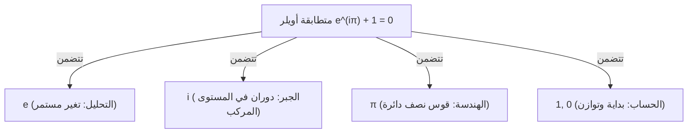

# ما الذي يجعل متطابقة أويلر جميلة؟

تحظى **متطابقة [أويلر](https://kenji.blog/ar/p/euler/)** بالإعجاب لأنها تربط خمسة ثوابت رياضية أساسية في معادلة قصيرة.

$$
e^{i\pi} + 1 = 0
$$

تجمع المعادلة أعدادًا مهمة في الحساب والهندسة والتحليل والجبر. في الفصل 22 من المجلد الأول من *The Feynman Lectures on Physics*، يصف [فاينمان](/ar/p/biography-richard-feynman/) صيغة أويلر العامة بعبارة “This is our jewel.” ويخص تعليقه الصيغة التي سنعرضها لاحقًا، لا المتطابقة الخاصة أعلاه وحدها.

سنشرح الثوابت الخمسة، ونستنتج المتطابقة من صيغة أويلر، ونبرهن الصيغة باستخدام متسلسلات متقاربة تقاربًا مطلقًا، ثم نفسرها بوصفها دورانًا. وفي التطبيقات نميز بين المتطابقة عند زاوية محددة والصيغة لزوايا عامة.

## خمسة ثوابت أساسية

للأعداد $0,1,\pi,e,i$ أدوار أساسية في سياقات رياضية مختلفة. توزيعها على فروع منفصلة وسيلة لشرح تلك الأدوار، وليس ادعاءً بأنها كانت غير مترابطة.

### 1. $0$: العنصر المحايد للجمع

$0$ هو العنصر المحايد للجمع: لكل عدد $a$، لدينا $a+0=a$. وقد يمثل أيضًا غياب كمية أو موضعًا فارغًا في نظام العد الموضعي؛ نركز هنا على خاصيته في الجمع.

### 2. $1$: العنصر المحايد للضرب

$1$ هو العنصر المحايد للضرب: لكل عدد $a$، لدينا $a\cdot1=a$. وبدء الأعداد الطبيعية من 1 أو شمولها للصفر مسألة اصطلاح، لا تغير دور 1 في الضرب.

### 3. $\pi$: ثابت الدائرة

$\pi$ عدد غير نسبي يساوي تقريبًا $3.14159\dots$، وهو نسبة محيط الدائرة إلى قطرها في المستوى الإقليدي. يظهر أيضًا في الدوال المثلثية وقياس الزوايا بالراديان. الزاوية الأساسية هنا هي $\pi$، أي نصف دورة.

### 4. $e$: أساس اللوغاريتم الطبيعي

$e$ عدد غير نسبي يساوي تقريبًا $2.71828\dots$، وهو أساس اللوغاريتم الطبيعي. للمتغير الحقيقي $x$، مشتقة $e^x$ هي $e^x$ ودوالها الأصلية هي $e^x+C$. يظهر في النماذج الأسية للنمو والاضمحلال، لكن ليس كل تغير مستمر يتبع نموذجًا أسيًا.

### 5. $i$: الوحدة التخيلية

$i$ هي الوحدة التخيلية التي تحقق $i^2=-1$. ولأن $-i$ يحقق المعادلة نفسها، نختار عادة أن يمثّل $i$ الاتجاه إلى الأعلى في المستوى المركب. تُكتب الأعداد المركبة على الصورة $a+bi$، حيث $a,b$ حقيقيان، مما يوسّع إطار دراسة المعادلات والدوران.

تربط متطابقة أويلر الثابتين الحسابيين $0$ و$1$ بالثابت الهندسي $\pi$ وثابت التحليل $e$ والثابت الجبري $i$ في معادلة واحدة.

## الاستنتاج من صيغة أويلر

المتطابقة هي الحالة الخاصة من **صيغة أويلر** العامة عند الزاوية $\pi$. في هذه المقالة، $x$ حقيقي والزوايا مقاسة بالراديان. ويعني الرمز $e^z$ الدالة الأسية المركبة أحادية القيمة $\exp z$، المعرفة بالمتسلسلة أدناه.

$$
e^{ix} = \cos x + i\sin x
$$

تربط الصيغة الدالة الأسية في الطرف الأيسر بالدوال المثلثية في الطرف الأيمن عبر الوحدة التخيلية $i$.

نعوض $x=\pi$، وهو قياس 180 درجة بالراديان:

$$
e^{i\pi} = \cos\pi + i\sin\pi
$$

بما أن $\cos\pi=-1$ و$\sin\pi=0$، نحصل على:

$$
e^{i\pi} = -1 + i \cdot 0
$$

إذن:

$$
e^{i\pi} = -1
$$

وبإضافة 1 إلى الطرفين:

$$
e^{i\pi} + 1 = 0
$$

وهكذا نستنتج المتطابقة من صيغة أويلر.

## البرهان بمتسلسلات ماكلورين

لماذا تصح $e^{ix}=\cos x+i\sin x$؟ نستخدم [توسع ماكلورين](/ar/p/taylor-and-maclaurin-series/)، مع التحقق من تعريف الدالة الأسية المركبة والتقارب، بدلًا من مجرد التعويض الشكلي بعدد مركب في مساواة لمتغيرات حقيقية.

نعرّف $\exp z=\sum_{n=0}^{\infty}z^n/n!$. التقارب عند $z=0$ واضح. ولكل عدد مركب ثابت $z\ne0$، تؤول نسبة القيم المطلقة للحدود المتتالية $|z|/(n+1)$ إلى الصفر، فتتقارب المتسلسلة تقاربًا مطلقًا. ولـ $x$ الحقيقي تتفق مع الدالة الأسية المعتادة؛ وللجيب وجيب التمام أيضًا التوسعات التالية. تصح المساويات الثلاث لكل $x$ حقيقي.

$$
e^x = 1 + x + \frac{x^2}{2!} + \frac{x^3}{3!} + \frac{x^4}{4!} + \frac{x^5}{5!} + \dots
$$

$$
\cos x = 1 - \frac{x^2}{2!} + \frac{x^4}{4!} - \frac{x^6}{6!} + \dots
$$

$$
\sin x = x - \frac{x^3}{3!} + \frac{x^5}{5!} - \frac{x^7}{7!} + \dots
$$

نضع $z=ix$ في متسلسلة الدالة الأسية المركبة. ولأن $x$ حقيقي، يكون $ix$ تخيليًا صرفًا، أو صفرًا عند $x=0$. نستخدم الدورة ذات الخطوات الأربع: $i^1=i$، $i^2=-1$، $i^3=-i$، $i^4=1$.

$$
e^{ix} = 1 + (ix) + \frac{(ix)^2}{2!} + \frac{(ix)^3}{3!} + \frac{(ix)^4}{4!} + \frac{(ix)^5}{5!} + \dots
$$

$$
e^{ix} = 1 + ix - \frac{x^2}{2!} - i\frac{x^3}{3!} + \frac{x^4}{4!} + i\frac{x^5}{5!} - \dots
$$

يسمح التقارب المطلق بتجميع الحدود ذات الدرجات الزوجية والفردية كلًّا على حدة. ولأن $x$ حقيقي، يعطي القوس الأول الجزء الحقيقي، والثاني قيمة الجزء التخيلي. والجزء التخيلي نفسه عدد حقيقي، ويختلف عن ذلك العدد مضروبًا في $i$.

$$
e^{ix} = \left( 1 - \frac{x^2}{2!} + \frac{x^4}{4!} - \dots \right) + i \left( x - \frac{x^3}{3!} + \frac{x^5}{5!} - \dots \right)
$$

القوس الأول متسلسلة $\cos x$، والثاني متسلسلة $\sin x$. وبالتالي:

$$
e^{ix} = \cos x + i\sin x
$$

وبهذا تثبت العلاقة بين الدالة الأسية والدوال المثلثية.

## المعنى الهندسي في المستوى المركب

للمتطابقة تفسير هندسي في **المستوى المركب**، الذي يسمى أيضًا مستوى غاوس.

نمثل $z=a+bi$ بالنقطة $(a,b)$: الإحداثي الأفقي هو الجزء الحقيقي، والرأسي قيمة الجزء التخيلي. ولـ $\theta$ الحقيقي، لدينا $|e^{i\theta}|=1$، لذا يحافظ الضرب في $e^{i\theta}$ على الطول ويدير النقطة حول الأصل. إذا كانت $\theta$ موجبة فالدوران عكس عقارب الساعة، وإذا كانت سالبة فمع عقارب الساعة. وتبقى نقطة الأصل ثابتة.

لننظر إلى $e^{i\pi}=-1$ من هذه الزاوية:

1. نبدأ من $1$، أي النقطة $(1,0)$ على المحور الحقيقي.
2. يعني الضرب في $e^{i\pi}$ دورانًا بمقدار $\pi$ راديان، أو 180 درجة، حول الأصل.
3. يقود نصف دورة من $1$ إلى النقطة المقابلة $-1$، أي $(-1,0)$.

إذن تعبر المتطابقة عن الحقيقة الهندسية القائلة إن نصف دورة من $1$ يصل إلى $-1$.

## ليونهارت أويلر

كان [ليونهارت أويلر](https://kenji.blog/ar/p/euler/) (Leonhard Euler, 1707–1783)، المولود في سويسرا، من أبرز رياضيي القرن الثامن عشر. أسهم في فروع عديدة من الرياضيات وعمل أيضًا في الفيزياء والفلك والهندسة.

ترك أويلر مقالات وكتبًا كثيرة، وظل نشطًا في البحث حتى بعد فقدانه البصر في أواخر حياته. يضع المجلد الأول من *Introductio in analysin infinitorum*، المنشور عام 1748، الدوال في مركز التحليل ويبرز الرمز $f(x)$ ودور $e$ والدالة الأسية. كما يتناول المتسلسلات اللانهائية والجداءات اللانهائية والكسور المستمرة.

البرهان المعروض هنا تفسير حديث يقوم على تعريف الدالة الأسية المركبة والتقارب المطلق. ولا ينبغي اعتباره مطابقًا مباشرة لحجج الكميات المتناهية في الصغر في كتابات أويلر.

## تطبيقات في العلم والهندسة

تعتمد التطبيقات أساسًا على صيغة أويلر ذات الزاوية المتغيرة. المتطابقة عند $x=\pi$ وحدها لا تنجز جميع هذه الحسابات.

### معالجة الإشارات وتحليل فورييه

يمثل تحليل فورييه الإشارات بمكونات مثلثية أو أسية مركبة. وتتطلب متسلسلات الإشارات الدورية وتحويلات الإشارات غير الدورية تحديد شروط الدوال ومعنى التقارب. مشتقة $e^{i\omega t}$ بالنسبة للزمن هي $i\omega e^{i\omega t}$؛ وعندما $\omega\ne0$، تكون $e^{i\omega t}/(i\omega)$ إحدى دوالها الأصلية. أما اشتقاق المتسلسلة أو تكاملها حدًا حدًا فيحتاج إلى شروط إضافية.

تحسب [FFT](/ar/p/fast-fourier-transform-algorithm/) تحويل فورييه المتقطع لبيانات منتهية بكفاءة. وتستخدم الطريقة الأساسية المعتادة لضغط JPEG مع فقدان البيانات تحويل جيب التمام المتقطع (DCT)؛ وهذا يختلف عن القول إن JPEG يستخدم FFT مباشرة.

### الهندسة الكهربائية والإلكترونية

في دائرة تيار متناوب خطية لا تتغير خصائصها مع الزمن، وفي الحالة المستقرة الجيبية عند تردد واحد، يتيح التمثيل بالمتجهات الطورية (phasors) حساب سعات الجهود والتيارات وأطوارها بالجبر المركب. تُعالج الظواهر العابرة على حدة، وتُحلل الترددات المختلفة منفصلة قبل التراكب. ولا يجوز تطبيق هذه الطريقة بلا شروط على الدوائر غير الخطية أو التغيرات الزمنية العامة.

### ميكانيكا الكم

في ميكانيكا الكم غير النسبية، تصف معادلة شرودنغر دالة موجية، وهي سعة احتمال مركبة. لدالة موجية مطبّعة في تمثيل الموضع $\psi(x,t)$، تكون $|\psi(x,t)|^2$ كثافة احتمال الموضع؛ أما الدالة الموجية نفسها فليست احتمالًا. تظهر الدوال الأسية المركبة في الموجات المستوية للجسيمات الحرة والتطور الزمني للحالات الذاتية للطاقة، لكن الدالة الموجية العامة ليست دالة أسية واحدة.

## خاتمة: جاذبية المعادلة

قد توحي متطابقة أويلر بأحجية تكتمل قطعها أخيرًا في صورة واحدة: ثابت الهندسة $\pi$، وثابت التحليل $e$، والوحدة التخيلية $i$، والعددان الأساسيان $1$ و$0$. وقد تمنح علاقاتها القارئ إحساسًا بأن الرياضيات تعكس نظامًا أعمق للعالم.

غالبًا ما تُعد الرياضيات لغة تقنية، لكن بساطة هذه المتطابقة وروابطها الواسعة يمكن تذوقها مثل قصيدة أو عمل فني. ويكمن جمالها في الانسجام الذي يجده القراء بين هذه الأفكار.

## المراجع

- [NIST DLMF §4.2(iii): متسلسلة الدالة الأسية المركبة والعلاقات المثلثية](https://dlmf.nist.gov/4.2#iii)
- [MIT 18.100C Lecture 11: التقارب المطلق والدالة الأسية المركبة](https://ocw.mit.edu/courses/18-100c-real-analysis-fall-2012/1058808e5cb57c986118333f8b6fa0d7_MIT18_100CF12_l11sum.pdf)
- [The Feynman Lectures I، الفصل 22: صيغة أويلر العامة والاقتباس](https://www.feynmanlectures.caltech.edu/I_22.html)
- [The Feynman Lectures I، الفصلان 23 و25: الاهتزازات المركبة والحالة المستقرة](https://www.feynmanlectures.caltech.edu/I_23.html) ([الفصل 25](https://www.feynmanlectures.caltech.edu/I_25.html))
- [MIT 6.002: الحالة المستقرة الجيبية وطريقة الممانعة](https://circuits.mit.edu/_static/S23/handouts/lec10b/lecture10b-berggren.pdf)
- [MIT 6.341 Lecture 19: خوارزميات FFT لحساب DFT](https://ocw.mit.edu/courses/6-341-discrete-time-signal-processing-fall-2005/resources/lec19/)
- [The Feynman Lectures III، الفصل 3: سعات الاحتمال المركبة](https://www.feynmanlectures.caltech.edu/III_03.html)
- [ITU-T T.81: طرق DCT في JPEG (§3.1.58–59 و§4.2)](https://www.w3.org/Graphics/JPEG/itu-t81.pdf)
- [Euler Archive: بيانات المجلد الأول من Introductio لعام 1748 وملخص محتواه](https://scholarlycommons.pacific.edu/euler-works/101/)
- [مكتبة ETH: حياة أويلر وأبحاثه بعد فقدان البصر](https://library.ethz.ch/sammlungen-und-archive/kurzportraets/leonhard-euler-1707-1783.html)
