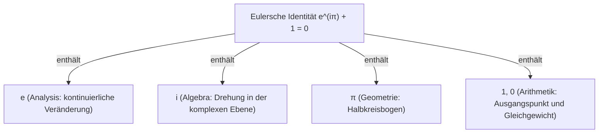

# Was macht die eulersche Identität schön?

Die **eulersche Identität**, benannt nach [Euler](https://kenji.blog/de/p/euler/), wird dafür bewundert, dass sie fünf grundlegende mathematische Konstanten in einer kurzen Gleichung verbindet.

$$
e^{i\pi} + 1 = 0
$$

Die Gleichung vereint wichtige Zahlen aus Arithmetik, Geometrie, Analysis und Algebra. In Kapitel 22 des ersten Bandes der *Feynman Lectures on Physics* bezeichnet [Feynman](/de/p/biography-richard-feynman/) die allgemeinere eulersche Formel mit den Worten „This is our jewel.“ Seine Bemerkung betrifft die weiter unten behandelte Formel und nicht allein die obige spezielle Identität.

Wir erläutern die fünf Konstanten, leiten die Identität aus der eulerschen Formel her, beweisen diese Formel mit absolut konvergenten Reihen und deuten sie als Drehung. Bei den Anwendungen unterscheiden wir die Identität für einen bestimmten Winkel von der Formel für beliebige Winkel.

## Fünf grundlegende Konstanten

Die Zahlen $0,1,\pi,e,i$ spielen in unterschiedlichen mathematischen Zusammenhängen grundlegende Rollen. Ihre Zuordnung zu einzelnen Gebieten dient der Erklärung und bedeutet nicht, dass sie ursprünglich ohne Zusammenhang waren.

### 1. $0$: Das neutrale Element der Addition

$0$ ist das neutrale Element der Addition: Für jede Zahl $a$ gilt $a+0=a$. Sie kann auch eine fehlende Menge oder eine unbesetzte Stelle im Stellenwertsystem darstellen; hier betrachten wir ihre additive Eigenschaft.

### 2. $1$: Das neutrale Element der Multiplikation

$1$ ist das neutrale Element der Multiplikation: Für jede Zahl $a$ gilt $a\cdot1=a$. Ob die natürlichen Zahlen bei 1 beginnen oder 0 einschließen, ist eine Konvention; die multiplikative Rolle der 1 bleibt gleich.

### 3. $\pi$: Die Kreiszahl

$\pi$ ist eine irrationale Zahl mit dem Näherungswert $3{,}14159\dots$, das Verhältnis von Kreisumfang zu Durchmesser in der euklidischen Ebene. Sie tritt auch in trigonometrischen Funktionen und bei Winkeln im Bogenmaß auf. Entscheidend ist hier der Winkel $\pi$, eine halbe Drehung.

### 4. $e$: Die Basis des natürlichen Logarithmus

$e$ ist eine irrationale Zahl mit dem Näherungswert $2{,}71828\dots$ und die Basis des natürlichen Logarithmus. Für reelles $x$ ist die Ableitung von $e^x$ wieder $e^x$, und ihre Stammfunktionen lauten $e^x+C$. Sie tritt in exponentiellen Wachstums- und Zerfallsmodellen auf; nicht jede kontinuierliche Veränderung folgt jedoch einem Exponentialmodell.

### 5. $i$: Die imaginäre Einheit

$i$ ist die imaginäre Einheit mit $i^2=-1$. Auch $-i$ löst dieselbe Gleichung, weshalb wir konventionell $i$ in der komplexen Ebene nach oben zeigen lassen. Komplexe Zahlen haben die Form $a+bi$ mit reellen $a,b$ und erweitern den Rahmen für Gleichungen und Drehungen.

Die eulersche Identität verbindet die arithmetischen Konstanten $0$ und $1$, die geometrische Konstante $\pi$, die Konstante der Analysis $e$ und die algebraische Konstante $i$ in einer Gleichung.

## Herleitung aus der eulerschen Formel

Die Identität ist der Fall der allgemeineren **eulerschen Formel** für den Winkel $\pi$. In diesem Artikel ist $x$ reell, und Winkel werden im Bogenmaß angegeben. $e^z$ bezeichnet die einwertige komplexe Exponentialfunktion $\exp z$, die unten durch eine Reihe definiert wird.

$$
e^{ix} = \cos x + i\sin x
$$

Diese Formel verbindet die Exponentialfunktion links mit den trigonometrischen Funktionen rechts über die imaginäre Einheit $i$.

Wir setzen $x=\pi$ ein, das Bogenmaß von 180 Grad:

$$
e^{i\pi} = \cos\pi + i\sin\pi
$$

Da $\cos\pi=-1$ und $\sin\pi=0$, folgt:

$$
e^{i\pi} = -1 + i \cdot 0
$$

Also:

$$
e^{i\pi} = -1
$$

Durch Addition von 1 auf beiden Seiten erhalten wir:

$$
e^{i\pi} + 1 = 0
$$

Damit ist die Identität aus der eulerschen Formel hergeleitet.

## Beweis mit Maclaurin-Reihen

Warum gilt $e^{ix}=\cos x+i\sin x$? Wir verwenden [Maclaurin-Reihen](/de/p/taylor-and-maclaurin-series/), prüfen aber die Definition der komplexen Exponentialfunktion und die Konvergenz, statt nur formal eine komplexe Zahl in eine Gleichheit für reelle Variablen einzusetzen.

Wir definieren $\exp z=\sum_{n=0}^{\infty}z^n/n!$. Für $z=0$ ist die Konvergenz unmittelbar klar. Für jedes feste komplexe $z\ne0$ geht der Quotient der Beträge aufeinanderfolgender Glieder, $|z|/(n+1)$, gegen null; die Reihe konvergiert daher absolut. Für reelles $x$ stimmt sie mit der üblichen Exponentialfunktion überein. Sinus und Kosinus besitzen ebenfalls die folgenden Entwicklungen. Alle drei Gleichheiten gelten für jedes reelle $x$.

$$
e^x = 1 + x + \frac{x^2}{2!} + \frac{x^3}{3!} + \frac{x^4}{4!} + \frac{x^5}{5!} + \dots
$$

$$
\cos x = 1 - \frac{x^2}{2!} + \frac{x^4}{4!} - \frac{x^6}{6!} + \dots
$$

$$
\sin x = x - \frac{x^3}{3!} + \frac{x^5}{5!} - \frac{x^7}{7!} + \dots
$$

Wir setzen $z=ix$ in die komplexe Exponentialreihe ein. Weil $x$ reell ist, ist $ix$ rein imaginär oder bei $x=0$ null. Wir nutzen den Viererzyklus $i^1=i$, $i^2=-1$, $i^3=-i$, $i^4=1$.

$$
e^{ix} = 1 + (ix) + \frac{(ix)^2}{2!} + \frac{(ix)^3}{3!} + \frac{(ix)^4}{4!} + \frac{(ix)^5}{5!} + \dots
$$

$$
e^{ix} = 1 + ix - \frac{x^2}{2!} - i\frac{x^3}{3!} + \frac{x^4}{4!} + i\frac{x^5}{5!} - \dots
$$

Absolute Konvergenz erlaubt, die Glieder geraden und ungeraden Grades getrennt zusammenzufassen. Da $x$ reell ist, liefert die erste Klammer den Realteil und die zweite den Wert des Imaginärteils. Der Imaginärteil ist eine reelle Zahl und ist von dieser Zahl multipliziert mit $i$ zu unterscheiden.

$$
e^{ix} = \left( 1 - \frac{x^2}{2!} + \frac{x^4}{4!} - \dots \right) + i \left( x - \frac{x^3}{3!} + \frac{x^5}{5!} - \dots \right)
$$

Die erste Klammer ist die Reihe von $\cos x$, die zweite die von $\sin x$. Folglich:

$$
e^{ix} = \cos x + i\sin x
$$

Damit ist die Beziehung zwischen Exponentialfunktion und trigonometrischen Funktionen bewiesen.

## Geometrische Bedeutung in der komplexen Ebene

Die Identität lässt sich auch geometrisch in der **komplexen Ebene**, auch gaußsche Zahlenebene genannt, deuten.

Wir stellen $z=a+bi$ als Punkt $(a,b)$ dar: Die horizontale Koordinate ist der Realteil, die vertikale der Wert des Imaginärteils. Für reelles $\theta$ gilt $|e^{i\theta}|=1$, weshalb Multiplikation mit $e^{i\theta}$ die Länge erhält und um den Ursprung dreht. Positives $\theta$ bedeutet eine Drehung gegen den Uhrzeigersinn, negatives $\theta$ eine im Uhrzeigersinn. Der Ursprung bleibt fest.

Betrachten wir $e^{i\pi}=-1$ aus dieser Sicht:

1. Wir beginnen bei $1$, dem Punkt $(1,0)$ auf der reellen Achse.
2. Die Multiplikation mit $e^{i\pi}$ dreht diesen Punkt um $\pi$ im Bogenmaß, also 180 Grad, um den Ursprung.
3. Eine halbe Drehung von $1$ führt zu $-1$, dem Punkt $(-1,0)$.

Die Identität beschreibt also, dass eine halbe Drehung von $1$ den gegenüberliegenden Punkt $-1$ erreicht.

## Leonhard Euler

[Leonhard Euler](https://kenji.blog/de/p/euler/) (1707–1783), in der Schweiz geboren, war einer der führenden Mathematiker des 18. Jahrhunderts. Er leistete Beiträge zu vielen Gebieten der Mathematik und arbeitete auch in Physik, Astronomie und Technik.

Euler verfasste zahlreiche Aufsätze und Bücher und forschte auch nach seiner Erblindung im Alter weiter. Der erste Band seiner 1748 veröffentlichten *Introductio in analysin infinitorum* stellt Funktionen ins Zentrum der Analysis und hebt die Schreibweise $f(x)$ sowie die Rollen von $e$ und der Exponentialfunktion hervor. Das Werk behandelt auch unendliche Reihen, unendliche Produkte und Kettenbrüche.

Der hier dargestellte Beweis ist eine moderne Erklärung mit der Definition der komplexen Exponentialfunktion und absoluter Konvergenz. Er darf nicht unmittelbar mit den infinitesimalen Argumenten in Eulers Schriften gleichgesetzt werden.

## Anwendungen in Wissenschaft und Technik

In Anwendungen wird hauptsächlich die eulersche Formel mit veränderlichem Winkel benutzt. Die Identität allein für $x=\pi$ führt nicht sämtliche dieser Rechnungen aus.

### Signalverarbeitung und Fourier-Analysis

Die Fourier-Analysis stellt Signale durch trigonometrische oder komplex-exponentielle Komponenten dar. Reihen für periodische Signale und Transformationen für nichtperiodische Signale erfordern festgelegte Bedingungen an die Funktionen und einen angegebenen Konvergenzbegriff. Die Zeitableitung von $e^{i\omega t}$ ist $i\omega e^{i\omega t}$; für $\omega\ne0$ ist eine Stammfunktion $e^{i\omega t}/(i\omega)$. Gliedweises Differenzieren oder Integrieren einer Reihe erfordert zusätzliche Voraussetzungen.

Eine [FFT](/de/p/fast-fourier-transform-algorithm/) berechnet effizient die diskrete Fouriertransformation endlicher Daten. Das grundlegende Verfahren des üblichen verlustbehafteten JPEG verwendet eine diskrete Kosinustransformation (DCT). Das ist von der Aussage zu unterscheiden, JPEG verwende unmittelbar eine FFT.

### Elektrotechnik und Elektronik

In einer linearen zeitinvarianten Wechselstromschaltung im sinusförmigen eingeschwungenen Zustand bei einer einzigen Frequenz lassen sich Spannungs- und Stromamplituden sowie Phasen mit komplexen Zeigern (Phasoren) algebraisch berechnen. Einschwingvorgänge werden getrennt behandelt; mehrere Frequenzen analysiert man einzeln vor der Überlagerung. Die Methode gilt nicht voraussetzungslos für nichtlineare Schaltungen oder beliebige zeitliche Veränderungen.

### Quantenmechanik

In der nichtrelativistischen Quantenmechanik beschreibt die Schrödingergleichung eine Wellenfunktion, eine komplexe Wahrscheinlichkeitsamplitude. Für eine normierte Wellenfunktion in Ortsdarstellung $\psi(x,t)$ ist $|\psi(x,t)|^2$ eine Ortswahrscheinlichkeitsdichte; die Wellenfunktion selbst ist keine Wahrscheinlichkeit. Komplexe Exponentialfunktionen treten bei ebenen Wellen freier Teilchen und in der Zeitentwicklung von Energieeigenzuständen auf. Eine allgemeine Wellenfunktion ist aber keine einzelne Exponentialfunktion.

## Fazit: Der Reiz der Gleichung

Die eulersche Identität kann an ein Puzzle erinnern, dessen Teile schließlich ein Bild ergeben: die Kreiszahl $\pi$, die Konstante der Analysis $e$, die imaginäre Einheit $i$ sowie die elementaren Zahlen $1$ und $0$. Ihre Beziehungen können den Eindruck erwecken, dass Mathematik eine tiefere Ordnung der Welt widerspiegelt.

Mathematik wird oft als technische Sprache betrachtet. Die Einfachheit und die weitreichenden Verbindungen dieser Identität lassen sich jedoch auch wie ein Gedicht oder ein Kunstwerk würdigen. Ihre Schönheit liegt in der Harmonie, die Leser zwischen diesen Ideen finden.

## Quellen

- [NIST DLMF §4.2(iii): Komplexe Exponentialreihe und trigonometrische Beziehungen](https://dlmf.nist.gov/4.2#iii)
- [MIT 18.100C Lecture 11: Absolute Konvergenz und komplexe Exponentialfunktion](https://ocw.mit.edu/courses/18-100c-real-analysis-fall-2012/1058808e5cb57c986118333f8b6fa0d7_MIT18_100CF12_l11sum.pdf)
- [The Feynman Lectures I, Kapitel 22: Allgemeine eulersche Formel und Zitat](https://www.feynmanlectures.caltech.edu/I_22.html)
- [The Feynman Lectures I, Kapitel 23 und 25: Komplexe Schwingungen und eingeschwungener Zustand](https://www.feynmanlectures.caltech.edu/I_23.html) ([Kapitel 25](https://www.feynmanlectures.caltech.edu/I_25.html))
- [MIT 6.002: Sinusförmiger eingeschwungener Zustand und Impedanzmethode](https://circuits.mit.edu/_static/S23/handouts/lec10b/lecture10b-berggren.pdf)
- [MIT 6.341 Lecture 19: FFT-Algorithmen zur Berechnung der DFT](https://ocw.mit.edu/courses/6-341-discrete-time-signal-processing-fall-2005/resources/lec19/)
- [The Feynman Lectures III, Kapitel 3: Komplexe Wahrscheinlichkeitsamplituden](https://www.feynmanlectures.caltech.edu/III_03.html)
- [ITU-T T.81: DCT-Verfahren von JPEG (§§3.1.58–59 und 4.2)](https://www.w3.org/Graphics/JPEG/itu-t81.pdf)
- [Euler Archive: Bibliografie und Inhaltsübersicht des ersten Introductio-Bandes von 1748](https://scholarlycommons.pacific.edu/euler-works/101/)
- [ETH-Bibliothek: Eulers Leben und Forschung nach der Erblindung](https://library.ethz.ch/sammlungen-und-archive/kurzportraets/leonhard-euler-1707-1783.html)
