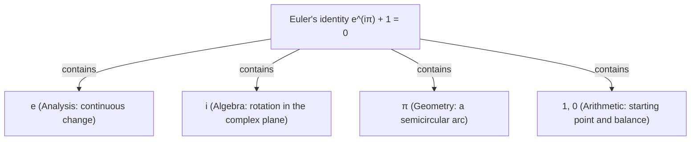

# What Makes Euler's Identity Beautiful?

**[Euler's](https://kenji.blog/en/p/euler/) identity** is admired for connecting five fundamental mathematical constants in a short equation.

$$
e^{i\pi} + 1 = 0
$$

The equation brings together numbers important in arithmetic, geometry, analysis, and algebra. In Volume I, Chapter 22 of *The Feynman Lectures on Physics*, [Feynman](/en/p/biography-richard-feynman/) describes the more general Euler formula as “This is our jewel.” His remark concerns the formula discussed below, rather than just the special identity above.

We will explain the five constants, derive the identity from Euler's formula, prove that formula using absolutely convergent series, and interpret it as a rotation. In the applications, we will distinguish the identity at a particular angle from the formula for arbitrary angles.

## Five Fundamental Constants

The numbers $0,1,\pi,e,i$ have basic roles in many parts of mathematics. Assigning them to separate fields is a way of explaining these roles, not a claim that they were unrelated.

### 1. $0$: The Additive Identity

$0$ is the additive identity: $a+0=a$ for every number $a$. It also represents an absent quantity or an empty place in positional notation; here we focus on its additive property.

### 2. $1$: The Multiplicative Identity

$1$ is the multiplicative identity: $a\cdot1=a$ for every number $a$. Whether the natural numbers start at 1 or include 0 is a convention; the multiplicative role of 1 is unchanged.

### 3. $\pi$: The Circle Constant

$\pi$ is an irrational number approximately equal to $3.14159\dots$, the ratio of a circle's circumference to its diameter in the Euclidean plane. It also appears in trigonometric functions and radian measure. Here the key angle is $\pi$, a half-turn.

### 4. $e$: The Base of the Natural Logarithm

$e$ is an irrational number approximately equal to $2.71828\dots$ and is the base of the natural logarithm. For real $x$, the derivative of $e^x$ is $e^x$, and its antiderivatives are $e^x+C$. It is used in exponential models of growth and decay, although not every continuous change follows an exponential model.

### 5. $i$: The Imaginary Unit

$i$ is the imaginary unit satisfying $i^2=-1$. Since $-i$ satisfies the same equation, we conventionally choose $i$ to point upward in the complex plane. Complex numbers have the form $a+bi$, with $a,b$ real, extending the setting for equations and rotations.

Euler's identity connects the arithmetic constants $0$ and $1$, the geometric constant $\pi$, the analytic constant $e$, and the algebraic constant $i$ in a single equation.

## Derivation from Euler's Formula

Euler's identity is the case of the more general **Euler formula** with angle $\pi$. Throughout this article, $x$ is real and angles are measured in radians. The notation $e^z$ means the single-valued complex exponential $\exp z$, defined by the series below.

$$
e^{ix} = \cos x + i\sin x
$$

The formula connects the exponential function on the left with trigonometric functions on the right through the imaginary unit $i$.

Substitute $x=\pi$, the radian measure of 180 degrees:

$$
e^{i\pi} = \cos\pi + i\sin\pi
$$

Since $\cos\pi=-1$ and $\sin\pi=0$, we obtain:

$$
e^{i\pi} = -1 + i \cdot 0
$$

Thus:

$$
e^{i\pi} = -1
$$

Adding 1 to both sides gives:

$$
e^{i\pi} + 1 = 0
$$

This derives Euler's identity from Euler's formula.

## Proof Using Maclaurin Series

Why does $e^{ix}=\cos x+i\sin x$ hold? We use [Maclaurin series](/en/p/taylor-and-maclaurin-series/), checking the complex exponential and convergence rather than merely substituting a complex number into an equality for real variables.

Define the complex exponential by $\exp z=\sum_{n=0}^{\infty}z^n/n!$. Convergence at $z=0$ is immediate. For any fixed complex $z\ne0$, the ratio of successive absolute term values, $|z|/(n+1)$, tends to zero, so the series converges absolutely. For real $x$, it agrees with the usual exponential; sine and cosine have the following expansions as well. All three equalities hold for every real $x$.

$$
e^x = 1 + x + \frac{x^2}{2!} + \frac{x^3}{3!} + \frac{x^4}{4!} + \frac{x^5}{5!} + \dots
$$

$$
\cos x = 1 - \frac{x^2}{2!} + \frac{x^4}{4!} - \frac{x^6}{6!} + \dots
$$

$$
\sin x = x - \frac{x^3}{3!} + \frac{x^5}{5!} - \frac{x^7}{7!} + \dots
$$

Set $z=ix$ in the complex exponential series. Since $x$ is real, $ix$ is purely imaginary (or zero when $x=0$). Use the four-step cycle $i^1=i$, $i^2=-1$, $i^3=-i$, $i^4=1$.

$$
e^{ix} = 1 + (ix) + \frac{(ix)^2}{2!} + \frac{(ix)^3}{3!} + \frac{(ix)^4}{4!} + \frac{(ix)^5}{5!} + \dots
$$

$$
e^{ix} = 1 + ix - \frac{x^2}{2!} - i\frac{x^3}{3!} + \frac{x^4}{4!} + i\frac{x^5}{5!} - \dots
$$

Absolute convergence allows us to group the even- and odd-degree terms. Because $x$ is real, the first bracket gives the real part and the second gives the value of the imaginary part. The imaginary part is a real number; it is distinct from that number multiplied by $i$.

$$
e^{ix} = \left( 1 - \frac{x^2}{2!} + \frac{x^4}{4!} - \dots \right) + i \left( x - \frac{x^3}{3!} + \frac{x^5}{5!} - \dots \right)
$$

The first bracket is the series for $\cos x$, and the second is the series for $\sin x$. Consequently:

$$
e^{ix} = \cos x + i\sin x
$$

This proves the connection between the exponential and trigonometric functions.

## Geometric Meaning in the Complex Plane

The identity also has a geometric interpretation in the **complex plane**, sometimes called the Gauss plane.

Represent $z=a+bi$ by the point $(a,b)$: the horizontal coordinate is the real part and the vertical coordinate is the value of the imaginary part. For real $\theta$, $|e^{i\theta}|=1$, so multiplication by $e^{i\theta}$ preserves length and rotates about the origin. Positive $\theta$ gives counterclockwise rotation, and negative $\theta$ gives clockwise rotation. The origin stays fixed.

Consider $e^{i\pi}=-1$ from this perspective:

1. Start at $1$, the point $(1,0)$ on the real axis.
2. Multiplication by $e^{i\pi}$ rotates this point through $\pi$ radians, or 180 degrees, about the origin.
3. A half-turn from $1$ reaches $-1$, the point $(-1,0)$.

Thus the identity expresses the geometric fact that a half-turn from $1$ reaches the opposite point, $-1$.

## Leonhard Euler

[Leonhard Euler](https://kenji.blog/en/p/euler/) (1707–1783), born in Switzerland, was a leading mathematician of the eighteenth century. He contributed across mathematics and also worked in physics, astronomy, and engineering.

Euler produced many papers and books and remained active in research after losing his sight later in life. Volume 1 of his *Introductio in analysin infinitorum*, published in 1748, places functions at the center of analysis and emphasizes the notation $f(x)$ and the roles of $e$ and the exponential function. It also treats infinite series, infinite products, and continued fractions.

The proof given here is a modern explanation using the definition of the complex exponential and absolute convergence. It should not be identified directly with the infinitesimal arguments used in Euler's writings.

## Applications in Science and Engineering

Applications chiefly use Euler's formula with a variable angle. The identity at $x=\pi$ alone does not carry out all these calculations.

### Signal Processing and Fourier Analysis

Fourier analysis represents signals using trigonometric or complex exponential components. Periodic Fourier series and transforms for nonperiodic signals require specified function conditions and notions of convergence. The time derivative of $e^{i\omega t}$ is $i\omega e^{i\omega t}$; for $\omega\ne0$, one antiderivative is $e^{i\omega t}/(i\omega)$. Termwise differentiation or integration of a series requires additional conditions.

An [FFT](/en/p/fast-fourier-transform-algorithm/) efficiently computes the discrete Fourier transform of finite data. The baseline method for ordinary lossy JPEG uses a discrete cosine transform (DCT); this should be distinguished from saying that JPEG directly uses an FFT.

### Electrical Engineering

For a linear, time-invariant AC circuit in sinusoidal steady state at a single frequency, phasors let us calculate voltage and current amplitudes and phases using complex algebra. Transients are treated separately; multiple frequencies are analyzed one at a time before superposition. This method cannot be applied unconditionally to nonlinear circuits or arbitrary time variation.

### Quantum Mechanics

In nonrelativistic quantum mechanics, the Schrödinger equation describes a wave function, a complex probability amplitude. For a normalized position-space wave function $\psi(x,t)$, $|\psi(x,t)|^2$ is a position probability density; the wave function itself is not a probability. Complex exponentials occur in free-particle plane waves and the time evolution of energy eigenstates, but a general wave function is not a single exponential.

## Conclusion: The Appeal of the Equation

Euler's identity can feel like a puzzle whose pieces finally form a single picture: the circle constant $\pi$, the analytic constant $e$, the imaginary unit $i$, and the elementary numbers $1$ and $0$. Their relationship can evoke a sense that mathematics reflects a deeper order in the world.

Mathematics is often described as a technical language, yet the simplicity and breadth of this identity can be appreciated much like a poem or a work of art. Its beauty lies in the harmony readers find in these connected ideas.

## References

- [NIST DLMF §4.2(iii): Complex exponential series and trigonometric relations](https://dlmf.nist.gov/4.2#iii)
- [MIT 18.100C Lecture 11: Absolute convergence and complex exponentials](https://ocw.mit.edu/courses/18-100c-real-analysis-fall-2012/1058808e5cb57c986118333f8b6fa0d7_MIT18_100CF12_l11sum.pdf)
- [The Feynman Lectures I, Chapter 22: Euler's general formula and the quotation](https://www.feynmanlectures.caltech.edu/I_22.html)
- [The Feynman Lectures I, Chapters 23 and 25: Complex oscillations and steady state](https://www.feynmanlectures.caltech.edu/I_23.html) ([Chapter 25](https://www.feynmanlectures.caltech.edu/I_25.html))
- [MIT 6.002: Sinusoidal steady state and the impedance method](https://circuits.mit.edu/_static/S23/handouts/lec10b/lecture10b-berggren.pdf)
- [MIT 6.341 Lecture 19: FFT algorithms for computing the DFT](https://ocw.mit.edu/courses/6-341-discrete-time-signal-processing-fall-2005/resources/lec19/)
- [The Feynman Lectures III, Chapter 3: Complex probability amplitudes](https://www.feynmanlectures.caltech.edu/III_03.html)
- [ITU-T T.81: JPEG DCT processes (§§3.1.58–59 and 4.2)](https://www.w3.org/Graphics/JPEG/itu-t81.pdf)
- [Euler Archive: Bibliography and content summary of the 1748 Introductio, Volume 1](https://scholarlycommons.pacific.edu/euler-works/101/)
- [ETH Library: Euler's life and research after blindness](https://library.ethz.ch/sammlungen-und-archive/kurzportraets/leonhard-euler-1707-1783.html)
