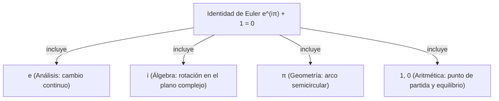

# ¿Qué hace hermosa a la identidad de Euler?

La **identidad de [Euler](https://kenji.blog/es/p/euler/)** es admirada por conectar cinco constantes matemáticas fundamentales en una ecuación breve.

$$
e^{i\pi} + 1 = 0
$$

La ecuación reúne números importantes en aritmética, geometría, análisis y álgebra. En el capítulo 22 del primer volumen de *The Feynman Lectures on Physics*, [Feynman](/es/p/biography-richard-feynman/) describe la fórmula general de Euler con las palabras “This is our jewel.” Su comentario se refiere a la fórmula que veremos más adelante, no únicamente a la identidad particular anterior.

Explicaremos las cinco constantes, obtendremos la identidad a partir de la fórmula de Euler, demostraremos esa fórmula mediante series absolutamente convergentes y la interpretaremos como una rotación. En las aplicaciones distinguiremos la identidad para un ángulo concreto de la fórmula para ángulos arbitrarios.

## Cinco constantes fundamentales

Los números $0,1,\pi,e,i$ desempeñan papeles básicos en distintos contextos matemáticos. Asignarlos a ramas diferentes es una forma de explicar sus funciones, no una afirmación de que antes carecieran de relación.

### 1. $0$: El elemento neutro aditivo

$0$ es el elemento neutro de la suma: $a+0=a$ para cualquier número $a$. También representa la ausencia de una cantidad o una posición vacía en la notación posicional; aquí nos centramos en su propiedad aditiva.

### 2. $1$: El elemento neutro multiplicativo

$1$ es el elemento neutro de la multiplicación: $a\cdot1=a$ para cualquier número $a$. Que los naturales comiencen en 1 o incluyan el 0 es una convención; el papel multiplicativo del 1 no cambia.

### 3. $\pi$: La constante del círculo

$\pi$ es un número irracional de valor aproximado $3.14159\dots$, la razón entre la longitud de una circunferencia y su diámetro en el plano euclídeo. También aparece en las funciones trigonométricas y en la medida angular en radianes. Aquí el ángulo clave es $\pi$, media vuelta.

### 4. $e$: La base del logaritmo natural

$e$ es un número irracional de valor aproximado $2.71828\dots$ y la base del logaritmo natural. Para $x$ real, la derivada de $e^x$ es $e^x$ y sus primitivas son $e^x+C$. Aparece en modelos exponenciales de crecimiento y decaimiento, aunque no todo cambio continuo sigue un modelo exponencial.

### 5. $i$: La unidad imaginaria

$i$ es la unidad imaginaria que satisface $i^2=-1$. Como $-i$ satisface la misma ecuación, convencionalmente se elige $i$ hacia arriba en el plano complejo. Los números complejos tienen la forma $a+bi$, con $a,b$ reales, y amplían el marco para estudiar ecuaciones y rotaciones.

La identidad de Euler conecta las constantes aritméticas $0$ y $1$, la constante geométrica $\pi$, la constante del análisis $e$ y la constante algebraica $i$ en una sola ecuación.

## Obtención a partir de la fórmula de Euler

La identidad es el caso de la **fórmula de Euler** correspondiente al ángulo $\pi$. En este artículo, $x$ es real y los ángulos se miden en radianes. La notación $e^z$ significa la función exponencial compleja de valor único $\exp z$, definida por la serie que presentaremos después.

$$
e^{ix} = \cos x + i\sin x
$$

La fórmula conecta la función exponencial de la izquierda con las funciones trigonométricas de la derecha mediante la unidad imaginaria $i$.

Sustituimos $x=\pi$, la medida en radianes de 180 grados:

$$
e^{i\pi} = \cos\pi + i\sin\pi
$$

Como $\cos\pi=-1$ y $\sin\pi=0$, obtenemos:

$$
e^{i\pi} = -1 + i \cdot 0
$$

Por tanto:

$$
e^{i\pi} = -1
$$

Sumando 1 a ambos lados:

$$
e^{i\pi} + 1 = 0
$$

Así se obtiene la identidad a partir de la fórmula de Euler.

## Demostración mediante series de Maclaurin

¿Por qué se cumple $e^{ix}=\cos x+i\sin x$? Usaremos las [series de Maclaurin](/es/p/taylor-and-maclaurin-series/), comprobando la definición de la exponencial compleja y la convergencia, en lugar de sustituir formalmente un número complejo en una igualdad para variables reales.

Definimos $\exp z=\sum_{n=0}^{\infty}z^n/n!$. La convergencia para $z=0$ es inmediata. Para cualquier $z\ne0$ complejo y fijo, la razón entre los valores absolutos de términos consecutivos, $|z|/(n+1)$, tiende a cero, de modo que la serie converge absolutamente. Para $x$ real coincide con la exponencial habitual; el seno y el coseno también admiten los desarrollos siguientes. Las tres igualdades se cumplen para todo $x$ real.

$$
e^x = 1 + x + \frac{x^2}{2!} + \frac{x^3}{3!} + \frac{x^4}{4!} + \frac{x^5}{5!} + \dots
$$

$$
\cos x = 1 - \frac{x^2}{2!} + \frac{x^4}{4!} - \frac{x^6}{6!} + \dots
$$

$$
\sin x = x - \frac{x^3}{3!} + \frac{x^5}{5!} - \frac{x^7}{7!} + \dots
$$

Tomamos $z=ix$ en la serie de la exponencial compleja. Como $x$ es real, $ix$ es imaginario puro, o cero si $x=0$. Utilizamos el ciclo de cuatro pasos $i^1=i$, $i^2=-1$, $i^3=-i$, $i^4=1$.

$$
e^{ix} = 1 + (ix) + \frac{(ix)^2}{2!} + \frac{(ix)^3}{3!} + \frac{(ix)^4}{4!} + \frac{(ix)^5}{5!} + \dots
$$

$$
e^{ix} = 1 + ix - \frac{x^2}{2!} - i\frac{x^3}{3!} + \frac{x^4}{4!} + i\frac{x^5}{5!} - \dots
$$

La convergencia absoluta permite agrupar los términos de grado par e impar. Como $x$ es real, el primer paréntesis da la parte real y el segundo da el valor de la parte imaginaria. La parte imaginaria es un número real, distinto de ese número multiplicado por $i$.

$$
e^{ix} = \left( 1 - \frac{x^2}{2!} + \frac{x^4}{4!} - \dots \right) + i \left( x - \frac{x^3}{3!} + \frac{x^5}{5!} - \dots \right)
$$

El primer paréntesis es la serie de $\cos x$ y el segundo la de $\sin x$. Por consiguiente:

$$
e^{ix} = \cos x + i\sin x
$$

Esto demuestra la relación entre las funciones exponencial y trigonométricas.

## Significado geométrico en el plano complejo

La identidad tiene también una interpretación geométrica en el **plano complejo**, llamado asimismo plano de Gauss.

Representamos $z=a+bi$ mediante el punto $(a,b)$: la coordenada horizontal es la parte real y la vertical el valor de la parte imaginaria. Para $\theta$ real, $|e^{i\theta}|=1$, por lo que multiplicar por $e^{i\theta}$ conserva la longitud y produce una rotación alrededor del origen. Si $\theta$ es positivo, la rotación es antihoraria; si es negativo, es horaria. El origen permanece fijo.

Consideremos $e^{i\pi}=-1$ desde esta perspectiva:

1. Partimos de $1$, el punto $(1,0)$ del eje real.
2. Multiplicar por $e^{i\pi}$ gira ese punto $\pi$ radianes, o 180 grados, alrededor del origen.
3. Media vuelta desde $1$ lleva a $-1$, el punto $(-1,0)$.

La identidad expresa así que media vuelta desde $1$ alcanza el punto opuesto, $-1$.

## Leonhard Euler

[Leonhard Euler](https://kenji.blog/es/p/euler/) (1707–1783), nacido en Suiza, fue uno de los principales matemáticos del siglo XVIII. Contribuyó a numerosas ramas de las matemáticas y también trabajó en física, astronomía e ingeniería.

Euler publicó muchos artículos y libros y siguió investigando activamente después de perder la vista en su vejez. El primer volumen de su *Introductio in analysin infinitorum*, publicado en 1748, sitúa las funciones en el centro del análisis y destaca la notación $f(x)$ y los papeles de $e$ y de la función exponencial. También trata series infinitas, productos infinitos y fracciones continuas.

La demostración aquí expuesta es una explicación moderna basada en la definición de la exponencial compleja y la convergencia absoluta. No debe identificarse directamente con los argumentos infinitesimales empleados en los escritos de Euler.

## Aplicaciones en ciencia e ingeniería

Las aplicaciones utilizan principalmente la fórmula de Euler con un ángulo variable. La identidad para $x=\pi$ por sí sola no realiza todos estos cálculos.

### Procesamiento de señales y análisis de Fourier

El análisis de Fourier representa señales mediante componentes trigonométricas o exponenciales complejas. Las series para señales periódicas y las transformadas para señales no periódicas requieren condiciones sobre las funciones y una noción de convergencia especificadas. La derivada temporal de $e^{i\omega t}$ es $i\omega e^{i\omega t}$; para $\omega\ne0$, una primitiva es $e^{i\omega t}/(i\omega)$. Derivar o integrar una serie término a término exige condiciones adicionales.

Una [FFT](/es/p/fast-fourier-transform-algorithm/) calcula eficientemente la transformada discreta de Fourier de datos finitos. El método básico de JPEG habitual con pérdida utiliza una transformada discreta del coseno (DCT); esto debe distinguirse de afirmar que JPEG usa directamente una FFT.

### Ingeniería eléctrica y electrónica

En un circuito de corriente alterna lineal e invariante en el tiempo, en régimen sinusoidal permanente a una sola frecuencia, los fasores permiten calcular amplitudes y fases de tensiones y corrientes mediante álgebra compleja. Los transitorios se tratan por separado; las distintas frecuencias se analizan individualmente antes de superponerlas. El método no se aplica sin condiciones a circuitos no lineales o a variaciones temporales arbitrarias.

### Mecánica cuántica

En mecánica cuántica no relativista, la ecuación de Schrödinger describe una función de onda, una amplitud de probabilidad compleja. Para una función de onda normalizada en representación de posición $\psi(x,t)$, $|\psi(x,t)|^2$ es una densidad de probabilidad de posición; la función de onda misma no es una probabilidad. Las exponenciales complejas aparecen en las ondas planas de partículas libres y en la evolución temporal de estados propios de energía, pero una función de onda general no es una sola exponencial.

## Conclusión: El atractivo de la ecuación

La identidad de Euler puede evocar un rompecabezas cuyas piezas finalmente forman una imagen: la constante geométrica $\pi$, la constante del análisis $e$, la unidad imaginaria $i$ y los números elementales $1$ y $0$. Sus relaciones pueden producir la sensación de que las matemáticas reflejan un orden más profundo del mundo.

Aunque las matemáticas suelen describirse como un lenguaje técnico, la sencillez y las amplias conexiones de esta identidad pueden apreciarse como un poema o una obra de arte. Su belleza está en la armonía que los lectores encuentran entre estas ideas.

## Referencias

- [NIST DLMF §4.2(iii): Series de la exponencial compleja y relaciones trigonométricas](https://dlmf.nist.gov/4.2#iii)
- [MIT 18.100C Lecture 11: Convergencia absoluta y exponenciales complejas](https://ocw.mit.edu/courses/18-100c-real-analysis-fall-2012/1058808e5cb57c986118333f8b6fa0d7_MIT18_100CF12_l11sum.pdf)
- [The Feynman Lectures I, capítulo 22: Fórmula general de Euler y cita](https://www.feynmanlectures.caltech.edu/I_22.html)
- [The Feynman Lectures I, capítulos 23 y 25: Oscilaciones complejas y régimen permanente](https://www.feynmanlectures.caltech.edu/I_23.html) ([capítulo 25](https://www.feynmanlectures.caltech.edu/I_25.html))
- [MIT 6.002: Régimen sinusoidal permanente y método de impedancias](https://circuits.mit.edu/_static/S23/handouts/lec10b/lecture10b-berggren.pdf)
- [MIT 6.341 Lecture 19: Algoritmos FFT para calcular la DFT](https://ocw.mit.edu/courses/6-341-discrete-time-signal-processing-fall-2005/resources/lec19/)
- [The Feynman Lectures III, capítulo 3: Amplitudes complejas de probabilidad](https://www.feynmanlectures.caltech.edu/III_03.html)
- [ITU-T T.81: Procesos DCT de JPEG (§§3.1.58–59 y 4.2)](https://www.w3.org/Graphics/JPEG/itu-t81.pdf)
- [Euler Archive: Bibliografía y resumen del primer volumen de Introductio de 1748](https://scholarlycommons.pacific.edu/euler-works/101/)
- [Biblioteca ETH: Vida de Euler e investigación tras la ceguera](https://library.ethz.ch/sammlungen-und-archive/kurzportraets/leonhard-euler-1707-1783.html)
