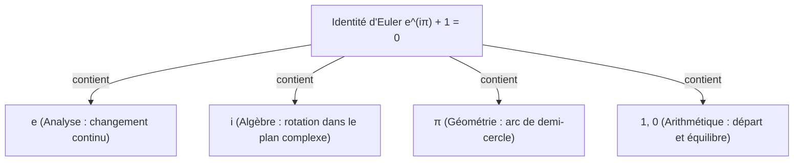

# Qu'est-ce qui fait la beauté de l'identité d'Euler ?

L'**identité d'[Euler](https://kenji.blog/fr/p/euler/)** est admirée parce qu'elle relie cinq constantes mathématiques fondamentales dans une équation très courte.

$$
e^{i\pi} + 1 = 0
$$

L'équation rassemble des nombres importants en arithmétique, en géométrie, en analyse et en algèbre. Dans le chapitre 22 du premier volume des *Feynman Lectures on Physics*, [Feynman](/fr/p/biography-richard-feynman/) qualifie la formule générale d'Euler par les mots “This is our jewel.” Son commentaire concerne la formule présentée plus loin, et non uniquement l'identité particulière ci-dessus.

Nous expliquerons les cinq constantes, obtiendrons l'identité à partir de la formule d'Euler, démontrerons cette formule avec des séries absolument convergentes et l'interpréterons comme une rotation. Dans les applications, nous distinguerons l'identité pour un angle particulier de la formule pour des angles quelconques.

## Cinq constantes fondamentales

Les nombres $0,1,\pi,e,i$ jouent des rôles fondamentaux dans différents contextes mathématiques. Les associer à des branches distinctes est une façon d'expliquer ces rôles, pas d'affirmer qu'ils étaient sans rapport entre eux.

### 1. $0$ : L'élément neutre de l'addition

$0$ est l'élément neutre de l'addition : $a+0=a$ pour tout nombre $a$. Il peut aussi représenter une quantité absente ou une position vide dans une écriture positionnelle ; nous nous concentrons ici sur sa propriété additive.

### 2. $1$ : L'élément neutre de la multiplication

$1$ est l'élément neutre de la multiplication : $a\cdot1=a$ pour tout nombre $a$. Faire commencer les entiers naturels à 1 ou y inclure 0 relève d'une convention ; le rôle multiplicatif de 1 ne change pas.

### 3. $\pi$ : La constante du cercle

$\pi$ est un nombre irrationnel valant environ $3{,}14159\dots$, le rapport de la circonférence d'un cercle à son diamètre dans le plan euclidien. Il apparaît aussi dans les fonctions trigonométriques et dans la mesure des angles en radians. L'angle essentiel ici est $\pi$, un demi-tour.

### 4. $e$ : La base du logarithme népérien

$e$ est un nombre irrationnel valant environ $2{,}71828\dots$ et la base du logarithme népérien. Pour $x$ réel, la dérivée de $e^x$ est $e^x$, et ses primitives sont $e^x+C$. Il intervient dans les modèles exponentiels de croissance et de décroissance, mais tout changement continu ne suit pas un tel modèle.

### 5. $i$ : L'unité imaginaire

$i$ est l'unité imaginaire qui vérifie $i^2=-1$. Comme $-i$ satisfait la même équation, on choisit conventionnellement de représenter $i$ vers le haut dans le plan complexe. Les nombres complexes s'écrivent $a+bi$, avec $a,b$ réels, ce qui élargit le cadre d'étude des équations et des rotations.

L'identité d'Euler relie les constantes arithmétiques $0$ et $1$, la constante géométrique $\pi$, la constante de l'analyse $e$ et la constante algébrique $i$ dans une seule équation.

## Obtention à partir de la formule d'Euler

L'identité est le cas de la **formule d'Euler** pour l'angle $\pi$. Dans cet article, $x$ est réel et les angles sont mesurés en radians. La notation $e^z$ désigne la fonction exponentielle complexe à valeur unique $\exp z$, définie par la série présentée plus loin.

$$
e^{ix} = \cos x + i\sin x
$$

La formule relie la fonction exponentielle à gauche aux fonctions trigonométriques à droite, par l'intermédiaire de l'unité imaginaire $i$.

Remplaçons $x$ par $\pi$, la mesure en radians de 180 degrés :

$$
e^{i\pi} = \cos\pi + i\sin\pi
$$

Comme $\cos\pi=-1$ et $\sin\pi=0$, nous obtenons :

$$
e^{i\pi} = -1 + i \cdot 0
$$

Donc :

$$
e^{i\pi} = -1
$$

En ajoutant 1 aux deux membres :

$$
e^{i\pi} + 1 = 0
$$

On obtient ainsi l'identité à partir de la formule d'Euler.

## Démonstration par les séries de Maclaurin

Pourquoi l'égalité $e^{ix}=\cos x+i\sin x$ est-elle vraie ? Nous utilisons les [séries de Maclaurin](/fr/p/taylor-and-maclaurin-series/), en vérifiant la définition de l'exponentielle complexe et la convergence plutôt qu'en substituant simplement un nombre complexe dans une égalité de variables réelles.

Définissons $\exp z=\sum_{n=0}^{\infty}z^n/n!$. La convergence pour $z=0$ est immédiate. Pour tout complexe fixé $z\ne0$, le rapport des valeurs absolues de deux termes consécutifs, $|z|/(n+1)$, tend vers zéro : la série converge donc absolument. Pour $x$ réel, elle coïncide avec l'exponentielle usuelle ; le sinus et le cosinus admettent aussi les développements suivants. Les trois égalités sont valables pour tout réel $x$.

$$
e^x = 1 + x + \frac{x^2}{2!} + \frac{x^3}{3!} + \frac{x^4}{4!} + \frac{x^5}{5!} + \dots
$$

$$
\cos x = 1 - \frac{x^2}{2!} + \frac{x^4}{4!} - \frac{x^6}{6!} + \dots
$$

$$
\sin x = x - \frac{x^3}{3!} + \frac{x^5}{5!} - \frac{x^7}{7!} + \dots
$$

Posons $z=ix$ dans la série de l'exponentielle complexe. Puisque $x$ est réel, $ix$ est imaginaire pur, ou nul si $x=0$. Utilisons le cycle de quatre étapes $i^1=i$, $i^2=-1$, $i^3=-i$, $i^4=1$.

$$
e^{ix} = 1 + (ix) + \frac{(ix)^2}{2!} + \frac{(ix)^3}{3!} + \frac{(ix)^4}{4!} + \frac{(ix)^5}{5!} + \dots
$$

$$
e^{ix} = 1 + ix - \frac{x^2}{2!} - i\frac{x^3}{3!} + \frac{x^4}{4!} + i\frac{x^5}{5!} - \dots
$$

La convergence absolue autorise le regroupement des termes de degrés pairs et impairs. Comme $x$ est réel, la première parenthèse donne la partie réelle et la seconde la valeur de la partie imaginaire. La partie imaginaire est un nombre réel, distinct de ce nombre multiplié par $i$.

$$
e^{ix} = \left( 1 - \frac{x^2}{2!} + \frac{x^4}{4!} - \dots \right) + i \left( x - \frac{x^3}{3!} + \frac{x^5}{5!} - \dots \right)
$$

La première parenthèse est la série de $\cos x$, et la seconde celle de $\sin x$. Par conséquent :

$$
e^{ix} = \cos x + i\sin x
$$

Cela démontre le lien entre l'exponentielle et les fonctions trigonométriques.

## Signification géométrique dans le plan complexe

L'identité possède aussi une interprétation géométrique dans le **plan complexe**, également appelé plan de Gauss.

Représentons $z=a+bi$ par le point $(a,b)$ : la coordonnée horizontale est la partie réelle et la verticale la valeur de la partie imaginaire. Pour $\theta$ réel, $|e^{i\theta}|=1$ ; multiplier par $e^{i\theta}$ conserve donc la longueur et effectue une rotation autour de l'origine. Un $\theta$ positif correspond au sens antihoraire, un $\theta$ négatif au sens horaire. L'origine reste fixe.

Considérons $e^{i\pi}=-1$ sous cet angle :

1. Le départ est $1$, le point $(1,0)$ de l'axe réel.
2. Multiplier par $e^{i\pi}$ fait tourner ce point de $\pi$ radians, soit 180 degrés, autour de l'origine.
3. Un demi-tour depuis $1$ mène à $-1$, le point $(-1,0)$.

L'identité exprime ainsi le fait géométrique qu'un demi-tour depuis $1$ atteint le point opposé, $-1$.

## Leonhard Euler

[Leonhard Euler](https://kenji.blog/fr/p/euler/) (1707–1783), né en Suisse, fut l'un des principaux mathématiciens du XVIIIe siècle. Il contribua à de nombreuses branches des mathématiques et travailla aussi en physique, en astronomie et en ingénierie.

Euler produisit de nombreux articles et livres et poursuivit activement ses recherches après avoir perdu la vue à la fin de sa vie. Le premier volume de son *Introductio in analysin infinitorum*, publié en 1748, place les fonctions au centre de l'analyse et souligne la notation $f(x)$ et les rôles de $e$ et de l'exponentielle. Il traite aussi des séries infinies, des produits infinis et des fractions continues.

La démonstration proposée ici est une explication moderne fondée sur la définition de l'exponentielle complexe et la convergence absolue. Elle ne doit pas être directement identifiée aux arguments infinitésimaux employés dans les écrits d'Euler.

## Applications scientifiques et techniques

Les applications utilisent surtout la formule d'Euler avec un angle variable. L'identité au seul angle $x=\pi$ ne réalise pas à elle seule tous ces calculs.

### Traitement du signal et analyse de Fourier

L'analyse de Fourier représente les signaux à l'aide de composantes trigonométriques ou exponentielles complexes. Les séries pour signaux périodiques et les transformées pour signaux non périodiques exigent des conditions sur les fonctions et une notion de convergence précisées. La dérivée temporelle de $e^{i\omega t}$ est $i\omega e^{i\omega t}$ ; pour $\omega\ne0$, une primitive est $e^{i\omega t}/(i\omega)$. Dériver ou intégrer une série terme à terme demande des conditions supplémentaires.

Une [FFT](/fr/p/fast-fourier-transform-algorithm/) calcule efficacement la transformée de Fourier discrète de données finies. Le procédé de base du JPEG usuel avec pertes utilise une transformée en cosinus discrète (DCT) ; cela se distingue de l'affirmation selon laquelle JPEG utilise directement une FFT.

### Électricité et électronique

Dans un circuit alternatif linéaire et invariant dans le temps, en régime sinusoïdal permanent à une seule fréquence, les phaseurs (phasors) permettent de calculer amplitudes et phases des tensions et courants par l'algèbre complexe. Les transitoires se traitent séparément ; différentes fréquences s'analysent individuellement avant superposition. La méthode ne s'applique pas sans conditions aux circuits non linéaires ou aux variations temporelles quelconques.

### Mécanique quantique

En mécanique quantique non relativiste, l'équation de Schrödinger décrit une fonction d'onde, une amplitude de probabilité complexe. Pour une fonction d'onde normalisée en représentation de position $\psi(x,t)$, $|\psi(x,t)|^2$ est une densité de probabilité de position ; la fonction d'onde elle-même n'est pas une probabilité. Des exponentielles complexes apparaissent dans les ondes planes des particules libres et dans l'évolution temporelle des états propres d'énergie, mais une fonction d'onde générale n'est pas une seule exponentielle.

## Conclusion : L'attrait de l'équation

L'identité d'Euler peut évoquer un puzzle dont les pièces finissent par former une image : la constante géométrique $\pi$, la constante de l'analyse $e$, l'unité imaginaire $i$ et les nombres élémentaires $1$ et $0$. Leurs relations peuvent donner le sentiment que les mathématiques reflètent un ordre plus profond du monde.

Si les mathématiques passent souvent pour un langage technique, la simplicité et les liens multiples de cette identité peuvent aussi s'apprécier comme un poème ou une œuvre d'art. Sa beauté tient à l'harmonie que les lecteurs trouvent entre ces idées.

## Références

- [NIST DLMF §4.2(iii) : Séries de l'exponentielle complexe et relations trigonométriques](https://dlmf.nist.gov/4.2#iii)
- [MIT 18.100C Lecture 11 : Convergence absolue et exponentielles complexes](https://ocw.mit.edu/courses/18-100c-real-analysis-fall-2012/1058808e5cb57c986118333f8b6fa0d7_MIT18_100CF12_l11sum.pdf)
- [The Feynman Lectures I, chapitre 22 : Formule générale d'Euler et citation](https://www.feynmanlectures.caltech.edu/I_22.html)
- [The Feynman Lectures I, chapitres 23 et 25 : Oscillations complexes et régime permanent](https://www.feynmanlectures.caltech.edu/I_23.html) ([chapitre 25](https://www.feynmanlectures.caltech.edu/I_25.html))
- [MIT 6.002 : Régime sinusoïdal permanent et méthode des impédances](https://circuits.mit.edu/_static/S23/handouts/lec10b/lecture10b-berggren.pdf)
- [MIT 6.341 Lecture 19 : Algorithmes FFT pour calculer la DFT](https://ocw.mit.edu/courses/6-341-discrete-time-signal-processing-fall-2005/resources/lec19/)
- [The Feynman Lectures III, chapitre 3 : Amplitudes complexes de probabilité](https://www.feynmanlectures.caltech.edu/III_03.html)
- [ITU-T T.81 : Procédés DCT de JPEG (§§3.1.58–59 et 4.2)](https://www.w3.org/Graphics/JPEG/itu-t81.pdf)
- [Euler Archive : Bibliographie et résumé du premier volume de l'Introductio de 1748](https://scholarlycommons.pacific.edu/euler-works/101/)
- [Bibliothèque ETH : Vie d'Euler et recherches après la cécité](https://library.ethz.ch/sammlungen-und-archive/kurzportraets/leonhard-euler-1707-1783.html)
