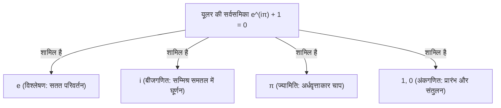

# यूलर की सर्वसमिका को सुंदर क्यों माना जाता है?

**[यूलर](https://kenji.blog/hi/p/euler/) की सर्वसमिका** (Euler's Identity) पाँच मूलभूत गणितीय स्थिरांकों को एक छोटे समीकरण में जोड़ती है। इसी कारण इसकी सुंदरता की प्रशंसा की जाती है।

$$
e^{i\pi} + 1 = 0
$$

यह समीकरण अंकगणित, ज्यामिति, विश्लेषण और बीजगणित की महत्वपूर्ण संख्याओं को जोड़ता है। *The Feynman Lectures on Physics* के पहले खंड के अध्याय 22 में [फाइनमैन](/hi/p/biography-richard-feynman/) ने अधिक सामान्य यूलर सूत्र को “This is our jewel.” कहा है। यह टिप्पणी नीचे दिए सामान्य सूत्र के लिए है, केवल ऊपर की विशेष सर्वसमिका के लिए नहीं।

हम पाँच स्थिरांकों का अर्थ समझेंगे, यूलर सूत्र से सर्वसमिका निकालेंगे, निरपेक्ष अभिसरण वाली श्रृंखलाओं से सूत्र सिद्ध करेंगे और घूर्णन के रूप में उसका अर्थ देखेंगे। अनुप्रयोगों में किसी विशेष कोण की सर्वसमिका और मनमाने कोण के सूत्र का अंतर स्पष्ट रखेंगे।

## पाँच मूलभूत स्थिरांक

$0,1,\pi,e,i$ गणित के अलग-अलग प्रसंगों में मूलभूत भूमिका निभाते हैं। इन्हें अलग विषयों से जोड़ना समझाने का तरीका है; इसका अर्थ यह नहीं कि ये पहले आपस में असंबद्ध थे।

### 1. $0$: योगात्मक तत्समक

$0$ जोड़ का तत्समक है: किसी भी संख्या $a$ के लिए $a+0=a$। यह किसी मात्रा का अभाव या स्थानीय मान वाली अंक-पद्धति में खाली स्थान भी दर्शा सकता है। यहाँ हम इसके जोड़ संबंधी गुण पर ध्यान देते हैं।

### 2. $1$: गुणात्मक तत्समक

$1$ गुणा का तत्समक है: किसी भी संख्या $a$ के लिए $a\cdot1=a$। प्राकृतिक संख्याएँ 1 से शुरू हों या उनमें 0 भी हो, यह परंपरा पर निर्भर है; गुणा में 1 की भूमिका नहीं बदलती।

### 3. $\pi$: वृत्त का स्थिरांक

$\pi$ लगभग $3.14159\dots$ मान वाली अपरिमेय संख्या है। यूक्लिडीय समतल में यह वृत्त की परिधि और व्यास का अनुपात है। यह त्रिकोणमितीय फलनों और रेडियन में कोण की माप में भी आता है। यहाँ महत्वपूर्ण कोण $\pi$ है, अर्थात आधा चक्कर।

### 4. $e$: प्राकृतिक लघुगणक का आधार

$e$ लगभग $2.71828\dots$ मान वाली अपरिमेय संख्या और प्राकृतिक लघुगणक का आधार है। वास्तविक $x$ के लिए $e^x$ का अवकलज $e^x$ है और उसके प्रतिअवकलज $e^x+C$ हैं। यह घातीय वृद्धि या क्षय के मॉडल में आता है, लेकिन हर सतत परिवर्तन घातीय मॉडल का पालन नहीं करता।

### 5. $i$: काल्पनिक इकाई

$i$ वह काल्पनिक इकाई है जिसके लिए $i^2=-1$ है। $-i$ भी इसी समीकरण का हल है, इसलिए सामान्यतः सम्मिश्र समतल में ऊपर की दिशा को $i$ मानने की परंपरा चुनते हैं। सम्मिश्र संख्याएँ $a+bi$ के रूप में लिखी जाती हैं, जहाँ $a,b$ वास्तविक हैं। इससे समीकरणों और घूर्णनों का अध्ययन करने का दायरा बढ़ता है।

यूलर की सर्वसमिका अंकगणित के $0$ और $1$, ज्यामिति के $\pi$, विश्लेषण के $e$ और बीजगणित के $i$ को एक समीकरण में जोड़ती है।

## यूलर सूत्र से व्युत्पत्ति

यह सर्वसमिका अधिक सामान्य **यूलर सूत्र** में कोण $\pi$ रखने पर मिलती है। इस लेख में $x$ वास्तविक है और कोण रेडियन में हैं। $e^z$ से नीचे श्रृंखला द्वारा परिभाषित एकमान वाला सम्मिश्र घातीय फलन $\exp z$ अभिप्रेत है।

$$
e^{ix} = \cos x + i\sin x
$$

यह सूत्र काल्पनिक इकाई $i$ के माध्यम से बाईं ओर के घातीय फलन और दाईं ओर के त्रिकोणमितीय फलनों को जोड़ता है।

$x=\pi$ रखें, जो 180 डिग्री का रेडियन माप है:

$$
e^{i\pi} = \cos\pi + i\sin\pi
$$

चूँकि $\cos\pi=-1$ और $\sin\pi=0$, हमें मिलता है:

$$
e^{i\pi} = -1 + i \cdot 0
$$

इसलिए:

$$
e^{i\pi} = -1
$$

दोनों पक्षों में 1 जोड़ने पर:

$$
e^{i\pi} + 1 = 0
$$

इस प्रकार यूलर सूत्र से सर्वसमिका प्राप्त होती है।

## मैकलॉरिन श्रृंखलाओं से प्रमाण

$e^{ix}=\cos x+i\sin x$ क्यों सही है? हम [मैकलॉरिन विस्तार](/hi/p/taylor-and-maclaurin-series/) का उपयोग करेंगे। लेकिन वास्तविक चर के समीकरण में केवल औपचारिक रूप से सम्मिश्र संख्या रखने के बजाय, सम्मिश्र घातीय फलन की परिभाषा और श्रृंखला का अभिसरण जाँचेंगे।

$\exp z=\sum_{n=0}^{\infty}z^n/n!$ परिभाषित करें। $z=0$ पर अभिसरण स्पष्ट है। स्थिर सम्मिश्र संख्या $z\ne0$ के लिए लगातार पदों के निरपेक्ष मानों का अनुपात $|z|/(n+1)$ शून्य की ओर जाता है, इसलिए श्रृंखला निरपेक्षतः अभिसरित होती है। वास्तविक $x$ पर यह सामान्य घातीय फलन के समान है; साइन और कोसाइन के भी नीचे दिए विस्तार हैं। तीनों बराबरियाँ प्रत्येक वास्तविक $x$ के लिए सही हैं।

$$
e^x = 1 + x + \frac{x^2}{2!} + \frac{x^3}{3!} + \frac{x^4}{4!} + \frac{x^5}{5!} + \dots
$$

$$
\cos x = 1 - \frac{x^2}{2!} + \frac{x^4}{4!} - \frac{x^6}{6!} + \dots
$$

$$
\sin x = x - \frac{x^3}{3!} + \frac{x^5}{5!} - \frac{x^7}{7!} + \dots
$$

सम्मिश्र घातीय फलन की श्रृंखला में $z=ix$ रखें। $x$ वास्तविक है, इसलिए $ix$ शुद्ध काल्पनिक है, या $x=0$ पर शून्य है। $i^1=i$, $i^2=-1$, $i^3=-i$, $i^4=1$ का चार चरणों वाला चक्र उपयोग करें।

$$
e^{ix} = 1 + (ix) + \frac{(ix)^2}{2!} + \frac{(ix)^3}{3!} + \frac{(ix)^4}{4!} + \frac{(ix)^5}{5!} + \dots
$$

$$
e^{ix} = 1 + ix - \frac{x^2}{2!} - i\frac{x^3}{3!} + \frac{x^4}{4!} + i\frac{x^5}{5!} - \dots
$$

निरपेक्ष अभिसरण के कारण सम और विषम घातों के पद अलग-अलग समूहों में जोड़े जा सकते हैं। $x$ वास्तविक होने के कारण पहला कोष्ठक वास्तविक भाग और दूसरा काल्पनिक भाग का मान देता है। काल्पनिक भाग स्वयं एक वास्तविक संख्या है; उसे $i$ से गुणा किए गए अंश से अलग समझना चाहिए।

$$
e^{ix} = \left( 1 - \frac{x^2}{2!} + \frac{x^4}{4!} - \dots \right) + i \left( x - \frac{x^3}{3!} + \frac{x^5}{5!} - \dots \right)
$$

पहला कोष्ठक $\cos x$ की और दूसरा $\sin x$ की श्रृंखला है। अतः:

$$
e^{ix} = \cos x + i\sin x
$$

इससे घातीय और त्रिकोणमितीय फलनों का संबंध सिद्ध होता है।

## सम्मिश्र समतल में ज्यामितीय अर्थ

सर्वसमिका को **सम्मिश्र समतल**, जिसे गाउस समतल भी कहते हैं, में ज्यामितीय रूप से भी समझा जा सकता है।

$z=a+bi$ को बिंदु $(a,b)$ से निरूपित करें। क्षैतिज निर्देशांक वास्तविक भाग और ऊर्ध्वाधर निर्देशांक काल्पनिक भाग का मान है। वास्तविक $\theta$ के लिए $|e^{i\theta}|=1$ है। इसलिए $e^{i\theta}$ से गुणा करने पर लंबाई बनी रहती है और मूलबिंदु के चारों ओर घूर्णन होता है। धनात्मक $\theta$ वामावर्त और ऋणात्मक $\theta$ दक्षिणावर्त घूर्णन देता है। मूलबिंदु स्थिर रहता है।

इस दृष्टि से $e^{i\pi}=-1$ देखें:

1. वास्तविक अक्ष पर $1$, अर्थात बिंदु $(1,0)$, से शुरू करें।
2. $e^{i\pi}$ से गुणा करना मूलबिंदु के चारों ओर $\pi$ रेडियन, यानी 180 डिग्री, घूमना है।
3. $1$ से आधा चक्कर घूमने पर विपरीत बिंदु $-1$, अर्थात $(-1,0)$, मिलता है।

इस प्रकार सर्वसमिका उस ज्यामितीय तथ्य को व्यक्त करती है कि $1$ से आधा चक्कर घूमने पर $-1$ मिलता है।

## लियोनहार्ड यूलर

स्विट्ज़रलैंड में जन्मे [लियोनहार्ड यूलर](https://kenji.blog/hi/p/euler/) (Leonhard Euler, 1707–1783) अठारहवीं सदी के प्रमुख गणितज्ञ थे। उन्होंने गणित की कई शाखाओं के साथ भौतिकी, खगोल विज्ञान और अभियांत्रिकी में भी काम किया।

यूलर ने अनेक शोधपत्र और पुस्तकें लिखीं और जीवन के अंतिम वर्षों में दृष्टि खोने के बाद भी सक्रिय शोध किया। 1748 में प्रकाशित *Introductio in analysin infinitorum* का पहला खंड फलनों को विश्लेषण के केंद्र में रखता है और $f(x)$ संकेतन, $e$ तथा घातीय फलन की भूमिका पर बल देता है। इसमें अनंत श्रृंखलाएँ, अनंत गुणनफल और सतत भिन्न भी हैं।

यहाँ दिया प्रमाण सम्मिश्र घातीय फलन की परिभाषा और निरपेक्ष अभिसरण पर आधारित आधुनिक व्याख्या है। इसे यूलर की रचनाओं में प्रयुक्त अनंतसूक्ष्म राशियों के तर्कों के बिल्कुल समान प्रमाण के रूप में नहीं लेना चाहिए।

## विज्ञान और अभियांत्रिकी में अनुप्रयोग

अनुप्रयोगों में मुख्यतः मनमाने कोण वाला यूलर सूत्र काम आता है। केवल $x=\pi$ की सर्वसमिका अपने आप इन सभी गणनाओं को नहीं करती।

### संकेत प्रसंस्करण और फूरियर विश्लेषण

फूरियर विश्लेषण संकेतों को त्रिकोणमितीय या सम्मिश्र घातीय घटकों से व्यक्त करता है। आवर्ती संकेतों की श्रृंखला और अनावर्ती संकेतों के रूपांतरण के लिए फलनों की शर्तें तथा अभिसरण का अर्थ बताना आवश्यक है। $e^{i\omega t}$ का समय के सापेक्ष अवकलज $i\omega e^{i\omega t}$ है। $\omega\ne0$ पर एक प्रतिअवकलज $e^{i\omega t}/(i\omega)$ है। श्रृंखला का पदशः अवकलन या समाकलन करने के लिए अतिरिक्त शर्तें चाहिए।

[FFT](/hi/p/fast-fourier-transform-algorithm/) परिमित डेटा के विविक्त फूरियर रूपांतरण की कुशल गणना करता है। सामान्य हानियुक्त JPEG की मूल विधि विविक्त कोसाइन रूपांतरण (DCT) उपयोग करती है। इसे JPEG द्वारा सीधे FFT उपयोग करने की बात से अलग समझना चाहिए।

### विद्युत और इलेक्ट्रॉनिक अभियांत्रिकी

रैखिक और समय-अपरिवर्ती प्रत्यावर्ती धारा परिपथ में, एक आवृत्ति के साइन संकेत की स्थायी अवस्था में, फेजर (phasor) से वोल्टेज और धारा के आयाम तथा कला की गणना सम्मिश्र बीजगणित से की जा सकती है। क्षणिक व्यवहार अलग संभालते हैं; कई आवृत्तियों के अध्यारोपण से पहले प्रत्येक आवृत्ति का विश्लेषण करते हैं। यह विधि अरेखीय परिपथों या मनमाने समय-परिवर्तनों पर बिना शर्त लागू नहीं होती।

### क्वांटम यांत्रिकी

गैर-सापेक्षिक क्वांटम यांत्रिकी में श्रोडिंगर समीकरण तरंग फलन का वर्णन करता है, जो सम्मिश्र प्रायिकता आयाम है। स्थिति निरूपण में प्रसामान्यीकृत तरंग फलन $\psi(x,t)$ के लिए $|\psi(x,t)|^2$ स्थिति का प्रायिकता घनत्व है; तरंग फलन स्वयं प्रायिकता नहीं है। मुक्त कण की समतल तरंगों और ऊर्जा की आइगेन-अवस्थाओं के समय-विकास में सम्मिश्र घातीय फलन आते हैं, लेकिन सामान्य तरंग फलन केवल एक घातीय फलन नहीं होता।

## निष्कर्ष: समीकरण का आकर्षण

यूलर की सर्वसमिका ऐसी पहेली का अनुभव दे सकती है जिसके टुकड़े अंततः एक चित्र बना देते हैं: ज्यामिति का $\pi$, विश्लेषण का $e$, काल्पनिक इकाई $i$ और मूलभूत $1$ तथा $0$। इनके संबंध से पाठक को लग सकता है कि गणित दुनिया के किसी गहरे क्रम को दर्शाता है।

गणित को अक्सर तकनीकी भाषा माना जाता है, फिर भी इस सर्वसमिका की सरलता और व्यापक संबंधों का आनंद कविता या कला की तरह लिया जा सकता है। इसकी सुंदरता उन विचारों के बीच पाठक को दिखाई देने वाले सामंजस्य में है।

## संदर्भ

- [NIST DLMF §4.2(iii): सम्मिश्र घातीय श्रृंखला और त्रिकोणमितीय संबंध](https://dlmf.nist.gov/4.2#iii)
- [MIT 18.100C Lecture 11: निरपेक्ष अभिसरण और सम्मिश्र घातीय फलन](https://ocw.mit.edu/courses/18-100c-real-analysis-fall-2012/1058808e5cb57c986118333f8b6fa0d7_MIT18_100CF12_l11sum.pdf)
- [The Feynman Lectures I, अध्याय 22: सामान्य यूलर सूत्र और उद्धरण](https://www.feynmanlectures.caltech.edu/I_22.html)
- [The Feynman Lectures I, अध्याय 23 और 25: सम्मिश्र दोलन और स्थायी अवस्था](https://www.feynmanlectures.caltech.edu/I_23.html) ([अध्याय 25](https://www.feynmanlectures.caltech.edu/I_25.html))
- [MIT 6.002: साइन संकेत की स्थायी अवस्था और प्रतिबाधा विधि](https://circuits.mit.edu/_static/S23/handouts/lec10b/lecture10b-berggren.pdf)
- [MIT 6.341 Lecture 19: DFT की गणना के FFT एल्गोरिदम](https://ocw.mit.edu/courses/6-341-discrete-time-signal-processing-fall-2005/resources/lec19/)
- [The Feynman Lectures III, अध्याय 3: सम्मिश्र प्रायिकता आयाम](https://www.feynmanlectures.caltech.edu/III_03.html)
- [ITU-T T.81: JPEG की DCT विधि (§3.1.58–59 और §4.2)](https://www.w3.org/Graphics/JPEG/itu-t81.pdf)
- [Euler Archive: 1748 की Introductio के पहले खंड की ग्रंथसूची और सार](https://scholarlycommons.pacific.edu/euler-works/101/)
- [ETH पुस्तकालय: यूलर का जीवन और दृष्टि खोने के बाद शोध](https://library.ethz.ch/sammlungen-und-archive/kurzportraets/leonhard-euler-1707-1783.html)
