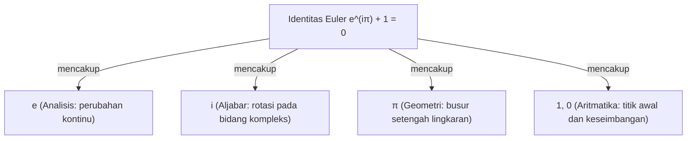

# Apa yang membuat identitas Euler indah?

**Identitas [Euler](https://kenji.blog/id/p/euler/)** dikagumi karena menghubungkan lima konstanta dasar matematika dalam sebuah persamaan singkat.

$$
e^{i\pi} + 1 = 0
$$

Persamaan ini mempertemukan bilangan penting dalam aritmatika, geometri, analisis, dan aljabar. Dalam bab 22 jilid pertama *The Feynman Lectures on Physics*, [Feynman](/id/p/biography-richard-feynman/) menyebut rumus umum Euler dengan kata-kata “This is our jewel.” Komentar itu merujuk pada rumus yang akan dibahas berikutnya, bukan hanya identitas khusus di atas.

Kita akan menjelaskan kelima konstanta, menurunkan identitas dari rumus Euler, membuktikan rumus tersebut dengan deret yang konvergen mutlak, dan menafsirkannya sebagai rotasi. Dalam aplikasi, kita membedakan identitas pada sudut tertentu dari rumus untuk sudut sembarang.

## Lima konstanta dasar

Bilangan $0,1,\pi,e,i$ mempunyai peran dasar dalam berbagai konteks matematika. Mengaitkannya dengan bidang yang berbeda adalah cara menjelaskan perannya, bukan pernyataan bahwa bilangan-bilangan itu sebelumnya tidak saling berhubungan.

### 1. $0$: Identitas penjumlahan

$0$ adalah elemen identitas penjumlahan: $a+0=a$ untuk setiap bilangan $a$. Bilangan ini juga dapat menyatakan ketiadaan kuantitas atau tempat kosong dalam notasi nilai tempat; di sini kita berfokus pada sifat penjumlahannya.

### 2. $1$: Identitas perkalian

$1$ adalah elemen identitas perkalian: $a\cdot1=a$ untuk setiap bilangan $a$. Apakah bilangan asli dimulai dari 1 atau mencakup 0 merupakan konvensi; peran 1 dalam perkalian tidak berubah.

### 3. $\pi$: Konstanta lingkaran

$\pi$ adalah bilangan irasional bernilai sekitar $3{,}14159\dots$, yaitu rasio keliling lingkaran terhadap diameternya pada bidang Euklides. Bilangan ini juga muncul dalam fungsi trigonometri dan ukuran sudut radian. Sudut penting di sini adalah $\pi$, setengah putaran.

### 4. $e$: Basis logaritma natural

$e$ adalah bilangan irasional bernilai sekitar $2{,}71828\dots$ dan basis logaritma natural. Untuk $x$ real, turunan $e^x$ tetap $e^x$ dan antiturunannya adalah $e^x+C$. Bilangan ini muncul dalam model pertumbuhan dan peluruhan eksponensial, tetapi tidak setiap perubahan kontinu mengikuti model eksponensial.

### 5. $i$: Satuan imajiner

$i$ adalah satuan imajiner yang memenuhi $i^2=-1$. Karena $-i$ memenuhi persamaan yang sama, kita biasanya memilih arah ke atas pada bidang kompleks sebagai arah $i$. Bilangan kompleks berbentuk $a+bi$, dengan $a,b$ real, memperluas konteks untuk mempelajari persamaan dan rotasi.

Identitas Euler menghubungkan konstanta aritmatika $0$ dan $1$, konstanta geometri $\pi$, konstanta analisis $e$, dan konstanta aljabar $i$ dalam satu persamaan.

## Penurunan dari rumus Euler

Identitas ini adalah kasus **rumus Euler** yang lebih umum pada sudut $\pi$. Dalam artikel ini, $x$ real dan sudut diukur dalam radian. Notasi $e^z$ berarti fungsi eksponensial kompleks bernilai tunggal $\exp z$, yang didefinisikan dengan deret di bawah.

$$
e^{ix} = \cos x + i\sin x
$$

Rumus ini menghubungkan fungsi eksponensial di ruas kiri dengan fungsi trigonometri di ruas kanan melalui satuan imajiner $i$.

Substitusikan $x=\pi$, ukuran radian untuk 180 derajat:

$$
e^{i\pi} = \cos\pi + i\sin\pi
$$

Karena $\cos\pi=-1$ dan $\sin\pi=0$, diperoleh:

$$
e^{i\pi} = -1 + i \cdot 0
$$

Jadi:

$$
e^{i\pi} = -1
$$

Tambahkan 1 pada kedua ruas:

$$
e^{i\pi} + 1 = 0
$$

Dengan demikian, identitas diperoleh dari rumus Euler.

## Pembuktian dengan deret Maclaurin

Mengapa $e^{ix}=\cos x+i\sin x$ berlaku? Kita menggunakan [deret Maclaurin](/id/p/taylor-and-maclaurin-series/), dengan memeriksa definisi eksponensial kompleks dan konvergensinya, bukan hanya menyubstitusikan bilangan kompleks secara formal ke dalam persamaan untuk variabel real.

Definisikan $\exp z=\sum_{n=0}^{\infty}z^n/n!$. Konvergensi untuk $z=0$ langsung terlihat. Untuk setiap bilangan kompleks $z\ne0$ yang tetap, rasio nilai mutlak suku-suku berurutan, $|z|/(n+1)$, menuju nol, sehingga deret konvergen mutlak. Untuk $x$ real, fungsi ini sama dengan eksponensial biasa; sinus dan kosinus juga memiliki ekspansi berikut. Ketiga persamaan berlaku untuk semua $x$ real.

$$
e^x = 1 + x + \frac{x^2}{2!} + \frac{x^3}{3!} + \frac{x^4}{4!} + \frac{x^5}{5!} + \dots
$$

$$
\cos x = 1 - \frac{x^2}{2!} + \frac{x^4}{4!} - \frac{x^6}{6!} + \dots
$$

$$
\sin x = x - \frac{x^3}{3!} + \frac{x^5}{5!} - \frac{x^7}{7!} + \dots
$$

Ambil $z=ix$ dalam deret eksponensial kompleks. Karena $x$ real, $ix$ merupakan imajiner murni, atau nol jika $x=0$. Gunakan siklus empat langkah $i^1=i$, $i^2=-1$, $i^3=-i$, $i^4=1$.

$$
e^{ix} = 1 + (ix) + \frac{(ix)^2}{2!} + \frac{(ix)^3}{3!} + \frac{(ix)^4}{4!} + \frac{(ix)^5}{5!} + \dots
$$

$$
e^{ix} = 1 + ix - \frac{x^2}{2!} - i\frac{x^3}{3!} + \frac{x^4}{4!} + i\frac{x^5}{5!} - \dots
$$

Konvergensi mutlak memungkinkan pengelompokan suku berderajat genap dan ganjil. Karena $x$ real, kurung pertama memberikan bagian real dan kurung kedua memberikan nilai bagian imajiner. Bagian imajiner adalah bilangan real, berbeda dari bilangan itu setelah dikalikan dengan $i$.

$$
e^{ix} = \left( 1 - \frac{x^2}{2!} + \frac{x^4}{4!} - \dots \right) + i \left( x - \frac{x^3}{3!} + \frac{x^5}{5!} - \dots \right)
$$

Kurung pertama adalah deret $\cos x$ dan kurung kedua adalah deret $\sin x$. Maka:

$$
e^{ix} = \cos x + i\sin x
$$

Ini membuktikan hubungan fungsi eksponensial dengan fungsi trigonometri.

## Makna geometris pada bidang kompleks

Identitas ini juga memiliki tafsiran geometris pada **bidang kompleks**, yang juga disebut bidang Gauss.

Nyatakan $z=a+bi$ sebagai titik $(a,b)$: koordinat horizontal adalah bagian real dan koordinat vertikal adalah nilai bagian imajiner. Untuk $\theta$ real, $|e^{i\theta}|=1$, sehingga perkalian dengan $e^{i\theta}$ mempertahankan panjang dan memutar titik terhadap titik asal. $\theta$ positif berarti berlawanan arah jarum jam, sedangkan $\theta$ negatif berarti searah jarum jam. Titik asal tetap di tempatnya.

Perhatikan $e^{i\pi}=-1$ dari sudut pandang ini:

1. Mulai dari $1$, titik $(1,0)$ pada sumbu real.
2. Perkalian dengan $e^{i\pi}$ memutar titik itu sebesar $\pi$ radian, atau 180 derajat, terhadap titik asal.
3. Setengah putaran dari $1$ mencapai $-1$, titik $(-1,0)$.

Identitas tersebut menyatakan fakta geometris bahwa setengah putaran dari $1$ mencapai titik yang berseberangan, $-1$.

## Leonhard Euler

[Leonhard Euler](https://kenji.blog/id/p/euler/) (1707–1783), lahir di Swiss, adalah salah satu matematikawan terkemuka abad ke-18. Ia berkontribusi pada berbagai bidang matematika dan juga meneliti fisika, astronomi, serta teknik.

Euler menghasilkan banyak makalah dan buku serta tetap aktif meneliti setelah kehilangan penglihatan pada masa tuanya. Jilid pertama *Introductio in analysin infinitorum*, terbit pada 1748, menempatkan fungsi di pusat analisis dan menekankan notasi $f(x)$ serta peran $e$ dan fungsi eksponensial. Buku ini juga membahas deret tak hingga, hasil kali tak hingga, dan pecahan berlanjut.

Pembuktian di sini adalah penjelasan modern berdasarkan definisi eksponensial kompleks dan konvergensi mutlak. Pembuktian ini tidak boleh langsung disamakan dengan argumen infinitesimal yang digunakan dalam tulisan Euler.

## Aplikasi dalam sains dan teknik

Aplikasi terutama menggunakan rumus Euler dengan sudut yang dapat berubah. Identitas hanya pada $x=\pi$ tidak dengan sendirinya melakukan seluruh perhitungan ini.

### Pemrosesan sinyal dan analisis Fourier

Analisis Fourier menyatakan sinyal dengan komponen trigonometri atau eksponensial kompleks. Deret untuk sinyal periodik dan transformasi untuk sinyal nonperiodik membutuhkan syarat fungsi serta makna konvergensi yang ditentukan. Turunan terhadap waktu dari $e^{i\omega t}$ adalah $i\omega e^{i\omega t}$; untuk $\omega\ne0$, salah satu antiturunannya adalah $e^{i\omega t}/(i\omega)$. Diferensiasi atau integrasi deret suku demi suku memerlukan syarat tambahan.

[FFT](/id/p/fast-fourier-transform-algorithm/) menghitung transformasi Fourier diskret dari data berhingga secara efisien. Metode dasar JPEG lossy yang umum menggunakan transformasi kosinus diskret (DCT); ini perlu dibedakan dari pernyataan bahwa JPEG langsung menggunakan FFT.

### Teknik listrik dan elektronika

Untuk rangkaian arus bolak-balik yang linier dan invarian terhadap waktu, dalam keadaan tunak sinusoidal pada satu frekuensi, fasor (phasor) memungkinkan perhitungan amplitudo dan fase tegangan serta arus dengan aljabar kompleks. Keadaan transien ditangani terpisah; frekuensi yang berbeda dianalisis masing-masing sebelum superposisi. Metode ini tidak berlaku tanpa syarat pada rangkaian nonlinier atau perubahan waktu yang sembarang.

### Mekanika kuantum

Dalam mekanika kuantum nonrelativistik, persamaan Schrödinger menggambarkan fungsi gelombang, yaitu amplitudo probabilitas kompleks. Untuk fungsi gelombang ternormalisasi dalam representasi posisi $\psi(x,t)$, $|\psi(x,t)|^2$ adalah kerapatan probabilitas posisi; fungsi gelombang itu sendiri bukan probabilitas. Eksponensial kompleks muncul pada gelombang bidang partikel bebas dan evolusi waktu keadaan eigen energi, tetapi fungsi gelombang umum bukan satu eksponensial tunggal.

## Kesimpulan: Daya tarik persamaan

Identitas Euler dapat mengingatkan kita pada kepingan teka-teki yang akhirnya membentuk satu gambar: konstanta geometri $\pi$, konstanta analisis $e$, satuan imajiner $i$, serta bilangan dasar $1$ dan $0$. Hubungan itu dapat memberi kesan bahwa matematika mencerminkan keteraturan dunia yang lebih mendalam.

Matematika sering dianggap sebagai bahasa teknis, tetapi kesederhanaan dan hubungan luas dalam identitas ini juga dapat dinikmati seperti puisi atau karya seni. Keindahannya terletak pada keselarasan yang ditemukan pembaca di antara gagasan-gagasan tersebut.

## Referensi

- [NIST DLMF §4.2(iii): Deret eksponensial kompleks dan hubungan trigonometri](https://dlmf.nist.gov/4.2#iii)
- [MIT 18.100C Lecture 11: Konvergensi mutlak dan eksponensial kompleks](https://ocw.mit.edu/courses/18-100c-real-analysis-fall-2012/1058808e5cb57c986118333f8b6fa0d7_MIT18_100CF12_l11sum.pdf)
- [The Feynman Lectures I, bab 22: Rumus umum Euler dan kutipan](https://www.feynmanlectures.caltech.edu/I_22.html)
- [The Feynman Lectures I, bab 23 dan 25: Osilasi kompleks dan keadaan tunak](https://www.feynmanlectures.caltech.edu/I_23.html) ([bab 25](https://www.feynmanlectures.caltech.edu/I_25.html))
- [MIT 6.002: Keadaan tunak sinusoidal dan metode impedansi](https://circuits.mit.edu/_static/S23/handouts/lec10b/lecture10b-berggren.pdf)
- [MIT 6.341 Lecture 19: Algoritma FFT untuk menghitung DFT](https://ocw.mit.edu/courses/6-341-discrete-time-signal-processing-fall-2005/resources/lec19/)
- [The Feynman Lectures III, bab 3: Amplitudo probabilitas kompleks](https://www.feynmanlectures.caltech.edu/III_03.html)
- [ITU-T T.81: Proses DCT pada JPEG (§§3.1.58–59 dan 4.2)](https://www.w3.org/Graphics/JPEG/itu-t81.pdf)
- [Euler Archive: Bibliografi dan ringkasan jilid pertama Introductio tahun 1748](https://scholarlycommons.pacific.edu/euler-works/101/)
- [Perpustakaan ETH: Kehidupan Euler dan penelitian setelah kehilangan penglihatan](https://library.ethz.ch/sammlungen-und-archive/kurzportraets/leonhard-euler-1707-1783.html)
