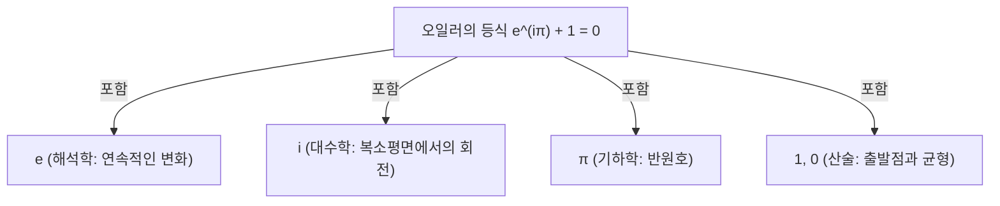

# 오일러의 등식이 아름답다고 평가받는 이유

**[오일러](https://kenji.blog/ko/p/euler/)의 등식**(Euler's Identity)은 다섯 가지 기본 수학 상수를 짧은 식으로 연결한다는 점에서 아름답다고 평가받습니다.

$$
e^{i\pi} + 1 = 0
$$

이 식에는 산술, 기하학, 해석학, 대수학에서 중요한 수들이 함께 등장합니다. [파인만](/ko/p/biography-richard-feynman/)은 《파인만의 물리학 강의》 제1권 22장에서 더 일반적인 오일러의 공식을 “This is our jewel.”이라고 평했습니다. 이는 뒤에서 다룰 일반적인 공식에 관한 말이며, 위의 특별한 등식만을 가리키는 인용과는 구별해야 합니다.

이 글에서는 다섯 상수의 의미, 오일러의 공식에서 등식을 유도하는 과정, 절대수렴하는 급수를 이용한 증명, 회전으로 보는 기하학적 해석을 설명합니다. 응용에서는 특정 각도에서의 등식과 임의의 각도에 대한 공식을 구별합니다.

## 다섯 가지 기본 수학 상수

$0,1,\pi,e,i$는 수학의 여러 상황에서 기본적인 역할을 합니다. 서로 다른 분야에 배치하는 것은 설명을 위한 구분이며, 이 수들이 원래 서로 무관했다는 뜻은 아닙니다.

### 1. $0$: 덧셈의 항등원

$0$은 덧셈의 항등원으로, 어떤 수 $a$에 대해서도 $a+0=a$가 성립합니다. 양이 없음을 나타내거나 위치 기수법에서 빈 자리를 나타내기도 하지만, 여기서는 덧셈의 성질에 주목합니다.

### 2. $1$: 곱셈의 항등원

$1$은 곱셈의 항등원으로, 어떤 수 $a$에 대해서도 $a\cdot1=a$가 성립합니다. 자연수를 1부터 시작할지 0을 포함할지는 관례의 차이이며, 곱셈의 항등원이라는 역할은 변하지 않습니다.

### 3. $\pi$: 원주율

$\pi$는 약 $3.14159\dots$인 무리수이며, 유클리드 평면에서 원의 둘레와 지름의 비입니다. 삼각함수와 라디안 각도 표현에도 등장합니다. 여기서는 반 바퀴 회전을 나타내는 각도 $\pi$가 핵심입니다.

### 4. $e$: 자연로그의 밑

$e$는 약 $2.71828\dots$인 무리수이며 자연로그의 밑입니다. 실변수 $x$에 대한 $e^x$의 도함수는 $e^x$이고 원시함수는 $e^x+C$입니다. 성장과 감소를 지수함수로 모형화할 때 등에 사용되지만, 모든 연속적인 변화가 지수 모형을 따르는 것은 아닙니다.

### 5. $i$: 허수 단위

$i$는 $i^2=-1$을 만족하는 허수 단위입니다. $-i$도 같은 방정식의 해이므로, 보통 복소평면에서 위쪽 방향을 $i$로 정합니다. 복소수는 실수 $a,b$에 대해 $a+bi$로 나타내며, 방정식과 회전을 다루는 범위를 넓혀 줍니다.

오일러의 등식은 산술의 $0$과 $1$, 기하학의 $\pi$, 해석학의 $e$, 대수학의 $i$를 하나의 식으로 연결합니다.

## 오일러의 공식에서 등식 유도하기

오일러의 등식은 더 일반적인 **오일러의 공식**에서 각도를 $\pi$로 정한 경우입니다. 이 글에서 $x$는 실수이며 각도는 라디안으로 나타냅니다. $e^z$는 뒤에서 급수로 정의할 단일값 복소지수함수 $\exp z$를 뜻합니다.

$$
e^{ix} = \cos x + i\sin x
$$

이 공식은 허수 단위 $i$를 매개로 왼쪽의 지수함수와 오른쪽의 삼각함수를 연결합니다.

여기에 180도에 해당하는 라디안 값 $x=\pi$를 대입합니다.

$$
e^{i\pi} = \cos\pi + i\sin\pi
$$

$\cos\pi=-1$이고 $\sin\pi=0$이므로 다음을 얻습니다.

$$
e^{i\pi} = -1 + i \cdot 0
$$

따라서:

$$
e^{i\pi} = -1
$$

양변에 1을 더하면:

$$
e^{i\pi} + 1 = 0
$$

이렇게 오일러의 공식에서 오일러의 등식이 유도됩니다.

## 매클로린 급수를 이용한 증명

왜 $e^{ix}=\cos x+i\sin x$가 성립할까요? [매클로린 전개](/ko/p/taylor-and-maclaurin-series/)를 사용하되, 실변수 등식에 형식적으로 복소수를 대입하기만 하는 대신 복소지수함수의 정의와 급수의 수렴을 확인합니다.

$\exp z=\sum_{n=0}^{\infty}z^n/n!$로 정의합니다. $z=0$일 때의 수렴은 자명합니다. 고정된 복소수 $z\ne0$에서는 이웃한 항의 절댓값의 비 $|z|/(n+1)$이 0으로 가므로 절대수렴합니다. 실수 $x$에서는 보통의 지수함수와 일치하며, 사인과 코사인도 다음 급수로 나타납니다. 세 등식은 모든 실수 $x$에서 성립합니다.

$$
e^x = 1 + x + \frac{x^2}{2!} + \frac{x^3}{3!} + \frac{x^4}{4!} + \frac{x^5}{5!} + \dots
$$

$$
\cos x = 1 - \frac{x^2}{2!} + \frac{x^4}{4!} - \frac{x^6}{6!} + \dots
$$

$$
\sin x = x - \frac{x^3}{3!} + \frac{x^5}{5!} - \frac{x^7}{7!} + \dots
$$

복소지수함수의 급수에서 $z=ix$로 둡니다. $x$가 실수이므로 $ix$는 순허수이며, $x=0$이면 0입니다. $i^1=i$, $i^2=-1$, $i^3=-i$, $i^4=1$의 네 단계 순환을 사용합니다.

$$
e^{ix} = 1 + (ix) + \frac{(ix)^2}{2!} + \frac{(ix)^3}{3!} + \frac{(ix)^4}{4!} + \frac{(ix)^5}{5!} + \dots
$$

$$
e^{ix} = 1 + ix - \frac{x^2}{2!} - i\frac{x^3}{3!} + \frac{x^4}{4!} + i\frac{x^5}{5!} - \dots
$$

절대수렴하므로 짝수 차수의 항과 홀수 차수의 항을 나누어 묶을 수 있습니다. $x$가 실수이므로 첫 번째 괄호는 실수부를, 두 번째 괄호는 허수부의 값을 나타냅니다. 허수부 자체는 실수이며, 여기에 $i$를 곱한 부분과는 구별합니다.

$$
e^{ix} = \left( 1 - \frac{x^2}{2!} + \frac{x^4}{4!} - \dots \right) + i \left( x - \frac{x^3}{3!} + \frac{x^5}{5!} - \dots \right)
$$

첫 번째 괄호는 $\cos x$의 급수이고 두 번째 괄호는 $\sin x$의 급수입니다. 따라서:

$$
e^{ix} = \cos x + i\sin x
$$

이로써 지수함수와 삼각함수의 관계가 증명됩니다.

## 복소평면에서의 기하학적 의미

오일러의 등식은 **복소평면(가우스 평면)**에서도 기하학적으로 해석할 수 있습니다.

복소수 $z=a+bi$를 점 $(a,b)$에 대응시킵니다. 가로 좌표는 실수부, 세로 좌표는 허수부의 값입니다. 실수 $\theta$에 대해 $|e^{i\theta}|=1$이므로, $e^{i\theta}$를 곱하면 길이를 유지하면서 원점을 중심으로 회전합니다. 양의 $\theta$는 반시계 방향, 음의 $\theta$는 시계 방향이며 원점은 움직이지 않습니다.

$e^{i\pi}=-1$을 이 관점에서 봅시다.

1. 실수축 위의 $1$, 즉 점 $(1,0)$에서 출발합니다.
2. $e^{i\pi}$를 곱하는 것은 원점을 중심으로 $\pi$ 라디안, 즉 180도 회전하는 것입니다.
3. $1$에서 반 바퀴 회전하면 반대편의 $-1$, 즉 점 $(-1,0)$에 도달합니다.

따라서 이 등식은 $1$에서 반 바퀴 회전하면 $-1$에 도달한다는 기하학적 사실을 표현합니다.

## 레온하르트 오일러

[레온하르트 오일러](https://kenji.blog/ko/p/euler/)(Leonhard Euler, 1707–1783)는 스위스에서 태어난 18세기의 대표적인 수학자입니다. 수학의 여러 분야에 기여했으며 물리학, 천문학, 공학도 연구했습니다.

오일러는 많은 논문과 저서를 남겼고, 말년에 시력을 잃은 뒤에도 활발하게 연구했습니다. 1748년에 출판한 《Introductio in analysin infinitorum》 제1권에서는 함수를 해석학의 중심에 두고 $f(x)$ 표기와 $e$, 지수함수의 역할을 강조합니다. 무한급수, 무한곱, 연분수도 다룹니다.

여기서 제시한 증명은 복소지수함수의 정의와 절대수렴을 사용하는 현대적인 설명입니다. 오일러의 저술에서 사용한 무한소 등의 논증과 그대로 같은 증명으로 취급해서는 안 됩니다.

## 과학과 공학에서의 응용

응용에서 주로 쓰는 것은 각도를 자유롭게 바꿀 수 있는 오일러의 공식입니다. $x=\pi$에서의 특별한 등식 하나만으로 모든 계산을 수행하는 것은 아닙니다.

### 신호 처리와 푸리에 해석

푸리에 해석에서는 신호를 삼각함수나 복소지수함수 성분으로 나타냅니다. 주기 신호의 급수나 비주기 신호의 변환 등은 함수의 조건과 수렴의 의미를 지정하여 다룹니다. $e^{i\omega t}$의 시간 도함수는 $i\omega e^{i\omega t}$이고, $\omega\ne0$이면 원시함수의 하나는 $e^{i\omega t}/(i\omega)$입니다. 급수를 항별로 미분하거나 적분하려면 별도의 조건이 필요합니다.

[FFT](/ko/p/fast-fourier-transform-algorithm/)는 유한 데이터의 이산 푸리에 변환을 효율적으로 계산하는 알고리즘입니다. 일반적인 손실 JPEG의 기본 방식은 이산 코사인 변환(DCT)을 사용하므로, JPEG가 곧바로 FFT를 사용한다는 설명과는 구별해야 합니다.

### 전기·전자공학

선형 시불변 교류 회로의 단일 주파수 정현파 정상상태에서는 페이저(phasor)로 전압과 전류를 표현하여 진폭과 위상을 복소수 대수로 계산할 수 있습니다. 과도현상은 별도로 다루고, 여러 주파수를 중첩할 때는 주파수별로 분석합니다. 비선형 회로나 임의의 시간 변화에 이 방법을 무조건 적용할 수는 없습니다.

### 양자역학

비상대론적 양자역학에서 슈뢰딩거 방정식은 복소수 확률진폭인 파동함수를 다룹니다. 정규화된 위치 표현의 파동함수 $\psi(x,t)$에 대해 $|\psi(x,t)|^2$은 위치의 확률밀도이며, 파동함수 자체가 확률은 아닙니다. 자유입자의 평면파나 에너지 고유상태의 시간 변화에는 복소지수함수가 나타나지만, 일반적인 파동함수가 하나의 지수함수인 것은 아닙니다.

## 결론: 등식의 매력

오일러의 등식은 퍼즐 조각들이 하나의 그림으로 맞춰지는 듯한 인상을 줍니다. 원주율 $\pi$, 해석학의 $e$, 허수 단위 $i$, 그리고 가장 기본적인 $1$과 $0$의 관계에서 독자는 수학이 세계의 더 깊은 질서를 비추는 듯한 느낌을 받을 수 있습니다.

수학은 기술적인 언어로 여겨지기도 하지만, 이 등식의 간결함과 폭넓은 연결은 시나 예술처럼 감상할 수도 있습니다. 독자가 느끼는 아름다움은 이 생각들 사이에서 발견하는 조화에 있습니다.

## 참고 자료

- [NIST DLMF §4.2(iii): 복소지수급수와 삼각함수의 관계](https://dlmf.nist.gov/4.2#iii)
- [MIT 18.100C Lecture 11: 절대수렴과 복소지수함수](https://ocw.mit.edu/courses/18-100c-real-analysis-fall-2012/1058808e5cb57c986118333f8b6fa0d7_MIT18_100CF12_l11sum.pdf)
- [파인만의 물리학 강의 제1권 22장: 일반 오일러 공식과 인용](https://www.feynmanlectures.caltech.edu/I_22.html)
- [파인만의 물리학 강의 제1권 23·25장: 복소수 진동 계산과 정상상태](https://www.feynmanlectures.caltech.edu/I_23.html) ([25장](https://www.feynmanlectures.caltech.edu/I_25.html))
- [MIT 6.002: 정현파 정상상태와 임피던스 방법의 조건](https://circuits.mit.edu/_static/S23/handouts/lec10b/lecture10b-berggren.pdf)
- [MIT 6.341 Lecture 19: DFT를 계산하는 FFT 알고리즘](https://ocw.mit.edu/courses/6-341-discrete-time-signal-processing-fall-2005/resources/lec19/)
- [파인만의 물리학 강의 제3권 3장: 복소수 확률진폭](https://www.feynmanlectures.caltech.edu/III_03.html)
- [ITU-T T.81: JPEG DCT 방식 (§3.1.58–59, §4.2)](https://www.w3.org/Graphics/JPEG/itu-t81.pdf)
- [Euler Archive: 1748년 Introductio 제1권의 서지 및 내용 요약](https://scholarlycommons.pacific.edu/euler-works/101/)
- [ETH 도서관: 오일러의 생애와 실명 후 연구](https://library.ethz.ch/sammlungen-und-archive/kurzportraets/leonhard-euler-1707-1783.html)
