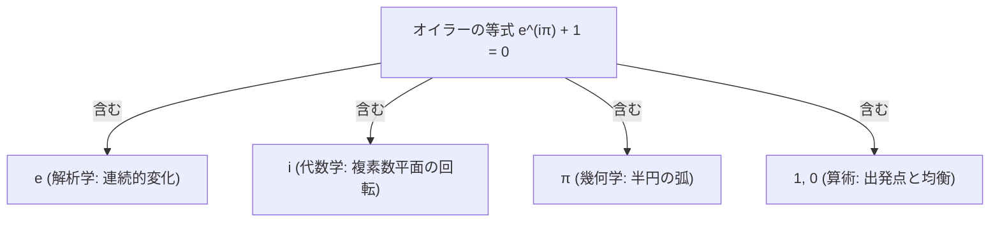

# 美しいと評される「オイラーの等式」とは？

**[オイラー](https://kenji.blog/p/euler/)の等式**（Euler's Identity）は、5つの基本的な数学定数を短い式で結ぶ関係として、美しいと評される数式です。

$$
e^{i\pi} + 1 = 0
$$

この式では、算術・幾何学・解析学・代数学で重要な5つの数が結びついています。[ファインマン](/p/biography-richard-feynman/)は『ファインマン物理学』第I巻22章で、より一般的なオイラーの公式を “This is our jewel.” と評しています。これは後述する公式についての言葉であり、上の等式だけを指す引用とは区別します。

本記事では、5つの定数の意味、オイラーの公式からの導出、絶対収束する級数による証明、回転としての解釈を説明します。応用では、特別な値での等式と、任意の角度を扱う公式を区別します。

## 奇跡の出会い：5つの基本的な数学定数

式に現れる $0,1,\pi,e,i$ は、数学のさまざまな場面で基本的な役割を果たします。分野の区分は説明のためのものであり、これらの数が互いに無関係だったという意味ではありません。

### 1. $0$（加法単位元：算術と代数の基礎）

$0$ は加法の単位元で、どの数 $a$ に対しても $a+0=a$ が成り立ちます。数量がないことや位取り記数法の空位を表す役割もありますが、ここでは加法に関する性質に注目します。

### 2. $1$（乗法単位元：数の始まり）

$1$ は乗法の単位元で、どの数 $a$ に対しても $a\cdot1=a$ が成り立ちます。自然数を1から始めるか0を含めるかは慣習によりますが、乗法の単位元としての役割は変わりません。

### 3. $\pi$（円周率：幾何学の象徴）

$\pi$（パイ）は約 $3.14159\dots$ の無理数で、ユークリッド平面における円周と直径の比です。三角関数やラジアンによる角度の表現にも現れ、ここでは半回転を表す角度 $\pi$ が鍵になります。

### 4. $e$（ネイピア数：解析学の主役）

$e$ は約 $2.71828\dots$ の無理数で、自然対数の底です。実変数の関数 $e^x$ は微分しても $e^x$ で、原始関数は $e^x+C$ です。成長・減衰を指数関数でモデル化するときなどに使われますが、あらゆる連続的変化がこの形になるわけではありません。

### 5. $i$（虚数単位：代数学の拡張）

$i$ は $i^2=-1$ を満たす虚数単位です。$-i$ も同じ方程式の解なので、通常は複素数平面の上向きを $i$ とする約束を選びます。複素数は $a+bi$（$a,b$ は実数）と表され、方程式や回転を扱う範囲を広げます。

オイラーの等式は、$0$ と $1$ という算術の基本、$\pi$ という幾何学の定数、$e$ という解析学の定数、そして $i$ という代数学の定数が、たった一つの式で見事に統合されることを示しているのです。

## オイラーの公式からの導出

オイラーの等式は、より一般的な**オイラーの公式**で角度を $\pi$ にした場合です。本記事では $x$ を実数とし、角度をラジアンで表します。$e^z$ は後述する級数で定める単一の複素指数関数 $\exp z$ を意味します。

$$
e^{ix} = \cos x + i\sin x
$$

この公式は、指数関数（左辺）と三角関数（右辺）という、一見すると全く無関係に思える2つの関数を、虚数 $i$ を媒介として結びつけています。

ここで、角度 $x$ に $\pi$（ラジアンにおける180度）を代入してみましょう。

$$
e^{i\pi} = \cos\pi + i\sin\pi
$$

三角関数の性質から、$\cos\pi$ は $-1$、$\sin\pi$ は $0$ となります。これを式に当てはめると、

$$
e^{i\pi} = -1 + i \cdot 0
$$

すなわち、

$$
e^{i\pi} = -1
$$

となります。この両辺に $1$ を足すと、

$$
e^{i\pi} + 1 = 0
$$

こうして、あの美しいオイラーの等式が導き出されるのです。

## マクローリン展開（テイラー展開）による証明

では、なぜ $e^{ix}=\cos x+i\sin x$ が成り立つのでしょうか。[マクローリン展開](/p/taylor-and-maclaurin-series/)を使います。ただし、実変数の等式に形式的に複素数を代入するだけでなく、複素指数関数と級数の収束を確認します。

複素指数関数を $\exp z=\sum_{n=0}^{\infty}z^n/n!$ と定めます。$z=0$ での収束は明らかです。固定した複素数 $z\ne0$ では、項の絶対値の比 $|z|/(n+1)$ が0に向かうため絶対収束します。実数 $x$ では通常の指数関数と一致し、正弦・余弦も次の級数で表されます。これらの等式はすべての実数 $x$ で成り立ちます。

$$
e^x = 1 + x + \frac{x^2}{2!} + \frac{x^3}{3!} + \frac{x^4}{4!} + \frac{x^5}{5!} + \dots
$$

$$
\cos x = 1 - \frac{x^2}{2!} + \frac{x^4}{4!} - \frac{x^6}{6!} + \dots
$$

$$
\sin x = x - \frac{x^3}{3!} + \frac{x^5}{5!} - \frac{x^7}{7!} + \dots
$$

複素指数関数の級数で $z=ix$ と置きます。$x$ は実数なので $ix$ は純虚数（$x=0$ では0）です。$i^1=i$、$i^2=-1$、$i^3=-i$、$i^4=1$ という4周期の性質を使います。

$$
e^{ix} = 1 + (ix) + \frac{(ix)^2}{2!} + \frac{(ix)^3}{3!} + \frac{(ix)^4}{4!} + \frac{(ix)^5}{5!} + \dots
$$

$$
e^{ix} = 1 + ix - \frac{x^2}{2!} - i\frac{x^3}{3!} + \frac{x^4}{4!} + i\frac{x^5}{5!} - \dots
$$

この級数は絶対収束するため、偶数次と奇数次の項に分けてまとめられます。$x$ が実数なので、最初の括弧が実部、2つ目の括弧が虚部の値です。虚部は実数値であり、$i$ を掛けた部分そのものとは区別します。

$$
e^{ix} = \left( 1 - \frac{x^2}{2!} + \frac{x^4}{4!} - \dots \right) + i \left( x - \frac{x^3}{3!} + \frac{x^5}{5!} - \dots \right)
$$

驚くべきことに、実数部分の括弧の中身は完全に $\cos x$ の展開式と一致し、虚数部分の括弧の中身は完全に $\sin x$ の展開式と一致します。したがって、

$$
e^{ix} = \cos x + i\sin x
$$

が証明されます。これは数学の異なる領域が根底で密接に繋がっていることを示す、非常に劇的な瞬間です。

## 複素数平面における幾何学的な意味

オイラーの等式は、代数的な計算だけでなく、<strong>複素数平面（ガウス平面）</strong>を用いることで視覚的・幾何学的にも美しい意味を持つことがわかります。

複素数 $z=a+bi$ を点 $(a,b)$ と対応させ、横軸を実部、縦軸を虚部の値とするのが複素数平面です。実数 $\theta$ に対し $|e^{i\theta}|=1$ なので、$z$ に $e^{i\theta}$ を掛けると長さを保って原点のまわりに回転します。正の $\theta$ は反時計回り、負の $\theta$ は時計回りです。原点は動きません。

オイラーの等式 $e^{i\pi} = -1$ をこの視点から考えてみましょう。

1. 出発点は実数軸上の $1$（座標 $(1, 0)$）です。
2. これに $e^{i\pi}$ を掛けるということは、原点を中心に $\pi$ ラジアン（すなわち180度）回転させることを意味します。
3. $1$ から始まり、円を描くように180度回転すると、たどり着く場所は反対側の $-1$（座標 $(-1, 0)$）になります。

つまり、$e^{i\pi} + 1 = 0$ という等式は、**「実数の $1$ を出発点とし、複素数平面上を半周（$\pi$ ラジアン）回転すると、元の位置と正反対の $-1$ に到達する」** という幾何学的な事実を、数式として完璧に表現したものなのです。

## 天才数学者レオンハルト・オイラー

この偉大な公式に名前を残す[レオンハルト・オイラー](https://kenji.blog/p/euler/)（Leonhard Euler, 1707–1783）は、スイス生まれの18世紀を代表する大数学者です。彼は数学のほぼすべての分野において決定的な貢献をし、物理学、天文学、工学などにも多大な業績を残しました。

オイラーは多くの論文や著書を残し、晩年に失明した後も活発に研究を続けました。1748年刊の『Introductio in analysin infinitorum』第1巻では、関数を解析学の中心に据え、$f(x)$ という記法や $e$・指数関数の役割を重視しています。同書は無限級数・無限積・連分数なども扱っています。

ここで示したのは、複素指数関数の定義と絶対収束を使う現代的な説明です。オイラーの著作で使われた無限小などの議論と、そのまま同一の証明として扱うものではありません。

## 現代科学と工学における不可欠な応用

応用で主に使うのは、角度を任意に取れるオイラーの公式です。$x=\pi$ だけの等式が直接すべての計算を行うわけではありません。

### 信号処理とフーリエ解析

フーリエ解析では、信号を三角関数や複素指数関数の成分で表します。周期信号の級数や非周期信号の変換などは、関数の条件と収束の意味を指定して扱います。$e^{i\omega t}$ の時間微分は $i\omega e^{i\omega t}$ で、$\omega\ne0$ のとき原始関数の一つは $e^{i\omega t}/(i\omega)$ です。ただし、級数の項別の微積分には別途条件が必要です。[FFT](/p/fast-fourier-transform-algorithm/)は有限データの離散フーリエ変換を効率よく計算するアルゴリズムです。通常の非可逆JPEGの基本方式は離散コサイン変換（DCT）を使うため、JPEGがそのままFFTを使うという説明とは区別します。

### 電気電子工学

線形で時間不変な交流回路の、単一周波数の正弦波定常状態では、電圧・電流をフェーザで表すと振幅や位相を複素数の代数計算で扱えます。過渡現象は別に扱い、複数の周波数を重ねる場合は周波数ごとに解析します。この方法を非線形回路や任意の時間変化に無条件で適用することはできません。

### 量子力学

非相対論的量子力学では、シュレーディンガー方程式は複素数の確率振幅である波動関数を扱います。位置表示で規格化された波動関数 $\psi(x,t)$ の $|\psi(x,t)|^2$ は位置の確率密度で、波動関数そのものが確率ではありません。自由粒子の平面波やエネルギー固有状態の時間発展には複素指数関数が現れますが、一般の波動関数が単一の指数関数になるわけではありません。

## 結論：数式が奏でるシンフォニー

「オイラーの等式」は、人類が長い時間をかけてバラバラに発見してきたパズルのピースが、最後に完璧な形で一つの絵を完成させたような驚きを与えてくれます。幾何学の円周率 $\pi$、解析学のネイピア数 $e$、代数学の虚数単位 $i$、そして最も基本的な数である $1$ と $0$。これらが織りなす関係は、数学が人間の都合で作られた単なる道具ではなく、宇宙の真理そのものを映し出しているかのような神秘性を帯びています。

数式はしばしば「理系の言語」と思われがちですが、オイラーの等式が持つ簡潔さと普遍性は、優れた詩や芸術作品が持つ美しさと何ら変わりません。私たちがこの等式を「美しい」と感じるとき、それは宇宙の深遠な秩序と調和の片鱗に触れている瞬間なのです。

## 参考資料

- [NIST DLMF §4.2(iii)：複素指数関数の級数と三角関数との関係](https://dlmf.nist.gov/4.2#iii)
- [MIT 18.100C Lecture 11：複素数での絶対収束と指数関数](https://ocw.mit.edu/courses/18-100c-real-analysis-fall-2012/1058808e5cb57c986118333f8b6fa0d7_MIT18_100CF12_l11sum.pdf)
- [ファインマン物理学 I巻22章：一般のオイラーの公式と引用](https://www.feynmanlectures.caltech.edu/I_22.html)
- [ファインマン物理学 I巻23・25章：複素数による振動の計算と定常状態](https://www.feynmanlectures.caltech.edu/I_23.html)（[25章](https://www.feynmanlectures.caltech.edu/I_25.html)）
- [MIT 6.002：正弦波定常状態とインピーダンス法の条件](https://circuits.mit.edu/_static/S23/handouts/lec10b/lecture10b-berggren.pdf)
- [MIT 6.341 Lecture 19：DFTを計算するFFTアルゴリズム](https://ocw.mit.edu/courses/6-341-discrete-time-signal-processing-fall-2005/resources/lec19/)
- [ファインマン物理学 III巻3章：複素数の確率振幅](https://www.feynmanlectures.caltech.edu/III_03.html)
- [ITU-T T.81：JPEGのDCT方式（§3.1.58–59、§4.2）](https://www.w3.org/Graphics/JPEG/itu-t81.pdf)
- [Euler Archive：1748年の『Introductio』第1巻の書誌・内容概要](https://scholarlycommons.pacific.edu/euler-works/101/)
- [ETH図書館：オイラーの生涯と失明後の研究](https://library.ethz.ch/sammlungen-und-archive/kurzportraets/leonhard-euler-1707-1783.html)
