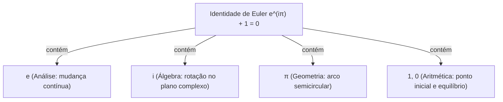

# O que torna a identidade de Euler bela?

A **identidade de [Euler](https://kenji.blog/pt/p/euler/)** é admirada por conectar cinco constantes matemáticas fundamentais em uma equação curta.

$$
e^{i\pi} + 1 = 0
$$

A equação reúne números importantes na aritmética, geometria, análise e álgebra. No capítulo 22 do primeiro volume de *The Feynman Lectures on Physics*, [Feynman](/pt/p/biography-richard-feynman/) descreve a fórmula geral de Euler com as palavras “This is our jewel.” O comentário se refere à fórmula discutida adiante, e não apenas à identidade particular acima.

Explicaremos as cinco constantes, obteremos a identidade a partir da fórmula de Euler, demonstraremos essa fórmula com séries absolutamente convergentes e a interpretaremos como uma rotação. Nas aplicações, distinguiremos a identidade para um ângulo específico da fórmula para ângulos arbitrários.

## Cinco constantes fundamentais

Os números $0,1,\pi,e,i$ desempenham papéis básicos em diferentes contextos matemáticos. Associá-los a áreas distintas é uma maneira de explicar esses papéis, não uma afirmação de que antes não tivessem relação entre si.

### 1. $0$: O elemento neutro da adição

$0$ é o elemento neutro da adição: $a+0=a$ para qualquer número $a$. Também pode representar a ausência de uma quantidade ou uma posição vazia na notação posicional; aqui nos concentramos em sua propriedade aditiva.

### 2. $1$: O elemento neutro da multiplicação

$1$ é o elemento neutro da multiplicação: $a\cdot1=a$ para qualquer número $a$. Começar os naturais em 1 ou incluir o 0 é uma convenção; o papel multiplicativo do 1 não muda.

### 3. $\pi$: A constante do círculo

$\pi$ é um número irracional de valor aproximado $3.14159\dots$, a razão entre o comprimento de uma circunferência e seu diâmetro no plano euclidiano. Também aparece nas funções trigonométricas e na medida de ângulos em radianos. Aqui o ângulo essencial é $\pi$, uma meia-volta.

### 4. $e$: A base do logaritmo natural

$e$ é um número irracional de valor aproximado $2.71828\dots$ e a base do logaritmo natural. Para $x$ real, a derivada de $e^x$ é $e^x$ e suas primitivas são $e^x+C$. Ele aparece em modelos exponenciais de crescimento e decaimento, embora nem toda mudança contínua siga um modelo exponencial.

### 5. $i$: A unidade imaginária

$i$ é a unidade imaginária que satisfaz $i^2=-1$. Como $-i$ satisfaz a mesma equação, convencionamos representar $i$ na direção vertical para cima no plano complexo. Os números complexos têm a forma $a+bi$, com $a,b$ reais, ampliando o contexto para estudar equações e rotações.

A identidade de Euler conecta as constantes aritméticas $0$ e $1$, a constante geométrica $\pi$, a constante da análise $e$ e a constante algébrica $i$ em uma só equação.

## Obtenção a partir da fórmula de Euler

A identidade é o caso da **fórmula de Euler** para o ângulo $\pi$. Neste artigo, $x$ é real e os ângulos são medidos em radianos. A notação $e^z$ significa a função exponencial complexa de valor único $\exp z$, definida pela série apresentada adiante.

$$
e^{ix} = \cos x + i\sin x
$$

A fórmula conecta a função exponencial à esquerda às funções trigonométricas à direita por meio da unidade imaginária $i$.

Substituímos $x=\pi$, a medida em radianos de 180 graus:

$$
e^{i\pi} = \cos\pi + i\sin\pi
$$

Como $\cos\pi=-1$ e $\sin\pi=0$, obtemos:

$$
e^{i\pi} = -1 + i \cdot 0
$$

Portanto:

$$
e^{i\pi} = -1
$$

Somando 1 aos dois lados:

$$
e^{i\pi} + 1 = 0
$$

Assim, a identidade decorre da fórmula de Euler.

## Demonstração por séries de Maclaurin

Por que vale $e^{ix}=\cos x+i\sin x$? Usaremos as [séries de Maclaurin](/pt/p/taylor-and-maclaurin-series/), verificando a definição da exponencial complexa e a convergência, em vez de apenas substituir formalmente um número complexo em uma igualdade de variáveis reais.

Definimos $\exp z=\sum_{n=0}^{\infty}z^n/n!$. A convergência para $z=0$ é imediata. Para qualquer complexo fixo $z\ne0$, a razão entre os valores absolutos de termos consecutivos, $|z|/(n+1)$, tende a zero, de modo que a série converge absolutamente. Para $x$ real, ela coincide com a exponencial usual; o seno e o cosseno também admitem as expansões seguintes. As três igualdades valem para todo $x$ real.

$$
e^x = 1 + x + \frac{x^2}{2!} + \frac{x^3}{3!} + \frac{x^4}{4!} + \frac{x^5}{5!} + \dots
$$

$$
\cos x = 1 - \frac{x^2}{2!} + \frac{x^4}{4!} - \frac{x^6}{6!} + \dots
$$

$$
\sin x = x - \frac{x^3}{3!} + \frac{x^5}{5!} - \frac{x^7}{7!} + \dots
$$

Tomamos $z=ix$ na série da exponencial complexa. Como $x$ é real, $ix$ é imaginário puro, ou zero quando $x=0$. Usamos o ciclo de quatro passos $i^1=i$, $i^2=-1$, $i^3=-i$, $i^4=1$.

$$
e^{ix} = 1 + (ix) + \frac{(ix)^2}{2!} + \frac{(ix)^3}{3!} + \frac{(ix)^4}{4!} + \frac{(ix)^5}{5!} + \dots
$$

$$
e^{ix} = 1 + ix - \frac{x^2}{2!} - i\frac{x^3}{3!} + \frac{x^4}{4!} + i\frac{x^5}{5!} - \dots
$$

A convergência absoluta permite agrupar os termos de grau par e ímpar. Como $x$ é real, o primeiro parêntese fornece a parte real e o segundo o valor da parte imaginária. A parte imaginária é um número real, diferente desse número multiplicado por $i$.

$$
e^{ix} = \left( 1 - \frac{x^2}{2!} + \frac{x^4}{4!} - \dots \right) + i \left( x - \frac{x^3}{3!} + \frac{x^5}{5!} - \dots \right)
$$

O primeiro parêntese é a série de $\cos x$ e o segundo a de $\sin x$. Logo:

$$
e^{ix} = \cos x + i\sin x
$$

Isso demonstra a relação entre as funções exponencial e trigonométricas.

## Significado geométrico no plano complexo

A identidade também tem uma interpretação geométrica no **plano complexo**, ou plano de Gauss.

Representamos $z=a+bi$ pelo ponto $(a,b)$: a coordenada horizontal é a parte real e a vertical é o valor da parte imaginária. Para $\theta$ real, $|e^{i\theta}|=1$, de modo que multiplicar por $e^{i\theta}$ preserva o comprimento e gira em torno da origem. Se $\theta$ é positivo, a rotação é anti-horária; se é negativo, é horária. A origem permanece fixa.

Consideremos $e^{i\pi}=-1$ nessa perspectiva:

1. Partimos de $1$, o ponto $(1,0)$ do eixo real.
2. Multiplicar por $e^{i\pi}$ gira esse ponto $\pi$ radianos, ou 180 graus, em torno da origem.
3. Uma meia-volta a partir de $1$ leva a $-1$, o ponto $(-1,0)$.

A identidade expressa, assim, o fato geométrico de que meia-volta a partir de $1$ alcança o ponto oposto, $-1$.

## Leonhard Euler

[Leonhard Euler](https://kenji.blog/pt/p/euler/) (1707–1783), nascido na Suíça, foi um dos principais matemáticos do século XVIII. Contribuiu para várias áreas da matemática e também trabalhou em física, astronomia e engenharia.

Euler produziu muitos artigos e livros e continuou pesquisando ativamente depois de perder a visão na velhice. O primeiro volume de *Introductio in analysin infinitorum*, publicado em 1748, coloca as funções no centro da análise e destaca a notação $f(x)$ e os papéis de $e$ e da função exponencial. Também trata de séries infinitas, produtos infinitos e frações contínuas.

A demonstração apresentada aqui é uma explicação moderna baseada na definição da exponencial complexa e na convergência absoluta. Ela não deve ser identificada diretamente com os argumentos infinitesimais empregados nos escritos de Euler.

## Aplicações na ciência e na engenharia

As aplicações usam principalmente a fórmula de Euler com um ângulo variável. A identidade apenas para $x=\pi$ não realiza, por si só, todos esses cálculos.

### Processamento de sinais e análise de Fourier

A análise de Fourier representa sinais por componentes trigonométricas ou exponenciais complexas. Séries para sinais periódicos e transformadas para sinais não periódicos exigem condições sobre as funções e uma noção especificada de convergência. A derivada temporal de $e^{i\omega t}$ é $i\omega e^{i\omega t}$; para $\omega\ne0$, uma primitiva é $e^{i\omega t}/(i\omega)$. Derivar ou integrar uma série termo a termo requer condições adicionais.

Uma [FFT](/pt/p/fast-fourier-transform-algorithm/) calcula eficientemente a transformada discreta de Fourier de dados finitos. O método básico do JPEG usual com perdas usa uma transformada discreta do cosseno (DCT); isso deve ser distinguido da afirmação de que JPEG usa diretamente uma FFT.

### Engenharia elétrica e eletrônica

Em um circuito de corrente alternada linear e invariante no tempo, no regime permanente senoidal de uma única frequência, fasores permitem calcular amplitudes e fases de tensões e correntes com álgebra complexa. Os transitórios são tratados separadamente; frequências diferentes são analisadas individualmente antes da superposição. O método não se aplica sem condições a circuitos não lineares ou a variações temporais arbitrárias.

### Mecânica quântica

Na mecânica quântica não relativística, a equação de Schrödinger descreve uma função de onda, uma amplitude de probabilidade complexa. Para uma função de onda normalizada na representação de posição $\psi(x,t)$, $|\psi(x,t)|^2$ é uma densidade de probabilidade de posição; a própria função de onda não é uma probabilidade. Exponenciais complexas aparecem nas ondas planas de partículas livres e na evolução temporal de autoestados de energia, mas uma função de onda geral não é uma única exponencial.

## Conclusão: O encanto da equação

A identidade de Euler pode lembrar um quebra-cabeça cujas peças finalmente formam uma imagem: a constante geométrica $\pi$, a constante da análise $e$, a unidade imaginária $i$ e os números elementares $1$ e $0$. Suas relações podem despertar a sensação de que a matemática reflete uma ordem mais profunda do mundo.

Embora a matemática seja frequentemente vista como uma linguagem técnica, a simplicidade e as amplas conexões dessa identidade também podem ser apreciadas como um poema ou uma obra de arte. Sua beleza está na harmonia que os leitores encontram entre essas ideias.

## Referências

- [NIST DLMF §4.2(iii): Séries da exponencial complexa e relações trigonométricas](https://dlmf.nist.gov/4.2#iii)
- [MIT 18.100C Lecture 11: Convergência absoluta e exponenciais complexas](https://ocw.mit.edu/courses/18-100c-real-analysis-fall-2012/1058808e5cb57c986118333f8b6fa0d7_MIT18_100CF12_l11sum.pdf)
- [The Feynman Lectures I, capítulo 22: Fórmula geral de Euler e citação](https://www.feynmanlectures.caltech.edu/I_22.html)
- [The Feynman Lectures I, capítulos 23 e 25: Oscilações complexas e regime permanente](https://www.feynmanlectures.caltech.edu/I_23.html) ([capítulo 25](https://www.feynmanlectures.caltech.edu/I_25.html))
- [MIT 6.002: Regime permanente senoidal e método das impedâncias](https://circuits.mit.edu/_static/S23/handouts/lec10b/lecture10b-berggren.pdf)
- [MIT 6.341 Lecture 19: Algoritmos FFT para calcular a DFT](https://ocw.mit.edu/courses/6-341-discrete-time-signal-processing-fall-2005/resources/lec19/)
- [The Feynman Lectures III, capítulo 3: Amplitudes complexas de probabilidade](https://www.feynmanlectures.caltech.edu/III_03.html)
- [ITU-T T.81: Processos DCT do JPEG (§§3.1.58–59 e 4.2)](https://www.w3.org/Graphics/JPEG/itu-t81.pdf)
- [Euler Archive: Bibliografia e resumo do primeiro volume de Introductio de 1748](https://scholarlycommons.pacific.edu/euler-works/101/)
- [Biblioteca ETH: Vida de Euler e pesquisa após a cegueira](https://library.ethz.ch/sammlungen-und-archive/kurzportraets/leonhard-euler-1707-1783.html)
