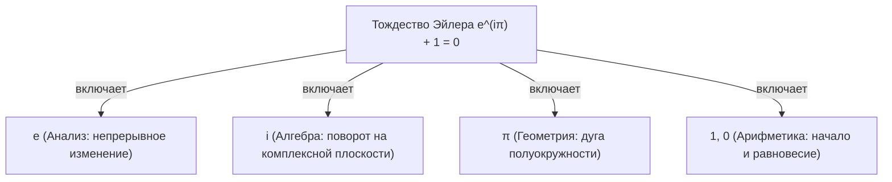

# В чём красота тождества Эйлера?

**Тождество [Эйлера](https://kenji.blog/ru/p/euler/)** вызывает восхищение тем, что связывает пять фундаментальных математических констант коротким равенством.

$$
e^{i\pi} + 1 = 0
$$

В равенстве встречаются числа, важные для арифметики, геометрии, анализа и алгебры. В главе 22 первого тома *The Feynman Lectures on Physics* [Фейнман](/ru/p/biography-richard-feynman/) характеризует более общую формулу Эйлера словами «This is our jewel.» Его замечание относится к формуле, рассмотренной ниже, а не только к приведённому частному тождеству.

Мы объясним смысл пяти констант, выведем тождество из формулы Эйлера, докажем эту формулу с помощью абсолютно сходящихся рядов и истолкуем её как поворот. В приложениях будем различать тождество для определённого угла и формулу для произвольных углов.

## Пять фундаментальных констант

Числа $0,1,\pi,e,i$ играют основные роли в разных математических ситуациях. Их распределение по отдельным областям служит объяснению этих ролей и не означает, что прежде они были никак не связаны.

### 1. $0$: Нейтральный элемент сложения

$0$ — нейтральный элемент сложения: для любого числа $a$ имеем $a+0=a$. Он может также обозначать отсутствие количества или пустой разряд в позиционной записи; здесь нас интересует его свойство относительно сложения.

### 2. $1$: Нейтральный элемент умножения

$1$ — нейтральный элемент умножения: для любого числа $a$ имеем $a\cdot1=a$. Начинаются ли натуральные числа с 1 или включают 0, зависит от соглашения; роль единицы при умножении не меняется.

### 3. $\pi$: Число пи

$\pi$ — иррациональное число, приблизительно равное $3{,}14159\dots$, отношение длины окружности к её диаметру на евклидовой плоскости. Оно появляется также в тригонометрических функциях и радианной мере углов. Здесь ключевой угол — $\pi$, половина оборота.

### 4. $e$: Основание натурального логарифма

$e$ — иррациональное число, приблизительно равное $2{,}71828\dots$, основание натурального логарифма. Для действительного $x$ производная $e^x$ равна $e^x$, а первообразные имеют вид $e^x+C$. Оно используется в экспоненциальных моделях роста и убывания, но не всякое непрерывное изменение подчиняется такой модели.

### 5. $i$: Мнимая единица

$i$ — мнимая единица, удовлетворяющая $i^2=-1$. Поскольку $-i$ решает то же уравнение, обычно договариваются, что $i$ соответствует направлению вверх на комплексной плоскости. Комплексные числа записываются как $a+bi$ с действительными $a,b$, расширяя возможности изучения уравнений и поворотов.

Тождество Эйлера связывает арифметические константы $0$ и $1$, геометрическую константу $\pi$, константу анализа $e$ и алгебраическую константу $i$ в одном равенстве.

## Вывод из формулы Эйлера

Тождество — частный случай более общей **формулы Эйлера** при угле $\pi$. В этой статье $x$ действителен, а углы измеряются в радианах. Обозначение $e^z$ означает однозначную комплексную экспоненту $\exp z$, определённую рядом ниже.

$$
e^{ix} = \cos x + i\sin x
$$

Формула связывает экспоненциальную функцию слева с тригонометрическими функциями справа посредством мнимой единицы $i$.

Подставим $x=\pi$, радианную меру 180 градусов:

$$
e^{i\pi} = \cos\pi + i\sin\pi
$$

Так как $\cos\pi=-1$ и $\sin\pi=0$, получаем:

$$
e^{i\pi} = -1 + i \cdot 0
$$

Следовательно:

$$
e^{i\pi} = -1
$$

Прибавляя 1 к обеим частям, имеем:

$$
e^{i\pi} + 1 = 0
$$

Так тождество получается из формулы Эйлера.

## Доказательство с помощью рядов Маклорена

Почему верно $e^{ix}=\cos x+i\sin x$? Мы используем [разложение Маклорена](/ru/p/taylor-and-maclaurin-series/), проверяя определение комплексной экспоненты и сходимость, а не просто формально подставляя комплексное число в равенство для действительных переменных.

Определим $\exp z=\sum_{n=0}^{\infty}z^n/n!$. При $z=0$ сходимость очевидна. Для любого фиксированного комплексного $z\ne0$ отношение модулей последовательных членов $|z|/(n+1)$ стремится к нулю, поэтому ряд сходится абсолютно. Для действительного $x$ он совпадает с обычной экспонентой; синус и косинус также имеют следующие разложения. Все три равенства верны для любого действительного $x$.

$$
e^x = 1 + x + \frac{x^2}{2!} + \frac{x^3}{3!} + \frac{x^4}{4!} + \frac{x^5}{5!} + \dots
$$

$$
\cos x = 1 - \frac{x^2}{2!} + \frac{x^4}{4!} - \frac{x^6}{6!} + \dots
$$

$$
\sin x = x - \frac{x^3}{3!} + \frac{x^5}{5!} - \frac{x^7}{7!} + \dots
$$

Положим $z=ix$ в ряде комплексной экспоненты. Поскольку $x$ действителен, $ix$ — чисто мнимое число, а при $x=0$ оно равно нулю. Используем цикл из четырёх шагов: $i^1=i$, $i^2=-1$, $i^3=-i$, $i^4=1$.

$$
e^{ix} = 1 + (ix) + \frac{(ix)^2}{2!} + \frac{(ix)^3}{3!} + \frac{(ix)^4}{4!} + \frac{(ix)^5}{5!} + \dots
$$

$$
e^{ix} = 1 + ix - \frac{x^2}{2!} - i\frac{x^3}{3!} + \frac{x^4}{4!} + i\frac{x^5}{5!} - \dots
$$

Абсолютная сходимость позволяет сгруппировать члены чётных и нечётных степеней. Так как $x$ действителен, первая скобка даёт действительную часть, а вторая — значение мнимой части. Мнимая часть сама является действительным числом; её следует отличать от этого числа, умноженного на $i$.

$$
e^{ix} = \left( 1 - \frac{x^2}{2!} + \frac{x^4}{4!} - \dots \right) + i \left( x - \frac{x^3}{3!} + \frac{x^5}{5!} - \dots \right)
$$

Первая скобка — ряд для $\cos x$, вторая — для $\sin x$. Поэтому:

$$
e^{ix} = \cos x + i\sin x
$$

Тем самым доказана связь экспоненты с тригонометрическими функциями.

## Геометрический смысл на комплексной плоскости

Тождество имеет и геометрическое толкование на **комплексной плоскости**, также называемой плоскостью Гаусса.

Представим $z=a+bi$ точкой $(a,b)$: горизонтальная координата — действительная часть, вертикальная — значение мнимой части. Для действительного $\theta$ имеем $|e^{i\theta}|=1$, поэтому умножение на $e^{i\theta}$ сохраняет длину и поворачивает вокруг начала координат. Положительный $\theta$ задаёт поворот против часовой стрелки, отрицательный — по часовой. Начало координат остаётся неподвижным.

Рассмотрим $e^{i\pi}=-1$ с этой точки зрения:

1. Начинаем с $1$, точки $(1,0)$ действительной оси.
2. Умножение на $e^{i\pi}$ поворачивает эту точку на $\pi$ радиан, то есть на 180 градусов, вокруг начала координат.
3. Половина оборота из $1$ приводит к противоположной точке $-1$, то есть $(-1,0)$.

Итак, тождество выражает геометрический факт: половина оборота из $1$ приводит к $-1$.

## Леонард Эйлер

[Леонард Эйлер](https://kenji.blog/ru/p/euler/) (Leonhard Euler, 1707–1783), родившийся в Швейцарии, был одним из ведущих математиков XVIII века. Он внёс вклад во многие области математики и занимался также физикой, астрономией и инженерными задачами.

Эйлер оставил множество статей и книг и продолжал активно заниматься исследованиями даже после потери зрения в старости. Первый том его *Introductio in analysin infinitorum*, опубликованный в 1748 году, ставит функции в центр анализа и подчёркивает обозначение $f(x)$, роль $e$ и экспоненциальной функции. В нём рассматриваются также бесконечные ряды, бесконечные произведения и цепные дроби.

Приведённое здесь доказательство — современное объяснение, основанное на определении комплексной экспоненты и абсолютной сходимости. Его не следует напрямую отождествлять с инфинитезимальными рассуждениями в трудах Эйлера.

## Применения в науке и технике

В приложениях главным образом используется формула Эйлера с переменным углом. Одно лишь тождество при $x=\pi$ не выполняет все эти вычисления.

### Обработка сигналов и анализ Фурье

Анализ Фурье представляет сигналы тригонометрическими или комплексно-экспоненциальными компонентами. Ряды для периодических сигналов и преобразования для непериодических требуют указания условий на функции и смысла сходимости. Производная $e^{i\omega t}$ по времени равна $i\omega e^{i\omega t}$; при $\omega\ne0$ одна из первообразных равна $e^{i\omega t}/(i\omega)$. Для почленного дифференцирования или интегрирования ряда нужны дополнительные условия.

[FFT](/ru/p/fast-fourier-transform-algorithm/) эффективно вычисляет дискретное преобразование Фурье конечных данных. Основной метод обычного JPEG с потерями использует дискретное косинусное преобразование (DCT); это следует отличать от утверждения, что JPEG непосредственно использует FFT.

### Электротехника и электроника

В линейной цепи переменного тока с не зависящими от времени параметрами, в установившемся синусоидальном режиме на одной частоте, комплексные амплитуды (фазоры) позволяют вычислять амплитуды и фазы напряжений и токов с помощью комплексной алгебры. Переходные процессы рассматриваются отдельно; разные частоты анализируются по отдельности перед суперпозицией. Метод нельзя безусловно применять к нелинейным цепям или произвольным изменениям во времени.

### Квантовая механика

В нерелятивистской квантовой механике уравнение Шрёдингера описывает волновую функцию, комплексную амплитуду вероятности. Для нормированной волновой функции в координатном представлении $\psi(x,t)$ величина $|\psi(x,t)|^2$ — плотность вероятности положения; сама волновая функция не является вероятностью. Комплексные экспоненты появляются в плоских волнах свободных частиц и во временной эволюции собственных состояний энергии, но общая волновая функция не сводится к одной экспоненте.

## Заключение: Привлекательность равенства

Тождество Эйлера может напоминать головоломку, части которой наконец складываются в картину: геометрическая константа $\pi$, константа анализа $e$, мнимая единица $i$ и основные числа $1$ и $0$. Их связи могут создавать впечатление, что математика отражает более глубокий порядок мира.

Математику часто считают техническим языком, однако простоту и широкие связи этого тождества можно ценить подобно стихотворению или произведению искусства. Его красота — в гармонии, которую читатели находят между этими идеями.

## Источники

- [NIST DLMF §4.2(iii): Ряд комплексной экспоненты и тригонометрические связи](https://dlmf.nist.gov/4.2#iii)
- [MIT 18.100C Lecture 11: Абсолютная сходимость и комплексная экспонента](https://ocw.mit.edu/courses/18-100c-real-analysis-fall-2012/1058808e5cb57c986118333f8b6fa0d7_MIT18_100CF12_l11sum.pdf)
- [The Feynman Lectures I, глава 22: Общая формула Эйлера и цитата](https://www.feynmanlectures.caltech.edu/I_22.html)
- [The Feynman Lectures I, главы 23 и 25: Комплексные колебания и установившийся режим](https://www.feynmanlectures.caltech.edu/I_23.html) ([глава 25](https://www.feynmanlectures.caltech.edu/I_25.html))
- [MIT 6.002: Установившийся синусоидальный режим и метод импедансов](https://circuits.mit.edu/_static/S23/handouts/lec10b/lecture10b-berggren.pdf)
- [MIT 6.341 Lecture 19: Алгоритмы FFT для вычисления DFT](https://ocw.mit.edu/courses/6-341-discrete-time-signal-processing-fall-2005/resources/lec19/)
- [The Feynman Lectures III, глава 3: Комплексные амплитуды вероятности](https://www.feynmanlectures.caltech.edu/III_03.html)
- [ITU-T T.81: Методы DCT в JPEG (§§3.1.58–59 и 4.2)](https://www.w3.org/Graphics/JPEG/itu-t81.pdf)
- [Euler Archive: Библиография и обзор первого тома Introductio 1748 года](https://scholarlycommons.pacific.edu/euler-works/101/)
- [Библиотека ETH: Жизнь Эйлера и исследования после потери зрения](https://library.ethz.ch/sammlungen-und-archive/kurzportraets/leonhard-euler-1707-1783.html)
