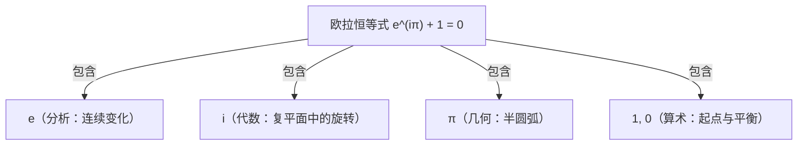

# 为什么欧拉恒等式被称为美丽的等式？

**[欧拉](https://kenji.blog/zh-cn/p/euler/)恒等式**（Euler's Identity）用一个简短的等式连接五个基本数学常数，因此常被赞为美丽的公式。

$$
e^{i\pi} + 1 = 0
$$

这个等式将算术、几何、分析和代数中的重要常数联系起来。[费曼](/zh-cn/p/biography-richard-feynman/)在《费曼物理学讲义》第一卷第22章中，用“This is our jewel.”评价更一般的欧拉公式。这句话指的是下文介绍的一般公式，应与只针对上述特殊恒等式的引语区分。

本文将解释五个常数的含义，从欧拉公式推导恒等式，用绝对收敛的级数证明公式，并说明其旋转意义。讨论应用时，我们会区分某个特定角度的恒等式与适用于任意角度的公式。

## 五个基本数学常数

$0,1,\pi,e,i$ 在数学的不同场合发挥基本作用。按学科划分只是为了说明各自的作用，并不表示这些常数原本互不相关。

### 1. $0$：加法单位元

$0$ 是加法单位元：对任意数 $a$，都有 $a+0=a$。它还可以表示数量不存在，或在位值记数法中占位；这里关注的是它的加法性质。

### 2. $1$：乘法单位元

$1$ 是乘法单位元：对任意数 $a$，都有 $a\cdot1=a$。自然数是否包含0是约定问题，不影响1作为乘法单位元的作用。

### 3. $\pi$：圆周率

$\pi$ 是约为 $3.14159\dots$ 的无理数，表示欧几里得平面中圆周长与直径的比。它也出现在三角函数与弧度制中。这里的关键角度 $\pi$ 表示半周旋转。

### 4. $e$：自然对数的底

$e$ 是约为 $2.71828\dots$ 的无理数，也是自然对数的底。对实变量 $x$，$e^x$ 的导数仍是 $e^x$，原函数为 $e^x+C$。它用于增长、衰减的指数模型，但并非所有连续变化都遵循指数模型。

### 5. $i$：虚数单位

$i$ 是满足 $i^2=-1$ 的虚数单位。$-i$ 也满足这个方程，因此通常约定复平面中向上的方向对应 $i$。复数可写为 $a+bi$，其中 $a,b$ 为实数，扩展了处理方程和旋转的范围。

欧拉恒等式把算术中的 $0$ 和 $1$、几何中的 $\pi$、分析中的 $e$ 与代数中的 $i$ 联系在同一个等式中。

## 从欧拉公式推导

欧拉恒等式是一般的**欧拉公式**在角度取 $\pi$ 时的特例。本文中 $x$ 为实数，角度采用弧度制。$e^z$ 表示下文用级数定义的单值复指数函数 $\exp z$。

$$
e^{ix} = \cos x + i\sin x
$$

这个公式通过虚数单位 $i$，将左边的指数函数与右边的三角函数连接起来。

代入 $x=\pi$，即180度对应的弧度值：

$$
e^{i\pi} = \cos\pi + i\sin\pi
$$

由 $\cos\pi=-1$、$\sin\pi=0$，得到：

$$
e^{i\pi} = -1 + i \cdot 0
$$

因此：

$$
e^{i\pi} = -1
$$

两边加1：

$$
e^{i\pi} + 1 = 0
$$

这样就从欧拉公式得到了欧拉恒等式。

## 用麦克劳林级数证明

为什么 $e^{ix}=\cos x+i\sin x$ 成立？我们使用[麦克劳林展开](/zh-cn/p/taylor-and-maclaurin-series/)，但需要确认复指数函数的定义和级数的收敛性，而不是仅在实变量等式中形式地代入复数。

定义 $\exp z=\sum_{n=0}^{\infty}z^n/n!$。$z=0$ 时收敛显然成立。对固定的复数 $z\ne0$，相邻项绝对值之比 $|z|/(n+1)$ 趋于0，因此级数绝对收敛。对实数 $x$，它与通常的指数函数一致；正弦和余弦也有如下展开。这三个等式对所有实数 $x$ 都成立。

$$
e^x = 1 + x + \frac{x^2}{2!} + \frac{x^3}{3!} + \frac{x^4}{4!} + \frac{x^5}{5!} + \dots
$$

$$
\cos x = 1 - \frac{x^2}{2!} + \frac{x^4}{4!} - \frac{x^6}{6!} + \dots
$$

$$
\sin x = x - \frac{x^3}{3!} + \frac{x^5}{5!} - \frac{x^7}{7!} + \dots
$$

在复指数函数的级数中令 $z=ix$。由于 $x$ 是实数，$ix$ 为纯虚数（$x=0$ 时为0）。利用 $i^1=i$、$i^2=-1$、$i^3=-i$、$i^4=1$ 的四步循环：

$$
e^{ix} = 1 + (ix) + \frac{(ix)^2}{2!} + \frac{(ix)^3}{3!} + \frac{(ix)^4}{4!} + \frac{(ix)^5}{5!} + \dots
$$

$$
e^{ix} = 1 + ix - \frac{x^2}{2!} - i\frac{x^3}{3!} + \frac{x^4}{4!} + i\frac{x^5}{5!} - \dots
$$

绝对收敛允许将偶数次项与奇数次项分别合并。因为 $x$ 为实数，第一个括号给出实部，第二个括号给出虚部的值。虚部本身是实数，应与乘上 $i$ 后的部分区分。

$$
e^{ix} = \left( 1 - \frac{x^2}{2!} + \frac{x^4}{4!} - \dots \right) + i \left( x - \frac{x^3}{3!} + \frac{x^5}{5!} - \dots \right)
$$

第一个括号是 $\cos x$ 的级数，第二个括号是 $\sin x$ 的级数。因此：

$$
e^{ix} = \cos x + i\sin x
$$

这就证明了指数函数与三角函数之间的联系。

## 复平面中的几何意义

欧拉恒等式也可通过**复平面（高斯平面）**获得几何解释。

将复数 $z=a+bi$ 对应于点 $(a,b)$，横坐标是实部，纵坐标是虚部的值。对实数 $\theta$，有 $|e^{i\theta}|=1$，因此乘以 $e^{i\theta}$ 会保持长度，并绕原点旋转。$\theta$ 为正时逆时针旋转，为负时顺时针旋转；原点保持不动。

从这个角度看 $e^{i\pi}=-1$：

1. 从实轴上的 $1$，即点 $(1,0)$ 出发。
2. 乘以 $e^{i\pi}$，相当于绕原点旋转 $\pi$ 弧度，即180度。
3. 从 $1$ 旋转半周，就到达对面的 $-1$，即点 $(-1,0)$。

因此，恒等式表达了从 $1$ 出发旋转半周会到达 $-1$ 这一几何事实。

## 莱昂哈德·欧拉

[莱昂哈德·欧拉](https://kenji.blog/zh-cn/p/euler/)（Leonhard Euler，1707—1783）出生于瑞士，是18世纪的代表性数学家。他对多个数学分支作出重要贡献，也研究物理学、天文学和工程问题。

欧拉留下大量论文与著作，晚年失明后仍积极研究。他在1748年出版的《Introductio in analysin infinitorum》第一卷中，将函数放在分析学的核心位置，强调 $f(x)$ 记号及 $e$ 和指数函数的作用。该书也讨论无穷级数、无穷乘积和连分数。

本文给出的是利用复指数函数的定义和绝对收敛的现代解释，不应直接视为欧拉著作中使用无穷小等论证的同一份证明。

## 科学与工程中的应用

应用中主要使用的是角度可以变化的欧拉公式，而非只靠 $x=\pi$ 这一特殊恒等式完成所有计算。

### 信号处理与傅里叶分析

傅里叶分析用三角函数或复指数函数的分量表示信号。周期信号的级数和非周期信号的变换等，需要指定函数条件与收敛的含义。$e^{i\omega t}$ 对时间的导数是 $i\omega e^{i\omega t}$；当 $\omega\ne0$ 时，一个原函数是 $e^{i\omega t}/(i\omega)$。不过，对级数逐项求导或积分还需要额外条件。

[FFT](/zh-cn/p/fast-fourier-transform-algorithm/)是高效计算有限数据的离散傅里叶变换的算法。普通有损JPEG的基本方式使用离散余弦变换（DCT），应与“JPEG直接使用FFT”的说法区分。

### 电气与电子工程

对于线性时不变交流电路，在单一频率的正弦稳态下，可用相量表示电压、电流，以复数代数计算振幅和相位。暂态需另行处理；叠加多个频率时，应分别分析各频率。不能将这一方法无条件用于非线性电路或任意时间变化。

### 量子力学

在非相对论量子力学中，薛定谔方程描述波函数，即复数概率振幅。对于归一化的位置表象波函数 $\psi(x,t)$，$|\psi(x,t)|^2$ 是位置的概率密度；波函数本身并不是概率。自由粒子的平面波和能量本征态的时间演化会出现复指数函数，但一般波函数并不等于单一指数函数。

## 结语：等式的魅力

欧拉恒等式令人联想到拼图的碎片终于组成一幅完整的图画：圆周率 $\pi$、分析中的 $e$、虚数单位 $i$，以及最基本的 $1$ 和 $0$。这种联系可以让读者感受到数学仿佛映照着世界更深层的秩序。

数学常被看作技术语言，但这个恒等式的简洁与广泛联系也可以像诗歌或艺术一样被欣赏。人们所感受到的美，来自这些观念之间的和谐。

## 参考资料

- [NIST DLMF §4.2(iii)：复指数函数级数与三角函数的关系](https://dlmf.nist.gov/4.2#iii)
- [MIT 18.100C Lecture 11：复数级数的绝对收敛与指数函数](https://ocw.mit.edu/courses/18-100c-real-analysis-fall-2012/1058808e5cb57c986118333f8b6fa0d7_MIT18_100CF12_l11sum.pdf)
- [费曼物理学讲义第一卷第22章：一般欧拉公式与引语](https://www.feynmanlectures.caltech.edu/I_22.html)
- [费曼物理学讲义第一卷第23、25章：复数振动计算与稳态](https://www.feynmanlectures.caltech.edu/I_23.html)（[第25章](https://www.feynmanlectures.caltech.edu/I_25.html)）
- [MIT 6.002：正弦稳态与阻抗法的适用条件](https://circuits.mit.edu/_static/S23/handouts/lec10b/lecture10b-berggren.pdf)
- [MIT 6.341 Lecture 19：计算DFT的FFT算法](https://ocw.mit.edu/courses/6-341-discrete-time-signal-processing-fall-2005/resources/lec19/)
- [费曼物理学讲义第三卷第3章：复数概率振幅](https://www.feynmanlectures.caltech.edu/III_03.html)
- [ITU-T T.81：JPEG的DCT方式（§3.1.58—59、§4.2）](https://www.w3.org/Graphics/JPEG/itu-t81.pdf)
- [Euler Archive：1748年《Introductio》第一卷的书目与内容概要](https://scholarlycommons.pacific.edu/euler-works/101/)
- [ETH图书馆：欧拉的生平与失明后的研究](https://library.ethz.ch/sammlungen-und-archive/kurzportraets/leonhard-euler-1707-1783.html)
