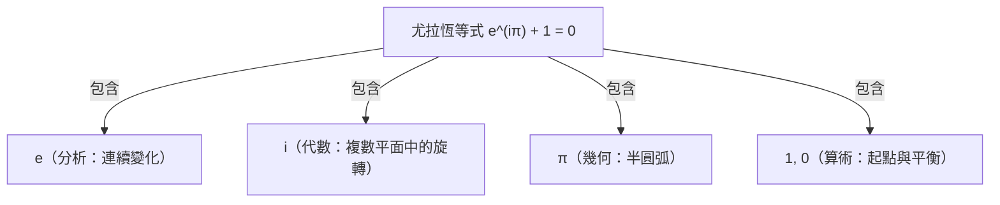

# 為什麼尤拉恆等式被讚為美麗的等式？

**[尤拉](https://kenji.blog/zh-tw/p/euler/)恆等式**（Euler's Identity）以簡短的式子連結五個基本數學常數，因此常被讚為美麗的公式。

$$
e^{i\pi} + 1 = 0
$$

這個等式連結了算術、幾何、分析與代數中的重要常數。[費曼](/zh-tw/p/biography-richard-feynman/)在《費曼物理學講義》第一卷第22章中，以“This is our jewel.”評價更一般的尤拉公式。這句話所指的是下文的一般公式，應與僅針對上述特殊恆等式的引文區分。

本文將解釋五個常數的意義、從尤拉公式推導恆等式、以絕對收斂的級數證明公式，並說明旋轉的幾何解釋。討論應用時，會區分特定角度的恆等式與適用於任意角度的公式。

## 五個基本數學常數

$0,1,\pi,e,i$ 在數學的不同場合扮演基本角色。將它們分配到不同學科只是說明方式，並不表示這些常數原本互不相關。

### 1. $0$：加法單位元素

$0$ 是加法單位元素：對任意數 $a$，皆有 $a+0=a$。它也可以表示數量不存在，或在位值記數法中占位；這裡著重於加法的性質。

### 2. $1$：乘法單位元素

$1$ 是乘法單位元素：對任意數 $a$，皆有 $a\cdot1=a$。自然數是否包含0是慣例問題，不影響1作為乘法單位元素的角色。

### 3. $\pi$：圓周率

$\pi$ 是約為 $3.14159\dots$ 的無理數，表示歐幾里得平面中圓周長與直徑的比值。它也出現在三角函數與弧度制中。這裡的關鍵角度 $\pi$ 表示半周旋轉。

### 4. $e$：自然對數的底數

$e$ 是約為 $2.71828\dots$ 的無理數，也是自然對數的底數。對實變數 $x$，$e^x$ 的導數仍為 $e^x$，原函數為 $e^x+C$。它常用於成長、衰減的指數模型，但並非所有連續變化都遵循指數模型。

### 5. $i$：虛數單位

$i$ 是滿足 $i^2=-1$ 的虛數單位。$-i$ 也滿足相同方程式，因此通常約定複數平面中向上的方向對應 $i$。複數可寫成 $a+bi$，其中 $a,b$ 為實數，擴展了處理方程式與旋轉的範圍。

尤拉恆等式將算術中的 $0$ 和 $1$、幾何中的 $\pi$、分析中的 $e$，以及代數中的 $i$ 連結在同一個等式中。

## 從尤拉公式推導

尤拉恆等式是一般的**尤拉公式**在角度取 $\pi$ 時的特例。本文中 $x$ 為實數，角度以弧度表示。$e^z$ 表示下文用級數定義的單值複數指數函數 $\exp z$。

$$
e^{ix} = \cos x + i\sin x
$$

這個公式透過虛數單位 $i$，將左邊的指數函數與右邊的三角函數連結起來。

代入 $x=\pi$，即180度對應的弧度值：

$$
e^{i\pi} = \cos\pi + i\sin\pi
$$

因為 $\cos\pi=-1$、$\sin\pi=0$，可得：

$$
e^{i\pi} = -1 + i \cdot 0
$$

因此：

$$
e^{i\pi} = -1
$$

兩邊加1：

$$
e^{i\pi} + 1 = 0
$$

如此就從尤拉公式推導出尤拉恆等式。

## 以麥克勞林級數證明

為什麼 $e^{ix}=\cos x+i\sin x$ 成立？我們使用[麥克勞林展開](/zh-tw/p/taylor-and-maclaurin-series/)，但必須確認複數指數函數的定義與級數的收斂性，不能僅在實變數的等式中形式地代入複數。

定義 $\exp z=\sum_{n=0}^{\infty}z^n/n!$。$z=0$ 時收斂顯然成立。對固定的複數 $z\ne0$，相鄰項絕對值的比 $|z|/(n+1)$ 趨近0，因此級數絕對收斂。對實數 $x$，它與通常的指數函數一致；正弦與餘弦也有以下展開。這三個等式對所有實數 $x$ 都成立。

$$
e^x = 1 + x + \frac{x^2}{2!} + \frac{x^3}{3!} + \frac{x^4}{4!} + \frac{x^5}{5!} + \dots
$$

$$
\cos x = 1 - \frac{x^2}{2!} + \frac{x^4}{4!} - \frac{x^6}{6!} + \dots
$$

$$
\sin x = x - \frac{x^3}{3!} + \frac{x^5}{5!} - \frac{x^7}{7!} + \dots
$$

在複數指數函數的級數中令 $z=ix$。因為 $x$ 為實數，$ix$ 為純虛數（$x=0$ 時為0）。利用 $i^1=i$、$i^2=-1$、$i^3=-i$、$i^4=1$ 的四步循環：

$$
e^{ix} = 1 + (ix) + \frac{(ix)^2}{2!} + \frac{(ix)^3}{3!} + \frac{(ix)^4}{4!} + \frac{(ix)^5}{5!} + \dots
$$

$$
e^{ix} = 1 + ix - \frac{x^2}{2!} - i\frac{x^3}{3!} + \frac{x^4}{4!} + i\frac{x^5}{5!} - \dots
$$

絕對收斂允許將偶數次項與奇數次項分別合併。因為 $x$ 是實數，第一個括號給出實部，第二個括號給出虛部的值。虛部本身是實數，應與乘上 $i$ 後的部分區分。

$$
e^{ix} = \left( 1 - \frac{x^2}{2!} + \frac{x^4}{4!} - \dots \right) + i \left( x - \frac{x^3}{3!} + \frac{x^5}{5!} - \dots \right)
$$

第一個括號是 $\cos x$ 的級數，第二個括號是 $\sin x$ 的級數。因此：

$$
e^{ix} = \cos x + i\sin x
$$

這就證明了指數函數與三角函數之間的關係。

## 複數平面中的幾何意義

尤拉恆等式也可以透過**複數平面（高斯平面）**獲得幾何解釋。

將複數 $z=a+bi$ 對應到點 $(a,b)$，橫座標是實部，縱座標是虛部的值。對實數 $\theta$，有 $|e^{i\theta}|=1$，所以乘以 $e^{i\theta}$ 會保持長度，並繞原點旋轉。$\theta$ 為正時逆時針旋轉，為負時順時針旋轉；原點保持不動。

從這個角度看 $e^{i\pi}=-1$：

1. 從實軸上的 $1$，即點 $(1,0)$ 出發。
2. 乘以 $e^{i\pi}$，相當於繞原點旋轉 $\pi$ 弧度，也就是180度。
3. 從 $1$ 旋轉半周，就會到達對面的 $-1$，即點 $(-1,0)$。

因此，這個恆等式表達了從 $1$ 出發旋轉半周會到達 $-1$ 的幾何事實。

## 李昂哈德·尤拉

[李昂哈德·尤拉](https://kenji.blog/zh-tw/p/euler/)（Leonhard Euler，1707—1783）出生於瑞士，是18世紀的代表性數學家。他對多個數學分支作出重要貢獻，也研究物理學、天文學與工程問題。

尤拉留下大量論文與著作，晚年失明後仍積極研究。他在1748年出版的《Introductio in analysin infinitorum》第一卷中，將函數放在分析學的核心位置，重視 $f(x)$ 記號及 $e$ 與指數函數的角色。書中也討論無窮級數、無窮乘積與連分數。

本文給出的是利用複數指數函數定義與絕對收斂的現代解釋，不應直接視為尤拉著作中運用無窮小等論證的同一份證明。

## 科學與工程中的應用

應用時主要使用的是角度可以變化的尤拉公式，而不是只靠 $x=\pi$ 的特殊恆等式完成所有計算。

### 訊號處理與傅立葉分析

傅立葉分析以三角函數或複數指數函數的分量表示訊號。週期訊號的級數、非週期訊號的轉換等，需要指定函數條件與收斂的意義。$e^{i\omega t}$ 對時間的導數是 $i\omega e^{i\omega t}$；當 $\omega\ne0$ 時，一個原函數是 $e^{i\omega t}/(i\omega)$。但對級數逐項微分或積分，仍需額外條件。

[FFT](/zh-tw/p/fast-fourier-transform-algorithm/)是有效率地計算有限資料之離散傅立葉轉換的演算法。一般失真JPEG的基本方式使用離散餘弦轉換（DCT），應與「JPEG直接使用FFT」的說法區分。

### 電機與電子工程

對線性非時變交流電路，在單一頻率的正弦穩態下，可用相量（phasor）表示電壓、電流，以複數代數計算振幅和相位。暫態須另外處理；疊加多個頻率時，應分別分析各頻率。不能將這個方法無條件用於非線性電路或任意時間變化。

### 量子力學

在非相對論量子力學中，薛丁格方程式描述波函數，也就是複數機率振幅。對正規化的位置表象波函數 $\psi(x,t)$，$|\psi(x,t)|^2$ 是位置的機率密度；波函數本身並不是機率。自由粒子的平面波與能量本徵態的時間演化會出現複數指數函數，但一般波函數並不是單一指數函數。

## 結語：等式的魅力

尤拉恆等式令人聯想到拼圖的碎片終於組成完整的圖畫：圓周率 $\pi$、分析中的 $e$、虛數單位 $i$，以及最基本的 $1$ 和 $0$。這些關係可以讓讀者感受到數學彷彿映照著世界更深層的秩序。

數學常被看作技術語言，但這個恆等式的簡潔與廣泛聯繫，也能像詩歌或藝術一樣被欣賞。讀者所感受到的美，來自這些觀念之間的和諧。

## 參考資料

- [NIST DLMF §4.2(iii)：複數指數級數與三角函數的關係](https://dlmf.nist.gov/4.2#iii)
- [MIT 18.100C Lecture 11：複數級數的絕對收斂與指數函數](https://ocw.mit.edu/courses/18-100c-real-analysis-fall-2012/1058808e5cb57c986118333f8b6fa0d7_MIT18_100CF12_l11sum.pdf)
- [費曼物理學講義第一卷第22章：一般尤拉公式與引文](https://www.feynmanlectures.caltech.edu/I_22.html)
- [費曼物理學講義第一卷第23、25章：複數振動計算與穩態](https://www.feynmanlectures.caltech.edu/I_23.html)（[第25章](https://www.feynmanlectures.caltech.edu/I_25.html)）
- [MIT 6.002：正弦穩態與阻抗法的適用條件](https://circuits.mit.edu/_static/S23/handouts/lec10b/lecture10b-berggren.pdf)
- [MIT 6.341 Lecture 19：計算DFT的FFT演算法](https://ocw.mit.edu/courses/6-341-discrete-time-signal-processing-fall-2005/resources/lec19/)
- [費曼物理學講義第三卷第3章：複數機率振幅](https://www.feynmanlectures.caltech.edu/III_03.html)
- [ITU-T T.81：JPEG的DCT方式（§3.1.58—59、§4.2）](https://www.w3.org/Graphics/JPEG/itu-t81.pdf)
- [Euler Archive：1748年《Introductio》第一卷的書目與內容概要](https://scholarlycommons.pacific.edu/euler-works/101/)
- [ETH圖書館：尤拉的生平與失明後的研究](https://library.ethz.ch/sammlungen-und-archive/kurzportraets/leonhard-euler-1707-1783.html)
