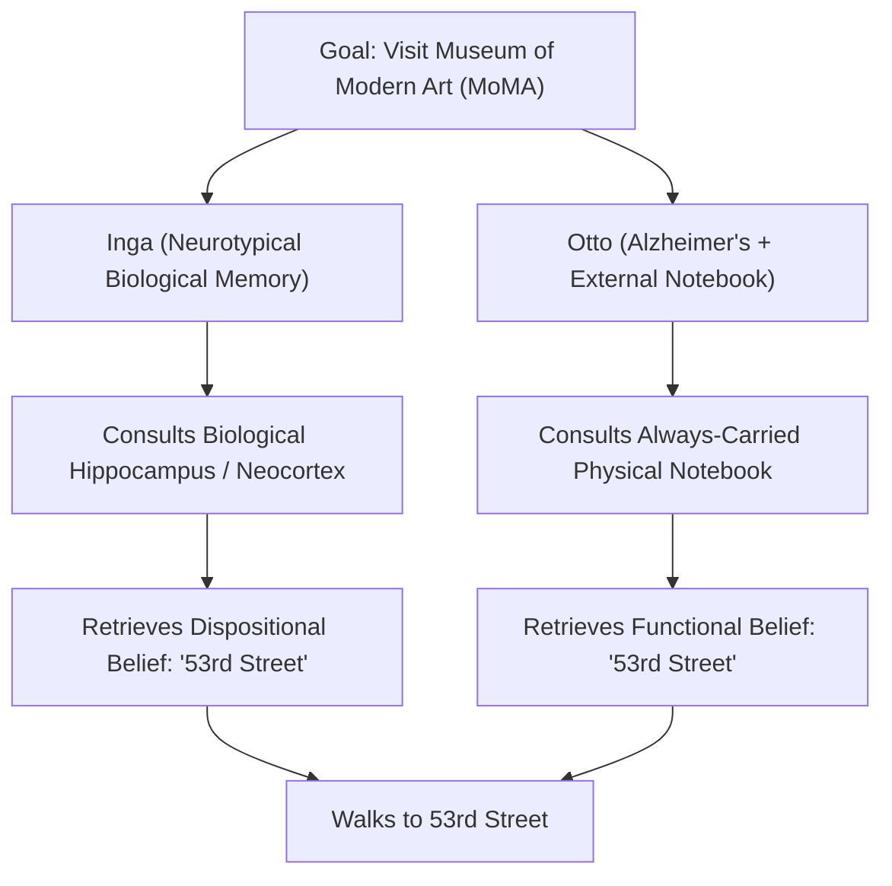
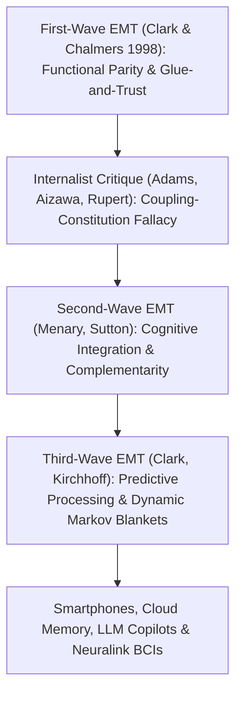

## مقدمة: «أين يتوقف العقل وأين يبدأ باقي العالم؟»

في عام 1998 نشر الفيلسوفان <strong>آندي كلارك (Andy Clark)</strong> و<strong>ديفيد تشالمرز (David J. Chalmers)</strong> في مجلة *Analysis* ورقة بحثية لا تتجاوز سبع صفحات بعنوان <strong>*«العقل الممتد» (The Extended Mind)</strong>*، لكنها أحدثت زلزالاً في فلسفة العقل والعلوم المعرفية المعاصرة. افتتح المؤلفان ورقتهما بسؤال بسيط ومثير للدهشة: <strong>«أين يتوقف العقل وأين يبدأ باقي العالم؟»</strong>

طوال قرابة أربعة قرون منذ رينيه ديكارت — سواء لدى الثنائيين أو الماديين الاختزاليين المحدثين — كان الجميع تقريباً يسلّمون ببداهة <strong>الداخليانية الجمجمية (Cranial Internalism)</strong>: أي أن حدود العقل والإدراك تتطابق تماماً مع الحدود البيولوجية <strong>للجلد والجمجمة (*Skin and Skull*)</strong>. أما المعداد، والورقة والقلم، ودفتر الملاحظات، والهاتف الذكي، أو نماذج اللغة الكبيرة (LLMs) اليوم، فليست سوى *أدوات* خارجية أو وسائط إدخال وإخراج، ولا يمكن أبداً أن تكون أجزاءً حرفية من العقل ذاته.

حطّم كلارك وتشالمرز هذه العقيدة بطرحهما <strong>الخارجيانية الفعالة (Active Externalism)</strong> و<strong>أطروحة العقل الممتد (Extended Mind Thesis, EMT)</strong>: عندما تقترن أداة مادية خارجية بالكائن البشري في حلقة سببية موثوقة ومتبادلة ومتكاملة وظيفياً، فإن هذه الأداة تكفّ عن كونها مجرد أداة وتصبح <strong>جزءاً تكوينياً أصيلاً من البنية المعرفية للفاعل، بل وحتى منعتقداته الاستعدادية وذاكرته</strong>!

---

## 1. الأفعال المعرفية ومبدأ التكافؤ: التجربة الفكرية لأوتو وإنغا

لإثبات أن العمليات المعرفية تتجاوز الجمجمة، استند كلارك وتشالمرز أولاً إلى الدراسة التجريبية التي أجراها ديفيد كيرش وبول ماغليو (1994) على اللاعبين المحترفين في لعبة *تتريس (Tetris)*. كانت النماذج المعرفية الكلاسيكية تفترض أن اللاعب يقوم أولاً بـ«تدوير ذهني» للقطعة الساقطة داخل قشرته البصرية (وهو ما يستغرق نحو $800	ext{–}1000\,	ext{مللي ثانية}$) قبل تحريكها. لكن كيرش وماغليو اكتشفا أن المحترفين يضغطون الزر مباشرة <strong>لتدوير القطعة فيزيائياً على الشاشة</strong> (في $100	ext{–}200\,	ext{مللي ثانية}$ فقط) ليروا بالعين كيف تتطابق! وتُسمى هذه الأفعال الفيزيائية في العالم الخارجي، التي تُنجز خصيصاً لتخفيف أو تسريع الحساب الداخلي للدماغ، <strong>الأفعال الإبستمية/المعرفية (Epistemic Actions)</strong> (تماماً كإعادة ترتيب قطع الحروف الخشبية باليد في لعبة *Scrabble*).

وانطلاقاً من ذلك صاغ كلارك وتشالمرز <strong>مبدأ التكافؤ (Parity Principle)</strong> الشهير:
> <strong>«إذا كان جزء من العالم الخارجي، أثناء مواجهتنا لمهمة ما، يعمل كعملية لو أنها جرت داخل الرأس لما ترددنا لحظة في الاعتراف بها كجزء من العملية المعرفية، فإن هذا الجزء من العالم هو بالفعل جزء من العملية المعرفية».</strong>

ولإثبات أن الامتداد لا يقتصر على العمليات الحسابية بل يشمل الحالات الذهنية الأصيلة مثل <strong>المعتقدات (Beliefs) والذاكرة</strong>، ابتكرا التجربة الفكرية الشهيرة لـ<strong>إنغا وأوتو (Inga and Otto)</strong>:
- تتمتع <strong>إنغا</strong> بذاكرة بيولوجية طبيعية. عندما تسمع عن معرض في متحف الفن الحديث (MoMA)، تفكر للحظة وتستحضر من ذاكرتها البيولوجية (الحُصين والقشرة المخية) أن المتحف يقع في الشارع 53، ثم تسير إلى هناك. من الواضح أن إنغا كانت تمتلك، حتى *قبل* التذكر الواعي، <strong>اعتقاداً استعدادياً (Dispositional Belief)</strong> بأن المتحف يقع في الشارع 53.
- يعاني <strong>أوتو</strong> من حالة خفيفة من مرض ألزهايمر. ولكي يدير حياته اليومية، يحمل معه في كل مكان <strong>دفتر ملاحظات</strong> ورقي: يدوّن فيه كل معلومة جديدة ويراجعه كلما احتاج إلى معلومة قديمة. عندما يسمع أوتو عن المعرض، يفتح دفتره ويقرأ العبارة «متحف MoMA يقع في الشارع 53» التي كتبها سابقاً، ثم يسير نحو الشارع 53.

يؤكد كلارك وتشالمرز أن دفتر أوتو يؤدي <strong>نفس الدور الوظيفي والتفسيري تماماً</strong> في سلوك أوتو الذي تؤديه الذاكرة البيولوجية لدى إنغا! وإنكار أن اعتقاد أوتو يكمن في دفتره لمجرد أن الورق يقع خارج الجمجمة ليس سوى «تعصب بيولوجي (Bio-chauvinism)» لا مبرر له.

$$
\text{Parity Principle:} \quad \text{If } \Phi_{\text{world}}(S, E) \cong_{\text{func}} \Phi_{\text{brain}}(S_{\text{internal}}) \implies E \subset \text{Cognitive System}(S)
$$

$$
I(M_{\text{bio}}; A) \approx I(M_{\text{notebook}}; A), \qquad \tau_{\text{access}}(E) \le \tau_{\text{crit}}, \qquad \mathbb{P}(\text{Endorse}(E)) \to 1
$$

---

## 2. معايير «الغراء والثقة» الأربعة لمنع التضخم المعرفي، والاعتراضات الداخليانية

إذا كان دفتر أوتو جزءاً من عقله، فهل يعني ذلك أن موسوعة ويكيبيديا بأكملها أو مكتبة الكونغرس جزء من عقلنا الآن؟ لدرء اعتراض <strong>التضخم المعرفي (Cognitive Bloat)</strong> هذا، وضع كلارك وتشالمرز أربعة <strong>معايير صارمة لـ«الغراء والثقة» (Glue and Trust)</strong>:
1. <strong>التوافر الدائم (Constant Availability)</strong>: يحمل أوتو دفتره معه دائماً ولا يفارقه.
2. <strong>سهولة ومباشرة الوصول (Easy Accessibility)</strong>: يمكن استرجاع المعلومة فوراً دون عوائق.
3. <strong>التصديق التلقائي (Automatic Endorsement)</strong>: بمجرد قراءة المعلومة من الدفتر يصدّقها أوتو تلقائياً كما نثق بذاكرتنا البيولوجية.
4. <strong>التصديق الواعي السابق (Past Conscious Endorsement)</strong>: تم التحقق من المعلومة وتدوينها بوعي من قِبل أوتو في الماضي.

ومع ذلك وجّه الفلاسفة الداخليانيون انتقادات حادة:
- <strong>فريد آدامز وكينيث أيزاوا (2008): «مغالطة الخلط بين الاقتران والتكوين (Coupling-Constitution Fallacy)» و«علامة المعرفي (Mark of the Cognitive)»</strong>: إن الاقتران السببي لجسم ما بنظام لا يعني أنه جزء أنطولوجي منه. كما أن الإدراك الحقيقي يتطلب تمثيلات ذات <strong>قصدية أصيلة غير مشتقة</strong> وخضوعاً للقوانين النفسية العصبية للذاكرة البيولوجية، بينما حبر الدفتر لا يملك سوى قصدية مشتقة بالاصطلاح الاجتماعي.
- <strong>«فرضية الإدراك المدمج (HEC)» لروبرت روبرت (2004) و«العقل المسنود بالسقالات (Scaffolded Mind)» لكيم ستيريلني (2010)</strong>: يقترحون إبقاء العقل داخل الكائن الحي مع الاعتراف باعتماده العميق على السقالات البيئية الخارجية (*Scaffolds*).

---

## 3. الموجتان الثانية والثالثة للعقل الممتد: التكاملية، الدماغ التنبؤي، والقانون الدستوري

استجابةً لهذه النقاشات تطورت نظرية العقل الممتد عبر موجتين ثانية وثالثة:
- <strong>الموجة الثانية (ميناري، ساتون: التكامل المعرفي والتكاملية Complementarity)</strong>: بدلاً من التركيز على *التشابه* (التكافؤ) بين الدماغ والدفتر، تركز على <strong>اختلافهما التكاملي</strong>! فالدماغ البيولوجي (*الإنغرامات*) بارع في الربط النمطي السريع لكنه ضعيف في حفظ سلاسل الرموز الطويلة بدقة؛ أما الوسائط الخارجية (*الإكسورامات*) فتفعل العكس تماماً. وإنما وُلدت الرياضيات والعلوم الحديثة من اندماجهما الهجين.
- <strong>الموجة الثالثة (كلارك 2016، كيرشهوف: المعالجة التنبؤية وبطانيات ماركوف الديناميكية)</strong>: بالارتباط مع <strong>مبدأ الطاقة الحرة (Free Energy Principle) والاستدلال الفعال</strong> لكارل فريستون، يُفهم الدماغ كمحرك بايزي يقلل خطأ التنبؤ $\mathcal{F}$. وتكون الحدود الإحصائية للذات المعرفية (<strong>بطانية ماركوف / Markov Blanket</strong>) مرنة تتسع ديناميكياً لتشمل أطرافنا المعرفية الخارجية.

وفي القرن الحادي والعشرين دخلت أطروحة العقل الممتد صلب القانون الدستوري:
ففي الحكم التاريخي <strong>*Riley v. California* (2014)</strong> قضت المحكمة العليا الأمريكية بالإجماع (9–0) بأنه <strong>لا يجوز للشرطة تفتيش المحتوى الرقمي للهاتف الذكي</strong> لشخص موقوف دون إذن قضائي. وكتب رئيس المحكمة العليا جون روبرتس عبارته الشهيرة: *«لقد أصبحت الهواتف المحمولة الحديثة جزءاً متغلغلاً وملازماً للحياة اليومية إلى حد أن الزائر المفترض من كوكب المريخ قد يستنتج أنها سمة مهمة من سمات التشريح البشري!»* وفي عصر الهواتف الذكية، والأدمغة الثانية السحابية، والمساعدات الذكية (LLM Copilots)، وواجهات الدماغ والحاسوب (Neuralink)، لم يعد اختراق أو مسح الذاكرة الرقمية الخارجية للإنسان مجرد إتلاف للممتلكات، بل هو <strong>اعتداء مباشر على السلامة المعرفية للشخص ذاته</strong>.

| النموذج / التيار | حدود العقل والإدراك | المعيار المحوري / الآلية | مكانة دفتر أوتو / الهاتف الذكي | الأثر القانوني والأخلاقي |
| :--- | :--- | :--- | :--- | :--- |
| <strong>الداخليانية الجمجمية (Adams & Aizawa)</strong> | محصورة صارمة داخل الجلد والجمجمة | علامة المعرفي (القصدية الأصيلة) | مجرد أداة سببية خارجية (الاقتران $
eq$ التكوين) | الإتلاف = ضرر مادي عادي للممتلكات |
| <strong>الإدراك المدمج / HEC (Rupert / Sterelny)</strong> | داخل الكائن الحي بدعم بيئي كثيف | الاقتصاد التفسيري والسقالات البيئية | سقالة إبستمية خارجية عالية النطاق | حماية البنية التحتية المعرفية |
| <strong>الموجة 1 للعقل الممتد (Clark & Chalmers 1998)</strong> | تمتد إلى الأدوات المقترنة بموثوقية | <strong>مبدأ التكافؤ</strong> + معايير «الغراء والثقة» الـ4 | <strong>جزء تكويني أصيل</strong> من معتقدات أوتو | التفتيش بلا إذن = انتهاك للخصوصية الذهنية |
| <strong>الموجة 2/3 للعقل الممتد (Sutton / Clark 2016)</strong> | بطانية ماركوف مرنة (دماغ-جسद-بيئة) | <strong>التكاملية</strong> + الاستدلال الفعال (الطاقة الحرة) | نظام هجين من الإنغرامات والإكسورامات | أساس الحقوق العصبية وحكم *Riley v. California* |

$$
\mathcal{F}(q, s, a) = \mathbb{E}_{q(\vartheta)}\big[ \ln q(\vartheta) - \ln p(s, \vartheta \mid a) \big] = D_{\text{KL}}\big( q(\vartheta) \,\|\, p(\vartheta \mid s, a) \big) - \ln p(s \mid a)
$$
