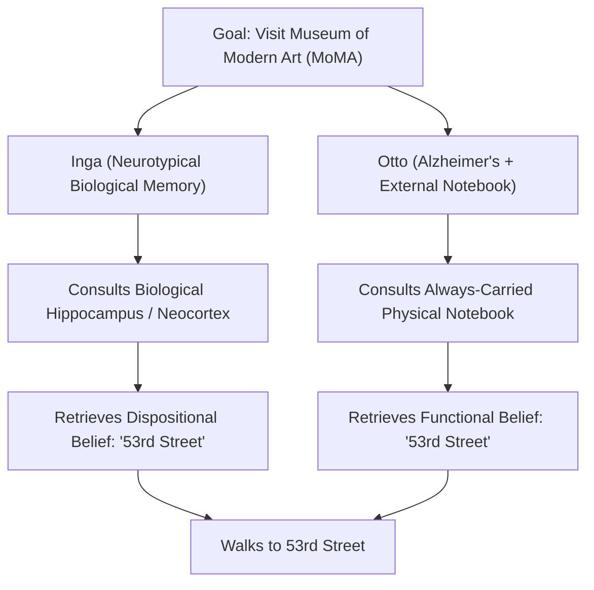
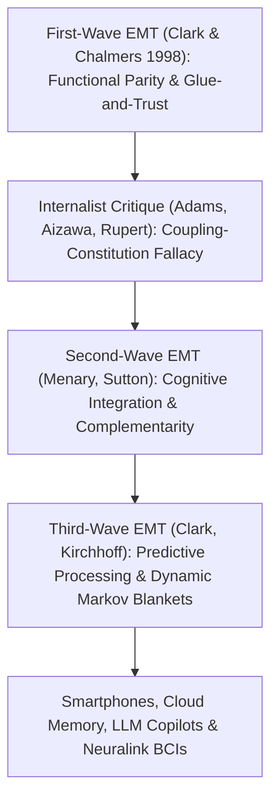

## Einleitung: „Wo hört der Geist auf und wo fängt der Rest der Welt an?“

Im Jahr 1998 veröffentlichten die Philosophen <strong>Andy Clark</strong> und <strong>David J. Chalmers</strong> in der Fachzeitschrift *Analysis* einen nur sieben Seiten langen Aufsatz mit dem Titel <strong>*„The Extended Mind“</strong>*, der die moderne Philosophie des Geistes und die Kognitionswissenschaft erschütterte. Sie eröffneten ihren Text mit einer ebenso schlichten wie radikalen Frage: <strong>„Wo hört der Geist auf und wo fängt der Rest der Welt an?“</strong>

Fast vier Jahrhunderte lang galt seit René Descartes — sowohl für Dualisten als auch für moderne reduktive Materialisten — der <strong>kraniale Internalismus</strong> als unantastbares Dogma: Die Grenze des Geistes fällt exakt mit der biologischen Grenze von <strong>Haut und Schädelknochen (Skin and Skull)</strong> zusammen. Rechenschieber, Notizbücher, Taschenrechner, Smartphones oder moderne KI-Sprachmodelle (LLMs) sind demnach bloße externe *Werkzeuge* oder Input-Output-Medien des Geistes, niemals jedoch buchstäbliche Bestandteile des Geistes selbst.

Clark und Chalmers brachen mit diesem Dogma und begründeten den <strong>aktiven Externalismus (Active Externalism)</strong> sowie die <strong>These des erweiterten Geistes (Extended Mind Thesis, EMT)</strong>: Wenn ein externes physisches Artefakt mit einem menschlichen Organismus in einer hinreichend verlässlichen, reziproken und funktional integrierten Rückkopplungsschleife gekoppelt ist, hört dieses Artefakt auf, ein bloßes Werkzeug zu sein — es wird zu einem <strong>konstitutiven Bestandteil der kognitiven Architektur und sogar der dispositionellen Überzeugungen des Subjekts</strong>!

---

## 1. Epistemische Handlungen und das Paritätsprinzip: Das Gedankenexperiment von Otto und Inga

Um zu zeigen, dass kognitive Prozesse die Schädelgrenze überschreiten, stützten sich Clark und Chalmers zunächst auf die empirische Studie von David Kirsh und Paul Maglio (1994) über erfahrene *Tetris*-Spieler. Klassische Kognitionsmodelle nahmen an, dass Spieler herabfallende Blöcke zuerst im Kopf (im visuellen Kortex) „mental rotieren“ (was etwa $800	ext{–}1000\,	ext{ms}$ dauert), bevor sie eine Taste drücken. Doch Kirsh und Maglio stellten fest, dass Profis die Blöcke stattdessen direkt per Tastendruck <strong>physisch auf dem Bildschirm rotieren</strong> (was inklusive visueller Wahrnehmung nur $100	ext{–}200\,	ext{ms}$ benötigt), um die Passform zu erkennen! Solche physischen Eingriffe in die Umwelt, die allein dazu dienen, interne Rechenprozesse des Gehirns zu entlasten oder zu beschleunigen, heißen <strong>epistemische Handlungen (Epistemic Actions)</strong> (analog zum physischen Umsortieren von Buchstabensteinen beim *Scrabble*).

Darauf aufbauend formulierten Clark und Chalmers ihr berühmtes <strong>Paritätsprinzip (Parity Principle)</strong>:
> <strong>„Wenn wir mit einer Aufgabe konfrontiert sind und ein Teil der Welt als ein Prozess fungiert, den wir, würde er im Kopf stattfinden, ohne zu zögern als Teil des kognitiven Prozesses anerkennen würden, dann ist dieser Teil der Welt Teil des kognitiven Prozesses.“</strong>

Um zu beweisen, dass nicht nur Rechenprozesse, sondern echte mentale Zustände wie <strong>Überzeugungen (Beliefs) und Gedächtnisinhalte</strong> außerhalb des Schädels existieren können, entwarfen sie das berühmteste Gedankenexperiment der neueren Philosophie des Geistes — <strong>Inga und Otto</strong>:
- <strong>Inga</strong> verfügt über ein normales biologisches Gedächtnis. Sie hört von einer Ausstellung im Museum of Modern Art (MoMA), überlegt kurz, ruft aus ihrem biologischen Langzeitgedächtnis (Hippocampus/Neokortex) ab, dass sich das MoMA in der 53rd Street befindet, und geht dorthin. Zweifellos besaß Inga schon *vor* dem bewussten Abruf die <strong>dispositionelle Überzeugung</strong>, dass das MoMA in der 53rd Street liegt.
- <strong>Otto</strong> leidet an einer leichten Form der Alzheimer-Krankheit. Wie viele Gedächtnispatienten trägt er ständig ein physisches <strong>Notizbuch</strong> bei sich: Neue Informationen trägt er sofort ein, benötigte Informationen schlägt er nach. Otto hört von der Ausstellung, schlägt in seinem Notizbuch nach, liest seinen Eintrag „Das MoMA ist in der 53rd Street“ und geht zur 53rd Street.

Clark und Chalmers argumentieren: Ottos Notizbuch spielt für die Erklärung seines Handelns <strong>exakt dieselbe funktionale Rolle</strong> wie Ingas biologisches Gedächtnis für ihr Handeln! Zu behaupten, Ottos Überzeugung befinde sich nicht im Notizbuch, nur weil Papier außerhalb des Schädels liegt, wäre reiner „Bio-Chauvinismus“.

$$
\text{Parity Principle:} \quad \text{If } \Phi_{\text{world}}(S, E) \cong_{\text{func}} \Phi_{\text{brain}}(S_{\text{internal}}) \implies E \subset \text{Cognitive System}(S)
$$

$$
I(M_{\text{bio}}; A) \approx I(M_{\text{notebook}}; A), \qquad \tau_{\text{access}}(E) \le \tau_{\text{crit}}, \qquad \mathbb{P}(\text{Endorse}(E)) \to 1
$$

---

## 2. Die vier „Glue and Trust“-Kriterien gegen kognitive Aufblähung und die Kritik des Internalismus

Wenn Ottos Notizbuch Teil seines Geistes ist, gehört dann auch die gesamte Wikipedia oder jede Bibliothek zu unserem Geist? Um diesen Einwand der <strong>kognitiven Aufblähung (Cognitive Bloat Objection)</strong> abzuwehren, definierten Clark und Chalmers vier strenge <strong>„Glue and Trust“-Kriterien (Klebstoff und Vertrauen)</strong>:
1. <strong>Konstante Verfügbarkeit (Constant Availability)</strong>: Otto trägt das Notizbuch immer bei sich und nutzt es routinemäßig.
2. <strong>Direkte und leichte Zugänglichkeit (Easy Accessibility)</strong>: Die Information ist ohne große Hürden sofort abrufbar.
3. <strong>Automatische Anerkennung (Automatic Endorsement)</strong>: Beim Lesen übernimmt Otto die Information automatisch als wahr, genau wie beim biologischen Erinnern.
4. <strong>Frühere bewusste Anerkennung (Past Conscious Endorsement)</strong>: Die Information wurde in der Vergangenheit von Otto bewusst geprüft und eingetragen.

Dennoch formulierten Internalisten scharfe Gegenargumente:
- <strong>Fred Adams & Kenneth Aizawa (2008): „Kopplungs-Konstitutions-Fehlschluss (Coupling-Constitution Fallacy)“ und das „Merkmal des Kognitiven (Mark of the Cognitive)“</strong>: Kausale Kopplung an ein System bedeutet noch lange nicht ontologische Konstitution (ein Bimetallstreifen ist an die Klimaanlage gekoppelt, aber Ausdehnung von Metall ist keine Kühlung). Zudem erfordere echte Kognition <strong>intrinsische, nicht-abgeleitete Intentionalität</strong> sowie die Einhaltung spezifischer neuropsychologischer Gedächtnisgesetze (wie Interferenz- und Generationseffekte), während Schriftzeichen im Notizbuch nur abgeleitete Bedeutung besitzen.
- <strong>Robert Ruperts „Hypothese der eingebetteten Kognition (HEC, 2004)“ und Kim Sterelnys „Gerüst-Geist (Scaffolded Mind, 2010)“</strong>: Sie plädieren dafür, den Geist im Organismus zu belassen, aber seine tiefe Einbettung in selbstgeschaffene kognitive Umweltnischen (*Cognitive Niches*) zu betonen.

---

## 3. Zweite und dritte Welle der EMT: Komplementarität, Predictive Processing und modernes Recht

In Reaktion auf diese Debatten entwickelte sich die Theorie über eine zweite und dritte Welle weiter:
- <strong>Zweite Welle (Menary, Sutton: Kognitive Integration & Komplementarität)</strong>: Statt auf die *Ähnlichkeit* (Parität) zwischen Gehirn und Notizbuch zu pochen, betont die zweite Welle deren <strong>Komplementarität</strong>! Biologische Gehirne (*Engramme*) sind exzellent in assoziativer Mustererkennung, aber schlecht im exakten Speichern langer Symbolketten; externe Medien (*Exogramme*) leisten genau das Gegenteil. Erst die Verschmelzung beider ermöglicht höhere Mathematik und Wissenschaft.
- <strong>Dritte Welle (Clark 2016, Kirchhoff: Predictive Processing & Dynamische Markov-Decken)</strong>: Im Rahmen von Karl Fristons <strong>Prinzip der freien Energie (Free Energy Principle) und Active Inference</strong> ist das Gehirn eine Bayessche Vorhersagemaschine, die den Vorhersagefehler $\mathcal{F}$ minimiert. Die statistische Grenze des kognitiven Selbst (die <strong>Markov-Decke / Markov Blanket</strong>) ist nicht starr an die Haut gebunden, sondern dehnt sich dynamisch auf gekoppelte Werkzeuge aus.

Im 21. Jahrhundert hat die These des erweiterten Geistes längst die Rechtsprechung erreicht:
Im historischen Urteil <strong>*Riley v. California* (2014)</strong> entschied der Oberste Gerichtshof der USA einstimmig (9:0), dass die Polizei das Smartphone einer verhafteten Person <strong>nicht ohne richterlichen Durchsuchungsbefehl</strong> durchsuchen darf. Chief Justice John Roberts schrieb dazu den berühmten Satz: *„Moderne Mobiltelefone sind heute ein so allgegenwärtiger und beharrlicher Bestandteil des täglichen Lebens, dass der sprichwörtliche Besucher vom Mars zu dem Schluss kommen könnte, sie seien ein wichtiges Merkmal der menschlichen Anatomie!“* Im Zeitalter von Smartphones, Cloud-Notizen, KI-Copiloten und Gehirn-Computer-Schnittstellen (Neuralink) ist der unbefugte Zugriff auf oder die Löschung externer digitaler Gedächtnisspeicher keine bloße Sachbeschädigung mehr, sondern ein <strong>direkter Eingriff in die persönliche kognitive Integrität</strong>.

| Paradigma / Strömung | Grenze des Geistes | Kernkriterium / Mechanismus | Status von Ottos Notizbuch / Smartphone | Rechtliche & Ethische Konsequenz |
| :--- | :--- | :--- | :--- | :--- |
| <strong>Kranialer Internalismus (Adams & Aizawa)</strong> | Strikt innerhalb von Haut und Schädel | Merkmal des Kognitiven (intrinsische Intentionalität) | Bloßes externes Werkzeug (Kopplung $
eq$ Konstitution) | Verlust/Löschung ist reine Sachbeschädigung |
| <strong>Eingebettete Kognition / HEC (Rupert / Sterelny)</strong> | Im Organismus, aber hochgradig umweltgestützt | Psychologische Sparsamkeit & Nischen-Scaffolding | Hochbandbreitiges epistemisches Gerüst (*Scaffold*) | Schutz kognitiver Infrastruktur |
| <strong>1. Welle Extended Mind (Clark & Chalmers 1998)</strong> | Umfasst verlässlich gekoppelte Artefakte | <strong>Paritätsprinzip</strong> + 4 „Glue and Trust“-Kriterien | <strong>Konstitutiver Teil</strong> von Ottos Überzeugungen | Durchsuchung ohne Befehl verletzt geistige Privatsphäre |
| <strong>2./3. Welle Extended Mind (Sutton / Clark 2016)</strong> | Plastische Markov-Decke (Gehirn-Körper-Nische) | <strong>Komplementarität</strong> + Active Inference (Freie Energie) | Hybrides System aus Engrammen und Exogrammen | Begründung von Neuro-Rechten & *Riley v. California* |

$$
\mathcal{F}(q, s, a) = \mathbb{E}_{q(\vartheta)}\big[ \ln q(\vartheta) - \ln p(s, \vartheta \mid a) \big] = D_{\text{KL}}\big( q(\vartheta) \,\|\, p(\vartheta \mid s, a) \big) - \ln p(s \mid a)
$$
