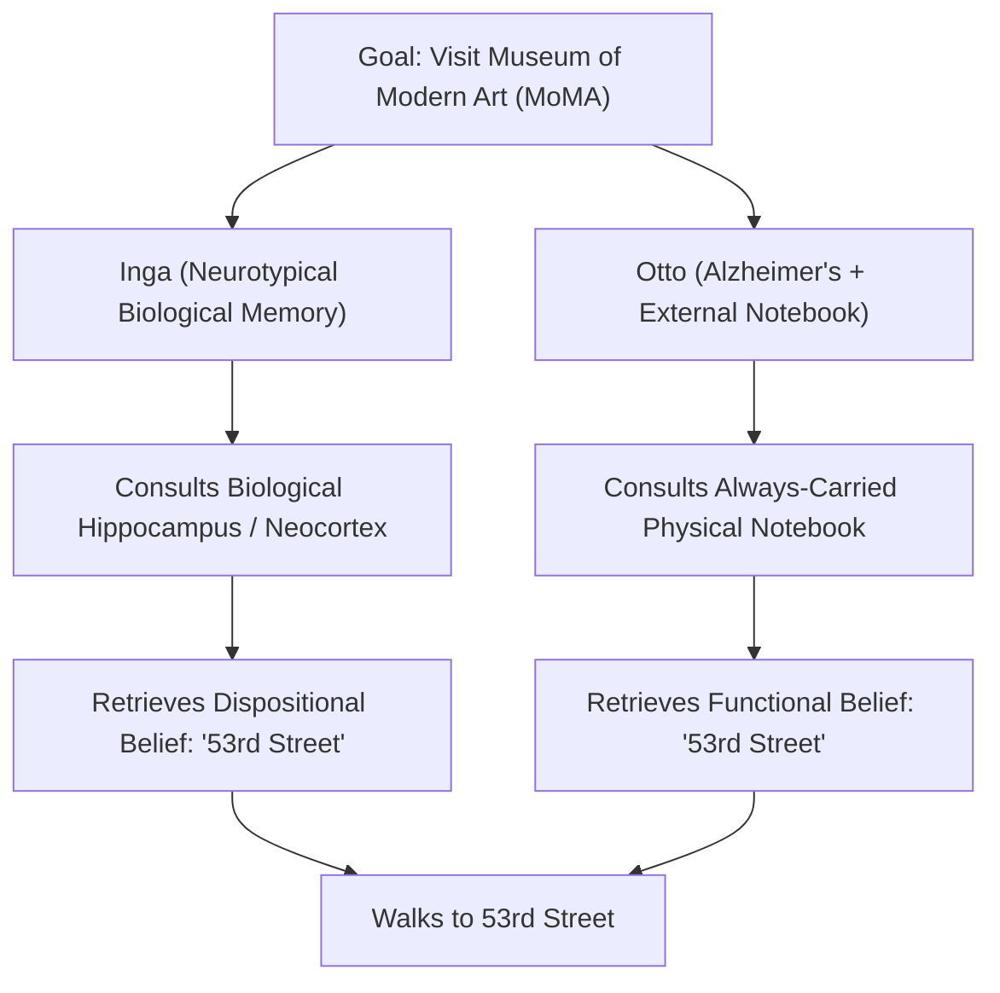
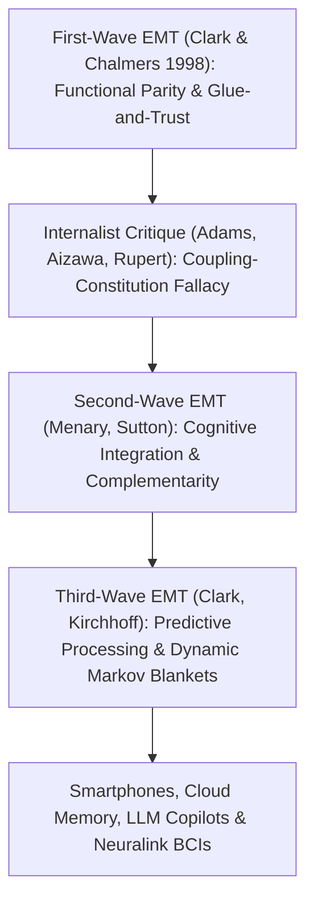

## Introduction: "Where Does the Mind Stop and the Rest of the World Begin?"

In 1998, philosophers <strong>Andy Clark</strong> and <strong>David J. Chalmers</strong> opened their landmark seven-page paper in the journal *Analysis*, titled *"The Extended Mind,"* with one of the most provocative questions in modern cognitive science:

> <strong>"Where does the mind stop and the rest of the world begin?"</strong>

For nearly four centuries following René Descartes, Western philosophy and mainstream neuroscience treated the answer as self-evident. Whether one was a Cartesian substance dualist or a modern physicalist reductionist, almost everyone agreed on <strong>cranial internalism (intracranialism)</strong>: the boundary of the mind is coterminous with the biological boundary of the <strong>skin and skull</strong>. Sensory organs receive physical inputs at the periphery, the central nervous system processes representations inside the cranium, and motor neurons dispatch action commands back out to the body. Tools—such as abacuses, notebooks, slide rules, smartphones, and large language models—are merely external *inputs* to or *instruments* of the mind, never literal parts of the mind itself.

Clark and Chalmers shattered this orthodoxy. They argued for <strong>Active Externalism</strong> and the <strong>Extended Mind Thesis (EMT)</strong>: when an external physical artifact is coupled with a human organism in a sufficiently reliable, reciprocal, and functionally integrated loop, that artifact ceases to be a mere tool and becomes a <strong>constitutive part of the agent's cognitive architecture and even their dispositional beliefs</strong>. When you lose your smartphone or have your lifelong personal notebook destroyed, you have not merely suffered property damage; in a rigorous functional and philosophical sense, you have suffered a localized brain lesion.

In this comprehensive treatise, we examine the intellectual foundations of the Extended Mind Thesis: from David Kirsh and Paul Maglio's empirical studies of *epistemic actions* in *Tetris*, to the <strong>Parity Principle</strong>, the iconic thought experiment of <strong>Otto and Inga</strong>, Clark's <strong>"Glue and Trust" criteria</strong>, the fierce counter-arguments by <strong>Fred Adams, Kenneth Aizawa, Robert Rupert, and Kim Sterelny</strong> (the *Coupling-Constitution Fallacy* and the *Mark of the Cognitive*), the evolution of <strong>Second-Wave Complementarity</strong> and <strong>Third-Wave Predictive Processing</strong>, and the urgent legal and ethical ramifications of extended cognition in the era of smartphones (*Riley v. California*), AI copilots, and brain-computer interfaces.

---

## 1. Epistemic Actions and Active Externalism: Thinking With the World

### 1.1 Passive Semantic Externalism vs. Active Externalism
Before 1998, philosophy of mind was already familiar with one form of externalism: <strong>Semantic Externalism</strong>, pioneered by Hilary Putnam (1975) and Tyler Burge (1979). In Putnam's famous *Twin Earth* thought experiment, Oscar on Earth and Twin-Oscar on Twin Earth have molecule-for-molecule identical brains, yet when Oscar thinks about "water," his thought refers to $\text{H}_2\text{O}$, whereas Twin-Oscar's thought refers to $\text{XYZ}$, because their historical and physical environments differ.

However, Clark and Chalmers noted that Putnam-Burge externalism is <strong>passive and distal</strong>: if you swapped Oscar onto Twin Earth today, his current behavior and causal dynamics would not change at all. By contrast, Clark and Chalmers proposed <strong>Active Externalism</strong>, where the external environment drives cognitive processing *here and now* through continuous, real-time causal coupling. If you remove the external component of an active coupled system, the agent's immediate behavioral competence collapses—just as it would if a region of their prefrontal cortex were removed.

### 1.2 Kirsh and Maglio's Tetris Discovery: Pragmatic vs. Epistemic Actions
To ground Active Externalism in empirical cognitive science, Clark and Chalmers drew upon a brilliant 1994 study by <strong>David Kirsh and Paul Maglio</strong> on expert players of the video game *Tetris*. In *Tetris*, geometric blocks (zoids) fall from the top of the screen, and the player must rotate and translate them into matching gaps at the bottom.

Standard "sense-think-act" cognitive models assumed that a player first perceives the falling zoid, mentally rotates its 3D/2D representation inside their visual cortex (a process proved by Shepard and Metzler in 1971 to take roughly $800\text{–}1000\,\text{ms}$ for a $90^\circ$ rotation), decides where it fits, and then executes motor commands to move it there. Yet Kirsh and Maglio discovered that human experts do something entirely different: they physically press the rotation button on the controller to rotate the block *on the screen*—taking only $100\text{–}200\,\text{ms}$ including perceptual uptake—specifically to see how it looks!

Kirsh and Maglio distinguished two fundamental types of human action:
1. <strong>Pragmatic Actions</strong>: Physical actions performed to bring the external world closer to a physical goal (e.g., dropping the zoid into its final slot, or laying bricks to build a wall).
2. <strong>Epistemic Actions</strong>: Physical actions performed on the external world *specifically to simplify, accelerate, or offload internal computational work* (e.g., physically rotating a *Tetris* zoid on-screen, rearranging Scrabble tiles on a wooden rack to trigger lexical pattern recognition, or writing intermediate carry digits during long multiplication).

When a player rearranges Scrabble tiles $[T, R, A, E, W]$ on their rack into $[W, A, T, E, R]$, the physical movement of wood across a groove is doing the exact functional work of lexical search in associative memory. The loop running through eye, hand, and wooden tiles is a single coupled computational process.

---

## 2. The Parity Principle and the Thought Experiment of Otto and Inga

### 2.1 Formulating the Parity Principle
How do we decide whether an external physical process is merely a helpful input to cognition or a genuine *part* of cognition? Clark and Chalmers formulated their famous <strong>Parity Principle</strong>:

> <strong>"If, as we confront some task, a part of the world functions as a process which, were it done in the head, we would have no hesitation in recognizing as part of the cognitive process, then that part of the world is (so we claim) part of the cognitive process."</strong>

Notice what the Parity Principle actually is: it is a <strong>veil of metabolic ignorance</strong> against bio-chauvinism. It asks us to judge cognitive status by *functional role and information-processing structure* rather than by spatial location (inside vs. outside the skull) or material substrate (carbon neurons vs. cellulose paper or silicon transistors).

$$
\text{Parity Principle:} \quad \text{If } \Phi_{\text{world}}(S, E) \cong_{\text{func}} \Phi_{\text{brain}}(S_{\text{internal}}) \implies E \subset \text{Cognitive System}(S)
$$

$$
I(M_{\text{bio}}; A) \approx I(M_{\text{notebook}}; A), \qquad \tau_{\text{access}}(E) \le \tau_{\text{crit}}, \qquad \mathbb{P}(\text{Endorse}(E)) \to 1
$$

### 2.2 From Extended Cognition to Extended Mind: Otto and Inga
Critics might concede that multiplying numbers with pen and paper is an "extended cognitive process" while still denying that the *mind* itself—specifically mental states like <strong>beliefs, desires, and memories</strong>—can reside outside the skull. To prove that genuine mental states extend into the world, Clark and Chalmers introduced the most famous thought experiment in contemporary philosophy of mind: <strong>Inga and Otto</strong>.

- <strong>Case 1: Inga</strong>. Inga hears from a friend that there is an exhibition at the Museum of Modern Art (MoMA). She thinks for a moment, recalls from her biological memory that MoMA is on 53rd Street, and walks to 53rd Street. Crucially, *before* she consciously recalled the address, she already possessed the <strong>dispositional belief (non-occurrent belief)</strong> that MoMA is on 53rd Street. That belief was sitting quietly in her synaptic weights waiting to be accessed when needed.
- <strong>Case 2: Otto</strong>. Otto suffers from mild Alzheimer's disease. Like many patients with memory impairment, he relies on a physical notebook that he carries with him everywhere he goes. Whenever he learns new information, he writes it down; whenever he needs old information, he looks it up. Otto hears about the exhibition at MoMA, decides to go, pulls out his notebook, reads the entry *"MoMA is on 53rd Street"* that he wrote months ago, and walks to 53rd Street.

Clark and Chalmers argue that Otto's notebook plays the <strong>exact same functional and explanatory role</strong> in Otto's life that Inga's biological long-term memory plays in hers:
1. Why did Inga walk to 53rd Street? Because she wanted to go to MoMA and *believed* MoMA was on 53rd Street.
2. Why did Otto walk to 53rd Street? If an internalist insists we cannot say Otto believed MoMA was on 53rd Street prior to opening the notebook, they must give a convoluted explanation: *"Otto believed that MoMA was wherever his notebook said it was, looked in his notebook, formed a new perceptual belief that the notebook said 53rd Street, inferred that MoMA was on 53rd Street, and walked there."*
3. As Clark and Chalmers point out, this internalist explanation adds a gratuitous extra step purely to preserve the dogma of the skull boundary! Inga also "consults" her biological memory and endorses its output; the only difference is that Inga's lookup occurs via electrochemical pathways inside her skull, whereas Otto's lookup occurs via perceptual-motor pathways outside his skull. Therefore, <strong>Otto's dispositional belief that MoMA is on 53rd Street literally resides in his notebook even when the notebook is closed!</strong>

---

## 3. Avoiding Cognitive Bloat: The Four "Glue and Trust" Criteria

If Otto's notebook is part of his mind, does that mean the entire Internet, every volume in the Library of Congress, and every phonebook in Manhattan is part of *your* mind right now? That absurd consequence is known as the <strong>Cognitive Bloat Objection</strong> (or the *Pancognitivism* problem).

To prevent cognitive bloat and demarcate genuine constitutive mind-extension from ordinary tool use, Clark and Chalmers formulated four strict <strong>"Glue and Trust" Criteria</strong> that an external resource must satisfy to qualify as part of an agent's dispositional belief system:

1. <strong>Criterion 1: Constant Availability (Portability & Presence)</strong>
   The resource must be reliably present and invoked whenever needed—Otto carries his notebook everywhere and never leaves home without it, just as Inga never leaves her hippocampus at home.
2. <strong>Criterion 2: Easy and Direct Accessibility (Bandwidth & Latency)</strong>
   The information in the resource must be directly and effortlessly available without major computational or physical bottlenecks. If Otto had to swim across a river or crack a 256-bit cryptographic cipher every time he wanted to read his notebook, the coupling would be too weak.
3. <strong>Criterion 3: Automatic Endorsement</strong>
   Upon retrieving information from the resource, the agent automatically endorses it as true without subjecting it to skeptical verification, just as we automatically trust our own biological recall.
4. <strong>Criterion 4: Past Conscious Endorsement (Historical Provenance)</strong>
   The information stored in the resource must have been consciously endorsed by the agent in the past and written there *because* of that endorsement (though Clark later debated whether Criterion 4 is strictly necessary in all cases).

These four criteria effortlessly rule out Wikipedia or anunread encyclopedia on a shelf (which fail Criteria 1, 3, and 4) while cleanly including Otto's personal notebook—and raising profound questions about modern smartphones and personalized AI memory systems.

---

## 4. The Great Philosophical Battle: Internalist Objections and Three Waves of EMT

The publication of *"The Extended Mind"* ignited one of the fiercest debates in 21st-century philosophy and cognitive science. Let us examine the three strongest internalist counter-attacks and how the Extended Mind research programme evolved through three distinct "waves."

### 4.1 Objection 1: Adams and Aizawa's "Coupling-Constitution Fallacy" and the "Mark of the Cognitive"
In their influential book *The Bounds of Cognition* (2008), <strong>Fred Adams and Kenneth Aizawa</strong> launched a two-pronged assault on Clark and Chalmers:

1. <strong>The Coupling-Constitution Fallacy</strong>: Adams and Aizawa argue that Clark and Chalmers conflate *causal coupling* ($X$ is causally connected to $Y$) with *ontological constitution* ($X$ is a part of $Y$). A bimetallic strip in a thermostat is causally coupled to the air conditioner, and a bowling ball is causally coupled to the bowler's arm, but expansion of a metal strip is not air conditioning, and the bowling ball is not part of the bowler's body! Merely showing that Otto's notebook is causally indispensable for his walk to 53rd Street does not prove that the notebook *constitutes* part of his mind.
2. <strong>The Mark of the Cognitive (Intrinsic Non-Derived Content)</strong>: What distinguishes a truly cognitive state from a non-cognitive state? Adams and Aizawa propose two necessary conditions:
   - First, genuine cognitive states must involve <strong>intrinsic, non-derived representations</strong> (representations whose meaning does not depend on social convention, whereas the ink marks *"53rd Street"* in Otto's notebook have only *derived intentionality* assigned by English readers).
   - Second, cognitive processes must obey specific empirical neuro-psychological laws (such as Weber-Fechner psychophysical scaling, primacy/recency memory curves, and synaptic consolidation).

<strong>Clark's Reply</strong>: Clark countered that demanding "intrinsic non-derived content" in every component of a cognitive system begs the question, because nobody knows how individual neurons possess intrinsic content either! Moreover, even inside the biological brain, we regularly use *conventional symbols* (such as silent inner speech in English or mental imagery of Arabic numerals) during working-memory reasoning. As for the Coupling-Constitution Fallacy, Clark clarified that EMT never claimed *any* causal coupling suffices; rather, when a coupled component satisfies the systemic functional role of a cognitive subsystem, the *supersystem* (Otto + Notebook) is the true locus of cognitive agency.

### 4.2 Objection 2: Robert Rupert's Hypothesis of Embedded Cognition (HEC vs. HEMC)
Philosopher <strong>Robert Rupert</strong> (2004) offered a more conservative scientific alternative: the <strong>Hypothesis of Embedded Cognition (HEC)</strong>, as opposed to the <strong>Hypothesis of Extended Mind/Cognition (HEMC)</strong>. Rupert fully agrees that human cognition relies heavily on external scaffolding, notebooks, and environmental props (we are deeply *embedded* in the world). However, he argues from explanatory parsimony in experimental psychology:
- Biological memory exhibits fine-grained empirical regularities such as the <strong>interference effect</strong>, the <strong>generation effect</strong>, and <strong>retrieval-induced forgetting</strong>.
- External notebooks and smartphones do *not* obey these laws (writing a new phone number on page 10 of a notebook does not cause proactive interference with page 3!).
- Therefore, treating biological memory and notebooks as a single unified scientific kind ("memory") destroys the taxonomic precision of cognitive psychology. Better to keep the cognitive system inside the organism and study how it interacts with external tools.

### 4.3 Second-Wave and Third-Wave Extended Mind: From Parity to Complementarity and Predictive Processing
Rupert's critique inspired <strong>Second-Wave Extended Mind</strong> theorists—such as <strong>John Sutton</strong>, <strong>Richard Menary</strong>, and <strong>Mark Rowlands</strong>—to move beyond the Parity Principle.
- <strong>First-Wave EMT (Parity)</strong> emphasized *similarity*: Otto's notebook is mind-like because it acts *just like* Inga's brain.
- <strong>Second-Wave EMT (Complementarity & Cognitive Integration)</strong> emphasizes *difference*: we recruit external artifacts (written mathematics, diagrams, notebooks) precisely because they have properties that biological brains <strong>lack</strong>! Biological brains are brilliant at rapid, parallel, associative pattern matching, but terrible at storing exact, unchanging serial strings of arbitrary symbols or performing 10-digit arithmetic. By coupling our fluid biological engrams with stable external exograms (Donald 1991), the hybrid system achieves cognitive feats (like modern calculus, Formal Verification, and science) that no naked biological brain could ever perform alone.
- <strong>Third-Wave EMT (Predictive Processing & Dynamic Markov Blankets)</strong>, developed by Andy Clark (*Surfing Uncertainty*, 2016) and Michael Kirchhoff, integrates extended cognition with Karl Friston's <strong>Free Energy Principle</strong> and <strong>Active Inference</strong>:

$$
\mathcal{F}(q, s, a) = \mathbb{E}_{q(\vartheta)}\big[ \ln q(\vartheta) - \ln p(s, \vartheta \mid a) \big] = D_{\text{KL}}\big( q(\vartheta) \,\|\, p(\vartheta \mid s, a) \big) - \ln p(s \mid a)
$$

In this framework, the brain is a hierarchical Bayesian prediction engine striving to minimize variational free energy (prediction error) $\mathcal{F}$ either by updating internal beliefs $q(\vartheta)$ (*perceptual inference*) or by acting on the world $a$ to make sensory inputs match predictions (*active inference*). When an agent constructs external epistemic niches—notebooks, dashboards, smartphones—the statistical boundary of the self (the <strong>Markov Blanket</strong>) becomes dynamically plastic and fluid, expanding to encompass the external artifacts that co-minimize prediction error.

Meanwhile, philosopher <strong>Kim Sterelny</strong> proposed the <strong>Scaffolded Mind / Ecological Niche Construction</strong> framework (2010), arguing that Otto's notebook is just one corner of a vast multidimensional space of cognitive scaffolding—ranging from shared cultural institutions and language to peer-reviewed laboratories—characterized along three continuous dimensions: *Individualization/Personalization*, *Trust/Reliability*, and *Entrenchment/Bandwidth*.

---

## 5. The Extended Mind in the 21st Century: Smartphones, LLM Copilots, and Constitutional Law

When Clark and Chalmers wrote their paper in 1998, Otto's paper notebook seemed like an exotic philosophical thought experiment. Today, billions of human beings live as Otto every waking hour through <strong>smartphones, cloud-synced second brains (Notion/Obsidian), Large Language Model (LLM) copilots, and invasive Brain-Computer Interfaces (BCIs)</strong>.

### 5.1 *Riley v. California* (2014): When the U.S. Supreme Court Endorsed the Extended Mind
Remarkably, the logic of the Extended Mind Thesis has already entered constitutional law. In the landmark 2014 case <strong>*Riley v. California</strong>* (573 U.S. 373), the United States Supreme Court ruled unanimously (9–0) that police officers may *not* search the digital contents of an arrested person's smartphone without a warrant.

The government had argued that searching a smartphone in a suspect's pocket is legally identical to searching a pack of cigarettes or a wallet found on their person. Writing for the Court, Chief Justice <strong>John Roberts</strong> rejected this analogy in words that echo Clark and Chalmers almost verbatim:

> *"Modern cell phones, as a category, implicate privacy concerns far beyond those implicated by the search of a cigarette pack, a wallet, or a purse. Saying that a search of their data is 'materially indistinguishable' from searches of these physical items is like saying a ride on horseback is materially indistinguishable from a flight to the moon... <strong>Modern cell phones are now such a pervasive and insistent part of daily life that the proverbial visitor from Mars might conclude they were an important feature of human anatomy.</strong>"*

Because a smartphone stores the sum of an individual's private memories, intentions, health records, and associative thoughts, warrantless intrusion into a smartphone is no longer a mere inspection of pocket property—it is a warrantless wiretap into the extended mind itself.

### 5.2 Cognitive Offloading, Epistemic Vulnerability, and "Extended Mind Assault"
As our minds extend deeper into digital and AI substrates, three urgent philosophical and ethical challenges emerge:
1. <strong>Cognitive Offloading vs. Biological Atrophy</strong>: Empirical studies by Betsy Sparrow et al. (2011, *"Google Effects on Memory"*) and Evan Risko & Sam Gilbert (2016) demonstrate that when humans know information is reliably stored externally, they remember *where* to find it rather than the content itself (*transactive memory*). Similarly, London taxi drivers who navigate by memory develop enlarged posterior hippocampi (Maguire et al. 2000), whereas habitual GPS reliance reduces hippocampal spatial map formation. Yet Second-Wave EMT reminds us that offloading low-level rote storage frees internal biological bandwidth for higher-order synthesis and creativity—just as Socrates feared writing would destroy memory in Plato's *Phaedrus*, while writing actually birthed philosophy and science.
2. <strong>Epistemic Vulnerability and Corporate Manipulation</strong>: Unlike Otto's inert paper notebook, your smartphone and cloud LLM are owned, updated, and algorithmically curated by third-party corporations. If an external system satisfies the "Glue and Trust" criteria (you consult it constantly and endorse its outputs automatically), then <strong>algorithmic bias, hallucination, or targeted manipulation in that external system is not merely false advertising—it is direct epistemic hijacking of your internal belief-forming cognitive architecture</strong> (Carter & Palermos 2016).
3. <strong>Extended Personal Assault and Neuro-Rights</strong>: If someone maliciously hacks and wipes the external memory prosthesis of an Alzheimer's patient—or disables a patient's closed-loop deep-brain stimulator or Neuralink speech BCI—treating the crime as mere "destruction of chattel property" or "computer trespass" is a moral category mistake. Under the Extended Mind Thesis, destroying an integrated cognitive organ is a form of <strong>assault against the person (extended bodily/mental harm)</strong>.

---

## 6. Comprehensive Comparison of Cognitive Architecture Paradigms

| Dimension / School | Cranial Internalism (Adams & Aizawa) | Embedded Cognition / HEC (Rupert, Sterelny) | 1st-Wave Extended Mind (Clark & Chalmers 1998) | 2nd/3rd-Wave Extended Mind (Menary, Sutton, Clark) |
| :--- | :--- | :--- | :--- | :--- |
| <strong>Boundary of the Mind</strong> | Strictly inside the biological skin and skull | Inside the organism, though heavily scaffolded by environment | Extends across brain, body, and coupled artifacts (Otto's notebook) | Dynamically plastic Markov blankets across brain-body-niche |
| <strong>Core Principle</strong> | Mark of the Cognitive (intrinsic content + neural laws) | Explanatory parsimony of cognitive psychology | <strong>Parity Principle</strong> + 4 "Glue and Trust" criteria | <strong>Complementarity</strong> (exograms + engrams) & Active Inference |
| <strong>Status of Otto's Notebook</strong> | External causal tool with derived intentionality | High-bandwidth epistemic scaffold in cognitive niche | Constitutive repository of Otto's dispositional beliefs | Complementary external symbol system integrated via habits |
| <strong>Key Vulnerability / Critique</strong> | Bio-chauvinism; struggles with neural prosthetics & BCIs | Draws arbitrary line between internal & hybrid loops | Vulnerable to Coupling-Constitution & psychological-law differences | Requires formal boundary criteria (Markov blankets) to avoid bloat |
| <strong>Legal & Ethical Implication</strong> | Deleting device = mere property damage | Deleting device = destruction of vital environmental tool | Deleting device = destruction of part of the agent's mind | Basis for cognitive liberty, neuro-rights & *Riley v. California* |
