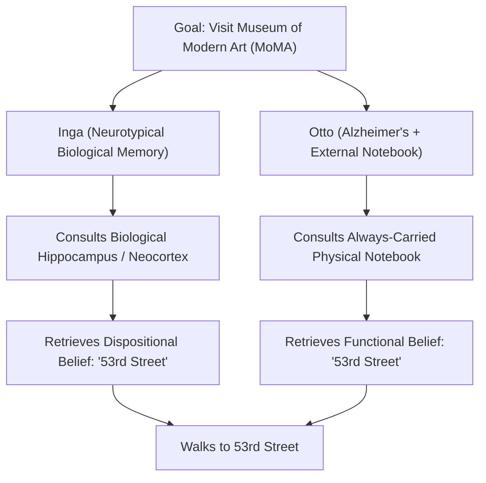
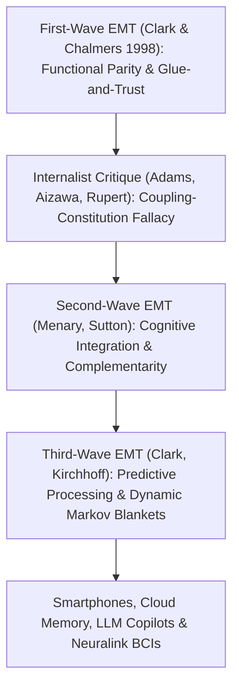

## Introducción: «¿Dónde termina la mente y dónde empieza el resto del mundo?»

En 1998, los filósofos <strong>Andy Clark</strong> y <strong>David J. Chalmers</strong> publicaron en la revista *Analysis* un artículo de apenas siete páginas titulado <strong>*«The Extended Mind»</strong>* (*La mente extendida*), que sacudió los cimientos de la filosofía de la mente y la ciencia cognitiva contemporáneas. Su texto comenzaba con una pregunta tan directa como revolucionaria: <strong>«¿Dónde termina la mente y dónde empieza el resto del mundo?»</strong>

Durante casi cuatro siglos desde René Descartes —tanto para los dualistas como para los materialistas reduccionistas modernos—, casi todos daban por sentado el <strong>internismo craneal</strong>: la frontera de la mente y la cognición coincide exactamente con el límite biológico de <strong>la piel y el cráneo (*skin and skull*)</strong>. El ábaco, el lápiz y el papel, los cuadernos de notas, los teléfonos inteligentes o los grandes modelos de lenguaje (LLM) actuales serían meras *herramientas* externas o dispositivos de entrada y salida, nunca partes literales de la mente misma.

Clark y Chalmers rompieron este dogma al proponer el <strong>externismo activo (*Active Externalism*)</strong> y la <strong>tesis de la mente extendida (*Extended Mind Thesis*, EMT)</strong>: cuando un artefacto físico externo se acopla a un organismo humano en un bucle causal suficientemente fiable, recíproco y funcionalmente integrado, ese artefacto deja de ser una simple herramienta y se convierte en una <strong>parte constitutiva de la arquitectura cognitiva del agente, e incluso de sus creencias disposicionales</strong>.

---

## 1. Acciones epistémicas y el principio de paridad: El experimento mental de Otto e Inga

Para demostrar que los procesos cognitivos traspasan el cráneo, Clark y Chalmers se apoyaron primero en el estudio empírico de David Kirsh y Paul Maglio (1994) sobre jugadores expertos de *Tetris*. Los modelos clásicos suponían que el jugador realiza primero una «rotación mental» de la pieza en su corteza visual (lo que tarda unos $800	ext{–}1000\,	ext{ms}$) antes de moverla. Sin embargo, Kirsh y Maglio descubrieron que los expertos pulsan directamente el botón para <strong>rotar físicamente la pieza en la pantalla</strong> (en apenas $100	ext{–}200\,	ext{ms}$) para comprobar visualmente cómo encaja. Estas acciones físicas sobre el mundo exterior destinadas a descargar o acelerar el cómputo interno del cerebro se denominan <strong>acciones epistémicas (*Epistemic Actions*)</strong> (igual que reordenar físicamente las fichas de madera en el *Scrabble*).

Sobre esta base, Clark y Chalmers formularon su célebre <strong>principio de paridad (*Parity Principle*)</strong>:
> <strong>«Si, al enfrentarnos a una tarea, una parte del mundo funciona como un proceso que, de realizarse dentro de la cabeza, no dudaríamos en reconocer como parte del proceso cognitivo, entonces esa parte del mundo es parte del proceso cognitivo».</strong>

Para demostrar que no solo el cálculo, sino estados mentales genuinos como las <strong>creencias (*beliefs*) y los recuerdos</strong> pueden residir fuera del cráneo, diseñaron el famoso experimento mental de <strong>Inga y Otto</strong>:
- <strong>Inga</strong> posee una memoria biológica normal. Al enterarse de una exposición en el Museo de Arte Moderno (MoMA), reflexiona un momento, recupera de su memoria biológica (hipocampo y neocorteza) que el MoMA está en la calle 53 y camina hacia allí. Es evidente que, antes incluso de recordarlo conscientemente, Inga ya tenía la <strong>creencia disposicional</strong> de que el MoMA está en la calle 53.
- <strong>Otto</strong> padece un principio de Alzheimer. Para desenvolverse en su vida diaria, lleva consigo a todas partes un <strong>cuaderno de notas</strong> físico: apunta cada dato nuevo y lo consulta cuando lo necesita. Al oír hablar de la exposición, Otto abre su cuaderno, lee la anotación «El MoMA está en la calle 53» que escribió tiempo atrás y se dirige a la calle 53.

Clark y Chalmers argumentan que el cuaderno de Otto desempeña <strong>exactamente el mismo papel funcional y explicativo</strong> en la conducta de Otto que la memoria biológica en la de Inga. Negar que la creencia de Otto resida en su cuaderno solo porque el papel está fuera del cráneo es puro «biocauvinismo» injustificado.

$$
\text{Parity Principle:} \quad \text{If } \Phi_{\text{world}}(S, E) \cong_{\text{func}} \Phi_{\text{brain}}(S_{\text{internal}}) \implies E \subset \text{Cognitive System}(S)
$$

$$
I(M_{\text{bio}}; A) \approx I(M_{\text{notebook}}; A), \qquad \tau_{\text{access}}(E) \le \tau_{\text{crit}}, \qquad \mathbb{P}(\text{Endorse}(E)) \to 1
$$

---

## 2. Los cuatro criterios de «pegamento y confianza» contra la inflación cognitiva y las críticas internistas

Si el cuaderno de Otto es parte de su mente, ¿significa eso que toda Wikipedia o la Biblioteca del Congreso son parte de nuestra mente ahora mismo? Para evitar esta objeción de la <strong>inflación cognitiva (*Cognitive Bloat*)</strong>, Clark y Chalmers establecieron cuatro estrictos <strong>criterios de «pegamento y confianza» (*Glue and Trust*)</strong>:
1. <strong>Disponibilidad constante (*Constant Availability*)</strong>: Otto lleva su cuaderno siempre encima y lo invoca de forma rutinaria.
2. <strong>Accesibilidad directa y sencilla (*Easy Accessibility*)</strong>: la información puede recuperarse de inmediato sin obstáculos.
3. <strong>Respaldo automático (*Automatic Endorsement*)</strong>: al leer una nota, Otto la da automáticamente por verdadera, igual que confiamos en nuestro recuerdo biológico.
4. <strong>Respaldo consciente pasado (*Past Conscious Endorsement*)</strong>: la información fue conscientemente aceptada y anotada por Otto en el pasado.

Aun así, los filósofos internistas lanzaron duras críticas:
- <strong>Fred Adams y Kenneth Aizawa (2008): la «falacia de acoplamiento-constitución (*Coupling-Constitution Fallacy*)» y la «marca de lo cognitivo (*Mark of the Cognitive*)»</strong>: que un objeto esté causalmente acoplado a un sistema no implica que forme parte ontológica de él. Además, sostienen que la auténtica cognición requiere representaciones con <strong>intencionalidad intrínseca no derivada</strong> y sujeción a las leyes neuropsicológicas de la memoria biológica (efectos de interferencia y generación), mientras que la tinta en el cuaderno solo posee intencionalidad derivada por convención social.
- <strong>La «hipótesis de la cognición embebida (*HEC*)» de Robert Rupert (2004) y la «mente andamiada (*Scaffolded Mind*)» de Kim Sterelny (2010)</strong>: proponen mantener la mente dentro del organismo reconociendo su profunda dependencia de andamiajes ambientales externos (*scaffolds*).

---

## 3. Segunda y tercera ola de la EMT: Complementariedad, procesamiento predictivo y derecho constitucional

En respuesta a estos debates, la teoría de la mente extendida evolucionó hacia una segunda y tercera ola:
- <strong>Segunda ola (Menary, Sutton: Integración cognitiva y complementariedad)</strong>: en lugar de insistir en la *similitud* (paridad) entre cerebro y cuaderno, subraya su <strong>complementariedad</strong>. El cerebro biológico (*engramas*) sobresale en el reconocimiento asociativo rápido, pero es pésimo almacenando largas cadenas exactas de símbolos; los soportes externos (*exogramas*) hacen justo lo contrario. Su integración híbrida es lo que hace posible la matemática y la ciencia modernas.
- <strong>Tercera ola (Clark 2016, Kirchhoff: Procesamiento predictivo y mantos de Markov dinámicos)</strong>: unida al <strong>principio de energía libre (*Free Energy Principle*) y la inferencia activa</strong> de Karl Friston, concibe el cerebro como un motor bayesiano que minimiza el error de predicción $\mathcal{F}$. La frontera estadística del yo cognitivo (el <strong>manto de Markov / *Markov Blanket*</strong>) es plástica y se expande dinámicamente para abarcar nuestras prótesis cognitivas externas.

En el siglo XXI, la tesis de la mente extendida ha llegado incluso al derecho constitucional:
En la histórica sentencia <strong>*Riley v. California* (2014)</strong>, el Tribunal Supremo de Estados Unidos dictaminó por unanimidad (9-0) que la policía <strong>no puede registrar el contenido digital del teléfono inteligente</strong> de un detenido sin una orden judicial. El presidente del Tribunal, John Roberts, escribió: *«Los teléfonos móviles modernos son hoy una parte tan omnipresente e insistente de la vida diaria que el proverbial visitante de Marte podría concluir que son un rasgo importante de la anatomía humana»*. En la era de los smartphones, los segundos cerebros en la nube, los copilotos de IA (LLM) y las interfaces cerebro-computadora (Neuralink), borrar o manipular maliciosamente la memoria digital externa de una persona ya no es un simple daño a la propiedad, sino una <strong>agresión directa contra la integridad cognitiva de la persona</strong>.

| Paradigma / Corriente | Frontera de la mente | Criterio central / Mecanismo | Estatus del cuaderno de Otto / Smartphone | Consecuencia jurídica y ética |
| :--- | :--- | :--- | :--- | :--- |
| <strong>Internismo craneal (Adams & Aizawa)</strong> | Estrictamente dentro de la piel y el cráneo | Marca de lo cognitivo (intencionalidad intrínseca) | Mera herramienta causal externa (acoplamiento $
eq$ constitución) | Destrucción = simple daño a la propiedad |
| <strong>Cognición embebida / HEC (Rupert / Sterelny)</strong> | En el organismo, pero apoyada en el nicho | Parsimonia psicológica y andamiaje ambiental | Andamio epistémico externo de alto ancho de banda | Protección del entorno cognitivo |
| <strong>1.ª ola Mente extendida (Clark & Chalmers 1998)</strong> | Se extiende a artefactos acoplados fiablemente | <strong>Principio de paridad</strong> + 4 criterios «Glue & Trust» | <strong>Parte constitutiva</strong> de las creencias de Otto | Registro sin orden = violación de la intimidad mental |
| <strong>2.ª/3.ª ola Mente extendida (Sutton / Clark 2016)</strong> | Manto de Markov plástico (cerebro-cuerpo-nicho) | <strong>Complementariedad</strong> + Inferencia activa (energía libre) | Sistema híbrido de engramas y exogramas | Base de los neuroderechos y *Riley v. California* |

$$
\mathcal{F}(q, s, a) = \mathbb{E}_{q(\vartheta)}\big[ \ln q(\vartheta) - \ln p(s, \vartheta \mid a) \big] = D_{\text{KL}}\big( q(\vartheta) \,\|\, p(\vartheta \mid s, a) \big) - \ln p(s \mid a)
$$
