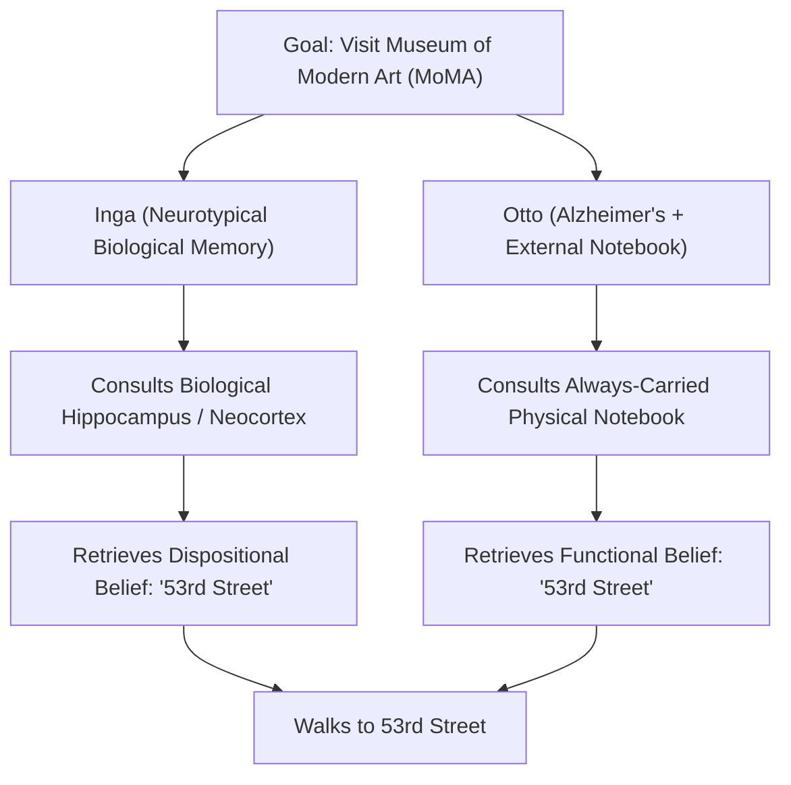
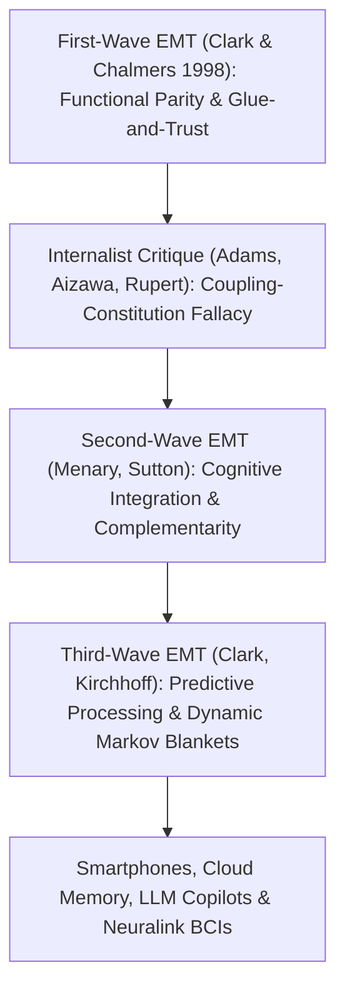

## Introduction : « Où s'arrête l'esprit et où commence le reste du monde ? »

En 1998, les philosophes <strong>Andy Clark</strong> et <strong>David J. Chalmers</strong> publièrent dans la revue *Analysis* un article de sept pages intitulé <strong>*« The Extended Mind »</strong>* (*L'Esprit étendu*), qui bouleversa la philosophie de l'esprit et les sciences cognitives contemporaines. Leur texte s'ouvrait sur une question aussi limpide que radicale : <strong>« Où s'arrête l'esprit et où commence le reste du monde ? »</strong>

Pendant près de quatre siècles après René Descartes, qu'on fût dualiste ou matérialiste réductionniste, tout le monde ou presque tenait pour évident l'<strong>internalisme crânien</strong> : les frontières de l'esprit et de la cognition coïncident strictement avec les limites biologiques de <strong>la peau et du crâne (*skin and skull*)</strong>. Le boulier, le papier et le crayon, le carnet de notes, le smartphone ou les grands modèles de langage (LLM) ne seraient que des *outils* externes ou des périphériques d'entrée-sortie, jamais des parties littérales de l'esprit lui-même.

Clark et Chalmers ont brisé ce dogme en proposant l'<strong>externalisme actif (*Active Externalism*)</strong> et la <strong>thèse de l'esprit étendu (*Extended Mind Thesis*, EMT)</strong> : lorsqu'un artefact physique externe est couplé à un organisme humain dans une boucle causale suffisamment fiable, réciproque et fonctionnellement intégrée, cet artefact cesse d'être un simple outil pour devenir une <strong>partie constitutive de l'architecture cognitive de l'agent, et même de ses croyances dispositionnelles</strong> !

---

## 1. Actions épistémiques et principe de parité : L'expérience de pensée d'Otto et Inga

Pour montrer que les processus cognitifs franchissent la boîte crânienne, Clark et Chalmers s'appuyèrent d'abord sur l'étude empirique de David Kirsh et Paul Maglio (1994) portant sur les joueurs experts de *Tetris*. Les modèles classiques supposaient que le joueur effectue d'abord une « rotation mentale » de la pièce dans son cortex visuel (ce qui prend environ $800	ext{–}1000\,	ext{ms}$) avant d'agir. Or Kirsh et Maglio découvrirent que les experts appuient directement sur le bouton pour <strong>faire pivoter physiquement la pièce sur l'écran</strong> (en seulement $100	ext{–}200\,	ext{ms}$) afin d'évaluer visuellement son ajustement ! Ces actions physiques sur le monde extérieur visant à alléger ou accélérer le calcul interne du cerveau sont appelées <strong>actions épistémiques (*Epistemic Actions*)</strong> (tout comme le fait de mélanger physiquement ses chevalets au *Scrabble*).

Sur cette base, Clark et Chalmers formulèrent leur célèbre <strong>principe de parité (*Parity Principle*)</strong> :
> <strong>« Si, lorsque nous sommes confrontés à une tâche, une partie du monde fonctionne comme un processus que nous n'hésiterions pas à reconnaître comme faisant partie du processus cognitif s'il se déroulait dans la tête, alors cette partie du monde fait partie du processus cognitif. »</strong>

Pour prouver que non seulement le calcul, mais aussi de véritables états mentaux comme les <strong>croyances (*beliefs*) et la mémoire</strong> peuvent résider hors du crâne, ils imaginèrent la célèbre expérience de pensée d'<strong>Inga et Otto</strong> :
- <strong>Inga</strong> jouit d'une mémoire biologique normale. Apprenant qu'une exposition se tient au Museum of Modern Art (MoMA), elle réfléchit un instant, extrait de sa mémoire biologique (hippocampe et néocortex) que le MoMA se trouve sur la 53e Rue, et s'y rend. Avant même ce rappel conscient, Inga possédait déjà la <strong>croyance dispositionnelle</strong> que le MoMA est sur la 53e Rue.
- <strong>Otto</strong> souffre d'une forme légère de la maladie d'Alzheimer. Pour pallier ce trouble, il transporte partout avec lui un <strong>carnet de notes</strong> physique : il y inscrit toute nouvelle information et le consulte dès qu'il en a besoin. Apprenant l'existence de l'exposition, Otto ouvre son carnet, lit la mention « Le MoMA est sur la 53e Rue » qu'il y avait notée, et marche vers la 53e Rue.

Clark et Chalmers soulignent que le carnet d'Otto joue <strong>exactement le même rôle fonctionnel et explicatif</strong> chez Otto que la mémoire biologique chez Inga ! Refuser d'admettre que la croyance d'Otto réside dans son carnet sous prétexte que le papier se trouve hors du crâne relève d'un « bio-chauvinisme » arbitraire.

$$
\text{Parity Principle:} \quad \text{If } \Phi_{\text{world}}(S, E) \cong_{\text{func}} \Phi_{\text{brain}}(S_{\text{internal}}) \implies E \subset \text{Cognitive System}(S)
$$

$$
I(M_{\text{bio}}; A) \approx I(M_{\text{notebook}}; A), \qquad \tau_{\text{access}}(E) \le \tau_{\text{crit}}, \qquad \mathbb{P}(\text{Endorse}(E)) \to 1
$$

---

## 2. Les quatre critères « Glue and Trust » contre l'inflation cognitive et les objections internalistes

Si le carnet d'Otto fait partie de son esprit, faut-il en conclure que Wikipédia tout entier ou la Bibliothèque nationale font partie de notre esprit ? Pour parer à cette objection de l'<strong>inflation cognitive (*Cognitive Bloat*)</strong>, Clark et Chalmers ont posé quatre <strong>critères « Glue and Trust » (Colle et Confiance)</strong> stricts :
1. <strong>Disponibilité constante (*Constant Availability*)</strong> : Otto porte son carnet sur lui en permanence et l'utilise systématiquement.
2. <strong>Accessibilité directe et aisée (*Easy Accessibility*)</strong> : l'information est immédiatement consultable sans obstacle majeur.
3. <strong>Adhésion automatique (*Automatic Endorsement*)</strong> : dès qu'il lit une note, Otto la tient automatiquement pour vraie, comme un souvenir biologique.
4. <strong>Adhésion consciente passée (*Past Conscious Endorsement*)</strong> : l'information a été consciemment validée et inscrite par Otto dans le passé.

Malgré ces garde-fous, les philosophes internalistes ont formulé de redoutables objections :
- <strong>Fred Adams et Kenneth Aizawa (2008) : le « sophisme couplage-constitution (*Coupling-Constitution Fallacy*) » et la « marque du cognitif (*Mark of the Cognitive*) »</strong> : le simple couplage causal d'un objet avec un système n'implique nullement qu'il en fasse ontologiquement partie. En outre, la vraie cognition exigerait des représentations dotées d'une <strong>intentionnalité intrinsèque non dérivée</strong> et obéissant aux lois neuropsychologiques de la mémoire biologique (effets d'interférence, d'amorçage), alors que l'encre sur le papier n'a qu'une intentionnalité dérivée par convention sociale.
- <strong>L'« hypothèse de la cognition située/enchâssée (*HEC*) » de Robert Rupert (2004) et l'« esprit échafaudé (*Scaffolded Mind*) » de Kim Sterelny (2010)</strong> : ils préfèrent considérer que l'esprit reste à l'intérieur de l'organisme tout en s'appuyant massivement sur des échafaudages environnementaux (*scaffolds*).

---

## 3. Deuxième et troisième vagues de l'EMT : Complémentarité, cerveau prédictif et droit constitutionnel

En réponse à ces critiques, la théorie de l'esprit étendu a évolué à travers deux nouvelles vagues :
- <strong>Deuxième vague (Menary, Sutton : Intégration cognitive et complémentarité)</strong> : au lieu d'insister sur la *ressemblance* (parité) entre le cerveau et le carnet, elle met l'accent sur leur <strong>complémentarité</strong> ! Le cerveau biologique (*engrammes*) excelle dans la reconnaissance associative rapide, mais peine à conserver intactes de longues chaînes de symboles ; les supports externes (*exogrammes*) font exactement l'inverse. C'est leur hybridation qui rend possibles les mathématiques et les sciences modernes.
- <strong>Troisième vague (Clark 2016, Kirchhoff : Traitement prédictif et couvertures de Markov dynamiques)</strong> : articulée au <strong>principe de l'énergie libre (*Free Energy Principle*) et à l'inférence active</strong> de Karl Friston, elle décrit le cerveau comme une machine bayésienne minimisant l'erreur de prédiction $\mathcal{F}$. La frontière statistique du soi cognitif (la <strong>couverture de Markov / *Markov Blanket*</strong>) est plastique et englobe dynamiquement nos prothèses cognitives externes.

Au XXIe siècle, la thèse de l'esprit étendu est entrée dans le droit constitutionnel :
Dans l'arrêt historique <strong>*Riley v. California* (2014)</strong>, la Cour suprême des États-Unis a jugé à l'unanimité (9-0) que la police <strong>ne peut pas fouiller le contenu numérique du smartphone</strong> d'une personne arrêtée sans mandat judiciaire. Le juge en chef John Roberts a écrit ces mots célèbres : *« Les téléphones portables modernes sont devenus une composante si omniprésente et insistante de la vie quotidienne que le proverbial visiteur venu de Mars pourrait conclure qu'ils constituent un élément important de l'anatomie humaine ! »* À l'heure des smartphones, des seconds cerveaux dans le cloud, des copilotes IA (LLM) et des interfaces cerveau-machine (Neuralink), pirater ou effacer la mémoire numérique externe d'un individu n'est plus une simple atteinte aux biens, mais une <strong>agression directe contre l'intégrité cognitive de la personne</strong>.

| Paradigme / Courant | Frontière de l'esprit | Critère central / Mécanisme | Statut du carnet d'Otto / Smartphone | Conséquence juridique et éthique |
| :--- | :--- | :--- | :--- | :--- |
| <strong>Internalisme crânien (Adams & Aizawa)</strong> | Strictement à l'intérieur de la peau et du crâne | Marque du cognitif (intentionnalité intrinsèque) | Simple outil causal externe (couplage $
eq$ constitution) | Destruction = simple dommage matériel |
| <strong>Cognition enchâssée / HEC (Rupert / Sterelny)</strong> | Dans l'organisme, mais soutenue par la niche | Parcimonie psychologique & échafaudage | Échafaudage épistémique externe à haut débit | Protection de l'environnement cognitif |
| <strong>1re vague Esprit étendu (Clark & Chalmers 1998)</strong> | S'étend aux artefacts couplés de façon fiable | <strong>Principe de parité</strong> + 4 critères « Glue & Trust » | <strong>Partie constitutive</strong> des croyances d'Otto | Fouille sans mandat = violation de l'intimité mentale |
| <strong>2e/3e vagues Esprit étendu (Sutton / Clark 2016)</strong> | Couverture de Markov plastique (cerveau-corps-niche) | <strong>Complémentarité</strong> + Inférence active (énergie libre) | Système hybride d'engrammes et d'exogrammes | Fondement des neuro-droits et de *Riley v. California* |

$$
\mathcal{F}(q, s, a) = \mathbb{E}_{q(\vartheta)}\big[ \ln q(\vartheta) - \ln p(s, \vartheta \mid a) \big] = D_{\text{KL}}\big( q(\vartheta) \,\|\, p(\vartheta \mid s, a) \big) - \ln p(s \mid a)
$$
