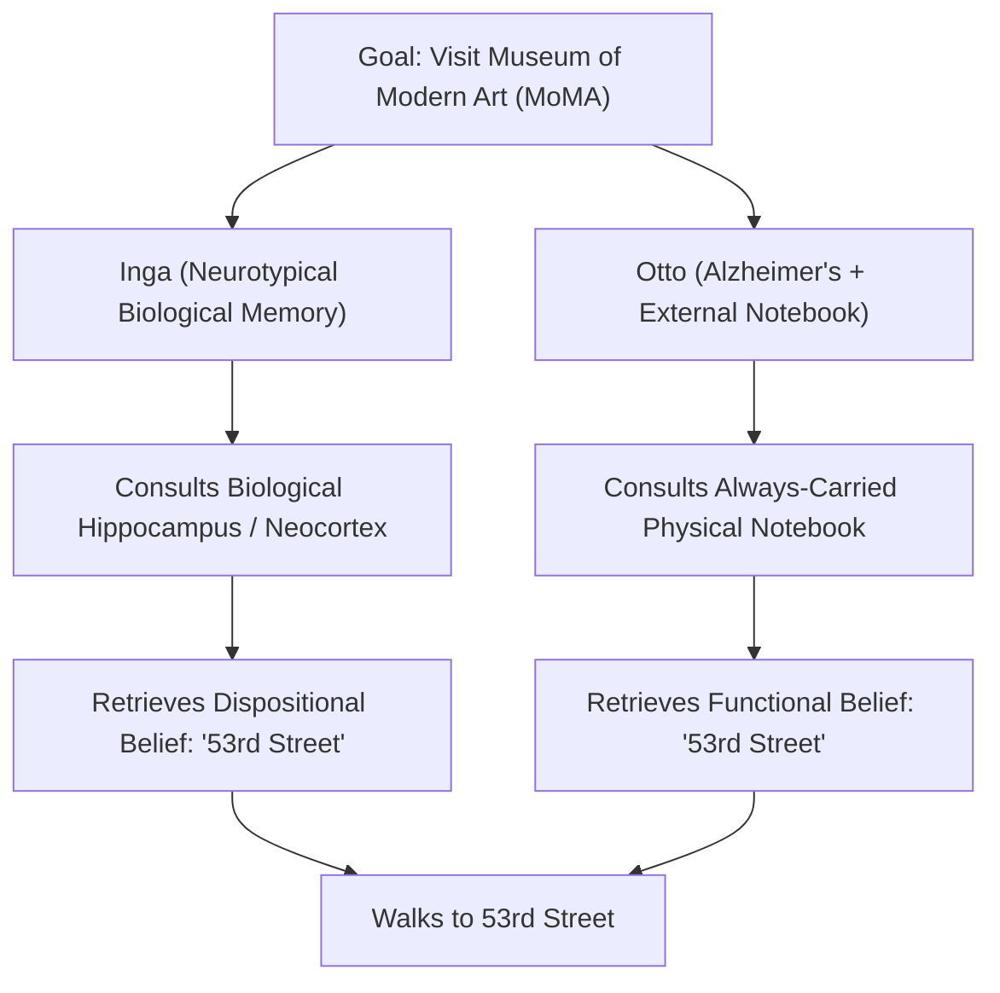
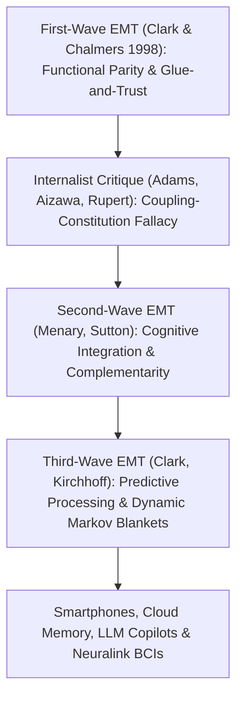

## प्रस्तावना: “मन कहाँ रुकता है और बाकी दुनिया कहाँ से शुरू होती है?”

1998 में दार्शनिक <strong>एंडी क्लार्क (Andy Clark)</strong> और <strong>डेविड चामर्स (David J. Chalmers)</strong> ने शोध पत्रिका *Analysis* में मात्र सात पृष्ठों का एक शोधपत्र <strong>*“The Extended Mind”</strong>* (*विस्तारित मन*) प्रकाशित किया, जिसने आधुनिक मन के दर्शन और संज्ञानात्मक विज्ञान (cognitive science) की नींव हिला दी। उन्होंने अपने लेख की शुरुआत एक अत्यंत क्रांतिकारी प्रश्न से की: <strong>“मन कहाँ रुकता है और बाकी दुनिया कहाँ से शुरू होती है?”</strong>

रेने देकार्त के बाद लगभग चार शताब्दियों तक — चाहे कोई द्वैतवादी रहा हो या आधुनिक भौतिकवादी — लगभग सभी विचारकों ने <strong>कपालीय आंतरिकतावाद (Cranial Internalism)</strong> को स्वयंसिद्ध माना: मन और संज्ञान की सीमा जैविक रूप से <strong>त्वचा और खोपड़ी (Skin and Skull)</strong> की सीमा के भीतर ही बंद है। अबेकस, कागज-कलम, नोटबुक, स्मार्टफोन या आज के बड़े भाषा मॉडल (LLMs) अधिक से अधिक मन द्वारा बाहर उपयोग किए जाने वाले ‘उपकरण’ या इनपुट-आउटपुट साधन मात्र हैं, वे कभी भी स्वयं मन का वास्तविक हिस्सा नहीं हो सकते।

क्लार्क और चामर्स ने इस रूढ़ि को तोड़ते हुए <strong>सक्रिय बाह्यतावाद (Active Externalism)</strong> और <strong>विस्तारित मन सिद्धांत (Extended Mind Thesis, EMT)</strong> प्रस्तुत किया: जब कोई बाहरी भौतिक वस्तु मानव जीव के साथ पर्याप्त रूप से विश्वसनीय, पारस्परिक और कार्यात्मक रूप से एकीकृत कारण-कार्य लूप में जुड़ जाती है, तो वह वस्तु केवल एक उपकरण नहीं रह जाती, बल्कि <strong>कर्ता की संज्ञानात्मक संरचना और यहाँ तक कि उसके स्वभावगत विश्वासों (dispositional beliefs) व स्मृति का एक वास्तविक संघटक (constitutive) हिस्सा बन जाती है</strong>!

---

## 1. ज्ञानमीमांसीय क्रियाएँ और समता सिद्धांत (Parity Principle): ओटो और इंगा का विचार प्रयोग

यह दिखाने के लिए कि संज्ञानात्मक प्रक्रियाएँ खोपड़ी की सीमा पार कर सकती हैं, क्लार्क और चामर्स ने सबसे पहले डेविड किर्श और पॉल मैग्लियो (1994) द्वारा वीडियो गेम *टेट्रिस (Tetris)* के विशेषज्ञ खिलाड़ियों पर किए गए प्रायोगिक अध्ययन का हवाला दिया। पारंपरिक संज्ञानात्मक मॉडल मानते थे कि खिलाड़ी गिरते हुए ब्लॉक को पहले अपने मस्तिष्क (विजुअल कॉर्टेक्स) में ‘मानसिक रूप से घुमाता’ है (जिसमें लगभग $800	ext{–}1000\,	ext{ms}$ लगते हैं) और फिर बटन दबाता है। किंतु किर्श और मैग्लियो ने पाया कि विशेषज्ञ खिलाड़ी दिमाग में घुमाने के बजाय सीधे कंट्रोलर का बटन दबाकर <strong>स्क्रीन पर ब्लॉक को भौतिक रूप से घुमाते हैं</strong> (जिसमें मात्र $100	ext{–}200\,	ext{ms}$ लगते हैं) ताकि आंखों से तुरंत देख सकें कि वह कहाँ फिट होगा! मस्तिष्क की आंतरिक गणना को सरल या तेज़ करने के लिए बाहरी दुनिया में किए गए ऐसे भौतिक कार्यों को <strong>ज्ञानमीमांसीय क्रियाएँ (Epistemic Actions)</strong> कहा जाता है (जैसे *स्क्रैबल* खेल में लकड़ी के अक्षरों को हाथ से इधर-उधर करके शब्द खोजना)।

इसी आधार पर क्लार्क और चामर्स ने अपना प्रसिद्ध <strong>समता सिद्धांत (Parity Principle)</strong> प्रतिपादित किया:
> <strong>“यदि किसी कार्य का सामना करते समय बाहरी दुनिया का कोई हिस्सा ऐसी प्रक्रिया के रूप में कार्य करता है जिसे — यदि वह सिर के भीतर हो रही होती — हम बिना किसी हिचकिचाहट के संज्ञानात्मक प्रक्रिया का हिस्सा मान लेते, तो बाहरी दुनिया का वह हिस्सा वास्तव में संज्ञानात्मक प्रक्रिया का हिस्सा है।”</strong>

यह सिद्ध करने के लिए कि केवल गणना ही नहीं, बल्कि <strong>विश्वास (Beliefs) और स्मृति</strong> जैसी मूल मानसिक अवस्थाएँ भी खोपड़ी के बाहर निवास कर सकती हैं, उन्होंने <strong>इंगा (Inga) और ओटो (Otto)</strong> का प्रसिद्ध विचार प्रयोग प्रस्तुत किया:
- <strong>इंगा</strong> एक सामान्य जैविक स्मृति वाली महिला है। वह सुनती है कि म्यूजियम ऑफ मॉडर्न आर्ट (MoMA) में एक प्रदर्शनी लगी है। वह एक पल सोचती है, अपनी जैविक स्मृति (हिप्पोकैम्पस और नियोकोर्टेक्स) से याद करती है कि MoMA 53वीं स्ट्रीट पर है, और वहाँ पैदल चली जाती है। स्पष्ट है कि सचेत रूप से याद करने से *पहले* भी इंगा के पास यह <strong>स्वभावगत विश्वास (Dispositional Belief)</strong> मौजूद था कि MoMA 53वीं स्ट्रीट पर है।
- <strong>ओटो</strong> अल्जाइमर रोग के शुरुआती चरण से पीड़ित है। अपने दैनिक जीवन को चलाने के लिए वह हमेशा अपने साथ एक भौतिक <strong>नोटबुक (डायरी)</strong> रखता है: कोई भी नई जानकारी मिलने पर वह उसे नोटबुक में लिख लेता है और आवश्यकता पड़ने पर उसे खोलकर देख लेता है। प्रदर्शनी के बारे में सुनकर ओटो अपनी नोटबुक निकालता है, उसमें पहले लिखा हुआ वाक्य “MoMA 53वीं स्ट्रीट पर है” पढ़ता है, और 53वीं स्ट्रीट की ओर चल पड़ता है।

क्लार्क और चामर्स तर्क देते हैं कि ओटो के व्यवहार की व्याख्या में ओटो की नोटबुक <strong>बिल्कुल वही कार्यात्मक भूमिका</strong> निभाती है जो इंगा के व्यवहार में उसकी जैविक स्मृति निभाती है! केवल इसलिए कि कागज खोपड़ी के बाहर है, यह नकारना कि ओटो का विश्वास उसकी नोटबुक में संचित है, निराधार ‘जैविक अंधराष्ट्रवाद (Bio-chauvinism)’ है।

$$
\text{Parity Principle:} \quad \text{If } \Phi_{\text{world}}(S, E) \cong_{\text{func}} \Phi_{\text{brain}}(S_{\text{internal}}) \implies E \subset \text{Cognitive System}(S)
$$

$$
I(M_{\text{bio}}; A) \approx I(M_{\text{notebook}}; A), \qquad \tau_{\text{access}}(E) \le \tau_{\text{crit}}, \qquad \mathbb{P}(\text{Endorse}(E)) \to 1
$$

---

## 2. ‘संज्ञानात्मक फैलाव’ रोकने के चार ‘गोंद और विश्वास’ मानदंड तथा आंतरिकतावादी आलोचना

यदि ओटो की नोटबुक उसके मन का हिस्सा है, तो क्या पूरा विकिपीडिया या पूरी लाइब्रेरी भी अभी हमारे मन का हिस्सा है? इस <strong>संज्ञानात्मक फैलाव आपत्ति (Cognitive Bloat Objection)</strong> से बचने के लिए क्लार्क और चामर्स ने चार कठोर <strong>‘गोंद और विश्वास’ (Glue and Trust) मानदंड</strong> निर्धारित किए:
1. <strong>निरंतर उपलब्धता (Constant Availability)</strong>: ओटो अपनी नोटबुक हर जगह साथ रखता है और नियमित रूप से उसका उपयोग करता है।
2. <strong>प्रत्यक्ष और सुगम पहुँच (Easy Accessibility)</strong>: बिना किसी बड़ी बाधा के जानकारी तुरंत पढ़ी जा सकती है।
3. <strong>स्वतः अनुमोदन (Automatic Endorsement)</strong>: नोटबुक से पढ़ते ही ओटो उस जानकारी को अपनी जैविक स्मृति की तरह स्वतः सत्य मान लेता है।
4. <strong>अतीत का सचेत अनुमोदन (Past Conscious Endorsement)</strong>: वह जानकारी अतीत में स्वयं ओटो द्वारा सचेत रूप से परख कर लिखी गई थी।

फिर भी आंतरिकतावादी दार्शनिकों ने तीखे प्रहार किए:
- <strong>फ्रेड एडम्स और केनेथ आइज़ावा (2008): ‘युग्मन-गठन तर्कदोष (Coupling-Constitution Fallacy)’ और ‘संज्ञानात्मक का चिह्न (Mark of the Cognitive)’</strong>: किसी वस्तु का प्रणाली के साथ कारण-कार्य रूप से जुड़ना (coupling) उसे प्रणाली का अस्तित्वगत हिस्सा (constitution) नहीं बना देता। इसके अलावा, वास्तविक संज्ञान के लिए <strong>मौलिक, गैर-व्युत्पन्न अभिप्रायता (Intrinsic Non-Derived Intentionality)</strong> और जैविक स्मृति के मनोवैज्ञानिक नियमों (जैसे व्यतिकरण प्रभाव) का पालन आवश्यक है, जबकि नोटबुक की स्याही में केवल सामाजिक परंपरा से व्युत्पन्न अर्थ होता है।
- <strong>रॉबर्ट रूपर्ट (2004) की ‘अंतःस्थापित संज्ञान परिकल्पना (HEC)’ और किम स्टेरेलनी (2010) का ‘मचानयुक्त मन (Scaffolded Mind)’</strong>: वे मानते हैं कि मन जीव के भीतर ही रहता है, किंतु बाहरी पर्यावरणीय मचानों (*scaffolds*) पर गहराई से निर्भर करता है।

---

## 3. EMT की दूसरी और तीसरी लहर: पूरकता, प्रेडिक्टिव प्रोसेसिंग और संवैधानिक कानून

इन आलोचनाओं के उत्तर में विस्तारित मन सिद्धांत दूसरी और तीसरी लहर के रूप में विकसित हुआ:
- <strong>दूसरी लहर (मेनरी, सटन: संज्ञानात्मक एकीकरण और पूरकता / Complementarity)</strong>: मस्तिष्क और नोटबुक की *समानता* (समता) के बजाय उनकी <strong>पूरकता (भिन्नता)</strong> पर बल दिया गया! जैविक मस्तिष्क (*एनग्राम*) तीव्र साहचर्य पैटर्न पहचानने में निपुण है किंतु लंबे प्रतीक अनुक्रमों को हूबहू सहेजने में कमजोर है; बाहरी माध्यम (*एक्सोग्राम*) ठीक इसके विपरीत कार्य करते हैं। दोनों के संकर एकीकरण से ही आधुनिक गणित और विज्ञान संभव हुआ।
- <strong>तीसरी लहर (क्लार्क 2016, किर्चहॉफ: प्रेडिक्टिव प्रोसेसिंग और गतिशील मार्कोव ब्लैंकेट)</strong>: कार्ल फ्रिस्टन के <strong>मुक्त ऊर्जा सिद्धांत (Free Energy Principle) और सक्रिय अनुमान (Active Inference)</strong> के साथ जुड़कर मस्तिष्क को भविष्यवाणी त्रुटि $\mathcal{F}$ को न्यूनतम करने वाले बेयसियन इंजन के रूप में देखा जाता है। संज्ञानात्मक स्व की सांख्यिकीय सीमा (<strong>मार्कोव ब्लैंकेट / Markov Blanket</strong>) लचीली होती है और बाहरी उपकरणों को अपने भीतर समेट लेती है।

21वीं सदी में विस्तारित मन का सिद्धांत संवैधानिक कानून का हिस्सा बन चुका है:
ऐतिहासिक मुकदमे <strong>*राइली बनाम कैलिफोर्निया (Riley v. California, 2014)</strong>* में अमेरिकी सुप्रीम कोर्ट ने सर्वसम्मति (9–0) से फैसला सुनाया कि पुलिस गिरफ्तार व्यक्ति के <strong>स्मार्टफोन के डिजिटल डेटा की तलाशी बिना न्यायिक वारंट के नहीं ले सकती</strong>। मुख्य न्यायाधीश जॉन रॉबर्ट्स ने लिखा: *“आधुनिक सेल फोन आज दैनिक जीवन का इतना सर्वव्यापी और अभिन्न हिस्सा बन चुके हैं कि मंगल ग्रह से आने वाला कोई आगंतुक यह निष्कर्ष निकाल सकता है कि वे मानव शरीर रचना (Human Anatomy) का एक महत्वपूर्ण अंग हैं!”* स्मार्टफोन, क्लाउड सेकंड ब्रेन, AI कोपायलट (LLMs) और न्यूरालिंक (Neuralink) ब्रेन-कंप्यूटर इंटरफेस के युग में किसी व्यक्ति की बाहरी डिजिटल स्मृति को हैक करना या मिटाना केवल संपत्ति की क्षति नहीं, बल्कि <strong>व्यक्ति की विस्तारित संज्ञानात्मक अखंडता पर सीधा शारीरिक/मानसिक हमला</strong> है।

| प्रतिमान / विचारधारा | मन और संज्ञान की सीमा | मुख्य कसौटी / तंत्र | ओटो की नोटबुक / स्मार्टफोन की स्थिति | कानूनी और नैतिक निहितार्थ |
| :--- | :--- | :--- | :--- | :--- |
| <strong>कपालीय आंतरिकतावाद (Adams & Aizawa)</strong> | त्वचा और खोपड़ी के भीतर सीमित | संज्ञानात्मक का चिह्न (मौलिक अभिप्रायता) | बाहरी कारण उपकरण (युग्मन $
eq$ गठन) | उपकरण नष्ट होना = सामान्य संपत्ति क्षति |
| <strong>अंतःस्थापित संज्ञान / HEC (Rupert / Sterelny)</strong> | जीव के भीतर, पर बाहरी मचान पर निर्भर | मनोवैज्ञानिक मितव्ययिता व पर्यावरणीय मचान | उच्च-बैंडविड्थ बाहरी ज्ञानमीमांसीय मचान | बाहरी संज्ञानात्मक ढाँचे का संरक्षण |
| <strong>प्रथम लहर विस्तारित मन (Clark & Chalmers 1998)</strong> | विश्वसनीय रूप से जुड़े उपकरणों तक विस्तारित | <strong>समता सिद्धांत</strong> + 4 ‘गोंद और विश्वास’ मानदंड | ओटो के विश्वासों और स्मृति का <strong>संघटक भाग</strong> | बिना वारंट तलाशी = मानसिक निजता का हनन |
| <strong>द्वितीय/तृतीय लहर विस्तारित मन (Sutton / Clark 2016)</strong> | लचीला मार्कोव ब्लैंकेट (मस्तिष्क-शरीर-परिवेश) | <strong>पूरकता</strong> + सक्रिय अनुमान (मुक्त ऊर्जा सिद्धांत) | एनग्राम और एक्सोग्राम की संकर प्रणाली | न्यूरो-अधिकारों और *Riley v. California* का आधार |

$$
\mathcal{F}(q, s, a) = \mathbb{E}_{q(\vartheta)}\big[ \ln q(\vartheta) - \ln p(s, \vartheta \mid a) \big] = D_{\text{KL}}\big( q(\vartheta) \,\|\, p(\vartheta \mid s, a) \big) - \ln p(s \mid a)
$$
