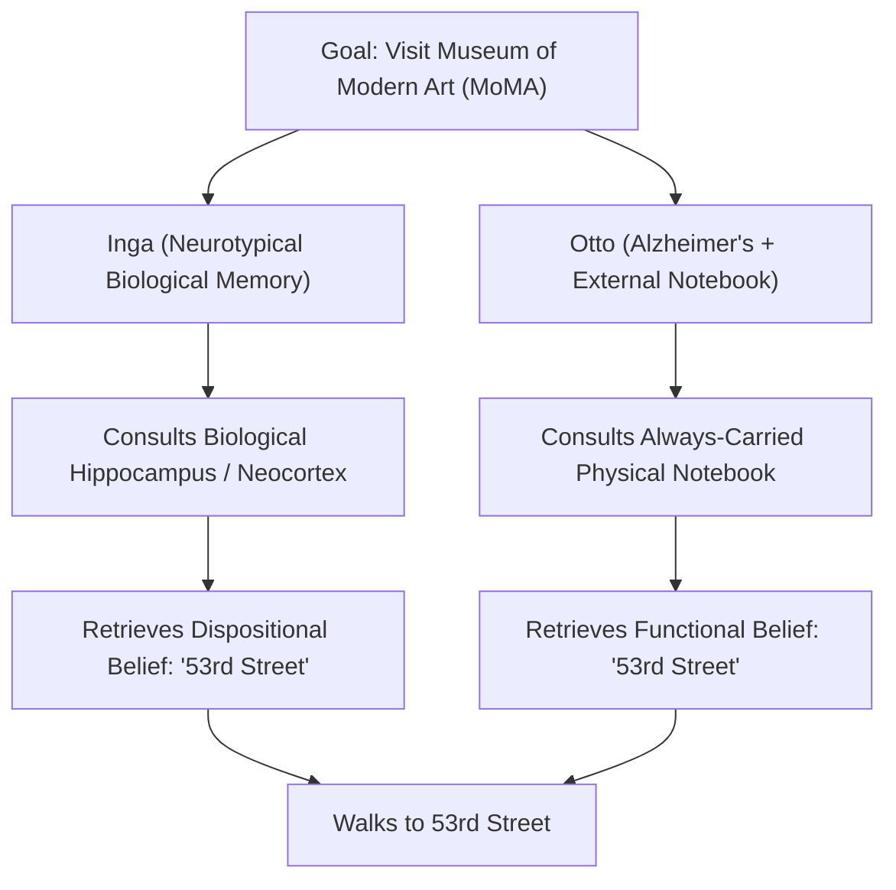
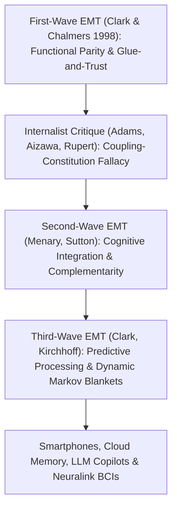

## Pendahuluan: “Di Mana Pikiran Berhenti dan Sisa Dunia Dimulai?”

Pada tahun 1998, filsuf <strong>Andy Clark</strong> dan <strong>David J. Chalmers</strong> menerbitkan sebuah makalah singkat setebal tujuh halaman di jurnal *Analysis* berjudul <strong>*“The Extended Mind”</strong>* (*Pikiran yang Meluas*), yang mengguncang filsafat pikiran dan ilmu kognitif modern. Mereka membuka makalah tersebut dengan pertanyaan yang sangat provokatif: <strong>“Di mana pikiran berhenti dan di mana sisa dunia dimulai?”</strong>

Selama hampir empat abad sejak René Descartes — baik bagi kaum dualis maupun materialis reduksionis modern — hampir semua ilmuwan menganggap <strong>internalisme kranial</strong> sebagai kebenaran mutlak: batas pikiran dan kognisi berimpit secara ketat dengan batas biologis <strong>kulit dan tengkorak (*skin and skull*)</strong>. Sempoa, kertas dan pensil, buku catatan, ponsel pintar (*smartphone*), hingga model bahasa besar (LLM) saat ini hanyalah *alat* eksternal atau perangkat input-output, bukan bagian harfiah dari pikiran itu sendiri.

Clark dan Chalmers meruntuhkan dogma ini dengan mengajukan <strong>eksternalisme aktif (*Active Externalism*)</strong> dan <strong>Tesis Pikiran yang Meluas (*Extended Mind Thesis*, EMT)</strong>: ketika suatu artefak fisik eksternal terkopel dengan organisme manusia dalam simpul kausal yang cukup andal, timbal-balik, dan terintegrasi secara fungsional, artefak tersebut berhenti menjadi sekadar alat dan berubah menjadi <strong>bagian konstitutif dari arsitektur kognitif agen tersebut, bahkan bagian dari keyakinan disposisionalnya</strong>!

---

## 1. Tindakan Epistemik dan Prinsip Paritas: Eksperimen Pikiran Otto dan Inga

Untuk menunjukkan bahwa proses kognitif dapat melampaui tengkorak, Clark dan Chalmers pertama-tama mengutip studi empiris David Kirsh dan Paul Maglio (1994) terhadap pemain ahli *Tetris*. Model kognitif klasik mengasumsikan bahwa pemain terlebih dahulu melakukan “rotasi mental” balok di dalam korteks visualnya (memakan waktu sekitar $800	ext{–}1000\,	ext{ms}$) sebelum menekan tombol. Namun Kirsh dan Maglio menemukan bahwa pemain ahli justru langsung menekan tombol untuk <strong>memutar balok secara fisik di layar</strong> (hanya butuh $100	ext{–}200\,	ext{ms}$) guna melihat kecocokannya secara langsung! Tindakan fisik terhadap dunia luar yang dilakukan khusus untuk meringankan atau mempercepat komputasi internal otak disebut <strong>tindakan epistemik (*Epistemic Actions*)</strong> (sama seperti mengacak kepingan huruf secara fisik dalam permainan *Scrabble*).

Berangkat dari temuan ini, Clark dan Chalmers merumuskan <strong>Prinsip Paritas (*Parity Principle*)</strong> yang terkenal:
> <strong>“Jika, saat kita menghadapi suatu tugas, bagian dari dunia luar berfungsi sebagai suatu proses yang — seandainya itu terjadi di dalam kepala — tidak akan ragu kita akui sebagai bagian dari proses kognitif, maka bagian dunia luar tersebut adalah bagian dari proses kognitif.”</strong>

Untuk membuktikan bahwa bukan hanya komputasi, melainkan kondisi mental sejati seperti <strong>keyakinan (*beliefs*) dan ingatan</strong> juga dapat berada di luar tengkorak, mereka merancang eksperimen pikiran terkenal tentang <strong>Inga dan Otto</strong>:
- <strong>Inga</strong> memiliki ingatan biologis normal. Ketika mendengar ada pameran di Museum of Modern Art (MoMA), ia berpikir sejenak, memanggil ingatan biologisnya (hipokampus dan neokorteks) bahwa MoMA berada di 53rd Street, lalu berjalan ke sana. Jelas bahwa *sebelum* ia mengingatnya secara sadar, Inga sudah memiliki <strong>keyakinan disposisional</strong> bahwa MoMA ada di 53rd Street.
- <strong>Otto</strong> menderita penyakit Alzheimer ringan. Untuk menjalani hidup sehari-hari, ia selalu membawa <strong>buku catatan</strong> fisik ke mana pun ia pergi: setiap informasi baru ia tulis di sana, dan setiap kali butuh informasi ia membukanya. Saat mendengar tentang pameran itu, Otto membuka buku catatannya, membaca tulisan “MoMA ada di 53rd Street” yang pernah ia catat, lalu berjalan menuju 53rd Street.

Clark dan Chalmers menegaskan bahwa buku catatan Otto memainkan <strong>peran fungsional dan eksplanatoris yang persis sama</strong> bagi perilaku Otto seperti halnya ingatan biologis bagi Inga! Menolak mengakui bahwa keyakinan Otto tersimpan di buku catatannya hanya karena kertas berada di luar tengkorak adalah “biocauvinisme” yang tak berdasar.

$$
\text{Parity Principle:} \quad \text{If } \Phi_{\text{world}}(S, E) \cong_{\text{func}} \Phi_{\text{brain}}(S_{\text{internal}}) \implies E \subset \text{Cognitive System}(S)
$$

$$
I(M_{\text{bio}}; A) \approx I(M_{\text{notebook}}; A), \qquad \tau_{\text{access}}(E) \le \tau_{\text{crit}}, \qquad \mathbb{P}(\text{Endorse}(E)) \to 1
$$

---

## 2. Empat Kriteria “Lem dan Kepercayaan” Penangkal Pembengkakan Kognitif & Kritik Internalis

Jika buku catatan Otto adalah bagian dari pikirannya, apakah itu berarti seluruh Wikipedia atau Perpustakaan Nasional adalah bagian dari pikiran kita saat ini? Untuk menangkal keberatan <strong>pembengkakan kognitif (*Cognitive Bloat*)</strong> ini, Clark dan Chalmers menetapkan empat <strong>kriteria “Lem dan Kepercayaan” (*Glue and Trust*)</strong> yang ketat:
1. <strong>Ketersediaan Konstan (*Constant Availability*)</strong>: Otto selalu membawa buku catatannya ke mana saja dan menggunakannya secara rutin.
2. <strong>Aksesibilitas Langsung dan Mudah (*Easy Accessibility*)</strong>: informasi dapat diakses seketika tanpa hambatan berarti.
3. <strong>Pengesahan Otomatis (*Automatic Endorsement*)</strong>: begitu membaca catatan tersebut, Otto otomatis mempercayainya sebagai kebenaran, sama seperti kita mempercayai ingatan biologis.
4. <strong>Pengesahan Sadar di Masa Lalu (*Past Conscious Endorsement*)</strong>: informasi tersebut telah diverifikasi dan ditulis secara sadar oleh Otto di masa lalu.

Meski demikian, para filsuf internalis melancarkan kritik tajam:
- <strong>Fred Adams & Kenneth Aizawa (2008): “Sesat Pikir Kopling-Konstitusi (*Coupling-Constitution Fallacy*)” dan “Tanda Kognitif (*Mark of the Cognitive*)”</strong>: keterhubungan kausal suatu objek dengan sistem tidak otomatis menjadikannya bagian ontologis dari sistem tersebut. Selain itu, kognisi sejati menuntut representasi dengan <strong>intensionalitas intrinsik tak-turunan</strong> serta kepatuhan pada hukum neuropsikologis ingatan biologis (efek interferensi dan generasi), sedangkan tinta di buku catatan hanya memiliki makna turunan berdasarkan konvensi sosial.
- <strong>“Hipotesis Kognisi Tertanam (*Embedded Cognition / HEC*)” Robert Rupert (2004) dan “Pikiran Berperancah (*Scaffolded Mind*)” Kim Sterelny (2010)</strong>: mereka mengusulkan agar pikiran tetap dipandang berada di dalam organisme, sembari mengakui ketergantungannya yang mendalam pada perancah lingkungan eksternal (*scaffolds*).

---

## 3. Gelombang Kedua & Ketiga EMT: Komplementaritas, Pemrosesan Prediktif, dan Hukum Konstitusi

Menanggapi perdebatan tersebut, teori pikiran yang meluas berevolusi melewati gelombang kedua dan ketiga:
- <strong>Gelombang Kedua (Menary, Sutton: Integrasi Kognitif & Komplementaritas)</strong>: alih-alih menekankan *kemiripan* (paritas) antara otak dan buku catatan, gelombang kedua menekankan <strong>komplementaritas (saling melengkapi)</strong>! Otak biologis (*engram*) unggul dalam pengenalan pola asosiatif cepat, tetapi buruk dalam menyimpan deretan simbol eksak berukuran panjang; media eksternal (*eksogram*) melakukan hal sebaliknya. Integrasi hibrida keduanya adalah fondasi matematika dan sains modern.
- <strong>Gelombang Ketiga (Clark 2016, Kirchhoff: Pemrosesan Prediktif & Selimut Markov Dinamis)</strong>: dipadukan dengan <strong>Prinsip Energi Bebas (*Free Energy Principle*) dan Inferensi Aktif</strong> Karl Friston, otak dipahami sebagai mesin Bayesian yang meminimalkan galat prediksi $\mathcal{F}$. Batas statistik diri kognitif (<strong>Selimut Markov / *Markov Blanket*</strong>) bersifat plastis dan meluas secara dinamis mencakup prostesis kognitif eksternal kita.

Di abad ke-21, tesis pikiran yang meluas bahkan telah masuk ke ranah hukum konstitusi:
Dalam putusan bersejarah <strong>*Riley v. California* (2014)</strong>, Mahkamah Agung Amerika Serikat memutuskan secara bulat (9–0) bahwa polisi <strong>tidak boleh menggeledah isi digital ponsel pintar</strong> orang yang ditangkap tanpa surat perintah pengadilan. Ketua Mahkamah Agung John Roberts menulis kalimat terkenal: *“Ponsel modern kini menjadi bagian kehidupan sehari-hari yang begitu meresap dan melekat sehingga pengunjung dari planet Mars mungkin akan menyimpulkan bahwa ponsel adalah fitur penting dari anatomi tubuh manusia!”* Di era ponsel pintar, otak kedua berbasis cloud, kopilot AI (LLM), dan antarmuka otak-komputer (Neuralink), meretas atau menghapus memori digital eksternal seseorang bukan lagi sekadar perusakan properti biasa, melainkan <strong>serangan langsung terhadap integritas kognitif pribadi</strong>.

| Paradigma / Aliran | Batas Pikiran | Kriteria Inti / Mekanisme | Status Buku Catatan Otto / Smartphone | Implikasi Hukum & Etika |
| :--- | :--- | :--- | :--- | :--- |
| <strong>Internalisme Kranial (Adams & Aizawa)</strong> | Ketat di dalam kulit dan tengkorak | Tanda Kognitif (intensionalitas intrinsik) | Sekadar alat kausal eksternal (kopling $
eq$ konstitusi) | Perusakan = kerugian properti biasa |
| <strong>Kognisi Tertanam / HEC (Rupert / Sterelny)</strong> | Di dalam organisme, ditopang relung | Parsimoni psikologis & perancah lingkungan | Perancah epistemik eksternal berpita lebar | Perlindungan infrastruktur kognitif |
| <strong>Gelombang 1 Extended Mind (Clark & Chalmers 1998)</strong> | Meluas ke artefak yang terkopel andal | <strong>Prinsip Paritas</strong> + 4 kriteria “Glue & Trust” | <strong>Bagian konstitutif</strong> dari keyakinan Otto | Penggeledahan tanpa izin = pelanggaran privasi mental |
| <strong>Gelombang 2/3 Extended Mind (Sutton / Clark 2016)</strong> | Selimut Markov plastis (otak-tubuh-relung) | <strong>Komplementaritas</strong> + Inferensi Aktif (energi bebas) | Sistem hibrida engram dan eksogram | Landasan hak-saraf (*neuro-rights*) & *Riley v. California* |

$$
\mathcal{F}(q, s, a) = \mathbb{E}_{q(\vartheta)}\big[ \ln q(\vartheta) - \ln p(s, \vartheta \mid a) \big] = D_{\text{KL}}\big( q(\vartheta) \,\|\, p(\vartheta \mid s, a) \big) - \ln p(s \mid a)
$$
