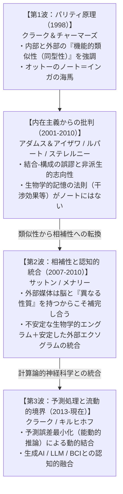

## 1. はじめに：「心」はどこで終わり、どこから「外界」が始まるのか？

「心はどこで終わり、残りの世界はどこから始まるのか？（*Where does the mind stop and the rest of the world begin?*）」

1998年、哲学者の<strong>アンディ・クラーク（Andy Clark）</strong>と<strong>デイヴィッド・チャーマーズ（David Chalmers）</strong>は、分析哲学の名門誌『Analysis』に掲載されたわずか12ページの論文<strong>『拡張された心（The Extended Mind）』</strong>の冒頭を、この挑発的な一文で切り開いた。私たちが日常的に抱いている素朴な直観――そしてルネ・デカルト以来の近代西洋哲学および古典的認知科学が当然の前提としてきたドグマ――に従えば、この問いに対する答えは自明であるように思われる。すなわち、「心（Mind）や認知（Cognition）とは、頭蓋骨（Skull）と皮膚（Skin）の内部、とりわけ中枢神経系および脳という生物学的器官の内部で完結する現象であり、皮膚の外側にあるペン、ノート、計算機、スマートフォンはすべて、心が外部から操作し利用する『単なる道具（Tools）』にすぎない」という見解である。

この伝統的な人間観は、心の哲学において<strong>「頭蓋内内在主義（Intracranial Internalism）」</strong>あるいは<strong>「神経中心主義（Neurocentrism）」</strong>と呼ばれる。古典的な計算主義的認知科学（Computational Theory of Mind）においても、人間の心は「感覚器官から入力（Input）を受け取り、脳内の神経回路で記号的表象を計算処理し、運動器官へ出力（Output）を送るサンドイッチ構造の中央処理装置」としてモデル化されてきた。このモデルにおいて、身体や外部の環境・道具は、入力と出力のインターフェースではあっても、思考や記憶という「心そのもの」の構成要素（Constituents）とはみなされない。

しかし、クラークとチャーマーズはこの「皮膚と頭蓋骨という境界線（Skin-and-Skull Boundary）」の神聖視に対して、根底から異議を唱えた。私たちが紙とペンを使って複雑な筆算を行うとき、スクラブルの文字タイルを指で並べ替えながら単語を思いつくとき、あるいは手元のノートやスマートフォンに記録された膨大な予定や知識と一体となって日常の意思決定を下しているとき、思考のプロセスや記憶のシステムは、本当に頭蓋骨の内側だけに閉じ込められていると言えるのだろうか？ むしろ、生身の脳と外部の非生物学的媒体（ノートやデジタル機器）が密接に結びついた<strong>ハイブリッドな結合系（Coupled System）全体</strong>こそが、文字通りの意味で「考えている主体」「記憶している心」なのではないか。

### 受動的外在主義（双子の地球）から「能動的外在主義（Active Externalism）」へ

クラークとチャーマーズの議論の革新性を正確に理解するためには、20世紀後半の言語哲学・心の哲学を席巻した従来の「外在主義」との決定的な違いを押さえておく必要がある。

1970年代以降、<strong>ヒラリー・パトナム（Hilary Putnam）</strong>の有名な「双子の地球（Twin Earth）」思考実験や、<strong>タイラー・バージ（Tyler Burge）</strong>の「関節炎（Arthritis）」思考実験によって、<strong>「意味論的外在主義（Semantic Externalism / Content Externalism）」</strong>が確立された。パトナムは、「意味というものは頭の中にはない（"Meanings" just ain't in the head!）」と宣言し、地球上の私が「水は喉の渇きを癒やす」と考えるときの信念内容（$\mathrm{H_2O}$に関する信念）と、水の化学組成が$\mathrm{H_2O}$ではなく$\mathrm{XYZ}$である「双子の地球」にいる私と分子レベルで完全に同一の脳状態を持つドッペルゲンガーの信念内容（$\mathrm{XYZ}$に関する信念）は異なると論じた。同様にバージは、同じ脳状態であっても、属する言語共同体の語法規約が異なれば保持する概念や信念の内容が異なることを示した。

しかし、パトナムやバージの外在主義は、クラークとチャーマーズの言葉によれば<strong>「受動的外在主義（Passive Externalism）」</strong>にとどまる。なぜなら、双子の地球において私の信念内容を決定している外部要因（$\mathrm{H_2O}$か$\mathrm{XYZ}$か、あるいは過去の言語習得の歴史）は、遠い過去からの因果的連鎖の末端にあるだけであり、「いま・ここ」で行われている私のリアルタイムの推論や行動に対しては何の能動的な因果的変化ももたらさないからである。地球の私を双子の地球の私の行動と比較しても、両者の身体運動や情報処理のダイナミクスには一切の差異が生じない。

これに対して、クラークとチャーマーズが提唱した<strong>「能動的外在主義（Active Externalism）」</strong>――別名<strong>「媒体外在主義（Vehicle Externalism）」</strong>――は、心的状態の「意味内容（Content）」だけでなく、心的状態や認知プロセスを物理的に実現する<strong>「担い手・媒体（Vehicles of Cognition）」そのもの</strong>が頭蓋骨の外へ張り出していると主張する。能動的外在主義において、外部の環境特徴（ノートの記述、画面上のブロック、スマートフォンのメモリ）は、いま現在進行している認知ループの真っ只中で主体と双方向的・リアルタイムに相互作用し、行動を直接的に駆動する。もし外部の媒体を取り除いたり書き換えたりすれば、主体の現在の行動能力や推論パフォーマンスは即座に崩壊・変容する。この「いま・ここでの因果的・機能的統合」こそが、能動的外在主義の核心である。

### 4E認知科学（4E Cognition）のスペクトラムにおける位置づけ

現代の認知科学および心の哲学では、古典的な頭蓋内計算主義を乗り越える潮流が<strong>「4E認知（4E Cognition）」</strong>という総称のもとに体系化されている。4つの「E」はそれぞれ異なる角度から頭蓋内中心主義を批判するが、その存在論的な踏み込みの深さには明確なグラデーションが存在する。

| パラダイム | 英語名称 | 核心的テーゼと認知の境界 | 代表的論者 |
| :--- | :--- | :--- | :--- |
| <strong>身体化された認知</strong> | <strong>Embodied Cognition</strong> | 認知は脳単独ではなく、身体の解剖学的構造・感覚運動系・身体図式によって本質的に形作られる。境界は「皮膚の内側（脳＋身体全体）」へと広がる。 | ヴァレラ、レイコフ＆ジョンソン、ギャラガー |
| <strong>埋め込まれた認知</strong> | <strong>Embedded Cognition</strong> | 認知システム自体は頭蓋内（または身体内）に存在するが、その機能遂行は外部環境の構造や足場（Scaffolds）に極めて強く因果的に依存している。 | ロバート・ルパート、ハーバート・サイモン、キム・ステレルニー |
| <strong>行為的認知</strong> | <strong>Enacted Cognition</strong> | 認知とは世界の内部表象を作ることではなく、有機体が環境と動的に相互作用するなかで意味世界を立ち上げる（Enactする）感覚運動的実践そのものである。 | ヴァレラ、トンプソン、ロッシュ、アルヴァ・ノエ |
| <strong>拡張された認知／心</strong> | <strong>Extended Cognition / Mind</strong> | 認知プロセスのみならず信念・記憶などの「心的状態」の物理的媒体そのものが、皮膚と頭蓋骨の境界を越えて外部の道具・環境へと文字通り構成的に拡張する。 | アンディ・クラーク、デイヴィッド・チャーマーズ、リチャード・メナリー |

この表から明らかなように、「埋め込まれた認知（Embedded Cognition）」が「脳は外部の道具に<strong>因果的に依存（Causally Dependent）</strong>している」という穏健な主張にとどまるのに対し、「拡張された心（Extended Mind）」は「外部の道具が心の一部を<strong>存在論的に構成（Ontologically Constitutive）</strong>している」という最もラディカルな形而上学的テーゼを打ち立てるのである。

---

## 2. 認識的行為（Epistemic Actions）とパリティ原理（Parity Principle）

クラークとチャーマーズの議論は、大きく2つの段階（ステップ）で構成されている。第1段階は「一時的な<strong>認知プロセス（Cognitive Processes）</strong>が外部世界へ拡張する」という論証であり、第2段階は「恒常的な<strong>心的状態（Mental States：信念や記憶など）</strong>そのものが外部世界へ拡張する」という論証である。まずは第1段階の鍵を握る「認識的行為」と「パリティ原理」から検証しよう。

### カーシュとマグリオの『テトリス（Tetris）』研究と認識的行為

人間はなぜ外界に働きかけるのか。従来の行動理論では、人間のあらゆる身体行動は<strong>「実用的行為（Pragmatic Actions）」</strong>として理解されてきた。実用的行為とは、物理的世界の状態を、自分の欲求や生存目標に直接合致するように変更する行為である（たとえば、家を建てるために釘を打つ、喉を潤すためにコップを口へ運ぶ、テトリスでブロックを最終的な隙間へ落とし込む、など）。

しかし1994年、認知科学者の<strong>デイヴィッド・カーシュ（David Kirsh）</strong>と<strong>ポール・マグリオ（Paul Maglio）</strong>は、ビデオゲーム『テトリス（Tetris）』の上級プレイヤーの操作ログと眼球運動を詳細に解析するなかで、実用的行為には還元できない全く別種の行動カテゴリーを発見し、それを<strong>「認識的行為（Epistemic Actions）」</strong>と命名した。

テトリスでは、画面上部からさまざまな幾何学的形状のブロック（ゾイド）が落下してくる。プレイヤーは落下地点の形状に合わせてゾイドの向きを判断しなければならない。古典的な頭蓋内認知モデルに従えば、プレイヤーはまず画面上のゾイドを見て、脳内の視覚野・頭頂葉で<strong>「心的回転（Mental Rotation）」</strong>という内部計算を行い、どの向きがフィットするかを頭の中で決定してから、その目標状態へ向けて回転ボタンを押す（実用的行為）はずである。ところが実際の熟練プレイヤーは、頭の中で考える前に、<strong>画面上でゾイドを物理的に素早くボタン連打で回転させ、回転した画面上の姿を直接目で見ることでフィットするかどうかを判断していた</strong>のである。

その理由は、計算速度と情報処理コストの圧倒的な差にある。人間の脳内で図形を90度「心的回転」させるには約 $800 \sim 1000\text{ ms}$（約1秒）の神経処理時間を要し、しかもワーキングメモリに多大な負荷をかける。これに対して、テトリスの画面上でボタンを1回押してブロックを物理的に90度回転させ、その結果が網膜に届くまでの時間はわずか $100 \sim 200\text{ ms}$ 程度にすぎない。プレイヤーは「脳内での重い内部計算」をショートカットし、「指の運動 $\to$ ゲーム画面の物理的変化 $\to$ 視覚的知覚」という<strong>外部世界を経由するループ</strong>に計算そのものを肩代わりさせていたのである。

このように、認識的行為とは<strong>「頭蓋内の計算が持つ時間的・記憶的・複雑性的コストを削減し、問題解決を容易かつ信頼性の高いものにするために、外部世界の物理的状態を意図的に操作する行為」</strong>と定義される。具体例は日常のいたるところに存在する。

1. <strong>スクラブル（Scrabble）のタイル操作</strong>：手持ちの7枚のアルファベットから英単語を作るボードゲームにおいて、人間は頭の中で文字の順列（$7! = 5040$通り）を想起するのではなく、手元のトレイの上でタイルを物理的にシャッフルし、ランダムに並んだ文字列が網膜を刺激することで脳内の語彙ネットワークを自動発火（プライミング）させる。
2. <strong>紙とペンによる多桁の筆算</strong>：たとえば $789 \times 456$ を暗算で行うことは、人間の生物学的ワーキングメモリ（マジカルナンバー $4 \pm 1$ チャンク）の容量限界を容易に超える。しかし紙とペンがあれば、私たちは「1桁のかけ算（九九）の想起 $\to$ 紙への数字の書き込み $\to$ 書き込まれた数字の視覚的再読み取り $\to$ 繰り上がりの足し算」というサイクルを反復することで、巨大な計算を完遂する。
3. <strong>海図と計算尺による航法計算</strong>：文化人類学者・認知科学者の<strong>エドウィン・ハッチンズ（Edwin Hutchins）</strong>が名著『野生の認知（*Cognition in the Wild*, 1995）』で描いたように、軍艦の航海士たちは単独の頭脳で船の位置を計算しているのではなく、見張り員、コンパス、海図、定規、計算尺（ノモグラム）からなる「分散認知システム（Distributed Cognitive System）」全体として座標変換という計算を遂行している。

### パリティ原理（The Parity Principle）の定式化

カーシュとマグリオの研究を踏まえ、クラークとチャーマーズは、ある外部のプロセスが「真に認知の一部である」と判定するための有名な基準――<strong>パリティ原理（The Parity Principle：対等性の原理）</strong>――を提唱した。

> <strong>【パリティ原理（The Parity Principle）】</strong>
> 「私たちが何らかの課題に取り組む際、世界の側のある部分が一定のプロセスとして機能しており、<strong>もしそのプロセスが頭蓋の内部で行われていたとしたら、私たちがためらうことなく『それは認知プロセスの一部である』と認めるようなものであるならば</strong>、世界のその部分は（そのプロセスが進行している間）認知プロセスの一部なのである。」

この原理が意図しているのは、多くの哲学者や科学者が無意識のうちに囚われている<strong>「生物学的ショーヴィニズム（Biological Chauvinism：生物・神経偏重主義）」</strong>あるいは「皮膚と頭蓋骨の偏見」を取り除くための思考のフィルターである。

たとえば、将来、脳の視覚野と運動野に直接接続されたシリコンチップを頭蓋内にインプラントしたサイボーグがいて、そのチップの上でテトリスのブロックを $100\text{ ms}$ で高速回転させて形状を確認していたとしよう。私たちはためらうことなく、そのシリコンチップ上の回転操作を「彼自身の内部的な認知プロセスの一部」と認めるだろう。であるならば、それと全く同じ計算的・機能的役割を、眼球と指とブラウン管モニターを介した外部ループが果たしているとき、「ただそれが皮膚と頭蓋骨の外側にあるから」という物理的ロケーションの違いだけを理由にして、後者を「認知ではない（単なる外部環境との入出力にすぎない）」と排除するのは、恣意的で根拠のない差別ではないか。これがパリティ原理の突きつける機能主義的（Functionalist）な挑戦である。

---

## 3. オットーとインガの思考実験：ノートは「傾性的信念」の担い手になれるか？

パリティ原理によって「紙とペンでの筆算」や「テトリスの画面操作」といった一時的な<strong>認知プロセス（Extended Cognition）</strong>が頭蓋外へ拡張することが示されたとしても、多くの懐疑論者はこう反論するだろう。「確かに計算プロセスは外部の道具を巻き込んでいるかもしれない。しかし、その人の『心（Mind）』の中核をなすもの――すなわち、その人が何を信じており（信念 Beliefs）、何を記憶しており（記憶 Memories）、何を欲しているか（欲求 Desires）という恒常的な心的状態――は、依然として脳の中にしか存在しないのではないか？」

この最後の砦を突き崩し、「拡張された認知（Extended Cognition）」から文字通りの<strong>「拡張された心（The Extended Mind）」</strong>へと決定的な跳躍を果たすために、クラークとチャーマーズが考案したのが、現代哲学において最も有名な思考実験のひとつである<strong>「インガとオットー（Inga and Otto）」</strong>の物語である。

### インガ（Inga）のケース：通常の生物学的記憶

まず、<strong>インガ（Inga）</strong>という健康な成人女性を考えよう。彼女はある日、友人からニューヨーク近代美術館（Museum of Modern Art: MoMA）で興味深い展覧会が開催されているという話を聞き、見に行こうと決心する。彼女は少しの間立ち止まって考え、「そういえば近代美術館は53丁目（53rd Street）にあったはずだ」と思い出し（生物学的記憶から検索し）、53丁目に向かって歩き出す。

この場合、インガは53丁目へ向かう理由として「近代美術館は53丁目にある」という信念（Belief）を持っていたことが挙げられる。しかも決定的に重要なのは、<strong>彼女が立ち止まって思い出す（意識にのぼらせる）よりも前から、彼女はこの信念を持っていた</strong>という点である。心の哲学では、いま現在意識の表面に浮かんでいる信念を<strong>「顕在的信念（Occurrent Belief）」</strong>と呼び、普段は意識されていなくとも記憶の中に保持されており、必要に応じていつでも引き出して行動の指針とすることができる潜在的な信念を<strong>「傾性的信念（Dispositional Belief）」</strong>と呼ぶ。インガの「MoMAは53丁目にある」という信念は、想起される前も彼女の海馬および大脳皮質のシナプス結合のなかに、傾性的信念として間違いなく存在していた。

### オットー（Otto）のケース：アルツハイマー病と常時携帯するノート

次に、<strong>オットー（Otto）</strong>という男性を考えよう。オットーはアルツハイマー病を患っており、多くの患者と同様に、新しい情報を生物学的な脳内に長期記憶として定着させたり想起したりする能力が損なわれている。そのためオットーは、どこへ行くにも常に1冊の<strong>ノート（Notebook）</strong>を持ち歩いている。彼は新しい情報を学ぶとすぐにそのノートに書き込み、過去の情報が必要になると即座にノートを開いて該当箇所を検索する。オットーにとって、このノートは失われた生物学的記憶の役割を完全に代替する生命線である。

ある日、オットーも近代美術館の展覧会の話を聞き、見に行こうと決心する。彼は手元のノートを開き、「近代美術館は53丁目にある」と自分が過去に書き留めたページを見つけ、それを読んで53丁目に向かって歩き出す。

ここでクラークとチャーマーズは次のように主張する。<strong>「オットーは、自分のノートを開くよりも前から、『近代美術館は53丁目にある』という傾性的信念を持っていた。なぜなら、インガにとっての生物学的記憶と、オットーにとってのノートは、あらゆる重要な点において全く同一の機能的役割（Functional Role）を果たしているからである。」</strong>

### 内在主義者からの反論と、機能的同型性の徹底検証

頭蓋内内在主義者は、当然ながらこの結論に強く抵抗し、オットーの行動を次のように説明しようとするだろう。

> <strong>【内在主義者によるオットーの再記述】</strong>
> 「オットーはノートを見る前には『MoMAが53丁目にある』とは信じていなかった。彼が最初から持っていた傾性的信念は、『MoMAの住所はノートに書いてある』というメタ信念だけである。そして彼はノートを開くという行動をとり、そこに『53丁目』と書かれているのを知覚した瞬間に、初めて『MoMAは53丁目にある』という新しい顕在的信念を頭蓋内に形成したのだ。だからオットーの心（信念）は一度たりとも頭蓋の外へ出てはいない。」

一見すると、この内在主義的な説明は常識的で無理がないように見える。しかしクラークとチャーマーズは、この説明がいかに不必要に複雑（迂遠）であり、かつインガとの対称性を不当に破壊しているかを鮮やかに暴き出す。

もし私たちがオットーの行動を上記のように「ノートを見るまでは信じておらず、見た瞬間に初めて信じた」と説明しなければならないとしたら、パリティ原理により、インガについても全く同じ迂遠な説明を強いられるはずである。すなわち、「インガも思い出す前には『MoMAは53丁目にある』とは信じていなかった。彼女が持っていたのは『自分の生物学的海馬のどこかを検索すれば住所が出てくるはずだ』というメタ信念だけであり、脳内検索を行って記憶痕跡（エングラム）にアクセスした瞬間に初めて『MoMAは53丁目にある』と信じたのだ」と言わなければならなくなる！ しかし、そんな説明は日常心理学（Folk Psychology）としても認知科学としても完全に不条理である。私たちはインガについて「彼女は最初から（思い出す前から）MoMAが53丁目にあると知っていた（信じていた）からこそ、そこへ行こうとしたのだ」と説明する。

さらに決定的な論点がある。仮に誰かが「インガとオットーの行動を説明せよ」と求められたとき、二人の内部構造の違いを捨象して<strong>「二人とも『MoMAへ行きたい』と欲し、かつ二人とも『MoMAは53丁目にある』と信じていたから53丁目へ向かったのだ」</strong>という単一の心理学的説明を与えることができる。ノートの記述は、オットーという主体の行動を駆動する推論と意思決定のネットワークの中で、インガの脳内エングラムと<strong>粗視化された機能的同型性（Coarse-grained Functional Isomorphism）</strong>を完全に共有している。単に「インガの記憶媒体は頭蓋骨の内側のタンパク質でできており、オットーの記憶媒体は頭蓋骨の外側のセルロース（紙）とインクでできている」という物質的・空間的な違い（さらにはアクセス手段が「内省的想起」か「視覚的知覚」かという違い）は、その情報が「オットーの信念である」という認知的地位を否定する理由にはならないのである。

---

## 4. 「接着と信頼（Glue and Trust）」の4基準と「認知的肥大化」の回避

しかし、オットーのノートを「彼の心（記憶・信念）の一部」として認めた瞬間、拡張された心のテーゼは直ちにひとつの巨大な危機に直面する。それは後に哲学者たちによって<strong>「認知的肥大化（Cognitive Bloat）」</strong>あるいは<strong>「暴走する外在主義（Runaway Externalism）」</strong>と名付けられた問題である。

もし外部の文字媒体に書かれた情報が私の傾性的信念になりうるのであれば、私の自宅の書斎にある『ブリタニカ百科事典』の全項目や、地域の公立図書館の蔵書、さらには私のスマートフォンから数秒でアクセスできるWikipediaの全記事やGoogleがインデックスしているインターネット上の全ウェブページも、すべて「私がすでに（検索する前から）持っている傾性的信念・知識」に含まれてしまうのではないか？ もしそうだとすれば、私は英語の辞書を引く前から世界中のあらゆる英単語の意味を知っており、歴史書を開く前から14世紀のビザンツ帝国の税収額を「信じている」ことになってしまう。これは明らかに不条理（背理法）である。

クラークとチャーマーズはこの問題を最初から鋭く予見しており、オットーのノートと単なる外部の参考図書やインターネットとを厳密に区別するための<strong>4つの構成的基準</strong>を提示した。アンディ・クラークは後の著作（*Supersizing the Mind*, 2008など）において、これらを<strong>「接着と信頼の基準（Criteria of Glue and Trust）」</strong>と呼んで定式化している。

### クラーク＆チャーマーズの「接着と信頼」の4基準

ある外部の物理的媒体に保持された情報が、単なる環境内のデータではなく、主体 $S$ の「拡張された心（傾性的信念・記憶）」の一部として認められるためには、以下の4つの条件を満たさなければならない。

1. <strong>常時利用可能性（Constant Availability / Portability）</strong>
   オットーはノートを常に携帯しており、それなしでは外出も日常行動も行わない。必要なときにはいつでも・どこでも即座に呼び出せる定数（Constant）として主体の生活に張り付いている（接着されている）こと。
2. <strong>容易かつ直接的なアクセス可能性（Easy and Direct Accessibility）</strong>
   ノートの中の情報は、特別な解読作業や長い移動時間、他者の許可などを必要とせず、必要なときに直接かつ容易に検索・取得できること（生物学的記憶の想起に匹敵するスムーズさを持つこと）。
3. <strong>検索された情報の自動的承認（Automatic Endorsement）</strong>
   ノートから情報を読み取った際、オットーはその記述を「本当にそうだろうか？」と疑ったり別の情報源で裏付けを取ったりすることなく、生物学的記憶から思い出したときと同様に、デフォルトで「真なるもの」として自動的に承認し、直ちに行動の前提とすること（深い信頼の結合）。
4. <strong>過去の意識的承認（Past Conscious Endorsement）</strong>
   ノートに記されている情報は、過去にオットー自身が意識的に学び、「これは事実である」と判断・承認した結果としてそこに書き込まれたものであること。

### 境界判定マトリックスによる検証

この「接着と信頼」の4基準を適用すると、なぜオットーのノートは心の一部であり、自宅の百科事典やWikipedia全体は心の一部ではないのかが極めて明快に整理される。

| 対象媒体 | ① 常時利用可能性 | ② 容易なアクセス | ③ 自動的承認（信頼） | ④ 過去の意識的承認 | 判定：心の一部（傾性的信念）か？ |
| :--- | :---: | :---: | :---: | :---: | :--- |
| <strong>インガの生物学的海馬</strong> | ◎ | ◎ | ◎ | ◎ | <strong>Yes</strong>（標準的な内部信念） |
| <strong>オットーの常時携帯ノート</strong> | ◎ | ◎ | ◎ | ◎ | <strong>Yes</strong>（拡張された傾性的信念） |
| <strong>自宅の本棚の百科事典</strong> | ×（外出時不在） | △（帰宅が必要） | ○ | ×（未読の項目） | <strong>No</strong>（単なる外部環境のリソース） |
| <strong>Google検索 / Wikipedia全体</strong> | ◎（スマホ携帯） | ◎ | △（批判的検証が必要） | ×（自分が承認し書いたものではない） | <strong>No</strong>（認知的肥大化は起きない） |
| <strong>個人のクラウドメモ（Obsidian / Notion等）</strong> | ◎ | ◎ | ◎ | ◎ | <strong>Yes</strong>（現代におけるオットーのノート） |

※なお、<strong>第4基準（過去の意識的承認）</strong>については、発表直後から哲学者の間で活発な議論が交わされた。というのも、私たちの生物学的記憶の中には、意識的な承認を経ずに無意識のうちに刷り込まれた記憶（潜在記憶やサブリミナルな知覚、幼少期のトラウマなど）も存在するからである。もし生物学的記憶に第4基準を厳格に要求しないのであれば、外部記憶にだけ第4基準を課すのはパリティ原理（内外の対等性）に反するのではないかという指摘である。これに対しクラークは、第4基準は絶対的な必要条件というよりも、「その情報が主体の既存の信念ネットワークにどれだけ深く統合され、主体自身のもの（Ownership）として機能しているか」を測るための有力な指標であると柔軟に位置づけ直している。

---

## 5. 拡張された心への主要な哲学的反論と論争の深化

1998年の論文発表以来、『拡張された心』は現代の心の哲学・認知科学において最も引用され、かつ最も激しい論争を巻き起こした論文となった。内在主義（頭蓋内主義）を守る哲学者たちは、クラークとチャーマーズの議論の急所を突く鋭い反論を次々と繰り出した。ここでは最も重要な3つの批判と、それに対する拡張論者の応答、そして理論のアップデート（第2波・第3波）を詳細に検討する。

### 反論①：アダムスとアイザワの「認知の刻印」と「結合-構成の誤謬」

拡張された心のテーゼに対する最も体系的かつ強力な批判を展開したのは、哲学者の<strong>フレッド・アダムス（Fred Adams）</strong>と<strong>ケン・アイザワ（Ken Aizawa）</strong>である（2001年論文および2008年の著書『*The Bounds of Cognition*（認知の境界）』）。彼らの批判は、以下の2つの核心的な論点に集約される。

#### (1) 結合-構成の誤謬（The Coupling-Constitution Fallacy）
アダムスとアイザワは、クラークとチャーマーズの論証が重大な論理的誤謬を犯していると指摘し、それを<strong>「結合-構成の誤謬（Coupling-Constitution Fallacy）」</strong>と名付けた。

> <strong>【結合-構成の誤謬の定式化】</strong>
> ある対象やプロセス $X$（たとえばノートやペン）が、認知的エージェント $Y$（脳）と密接に<strong>因果的に結合（Causally Coupled）</strong>しており、$Y$ が認知課題を達成するうえで $X$ が不可欠な役割を果たしているという事実から、「ゆえに $X$ は認知プロセスや心の一部を<strong>存在論的に構成（Ontologically Constitute）</strong>している」と結論づける誤謬。

アダムスとアイザワはわかりやすい物理的アナロジーを挙げる。たとえば、バイメタルを用いた空調のサーモスタット（温度調節器）において、金属板の膨張・収縮は周囲の部屋の空気分子の熱運動と密接に「因果的に結合」している。しかし、だからといってサーモスタットという装置が「部屋全体の空気へと拡張している」とは言わない。また、ウラン235の原子核分裂は外部から飛び込んでくる中性子と因果的に結合しているが、核分裂そのものは原子核の内部で起きる現象である。同様に、紙とペンやオットーのノートがいかに脳の認知活動と密接に因果的相互作用を取り交わしていようとも、それは「認知プロセスに対して外部から因果的支援（Causal Support）を与えている」だけであり、ノート自体が「思考している」「記憶の一部を構成している」ことには断じてならない、と彼らは主張する。

#### (2) 「認知の刻印（Mark of the Cognitive）」の欠如
では、単なる外部の道具と「真の認知プロセス」とを分かつ本質的な基準――<strong>「認知の刻印（Mark of the Cognitive）」</strong>――とは何か。アダムスとアイザワは以下の2つの条件を提示する。

第一の条件は、<strong>「非派生的・内在的志向性（Non-derived / Intrinsic Intentionality）」</strong>の保持である。ジョン・サール（John Searle）の志向性理論でも強調されるように、ノートに書かれた「53丁目（53rd Street）」というインクの染みや、スマートフォンのメモリ上の `0` と `1` のビット列は、それ自体としては何の意味も指し示さない単なる物理的パターンにすぎない。それらが「53丁目」という意味を持つのは、言語を使用する人間が「この文字列は53丁目を表すものとする」という社会的規約（Convention）と解釈を与えているからであり、これを<strong>「派生的志向性（Derived Intentionality）」</strong>と呼ぶ。これに対して、人間の脳内のニューロン発火パターンが持つ表象内容は、誰かの規約や解釈に依存することなく、それ自体で世界を志向する<strong>「非派生的（内在的）志向性（Non-derived / Intrinsic Intentionality）」</strong>を持っている。真の認知は必ずこの非派生的表象の操作を含まなければならず、派生的表象しか持たないノートは認知の一部にはなりえない。

第二の条件は、<strong>「固有の認知科学的法則（Peculiar Cognitive Laws）」</strong>への従属である。これについては次のルパートの議論と直結するため、続けて見ていこう。

#### クラークによるアダムス＆アイザワへの再反論
クラーク（2008, 2010）はこれらの批判に対して真っ向から応答した。まず「結合-構成の誤謬」について、クラークは「単に $X$ が $Y$ と因果的に結びついているから $X$ が認知だ」などと素朴に主張したことは一度もないと反論する。クラークの主張は、<strong>「脳（$Y$）とノート（$X$）が双方向的に結合した上位の全体システム（$X + Y$）が、全体としてひとつの認知機能を実現しており、$X$ はその全体システムの構成要素（Constituent）である」</strong>というシステム論的説明である。

また「非派生的志向性（認知の刻印）」という要求に対しても、クラークは2つの点から論駁する。第一に、「脳内の神経発火だけが誰の解釈にもよらない魔術的な『内在的意味』を持っている」という前提自体が、現代の自然主義的哲学においていまだ解明されていない謎めいたドグマにすぎない。第二に、仮に脳内に非派生的志向性があるとしても、人間が言語や数式を用いて高次の思考を行う際には、脳内の内部表象でさえ「公的言語の記号（派生的表象）」を内面化したものと不可分に結びついている。オットーがノートを使って思考するとき、オットーの脳内の非派生的志向性とノートの派生的記号は一つの機能的ループとして融合しており、ノートの文字だけを全体システムから切り離して「これ単体ではインクの染みにすぎないから認知ではない」と批判するのは、脳内の単一のシナプスやナトリウムイオンをピンセットでつまみ出して「このイオン単体には志向性がないから脳は心ではない」と言うのと同じ要素還元主義の誤り（分割の誤謬）なのである。

---

### 反論②：ロバート・ルパートの「埋め込まれた認知（HEC）」と心理学的法則の非対称性

第2の強力な批判者は、認知科学の哲学を専門とする<strong>ロバート・ルパート（Robert Rupert）</strong>である。ルパートは2004年の著名な論文『拡張された認知への挑戦と、埋め込まれた認知の代替案（*Challenges to the Hypothesis of Extended Cognition*）』において、次の2つの仮説を厳密に対比させた。

- <strong>拡張された認知・心の仮説（HEMC: Hypothesis of Extended Mind/Cognition）</strong>：人間の認知システムや心そのものが、有機体の境界を越えて外部環境の対象を含み込むように拡張しているという仮説（クラーク＆チャーマーズの立場）。
- <strong>埋め込まれた認知の仮説（HEC: Hypothesis of Embedded Cognition）</strong>：認知システム自体はあくまで有機体（脳・身体）の内部に限定されているが、その認知プロセスは外部の環境構造や道具（足場）に極めて深く依存（埋め込まれ）ながら機能しているという仮説（ルパート自身の立場）。

ルパートは、オカンの剃刀（説明の経済性の原理）および認知科学の実践的観点からすれば、HEMCのような過激で常識に反する存在論を採用しなくとも、穏健な <strong>HEC（埋め込まれた認知）</strong> によってカーシュ＆マグリオのテトリス実験もオットーの行動も100%過不足なく説明できると主張する。

さらにルパートは、なぜ「インガの生物学的記憶」と「オットーのノート」を同じ「記憶（Memory）」という科学的な<strong>自然種（Natural Kind）</strong>に分類してはならないのかについて、実験心理学の知見に基づく極めて説得力のある論拠を提示した。すなわち、人間の生物学的記憶には、100年以上にわたる心理学実験によって確立された以下のような普遍的法則（細かな機能的プロファイル Fine-grained Functional Profile）が存在する。

1. <strong>負の転移と干渉効果（Negative Transfer & Interference Effects）</strong>：似たような電話番号や単語リストを新しく覚えると、古い記憶の想起が妨害されたり（逆向干渉）、古い記憶が新しい記憶の定着を邪魔したりする（順向干渉）。
2. <strong>生成効果（Generation Effect）</strong>：他人から与えられた情報をただ読むだけよりも、自分で苦労して思い出しながら生成した情報のほうが長期記憶に強く定着する。
3. <strong>系列位置効果（Serial Position Effect）</strong>：リストの最初（初頭効果）と最後（新近性効果）の項目は記憶に残りやすく、中間の項目は忘れやすい。
4. <strong>メタ記憶と既知感（Feeling-of-Knowing / Tip-of-the-Tongue）</strong>：具体的な名前を思い出せなくても、「喉まで出かかっている」「見れば絶対にわかる」というメタ認知的な感覚が先行して生じる。

ルパートは問う。「オットーのノートに、干渉効果や生成効果や系列位置効果が存在するか？」 もちろん存在しない。オットーがノートの100ページ目に新しい電話番号を書き込んだからといって、1ページ目に書いてある近代美術館の住所がインクのにじみで消えたり書き換わったりすること（逆向干渉）は決してない。もし私たちが「生物学的記憶」と「ノートの記述」を無理やり『記憶』という単一のカテゴリーに統合してしまえば、実験心理学がこれまで積み上げてきた精密な記憶の法則群はすべて「ある記憶には成り立つが、別の記憶には成り立たない」という支離滅裂なものになり、科学的探究としての認知心理学の基盤が崩壊してしまう。

---

### 反論③：ステレルニーの「足場かけられた心」と、第2波・第3波の拡張された心への進化

ルパートの「細かな機能的プロファイルの相違」という批判、および進化哲学者<strong>キム・ステレルニー（Kim Sterelny）</strong>が2010年に提唱した<strong>「足場かけられた心（The Scaffolded Mind）」</strong>の議論は、拡張された心の理論家たちに決定的な理論的進化を促すこととなった。

ステレルニーは、人間が進化の過程で自らの生存環境を作り変える<strong>「認知的ニッチ構築（Cognitive Niche Construction）」</strong>を行ってきたことを重視する。人間は、複雑な言語体系、数体系、地図、道具、徒弟制度、図書館といった外部の「認知的足場（Environmental Scaffolds）」を世代を超えて蓄積し、子供の脳をその足場に適合するように訓練してきた。ステレルニーによれば、クラークとチャーマーズが描いた「オットーのノート」のようなケース（特定の個人に1対1で排他的に結びつき、他者から隔離されて常に信頼できる外部媒体）は、人間の広大な環境的足場のネットワーク全体から見れば、ごく特殊な「一変数だけが突出した極限ケース」にすぎない。

こうした批判を受け止め、2000年代後半から2010年代にかけて、<strong>リチャード・メナリー（Richard Menary）</strong>、<strong>ジョン・サットン（John Sutton）</strong>、<strong>マーク・ローランズ（Mark Rowlands）</strong>、そしてクラーク自身によって、拡張された心の理論は<strong>「第2波（Second-Wave Extended Mind）」</strong>および<strong>「第3波（Third-Wave Extended Mind）」</strong>へと劇的なバージョンアップを遂げた。

#### 第2波の拡張された心：「パリティ（類似性）」から「相補性（Complementarity）」へ
ジョン・サットン（2010）とリチャード・メナリー（2007, *Cognitive Integration*）が主導した<strong>「第2波の拡張された心」</strong>は、ルパートの批判を逆手に取る鮮やかな発想の転換を行った。

第1波（クラーク＆チャーマーズの初期定式化）は、パリティ原理によって「オットーのノートはインガの生物学的記憶と<strong>同じように機能する（類似している）</strong>から心の一部だ」と論じた。だからこそルパートに「いや、よく見れば生物学的記憶とノートは全然違う性質（干渉効果の有無など）を持っているではないか」と突かれたのである。

これに対し第2波は、<strong>「相補性原理（Complementarity Principle）」</strong>を掲げる。そもそも、私たちがなぜ紙とペンやノートやコンピュータを認知システムに組み込むのかを考えてみよう。もしノートが生物学的記憶と全く同じように「新しいことを書くと古い記述が勝手に混ざって消えてしまう（干渉効果）」とか「7桁以上の数字を書くと最初の3桁が蒸発する（ワーキングメモリ限界）」といった性質を持っていたとしたら、誰もそんなノートは使わない！

私たちの生物学的脳が持つ記憶痕跡（<strong>エングラム Engrams</strong>）は、連想が豊かで文脈に応じた柔軟なパターン認識に優れている反面、揮発しやすく、干渉を受けやすく、正確な系列保持が苦手である。一方、ノートやデジタル機器に刻まれた外部記憶痕跡（人類学者マーリン・ドナルドの用語で<strong>エクソグラム Exograms</strong>）は、受動的で自発的な連想はしない代わりに、半永久的に揮発せず、干渉効果を受けず、どれほど複雑な記号体系も厳密に保持できる。

つまり、<strong>「生物学的脳と外部媒体がまったく異なる機能的プロファイルを持っているからこそ、両者が結合したときに互いの弱点を補い合い（相補性）、単独の脳では決して到達できない高次のハイブリッド認知システム（Cognitive Integration）が成立する」</strong>のである。ルパートが指摘した「内部記憶と外部記憶の性質の違い」は、拡張された心を否定する証拠どころか、なぜ心が外部へと拡張しなければならないのかを説明する最大の根拠へと反転したのだ。

#### 第3波の拡張された心：予測処理（Predictive Processing）と能動的推論
さらに2010年代中盤以降、アンディ・クラーク（2016年の主著『*Surfing Uncertainty*（不確実性の波に乗る）』）やマイケル・キルヒホフ（Michael Kirchhoff）らによって展開されている<strong>「第3波の拡張された心」</strong>は、現代の計算論的神経科学の最前線である<strong>「予測処理（Predictive Processing）」</strong>およびカール・フリストン（Karl Friston）の<strong>「自由エネルギー原理（Free Energy Principle）」</strong>と拡張された心のテーゼを融合させている。

この枠組みにおいて、脳は受動的に感覚入力を待つ装置ではなく、絶えず世界の隠れた原因についてのトップダウンの予測（生成モデル）を発し、実際のボトムアップの感覚入力とのズレである<strong>「予測誤差（Prediction Error）」</strong>を最小化し続けるベイズ推論エンジンとして定式化される：

$$\mathcal{F} = D_{\mathrm{KL}}\bigl(q(\vartheta) \parallel p(\vartheta \mid y)\bigr) - \ln p(y) \ge -\ln p(y) \quad (\text{変分自由エネルギー / 予測誤差の上界})$$

予測誤差を最小化する方法には2つある。1つは自分の内部モデル $q(\vartheta)$ を書き換えること（知覚・学習）であり、もう1つは自ら身体を動かして外部環境を操作し、感覚入力 $y$ の側を自分の予測に一致させること――すなわち<strong>「能動的推論（Active Inference）」</strong>である。スマートフォンのカレンダーを確認したり、紙の上で数式を変形したりする認識的行為は、脳が自らの頭蓋内モデルの不確実性（エントロピー）を劇的に引き下げるために、外部の安定した物理的構造を「自己の生成モデルの外部ループ」として一時的・継続的にアセンブル（編成）する能動的推論プロセスそのものにほかならない。ここではもはや、「固定された内部の心」と「固定された外部の道具」という静的な二元論すら融解し、課題や文脈に応じて柔軟に認知の境界線（マルコフ・ブランケット Markov Blanket）を伸縮させる動的で流動的な認知主体像が立ち現れる。

---

## 6. スマートフォン・クラウド・生成AI・BCI時代の「拡張された心」：倫理・法学・人間性の未来

クラークとチャーマーズが1998年にオットーの紙のノートを思考実験として描いてから四半世紀以上が経過した今日、この哲学理論はもはや象牙の塔の思考実験ではなく、人類社会全体が直面する最も切実なテクノロジー・倫理・法学の現実問題となった。クラーク自身が2003年の著書『*Natural-Born Cyborgs*（生まれながらのサイボーグ）』で喝破した通り、人間という種（ホモ・サピエンス）は、SF映画のように金属の義体や脳内チップを埋め込まれるのを待つまでもなく、言語・文字・時計・そしてデジタル機器と自らの可塑的な脳を結合させることで進化してきた「生まれながらのサイボーグ」なのである。

### 認知的オフローディング（Cognitive Offloading）と「Google効果」の光と影

現代人にとって、スマートフォンとクラウドストレージは、オットーのノートをはるかに凌駕する速度と容量で「接着と信頼」を実現した外部脳である。認知心理学では、本来なら生物学的認知で行う情報処理や記憶保持を外部の道具に委ねる現象を<strong>「認知的オフローディング（Cognitive Offloading）」</strong>と呼ぶ（Risko & Gilbert, 2016）。

2011年、コロンビア大学の心理学者<strong>ベッツィ・スパロウ（Betsy Sparrow）</strong>らが科学誌『Science』に発表した画期的な研究『Googleが記憶に与える影響（*Google Effects on Memory*）』は、インターネット検索エンジンが人間の記憶システムをどのように再編成しているかを実証した。実験の結果、被験者は「後でパソコンでいつでも検索できる」とわかっている事実情報については、その<strong>内容そのもの（What）</strong>を生物学的記憶に定着させる率が著しく低下する一方で、<strong>「その情報がどのフォルダのどこに保存されているか（Where / How to find）」</strong>については極めて正確に記憶していることが判明した。

スパロウらはこの現象を、社会心理学者ダニエル・ウェグナー（Daniel Wegner）が提唱した<strong>「トランザクティブ・メモリ（Transactive Memory：交換記憶・分業記憶）」</strong>のデジタル版として解釈した。長年連れ添った夫婦が「親戚の誕生日は妻が覚え、車の整備時期は夫が覚える」という形で二人の頭脳を一つの共有メモリシステムとして運用するように、現代人は「細かな事実の保持はGoogleやクラウドメモ（NotionやObsidianなど）に任せ、自分の生物学的脳は『どのキーワードでどこを検索すれば引き出せるか』というポインタ（索引）と高次の統合判断を受け持つ」というハイブリッドな認知システムを形成しているのである。

しかし、この認知的オフローディングには深刻な脆弱性（<strong>認識的脆弱性 Epistemic Vulnerability</strong>）も潜んでいる。
- <strong>空間認知と海馬の変容</strong>：ロンドンのタクシー運転手が複雑な街路網（「The Knowledge」）を暗記することで海馬後部の体積が物理的に肥大化することが神経科学（エレノア・マグワイアらの研究）によって知られているが、逆にターン・バイ・ターン方式のGPSナビゲーションに常時依存して移動し続けると、脳内の海馬における空間マップ構築機能が働かなくなり、道順の記憶力や未知の空間での方向感覚が低下することが実験的に示されている（Dahmani & Bohbot, 2020）。
- <strong>イリュージョン・オブ・エクスプラナトリー・デプス（説明の深さの錯覚）</strong>：スマートフォンで検索すれば1秒で答えが出る環境にいる人間は、「Googleが知っていること」をあたかも「自分自身の頭脳が深く理解していること」であるかのように錯覚し、自分の実際の知識量を過大評価してしまう傾向がある（Ward, 2021）。

### 大規模言語モデル（LLM / AIコパイロット）は「拡張された推論」か？

2020年代に入り、ChatGPTやClaudeに代表される<strong>大規模言語モデル（LLM）</strong>および個人の全ドキュメント・全ノートと結合した<strong>パーソナルAIエージェント（RAG・長期メモリ搭載AI）</strong>の登場は、拡張された心の議論をまったく新しい次元へと押し上げた。

オットーのノートや初期のスマートフォンは、主として<strong>「記憶（Memory / Dispositional Beliefs）」</strong>の外部化であった。しかし、生成AIコパイロットと対話しながらコードを書いたり、論文の構成を練ったり、意思決定の選択肢を比較検討したりするとき、外部化されているのは単なる静的な記憶データの保存ではなく、<strong>「推論・連想・仮説生成・批判的検討（Reasoning & Executive Processes）」という動的な思考プロセスそのもの</strong>である。

ここで哲学的に極めて興味深い問いが生じる。生成AIとの協働は「私自身の拡張された心（Extended Mind）」なのか、それとも「極めて優秀な他者（人間の同僚や秘書）との相談（Socially Distributed Cognition）」なのか？
- もしAIがブラックボックスの巨大クラウドモデルであり、私の過去の承認とは無関係にハルシネーション（もっともらしい嘘）を含む回答を返すとき、私たちはそれを無批判に「自動的承認（第3基準）」することはできず、ファクトチェックという認識的距離を保たなければならない。この段階では、AIは「心の一部」ではなく「外部の相談相手（あるいは精巧な道具）」にとどまる。
- しかし、将来、自分自身が過去に読み書きし承認したすべてのノートと記憶をベースにファインチューニングされ、自分の価値観・文体・推論のクセと完全に同調（アライメント）し、さらには<strong>ブレイン・コンピュータ・インターフェース（NeuralinkなどのBCI）</strong>やARグラスを通じて思考の速度でシームレスに双方向通信するパーソナルAIが実現したならばどうだろうか。そのとき、生物学的ニューロンによる連想と、シリコン上のトランスフォーマーによる注意機構（Self-Attention）との境界線は、主観的な現象学としても客観的な機能主義としても完全に消失するだろう。

---

### 法哲学・倫理学における革命的帰結：スマートフォンへの捜索と「人格への暴行」

「ノートやスマートフォンが文字通りその人の『心の一部』である」というテーゼは、単なる言葉遊びや形而上学的な分類変更ではない。もしそれを真剣に受け止めるならば、<strong>私たちの法律、人権概念、そして犯罪の定義そのものが根底から書き換えられなければならない</strong>。クラークとチャーマーズ自身、1998年の論文の末尾で「ある環境の一部が心の一部として認められるなら、それを損傷することは、単なる器物損壊ではなく、人格そのものへの侵害と同等の道徳的・法的意味を持つかもしれない」と予言していたが、この予言はすでに現実の法廷で動き始めている。

#### 1. 2014年アメリカ連邦最高裁判決『ライリー対カリフォルニア州（Riley v. California）』
2014年、アメリカ合衆国連邦最高裁判所は、現代のプライバシー権とデジタル機器の法的地位を決定づける歴史的な判決を下した（*Riley v. California*, 573 U.S. 373）。争点は、警察官が容疑者を逮捕する際、令状なしで容疑者の身体やポケットの中（タバコの箱や財布など）を捜索できるという従来の判例法理を、容疑者が所持していた<strong>「スマートフォンの内部データ」の無令状捜索</strong>にまで適用できるかどうかであった。

検察側は「スマートフォンもポケットに入った財布や手帳と同じ『物理的な所持品（単なる物）』にすぎないのだから、令状なしで中身を見てよいはずだ」と主張した。しかし、<strong>ジョン・ロバーツ最高裁長官（Chief Justice John Roberts）</strong>は、9対0の全会一致の判決文において検察側の主張を退け、次のように記したのである。

> 「現代の携帯電話を『ただの便利な道具』と呼ぶのはあまりに不正確である。それは私たちの日常生活のあまりにも広範な部分に深く浸透しているため、<strong>もし火星からの訪問者が地球人を観察したならば、携帯電話は人間の解剖学的構造（身体）の重要な一部（an important feature of human anatomy）であると結論づけるかもしれない</strong>。……携帯電話を捜索することは、もはや単なる物理的所持品の検査ではなく、その人間の私的な人生、記憶、思考の総体を暴き出すことに等しい。」

法哲学者や認知科学者たちが驚嘆した通り、ロバーツ長官のこの判決文は、クラークとチャーマーズの「拡張された心」のテーゼを合衆国憲法修正第4条（不当な捜索・押収からの保護）の解釈として事実上そのまま法制化したものにほかならない。スマートフォンの中身を覗き見ることは、カバンの中を見るような「所有物の検査」ではなく、実質的に<strong>「令状なしに他人の頭蓋骨をこじ開けて脳内の記憶をスキャンする行為」</strong>と同等の重大な人権侵害として位置づけられたのである。

#### 2. 「器物損壊罪（Property Damage）」から「傷害罪・人格への暴行（Assault on the Person）」へ
哲学者<strong>J・アダム・カーター（J. Adam Carter）</strong>や<strong>ニール・レヴィ（Neil Levy）</strong>、<strong>ヤン・ハルペン（Jan Halperin）</strong>らは、拡張された心の倫理学（Extended Ethics / Neuroethics）においてさらに踏み込んだ議論を展開している。

もし悪意を持った人間が、アルツハイマー病を患うオットーから常時携帯のノートを奪い取って燃やしてしまったとしよう。あるいは現代において、ある人間のスマートフォンとクラウド上のパーソナルメモリ（10年分の外部化された記憶、連絡先、思考ノート、スケジュール）をマルウェアによって完全に消去・改ざんしたとしよう。
現行の刑法典（伝統的な頭蓋内内在主義とデカルト的身心二元論を前提に作られた近代法）では、皮膚の外側にあるノートやサーバー上のデータを破壊する行為は、どれほど被害が甚大であっても<strong>「器物損壊罪」</strong>や<strong>「電子計算機損壊等業務妨害罪（財産犯・業務に対する罪）」</strong>としてしか扱われない。人間の皮膚の内側（脳や身体）を殴って記憶喪失にさせた場合だけが<strong>「傷害罪（身体・人格に対する暴行）」</strong>となる。

しかし、拡張された心の哲学が正しいならば、この法的非対称性は重大な不正義である。オットーのノートを燃やすことや、視覚障害者の白杖・人工内耳・外部記憶ストレージを破壊することは、被害者の「物理的な所有物（Property）」を壊したのではなく、<strong>被害者の「心そのもの（認知能力・記憶・人格の基盤）」を直接切り裂き、外傷性記憶喪失を負わせたのと同じ「人格・身体への暴行（Assault on the Person）」</strong>として重く処罰されなければならない。近年、国連や法哲学界で議論されている<strong>「認知的自由（Cognitive Liberty）」</strong>および<strong>「精神的完全性の権利（Right to Mental Integrity）」</strong>は、生身の脳だけでなく、私たちが「接着と信頼」によって自己と統合した外部デジタル媒体にまで拡張して保護されるべきだという議論が急速に支持を集めている。

#### 3. 巨大テック企業による「心の私有化」とマインド・マニピュレーション
最後に、最も恐るべき現代的リスクについて触れなければならない。オットーの紙のノートは、完全にオットー個人の所有物であり、オットー以外の誰かが遠隔操作でノートの文字を書き換えたり、特定のページを勝手に開かせたりすることはできなかった。

しかし現代の私たちの「拡張された心（スマートフォン、SNSフィード、クラウドメモ、AIアシスタント）」はどうだろうか。その物理的インフラとアルゴリズムの制御権は、私たち個人ではなく、少数の巨大テック企業（プラットフォーマー）の手に握られている。アテンション・エコノミー（関心経済）の利益最大化を目的としたアルゴリズムが、プッシュ通知やレコメンデーションを通じて私たちのスマートフォンの画面表示を絶えず操作するとき、それは単なる「外部からの広告の提示」ではない。拡張された心の観点に立てば、それは<strong>「私たちの心の一部を構成している認知回路の内部に第三者が無断で侵入し、私たちの注意・欲求・傾性的信念を企業の利益に沿うように内側から直接書き換えている（Mental Manipulation / 心のハイジャック）」</strong>ことに等しいのである。

---

## 7. おわりに：境界なき「私」を生きるための認知の哲学

アンディ・クラークとデイヴィッド・チャーマーズが1998年に投げかけた「心はどこで終わり、残りの世界はどこから始まるのか？」という問いは、私たちが何世紀にもわたって自明視してきた「皮膚と頭蓋骨の中に閉じこもった孤独な『私』（デカルト的コギト）」という人間像を鮮やかに解体した。

本稿で辿ってきた議論の軌跡を改めて振り返ろう。
1. <strong>能動的外在主義とパリティ原理</strong>：テトリスの画面操作や紙とペンでの筆算が示すように、外部の物理的環境を操作する「認識的行為」は、頭蓋内の神経計算と機能的に同等の認知プロセスを構成する。
2. <strong>オットーとインガの思考実験</strong>：常時携帯され、容易にアクセスでき、自動的に承認される外部媒体（オットーのノート）に記された情報は、生物学的海馬のエングラムと全く同じ「傾性的信念（心の一部）」としての地位を持つ。
3. <strong>第2波・第3波への深化</strong>：アダムス＆アイザワやルパートによる「生物学的記憶と外部媒体の性質の相違」という批判を経て、拡張された心の理論は「内部と外部が異なる性質（エングラムとエクソグラム）を持つからこそ互いに補完し合い、予測誤差を最小化する高次の統合システムを作る」という相補性・予測処理モデルへと進化した。
4. <strong>AI・スマートフォン時代の倫理と法</strong>：私たちの心がスマートフォンやクラウドAIへと文字通り拡張しているからこそ、外部データの侵害は「人格への暴行」であり、プラットフォームによるアルゴリズム操作は「心の内部への侵入」として批判的に監視されなければならない。

「道具に頼ると人間の本来の能力が退化する」という嘆きは、古代ギリシアのプラトンが対話篇『パイドロス』の中でソクラテス（およびエジプトのタモス王）の口を借りて「文字（エクリチュール）の発明は、人々が外部の記号に頼って自分の内部から思い出すことをやめてしまうため、人間の記憶力を衰退させる」と批判した時代から2400年間繰り返されてきた。しかし、もし人類が「文字」や「印刷術」や「数式」という外部媒体との結合を拒絶して生身の脳の暗記力だけに固執していたならば、近代科学も哲学も、私たちが享受する文明のすべては決して生まれなかっただろう。

重要なのは、外部の道具やAIとの結合を恐れて頭蓋骨の殻へと退行することでもなければ、逆に巨大企業が提供するブラックボックスのアルゴリズムに思考のすべてを無批判に丸投げ（オフローディング）することでもない。私たち一人ひとりが「生まれながらのサイボーグ」としての自己の本性を自覚し、<strong>「どの外部媒体を、どのような『接着と信頼』のアーキテクチャによって自分自身の心の一部として迎え入れるか」を主体的に設計・管理する認識的自律性（Epistemic Autonomy）</strong>を身につけること――それこそが、拡張された心の哲学が現代を生きる私たちに手渡す最も実践的で力強い知恵なのである。
