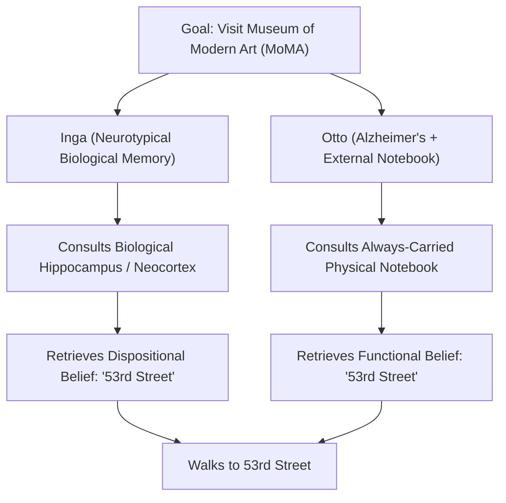
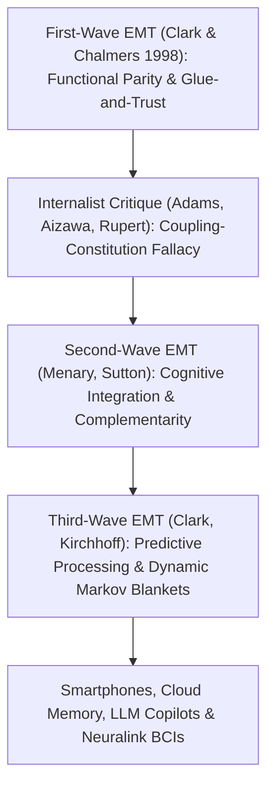

## 서론: “마음은 어디에서 멈추고, 나머지 세계는 어디에서 시작되는가?”

1998년 철학자 <strong>앤디 클라크(Andy Clark)</strong>와 <strong>데이비드 차머스(David J. Chalmers)</strong>는 학술지 《분석》(*Analysis*)에 단 일곱 페이지 분량이지만 현대 심리철학과 인지과학계를 뒤흔든 기념비적 논문 <strong>〈확장된 마음〉(*The Extended Mind*)</strong>을 발표했습니다. 논문의 첫 문장은 가장 도발적인 질문으로 시작합니다. <strong>“마음은 어디에서 멈추고, 나머지 세계는 어디에서 시작되는가?”</strong>

르네 데카르트 이후 약 400년 동안 심신이원론자든 현대의 신경물리주의자든 거의 모든 학자들은 <strong>두개골 내재주의(Cranial Internalism)</strong>를 당연한 전제로 받아들였습니다. 즉 마음과 인지의 경계는 <strong>피부와 두개골(Skin and Skull)</strong>이라는 생물학적 경계선과 정확히 일치한다는 것입니다. 주판, 종이와 연필, 수첩, 스마트폰, 나아가 오늘날의 대규모 언어 모델(LLM)은 기껏해야 마음이 외부에서 사용하는 ‘도구’나 ‘입출력 장치’일 뿐 결코 마음 그 자체의 구성 요소가 될 수 없다고 보았습니다.

클라크와 차머스는 이 오랜 도그마를 정면으로 깨뜨리며 <strong>능동적 외재주의(Active Externalism)</strong>와 <strong>확장된 마음 테제(Extended Mind Thesis, EMT)</strong>를 제창했습니다. 외부의 물리적 인공물(예: 늘 휴대하는 노트나 스마트폰)이 인간 유기체와 충분히 신뢰할 수 있고 양방향적이며 기능적으로 통합된 인과적 결합 루프를 형성할 때, 그 외부 사물은 단순한 도구를 넘어 <strong>인지 주체의 마음 체계(나아가 성향적 믿음과 기억)를 이루는 진정한 존재론적 일부가 된다</strong>는 것입니다!

---

## 1. 인식적 행위와 동등성 원리(Parity Principle): 오토와 잉가의 사고실험

인지 과정이 두개골 밖으로 확장될 수 있음을 보이기 위해, 클라크와 차머스는 먼저 데이비드 커시(David Kirsh)와 폴 마글리오(Paul Maglio, 1994)가 수행한 비디오 게임 《테트리스(Tetris)》 숙련자 연구를 인용했습니다. 고전적인 인지 모델은 플레이어가 떨어지는 블록을 눈으로 본 뒤 머릿속(시각 피질)에서 ‘심적 회전(Mental Rotation)’(약 $800	ext{–}1000\,	ext{ms}$ 소요)을 거쳐 위치를 결정한다고 가정했습니다. 그러나 실제 숙련자들은 머릿속에서 회전시키는 대신 컨트롤러 버튼을 눌러 <strong>화면 위에서 블록을 직접 물리적으로 회전</strong>시켜 보며(단 $100	ext{–}200\,	ext{ms}$ 소요) 모양을 맞췄습니다! 이처럼 뇌 내부의 계산 부담을 줄이고 속도를 높이기 위해 외부 물리적 환경을 직접 조작하는 행위를 <strong>인식적 행위(Epistemic Action)</strong>라고 부릅니다(스크래블 게임에서 글자 타일을 손으로 섞어 단어 연상을 촉발하는 것도 같은 원리입니다).

이를 바탕으로 클라크와 차머스는 유명한 <strong>동등성 원리(Parity Principle)</strong>를 정식화했습니다.
> <strong>“어떤 과제를 수행할 때 세계의 한 부분이 작동하는 방식이, 만약 그것이 머릿속에서 이루어졌더라면 주저 없이 인지 과정의 일부로 인정했을 법한 과정으로 기능한다면, 세계의 그 부분은 실제로 인지 과정의 일부이다.”</strong>

나아가 단순한 ‘계산 과정’뿐만 아니라 <strong>믿음(Beliefs)과 기억</strong> 같은 핵심 심적 상태조차 두개골 밖에 존재할 수 있음을 증명하기 위해, 그들은 현대 심리철학에서 가장 유명한 사고실험인 <strong>잉가(Inga)와 오토(Otto)</strong>를 제시했습니다.
- <strong>잉가</strong>는 정상적인 생물학적 기억력을 가진 여성입니다. 그녀는 뉴욕 현대미술관(MoMA)에서 전시회가 열린다는 소식을 듣고, 잠시 자신의 뇌(해마와 대뇌피질) 속 기억을 더듬어 미술관이 ‘53번가’에 있다는 사실을 떠올린 뒤 53번가로 걸어갑니다. 분명히 잉가는 기억을 떠올리기 전부터 이미 “현대미술관은 53번가에 있다”는 <strong>성향적 믿음(Dispositional Belief)</strong>을 가지고 있었습니다.
- <strong>오토</strong>는 경증 알츠하이머병을 앓고 있습니다. 그는 일상생활을 유지하기 위해 언제 어디서나 물리적인 <strong>노트(수첩)</strong>를 휴대합니다. 새로운 정보를 알게 되면 노트에 적고, 필요할 때마다 노트를 펼쳐 확인합니다. 오토는 전시회 소식을 듣고 노트를 꺼내 예전에 적어 둔 “현대미술관은 53번가에 있다”는 문장을 읽은 뒤 53번가로 걸어갑니다.

클라크와 차머스는 강조합니다. 오토의 노트가 오토의 행동을 설명하는 데서 수행하는 <strong>기능적 역할(Functional Role)</strong>은 잉가의 생물학적 장기기억이 잉가에게 수행하는 역할과 <strong>완벽하게 동형(isomorphic)</strong>입니다! 단지 노트가 두개골 밖에 있다는 이유만으로 오토가 노트를 펼치기 전에 그 믿음을 갖고 있었다는 사실을 부정하는 것은 근거 없는 ‘생물학적 쇼비니즘(Bio-chauvinism)’에 불과합니다.

$$
\text{Parity Principle:} \quad \text{If } \Phi_{\text{world}}(S, E) \cong_{\text{func}} \Phi_{\text{brain}}(S_{\text{internal}}) \implies E \subset \text{Cognitive System}(S)
$$

$$
I(M_{\text{bio}}; A) \approx I(M_{\text{notebook}}; A), \qquad \tau_{\text{access}}(E) \le \tau_{\text{crit}}, \qquad \mathbb{P}(\text{Endorse}(E)) \to 1
$$

---

## 2. ‘인지적 팽창’을 막는 4대 접착제와 신뢰 기준, 그리고 내재주의의 반격

만약 오토의 노트가 그의 마음의 일부라면, 도서관의 모든 책이나 인터넷 전체도 지금 당장 내 마음의 일부라는 뜻일까요? 이러한 터무니없는 <strong>인지적 팽창 반론(Cognitive Bloat Objection)</strong>을 차단하기 위해, 클라크는 외부 자원이 마음의 일부로 인정받기 위해 반드시 충족해야 할 <strong>4대 ‘접착제와 신뢰(Glue and Trust)’ 기준</strong>을 제시했습니다.
1. <strong>상시적 가용성(Constant Availability)</strong>: 오토는 노트를 늘 몸에 지니고 다니며 필요할 때 즉시 사용한다.
2. <strong>직접적이고 쉬운 접근성(Direct & Easy Accessibility)</strong>: 복잡한 장애물 없이 즉각적으로 정보를 검색하고 읽을 수 있다.
3. <strong>자동적 승인(Automatic Endorsement)</strong>: 노트에서 읽은 정보를 마치 자신의 생물학적 기억을 믿듯 의심 없이 자동으로 신뢰한다.
4. <strong>과거의 의식적 승인(Past Conscious Endorsement)</strong>: 노트에 적힌 정보는 과거에 오토 자신이 의식적으로 확인하고 기록한 것이어야 한다.

그럼에도 내재주의 철학자들은 날카로운 반론을 제기했습니다.
- <strong>프레드 애덤스와 케네스 아이자와(Adams & Aizawa, 2008)의 ‘결합-구성 오류(Coupling-Constitution Fallacy)’와 ‘인지의 표지(Mark of the Cognitive)’</strong>: 그들은 인과적 결합(causal coupling)이 곧 존재론적 구성(ontological constitution)을 의미하지는 않는다고 비판했습니다. 또한 진정한 인지는 <strong>파생되지 않은 본래적 지향성(Intrinsic Non-Derived Intentionality)</strong>을 가져야 하며 생물학적 기억의 경험적 심리 법칙(간섭 효과, 생성 효과 등)을 따라야 하는데, 노트의 잉크 자국은 사회적 관습에 의한 파생적 의미만 가질 뿐이라고 주장했습니다.
- <strong>로버트 루퍼트(Robert Rupert, 2004)의 ‘배태된 인지 가설(HEC)’과 킴 스터렐니(Kim Sterelny, 2010)의 ‘비계 설정된 마음(Scaffolded Mind)’</strong>: 이들은 마음이 외부 사물로 확장된다(Extended)는 급진적 주장 대신, 두개골 안의 마음이 외부 환경적 비계(Scaffold)에 깊이 의존한다(Embedded)고 보는 것이 인지심리학의 과학적 분류 체계를 보존하는 데 더 적합하다고 주장했습니다.

---

## 3. 제2·3세대 확장된 마음: 상보성, 예측 처리, 그리고 스마트폰 시대의 법리 혁명

비판에 직면한 확장된 마음 연구 프로그램은 제2세대와 제3세대 이론으로 진화했습니다.
- <strong>제2세대 확장된 마음(Menary, Sutton: 인지적 통합과 상보성 Complementarity)</strong>: 외부 도구가 뇌와 ‘얼마나 비슷한가(동등성 원리)’에 집착하는 대신, 뇌와 외부 도구가 <strong>얼마나 다른가</strong>에 주목합니다! 인간의 생물학적 뇌는 빠른 병렬 패턴 연상에는 뛰어나지만 긴 기호열을 정확히 보존하거나 10자리 곱셈을 하는 데는 매우 취약합니다. 뇌 내부의 유동적인 엔그램(Engrams)과 외부의 안정적인 엑소그램(Exograms)이 <strong>상보적으로 결합</strong>했기에 비로소 현대 수학과 과학이 탄생할 수 있었습니다.
- <strong>제3세대 확장된 마음(Clark, Kirchhoff: 예측 처리와 동적 마르코프 블랭킷)</strong>: 칼 프리스턴(Karl Friston)의 <strong>자유 에너지 원리(Free Energy Principle) 및 능동적 추론(Active Inference)</strong>과 결합하여, 뇌를 예측 오차 $\mathcal{F}$를 최소화하는 베이지안 엔진으로 파악합니다. 이때 인지적 자아의 통계적 경계인 <strong>마르코프 블랭킷(Markov Blanket)</strong>은 피부에 고정된 것이 아니라 외부 인식 도구의 결합에 따라 역동적으로 확장되고 재구성됩니다.

오늘날 이 철학적 논쟁은 상아탑을 넘어 현대 법학과 윤리학을 직접 바꾸어 놓았습니다.
2014년 미국 연방대법원의 역사적인 판결인 <strong>‘라일리 대 캘리포니아 사건’(*Riley v. California*)</strong>에서 존 로버츠 대법원장은 9대 0 만장일치 의견으로 경찰이 체포된 용의자의 스마트폰 내부 데이터를 <strong>영장 없이 수색하는 것은 위헌</strong>이라고 판결하며 다음과 같이 선언했습니다. *“현대 휴대전화는 일상생활의 너무나 보편적이고 필수적인 부분이 되었기에, 화성에서 온 방문객이 본다면 그것을 인간 해부학적 신체 구조(Human Anatomy)의 중요한 일부라고 결론지을 것이다!”* 스마트폰, 클라우드 세컨드 브레인(Notion/Obsidian), AI 코파일럿(LLM Copilots), 그리고 뉴럴링크(Neuralink) 뇌-컴퓨터 인터페이스가 인간의 뇌와 하나로 결합된 오늘날, 타인의 외부 디지털 기억을 악의적으로 삭제하거나 조작하는 행위는 단순한 ‘재물손괴’가 아니라 <strong>확장된 마음 자체에 대한 직접적인 인식적 납치이자 인신 공격</strong>입니다.

| 이론 사조 / 패러다임 | 마음과 인지의 경계 | 핵심 기준 / 이론적 메커니즘 | ‘오토의 노트 / 스마트폰’의 지위 | 법적·윤리적 함의 |
| :--- | :--- | :--- | :--- | :--- |
| <strong>두개골 내재주의 (Adams & Aizawa)</strong> | 생물학적 피부와 두개골 내부로 엄격히 제한 | 인지의 표지 (본래적 지향성 + 신경심리 법칙) | 외부의 인과적 도구 (결합과 구성을 혼동) | 기기 파손은 단순한 재산권 침해 |
| <strong>배태된/비계 마음 (Rupert / Sterelny)</strong> | 유기체 내부에 위치하나 외부 생태계에 고도로 의존 | 인지심리학적 간결성 + 3차원 생태적 비계 | 고대역폭 외부 인식적 비계 (Scaffold) | 핵심 외부 인지 보조 환경의 보호 |
| <strong>제1세대 확장된 마음 (Clark & Chalmers 1998)</strong> | 두개골을 넘어 신뢰성 있게 결합된 외부 인공물로 확장 | <strong>동등성 원리(Parity Principle)</strong> + 4대 접착제와 신뢰 기준 | 오토의 성향적 믿음과 기억의 <strong>존재론적 구성 부분</strong> | 영장 없는 스마트폰 수색은 정신적 사생활 침해 |
| <strong>제2·3세대 확장된 마음 (Sutton / Clark 2016)</strong> | 역동적으로 변하는 마르코프 블랭킷 (뇌-신체-기술 생태계) | <strong>상보적 통합(Complementarity)</strong> + 자유 에너지 능동적 추론 | 엔그램과 엑소그램이 함께 예측 오차를 줄이는 하이브리드 체계 | 인지적 자유권 및 신경권(Neuro-rights) 확립 |

$$
\mathcal{F}(q, s, a) = \mathbb{E}_{q(\vartheta)}\big[ \ln q(\vartheta) - \ln p(s, \vartheta \mid a) \big] = D_{\text{KL}}\big( q(\vartheta) \,\|\, p(\vartheta \mid s, a) \big) - \ln p(s \mid a)
$$
