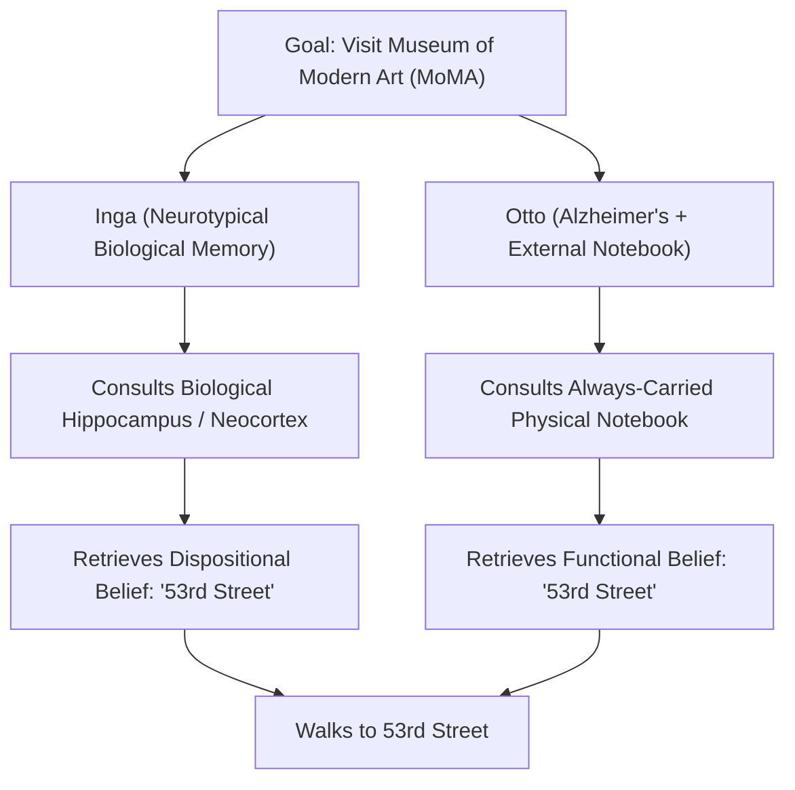
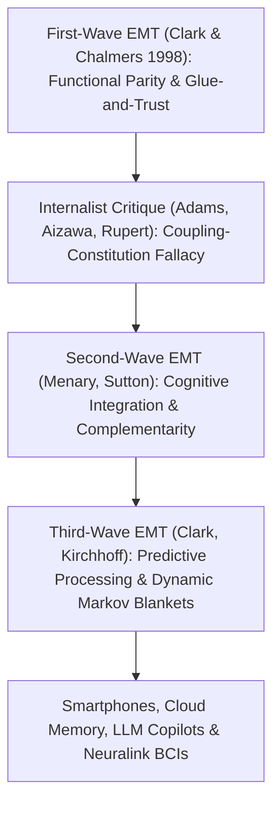

## Introdução: “Onde Termina a Mente e Onde Começa o Resto do Mundo?”

Em 1998, os filósofos <strong>Andy Clark</strong> e <strong>David J. Chalmers</strong> publicaram na revista *Analysis* um artigo de apenas sete páginas intitulado <strong>*“The Extended Mind”</strong>* (*A Mente Estendida*), que abalou os alicerces da filosofia da mente e da ciência cognitiva contemporâneas. O texto abria com uma pergunta tão simples quanto revolucionária: <strong>“Onde termina a mente e onde começa o resto do mundo?”</strong>

Durante quase quatro séculos desde René Descartes — tanto para dualistas quanto para materialistas reducionistas modernos —, quase todos tomavam como óbvio o <strong>internismo craniano</strong>: a fronteira da mente e da cognição coincide estritamente com o limite biológico da <strong>pele e do crânio (*skin and skull*)</strong>. O ábaco, o papel e a caneta, os cadernos de anotações, os smartphones ou os grandes modelos de linguagem (LLMs) atuais seriam meras *ferramentas* externas ou dispositivos de entrada e saída, jamais partes literais da própria mente.

Clark e Chalmers romperam esse dogma ao propor o <strong>externismo ativo (*Active Externalism*)</strong> e a <strong>tese da mente estendida (*Extended Mind Thesis*, EMT)</strong>: quando um artefato físico externo está acoplado a um organismo humano em um circuito causal suficientemente confiável, recíproco e funcionalmente integrado, esse artefato deixa de ser uma simples ferramenta e torna-se uma <strong>parte constitutiva da arquitetura cognitiva do agente, e até mesmo de suas crenças disposicionais</strong>!

---

## 1. Ações Epistêmicas e o Princípio da Paridade: O Experimento Mental de Otto e Inga

Para demonstrar que os processos cognitivos ultrapassam o crânio, Clark e Chalmers basearam-se inicialmente no estudo empírico de David Kirsh e Paul Maglio (1994) sobre jogadores especialistas de *Tetris*. Os modelos clássicos supunham que o jogador primeiro realiza uma “rotação mental” da peça em seu córtex visual (levando cerca de $800	ext{–}1000\,	ext{ms}$) antes de movê-la. Contudo, Kirsh e Maglio descobriram que os especialistas apertam diretamente o botão para <strong>girar fisicamente a peça na tela</strong> (em apenas $100	ext{–}200\,	ext{ms}$) a fim de verificar visualmente o encaixe! Essas ações físicas sobre o mundo externo destinadas a aliviar ou acelerar o cálculo interno do cérebro são chamadas de <strong>ações epistêmicas (*Epistemic Actions*)</strong> (assim como reorganizar fisicamente as peças de letras no *Scrabble*).

Com base nisso, Clark e Chalmers formularam seu famoso <strong>Princípio da Paridade (*Parity Principle*)</strong>:
> <strong>“Se, ao enfrentarmos uma tarefa, uma parte do mundo funciona como um processo que, se fosse realizado dentro da cabeça, não hesitaríamos em reconhecer como parte do processo cognitivo, então essa parte do mundo faz parte do processo cognitivo.”</strong>

Para provar que não apenas o cálculo, mas estados mentais genuínos como <strong>crenças (*beliefs*) e memórias</strong> podem residir fora do crânio, eles criaram o famoso experimento mental de <strong>Inga e Otto</strong>:
- <strong>Inga</strong> possui uma memória biológica normal. Ao saber de uma exposição no Museu de Arte Moderna (MoMA), ela pensa um instante, recupera de sua memória biológica (hipocampo e neocórtex) que o MoMA fica na Rua 53 e caminha até lá. É evidente que, mesmo antes de lembrar conscientemente, Inga já possuía a <strong>crença disposicional</strong> de que o MoMA fica na Rua 53.
- <strong>Otto</strong> sofre de um estágio leve da doença de Alzheimer. Para lidar com isso, ele carrega consigo para todos os lugares um <strong>caderno de anotações</strong> físico: anota toda informação nova e o consulta sempre que precisa. Ao ouvir falar da exposição, Otto abre seu caderno, lê a anotação “O MoMA fica na Rua 53” que escreveu meses antes e caminha até a Rua 53.

Clark e Chalmers argumentam que o caderno de Otto desempenha <strong>exatamente o mesmo papel funcional e explicativo</strong> no comportamento de Otto que a memória biológica no de Inga! Negar que a crença de Otto resida em seu caderno apenas porque o papel está fora do crânio é puro “biochauvinismo” injustificado.

$$
\text{Parity Principle:} \quad \text{If } \Phi_{\text{world}}(S, E) \cong_{\text{func}} \Phi_{\text{brain}}(S_{\text{internal}}) \implies E \subset \text{Cognitive System}(S)
$$

$$
I(M_{\text{bio}}; A) \approx I(M_{\text{notebook}}; A), \qquad \tau_{\text{access}}(E) \le \tau_{\text{crit}}, \qquad \mathbb{P}(\text{Endorse}(E)) \to 1
$$

---

## 2. Os Quatro Critérios de “Cola e Confiança” contra o Inchaço Cognitivo e as Críticas Internistas

Se o caderno de Otto faz parte de sua mente, isso significa que toda a Wikipédia ou a Biblioteca Nacional fazem parte da nossa mente agora mesmo? Para evitar essa objeção do <strong>inchaço cognitivo (*Cognitive Bloat*)</strong>, Clark e Chalmers estabeleceram quatro rigorosos <strong>critérios de “cola e confiança” (*Glue and Trust*)</strong>:
1. <strong>Disponibilidade constante (*Constant Availability*)</strong>: Otto carrega seu caderno sempre consigo e o utiliza rotineiramente.
2. <strong>Acessibilidade direta e fácil (*Easy Accessibility*)</strong>: a informação pode ser recuperada imediatamente sem obstáculos.
3. <strong>Endosso automático (*Automatic Endorsement*)</strong>: ao ler uma nota, Otto a aceita automaticamente como verdadeira, tal como confiamos em nossa lembrança biológica.
4. <strong>Endosso consciente passado (*Past Conscious Endorsement*)</strong>: a informação foi conscientemente validada e anotada por Otto no passado.

Ainda assim, os filósofos internistas lançaram críticas contundentes:
- <strong>Fred Adams e Kenneth Aizawa (2008): a “falácia acoplamento-constituição (*Coupling-Constitution Fallacy*)” e a “marca do cognitivo (*Mark of the Cognitive*)”</strong>: o fato de um objeto estar causalmente acoplado a um sistema não implica que ele faça parte ontológica dele. Além disso, sustentam que a cognição genuína exige representações com <strong>intencionalidade intrínseca não derivada</strong> e obediência às leis neuropsicológicas da memória biológica (efeitos de interferência e geração), enquanto a tinta no caderno possui apenas intencionalidade derivada por convenção social.
- <strong>A “hipótese da cognição incorporada/situada (*HEC*)” de Robert Rupert (2004) e a “mente andaime (*Scaffolded Mind*)” de Kim Sterelny (2010)</strong>: propõem manter a mente dentro do organismo, reconhecendo sua profunda dependência de andaimes ambientais externos (*scaffolds*).

---

## 3. Segunda e Terceira Ondas da EMT: Complementaridade, Processamento Preditivo e Direito Constitucional

Em resposta a esses debates, a teoria da mente estendida evoluiu para uma segunda e terceira ondas:
- <strong>Segunda onda (Menary, Sutton: Integração cognitiva e complementaridade)</strong>: em vez de insistir na *semelhança* (paridade) entre cérebro e caderno, destaca sua <strong>complementaridade</strong>! O cérebro biológico (*engramas*) é excelente no reconhecimento associativo rápido, mas péssimo em armazenar longas cadeias exatas de símbolos; os suportes externos (*exogramas*) fazem exatamente o oposto. Sua integração híbrida é o que torna possível a matemática e a ciência modernas.
- <strong>Terceira onda (Clark 2016, Kirchhoff: Processamento preditivo e cobertores de Markov dinâmicos)</strong>: unida ao <strong>princípio da energia livre (*Free Energy Principle*) e à inferência ativa</strong> de Karl Friston, concebe o cérebro como um motor bayesiano que minimiza o erro de predição $\mathcal{F}$. A fronteira estatística do eu cognitivo (o <strong>cobertor de Markov / *Markov Blanket*</strong>) é plástica e se expande dinamicamente para abranger nossas próteses cognitivas externas.

No século XXI, a tese da mente estendida chegou até ao direito constitucional:
Na histórica decisão <strong>*Riley v. California* (2014)</strong>, a Suprema Corte dos Estados Unidos decidiu por unanimidade (9–0) que a polícia <strong>não pode vasculhar o conteúdo digital do smartphone</strong> de um detido sem mandado judicial. O Chief Justice John Roberts escreveu: *“Os telefones celulares modernos são hoje uma parte tão onipresente e insistente da vida diária que o proverbial visitante de Marte poderia concluir que eles são uma característica importante da anatomia humana!”* Na era dos smartphones, segundos cérebros na nuvem, copilotos de IA (LLMs) e interfaces cérebro-computador (Neuralink), apagar ou manipular maliciosamente a memória digital externa de uma pessoa não é mais um simples dano material, mas uma <strong>agressão direta contra a integridade cognitiva da pessoa</strong>.

| Paradigma / Corrente | Fronteira da Mente | Critério Central / Mecanismo | Status do Caderno de Otto / Smartphone | Consequência Jurídica e Ética |
| :--- | :--- | :--- | :--- | :--- |
| <strong>Internismo Craniano (Adams & Aizawa)</strong> | Estritamente dentro da pele e do crânio | Marca do cognitivo (intencionalidade intrínseca) | Mera ferramenta causal externa (acoplamento $
eq$ constituição) | Destruição = simples dano à propriedade |
| <strong>Cognição Situada / HEC (Rupert / Sterelny)</strong> | No organismo, mas apoiada no nicho | Parcimônia psicológica e andaime ambiental | Andaime epistêmico externo de alta largura de banda | Proteção do ambiente cognitivo |
| <strong>1.ª Onda Mente Estendida (Clark & Chalmers 1998)</strong> | Estende-se a artefatos acoplados de forma confiável | <strong>Princípio da paridade</strong> + 4 critérios “Glue & Trust” | <strong>Parte constitutiva</strong> das crenças de Otto | Busca sem mandado = violação da privacidade mental |
| <strong>2.ª/3.ª Onda Mente Estendida (Sutton / Clark 2016)</strong> | Cobertor de Markov plástico (cérebro-corpo-nicho) | <strong>Complementaridade</strong> + Inferência ativa (energia livre) | Sistema híbrido de engramas e exogramas | Base dos neurodireitos e *Riley v. California* |

$$
\mathcal{F}(q, s, a) = \mathbb{E}_{q(\vartheta)}\big[ \ln q(\vartheta) - \ln p(s, \vartheta \mid a) \big] = D_{\text{KL}}\big( q(\vartheta) \,\|\, p(\vartheta \mid s, a) \big) - \ln p(s \mid a)
$$
