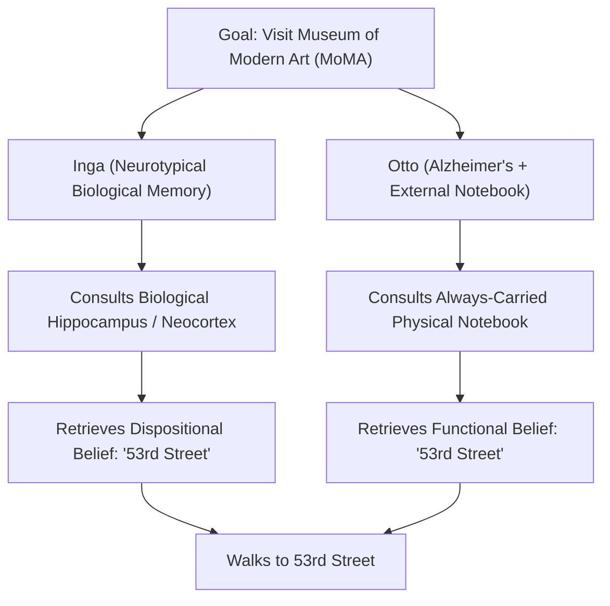
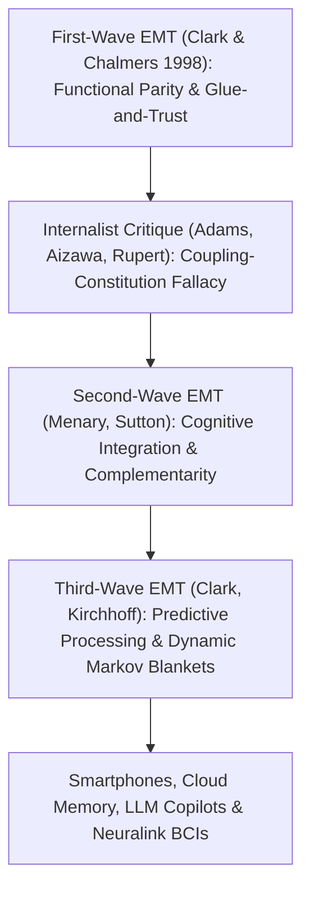

## Введение: «Где заканчивается разум и начинается остальной мир?»

В 1998 году философы <strong>Энди Кларк (Andy Clark)</strong> и <strong>Дэвид Чалмерс (David J. Chalmers)</strong> опубликовали в журнале *Analysis* всего лишь семистраничную статью под названием <strong>*«The Extended Mind»</strong>* («Расширенный разум» / «Расширенное сознание»), которая произвела эффект разорвавшейся бомбы в современной философии сознания и когнитивной науке. Статья начиналась с провокационного вопроса: <strong>«Где заканчивается разум и где начинается остальной мир?»</strong>

На протяжении почти четырёх столетий после Рене Декарта — как для дуалистов, так и для современных нейрофизиологических материалистов — <strong>краниальный интернализм (внутричерепной подход)</strong> казался самоочевидной аксиомой: границы разума и познания строго совпадают с биологическими границами <strong>кожи и черепа (*skin and skull*)</strong>. Счёты, бумага и карандаш, записные книжки, смартфоны или современные большие языковые модели (LLM) рассматривались лишь как внешние *инструменты* или устройства ввода-вывода, но никогда — как буквальная часть самого разума.

Кларк и Чалмерс разрушили эту догму, выдвинув концепцию <strong>активного экстернализма (*Active Externalism*)</strong> и <strong>тезис расширенного разума (*Extended Mind Thesis*, EMT)</strong>: когда внешний физический артефакт связан с человеческим организмом в достаточно надёжную, двустороннюю и функционально интегрированную петлю обратной связи, этот артефакт перестаёт быть просто инструментом и становится <strong>конститутивной частью когнитивной архитектуры субъекта и даже его диспозициональных убеждений</strong>!

---

## 1. Эпистемические действия и принцип паритета: Мысленный эксперимент об Отто и Инге

Чтобы показать, что когнитивные процессы выходят за пределы черепной коробки, Кларк и Чалмерс сначала обратились к эмпирическому исследованию Дэвида Кирша и Пола Мальо (1994), изучавших опытных игроков в *Тетрис* (*Tetris*). Классические когнитивные модели предполагали, что игрок сначала совершает «мысленное вращение» падающей фигурки в зрительной коре мозга (что занимает около $800	ext{–}1000\,	ext{мс}$), и лишь затем нажимает кнопки. Однако Кирш и Мальо обнаружили, что мастера *Тетриса* вместо мысленного вращения сразу нажимают кнопку, чтобы <strong>физически повернуть фигурку на экране</strong> (всего за $100	ext{–}200\,	ext{мс}$), оценивая её положение глазами! Такие физические манипуляции с внешним миром, совершаемые специально для разгрузки и ускорения внутренних вычислений мозга, называются <strong>эпистемическими действиями (*Epistemic Actions*)</strong> (как и физическое перемешивание костяшек с буквами в игре *Scrabble*).

Опираясь на это, Кларк и Чалмерс сформулировали знаменитый <strong>принцип паритета (*Parity Principle*)</strong>:
> <strong>«Если при решении некоторой задачи часть внешнего мира функционирует как процесс, который — происходи он внутри головы — мы бы без колебаний признали частью когнитивного процесса, то эта часть мира действительно является частью когнитивного процесса».</strong>

Чтобы доказать, что за пределы черепа могут выходить не только вычисления, но и подлинные ментальные состояния, такие как <strong>убеждения (*beliefs*) и память</strong>, они предложили знаменитый мысленный эксперимент об <strong>Инге и Отто</strong>:
- <strong>Инга</strong> обладает нормальной биологической памятью. Узнав о выставке в Музее современного искусства (MoMA), она на секунду задумывается, извлекает из своей биологической памяти (гиппокампа и неокортекса) сведение о том, что музей находится на 53-й улице, и идёт туда. Очевидно, что ещё *до* момента сознательного припоминания Инга уже обладала <strong>диспозициональным убеждением</strong>, что MoMA находится на 53-й улице.
- <strong>Отто</strong> страдает лёгкой формой болезни Альцгеймера. Чтобы компенсировать расстройство памяти, он повсюду носит с собой физическую <strong>записную книжку (блокнот)</strong>: каждую новую информацию он записывает туда, а при необходимости заглядывает в блокнот. Услышав о выставке, Отто открывает блокнот, читает сделанную ранее запись «MoMA находится на 53-й улице» и направляется на 53-ю улицу.

Кларк и Чалмерс утверждают: блокнот Отто играет <strong>абсолютно ту же функциональную и объяснительную роль</strong> в поведении Отто, какую биологическая долговременная память играет у Инги! Отрицать, что убеждение Отто хранилось в его блокноте до его открытия, только потому, что бумага находится снаружи черепа, — значит впадать в необоснованный «биошовинизм».

$$
\text{Parity Principle:} \quad \text{If } \Phi_{\text{world}}(S, E) \cong_{\text{func}} \Phi_{\text{brain}}(S_{\text{internal}}) \implies E \subset \text{Cognitive System}(S)
$$

$$
I(M_{\text{bio}}; A) \approx I(M_{\text{notebook}}; A), \qquad \tau_{\text{access}}(E) \le \tau_{\text{crit}}, \qquad \mathbb{P}(\text{Endorse}(E)) \to 1
$$

---

## 2. Четыре критерия «клея и доверия» против когнитивного раздувания и критика интерналистов

Если блокнот Отто — часть его разума, значит ли это, что вся Википедия или вся Российская государственная библиотека являются частью нашего разума прямо сейчас? Чтобы отсечь это возражение о <strong>когнитивном раздувании (*Cognitive Bloat*)</strong>, Кларк и Чалмерс ввели четыре жёстких <strong>критерия «клея и доверия» (*Glue and Trust*)</strong>:
1. <strong>Постоянная доступность (*Constant Availability*)</strong>: Отто никогда не расстаётся с блокнотом и обращается к нему автоматически.
2. <strong>Прямой и лёгкий доступ (*Easy Accessibility*)</strong>: информация извлекается мгновенно без серьёзных преград.
3. <strong>Автоматическое одобрение (*Automatic Endorsement*)</strong>: прочитав запись в блокноте, Отто сразу принимает её на веру, как собственное воспоминание.
4. <strong>Прошлое сознательное одобрение (*Past Conscious Endorsement*)</strong>: информация была сознательно проверена и внесена в блокнот самим Отто в прошлом.

Тем не менее философы-интерналисты выдвинули серьёзные контраргументы:
- <strong>Фред Адамс и Кеннет Айзава (2008): «ошибка смешения сцепления и конституирования (*Coupling-Constitution Fallacy*)» и «признак когнитивного (*Mark of the Cognitive*)»</strong>: причинная связь объекта с системой ещё не делает его онтологической частью этой системы. Кроме того, подлинное познание требует репрезентаций с <strong>внутренней непроизводной интенциональностью</strong> и подчинения нейропсихологическим законам биологической памяти (эффекты интерференции и генерации), тогда как чернила в блокноте обладают лишь производной интенциональностью.
- <strong>«Гипотеза укоренённого познания (*HEC*)» Роберта Руперта (2004) и «поддерживаемый разум (*Scaffolded Mind*)» Кима Стерелни (2010)</strong>: они предлагают считать, что разум остаётся внутри организма, но опирается на внешние «строительные леса» (*scaffolds*) когнитивной ниши.

---

## 3. Вторая и третья волны EMT: Дополнительность, предиктивное кодирование и конституционное право

В ответ на критику теория расширенного разума прошла через вторую и третью волны развития:
- <strong>Вторая волна (Менари, Саттон: Когнитивная интеграция и дополнительность / *Complementarity*)</strong>: вместо акцента на *сходстве* (паритете) мозга и блокнота подчёркивается их <strong>функциональная противоположность и дополнительность</strong>! Биологический мозг (*энграммы*) великолепен в быстром ассоциативном распознавании образов, но плохо хранит длинные точные цепочки символов; внешние носители (*экзограммы*) делают ровно обратное. Именно их гибридный симбиоз породил современную математику и науку.
- <strong>Третья волна (Кларк 2016, Кирхгоф: Предиктивное кодирование и динамические одеяла Маркова)</strong>: опираясь на <strong>принцип свободной энергии (*Free Energy Principle*) и активный вывод</strong> Карла Фристона, мозг описывается как байесовская машина, минимизирующая ошибку предсказания $\mathcal{F}$. Статистическая граница когнитивного «Я» (<strong>одеяло Маркова / *Markov Blanket*</strong>) пластична и динамически охватывает подключённые внешние когнитивные артефакты.

В XXI веке тезис расширенного разума вошёл в конституционное право:
В историческом решении <strong>*Riley v. California* (2014)</strong> Верховный суд США единогласно (9–0) постановил, что полиция <strong>не имеет права обыскивать цифровое содержимое смартфона</strong> задержанного без судебного ордера. Председатель Верховного суда Джон Робертс написал знаменитые слова: *«Современные мобильные телефоны стали настолько вездесущей и неотъемлемой частью повседневной жизни, что пресловутый гость с Марса мог бы заключить, будто они являются важной деталью человеческой анатомии!»* В эпоху смартфонов, облачных «вторых мозгов», ИИ-копилотов (LLM) и нейроинтерфейсов (Neuralink) взлом или удаление внешней цифровой памяти человека — это уже не просто порча имущества, а <strong>прямое посягательство на когнитивную неприкосновенность личности</strong>.

| Парадигма / Направление | Граница разума | Ключевой критерий / Механизм | Статус блокнота Отто / Смартфона | Правовое и этическое следствие |
| :--- | :--- | :--- | :--- | :--- |
| <strong>Краниальный интернализм (Adams & Aizawa)</strong> | Строго внутри кожи и черепа | Признак когнитивного (внутренняя интенциональность) | Внешний причинный инструмент (сцепление $
eq$ часть) | Поломка/удаление = обычный имущественный ущерб |
| <strong>Укоренённое познание / HEC (Rupert / Sterelny)</strong> | Внутри организма, но с опорой на нишу | Психологическая экономность и внешние «леса» | Внешний эпистемический каркас (*Scaffold*) | Защита внешней когнитивной инфраструктуры |
| <strong>1-я волна Extended Mind (Clark & Chalmers 1998)</strong> | Включает надёжно связанные артефакты | <strong>Принцип паритета</strong> + 4 критерия «Glue & Trust» | <strong>Конститутивная часть</strong> убеждений и памяти Отто | Обыск без ордера = вторжение в ментальную тайну |
| <strong>2-я/3-я волны Extended Mind (Sutton / Clark 2016)</strong> | Пластичное одеяло Маркова (мозг-тело-ниша) | <strong>Дополнительность</strong> + Активный вывод (свободная энергия) | Гибридная система энграмм и экзограмм | Обоснование нейроправ и вердикта *Riley v. California* |

$$
\mathcal{F}(q, s, a) = \mathbb{E}_{q(\vartheta)}\big[ \ln q(\vartheta) - \ln p(s, \vartheta \mid a) \big] = D_{\text{KL}}\big( q(\vartheta) \,\|\, p(\vartheta \mid s, a) \big) - \ln p(s \mid a)
$$
