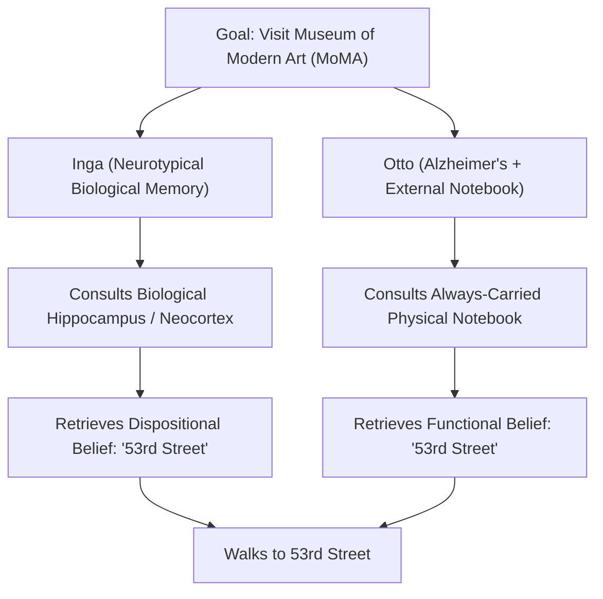
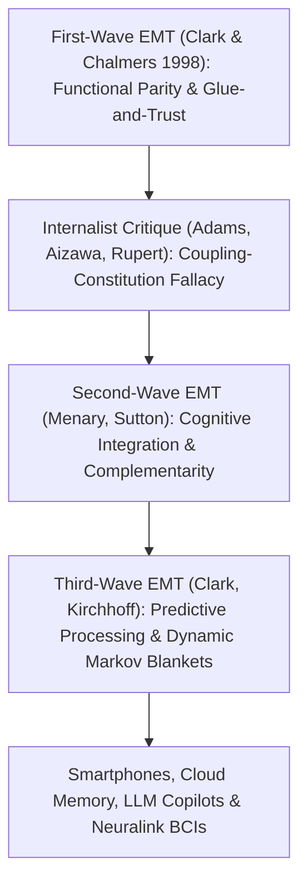

## 引言：“心智在哪里停止，世界又从哪里开始？”

1998年，哲学家<strong>安迪·克拉克（Andy Clark）</strong>与<strong>大卫·查默斯（David J. Chalmers）</strong>在《分析》（*Analysis*）期刊上发表了一篇仅有七页却震撼了当代心灵哲学与认知科学的论文——<strong>《延展心智》（*The Extended Mind*）</strong>。文章开篇便抛出了一个极具颠覆性的问题：<strong>“心智在哪里停止，外部世界又从哪里开始？”</strong>

自笛卡尔以来的近四百年间，无论是心物二元论者还是现代神经唯物主义者，几乎都默认了<strong>颅内内在主义（Cranial Internalism）</strong>：心智与认知的边界严格等同于<strong>皮肤与头骨（Skin and Skull）</strong>的生物学边界。算盘、纸笔、笔记本、智能手机乃至今天的大语言模型（LLM），充其量只是心智在外部使用的“工具”或“输入输出设备”，绝不可能是心智本身的组成部分。

克拉克与查默斯彻底打破了这一教条，提出了<strong>主动外在主义（Active Externalism）</strong>与<strong>延展心智论题（Extended Mind Thesis, EMT）</strong>：当外部物理人工制品（如随身笔记本或智能手机）与人类有机体建立起足够可靠、双向且高频的因果耦合回路时，该外部物体就不再仅仅是工具，而是<strong>在本体论上构成了认知主体心智系统（乃至其倾向性信念与记忆）的真实一部分</strong>！

---

## 1. 认识性行动与对等原则（Parity Principle）：奥托与英格的思想实验

为了论证认知过程可以跨越头骨，克拉克与查默斯首先援引了大卫·基什（David Kirsh）与保罗·马格里奥（Paul Maglio, 1994）对《俄罗斯形势（Tetris）》游戏高手的实验研究。传统认知模型认为玩家会先在脑海（视觉皮层）中进行“心理旋转”（耗时约 $800	ext{–}1000$ 毫秒），再移动方块；但实验发现，高手往往直接按下手柄按键<strong>在屏幕上物理旋转方块</strong>（仅需 $100	ext{–}200$ 毫秒）来观察形状是否匹配！这种改变外部物理世界以分担、加速内部大脑计算的行动被称为<strong>认识性行动（Epistemic Action）</strong>（如同拼字游戏玩家用手打乱木块来激发词汇联想）。

在此基础上，他们提出了著名的<strong>对等原则（Parity Principle）</strong>：
> <strong>“如果当我们面对某项任务时，外部世界的某一部分所起到的功能过程，倘若发生在脑袋内部，我们会毫不犹豫地承认它是认知过程的一部分，那么外部世界的这一部分就是（我们主张）认知过程的一部分。”</strong>

为了进一步证明不仅“计算过程”可以延展，连<strong>信念（Beliefs）与记忆</strong>这样的核心心理状态也能驻留在颅外，他们设计了心灵哲学史上最著名的思想实验——<strong>英格（Inga）与奥托（Otto）</strong>：
- <strong>英格</strong>是一位记忆力正常的普通女性。她听说纽约现代艺术博物馆（MoMA）有展览，回想了一下自己生物学大脑（海马体与新皮层）中的记忆，想起博物馆在“第53街”，于是前往第53街。显然，在她回忆起来之前，她就已经拥有“博物馆在第53街”的<strong>倾向性信念（Dispositional Belief）</strong>。
- <strong>奥托</strong>患有轻度阿尔茨海默病（老年痴呆症）。为了正常生活，他无论走到哪里都随身携带一本物理<strong>笔记本</strong>：学到新信息就写进去，需要时就翻开查阅。奥托听说展览后，掏出笔记本查到多年前写下的“现代艺术博物馆在第53街”，随后前往第53街。

克拉克与查默斯指出：奥托的笔记本在奥托的行为解释中所扮演的<strong>功能角色（Functional Role）</strong>，与英格的生物大脑记忆在英格身上所扮演的角色<strong>完全同构</strong>！如果仅仅因为笔记本位于头骨之外就否认奥托在打开笔记本前拥有该信念，完全是毫无根据的“生物沙文主义（Bio-chauvinism）”。

$$
\text{Parity Principle:} \quad \text{If } \Phi_{\text{world}}(S, E) \cong_{\text{func}} \Phi_{\text{brain}}(S_{\text{internal}}) \implies E \subset \text{Cognitive System}(S)
$$

$$
I(M_{\text{bio}}; A) \approx I(M_{\text{notebook}}; A), \qquad \tau_{\text{access}}(E) \le \tau_{\text{crit}}, \qquad \mathbb{P}(\text{Endorse}(E)) \to 1
$$

---

## 2. 防止“认知膨胀”的四大胶水与信任标准，以及内在主义的猛烈反击

如果奥托的笔记本是他心智的一部分，这是否意味着整座图书馆或整个互联网现在都是你心智的一部分？为了克服这一<strong>认知膨胀异议（Cognitive Bloat Objection）</strong>，克拉克提出了外部资源成为心智一部分必须同时满足的<strong>四大“胶水与信任（Glue and Trust）”标准</strong>：
1. <strong>恒常可用性（Constant Availability）</strong>：奥托去哪儿都带着笔记本，从不离身；
2. <strong>直接易得性（Direct & Easy Accessibility）</strong>：无需繁琐障碍即可瞬间检索读取；
3. <strong>自动背书（Automatic Endorsement）</strong>：一旦从笔记本读出信息，奥托会像相信自己的生物记忆一样自动采信，无需二次怀疑核实；
4. <strong>过往有意识背书（Past Conscious Endorsement）</strong>：笔记本里的内容必须是奥托过去亲自认可并写入的。

即便如此，内在主义哲学家依然发起了猛烈反击：
- <strong>亚当斯与相泽（Fred Adams & Kenneth Aizawa, 2008）的“耦合-构成谬误（Coupling-Constitution Fallacy）”与“认知的标志（Mark of the Cognitive）”</strong>：他们指出，因果耦合绝不等于本体论构成（恒温器的双金属片与空调因果耦合，但金属膨胀不是制冷；保龄球与手臂耦合，但球不是身体的一部分）。此外，真正的认知必须具有<strong>非派生的内在意向性（Intrinsic Non-Derived Intentionality）</strong>并遵循人类生物记忆特有的心理学定律（如韦伯定律、干扰效应），而笔记本上的墨水字迹只有社会赋予的派生意义。
- <strong>罗伯特·鲁珀特（Robert Rupert, 2004）的“嵌入认知假说（HEC）”與金·斯特렐尼（Kim Sterelny, 2010）的“脚手架心智（Scaffolded Mind）”</strong>：他们主张用更温和的“心智依赖于外部环境脚手架（Embedded / Scaffolded）”取代激进的“心智延展到外部物体（Extended）”，以保持实验心理学对生物记忆分类的科学严谨性。

---

## 3. 第二代与第三代延展心智：互补性、预测加工与智能手机时代的法理革命

面对批评，延展心智理论演化出了第二代与第三代理论：
- <strong>第二代延展心智（Menary, Sutton：认知整合与互补性 Complementarity）</strong>：不再强调外部工具与大脑“有多像（对等原则）”，而是强调它们<strong>有多不同</strong>！人类生物大脑擅长快速的并行模式联想，却极其不擅长精确存储长串任意符号或进行十位数乘法；正因为外部笔记本（外铭文 Exograms）与内部神经元（内铭文 Engrams）在功能上<strong>高度互补</strong>，两者的深度整合才催生了现代数学与科学。
- <strong>第三代延展心智（Clark, Kirchhoff：预测加工与动态马尔可夫毯）</strong>：结合卡尔·弗里斯顿（Karl Friston）的<strong>自由能原理（Free Energy Principle）与主动推理（Active Inference）</strong>，大脑是一台不断最小化预测误差 $\mathcal{F}$ 的贝叶斯引擎，认知自我的统计边界（马尔可夫毯 Markov Blanket）并非固定在皮肤上，而是随着外部认识性工具的接入而动态伸缩。

今天，这一哲学争论早已走出象牙塔，直接改写了现代法律与伦理：
2014年，在美国联邦最高法院具有里程碑意义的<strong>“莱利诉加利福尼亚州案”（*Riley v. California*）</strong>中，首席大法官约翰·罗伯茨代表全院9比0一致裁定：警察在逮捕嫌疑人时，<strong>未经法官签发搜查令，绝对不得搜查其智能手机中的数据</strong>。罗伯茨大法官在判词中写道：*“现代手机已成为日常生活如此普遍而紧迫的一部分，以至于来自火星的访客可能会得出结论：手机就是人类解剖结构（Human Anatomy）的重要组成部分！”* 在智能手机、云端笔记（Notion/Obsidian）、AI 大模型副驾驶（LLM Copilots）与 Neuralink 脑机接口与人类大脑深度耦合的今天，恶意篡改或删除他人的外部数字记忆已不再是单纯的“财产侵害”，而是对<strong>延展心智本体的直接认识性劫持与人身攻击</strong>。

| 理论流派 / 范式 | 心智与认知的边界 | 核心判据 / 理论机制 | 对“奥托笔记本/智能手机”的定性 | 法律与伦理推论 |
| :--- | :--- | :--- | :--- | :--- |
| <strong>颅内内在主义（Adams & Aizawa）</strong> | 严格限制在生物皮肤与头骨之内 | 认知的标志（非派生意向性 + 神经心理定律） | 外部因果工具（混淆耦合与构成） | 损坏设备仅属普通财物毁损 |
| <strong>嵌入/脚手架心智（Rupert / Sterelny）</strong> | 位于有机体内部，但重度依赖外部生态位 | 实验心理学分类简约性 + 三维生态位脚手架 | 高带宽外部认识性脚手架（Scaffold） | 保护关键外部认知辅助设施 |
| <strong>第一代延展心智（Clark & Chalmers 1998）</strong> | 跨越头骨，延展至可靠耦合的外部人工制品 | <strong>对等原则（Parity Principle）</strong> + 四大胶水与信任标准 | 奥托倾向性信念与记忆的<strong>本体论构成部分</strong> | 搜查/毁坏手机即侵犯心智隐私与人身 |
| <strong>第二/三代延展心智（Sutton / Clark 2016）</strong> | 动态可塑的马尔可夫毯（脑-身体-技术生态位） | <strong>互补性整合（Complementarity）</strong> + 自由能主动推理 | 内铭文与外铭文协同最小化预测误差的混合系统 | 确立数字时代的认知自由权与神经权利（Neuro-rights） |

$$
\mathcal{F}(q, s, a) = \mathbb{E}_{q(\vartheta)}\big[ \ln q(\vartheta) - \ln p(s, \vartheta \mid a) \big] = D_{\text{KL}}\big( q(\vartheta) \,\|\, p(\vartheta \mid s, a) \big) - \ln p(s \mid a)
$$
