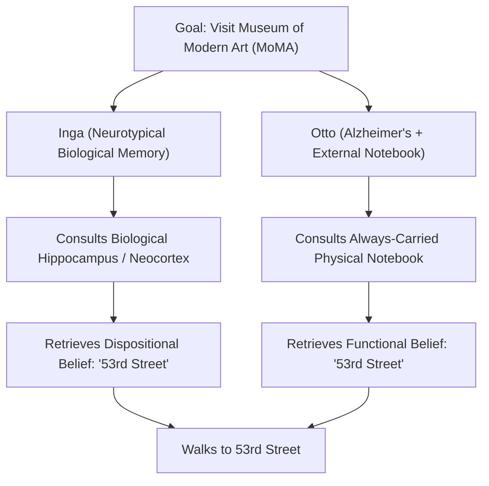
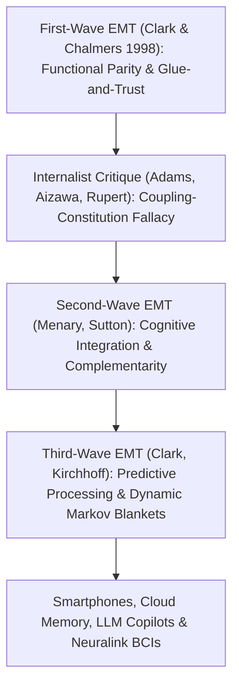

## 引言：「心智在哪裡停止，世界又從哪裡開始？」

1998年，哲學家<strong>安迪·克拉克（Andy Clark）</strong>與<strong>大衛·查默斯（David J. Chalmers）</strong>在《分析》（*Analysis*）期刊上發表了一篇僅有七頁卻震撼了當代心靈哲學與認知科學的論文——<strong>《延展心智》（*The Extended Mind*）</strong>。文章開篇便拋出了一個極具顛覆性的問題：<strong>「心智在哪裡停止，外部世界又從哪裡開始？」</strong>

自笛卡兒以來的近四百年間，無論是心物二元論者還是現代神經唯物主義者，幾乎都默認了<strong>顱內內在主義（Cranial Internalism）</strong>：心智與認知的邊界嚴格等同於<strong>皮膚與頭骨（Skin and Skull）</strong>的生物學邊界。算盤、紙筆、筆記本、智慧型手機乃至今天的大型語言模型（LLM），充其量只是心智在外部使用的「工具」或「輸入輸出設備」，絕不可能是心智本身的組成部分。

克拉克與查默斯徹底打破了這一教條，提出了<strong>主動外在主義（Active Externalism）</strong>與<strong>延展心智論題（Extended Mind Thesis, EMT）</strong>：當外部物理人工製品（如隨身筆記本或智慧型手機）與人類有機體建立起足夠可靠、雙向且高頻的因果耦合迴路時，該外部物體就不再僅僅是工具，而是<strong>在本體論上構成了認知主體心智系統（乃至其傾向性信念與記憶）的真實一部分</strong>！

---

## 1. 認識性行動與對等原則（Parity Principle）：奧托與英格的思想實驗

為了論證認知過程可以跨越頭骨，克拉克與查默斯首先援引了大衛·基什（David Kirsh）與保羅·馬格里奧（Paul Maglio, 1994）對《俄羅斯方塊（Tetris）》遊戲高手的實驗研究。傳統認知模型認為玩家會先在腦海（視覺皮質）中進行「心理旋轉」（耗時約 $800	ext{–}1000$ 毫秒），再移動方塊；但實驗發現，高手往往直接按下手把按鍵<strong>在螢幕上物理旋轉方塊</strong>（僅需 $100	ext{–}200$ 毫秒）來觀察形狀是否匹配！這種改變外部物理世界以分擔、加速內部大腦計算的行動被稱為<strong>認識性行動（Epistemic Action）</strong>（如同拼字遊戲玩家用手打亂木塊來激發詞彙聯想）。

在此基礎上，他們提出了著名的<strong>對等原則（Parity Principle）</strong>：
> <strong>「如果當我們面對某項任務時，外部世界的某一部分所起到的功能過程，倘若發生在腦袋內部，我們會毫不猶豫地承認它是認知過程的一部分，那麼外部世界的這一部分就是（我們主張）認知過程的一部分。」</strong>

為了進一步證明不僅「計算過程」可以延展，連<strong>信念（Beliefs）與記憶</strong>這樣的核心心理狀態也能駐留在顱外，他們設計了心靈哲學史上最著名的思想實驗——<strong>英格（Inga）與奧托（Otto）</strong>：
- <strong>英格</strong>是一位記憶力正常的普通女性。她聽說紐約現代藝術博物館（MoMA）有展覽，回想了一下自己生物學大腦（海馬迴與新皮質）中的記憶，想起博物館在「第53街」，於是前往第53街。顯然，在她回憶起來之前，她就已經擁有「博物館在第53街」的<strong>傾向性信念（Dispositional Belief）</strong>。
- <strong>奧托</strong>患有輕度阿茲海默症。為了正常生活，他無論走到哪裡都隨身攜帶一本物理<strong>筆記本</strong>：學到新資訊就寫進去，需要時就翻開查閱。奧托聽說展覽後，掏出筆記本查到多年前寫下的「現代藝術博物館在第53街」，隨後前往第53街。

克拉克與查默斯指出：奧托的筆記本在奧托的行為解釋中所扮演的<strong>功能角色（Functional Role）</strong>，與英格的生物大腦記憶在英格身上所扮演的角色<strong>完全同構</strong>！如果僅僅因為筆記本位於頭骨之外就否認奧托在打開筆記本前擁有該信念，完全是毫無根據的「生物沙文主義（Bio-chauvinism）」。

$$
\text{Parity Principle:} \quad \text{If } \Phi_{\text{world}}(S, E) \cong_{\text{func}} \Phi_{\text{brain}}(S_{\text{internal}}) \implies E \subset \text{Cognitive System}(S)
$$

$$
I(M_{\text{bio}}; A) \approx I(M_{\text{notebook}}; A), \qquad \tau_{\text{access}}(E) \le \tau_{\text{crit}}, \qquad \mathbb{P}(\text{Endorse}(E)) \to 1
$$

---

## 2. 防止「認知膨脹」的四大膠水與信任標準，以及內在主義的猛烈反擊

如果奧托的筆記本是他心智的一部分，這是否意味著整座圖書館或整個網際網路現在都是你心智的一部分？為了克服這一<strong>認知膨脹異議（Cognitive Bloat Objection）</strong>，克拉克提出了外部資源成為心智一部分必須同時滿足的<strong>四大「膠水與信任（Glue and Trust）」標準</strong>：
1. <strong>恆常可用性（Constant Availability）</strong>：奧托去哪兒都帶著筆記本，從不離身；
2. <strong>直接易得性（Direct & Easy Accessibility）</strong>：無需繁瑣障礙即可瞬間檢索讀取；
3. <strong>自動背書（Automatic Endorsement）</strong>：一旦從筆記本讀出資訊，奧托會像相信自己的生物記憶一樣自動採信，無需二次懷疑核實；
4. <strong>過往有意識背書（Past Conscious Endorsement）</strong>：筆記本裡的內容必須是奧托過去親自認可並寫入的。

即便如此，內在主義哲學家依然發起了猛烈反擊：
- <strong>亞當斯與相澤（Fred Adams & Kenneth Aizawa, 2008）的「耦合-構成謬誤（Coupling-Constitution Fallacy）」與「認知的標誌（Mark of the Cognitive）」</strong>：他們指出，因果耦合絕不等於本體論構成（恆溫器的雙金屬片與冷氣機因果耦合，但金屬膨脹不是製冷；保齡球與手臂耦合，但球不是身體的一部分）。此外，真正的認知必須具有<strong>非派生的內在意向性（Intrinsic Non-Derived Intentionality）</strong>並遵循人類生物記憶特有的心理學定律（如韋伯定律、干擾效應），而筆記本上的墨水字跡只有社會賦予的派生意義。
- <strong>羅伯特·魯珀特（Robert Rupert, 2004）的「嵌入認知假說（HEC）」與金·斯特雷爾尼（Kim Sterelny, 2010）的「鷹架心智（Scaffolded Mind）」</strong>：他們主張用更溫和的「心智依賴於外部環境鷹架（Embedded / Scaffolded）」取代激進的「心智延展到外部物體（Extended）」，以保持實驗心理學對生物記憶分類的科學嚴謹性。

---

## 3. 第二代與第三代延展心智：互補性、預測加工與智慧型手機時代的法理革命

面對批評，延展心智理論演化出了第二代與第三代理論：
- <strong>第二代延展心智（Menary, Sutton：認知整合與互補性 Complementarity）</strong>：不再強調外部工具與大腦「有多像（對等原則）」，而是強調它們<strong>有多不同</strong>！人類生物大腦擅長快速的平行模式聯想，卻極其不擅長精確儲存長串任意符號或進行十位數乘法；正因為外部筆記本（外銘文 Exograms）與內部神經元（內銘文 Engrams）在功能上<strong>高度互補</strong>，兩者的深度整合才催生了現代數學與科學。
- <strong>第三代延展心智（Clark, Kirchhoff：預測加工與動態馬可夫毯）</strong>：結合卡爾·弗里斯頓（Karl Friston）的<strong>自由能原理（Free Energy Principle）與主動推理（Active Inference）</strong>，大腦是一台不斷最小化預測誤差 $\mathcal{F}$ 的貝氏引擎，認知自我的統計邊界（馬可夫毯 Markov Blanket）並非固定在皮膚上，而是隨著外部認識性工具的接入而動態伸縮。

今天，這一哲學爭論早已走出象牙塔，直接改寫了現代法律與倫理：
2014年，在美國聯邦最高法院具有里程碑意義的<strong>「萊利訴加利福尼亞州案」（*Riley v. California*）</strong>中，首席大法官約翰·羅伯茨代表全院9比0一致裁定：警察在逮捕嫌疑人時，<strong>未經法官簽發搜索票，絕對不得搜查其智慧型手機中的資料</strong>。羅伯茨大法官在判詞中寫道：*「現代手機已成為日常生活如此普遍而緊迫的一部分，以至於來自火星的訪客可能會得出結論：手機就是人類解剖結構（Human Anatomy）的重要組成部分！」* 在智慧型手機、雲端筆記（Notion/Obsidian）、AI 大模型副駕駛（LLM Copilots）與 Neuralink 腦機介面與人類大腦深度耦合的今天，惡意竄改或刪除他人的外部數位記憶已不再是單純的「財產侵害」，而是對<strong>延展心智本體的直接認識性劫持與人身攻擊</strong>。

| 理論流派 / 典範 | 心智與認知的邊界 | 核心判準 / 理論機制 | 對「奧托筆記本/智慧型手機」的定性 | 法律與倫理推論 |
| :--- | :--- | :--- | :--- | :--- |
| <strong>顱內內在主義（Adams & Aizawa）</strong> | 嚴格限制在生物皮膚與頭骨之內 | 認知的標誌（非派生意向性 + 神經心理定律） | 外部因果工具（混淆耦合與構成） | 損壞設備僅屬普通財物毀損 |
| <strong>嵌入/鷹架心智（Rupert / Sterelny）</strong> | 位於有機體內部，但重度依賴外部生態位 | 實驗心理學分類簡約性 + 三維生態位鷹架 | 高頻寬外部認識性鷹架（Scaffold） | 保護關鍵外部認知輔助設施 |
| <strong>第一代延展心智（Clark & Chalmers 1998）</strong> | 跨越頭骨，延展至可靠耦合的外部人工製品 | <strong>對等原則（Parity Principle）</strong> + 四大膠水與信任標準 | 奧托傾向性信念與記憶的<strong>本體論構成部分</strong> | 搜查/毀壞手機即侵犯心智隱私與人身 |
| <strong>第二/三代延展心智（Sutton / Clark 2016）</strong> | 動態可塑的馬可夫毯（腦-身體-技術生態位） | <strong>互補性整合（Complementarity）</strong> + 自由能主動推理 | 內銘文與外銘文協同最小化預測誤差的混合系統 | 確立數位時代的認知自由權與神經權利（Neuro-rights） |

$$
\mathcal{F}(q, s, a) = \mathbb{E}_{q(\vartheta)}\big[ \ln q(\vartheta) - \ln p(s, \vartheta \mid a) \big] = D_{\text{KL}}\big( q(\vartheta) \,\|\, p(\vartheta \mid s, a) \big) - \ln p(s \mid a)
$$
