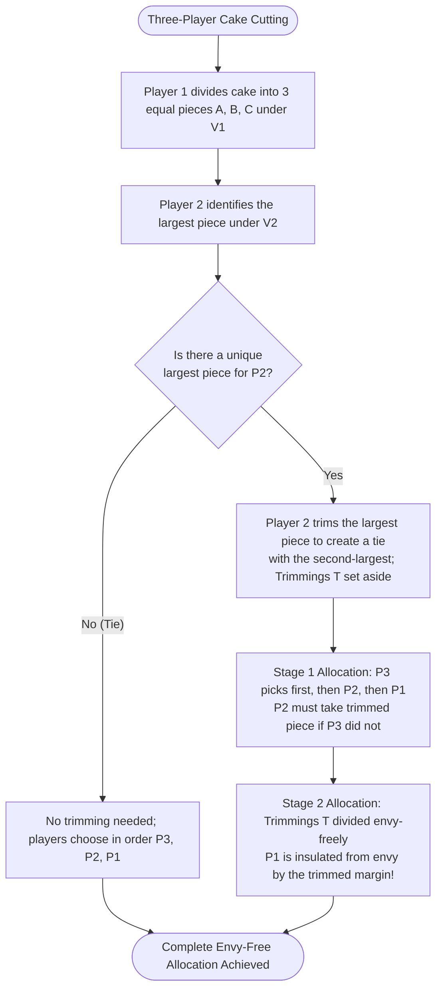
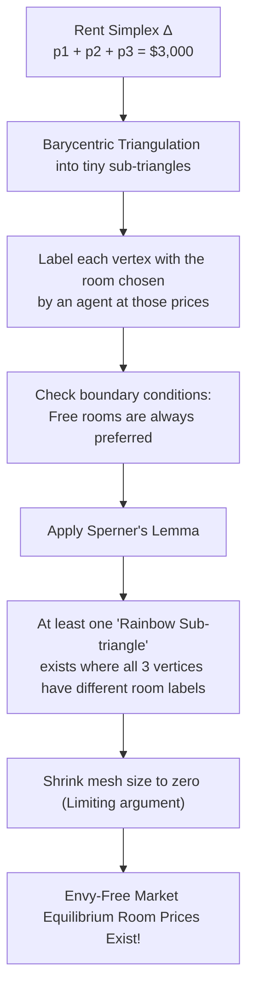

Whenever siblings attempt to divide a birthday cake, heirs negotiate the liquidation of an estate, divorcing couples untangle communal property, or roommates allocate bedrooms and rent, human beings collide directly with the elusive concept of <strong>fairness</strong>.

From early childhood, the universal folklore solution passed down through generations is the venerable <strong>"Cut and Choose"</strong> (or "I cut, you choose") protocol. One person slices the cake into two pieces, striving with surgical precision to make them equal in value, and the second person gets first pick. Under this elegant rule, neither party can rationally complain: the cutter gets a piece they deem to be at least half, and the chooser picks the piece they prefer.

Yet, what happens when there are <strong>three or more participants</strong>?

What happens if the cake is heterogeneous—featuring chocolate frosting on one side, fresh strawberries in the middle, and matcha cream on the other—and the participants harbor wildly divergent, asymmetric tastes? If one person is allergic to strawberries while another craves chocolate above all else, slicing the cake into three equal geometric slabs by volume is practically guaranteed to cause outrage.

Is it mathematically possible to divide a heterogeneous resource among $n$ individuals with completely arbitrary, subjective preferences such that <strong>every single person believes they received a fair share, and not a single soul envies the portion assigned to anyone else</strong>?

This fascinating question lies at the core of <strong>Fair Division Theory</strong>, widely celebrated in mathematics and theoretical computer science as the <strong>"Cake-Cutting Problem"</strong>.

Formulated rigorously in the 1940s by Polish mathematician Hugo Steinhaus and his colleagues in Lwów, fair division has blossomed into a profound discipline uniting measure theory, topology (fixed-point theorems and Sperner's lemma), algorithmic game theory, and mechanism design. In 2016, computer scientists Haris Aziz and Simon Mackenzie achieved a historic breakthrough by inventing the first bounded, finite algorithm to achieve envy-free division for any arbitrary number of players—solving a problem that had baffled the mathematical community for over half a century.

This comprehensive treatise explores the formal measure-theoretic architecture of fairness, dissects why envy-freeness is vastly more demanding than proportionality, unpacks the brilliant Selfridge-Conway discrete protocol for three players, examines the topological mechanics of room and rent division via Sperner's lemma, navigates the challenge of chore division (allocating burdens rather than benefits), and surveys the cutting-edge frontier of indivisible goods and Nash social welfare.

---

## 1. The Measure-Theoretic Foundation of the Cake

To study fairness mathematically, we must first abstract both the physical object being divided and the internal, subjective psychology of the agents doing the dividing.

### 1.1 The Cake as a Continuous Metric Space

In the classical formulation, the cake is modeled as the unit interval:

$$
X = [0, 1]
$$

More generally, $X$ can represent any bounded, compact Borel-measurable subset of $d$-dimensional Euclidean space $\mathbb{R}^d$. A "slice" or "piece" of cake is a measurable subset $A \in \mathcal{B}(X)$, where $\mathcal{B}(X)$ denotes the Borel $\sigma$-algebra on $X$.

### 1.2 Valuation Measures: Quantifying Subjective Desirability

Suppose there are $n$ distinct agents, indexed by $i \in \{1, 2, \dots, n\}$.
Each agent $i$ possesses a private, subjective <strong>valuation measure</strong> $V_i: \mathcal{B}(X) \to [0, 1]$.

In standard fair division theory, each $V_i$ is assumed to satisfy four core measure-theoretic axioms:

1. <strong>Normalization</strong>:
   The value of the entire cake to agent $i$ is standardized to $1$, while the empty set holds zero value:
   $$
   V_i(X) = 1, \quad V_i(\emptyset) = 0
   $$
2. <strong>Non-Negativity</strong>:
   For any piece $A \subseteq X$, $V_i(A) \ge 0$. (The cake consists of desirable goods; burdens or chores carry negative valuations).
3. <strong>Countable Additivity</strong>:
   For any countable collection of pairwise disjoint pieces $\{A_k\}_{k=1}^\infty$ ($A_j \cap A_k = \emptyset$ for $j \neq k$):
   $$
   V_i\left(\bigcup_{k=1}^\infty A_k\right) = \sum_{k=1}^\infty V_i(A_k)
   $$
4. <strong>Non-Atomicity (Divisibility)</strong>:
   There are no indivisible "point masses" of value. For any piece $A$ with $V_i(A) > 0$ and any real scalar $\alpha \in [0, 1]$, there exists a sub-piece $B \subset A$ such that:
   $$
   V_i(B) = \alpha V_i(A)
   $$
   Physically, this guarantees that a knife can cut at any continuous coordinate, allowing infinitesimal adjustments.

### 1.3 Value Density Functions

Under the Radon-Nikodym theorem, if $V_i$ is absolutely continuous with respect to standard Lebesgue measure $\lambda$, there exists an integrable <strong>value density function</strong> $v_i: [0, 1] \to \mathbb{R}_{\ge 0}$ such that:

$$
V_i(A) = \int_A v_i(x) \, dx, \quad \text{with} \quad \int_0^1 v_i(x) \, dx = 1
$$

The revolutionary elegance of this model is that <strong>agents need not agree on anything</strong>. Agent 1 may place $90\%$ of their valuation on the interval $[0, 0.2]$ (the chocolate topping) and virtually zero on the rest, while Agent 2 distributes their value uniformly across $[0.5, 1.0]$. The algorithm operates solely on how agents value pieces relative to their own private measures, completely immune to interpersonal utility comparisons.

---

## 2. Four Notions of Fairness: Defining the Objective

An <strong>allocation</strong> is a partition of the cake $X$ into $n$ pairwise disjoint measurable pieces $(X_1, X_2, \dots, X_n)$ such that:

$$
\bigcup_{i=1}^n X_i = X \quad \text{and} \quad X_i \cap X_j = \emptyset \quad (\forall i \neq j)
$$

where piece $X_i$ is allocated to agent $i$. 

When is such an allocation "fair"? Mathematical literature formalizes four distinct, non-equivalent concepts of fairness:

| Fairness Criterion | Formal Definition | Intuitive Meaning | Computational Difficulty |
| :---: | :---: | :---: | :---: |
| <strong>Proportionality (PROP)</strong> | $\forall i, \quad V_i(X_i) \ge \frac{1}{n}$ | Every agent gets at least an equal fraction ($1/n$) of the total value | Moderate (Solved in 1944) |
| <strong>Envy-Freeness (EF)</strong> | $\forall i, j, \quad V_i(X_i) \ge V_i(X_j)$ | No agent prefers another agent's assigned portion to their own | Extremely high ($n \ge 3$) |
| <strong>Equitability (EQ)</strong> | $\forall i, j, \quad V_i(X_i) = V_j(X_j)$ | All agents experience the exact same numerical subjective utility | High; requires interpersonal scaling |
| <strong>Pareto Efficiency (PE)</strong> | No alternative allocation $X'$ has $V_i(X'_i) \ge V_i(X_i)$ with strict inequality for at least one agent | No cake is wasted; all mutually beneficial trades are exhausted | Optimization benchmark |

### 2.1 Proportionality (Steinhaus, 1944)

The most foundational benchmark is proportionality: in a room of $n$ people, each individual is entitled to at least a $1/n$ share of the total pie according to their own subjective evaluation:

$$
V_i(X_i) \ge \frac{1}{n} \quad (\forall i \in \{1, \dots, n\})
$$

When $n = 2$, proportionality dictates $V_i(X_i) \ge 1/2$. Because the total valuation is $V_i(X_1) + V_i(X_2) = 1$, if $V_1(X_1) \ge 1/2$, it automatically follows that $V_1(X_2) \le 1/2$, which implies $V_1(X_1) \ge V_1(X_2)$. Thus, <strong>for two players, proportionality and envy-freeness are mathematically identical</strong>.

### 2.2 Envy-Freeness: The Gold Standard

For $n \ge 3$, proportionality and envy-freeness diverge sharply.

Consider an allocation among three agents—Alice ($A$), Bob ($B$), and Charlie ($C$). Suppose Alice evaluates the three assigned pieces as follows:
- Her own slice $X_A$: $V_A(X_A) = 0.35$
- Bob's slice $X_B$: $V_A(X_B) = 0.50$
- Charlie's slice $X_C$: $V_A(X_C) = 0.15$

Notice that $V_A(X_A) = 0.35 > 1/3 \approx 0.333$. <strong>The allocation is strictly proportional for Alice!</strong> She received more than her fair one-third share.

Yet Alice looks across the table at Bob's plate and sees a slice she values at $0.50$. She experiences bitter <strong>envy</strong>. She would gladly surrender her own piece to seize Bob's.

An allocation is defined as <strong>Envy-Free (EF)</strong> if and only if:

$$
\forall i, j \in \{1, \dots, n\}, \quad V_i(X_i) \ge V_i(X_j)
$$

Every envy-free allocation is automatically proportional. Summing over all $j$:

$$
n V_i(X_i) \ge \sum_{j=1}^n V_i(X_j) = V_i(X) = 1 \implies V_i(X_i) \ge \frac{1}{n}
$$

However, the converse is emphatically false. Envy-freeness is an inherently relational, pairwise constraint requiring $\binom{n}{2}$ simultaneous inequalities to hold across heterogeneous perspectives.

---

## 3. Two-Player Division: The Timeless "Cut and Choose"

For $n = 2$, the Cut and Choose protocol solves the problem in two elementary steps:

```mermaid
sequenceDiagram
    autonumber
    actor A as Player 1 (Cutter)
    actor B as Player 2 (Chooser)
    Note over A: Cuts cake at point c such that<br/>V1([0, c]) = 1/2 and V1([c, 1]) = 1/2
    A->>B: Presents pieces X1 = [0, c] and X2 = [c, 1]
    Note over B: Evaluates both pieces under V2
    alt V2(X1) >= V2(X2)
        B->>B: Takes piece X1
        A->>A: Receives remaining piece X2
    else V2(X2) > V2(X1)
        B->>B: Takes piece X2
        A->>A: Receives remaining piece X1
    end
    Note over A,B: Both players secure >= 1/2; zero envy exists!
```

### 3.1 Step-by-Step Mechanics
1. <strong>The Cut</strong>: Player 1 (the Cutter) identifies a coordinate $c \in [0, 1]$ such that:
   $$
   V_1([0, c]) = V_1([c, 1]) = \frac{1}{2}
   $$
   By the Intermediate Value Theorem and non-atomicity of $V_1$, such a coordinate $c$ always exists.
2. <strong>The Choice</strong>: Player 2 (the Chooser) selects whichever piece has greater value under $V_2$:
   $$
   \text{Chooser picks } \arg\max_{k \in \{1, 2\}} V_2(X_k)
   $$
   Player 1 receives the unchosen piece.

### 3.2 Strategic Asymmetry: The Chooser's Information Rent
While Cut and Choose is envy-free and proportional, it exhibits a fascinating game-theoretic asymmetry: <strong>the Chooser possesses a systematic structural advantage.</strong>

- The Cutter is constrained by self-protection: to guarantee receiving at least $1/2$, they must slice the cake into two pieces of exact equal value $1/2$. Consequently, <strong>the Cutter never receives more than $50\%$ subjective utility</strong>.
- The Chooser, however, exploits differences in preference. If the Cutter slices a cake with half chocolate and half vanilla, and the Chooser loves chocolate exclusively ($V_2(\text{choc}) = 1.0$), the Chooser claims the chocolate half and walks away with <strong>$100\%$ subjective utility</strong>!

In economic terms, all subjective surplus generated by heterogeneous tastes flows directly to the Chooser.

---

## 4. The Three-Player Breakthrough: The Selfridge-Conway Protocol

For nearly two decades following World War II, the question of whether an envy-free protocol existed for $n = 3$ without requiring infinite knife movements remained open.

Around 1960, mathematicians <strong>John Selfridge</strong> and <strong>John Horton Conway</strong> independently discovered an astonishing discrete protocol that guarantees envy-freeness for three players using at most five cuts.



### 4.1 Stage 1: Main Cake Division and Trimming
Let the players be $P_1, P_2, P_3$.

1. <strong>Division by $P_1$</strong>: $P_1$ cuts the cake into three slices $A, B, C$ that are strictly equal under $V_1$:
   $$
   V_1(A) = V_1(B) = V_1(C) = \frac{1}{3}
   $$
2. <strong>Trimming by $P_2$</strong>: $P_2$ evaluates $A, B, C$ under $V_2$.
   - If two or three pieces tie for maximum value under $V_2$, no trimming is performed.
   - If one piece (say $A$) is strictly larger than the second largest, $P_2$ trims a slice $T$ off $A$ so that the remaining slice $A'$ ties with the second largest piece under $V_2$:
     $$
     V_2(A') = V_2(\text{second largest})
     $$
   The trimmings $T$ are set aside on a plate for Stage 2.
3. <strong>Allocation of Main Slices ($A', B, C$)</strong>:
   - <strong>$P_3$ chooses first</strong>, taking their favorite piece.
   - <strong>$P_2$ chooses second</strong>, with one mandatory rule: *If $P_3$ did not pick the trimmed slice $A'$, $P_2$ must take $A'$*.
   - <strong>$P_1$ receives the remaining slice</strong>.

#### Envy Audit for Stage 1:
- <strong>$P_3$</strong> chose first among all available options, so $P_3$ envies nobody.
- <strong>$P_2$</strong> had two pieces tied for first place under $V_2$ ($A'$ and whichever piece tied with it). Even after $P_3$ picked one, a top-tier piece was guaranteed to remain for $P_2$. Thus $P_2$ envies nobody.
- <strong>$P_1$</strong> values $B$ and $C$ at exactly $1/3$, while $A'$ is worth strictly less than $1/3$. Since $A'$ was guaranteed to be claimed by either $P_3$ or $P_2$, $P_1$ is guaranteed to receive an untrimmed piece ($B$ or $C$) worth exactly $1/3$. Since the other untrimmed piece is also worth $1/3$ to $P_1$, $P_1$ envies nobody!

At the conclusion of Stage 1, the main cake is allocated with zero envy among all three players.

### 4.2 Stage 2: Dividing the Trimmings $T$
The residual trimmings $T$ must now be allocated without destroying the delicate harmony of Stage 1.

Identify the player who received the trimmed piece $A'$ in Stage 1 as <strong>$T_{\text{in}}$</strong> (this is either $P_2$ or $P_3$). Identify the other player among $\{P_2, P_3\}$ as <strong>$T_{\text{out}}$</strong>.

1. <strong>Division of $T$</strong>: $T_{\text{out}}$ cuts the trimmings $T$ into three equal pieces $T_1, T_2, T_3$ under their own valuation $V_{T_{\text{out}}}$.
2. <strong>Selection of $T$</strong>:
   - <strong>$T_{\text{in}}$ picks first</strong>.
   - <strong>$P_1$ picks second</strong>.
   - <strong>$T_{\text{out}}$ receives the remaining piece</strong>.

#### Why Does Stage 2 Produce Absolutely Zero Envy?
- <strong>$T_{\text{in}}$</strong> picked first from $T$, so they envy no one regarding the trimmings.
- <strong>$T_{\text{out}}$</strong> cut $T$ into three equal pieces and received one, so they envy no one regarding the trimmings.
- <strong>$P_1$</strong> chose before $T_{\text{out}}$, so $P_1$ does not envy $T_{\text{out}}$.
- <strong>Does $P_1$ envy $T_{\text{in}}$?</strong> This is the masterstroke of Conway and Selfridge!
  Recall that $T_{\text{in}}$ received the trimmed slice $A'$ in Stage 1. To $P_1$, the entire original slice $A$ (which consists of $A' \cup T$) was worth exactly $1/3$, identical to $P_1$'s own slice:
  $$
  V_1(A' \cup T) = V_1(A) = \frac{1}{3} = V_1(\text{P1's slice})
  $$
  Even if $T_{\text{in}}$ had been awarded the <strong>entirety</strong> of the trimmings $T$, $T_{\text{in}}$'s combined holdings would only equal $1/3$ in $P_1$'s eyes. Since $T_{\text{in}}$ received only a sub-fraction of $T$, $P_1$'s total valuation of $T_{\text{in}}$'s holdings is strictly less than or equal to $1/3$. Therefore, <strong>it is physically impossible for $P_1$ to envy $T_{\text{in}}$!</strong>

The Selfridge-Conway protocol stands as one of the most sublime algorithmic achievements in 20th-century discrete mathematics.

---

## 5. Arbitrary $n$: The Robertson-Webb Model and the 2016 Frontier

When extending to $n \ge 4$, discrete protocols quickly become combinatorially explosive.

### 5.1 The Robertson-Webb Query Model

In computational complexity, cake-cutting algorithms are evaluated within the <strong>Robertson-Webb query model</strong>. Rather than possessing omniscient knowledge of continuous functions $V_i$, the protocol communicates with agents through two standard oracle queries:

1. <strong>$\text{Eval}_i(x, y)$</strong>: The protocol asks agent $i$: *"What is your valuation $V_i([x, y])$ for the interval between coordinate $x$ and coordinate $y$?"*
2. <strong>$\text{Cut}_i(x, \alpha)$</strong>: The protocol asks agent $i$: *"Starting at coordinate $x$, at what coordinate $y > x$ does the interval $[x, y]$ achieve value exactly $\alpha$ (i.e., $V_i([x, y]) = \alpha$)?"*

The complexity of an algorithm is measured by the total number of $\text{Cut}$ and $\text{Eval}$ queries executed.

### 5.2 The Brams-Taylor Protocol (1995)
In 1995, Steven Brams and Alan Taylor broke a 50-year barrier by publishing the first finite envy-free cake-cutting protocol for arbitrary $n$.

However, Brams-Taylor had a fundamental limitation: it was <strong>unbounded</strong>. The number of cuts depended on the numerical ratios of the agents' valuations. If two agents had value densities that differed by an infinitesimal $\epsilon > 0$, the algorithm could require trillions of trimming operations before terminating.

### 5.3 The Aziz-Mackenzie Breakthrough (2016)
For 21 years, the foundational open question was: <strong>Does there exist an envy-free cake-cutting algorithm that terminates in a bounded number of queries depending solely on $n$?</strong>

In 2016, <strong>Haris Aziz</strong> and <strong>Simon Mackenzie</strong> stunned the international mathematical community by proving that the answer is <strong>YES</strong>.

They developed an algorithm that tracks intricate networks of "dominating players" across recursive trimming subroutines. Their upper bound on query complexity for $n$ players is:

$$
O\left(n^{n^{n^{n^{n^{n}}}}}\right)
$$

While this six-fold tower of exponents represents an astronomically large number, it is a <strong>strict mathematical constant depending solely on $n$</strong>, entirely independent of the underlying valuations. It proved once and for all that envy-free cake cutting is decidable in bounded time.

---

## 6. Topological Fair Division: Sperner's Lemma and Rental Harmony

Fair division is not confined to cutting food. One of its most famous practical manifestations is <strong>Rental Harmony</strong>: how to divide rooms and allocate rent among roommates so that no one envies anyone else's room-price combination.

### 6.1 The Roommate Problem
Three friends share an apartment with total rent $\\$3{,}000$ and three bedrooms:
- Room 1: Master bedroom with private balcony and bath.
- Room 2: Medium room with decent window.
- Room 3: Small windowless box.

Roommates have different budgets and preferences: Alice wants luxury at any price; Bob is a frugal student who wants the lowest rent possible; Charlie is in between.

Can we set prices $(p_1, p_2, p_3)$ summing to $\\$3{,}000$ such that when each person chooses their favorite room at those prices, <strong>each person chooses a different room</strong>?

### 6.2 Francis Su's Theorem (1999)

Mathematician Francis Edward Su proved that such an envy-free price vector <strong>always exists</strong>, using <strong>Sperner's Lemma</strong>—a combinatorial equivalent of the Brouwer Fixed Point Theorem.



### 6.3 The Logic of Sperner's Lemma
Consider the simplex $\Delta = \{(p_1, p_2, p_3) \mid p_1 + p_2 + p_3 = 3000, p_k \ge 0\}$.
We triangulate this simplex into a dense lattice of vertices. At each vertex (representing a specific price configuration), we ask a roommate: *"At these rents, which room do you prefer?"* We label that vertex with the room number chosen ($1, 2,$ or $3$).

By Sperner's Lemma, any properly colored triangulation contains an odd number of <strong>"fully labeled (rainbow) triangles"</strong>—sub-triangles whose vertices bear three distinct labels $\{1, 2, 3\}$.

By taking the limit as the triangulation mesh size approaches zero, these rainbow triangles converge to a single price point $(p_1^*, p_2^*, p_3^*)$ where Alice prefers Room 1, Bob prefers Room 2, and Charlie prefers Room 3 simultaneously. Zero envy exists!

---

## 7. Chore Division: Allocating the Burdens

What if the resource to be divided is undesirable?
- Splitting house cleaning tasks
- Allocating national debt among breakaway states
- Siting municipal landfills or hazardous waste repositories

This is the domain of <strong>Chore Division</strong>.

Mathematically, valuations are non-positive: $V_i(A) \le 0$, or expressed as a cost function $C_i(A) = -V_i(A) \ge 0$.

In chore division:
- <strong>Proportionality</strong> means $C_i(X_i) \le \frac{1}{n} C_i(X)$.
- <strong>Envy-Freeness</strong> means $C_i(X_i) \le C_i(X_j)$ (no agent believes another agent has an easier job).

In two-player Cut and Choose for chores:
1. Cutter divides the chore list into two bundles they consider equal in burden ($50:50$).
2. Chooser picks the <strong>smaller (easier) burden</strong>.
3. Cutter is stuck with the remaining bundle.

Once again, the Chooser captures the surplus, demonstrating that throughout mechanism design, <strong>freedom of selection conveys power</strong>.

---

## 8. Indivisible Goods and the Modern Frontier

When assets cannot be cut continuously without destroying their utility (e.g., houses, automobiles, jewelry, family heirlooms), strict envy-freeness is impossible. If two heirs must split a single heirloom ring, whoever receives it will be envied by the other.

To solve this, theoretical computer science created relaxed fairness concepts:

### 8.1 EF1 and EFX
1. <strong>EF1 (Envy-Free up to One Good)</strong>:
   Agent $i$ may envy agent $j$, but that envy would evaporate if <strong>a single item was removed</strong> from agent $j$'s bundle:
   $$
   \forall i, j, \exists g \in X_j \quad \text{such that} \quad V_i(X_i) \ge V_i(X_j \setminus \{g\})
   $$
   Lipton et al. (2004) proved that <strong>EF1 allocations always exist and can be computed in polynomial time</strong>.
2. <strong>EFX (Envy-Free up to Any Good)</strong>:
   Envy evaporates if <strong>any</strong> good is removed from $j$'s bundle ($V_i(X_i) \ge V_i(X_j \setminus \{g\})$ for all $g \in X_j$). Whether an EFX allocation always exists for general additive valuations remains one of the greatest open problems in theoretical computer science.

### 8.2 Maximum Nash Welfare (MNW)
The holy grail for indivisible goods is <strong>Maximum Nash Welfare</strong>:

$$
\arg\max_{(X_1, \dots, X_n)} \prod_{i=1}^n V_i(X_i)
$$

In a landmark 2016 paper, Caragiannis, Kurokawa, Moulin, Procaccia, Shah, and Wang proved that <strong>allocations maximizing the product of utilities are simultaneously EF1 and Pareto Optimal!</strong> The geometric mean acts as a natural harmonic equalizer, balancing efficiency and equity without administrative friction.

---

## 9. Conclusion: Algorithms of Peace

The mathematical journey from slicing a birthday cake to multi-agent Nash welfare reveals a profound philosophical lesson:

<strong>Fairness is not identical to physical uniformity.</strong>

True justice does not require treating everyone as if they are identical clones with identical needs. Rather, genuine fairness emerges from <strong>designing rules of engagement (mechanisms) that align private incentives with collective harmony</strong>.

When protocols respect individual subjective valuation functions, differences in preference cease to be a source of violent conflict. Instead, preference diversity becomes an asset—creating subjective trade surpluses where everyone walks away believing they received the finest slice of the world.
