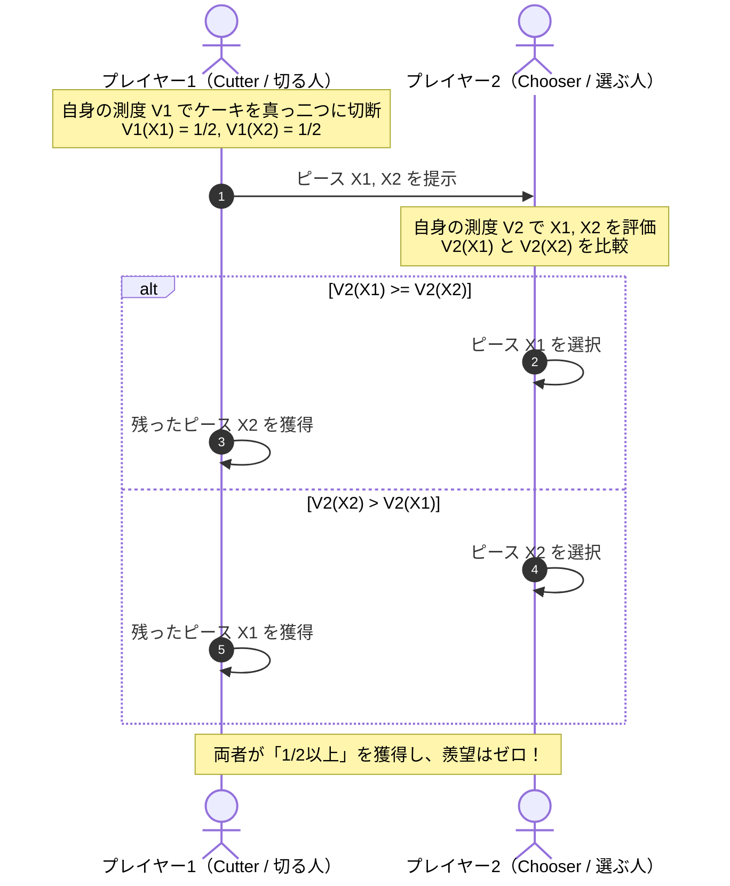
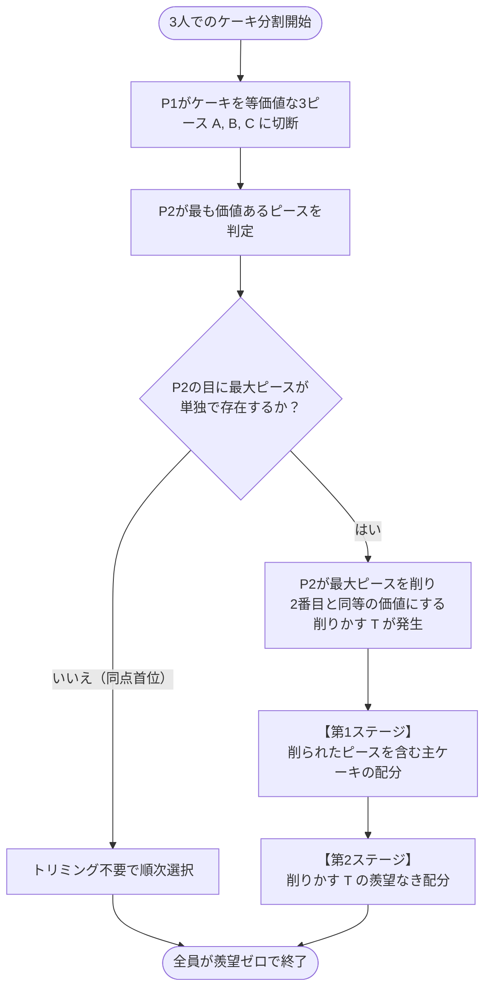
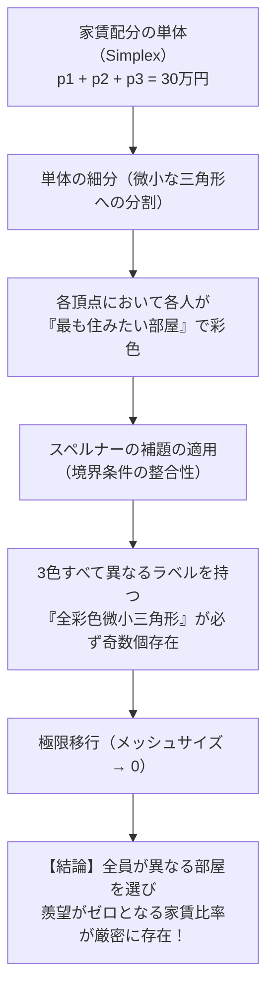

兄弟で1つのケーキを分けるとき、遺産や離婚時の財産を分配するとき、あるいはルームメイト同士で部屋の広さと家賃負担を決めるとき、私たちは常に<strong>「公平（Fairness）」</strong>という概念に直面します。

子供の頃、親から教わった最も素朴な解決法は「一人が切り、もう一人が選ぶ（Cut and Choose）」という知恵でした。切る側は自分が損をしないように細心の注意を払って真ん中で二等分し、選ぶ側は好きな方を先に取る。このシンプルなルールによって、双方が不満を持たずに分け合うことができます。

しかし、参加者が3人以上になったらどう分ければよいでしょうか？
あるいは、ケーキが一様なスポンジではなく、右半分には濃厚なチョコレートが、左半分には新鮮なイチゴが載っており、参加者ごとに「チョコが好き」「イチゴが好き」という<strong>好みの違い（主観的価値の非対称性）</strong>が存在する場合はどうなるでしょうか？

物理的な体積や重量を均等に三等分したとしても、イチゴ嫌いの人にイチゴだらけの部分が割り振られれば、その人は「不公平だ！」と激怒するでしょう。一方で、全員が「自分は十分に多くをもらった」と満足し、しかも「他人の分け前が羨ましくてたまらない」という嫉妬の感情が完全にゼロになるような分割は、数学的に常に可能なのでしょうか？

この問いを探求する数学の一大分野が<strong>「公平分割問題（Fair Division Problem）」</strong>、通称<strong>「ケーキ分割問題（Cake-Cutting Problem）」</strong>です。

1940年代にポーランドの数学者フーゴ・スタインハウス（Hugo Steinhaus）によって定式化されて以来、この問題は単なるパズルを超え、測度論、トポロジー（不動点定理やスペルナーの補題）、計算複雑性理論、そしてメカニズムデザイン（制度設計）が交錯する現代数学の最前線へと発展してきました。2016年には、任意の人数の参加者に対して有限の手順で「羨望なき分割」を達成する画期的なアルゴリズム（アジズ・マッケンジーのアルゴリズム）が発見され、世界中の数学界に激震が走りました。

本稿では、公平分割の数理的定義（比例性と羨望のなさの決定的相違）、セルリッジ・コンウェイの手順による3人分割の完全解法、ロバートソン・ウェブの質問モデル、トポロジーを応用した家賃分配定理、嫌な作業を分け合う「Chore分割」、そして分割不能財（相続や離散的アイテム）における最新のアルゴリズムまで、16,000字を超える圧倒的な密度で徹底的に解き明かしていきます。

---

## 1. 「公平」の数理モデル：測度論による主観的価値の定式化

数学においてケーキ分割を厳密に議論するためには、まず「ケーキ」と「参加者の主観的価値」を数学的対象として厳密にモデル化する必要があります。

### 1.1 連続体としてのケーキとボレル集合族

ケーキは、実数直線上の有界閉区間 $X = [0, 1]$、あるいはより一般に $d$ 次元ユークリッド空間のコンパクト可測部分集合 $X \subset \mathbb{R}^d$ としてモデル化されます。

ケーキの任意の部分片（ピース）は、$X$ の可測部分集合 $A \in \mathcal{B}(X)$（ボレル $\sigma$-加法族の元）として定義されます。

### 1.2 主観的効用を表す非原子的な確率測度

参加者が $n$ 人存在し、各参加者を $i \in \{1, 2, \dots, n\}$ と番号付けします。
各参加者 $i$ は、ケーキの部分片 $A \subseteq X$ に対して自分自身の主観的価値を評価する<strong>価値関数（Value Measure）</strong> $V_i: \mathcal{B}(X) \to [0, 1]$ を持っています。

現代の公平分割理論において、この価値関数 $V_i$ は以下の標準的な測度論的公理を満たすものと仮定されます：

1. <strong>正規化（Normalization）</strong>:
   ケーキ全体に対する価値は全員にとって $1$ である：
   $$
   V_i(X) = 1, \quad V_i(\emptyset) = 0
   $$
2. <strong>非負性（Non-negativity）</strong>:
   いかなる部分片 $A$ に対しても、$V_i(A) \ge 0$ である（※後述する chore 分割では非正値へと拡張されます）。
3. <strong>有限加法性（Additivity）</strong>:
   互いに素な2つのピース $A, B$ （$A \cap B = \emptyset$）に対し、その合併の価値は個別の価値の和に等しい：
   $$
   V_i(A \cup B) = V_i(A) + V_i(B)
   $$
4. <strong>非原子性（Non-atomicity / Divisibility）</strong>:
   どのようなピース $A$ であっても、その中に「これ以上分割できない点状の価値の塊」は存在しない。すなわち、$V_i(A) > 0$ である任意のピースと任意の定数 $\alpha \in [0, 1]$ に対し、ある部分片 $B \subset A$ が存在して $V_i(B) = \alpha V_i(A)$ とできる。物理的には、ケーキナイフは無限に薄く、どこでも自由に微細に切断できることを意味します。

### 1.3 価値密度関数（Value Density Function）

多くの場合、各参加者の測度 $V_i$ はルベーグ測度に対して絶対連続であり、可積分な非負の<strong>価値密度関数（Value Density Function）</strong> $v_i: [0, 1] \to \mathbb{R}_{\ge 0}$ が存在します：

$$
V_i(A) = \int_A v_i(x) \, dx, \quad \text{with} \quad \int_0^1 v_i(x) \, dx = 1
$$

この枠組みの最大の美しさは、<strong>参加者間で価値観が全く一致していなくてもよい</strong>という点にあります。
例えば、$A$ さんにとっては「イチゴが載っている部分」の価値密度が高く、スポンジ部分はほぼゼロかもしれませんし、$B$ さんにとっては逆に「チョコレートの部分」が極めて高く、イチゴはどうでもいいかもしれません。客観的な重量や体積は一切関係なく、各人が自身の内心の測度 $V_i$ に従ってのみ世界を評価します。

---

## 2. 公平性を測る4つの基準：何を達成すべきか？

ケーキを $n$ 個の互いに素なピース $(X_1, X_2, \dots, X_n)$ に分割し（$\bigcup_{i=1}^n X_i = X$ かつ $i \neq j \implies X_i \cap X_j = \emptyset$）、各参加者 $i$ にピース $X_i$ を割り当てることを<strong>「分割（Allocation）」</strong>と呼びます。

この分割が「公平」であるとは、具体的にどのような条件を満たすことなのでしょうか？ 数学では主に以下の4つの基準が厳密に区別されます。

| 公平性の基準 | 数学的定義 | 直感的な意味 | 難易度 |
| :---: | :---: | :---: | :---: |
| <strong>比例性（Proportionality）</strong> | $\forall i, \quad V_i(X_i) \ge \frac{1}{n}$ | 全員が「自分の基準で $1/n$ 以上の分け前を得た」と納得している | 比較的容易（古くから解法が存在） |
| <strong>羨望のなさ（Envy-Freeness）</strong> | $\forall i, j, \quad V_i(X_i) \ge V_i(X_j)$ | どの参加者も「他人のピースの方が自分のピースより魅力的だ」と羨まない | 非常に困難（現代数学の核心） |
| <strong>平等性（Equitability）</strong> | $\forall i, j, \quad V_i(X_i) = V_j(X_j)$ | 全員の主観的満足度の数値が完全に一致する | 主観的効用の個人間比較が必要 |
| <strong>パレート効率性（Pareto Efficiency）</strong> | 他者を損なわずに誰かの満足度を上げる再配分が存在しない | 資源が一切無駄にならず配分し尽くされている | 経済学・最適化の標準基準 |

### 2.1 比例性（Proportionality）

比例性とは、1944年にスタインハウスが提唱した最も伝統的な基準です。
$n$ 人で分ける以上、各人が「自分は全体の $1/n$ 以上の価値を受け取った」と感じられるなら、最低限の正当性は保証されていると言えます。

$$
V_i(X_i) \ge \frac{1}{n} \quad (\forall i \in \{1, \dots, n\})
$$

2人の場合（$n=2$）、「自分の価値が $1/2$ 以上」であれば、相手の残りのピースは自分の目から見て $1 - V_i(X_i) \le 1/2$ となるため、自動的に相手を羨むことはありません（$V_i(X_i) \ge V_i(X_j)$）。したがって、$n=2$ においては比例性と羨望のなさは完全に一致します。

### 2.2 羨望のなさ（Envy-Freeness, EF）

しかし、<strong>$3$ 人以上（$n \ge 3$）になると、比例性と羨望のなさは劇的に乖離します。</strong>

次の具体例を考えてみましょう。参加者3人（Alice, Bob, Charlie）でケーキを分けたとします。
Aliceの視点（測度 $V_A$）から見て、各ピースの価値が以下のように評価されたとします：
- 自分のピース $X_1$: $V_A(X_1) = 0.35$
- Bobのピース $X_2$: $V_A(X_2) = 0.45$
- Charlieのピース $X_3$: $V_A(X_3) = 0.20$

Aliceは全体の $1/3 \approx 0.333$ を上回る $0.35$（$35\%$）の価値を受け取っているため、<strong>比例性は満たされています</strong>。
しかし、AliceはBobのピース（$45\%$）を見てこう叫ぶはずです：
「なんでBobの方が私より大きくて美味しそうなピースをもらっているの？ 不公平よ！」

AliceはBobに対して<strong>「羨望（Envy）」</strong>を抱いています。
真の社会的平穏、すなわち「誰一人として他人の取り分を羨ましがらず、自分のピースと交換したいと望まない」状態を保証するためには、比例性よりも遥かに強固な<strong>「羨望のなさ（Envy-Freeness）」</strong>が要求されるのです。

数学的に、羨望のない分割は常に比例性を満たします：
$$
\sum_{j=1}^n V_i(X_j) = V_i(X) = 1
$$
羨望がない場合、$V_i(X_i) \ge V_i(X_j)$ がすべての $j$ について成立するため：
$$
n V_i(X_i) \ge \sum_{j=1}^n V_i(X_j) = 1 \implies V_i(X_i) \ge \frac{1}{n}
$$
逆は一般に成り立ちません。したがって、羨望のなさは比例性の上位互換となる極めて厳格な基準です。

---

## 3. 2人の分割：クラシックな「Cut and Choose」プロトコル

2人の公平分割（$n=2$）は、人類が何千年も前から実践してきた「一人が切り、一人が選ぶ（Cut and Choose）」によって完璧に解決されます。

### 3.1 手順の厳密な分析
1. <strong>切断フェーズ</strong>: プレイヤー1（Alice）は、自身の価値関数 $V_1$ においてちょうど等価値となるようにケーキを2つのピース $X_1, X_2$ に切断します：
   $$
   V_1(X_1) = V_1(X_2) = \frac{1}{2}
   $$
   （※測度の非原子性から、このような切断点は中間値の定理により常に存在します。）
2. <strong>選択フェーズ</strong>: プレイヤー2（Bob）は、自身の価値関数 $V_2$ において価値が大きい方のピースを選択します。残ったピースをAliceが受け取ります。

### 3.2 なぜこれが羨望なき分割になるのか？
- <strong>Aliceの満足度</strong>: Aliceはどちらのピースが相手に取られても、手元に残るピースの価値は $V_1 = 1/2$ です。相手のピースも $1/2$ なので、相手を羨むことはありません。
- <strong>Bobの満足度</strong>: Bobは2つのピースのうち大きい方（$V_2 \ge 1/2$）を選びます。したがって、$V_2(\text{自分のピース}) \ge 1/2 \ge V_2(\text{相手のピース})$ となり、Aliceを羨むことは絶対にありません。

### 3.3 切る側と選ぶ側：どちらが有利か？（情報の非対称性と余剰）
興味深いことに、ゲーム理論の観点から見ると、<strong>「選ぶ側（Chooser）」の方が圧倒的に有利</strong>です。

- Alice（切る側）は、自身の価値観において正確に $50\%$ の価値しか獲得できません。
- 一方、Bob（選ぶ側）は、もしAliceと好みが異なっていれば、<strong>$50\%$ を大幅に超える価値（例えば $80\%$ や $90\%$）を独占</strong>できます。

例えば、左半分がチョコ、右半分がバニラのケーキがあるとします。
- Aliceは両方均等に好き（チョコ $50\%$, バニラ $50\%$）。Aliceは左右真っ二つに切断します。
- Bobはチョコが大好きでバニラが大嫌い（チョコ $100\%$, バニラ $0\%$）。
- Bobはチョコの載った左半分を選びます。

結果：
- Aliceは $V_1 = 50\%$ を得ます。
- Bobは $V_2 = 100\%$ を得ます！

双方が満足していますが、選好の差異から生じる「取引余剰（Surplus）」はすべて後から選んだ側に帰属します。

---

## 4. 3人の分割：セルリッジ・コンウェイの劇的な手順

3人（$n=3$）になった瞬間、問題の難易度は跳ね上がります。
スタインハウスの「ラスト・ディミニッシャー（Last Diminisher）」プロトコルを用いれば、3人以上の比例的分割（全員が $1/n$ 以上）は容易に作れますが、<strong>羨望のない分割（Envy-Free）を作ることは長年未解決の難問</strong>でした。

この壁を1960年頃に独立して打ち破ったのが、ジョン・セルリッジ（John Selfridge）とジョン・ホートン・コンウェイ（John Horton Conway）です。彼らが考案した<strong>「セルリッジ・コンウェイの手順（Selfridge-Conway Procedure）」</strong>は、最大5回の切断で3人の羨望なき分割を完全に達成する、数学史上極めて美しい離散アルゴリズムです。

### 4.1 第1ステージ：主ケーキの切断とトリミング（削り取り）

プレイヤーを $P_1, P_2, P_3$ とします。

1. <strong>$P_1$ による3等分</strong>:
   $P_1$ がケーキを自身の測度 $V_1$ で完全に等しい3つのピース $A, B, C$ に切断します：
   $$
   V_1(A) = V_1(B) = V_1(C) = \frac{1}{3}
   $$
2. <strong>$P_2$ によるトリミング（Trimming）</strong>:
   $P_2$ は3つのピースを自身の測度 $V_2$ で評価します。
   - もし最大のピースが2つ以上あって同点なら、何も削りません。
   - もし単独で最大のピースが存在する場合（例えば $A$ が最大）、$P_2$ は $A$ の端を少しだけ切り落として（削りカスを $T$ とする）、<strong>残った主片 $A'$ の価値が2番目に大きいピースと同等になるように調整</strong>します：
     $$
     V_2(A') = V_2(\text{2番目のピース})
     $$
   こうして、ケーキは「削られた主片 $A'$」「元のピース2つ（$B, C$）」「削りカス $T$」に分かれます。削りカス $T$ は一旦テーブルの脇によけておきます。

3. <strong>第1ステージの選択順序</strong>:
   削られたケーキ（$A', B, C$）を以下の厳格な順序で選んでいきます：
   - まず <strong>$P_3$</strong> が好きなピースを1つ選ぶ。
   - 次に <strong>$P_2$</strong> が選ぶ。ただし、<strong>もし $P_3$ が削られたピース $A'$ を取らなかった場合、$P_2$ は必ず $A'$ を取らなければならない</strong>。
   - 最後に <strong>$P_1$</strong> が残った1つのピースを取る。

#### 第1ステージ終了時の羨望チェック：
- <strong>$P_3$</strong>: 誰よりも先に自由に選んだので、当然誰も羨みません。
- <strong>$P_2$</strong>: $P_2$ にとって最大のピースは同点で2つ存在していました（$A'$ ともう1つ）。$P_3$ がどちらか1つを取ったとしても、もう1つの最大ピースが必ず残っているため、それを手に入れた $P_2$ は誰も羨みません。
- <strong>$P_1$</strong>: $P_1$ にとって $B$ と $C$ は等しく $1/3$ です。削られた $A'$ は $1/3$ 未満です。$A'$ は $P_3$ または $P_2$ のどちらかが必ず引き取っているため、$P_1$ の手元には無傷の $B$ または $C$（価値 $1/3$）が必ず残ります。したがって、$P_1$ も誰も羨みません。

この時点で、主ケーキの配分に関しては<strong>全員が誰も羨んでいない完全な状態</strong>が確立します！

### 4.2 第2ステージ：削りカス（Trimmings）の完璧な再配分

問題は、脇によけておいた削りカス $T$ です。これを適当に分けると第1ステージのバランスが崩れて羨望が発生してしまいます。セルリッジとコンウェイの天才性は、この削りカスの配分手順にあります。

第1ステージで「削られたピース $A'$」を引き取ったプレイヤーを <strong>$T_{\text{in}}$</strong> と呼び（これは $P_2$ または $P_3$ のいずれかです）、引き取らなかったもう一方のプレイヤー（$P_2$ または $P_3$）を <strong>$T_{\text{out}}$</strong> と呼びます。

1. <strong>切断者</strong>: $T_{\text{out}}$ が削りカス $T$ を、自身の測度で等価値な3つの断片 $T_1, T_2, T_3$ に切断します。
2. <strong>選択順序</strong>:
   - まず <strong>$T_{\text{in}}$</strong> が好きな断片を1つ選ぶ。
   - 次に <strong>$P_1$</strong> が好きな断片を1つ選ぶ。
   - 最後に <strong>$T_{\text{out}}$</strong> が残りの断片を取る。

#### なぜこれで全体の羨望が一切生じないのか？
- <strong>$T_{\text{in}}$</strong>: 最初に自由に断片を選んだので、削りカスに関して誰も羨みません。
- <strong>$T_{\text{out}}$</strong>: 自分で3等分してその1つを取ったので、削りカスに関して誰も羨みません。
- <strong>$P_1$</strong>: ここが最大のハイライトです！
  $P_1$ は $T_{\text{out}}$ より先に断片を選んだので、$T_{\text{out}}$ を羨むことはありません。
  では、$P_1$ は $T_{\text{in}}$ を羨むでしょうか？
  答えは<strong>「絶対に羨まない」</strong>です。なぜなら、$P_1$ の目から見ると、$T_{\text{in}}$ が持っている主片 $A'$ は、もともと無傷のピースより削られていたため、$P_1$ の基準では「削りカス $T$ を丸ごと全部 $T_{\text{in}}$ に上乗せしたとしても、ようやく他の無傷ピース（$1/3$）と同じ価値にしかならない」からです。
  $$
  V_1(A' \cup T) = V_1(A) = \frac{1}{3} = V_1(\text{無傷ピース})
  $$
  $T_{\text{in}}$ は削りカスの一部しか受け取っていないため、$P_1$ から見て $T_{\text{in}}$ の取り分の合計が自分の取り分を上回ることは物理的にあり得ないのです！

こうして、3人の間に一切の妥協も羨望も存在しない、完全無欠の公平分割が完了します。

---

## 5. $n$ 人への一般化：未解決問題から2016年の大ブレイクスルーへ

3人のセルリッジ・コンウェイ手順の成功を受けて、数学者たちは当然の問いに直面しました：
<strong>「任意の $n$ 人に対して、羨望のない分割を有限回の手順で行うアルゴリズムは存在するか？」</strong>

この問題は、20世紀後半の数理経済学と組合せ論における最大の未解決問題の一つとして君臨し続けました。

### 5.1 ロバートソン・ウェブの質問モデル（Robertson-Webb Model）

公平分割アルゴリズムの計算量を議論する際、計算機科学では<strong>ロバートソン・ウェブ（Robertson-Webb）モデル</strong>と呼ばれる標準的なオラクルモデルが使用されます。アルゴリズムは参加者に対し、以下の2種類の質問（クエリ）のみを行うことが許されます：

1. <strong>評価クエリ $\text{Eval}_i(x, y)$</strong>: 参加者 $i$ に対し、区間 $[x, y]$ の主観的価値 $V_i([x, y])$ を質問する。
2. <strong>切断クエリ $\text{Cut}_i(x, \alpha)$</strong>: 参加者 $i$ に対し、$V_i([x, y]) = \alpha$ となるような切断点 $y$ を答えさせる。

このモデルにおいて、何回のクエリでアルゴリズムが終了するかがアルゴリズムの「計算量（複雑性）」となります。

### 5.2 ブラムス・テイラーのプロトコル（1995年）
1995年、スティーブン・ブラムス（Steven Brams）とアラン・テイラー（Alan Taylor）は、任意の人数の参加者に対して羨望なき分割を保証する史上初の有限アルゴリズム（Brams-Taylor Procedure）を発表しました。

しかし、このプロトコルには重大な弱点がありました。それは<strong>「有限回で終了するが、何回のステップで終わるかが事前に有界（Bounded）ではない」</strong>という点でした。参加者の好みの数値の比率（無理数に近い極微な差など）によっては、トリミングの繰り返し回数が参加者の価値観の比率に依存し、切断の回数が何千回、何億回と際限なく増大する可能性があったのです。

### 5.3 アジズ・マッケンジーの定理（2016年の歴史的快挙）
「切断回数が参加者数 $n$ の関数として事前に上から抑えられる（有界である）アルゴリズムは存在するか？」という問いは、20年以上にわたって未解決のままでした。

この究極の難問を2016年に解決したのが、オーストラリア・ニューサウスウェールズ大学のコンピュータ科学者<strong>ハリス・アジズ（Haris Aziz）</strong>と<strong>サイモン・マッケンジー（Simon Mackenzie）</strong>です。

彼らは、複雑怪奇なトリミングと支配関係（Domination）のネットワークを追跡するアルゴリズムを構築し、<strong>任意の人数の参加者に対して「有界なステップ数（Bounded-Time）」で羨望なきケーキ分割を完了できること</strong>を世界で初めて数学的に証明しました。

彼らの証明した切断回数の上限は：
$$
O\left(n^{n^{n^{n^{n^{n}}}}}\right)
$$
という、天文学的なタワー指数関数（巨大数）ですが、理論上「参加者の価値関数の具体的な値に一切依存せず、人数 $n$ だけで決まる有限の上限が存在する」ことを示した点において、世紀のブレイクスルーとして称賛されました。

---

## 6. トポロジーの魔術：スペルナーの補題と家賃分配問題

ケーキ分割の数学は、連続的な食べ物の分割にとどまらず、住居の部屋割りや家賃の分配といった現実の経済問題にも強力な威力を発揮します。

### 6.1 ルームシェアの家賃分配問題（Rental Harmony）

3人の友人（Alice, Bob, Charlie）が3部屋（部屋1：日当たり良好で広い、部屋2：普通、部屋3：狭くて暗い）のアパートをシェアし、家賃総額 30 万円を支払うとします。

部屋の好みや金銭感覚は人それぞれです：
- Aliceは「お金を払ってでも広い部屋に住みたい」。
- Bobは「とにかく安ければ狭い部屋で構わない」。
- Charlieはその中間。

全員が納得し、「他人の部屋と家賃の組み合わせ」を誰も羨まない状態（羨望なき家賃配分）は必ず見つかるでしょうか？

数学者フランシス・スー（Francis Su）は1999年、代数的トポロジーの基本定理である<strong>「スペルナーの補題（Sperner's Lemma）」</strong>を応用し、いかなる選好のもとでも<strong>「全員が納得する羨望なき家賃と部屋の組み合わせが必ず存在する」</strong>ことを証明しました。

### 6.2 スペルナーの補題とは何か？
スペルナーの補題は、単体（三角形や四面体の高次元への一般化）を細分した網目において、頂点に適切な境界ルールでラベルを貼ると、<strong>「すべてのラベルが異なる完全にカラフルな極小単体が必ず奇数個（したがって少なくとも1個）存在する」</strong>という離散トポロジーの定理です。これは解析学におけるブラウワーの不動点定理（Brouwer Fixed Point Theorem）の組合せ論的同値版です。

家賃の比率（$p_1, p_2, p_3 \ge 0, p_1 + p_2 + p_3 = 30$）を正三角形上の点（重心座標）としてプロットし、各家賃条件のもとで各人が希望する部屋番号で頂点を彩色していくと、スペルナーの補題によって「Aliceは部屋1、Bobは部屋2、Charlieは部屋3を同時に第一希望とするような魔法の家賃設定」の存在が数学的に確定するのです。

このアルゴリズムは、現在ニューヨーク・タイムズのWebサイトなどで「Fair Division Calculator」として実用化され、世界中のルームシェアのトラブルを未然に防ぐツールとして活用されています。

---

## 7. 負のケーキ：家事分担と嫌な仕事の分配（Chore Division）

これまでの議論では、ケーキは「誰もが欲しがる好ましいもの（Goods）」でした。しかし、世の中には<strong>「誰も欲しがらない嫌なもの（Bads / Chores）」</strong>も存在します。
- 散らかった部屋の掃除当番の分担
- 放射性廃棄物やゴミ処理場の立地負担
- 破産した共同事業の負債の分担

「嫌なもの」を公平に分ける問題は<strong>「Chore分割（Chore Division）」</strong>と呼ばれます。

数学的には、価値測度 $V_i$ が非負ではなく非正（$V_i(A) \le 0$）、あるいはコスト関数 $C_i(A) \ge 0$ として定式化されます。

### 7.1 Chore版「Cut and Choose」の逆転現象
2人で家事を分担する場合、Cut and Chooseのルールは以下のように反転します：
1. <strong>Alice（切る側）</strong>: 自分の評価で家事の負担がちょうど $50:50$ になるように作業リストを2つに分割する。
2. <strong>Bob（選ぶ側）</strong>: 負担が<strong>小さい（楽な）方</strong>の作業リストを選択する。
3. Aliceが残った作業を担当する。

Goodsのときと同様に、両者ともに「自分の基準で負担は $50\%$ 以下」となり、羨望は生じません。しかし、ここでは「切る側」はきっちり $50\%$ の負担を背負わされるのに対し、「選ぶ側」は好みの違いによって「自分の目から見てわずか $10\%$ や $20\%$ の負担」で済む可能性があるため、やはり選ぶ側が圧倒的に有利となります。

---

## 8. 分割不能財の壁：遺産相続と最新アルゴリズム

ケーキのように包丁で細かく切断できる「連続財」に対し、現実の財産分与（自動車、家屋、美術品、ペット、宝石など）の多くは、真っ二つに切ると価値が消滅してしまう<strong>「分割不能財（Indivisible Goods）」</strong>です。

### 8.1 厳密な羨望なき分割の不可能性
分割不能財においては、厳密な「羨望のなさ（EF）」は原理的に達成できない場合があります。
例えば、価値あるダイヤモンドが1個しかなく、相続人が2人いる場合、どちらか1人がダイヤを受け取るしかありません。ダイヤをもらえなかった側は、相手を羨まざるを得ないからです。

### 8.2 EF1（1個除外すれば羨望なし）と EFX
そこで現代のコンピュータ科学者やメカニズムデザイン研究者たちは、基準を現実的に緩和した新しい公平性概念を定義しました：

1. <strong>EF1（Envy-Free up to One Good）</strong>:
   相手の持ち物の中から「最も価値の高いアイテムを1個だけ取り除いた」と仮定したとき、自分の方が価値が上（または同等）になれば合格とする基準。
   - 驚くべきことに、任意の参加者数と任意のアイテム数に対し、<strong>EF1かつパレート効率的な分割は常に多項式時間で計算可能</strong>であることが証明されています（Lipton et al., 2004）。
2. <strong>EFX（Envy-Free up to Any Good）</strong>:
   相手の持ち物から「どのアイテムを1個取り除いても」羨望が消えるという、EF1よりさらに厳しい基準。
   - すべてのアイテムに対してEFX分割が常に存在するかどうかは、<strong>現代の離散数学・理論計算機科学における最大の未解決問題の一つ</strong>として現在も熱烈に研究されています。

### 8.3 ナッシュ社会厚生（Maximum Nash Welfare, MNW）の奇跡
分割不能財を最も美しく配分する最適化基準として注目されているのが、<strong>ナッシュ社会厚生（Nash Welfare）</strong>の最大化です：

$$
\max \prod_{i=1}^n V_i(X_i)
$$

各人の主観的効用の「総和（$\sum V_i$）」を最大化しようとすると、効用を感じやすい特定の人物にアイテムが偏る不平等が生じます。しかし、効用の<strong>「総乗（掛け算）」</strong>を最大化すると、誰かの効用がゼロになると全体がゼロになってしまうため、富が自然に均等に分散されます。

カーリン（Caragiannis）らの2016年の画期的な研究により、<strong>「ナッシュ社会厚生を最大化する分割は、自動的にEF1を満たし、かつパレート効率性を同時に満たす」</strong>という奇跡的な調和が証明されました。

---

## 9. まとめ：数学が嫉妬を解体し、平和をもたらす

ケーキの切り方という日常の素朴な疑問から始まった探求は、測度論、ゲーム理論、トポロジー、そして理論計算機科学を巻き込む壮大な学問体系へと結実しました。

人間社会における争いの多くは、「客観的な正義」を巡る対立ではなく、<strong>「主観的な価値観の違い」と「他者への羨望」</strong>から生まれます。全員が同じ価値観を持っている必要はありません。むしろ、価値観が違うからこそ、ある人にとって宝物であるピースが、別の人にとっては不要な端切れになり得るのです。

公平分割の数学が私たちに教えてくれる最も深い教訓は、以下の点に集約されます：

1. <strong>公平さとは均一性ではない</strong>: 物理的に同じ形に切ることが公平なのではなく、個々人の主観的測度を尊重し、各人が自身の基準で納得することが真の公平である。
2. <strong>制度設計（プロトコル）の力</strong>: 人間の道徳心や良心に頼るのではなく、ゲーム理論的なルール（インセンティブ設計）を適切に構築すれば、利己的な動機に従って行動した結果として、全体として羨望ゼロの調和が数学的必然として導かれる。

切る人と選ぶ人の知恵から、スペルナーの補題、そしてナッシュ厚生の最適化に至るまで、数学は人間の心の中にある「嫉妬」という原始的な感情を解体し、全員が笑顔で分け合える平和のアルゴリズムを提供し続けているのです。
