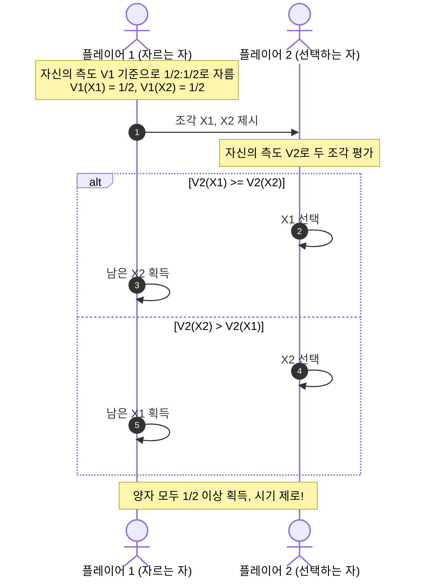

형제자매끼리 하나의 생일 케이크를 나눌 때, 이혼이나 상속 과정에서 재산을 분할할 때, 혹은 룸메이트끼리 방 크기에 맞춰 월세를 배분할 때, 우리는 언제나 <strong>'공평함(Fairness)'</strong>이라는 근본적인 문제와 마주합니다.

어린 시절 어른들에게 배운 가장 고전적인 지혜는 "한 사람이 자르고, 다른 사람이 고른다(Cut and Choose)"였습니다. 자르는 사람은 손해를 보지 않기 위해 정확히 절반으로 자르려 애쓰고, 고르는 사람은 자신이 더 마음에 드는 쪽을 먼저 선택합니다. 이 소박한 규칙은 두 사람 사이에 완벽한 평화를 보장합니다.

하지만 참가자가 <strong>3명 이상</strong>이 된다면 어떻게 나누어야 할까요?
더 나아가 케이크가 균일하지 않고, 한쪽에는 초콜릿이, 다른 쪽에는 딸기가 얹혀 있어 참가자마다 <strong>주관적 선호(선호의 비대칭성)</strong>가 극명히 갈린다면 어떻게 될까요? 딸기를 싫어하는 사람에게 물리적 부피만 똑같은 딸기 조각을 준다면 그는 "불공평하다"며 분노할 것입니다.

모든 사람이 각자의 주관적 기준에 따라 "충분히 큰 몫을 받았다"고 만족하면서도, <strong>동시에 그 누구도 타인의 몫을 부러워하거나 질투하지 않는(Envy-Free)</strong> 분할은 수학적으로 항상 가능할까요?

이 질문을 다루는 현대 수학과 컴퓨터과학의 핵심 분야가 바로 <strong>'공평 분할 문제(Fair Division Problem)'</strong>, 일명 <strong>'케이크 자르기 문제(Cake-Cutting Problem)'</strong>입니다.

1940년대 폴란드 수학자 후고 슈타인하우스(Hugo Steinhaus)가 정식화한 이래, 이 문제는 단순한 퍼즐을 넘어 측도론, 위상수학(不动点 정리 및 슈페르너의 보조정리), 계산복잡도 이론, 메커니즘 디자인의 최전선으로 발전했습니다. 2016년에는 컴퓨터과학자 아지즈(Haris Aziz)와 매켄지(Simon Mackenzie)가 임의의 $n$명에 대해 유한한 단계로 시기 없는 분할을 보장하는 획기적인 알고리즘을 발표하여 전 세계 수학계를 놀라게 했습니다.

본 글에서는 공평성의 공리적 정의(비례성과 무시기성의 본질적 차이), 셀프리지-콘웨이 3인 분할 프로토콜의 완전 해법, 슈페르너 보조정리를 활용한 룸메이트 월세 배분 정리, 궂은일을 나누는 Chore 분할, 그리고 나눌 수 없는 재산 분할의 최신 성과를 심도 있게 살펴봅니다.

---

## 1. '공평'의 수학적 모델링: 측도론적 접근

### 1.1 연속 공간으로서의 케이크
수학적으로 케이크는 단위 닫힌구간 $X = [0, 1]$ 또는 $d$차원 유클리드 공간의 콤팩트 부분집합으로 모델링됩니다. 임의의 케이크 조각은 보렐 $\sigma$-대수 위의 가측 집합 $A \in \mathcal{B}(X)$입니다.

### 1.2 주관적 가치 측도 (Value Measure)
$n$명의 참가자 $i \in \{1, 2, \dots, n\}$ 각각은 자신만의 비음수, 비원자적(Non-atomic), 가법적 가치 측도 $V_i: \mathcal{B}(X) \to [0, 1]$를 가집니다:
1. <strong>정규화</strong>: $V_i(X) = 1, V_i(\emptyset) = 0$
2. <strong>가법성</strong>: $A \cap B = \emptyset \implies V_i(A \cup B) = V_i(A) + V_i(B)$
3. <strong>비원자성 (분할가능성)</strong>: 아무리 작은 조각도 칼로 연속적으로 자를 수 있음.

가치밀도함수 $v_i(x)$가 존재하여 $V_i(A) = \int_A v_i(x) \, dx$로 나타납니다. 핵심은 <strong>참가자 간의 가치관이 일치할 필요가 없다</strong>는 점입니다. 각자는 오직 자신의 잣대 $V_i$로만 조각의 가치를 평가합니다.

---

## 2. 공평성의 4대 기준: 비례성 vs 무시기성

$n$개의 상호 배타적인 조각 $(X_1, \dots, X_n)$으로 나눌 때, 공평성의 핵심 기준은 다음과 같습니다:

| 기준 | 수학적 정의 | 의미 |
| :---: | :---: | :---: |
| <strong>비례성 (Proportionality)</strong> | $\forall i, \quad V_i(X_i) \ge \frac{1}{n}$ | 모든 사람이 자신의 기준으로 최소 $1/n$ 이상의 몫을 획득 |
| <strong>무시기성 (Envy-Freeness)</strong> | $\forall i, j, \quad V_i(X_i) \ge V_i(X_j)$ | 그 누구도 타인의 조각을 자신의 조각보다 탐내지 않음 |
| <strong>등가성 (Equitability)</strong> | $\forall i, j, \quad V_i(X_i) = V_j(X_j)$ | 모든 사람의 주관적 만족도 수치가 정확히 일치 |
| <strong>파레토 효율성 (Pareto Efficiency)</strong> | 타인의 효용을 깎지 않고는 누구의 효용도 높일 수 없음 | 자원의 낭비가 전혀 없는 완벽한 배분 |

### 비례성과 무시기성의 결정적 차이
2인 분할($n=2$)에서는 자신이 $1/2$ 이상을 받으면 상대의 몫은 $1/2$ 이하가 되므로 자동으로 상대를 시기하지 않습니다.

그러나 <strong>3인 이상($n \ge 3$)에서는 비례성을 만족해도 극심한 시기가 발생할 수 있습니다!</strong>
앨리스, 밥, 찰리가 케이크를 나눌 때, 앨리스의 평가가 다음과 같다고 가정해 봅시다:
- 자신의 조각 $X_1$: $0.35$ ($> 1/3$, 비례성 만족!)
- 밥의 조각 $X_2$: $0.50$
- 찰리의 조각 $X_3$: $0.15$

앨리스는 $1/3$ 이상을 받았음에도, 밥이 가져간 $50\%$짜리 거대한 조각을 보며 질투심에 휩싸이게 됩니다. 진정한 사회적 화합을 위해서는 단순한 비례성을 넘어 <strong>'무시기성(Envy-Freeness)'</strong>이 반드시 충족되어야 합니다.

---

## 3. 2인 분할: "Cut and Choose"와 선택자의 정보 지대

게임이론적으로 자르는 자(Cutter)는 위험을 회피하기 위해 정확히 $50\%$ 가치로 자를 수밖에 없어 효용이 $50\%$에 고정됩니다. 반면 선택자(Chooser)는 상대와 취향이 다를 경우 $80\%$나 $100\%$의 막대한 주관적 잉여(Surplus)를 독식합니다. 선택의 자유가 곧 전략적 우위가 됩니다.

---

## 4. 셀프리지-콘웨이(Selfridge-Conway) 3인 무시기 프로토콜

1960년경 발견된 셀프리지-콘웨이 프로토콜은 최대 5번의 칼질로 3인 무시기 분할을 달성하는 기발한 알고리즘입니다:

1. <strong>1단계 (주 케이크 분할 및 다듬기)</strong>:
   - $P_1$이 케이크를 $V_1$ 기준으로 동일한 3조각 $A, B, C$로 자릅니다.
   - $P_2$가 가장 크다고 생각하는 조각(예: $A$)의 가장자리를 조금 잘라내어(부스러기 $T$ 발생), 2등 조각과 동등한 가치가 되도록 다듬습니다($A'$).
   - 선택 순서: $P_3$가 가장 먼저 하나를 고르고, $P_2$가 고르며(단, $P_3$가 다듬은 조각 $A'$를 안 골랐다면 $P_2$가 의무 인수), 마지막으로 $P_1$이 남은 것을 가져갑니다.
   - $P_1$은 온전한 $1/3$ 조각을 보장받으므로 1단계에서 아무도 시기하지 않습니다.
2. <strong>2단계 (부스러기 $T$의 분할)</strong>:
   - 다듬어진 조각 $A'$를 가져간 사람을 $T_{\text{in}}$, 다른 한 사람을 $T_{\text{out}}$이라 합니다.
   - $T_{\text{out}}$이 부스러기 $T$를 3등분하고, $T_{\text{in}} \to P_1 \to T_{\text{out}}$ 순서로 고릅니다.
   - $P_1$의 눈에 $T_{\text{in}}$은 원래 깎였던 조각을 가졌으므로, 부스러기를 아무리 보태도 $1/3$을 넘지 못합니다. 따라서 $P_1$은 결코 $T_{\text{in}}$을 시기하지 않습니다!

---

## 5. 위상수학의 마법: 슈페르너의 보조정리와 월세 배분

방 3개짜리 아파트에서 룸메이트 3명이 방 크기와 채광에 따라 월세 300만 원을 나누는 문제(Rental Harmony)는 프랜시스 수(Francis Su)에 의해 위상수학의 <strong>슈페르너 보조정리(Sperner's Lemma)</strong>로 해결되었습니다.

월세 단체(Simplex)의 삼각분할 격자점에서 각자가 원하는 방 번호로 라벨을 매기면, 경계 조건에 의해 세 꼭짓점의 라벨이 모두 다른 '무지개 삼각형'이 반드시 존재합니다. 극한에서 이 점은 <strong>모든 사람이 서로 다른 방을 1순위로 원하면서 시기가 전혀 없는 균형 월세 가격</strong>으로 수렴합니다.

---

## 6. 결론: 차이를 축복으로 바꾸는 공평성의 수학

공평 분할의 수학은 "기계적인 균등함이 곧 공평함은 아니다"라는 심오한 통찰을 줍니다. 인간마다 가치관과 취향이 다르다는 사실은 갈등의 불씨가 아니라, 올바른 메커니즘 설계를 통해 모두가 윈-윈(Win-Win)할 수 있는 주관적 잉여의 원천입니다. 수학은 인간의 질투를 합리적으로 해체하고 조화로운 평화를 실현하는 정교한 청사진을 제시합니다.
